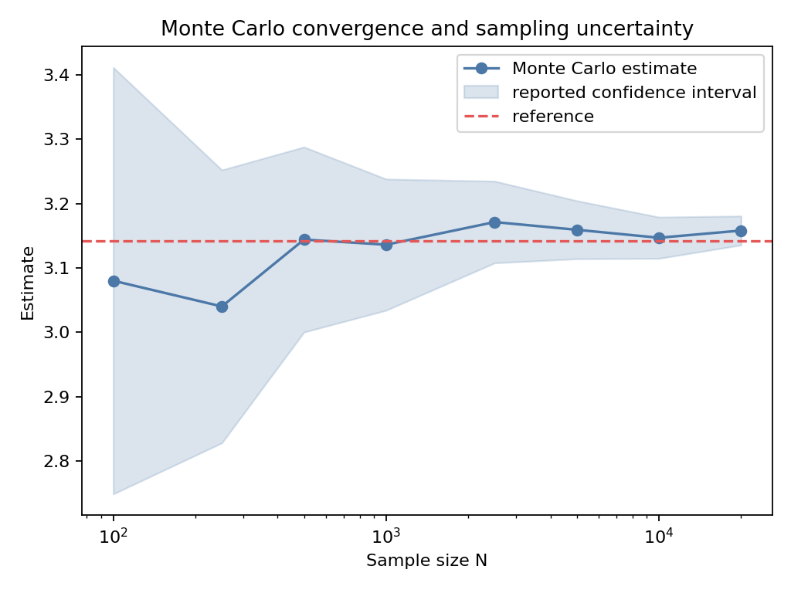
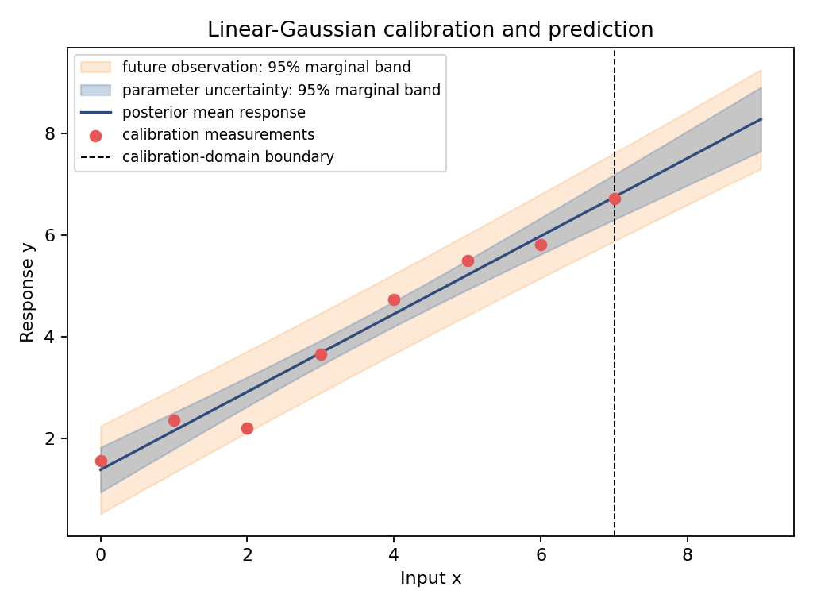
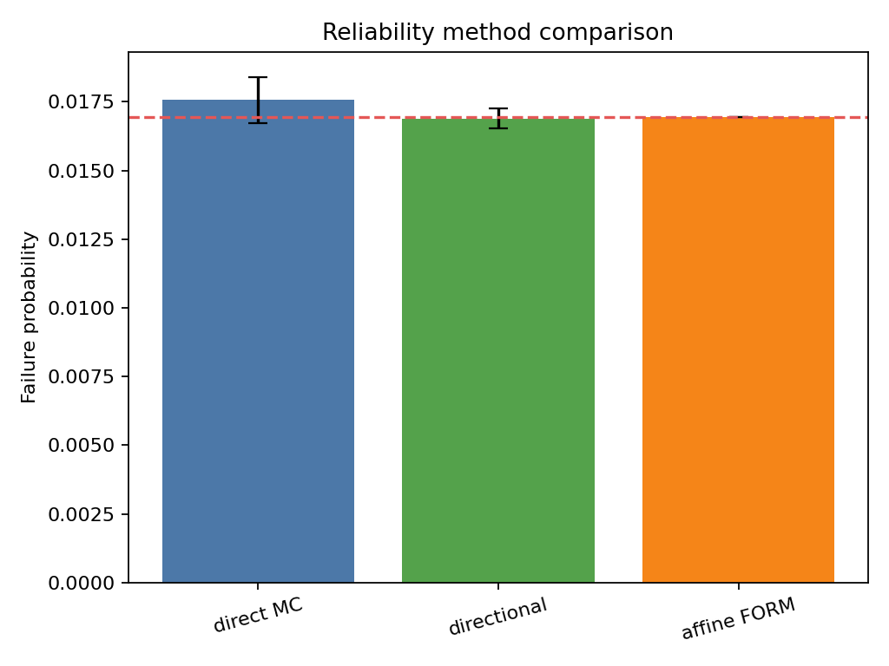

# Stats-Lab

**A citation-first Python library that builds probability, statistics, and
uncertainty quantification from auditable foundations.**

Every public formula carries an equation ID, every equation points to a primary
source, and every design decision is recorded. The goal is software you can
trust *and* explanations you can teach from.


## Quick start

```bash
git clone https://github.com/ayberkdt/Stats-Lab.git
cd Stats-Lab
python -m venv .venv
source .venv/bin/activate        # Windows: .venv\Scripts\Activate.ps1
python -m pip install -e .
```

Exact probability on a finite sample space:

```python
from probstat.probability import (
    FiniteProbabilityMeasure,
    FiniteRandomVariable,
    FiniteSampleSpace,
)

die = FiniteSampleSpace((1, 2, 3, 4, 5, 6))
fair = FiniteProbabilityMeasure.uniform(die)

print(fair.probability(die.event((2, 4, 6))))  # 0.5

roll = FiniteRandomVariable.from_function(fair, float, name="Roll")
print(roll.expectation, roll.variance)  # 3.5 2.9166666666666665
```

A seeded Monte Carlo estimate that reports its own uncertainty:

```python
import random

from probstat.monte_carlo import estimate_mean

rng = random.Random(2026)
hits = (
    4.0 if rng.random() ** 2 + rng.random() ** 2 <= 1.0 else 0.0
    for _ in range(20_000)
)
pi = estimate_mean(hits)
print(f"{pi.estimate:.4f} ± {pi.standard_error:.4f}")  # 3.1580 ± 0.0115
print(pi.confidence_interval)  # 95% interval, method stated explicitly
```

The core library has no runtime dependencies. Plotting is optional:

```bash
python -m pip install -e ".[visualization]"
python examples/basic_monte_carlo_lab.py
```

## What's inside

| Layer | Package | Covers |
|---|---|---|
| Foundations | `probability` | Finite sample spaces, event algebra, measures, Bayes' rule, counting |
| | `distributions` | Bernoulli, Binomial, Categorical, Poisson, Geometric, Negative Binomial, Uniform, Exponential, Normal, Lognormal, Weibull |
| | `statistics` | Descriptive statistics for univariate and paired samples |
| | `multivariate` | Positive-definite multivariate Normal, dependency-free Cholesky |
| Inference | `inference` | MLE, confidence procedures (z, Wilson), KS/AD goodness of fit |
| Numerics | `numerics`, `foundations` | Trapezoid and Simpson quadrature, parameter validation, shared law protocols |
| Uncertainty quantification | `uq`, `validation` | Uncertainty taxonomy, quantities of interest, `Y = g(X)` contracts, error budgets, observed convergence order, Richardson extrapolation, model discrepancy |
| | `monte_carlo` | Crude MC, antithetic, control variates, stratified and importance sampling, cost-normalized efficiency |
| | `propagation` | Forward propagation with threshold probabilities |
| | `reliability` | Failure probability, Wilson bounds, affine FORM, directional sampling |
| | `sensitivity` | Finite-difference gradients, first-, second-, and total-effect Sobol indices |
| | `inverse` | Linear-Gaussian Bayesian calibration, posterior predictive, model discrepancy |
| Optional | `visualization` | Explanatory plots built on stable domain APIs (matplotlib) |

The [ATHENS 2026 coverage matrix](docs/curriculum/athens-2026-coverage.md)
tracks all 110 topics of the ATHENS 2026 VV-UQ course: 74 implemented,
17 partial, 19 planned.

## Example labs

Each lab in [`examples/`](examples) is seeded and reproducible. They write
their figures to `examples/generated/`.

| | |
|---|---|
|  |  |
| **Monte Carlo convergence**: the estimate and its confidence interval tighten at the 1/√N rate. | **Bayesian calibration**: parameter uncertainty is kept separate from future-observation uncertainty. |
|  |  |
| **Reliability**: direct MC, directional sampling, and FORM estimate the same failure probability. | **Global sensitivity**: Sobol indices show that X3 matters only through interactions. |

## Design principles

- **Citation-first.** Docstrings cite equation IDs such as `EQ-MC-PROB-001`.
  Look them up in the [equation registry](docs/equation-registry.md), then
  follow the citation key to the [bibliography](docs/references.md).
- **Honest boundaries.** Each estimator states its assumptions, cost, and
  failure modes. Singular covariances raise errors instead of being
  silently jittered.
- **Reproducible randomness.** Every random stream is seeded locally, with no
  shared global state.
- **Recorded decisions.** Architectural choices are kept as ADRs in
  [`memory/decisions/`](memory/decisions).
- **Layered teaching.** Concepts go from definitions to assumptions,
  equations, examples, and visuals without dropping mathematical scope.

## Documentation

Suggested reading order:

1. [Learning path](docs/learning-path.md)
2. [VV-UQ foundations](docs/foundations/vv-uq-foundations.md)
3. [Uncertainty modeling and fitting](docs/foundations/uncertainty-modeling-and-fitting.md)
4. [Uncertainty propagation](docs/foundations/uncertainty-propagation.md)
5. [Advanced Monte Carlo](docs/foundations/advanced-monte-carlo.md)
6. [Reliability analysis](docs/foundations/reliability-analysis.md)
7. [Sensitivity analysis](docs/foundations/sensitivity-analysis.md)
8. [Inverse problems and Bayesian calibration](docs/foundations/inverse-problems-and-calibration.md)

Reference: [Architecture](docs/architecture.md) ·
[Roadmap](memory/ROADMAP.md) · [Changelog](CHANGELOG.md)

## Development

```bash
python -m pip install -e ".[dev,visualization]"
python -m unittest discover -s tests -v
python -m ruff check .
python -m mypy src/probstat
```

Before you open a pull request, read the [contribution contract](CONTRIBUTING.md).
New public functions need a docstring, an equation record, and a citation.

## License

[BSD 3-Clause](LICENSE). If you use this library in research, see
[`CITATION.cff`](CITATION.cff).
