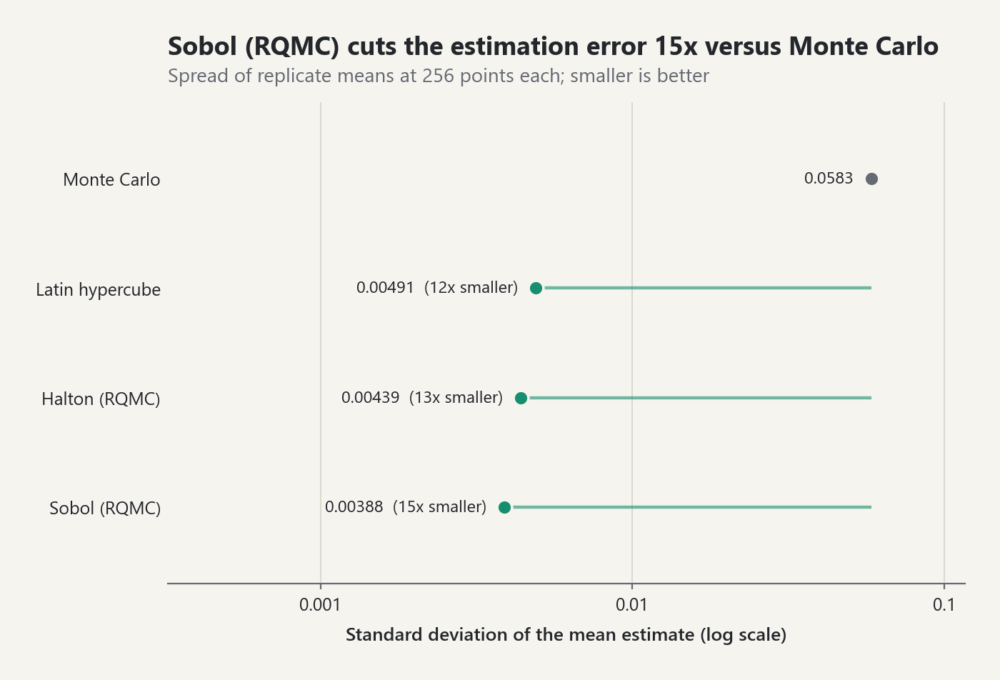
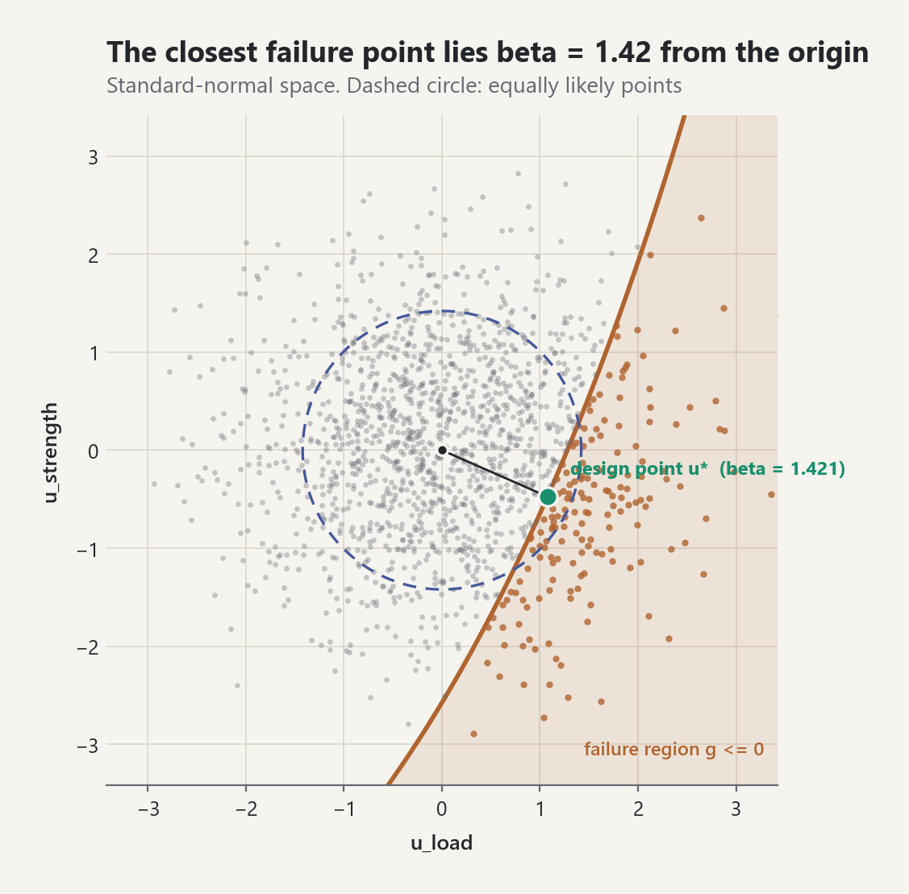
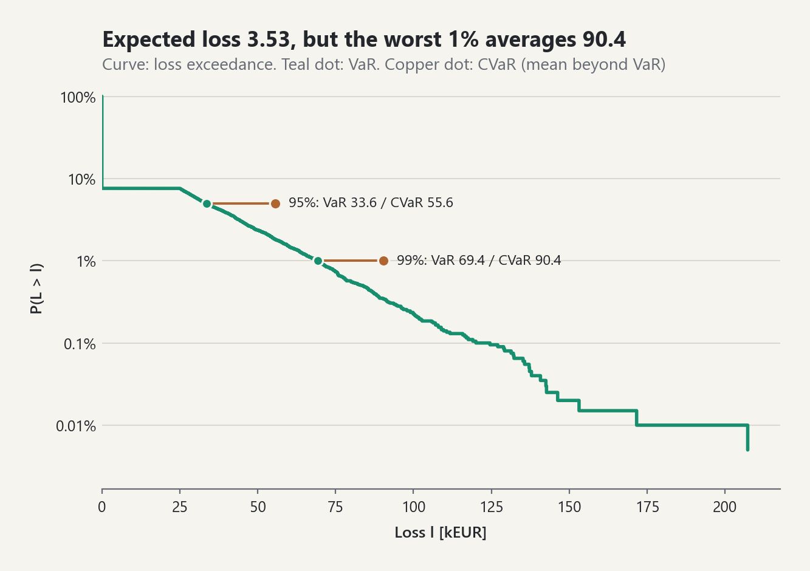
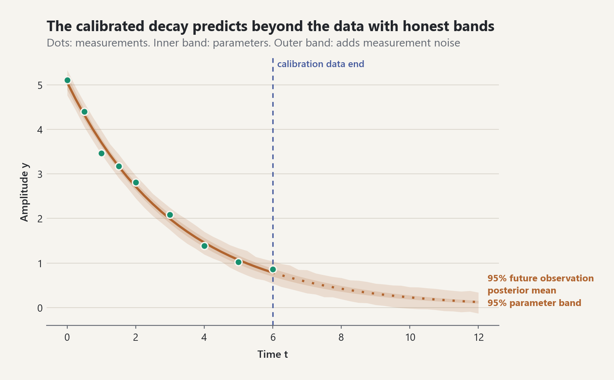
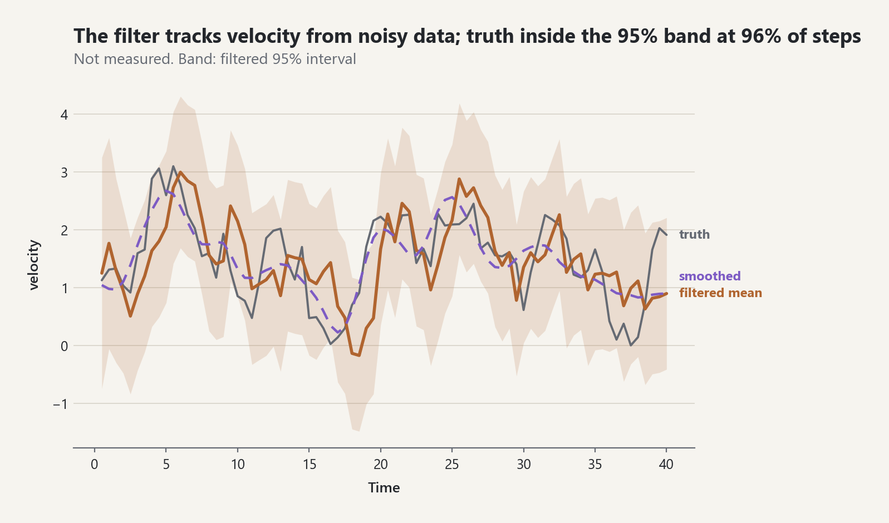
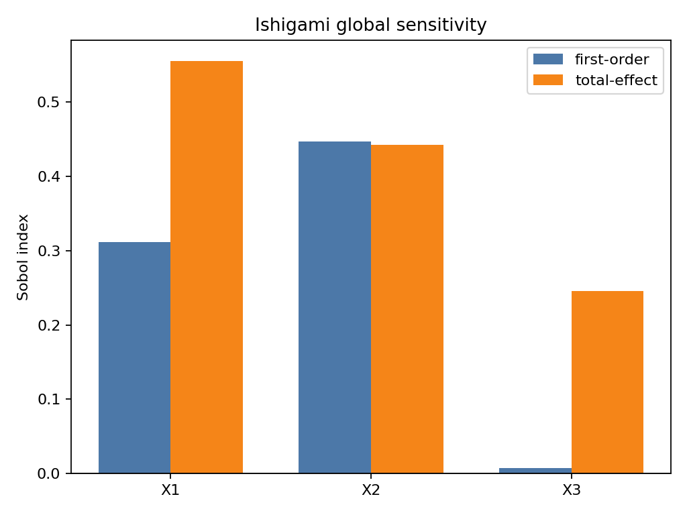
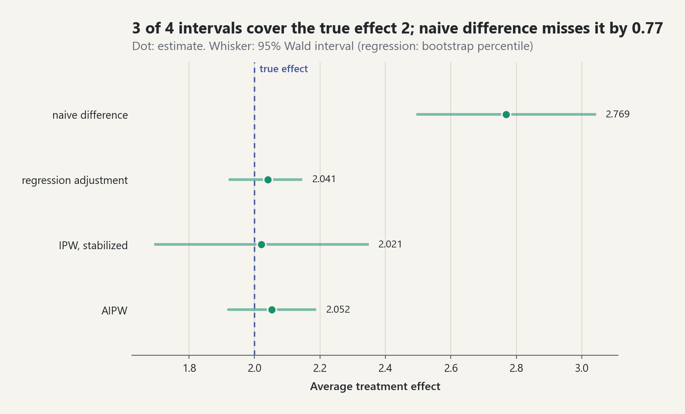
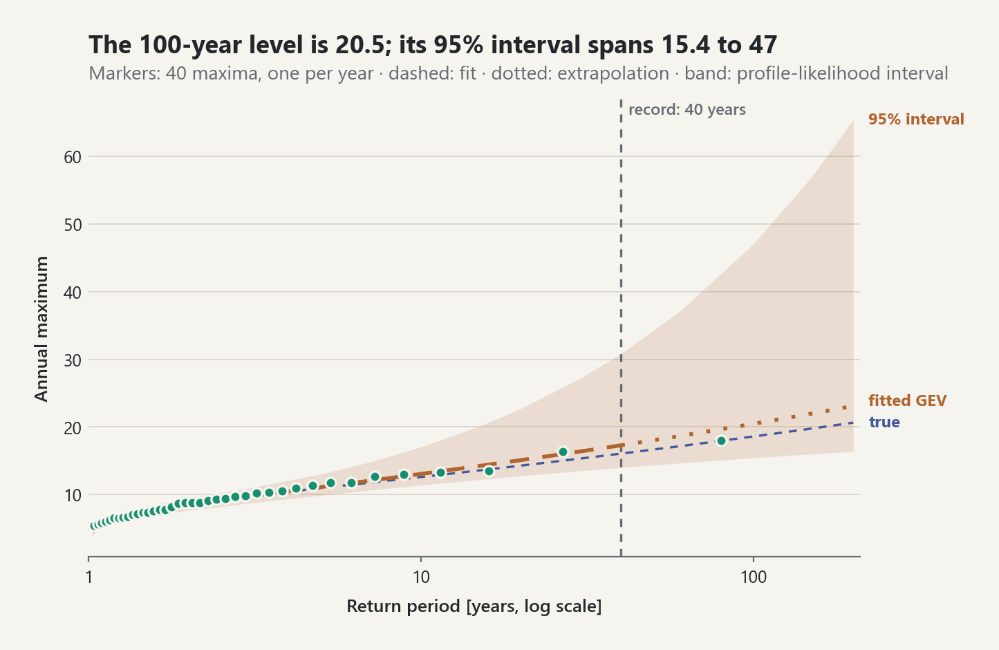

# Stats-Lab

**A citation-first Python library for probability, statistics, and
uncertainty quantification, built around one model object that every analysis
shares.**

Define your uncertain inputs and your simulator once. The same object then
answers forward questions (what does the output look like?), backward
questions (what do the data say about the inputs?), and risk questions (how
likely is failure and what does it cost?), with one seed tree and one report.
Every formula carries an equation ID that resolves to a primary source.


## Quick start

```bash
git clone https://github.com/ayberkdt/Stats-Lab.git
cd Stats-Lab
python -m venv .venv
source .venv/bin/activate        # Windows: .venv\Scripts\Activate.ps1
python -m pip install -e ".[visualization]"
```

One model, every analysis:

```python
from probstat.distributions import LogNormal, Normal
from probstat.modeling import JointInput, ProbabilisticModel, RandomInput
from probstat.risk import custom_loss
from probstat.uq import QuantityOfInterest
from probstat.workflow import UQStudy

inputs = JointInput.independent(
    RandomInput("load", LogNormal(0.9, 0.25), unit="kN"),
    RandomInput("strength", Normal(4.0, 0.4), unit="kN"),
)
model = ProbabilisticModel(
    inputs,
    lambda p: {"margin": p["strength"] - p["load"]},
    (QuantityOfInterest("margin", "capacity minus demand", "kN"),),
)

study = UQStudy(model, seed=2026)
forward = study.propagate(4096, design="sobol")           # output distribution
sobol = study.sensitivity("margin", 1024)                  # which input matters
methods = study.reliability("margin", 0.0, failure="below")  # FORM, SORM, IS, subset, MC
risk = study.risk("margin", custom_loss(lambda m: 50.0 * max(0.0, -m)), 20_000)

forward["margin"].quantile(0.05)        # 0.124
sobol.ranking()                          # ('load', 'strength')
methods.row("FORM").probability          # 0.0362  (Monte Carlo: 0.0395)
risk.conditional_value_at_risk[0.99]     # 49.8, mean loss in the worst 1%
print(study.report())                    # Markdown: every stage, cost, and seed

from probstat.visualization.study import write_study_html
write_study_html(study, "study.html")    # one page, every stage, light and dark figures
```

The same study can also `calibrate` the inputs against experiments,
`predict` with the posterior, `validate` against independent data, `emulate`
the model with a polynomial-chaos or Gaussian-process surrogate, calibrate
with an explicit model-discrepancy term (`calibrate_with_discrepancy`), fit the
output tail (`extremes`), rank inputs by mutual information
(`information_sensitivity`), choose the next experiment (`design`), and
handle failure domains with several important regions (`design_points`,
`active_reliability`).
The core library has no runtime dependencies; Matplotlib is only needed for
figures.

## What's inside

| Layer | Packages | Highlights |
|---|---|---|
| Central model | `modeling` | Named marginals + Gaussian copula, Nataf transform, random-field (KL) inputs, `ProbabilisticModel` |
| Forward | `propagation`, `sampling`, `monte_carlo` | Monte Carlo, Latin hypercube, scrambled Halton and Sobol designs; variance reduction; quantiles and exceedance curves |
| Sensitivity | `sensitivity` | Sobol first/total indices with bootstrap intervals, Morris screening, local derivatives |
| Reliability | `reliability` | HL-RF FORM, SORM, multiple design points, importance and subset sampling, line sampling, AK-MCS active learning, system bounds, inverse FORM |
| Risk | `risk` | VaR/CVaR, loss models, fault and event trees, fragility curves, EVPI/EVSI, GEV/GPD extremes and return levels |
| Backward | `inverse`, `inference` | Nonlinear calibration, Kennedy-O'Hagan model discrepancy, adaptive Metropolis, HMC/NUTS, ADVI, Laplace, posterior prediction |
| Validation | `validation` | Area metric, u-pooling, ASME V&V 20 comparison, applicability domain, scoped verdicts, CRPS and proper scores, PIT and reliability diagrams, distribution-shift tests |
| Dynamics | `filtering`, `data_assimilation`, `processes` | Kalman/EKF/UKF, RTS smoother, particle filter, EnKF, 3D-Var; Markov chains, SDEs, random fields |
| Emulators | `surrogates` | Polynomial chaos (Sobol from coefficients), Gaussian-process regression |
| Statistics | `statistics`, `inference`, `distributions`, `information` | Tests, bootstrap (BCa), power, multiple testing, kernel density, 20+ distribution families, generic MLE and AIC/BIC selection, entropy, mutual information, optimal transport, Fisher-Rao geometry |
| Modeling | `inference`, `timeseries`, `conformal` | Regression and GLMs, ridge/lasso, hierarchical models, EM and mixtures, missing data and multiple imputation, contingency tables, ARIMA, Kaplan-Meier/Cox survival, conformal prediction |
| Decisions | `causal`, `design` | Back-door/front-door identification, IPW/AIPW, E-values; D-optimal and Bayesian experimental design |
| Foundations | `linalg`, `optimization`, `numerics`, `probability` | Cholesky/LU/Jacobi, BFGS/Levenberg-Marquardt/Brent, quadrature, exact finite probability |

The [ATHENS 2026 coverage matrix](docs/curriculum/athens-2026-coverage.md)
tracks all 110 topics of the ATHENS 2026 VV-UQ course; all 110 are
implemented, each with source, tests, and documentation as evidence.

## Example labs

Every lab in [`examples/`](examples) is seeded and reproducible and writes its
figures to `examples/generated/`. All figures share one theme: colour follows
meaning (data, model, reference), titles state the finding, and labels sit on
the data.

| | |
|---|---|
| <picture><source media="(prefers-color-scheme: dark)" srcset="docs/images/central-model-design-comparison-dark.png"></picture> | <picture><source media="(prefers-color-scheme: dark)" srcset="docs/images/central-model-form-geometry-dark.png"></picture> |
| **Forward**: scrambled Sobol points cut the error of the mean 15x at the same cost. | **Reliability**: FORM finds the most likely failure point in standard-normal space. |
| <picture><source media="(prefers-color-scheme: dark)" srcset="docs/images/central-model-loss-exceedance-dark.png"></picture> | <picture><source media="(prefers-color-scheme: dark)" srcset="docs/images/calibration-forecast-dark.png"></picture> |
| **Risk**: the expected loss hides a heavy tail; CVaR shows it. | **Backward**: MCMC calibration, then a forecast whose bands widen beyond the data. |
| <picture><source media="(prefers-color-scheme: dark)" srcset="docs/images/filtering-velocity-dark.png"></picture> | <picture><source media="(prefers-color-scheme: dark)" srcset="docs/images/ishigami-sobol-indices-dark.png"></picture> |
| **Filtering**: the Kalman filter recovers a velocity that is never measured. | **Sensitivity**: X3 matters only through interactions. |
| <picture><source media="(prefers-color-scheme: dark)" srcset="docs/images/causal-effect-estimates-dark.png"></picture> | <picture><source media="(prefers-color-scheme: dark)" srcset="docs/images/extremes-return-levels-dark.png"></picture> |
| **Causal**: adjusting for confounders recovers the true effect the naive difference misses. | **Extremes**: a 40-year record gives a 100-year level with an honest, wide interval. |

Start with [`examples/uq_study_lab.py`](examples/uq_study_lab.py) (one model
through every stage) and
[`examples/central_model_lab.py`](examples/central_model_lab.py) (the same
steps with the low-level APIs).

## Design principles

- **One model, every question.** `ProbabilisticModel` is the only model
  contract; analyses never redefine the inputs or the simulator.
- **Citation-first.** Docstrings cite equation IDs such as `EQ-REL-HLRF-001`;
  each resolves in the [equation registry](docs/equation-registry.md) to a
  [bibliography](docs/references.md) entry.
- **Honest boundaries.** Estimators report assumptions, model-evaluation cost,
  and failure modes. Singular inputs raise instead of being jittered, and
  validation results are scoped verdicts, never "validated".
- **Reproducible randomness.** One root seed derives named child streams for
  every stage.
- **Recorded decisions.** Architecture choices are ADRs in
  [`memory/decisions/`](memory/decisions).

## Documentation

1. [Learning path](docs/learning-path.md): the suggested reading order
2. [The central probabilistic model](docs/foundations/probabilistic-modeling.md)
3. [Uncertainty propagation](docs/foundations/uncertainty-propagation.md) and [sensitivity analysis](docs/foundations/sensitivity-analysis.md)
4. [Model-based reliability](docs/foundations/advanced-reliability.md) and [risk analysis](docs/foundations/risk-analysis.md)
5. [Nonlinear calibration and MCMC](docs/foundations/nonlinear-calibration-and-mcmc.md) and [model validation](docs/foundations/model-validation.md)
6. [Filtering and data assimilation](docs/foundations/filtering-and-data-assimilation.md) and [surrogate models](docs/foundations/surrogate-models.md)
7. [All foundation guides](docs/foundations)

Reference: [API reference](docs/api-reference.md) ·
[Benchmarks](docs/benchmarks.md) ·
[Architecture](docs/architecture.md) · [Roadmap](memory/ROADMAP.md) ·
[Changelog](CHANGELOG.md)

## Development

```bash
python -m pip install -e ".[dev,visualization]"
python -m unittest discover -s tests -v
python -m ruff check .
python -m mypy src/probstat
python benchmarks/run.py --quick     # accuracy, error calibration, and cost per method
```

CI runs these checks and every example lab on Python 3.11 to 3.13. Before
opening a pull request, read the [contribution contract](CONTRIBUTING.md): new
public functions need a docstring, an equation record, and a citation.

## License

[BSD 3-Clause](LICENSE). If you use this library in research, see
[`CITATION.cff`](CITATION.cff).
