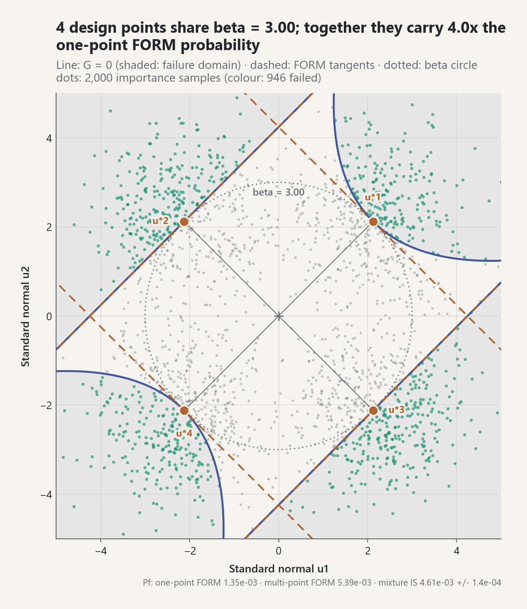
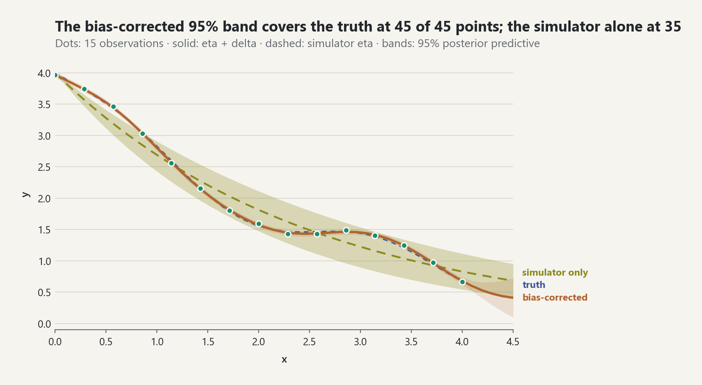

# Stats-Lab

**A citation-first Python library for probability, statistics, and
uncertainty quantification, built around one model object that every analysis
shares.**

Define your uncertain inputs and your simulator once. The same object then
answers forward questions (what does the output look like?), backward
questions (what do the data say about the inputs?), and risk questions (how
likely is failure and what does it cost?), with one seed tree and one report.
Every formula carries an equation ID that resolves to a primary source.


## Quick start

```bash
git clone https://github.com/ayberkdt/Stats-Lab.git
cd Stats-Lab
python -m venv .venv
source .venv/bin/activate        # Windows: .venv\Scripts\Activate.ps1
python -m pip install -e ".[visualization]"
```

One model, every analysis:

```python
from probstat.distributions import LogNormal, Normal
from probstat.modeling import JointInput, ProbabilisticModel, RandomInput
from probstat.risk import custom_loss
from probstat.uq import QuantityOfInterest
from probstat.workflow import UQStudy

inputs = JointInput.independent(
    RandomInput("load", LogNormal(0.9, 0.25), unit="kN"),
    RandomInput("strength", Normal(4.0, 0.4), unit="kN"),
)
model = ProbabilisticModel(
    inputs,
    lambda p: {"margin": p["strength"] - p["load"]},
    (QuantityOfInterest("margin", "capacity minus demand", "kN"),),
)

study = UQStudy(model, seed=2026)
forward = study.propagate(4096, design="sobol")           # output distribution
sobol = study.sensitivity("margin", 1024)                  # which input matters
methods = study.reliability("margin", 0.0, failure="below")  # FORM, SORM, IS, subset, MC
risk = study.risk("margin", custom_loss(lambda m: 50.0 * max(0.0, -m)), 20_000)

forward["margin"].quantile(0.05)        # 0.124
sobol.ranking()                          # ('load', 'strength')
methods.row("FORM").probability          # 0.0362  (Monte Carlo: 0.0395)
risk.conditional_value_at_risk[0.99]     # 49.8, mean loss in the worst 1%
print(study.report())                    # Markdown: every stage, cost, and seed

from probstat.visualization.study import write_study_html
write_study_html(study, "study.html")    # one page, every stage, light and dark figures
```

The core library has no runtime dependencies; Matplotlib is only needed for
figures.

## One study, every question

Every stage of `UQStudy` reuses the same model, draws from its own named
child stream of the root seed, counts model evaluations, and adds a section
(with a figure) to the report.

| Question | Stages |
|---|---|
| What does the output look like? | `propagate`, `propagate_until` (stops at a target accuracy), `emulate` (polynomial chaos or Gaussian process) |
| Which inputs matter? | `sensitivity` (Sobol), `shapley` (dependent inputs), `screening` (Morris), `information_sensitivity` (mutual information) |
| How likely is failure, and what does it cost? | `reliability`, `form`, `design_points`, `active_reliability` (AK-MCS), `extremes`, `risk` |
| What do the data say about the inputs? | `calibrate`, `calibrate_with_discrepancy` (Kennedy-O'Hagan), `predict` |
| Can the model be trusted, and what should be measured next? | `verify` (solution verification), `validate` (with CRPS, PIT, and coverage), `design` (Bayesian experimental design) |

## What's inside

30 packages and 1,076 public names, all documented in the
[API reference](docs/api-reference.md).

| Area | Packages | Highlights |
|---|---|---|
| Central model and forward | `modeling`, `propagation`, `sampling`, `monte_carlo`, `sensitivity`, `surrogates` | Gaussian-copula inputs with the Nataf transform, random fields; Sobol, Halton, and LHS designs; Sobol, Shapley, and Morris indices; polynomial chaos and Gaussian processes |
| Reliability and risk | `reliability`, `risk` | FORM/SORM, multiple design points, importance, subset, and line sampling, AK-MCS; VaR/CVaR, fault and event trees, fragility, GEV/GPD return levels, value of information |
| Backward and validation | `inverse`, `inference`, `validation` | Nonlinear calibration, model discrepancy, adaptive Metropolis, HMC/NUTS, ADVI, a small probabilistic-programming interface; area metric, ASME V&V 20, CRPS and proper scores, PIT, distribution-shift tests |
| Statistical modelling | `inference`, `timeseries`, `conformal` | Regression and GLMs, regularization, hierarchical models, EM and mixtures, missing data and multiple imputation, ARIMA, survival, conformal prediction |
| Decisions | `causal`, `design` | Back-door and front-door identification, IPW/AIPW, E-values; D-optimal and Bayesian experimental design |
| Probability and statistics | `probability`, `distributions`, `statistics`, `multivariate`, `processes`, `information` | 20+ distribution families, tests and bootstrap, kernel density, streaming summaries, limit theorems, contingency tables, stochastic processes, entropy, optimal transport |
| Foundations and dynamics | `foundations`, `linalg`, `optimization`, `numerics`, `filtering`, `data_assimilation`, `uq`, `workflow`, `visualization` | Dense linear algebra, optimizers, adaptive quadrature; Kalman, particle, and ensemble filters; the `UQStudy` workflow and the themed figure library |

The [ATHENS 2026 coverage matrix](docs/curriculum/athens-2026-coverage.md)
tracks all 110 topics of the ATHENS 2026 VV-UQ course; all 110 are
implemented, each with source, tests, and documentation as evidence.

## Gallery

Every lab in [`examples/`](examples) (31 of them) is seeded and reproducible
and writes its figures to `examples/generated/`. All figures share one theme:
colour follows meaning (observed data, model, reference), titles state the
finding, labels sit on the data, and every figure exists in a light and a dark
palette.

| | |
|---|---|
| <picture><source media="(prefers-color-scheme: dark)" srcset="docs/images/central-model-design-comparison-dark.png"></picture> | <picture><source media="(prefers-color-scheme: dark)" srcset="docs/images/central-model-form-geometry-dark.png"></picture> |
| **Forward**: scrambled Sobol points cut the error of the mean 15x at the same cost. | **Reliability**: FORM finds the most likely failure point in standard-normal space. |
| <picture><source media="(prefers-color-scheme: dark)" srcset="docs/images/central-model-loss-exceedance-dark.png"></picture> | <picture><source media="(prefers-color-scheme: dark)" srcset="docs/images/calibration-forecast-dark.png"></picture> |
| **Risk**: the expected loss hides a heavy tail; CVaR shows it. | **Backward**: MCMC calibration, then a forecast whose bands widen beyond the data. |
| <picture><source media="(prefers-color-scheme: dark)" srcset="docs/images/filtering-velocity-dark.png"></picture> | <picture><source media="(prefers-color-scheme: dark)" srcset="docs/images/ishigami-sobol-indices-dark.png"></picture> |
| **Filtering**: the Kalman filter recovers a velocity that is never measured. | **Sensitivity**: X3 matters only through interactions. |
| <picture><source media="(prefers-color-scheme: dark)" srcset="docs/images/causal-effect-estimates-dark.png"></picture> | <picture><source media="(prefers-color-scheme: dark)" srcset="docs/images/extremes-return-levels-dark.png"></picture> |
| **Causal**: adjusting for confounders recovers the true effect the naive difference misses. | **Extremes**: a 40-year record gives a 100-year level with an honest, wide interval. |
| <picture><source media="(prefers-color-scheme: dark)" srcset="docs/images/adaptive-reliability-design-points-dark.png"></picture> | <picture><source media="(prefers-color-scheme: dark)" srcset="docs/images/discrepancy-predictions-dark.png"></picture> |
| **Rare events**: four design points carry four times the one-point FORM probability. | **Model error**: a discrepancy term restores coverage the simulator alone loses. |

Start with [`examples/uq_study_complete_lab.py`](examples/uq_study_complete_lab.py)
(one study through every stage, written to an HTML report) or
[`examples/central_model_lab.py`](examples/central_model_lab.py) (the same
steps with the low-level APIs).

## Design principles

- **One model, every question.** `ProbabilisticModel` is the only model
  contract; analyses never redefine the inputs or the simulator.
- **Citation-first.** Docstrings cite equation IDs such as `EQ-REL-HLRF-001`;
  each of the 710 entries in the [equation registry](docs/equation-registry.md)
  resolves to the [bibliography](docs/references.md).
- **Honest boundaries.** Estimators report assumptions, model-evaluation cost,
  and convergence; unconverged results are flagged, and validation results are
  scoped verdicts, never "validated".
- **Checked against oracles.** Independent numerical reviews compare results
  with exact, high-precision, or reference implementations, and every
  confirmed defect gets a regression test; the
  [benchmark suite](docs/benchmarks.md) tracks accuracy, error calibration,
  and cost per method.
- **Reproducible randomness.** One root seed derives named child streams for
  every stage.
- **Recorded decisions.** Architecture choices are ADRs in
  [`memory/decisions/`](memory/decisions).

## Documentation

1. [Learning path](docs/learning-path.md): the suggested reading order
2. [The central probabilistic model and `UQStudy`](docs/foundations/probabilistic-modeling.md)
3. [Uncertainty propagation](docs/foundations/uncertainty-propagation.md) and [sensitivity analysis](docs/foundations/sensitivity-analysis.md)
4. [Reliability](docs/foundations/advanced-reliability.md), [risk](docs/foundations/risk-analysis.md), and [extreme values](docs/foundations/extreme-value-analysis.md)
5. [Calibration and MCMC](docs/foundations/nonlinear-calibration-and-mcmc.md), [model discrepancy](docs/foundations/model-discrepancy.md), and [validation](docs/foundations/model-validation.md)
6. [Regression](docs/foundations/regression-and-glms.md), [hierarchical models](docs/foundations/hierarchical-models.md), [time series](docs/foundations/time-series.md), and [survival](docs/foundations/survival-analysis.md)
7. [All 39 foundation guides](docs/foundations)

Reference: [API reference](docs/api-reference.md) ·
[Benchmarks](docs/benchmarks.md) · [Architecture](docs/architecture.md) ·
[Visual language](docs/foundations/visual-language.md) ·
[Roadmap](memory/ROADMAP.md) · [Changelog](CHANGELOG.md)

## Development and license

```bash
python -m pip install -e ".[dev,visualization]"
python -m unittest discover -s tests -v
python -m ruff check .
python -m mypy src/probstat
python benchmarks/run.py --quick     # accuracy, error calibration, and cost per method
```

CI runs these checks and every example lab on Python 3.11 to 3.13. Before
opening a pull request, read the [contribution contract](CONTRIBUTING.md): new
public functions need a docstring, an equation record, and a citation.

Released under the [BSD 3-Clause](LICENSE) license. If you use this library in
research, see [`CITATION.cff`](CITATION.cff).
