# Stats-Lab

**One probabilistic model answers forward, inverse, risk, and
system-reliability questions, and every formula in the code is traced to a
published source.**


Stats-Lab is a Python library for engineers, analysts, and students who need
to say how uncertain a simulator's answer is, how likely failure is, and what
the data say about the inputs. Those questions are usually answered with
scattered tools: a sampler, a sensitivity package, a reliability code, an
MCMC library, a fault-tree program. Each redefines the inputs, draws from its
own random seed, and reports in its own format, so the answers do not line
up.

Here you define the uncertain inputs and the simulator once, as a
`ProbabilisticModel`. A `UQStudy` runs every analysis on that one object,
derives each stage's random stream from one root seed, counts model
evaluations, and writes one report. Every formula carries an equation ID that
resolves to a primary source, and the core library runs on the Python
standard library alone.

<picture><source media="(prefers-color-scheme: dark)" srcset="https://raw.githubusercontent.com/ayberkdt/Stats-Lab/main/docs/images/readme-one-model-workflow-dark.png">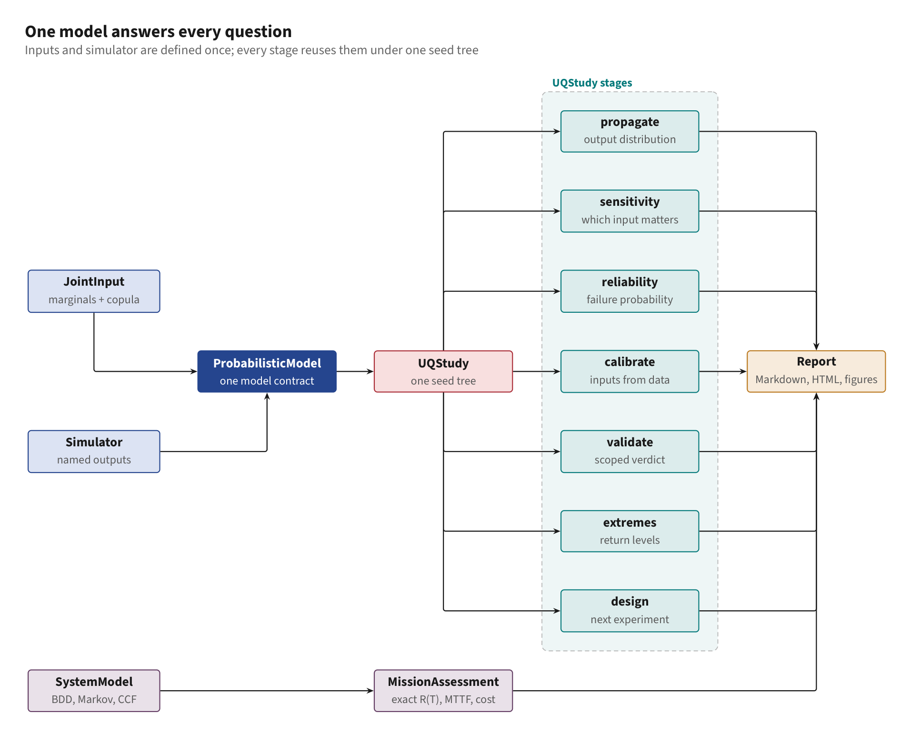</picture>

## Quick start: one model, four answers, one report

Install from a clone (other options are under Installation below):

```bash
git clone https://github.com/ayberkdt/Stats-Lab.git
cd Stats-Lab
python -m venv .venv
source .venv/bin/activate        # Windows: .venv\Scripts\Activate.ps1
python -m pip install -e ".[visualization]"
```

One model, every analysis:

```python
from probstat.distributions import LogNormal, Normal
from probstat.modeling import JointInput, ProbabilisticModel, RandomInput
from probstat.risk import custom_loss
from probstat.uq import QuantityOfInterest
from probstat.workflow import UQStudy

inputs = JointInput.independent(
    RandomInput("load", LogNormal(0.9, 0.25), unit="kN"),
    RandomInput("strength", Normal(4.0, 0.4), unit="kN"),
)
model = ProbabilisticModel(
    inputs,
    lambda p: {"margin": p["strength"] - p["load"]},
    (QuantityOfInterest("margin", "capacity minus demand", "kN"),),
)

study = UQStudy(model, seed=2026)
forward = study.propagate(4096, design="sobol")           # output distribution
sobol = study.sensitivity("margin", 1024)                  # which input matters
methods = study.reliability("margin", 0.0, failure="below")  # FORM, SORM, IS, subset, MC
risk = study.risk("margin", custom_loss(lambda m: 50.0 * max(0.0, -m)), 20_000)

forward["margin"].quantile(0.05)        # 0.124
sobol.ranking()                          # ('load', 'strength')
methods.row("FORM").probability          # 0.0362, first-order approximation
methods.row("MC").probability            # 0.0395, crude Monte Carlo (10 000 runs)
risk.conditional_value_at_risk[0.99]     # 49.8, mean loss in the worst 1%
print(study.report())                    # Markdown: every stage, cost, and seed

from probstat.visualization.study import write_study_html
write_study_html(study, "study.html")    # one page, every stage, light and dark figures
```

The commented values are not illustrations: the test suite runs every Python
block of this README and fails if a computed value differs from the quoted
one at the precision shown.

## Why trust it: the test suite re-checks every number here

| Check | Scale | Enforced by |
|---|---|---|
| Tests | 6,000+ test cases, run in CI on Python 3.11 to 3.13 with lint and strict type checks | [`tests/`](https://github.com/ayberkdt/Stats-Lab/tree/main/tests), [CI workflow](https://github.com/ayberkdt/Stats-Lab/blob/main/.github/workflows/ci.yml) |
| Equations | 2,227 entries in the [equation registry](https://github.com/ayberkdt/Stats-Lab/blob/main/docs/equation-registry.md), each with symbols, assumptions, and a code location | every docstring cites an `EQ-` or `REF-` key that must exist |
| Sources | 1,000+ primary sources in the [bibliography](https://github.com/ayberkdt/Stats-Lab/blob/main/docs/references.md), each cited at least once | no unused or unknown reference key |
| Decisions | 140+ decision records in [`docs/adr/`](https://github.com/ayberkdt/Stats-Lab/tree/main/docs/adr), each with its verification evidence | [contribution contract](https://github.com/ayberkdt/Stats-Lab/blob/main/CONTRIBUTING.md) |
| Documentation | 60+ Markdown files whose Python examples run, with quoted values compared | [`tests/test_documentation_examples.py`](https://github.com/ayberkdt/Stats-Lab/blob/main/tests/test_documentation_examples.py) |
| Properties | 80+ property-based and metamorphic tests, drawing random valid parameters for every distribution family | [`tests/_properties.py`](https://github.com/ayberkdt/Stats-Lab/blob/main/tests/_properties.py) |
| Figures | text of at least 9 pt inside the canvas; WCAG AA contrast of 4.5:1 for text and 3:1 for marks; 117 guide figures in two palettes, all passed through the datawiz audit, with captions that quote the numbers of the build | [canvas](https://github.com/ayberkdt/Stats-Lab/blob/main/tests/test_figure_canvas.py), [contrast](https://github.com/ayberkdt/Stats-Lab/blob/main/tests/test_visualization_accessibility.py), and [guide-figure](https://github.com/ayberkdt/Stats-Lab/blob/main/tests/test_guide_figures.py) tests |
| Agreement with R | 155 cases checked against R 4.6.2 (stats, MASS, nlme, survival, fitdistrplus, ismev, e1071): distribution functions, classical tests, lm/glm/nls/lme, survival, time series, fits; each with the exact R call and a justified tolerance | [`tests/test_r_parity.py`](https://github.com/ayberkdt/Stats-Lab/blob/main/tests/test_r_parity.py), regenerated by [`tools/r_oracles/parity.R`](https://github.com/ayberkdt/Stats-Lab/blob/main/tools/r_oracles/parity.R) |
| Packaging | the built wheel passes `twine check --strict`, installs in a clean environment, and passes a smoke test | [`tools/smoke_test_wheel.py`](https://github.com/ayberkdt/Stats-Lab/blob/main/tools/smoke_test_wheel.py) |

Two habits sit behind the table. **Defects are demonstrated, not
suspected:** each is reproduced against an independent oracle (closed form,
exact arithmetic, enumeration, or the multiple-precision reference backend)
and kept as a regression test, and the
[benchmark suite](https://github.com/ayberkdt/Stats-Lab/blob/main/docs/benchmarks.md)
tracks accuracy, error calibration, and cost per method. **Boundaries are
stated:** estimators report their assumptions, model-evaluation cost, and
convergence; unconverged results are flagged; validation returns a scoped
verdict, never "validated".

## One study, every question

Each stage below is a method of `UQStudy`. It reuses the same model, draws
from its own named child stream of the root seed, counts model evaluations,
and adds a section (with a figure) to the report.

| Question | Stages |
|---|---|
| What does the output look like? | `propagate`, `propagate_until` (stops at a target accuracy), `emulate` (polynomial chaos or Gaussian process) |
| Which inputs matter? | `sensitivity` (Sobol), `shapley` (dependent inputs), `screening` (Morris), `information_sensitivity` (mutual information) |
| How likely is failure, and what does it cost? | `reliability`, `form`, `design_points`, `active_reliability` (AK-MCS), `extremes`, `risk` |
| What do the data say about the inputs? | `calibrate`, `calibrate_with_discrepancy` (Kennedy-O'Hagan), `predict` |
| Can the model be trusted, and what should be measured next? | `verify` (solution verification), `validate` (with CRPS, PIT, and coverage), `design` (Bayesian experimental design) |

## Systems engineering: exact mission reliability, risk, and cost

Describe a mission from its subsystems and get exact answers, not samples:

```python
from probstat.systems import (
    BetaFactorGroup, ExponentialComponent, MarkovComponent, SystemModel,
    k_out_of_n, series, standby_system,
)
from probstat.workflow import MissionAssessment

system = SystemModel(
    series(
        "pumps",                                   # a Markov subsystem
        k_out_of_n(2, "cpu1", "cpu2", "cpu3"),     # 2-out-of-3 computers
    ),
    {
        "pumps": MarkovComponent(standby_system(spares=1, failure_rate=1e-4)),
        **{f"cpu{i}": ExponentialComponent(3e-6) for i in (1, 2, 3)},
    },
    ccf_groups=(BetaFactorGroup(("cpu1", "cpu2", "cpu3"), 0.05),),
)
mission = MissionAssessment(system, 720.0, mission_loss_cost=4.5e8)
print(mission.report())   # exact R(T), MTTF, cut sets, importance, cost, risk
```

| Question | Tools |
|---|---|
| Does the system work for the mission? | Exact reliability on binary decision diagrams (`systems.SystemModel`): series, parallel, k-out-of-n, bridges, fault trees; minimal cut/path sets, bounds, MTTF, availability |
| Which component matters? | Birnbaum, criticality, Fussell-Vesely, RAW, RRW, improvement potential |
| Repair, standby, switching, shared crews? | Continuous-time Markov chains solved by uniformization with error bounds (`processes.ContinuousTimeMarkovChain`, `systems.markov`) |
| Phases, retries, aborts? | `PhasedMission` (exact, phase-dependent rates), `MarkovPhasedMission`, `MissionStageModel` (absorbing success/abort/loss outcomes) |
| Redundancy defeated by a shared cause? | Beta-factor, multiple Greek letter, and alpha-factor common-cause groups |
| What do the test data say, and how uncertain is R? | Beta/Gamma posteriors, chi-square bounds, Crow-AMSAA growth (`reliability.data`); exact epistemic moments and Sobol ranking of which data matter |
| What does it cost, and what is at risk? | Life-cycle cost, cost-risk S-curves with correlation, maintenance optimisation, spares, cost of unreliability (`cost`); risk register, FMECA, MIL-STD-882E matrix, F-N curves (`risk`); reliability allocation |

Read the
[systems engineering guide](https://github.com/ayberkdt/Stats-Lab/blob/main/docs/foundations/systems-engineering-guide.md)
and run
[`examples/mission_systems_lab.py`](https://github.com/ayberkdt/Stats-Lab/blob/main/examples/mission_systems_lab.py).

## Applied statistics: the models an analyst reaches for, with their caveats

The same equation-traced discipline covers the statistical core: estimators
report standard errors, degrees of freedom, and convergence, and each guide
lists the pitfalls of its methods.

```python
from probstat.inference import fit_linear_mixed_model, random_effect

batch = [b for b in "ABCDEF" for _ in range(4)]
strength = [41.2, 43.0, 42.1, 40.6, 45.3, 46.1, 44.0, 45.9, 39.8, 38.7, 40.9, 39.5,
            44.1, 42.8, 43.6, 44.9, 42.0, 41.1, 43.3, 42.5, 40.2, 41.9, 40.4, 41.5]
fit = fit_linear_mixed_model([[1.0]] * 24, strength, random_effect(batch, name="batch"))
round(fit.coefficients[0], 3)                                 # 42.308
round(fit.variance_components[0].standard_deviations[0], 4)   # 1.9565, between batches
round(fit.residual_sd, 4)                                     # 0.9256, within a batch
round(fit.degrees_of_freedom[0], 3)                           # 5.0, Satterthwaite
```

| Question | Tools (`probstat.inference` unless noted) |
|---|---|
| Which law for an uncertain input? | Expert bounds and moments only: `maximum_entropy` (`probstat.distributions`); some data: `fit_distribution` (likelihood) and `fit_distribution_moments` (moments, matching R's fitdistrplus), Kolmogorov-Smirnov and Anderson-Darling tests with p-values, `bootstrap_goodness_of_fit` when parameters were fitted, `parameter_uncertainty_band`; many data: `select_kde_bandwidth` (leave-one-out, UCV, BCV) and `gaussian_kde_multivariate` (both in `probstat.statistics`) |
| Is there an effect, and how sure are we? | t, Welch, paired, sign, Wilcoxon, Mann-Whitney, Fisher exact, permutation tests; bootstrap with BCa intervals; `adjust_p_values` (Holm, Benjamini-Hochberg) |
| Do groups differ? | Tukey HSD on the exact studentized range, Kruskal-Wallis (exact for small designs), Friedman, Cochran's Q, Dunn; Levene, Brown-Forsythe, Bartlett; Shapiro-Wilk |
| How does a response depend on predictors? | `fit_linear_model`, `fit_glm` (Gaussian, binomial with logit or probit link, Poisson, Gamma), ridge and cross-validated elastic net, `fit_robust_linear_model` (Huber, biweight), `theil_sen_slope`, exact `fit_quantile_regression` |
| Counts and categories? | Poisson regression with exposures and sandwich errors, negative binomial, zero-inflated and hurdle models with the Vuong test, ordinal and multinomial logit, average marginal effects |
| Grouped or repeated measurements? | `fit_linear_mixed_model` (ML and REML, crossed and nested factors, BLUPs, Satterthwaite tests), `fit_generalized_linear_mixed_model` (Laplace and adaptive Gauss-Hermite) |
| Smooth, unknown shapes? | B-splines, `fit_pspline` and `fit_smoothing_spline` with REML or GCV, `loess`, `isotonic_regression`, `kernel_regression`, `fit_additive_model` |
| Many correlated variables? | `principal_components`, `factor_analysis` with varimax, linear and quadratic discriminants, `kmeans` with silhouette scores |
| Time? | ARIMA, GARCH, VAR with bootstrap impulse-response bands, ADF and KPSS, CUSUM and PELT change points (`probstat.timeseries`) |
| Censored, missing, or confounded data? | Kaplan-Meier, Nelson-Aalen, log-rank, Cox and parametric survival models (`inference.survival`); multiple imputation; IPW and doubly robust AIPW (`probstat.causal`) |

Each row has a guide with worked examples and a figure; start from the
[Statistics track](https://github.com/ayberkdt/Stats-Lab/blob/main/docs/learning-path.md#track-s--statistics)
of the learning path.

## Visual tour: every figure states its finding in its title

Every lab in [`examples/`](https://github.com/ayberkdt/Stats-Lab/tree/main/examples)
(48 of them) is seeded and reproducible and writes its figures to
`examples/generated/`; every guide in
[`docs/foundations/`](https://github.com/ayberkdt/Stats-Lab/tree/main/docs/foundations)
shows its own checked figures. All figures share one theme: colour follows
meaning (observed data, model, reference), labels sit on the data, and every
figure exists in a light and a dark palette.

| | |
|---|---|
| <picture><source media="(prefers-color-scheme: dark)" srcset="https://raw.githubusercontent.com/ayberkdt/Stats-Lab/main/docs/images/central-model-design-comparison-dark.png">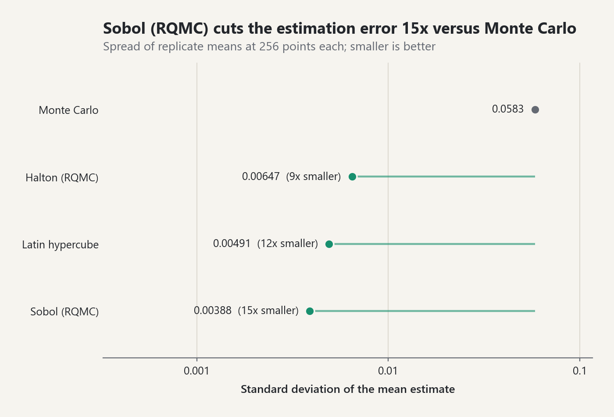</picture> | <picture><source media="(prefers-color-scheme: dark)" srcset="https://raw.githubusercontent.com/ayberkdt/Stats-Lab/main/docs/images/ishigami-sobol-indices-dark.png">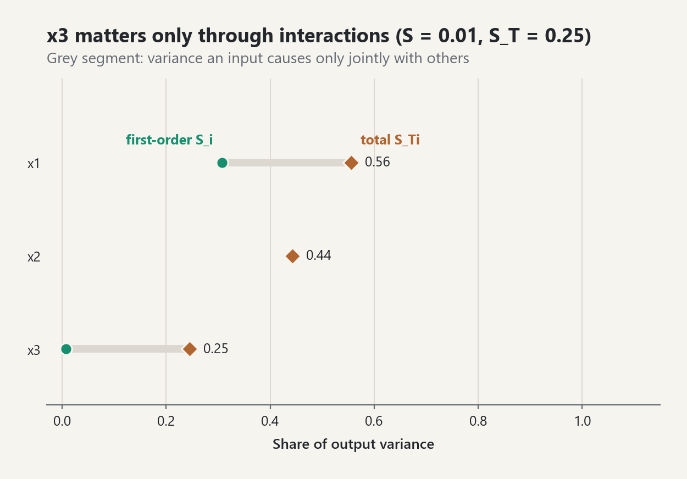</picture> |
| **Forward:** at 256 points, scrambled Sobol cuts the spread of the mean 15x, from 0.0583 to 0.00388. | **Sensitivity:** x3 has a first-order index of 0.01 but a total index of 0.25; it acts only through interactions. |
| <picture><source media="(prefers-color-scheme: dark)" srcset="https://raw.githubusercontent.com/ayberkdt/Stats-Lab/main/docs/images/central-model-form-geometry-dark.png">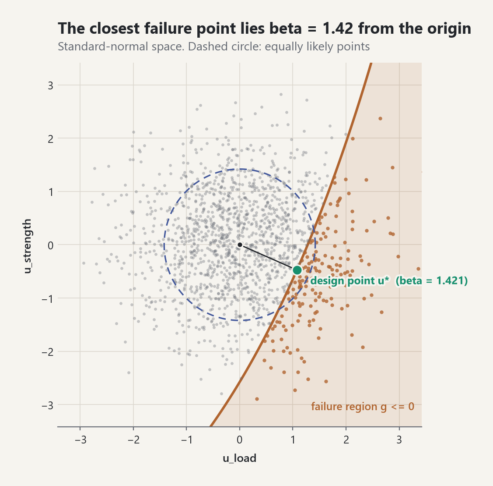</picture> | <picture><source media="(prefers-color-scheme: dark)" srcset="https://raw.githubusercontent.com/ayberkdt/Stats-Lab/main/docs/images/adaptive-reliability-design-points-dark.png">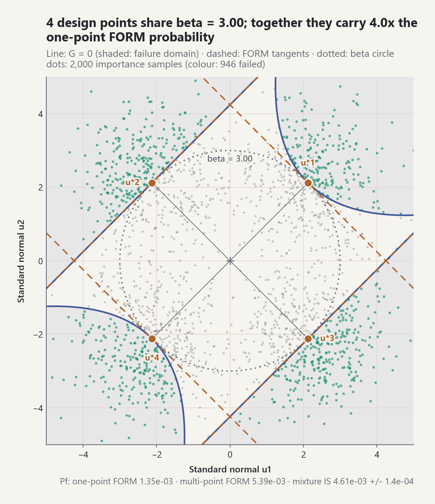</picture> |
| **Reliability:** FORM finds the most likely failure point at β = 1.42 from the origin. | **Rare events:** four design points at β = 3.00 carry 4.0x the one-point FORM probability. |
| <picture><source media="(prefers-color-scheme: dark)" srcset="https://raw.githubusercontent.com/ayberkdt/Stats-Lab/main/docs/images/central-model-loss-exceedance-dark.png">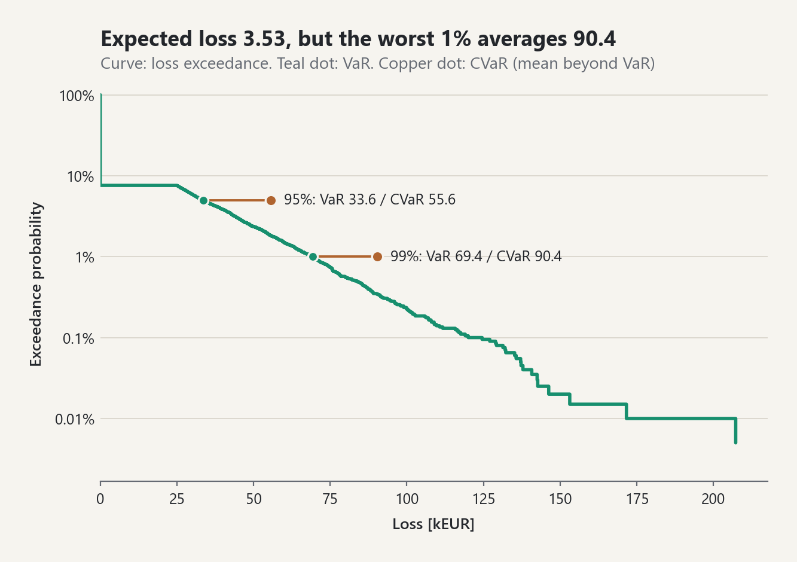</picture> | <picture><source media="(prefers-color-scheme: dark)" srcset="https://raw.githubusercontent.com/ayberkdt/Stats-Lab/main/docs/images/extremes-return-levels-dark.png">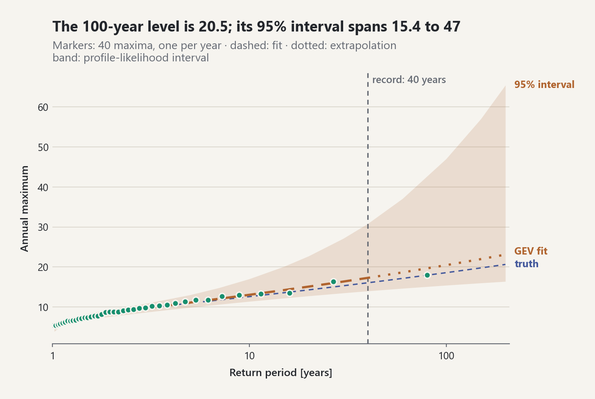</picture> |
| **Risk:** the expected loss is 3.53 kEUR, but the worst 1% of outcomes average 90.4. | **Extremes:** 40 annual maxima give a 100-year level of 20.5 with a 95% interval of 15.4 to 47. |
| <picture><source media="(prefers-color-scheme: dark)" srcset="https://raw.githubusercontent.com/ayberkdt/Stats-Lab/main/docs/images/calibration-forecast-dark.png">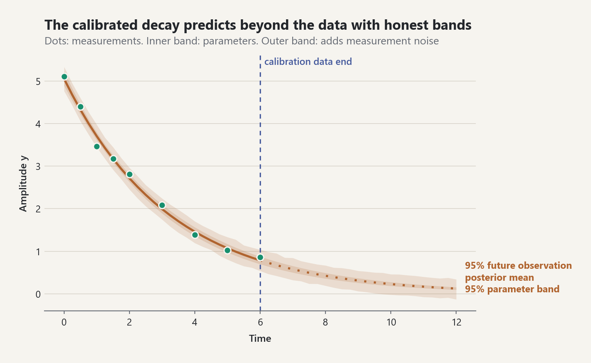</picture> | <picture><source media="(prefers-color-scheme: dark)" srcset="https://raw.githubusercontent.com/ayberkdt/Stats-Lab/main/docs/images/discrepancy-predictions-dark.png">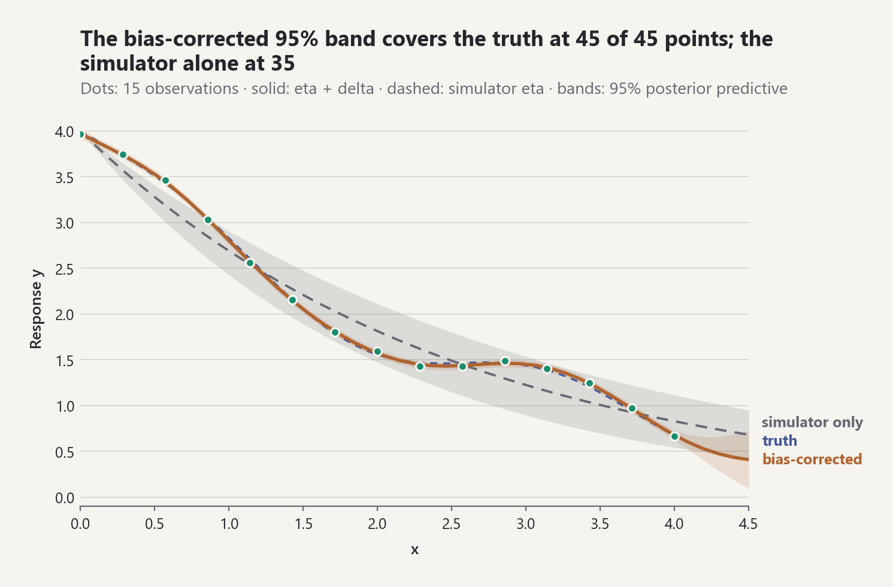</picture> |
| **Calibration:** 9 measurements up to t = 6 calibrate the decay; the 95% bands carry it to t = 12. | **Model error:** with a discrepancy term the 95% band covers the truth at 45 of 45 points; the simulator alone at 35. |
| <picture><source media="(prefers-color-scheme: dark)" srcset="https://raw.githubusercontent.com/ayberkdt/Stats-Lab/main/docs/images/filtering-velocity-dark.png">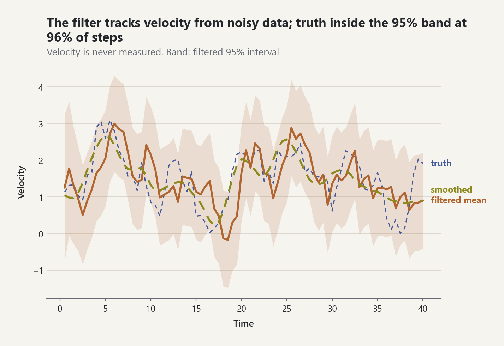</picture> | <picture><source media="(prefers-color-scheme: dark)" srcset="https://raw.githubusercontent.com/ayberkdt/Stats-Lab/main/docs/images/causal-effect-estimates-dark.png">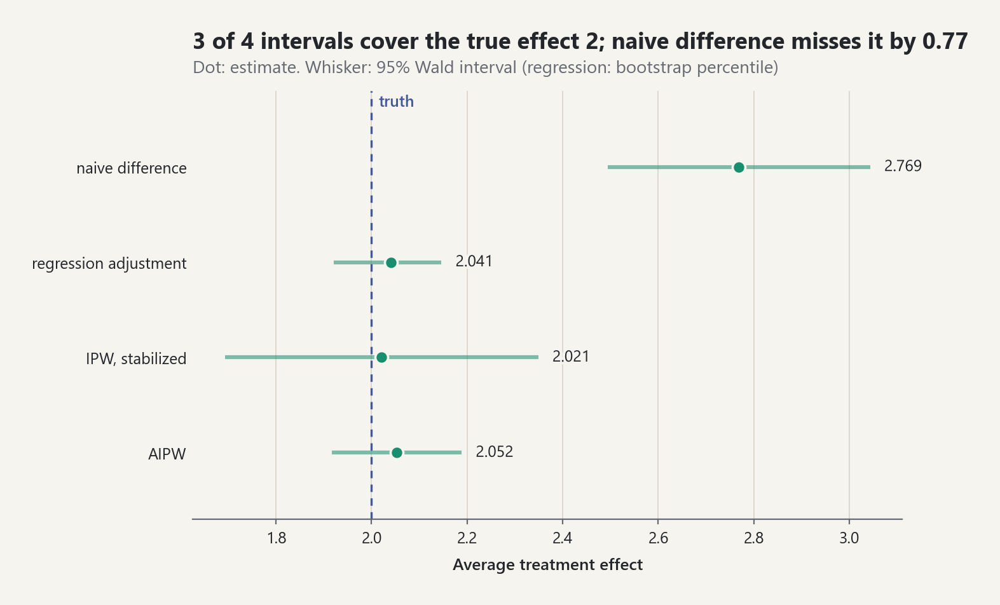</picture> |
| **Filtering:** the velocity is never measured, yet it stays inside the filter's 95% band at 96% of steps. | **Causal:** 3 of 4 intervals cover the true effect 2; the naive difference misses it by 0.77. |
| <picture><source media="(prefers-color-scheme: dark)" srcset="https://raw.githubusercontent.com/ayberkdt/Stats-Lab/main/docs/images/guides/robust-regression-leverage-dark.png">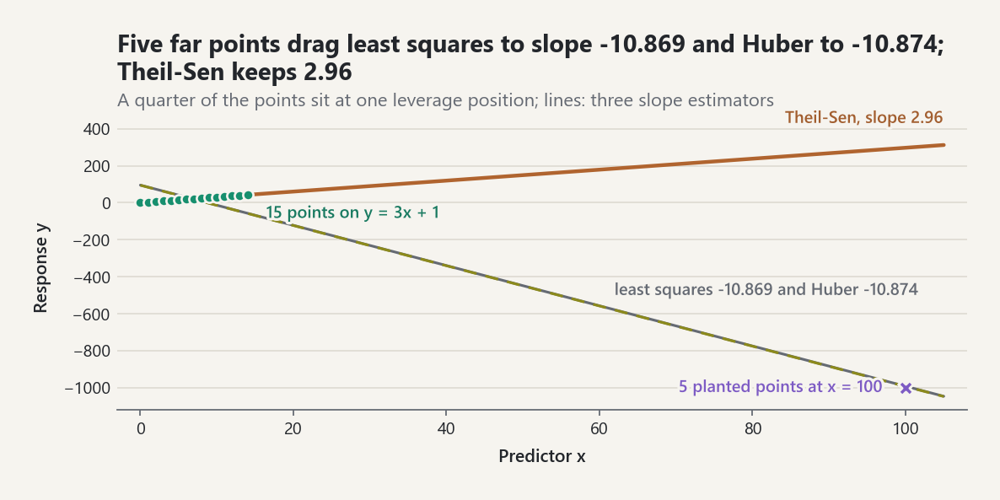</picture> | <picture><source media="(prefers-color-scheme: dark)" srcset="https://raw.githubusercontent.com/ayberkdt/Stats-Lab/main/docs/images/guides/quantile-regression-fan-dark.png">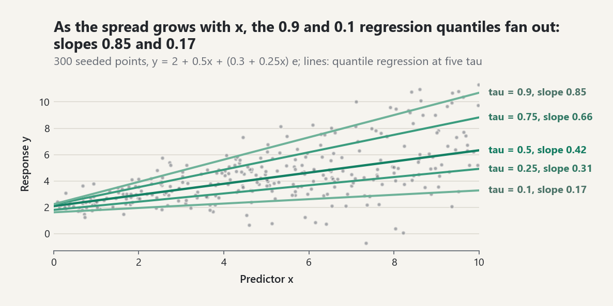</picture> |
| **Robust regression:** five far points drag least squares to slope -10.869 and Huber to -10.874; Theil-Sen keeps 2.96. | **Quantile regression:** as the spread grows, the 0.9 and 0.1 quantile slopes fan out to 0.85 and 0.17 (true 0.82 and 0.18). |
| <picture><source media="(prefers-color-scheme: dark)" srcset="https://raw.githubusercontent.com/ayberkdt/Stats-Lab/main/docs/images/guides/mixed-models-blup-shrinkage-dark.png">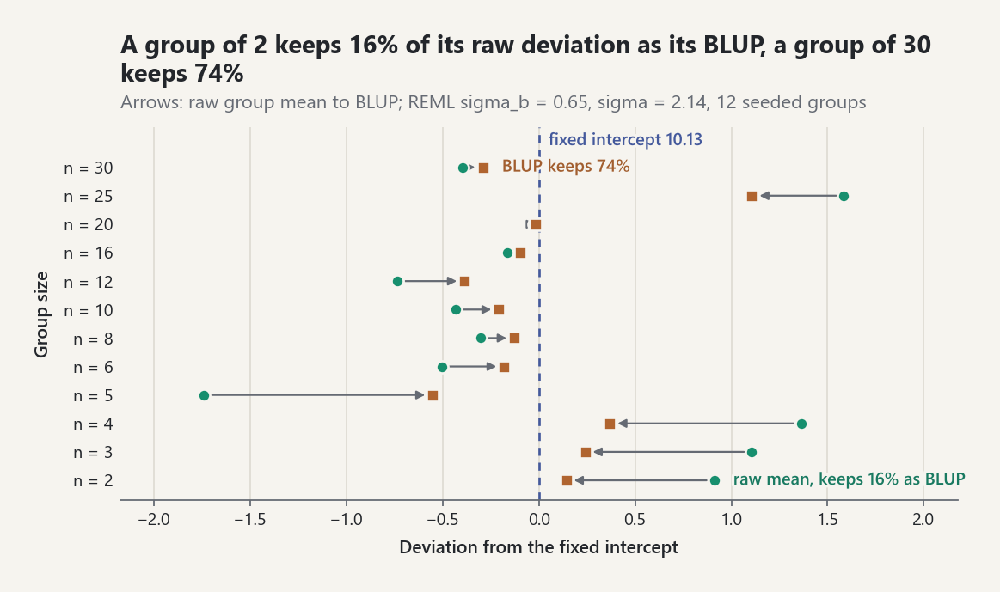</picture> | <picture><source media="(prefers-color-scheme: dark)" srcset="https://raw.githubusercontent.com/ayberkdt/Stats-Lab/main/docs/images/guides/time-series-garch-volatility-dark.png">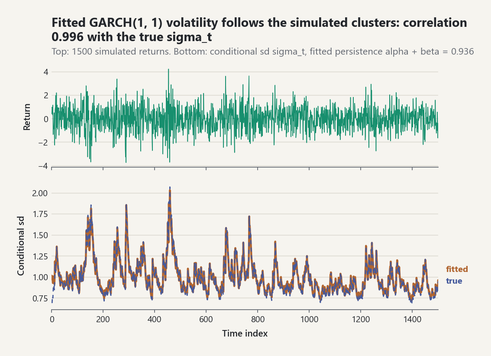</picture> |
| **Mixed models:** with REML estimates sigma_b = 0.65 and sigma = 2.14, a group of 2 keeps 16% of its raw deviation as its BLUP, a group of 30 keeps 74%. | **Volatility:** the fitted GARCH(1, 1) volatility (persistence 0.936) tracks the simulated clusters with correlation 0.996. |
| <picture><source media="(prefers-color-scheme: dark)" srcset="https://raw.githubusercontent.com/ayberkdt/Stats-Lab/main/docs/images/guides/fitting-parameter-bands-dark.png">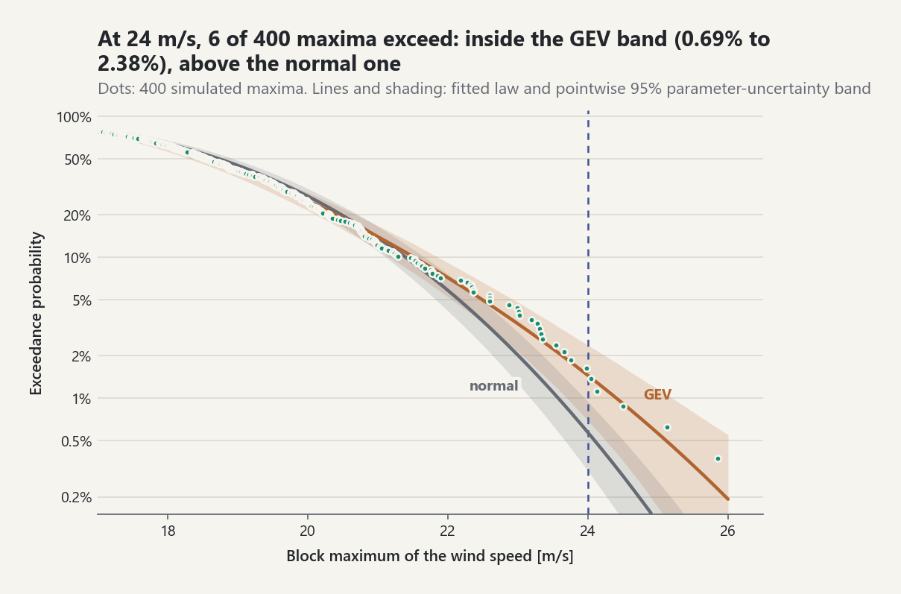</picture> | <picture><source media="(prefers-color-scheme: dark)" srcset="https://raw.githubusercontent.com/ayberkdt/Stats-Lab/main/docs/images/guides/kde-bandwidth-selection-dark.png">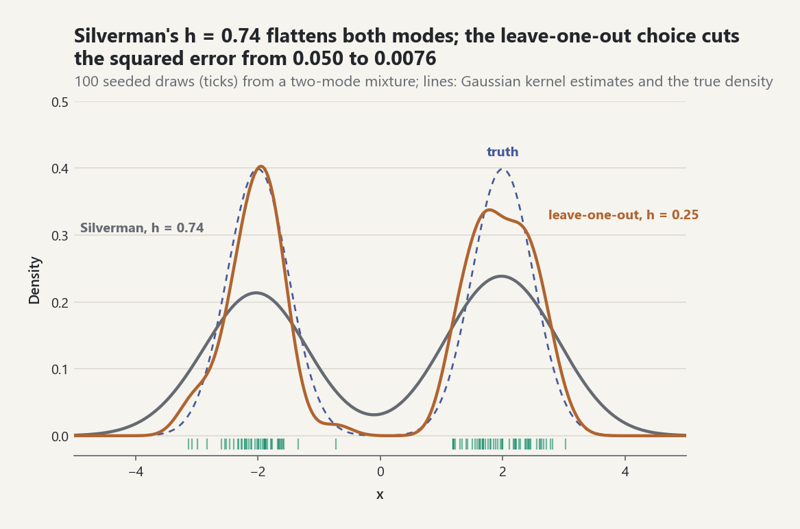</picture> |
| **Input laws:** at 24 m/s, 6 of 400 simulated maxima exceed: inside the GEV band (0.69% to 2.38%), above the normal band (0.30% to 0.94%); the normal AIC is 19.3 worse. | **Kernel density:** on two modes Silverman's h = 0.74 flattens both peaks; the leave-one-out h = 0.25 cuts the squared error from 0.050 to 0.0076. |

Start with
[`examples/uq_study_complete_lab.py`](https://github.com/ayberkdt/Stats-Lab/blob/main/examples/uq_study_complete_lab.py)
(one study through every stage, written to an HTML report) or
[`examples/central_model_lab.py`](https://github.com/ayberkdt/Stats-Lab/blob/main/examples/central_model_lab.py)
(the same steps with the low-level APIs).

## Recent methods, and a laboratory for deriving new ones

Release 0.27 adds methods from the last decade to every layer, each
re-derived and tested against an independent oracle, and a package for
building and certifying estimators the library does not contain.

```python
import statistics

from probstat.methodlab import (
    check_unbiasedness, estimator_from_function, jackknife_bias_corrected,
)
from probstat.monte_carlo import compare_multifidelity_estimators


def sample(g):
    return [g.gauss(0.0, 1.0) for _ in range(5)]


plug_in = estimator_from_function("plug-in", lambda g: statistics.pvariance(sample(g)))
claim = check_unbiasedness(plug_in, 1.0, replicates=20_000, seed=1)
claim.verdict, round(claim.estimate, 2)   # ('refuted', -0.2): bias -sigma^2/n

repaired = jackknife_bias_corrected(statistics.pvariance)   # a derived statistic
jackknifed = estimator_from_function("jackknifed", lambda g: repaired(sample(g)))
check_unbiasedness(jackknifed, 1.0, replicates=20_000, seed=1, tolerance=0.05).verdict
# 'supported'

table = compare_multifidelity_estimators(((1.0, 0.95), (0.95, 1.0)), (1.0, 0.05), 100.0)
[(row.method, round(row.variance_ratio, 2)) for row in table.rows]
# [('MC', 1.0), ('MFMC', 0.28), ('ACV-MF', 0.28), ('MLBLUE', 0.28)]
```

| Question | Tools |
|---|---|
| Can cheap models pay for an expensive one? | `monte_carlo`: multifidelity Monte Carlo, approximate control variates, multilevel best linear unbiased estimators with budget allocation |
| May I look at the data as they arrive? | `inference`: e-values and e-BH, betting tests and confidence sequences, universal inference; prediction-powered inference |
| What holds without exchangeability, or for a loss other than coverage? | `conformal`: covariate-shift and fixed weights, conformal risk control, conformal p-values, Mondrian, CV+, online tracking |
| Is the effect causal, and how fragile is it? | `causal`: double machine learning, staggered difference-in-differences, omitted-variable-bias bounds, synthetic control, two-stage least squares |
| Can I trust these importance weights or this sampler? | `inference`: Pareto-smoothed importance sampling and PSIS-LOO, nested R-hat, slice and elliptical slice sampling, MALA, the stretch move, parallel tempering, SVGD |
| Which inputs matter, from data I already have? | `sensitivity`: rank-based Sobol indices, Chatterjee's coefficient, moment-independent and kernel indices, active subspaces |
| How small is this failure probability, or where is the optimum? | `reliability`: improved cross-entropy, sequential importance sampling, BUS; `surrogates` and `design`: co-kriging, stochastic kriging, Bayesian quadrature, Bayesian optimization; `sampling`: lattice rules and median quasi-Monte Carlo |
| What should I do next, given logged decisions? | `risk`: LinUCB, linear Thompson sampling, off-policy evaluation, finite Markov decision processes |
| What does the simulator say about its parameters? | `generative`: flow matching, flow-matching posterior estimation, neural ratio estimation; `inverse`: interacting Langevin sampler, unscented Kalman inversion, consensus-based sampling |
| Can I invert a large or edge-preserving problem, and what did the data resolve? | `linalg`: matrix-free operators, CGLS, LSQR, LSMR, Lanczos, randomized SVD; `inverse` and `design` (experimental): see [Inverse problems](https://github.com/ayberkdt/Stats-Lab/blob/main/README.md#inverse-problems-large-non-smooth-and-bayesian-experimental) below |
| Is my new estimator unbiased, and better? | `methodlab`: combinators with a derivation lineage, certification checks with scoped verdicts, pre-specified simulation studies |

The sources of these methods were confirmed by title and identifier but
could not be opened where the release was built, so no formula was copied:
each was derived again and checked against a closed form, an exact
enumeration, or a guarantee measured by simulation. The
[survey and gap ledger](https://github.com/ayberkdt/Stats-Lab/blob/main/docs/research/literature-gaps-2026.md)
records what was verified, what the literature of 2023-2026 changed, and
which questions look open; the
[method-development guide](https://github.com/ayberkdt/Stats-Lab/blob/main/docs/foundations/method-development.md)
shows a derivation from a biased rule to a certified unbiased estimator.

### Budgets, margins, and credibility for system design

A system design is judged against requirements, so the uncertainty analysis
has to end in the terms a design review uses: a budget table, a margin with a
confidence, a credibility statement.

| Question | Tools |
|---|---|
| How do the error sources of a budget combine? | `uq`: `UncertaintyBudget` (law of propagation with correlation, Welch-Satterthwaite, root-sum-square, worst-case and mixed rules kept apart by type), `budget_from_model`, `monte_carlo_budget` with symmetric and shortest coverage intervals and the validation of the linear budget against it |
| Does the design meet its requirement, and with what confidence? | `propagation`: `normal_tolerance_factor` (exact one- and two-sided), `quantify_margin` (margin over uncertainty), `compliance_probability`, `contingency_for_confidence`, `TechnicalPerformanceMeasure` across milestones |
| There are no data yet, only engineers' judgement | `inference`: `fit_from_quantiles`, `pert_from_quantiles`, linear and logarithmic opinion pools, `cooke_classical_model` |
| How far can the model behind the number be trusted? | `validation`: `nasa_std_7009b_scale`, `pcmm_scale`, `CredibilityAssessment`, `level_gaps` against a target profile |
| Is the filter's covariance realistic, and what after a long nonlinear arc? | `filtering`: `nees_test`, `nis_test`, `covariance_realism`, `propagate_gaussian_mixture`; `multivariate`: `gaussian_disc_probability`, `gaussian_ball_probability` |
| Which inputs matter, shown the way a review expects? | `sensitivity`: `tornado_analysis`, `fast_analysis`, `rbd_fast_analysis`; `visualization`: `plot_tornado` |
| Size a design under a probabilistic requirement | `reliability`: `solve_chance_constrained`, `scenario_sample_size`, `certify_design`, `rbdo_sora` |
| When will it be finished, and at what cost? | `cost`: `critical_path`, `simulate_schedule`, `joint_cost_schedule_confidence`, `cost_schedule_frontier` |

## Inverse problems: large, non-smooth, and Bayesian (experimental)

The `inverse` package recovers parameters, fields, and sources from indirect,
noisy data, from a deconvolution with a few dozen unknowns to matrix-free
problems with thousands. Each method states the noise model, reports why it
stopped, and keeps the regularization bias apart from the posterior
uncertainty. The benchmark cases withhold the truth and flag data generated
on the solver's own grid (the "inverse crime").

```python
import math

from probstat.inverse import (
    LinearInverseProblem, correlated_gaussian_benchmark, credible_bands,
    deconvolution_benchmark, expected_noise_norm, krylov_regularization,
    linear_gaussian_posterior,
)

case = deconvolution_benchmark(64, refinement=2, relative_noise=0.02)  # finer-grid data
problem = LinearInverseProblem.create(case.operator, case.data, noise=case.noise)
early = krylov_regularization(problem, noise_norm=expected_noise_norm(64))
early.iterations, early.stop_reason      # (5, 'discrepancy')
round(math.dist(early.estimate, case.truth) / math.hypot(*case.truth), 3)  # 0.137

prior_case = correlated_gaussian_benchmark(
    40, 12, length_scale=0.2, noise_level=0.05, seed=20261126
)
posterior = linear_gaussian_posterior(
    prior_case.operator, prior_case.data, noise=prior_case.noise,
    prior_covariance=prior_case.prior_covariance,
)
bands = credible_bands(posterior.sample(2000, seed=20261126), 0.9)
round(bands.scaling_factor, 2)           # 2.97, simultaneous band in posterior sd
```

| Question | Tools (`probstat.inverse` unless noted) |
|---|---|
| How do I regularize, and where do I stop? | weighted affine Tikhonov by QR, SVD or Krylov with one factorization reused for many data vectors; Landweber, early-stopped CGLS/LSQR/LSMR, hybrid and flexible-hybrid LSQR; GCV, weighted GCV, UPRE, discrepancy, L-curve, evidence and grouped cross-validation on one path, with a predeclared study of the rules against the grid oracle |
| What can the data resolve at all? | whitened singular spectra with complete nullspaces and Picard coefficients; the generalized SVD (including wide operators and common nullspaces); resolution operators and averaging kernels with mass matrices; likelihood-informed subspaces, dense or matrix-free |
| The truth has edges or is sparse | `l1`, total variation, Huber-TV, total generalized variation (1D and 2D grids), MCP and SCAD by FISTA, PDHG, ADMM and iteratively reweighted least squares (`optimization` holds the proximal solvers) |
| The model is nonlinear or a PDE | Gauss-Newton with inner LSQR, IRGNM, trust-region Newton-CG, bound-constrained and robust Gauss-Newton, variable projection; exact discrete adjoints for 1D and 2D elliptic models, heat equations and Runge-Kutta ODE models; a simulator adapter that records failures |
| Counts, censoring, outliers, unknown noise | Poisson, binomial, negative binomial, censored and interval-censored Gaussian, Student-t and multivariate t, contaminated normal, Huber; covariances that depend on the prediction; a noise scale profiled or integrated out |
| What is the posterior, and are the samples right? | exact and low-rank Gaussian posteriors, function-space priors (spectral, Whittle-Matern), pointwise and simultaneous bands; pCN, NUTS and tempered SMC adapters with the log evidence; quadrature references that expose missed modes; ensemble Kalman updates with localization and inflation, and the ensemble transform particle filter |
| Where is the structure damaged? | Bayesian updating of a lumped structural model from identified frequencies and mode shapes, with exact eigenvalue sensitivities, Laplace and transitional MCMC posteriors, damage probabilities and damage-class selection by evidence; a symmetric case shows why one-mode answers mislead |
| Does the thermal model match the thermal-vacuum test? | correlation of a lumped thermal network (conduction and radiation) to test data with exact Jacobians, Laplace and transitional MCMC posteriors, the conductances a steady test cannot separate, and flight predictions with and without a discrepancy term |
| What is the spacecraft's inertia tensor? | identification from gyro data during torque manoeuvres: a realizable Cholesky parameterization, regression and output-error estimators (the regression is biased by noisy rates, and more data does not remove it), a Laplace posterior of the principal moments and axes, and excitation design |
| Is a parameter identified? | profile likelihood with honest open intervals, 2D profiles, bootstrap calibration of the threshold, ODE sensitivity rank |
| Can a cheap model or a simulator stand in? | approximation-error models, delayed acceptance, active surrogates, multilevel MCMC, coarse-to-fine warm starts, sensitivity-error checks; ABC, synthetic likelihood, neural posterior and ratio estimation, flow matching and diffusion sampling compared on one simulator, each labelled approximate |
| Where should the next sensor go? | `design`: thermocouple depths for heat-flux reconstruction (A-, D- and goal-oriented criteria on the exact Gaussian posterior, checked by Monte Carlo);  A-, D-, E- and goal-oriented criteria (dense or by Hutchinson and Lanczos), greedy, exhaustive, sequential and robust selection |
| Is it tested on something realistic? | a benchmark catalog (deblurring, tomography, decay, PDE, Poisson imaging, model discrepancy, functional inversion) and synthetic orbit-determination, expansion-history (with Bayes factors) and gravity-field cases; seven of them in the benchmark report |

| | |
|---|---|
| <picture><source media="(prefers-color-scheme: dark)" srcset="https://raw.githubusercontent.com/ayberkdt/Stats-Lab/main/docs/images/guides/large-scale-posterior-bands-dark.png">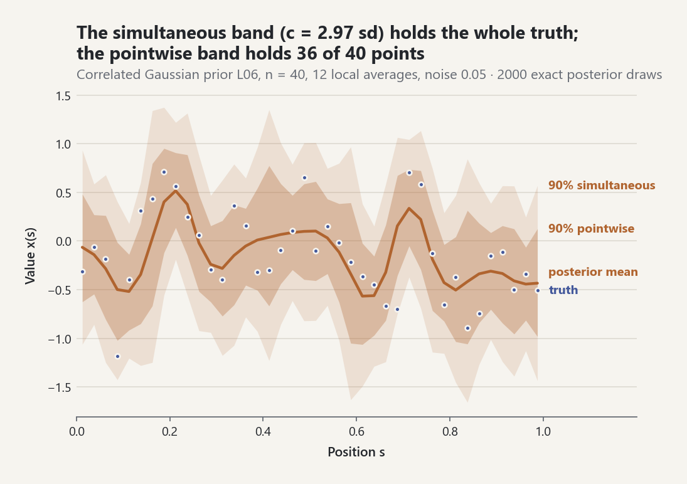</picture> | <picture><source media="(prefers-color-scheme: dark)" srcset="https://raw.githubusercontent.com/ayberkdt/Stats-Lab/main/docs/images/guides/large-scale-design-gains-dark.png">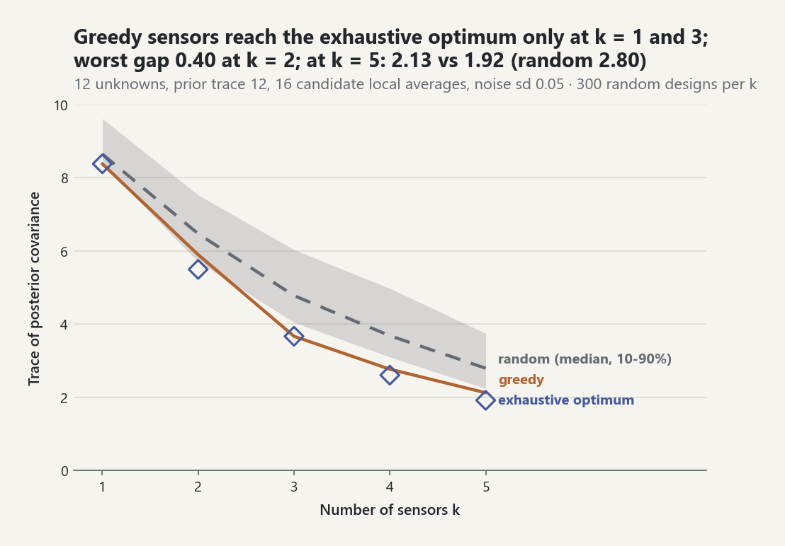</picture> |
| **Posterior bands:** the 90% simultaneous band (c = 2.97 sd) keeps the truth inside everywhere; the pointwise band holds it at 36 of 40 points. | **Sensor design:** with a prior trace of 12, greedy A-optimal sensors reach the exhaustive optimum only at k = 1 and 3 (worst gap 0.40 at k = 2); with five sensors greedy gives 2.13, the optimum 1.92 and a random design 2.80 in median. |

Read the
[large-scale inverse problems guide](https://github.com/ayberkdt/Stats-Lab/blob/main/docs/foundations/large-scale-inverse-problems.md)
and, for nonlinear posteriors, expensive models and the heat-flux case, the
[nonlinear Bayesian inversion guide](https://github.com/ayberkdt/Stats-Lab/blob/main/docs/foundations/nonlinear-bayesian-inversion.md),
run
[`examples/large_scale_inverse_lab.py`](https://github.com/ayberkdt/Stats-Lab/blob/main/examples/large_scale_inverse_lab.py),
and see the
[progress ledger](https://github.com/ayberkdt/Stats-Lab/blob/main/docs/research/inverse-expansion-progress.md)
for the evidence and the limitations of each method. All of it is
experimental: names may change before they are promoted.

Release 0.28 adds the research-grade layer around these tools:

| Question | Tools (experimental) |
|---|---|
| One reproducible run from spectrum to posterior | `workflow.InverseStudy`: spectrum, regularization path, MAP, Laplace, sampling, resolution and comparison with an exact or quadrature reference, each stage on its own child stream with evaluation counts, written to one Markdown report |
| The posterior is non-Gaussian and the parameter is a field | `inverse`: Gauss-Newton Laplace approximation with a low-rank Hessian, randomize-then-optimize, randomized maximum likelihood, pCN, generalized pCN and dimension-independent likelihood-informed (DILI) chains; triangular transport maps from samples or from the density; Stein variational gradient descent |
| The forward model is too expensive for MCMC | `inverse`: local-approximation Metropolis-Hastings that refines a local regression surrogate with true runs (asymptotically exact), and delayed acceptance with that surrogate as the cheap stage; the evaluation savings are reported |
| Does my sampler pass a published benchmark? | `inverse.benchmark_aristoff_bangerth`: the 64-parameter elliptic benchmark of Aristoff and Bangerth (SIAM Review, 2023) with an exact discrete adjoint, its published data and reference posterior means |
| Which experiment is most informative for a nonlinear model? | `design`: expected information gain by nested Monte Carlo, a contrastive lower bound, and the Laplace approximation; exhaustive and greedy nonlinear designs |
| Which model class do the data support? | `inference`: transitional MCMC with the log evidence, model-class selection, model-averaged predictions and hierarchical calibration |

## Aerospace propulsion and space operations (experimental)

The `aerospace` package turns the physics of a launch vehicle into
`ProbabilisticModel`s, so every tool above (propagation, Sobol, FORM, subset
simulation, calibration) runs on an engine, a motor, a chamber or an ascent
without glue code. The physics is textbook-level and every example vehicle is
synthetic; the point is the uncertainty workflow, not a design tool.

```python
from probstat.aerospace import liquid_engine_model
from probstat.distributions import Normal, TruncatedNormal, Uniform
from probstat.workflow import UQStudy

engine = liquid_engine_model(                     # synthetic demonstration engine
    chamber_pressure=Normal(7.0e6, 2.0e5),        # Pa
    mixture_ratio=Uniform(2.2, 3.4),              # O/F
    throat_diameter=Normal(0.1, 0.0005),          # m
    expansion_ratio=Normal(40.0, 1.0),
    combustion_efficiency=TruncatedNormal(0.97, 0.01, upper=1.0),
)
study = UQStudy(engine, seed=2026)
isp = study.propagate(2048, design="sobol")["vacuum_specific_impulse"]
round(isp.quantile(0.05), 1)                          # 378.7 s
study.sensitivity("vacuum_specific_impulse", 512).ranking()[:2]
# ('mixture_ratio', 'combustion_efficiency')
methods = study.reliability("vacuum_specific_impulse", 378.0, failure="below")
round(methods.row("FORM").probability, 4)             # 0.0529, first order
round(methods.row("SORM-Breitung").probability, 4)    # 0.0446, with curvature
round(methods.row("MC").probability, 4)               # 0.0422, crude Monte Carlo
```

| Question | Tools (`probstat.aerospace` unless noted) |
|---|---|
| How does a liquid engine perform, and how sure are we? | ideal-rocket `c*`, `CF` and `Isp` with the area-Mach inversion, nozzle divergence and the Summerfield separation flag; mixture-ratio tables; the turbine-pump power balance; `liquid_engine_model` |
| Will a solid motor burst? | zero-dimensional ballistics with the Vieille burn rate and tubular, end-burning and BATES grains; MEOP and burst margin; `solid_motor_model` for subset simulation and FORM; calibration of the burn-rate law by transitional MCMC with model-class evidence |
| Is the combustion chamber acoustically stable? | `n`-`tau` thermoacoustic modes with a Marble-Candel choked nozzle, the Rayleigh index and adjoint eigenvalue sensitivities; the probability of instability by Monte Carlo, polynomial chaos and FORM |
| Does the vehicle reach orbit, and with what dispersion? | planar ascent through the 1976 standard atmosphere with staging, a gravity turn, and gravity and drag losses; 3-sigma intervals, dispersion ellipses and a root-sum-square budget checked against Monte Carlo |
| How reliable are the engine, the cluster and the vehicle? | classical and Bayesian demonstration test plans, heritage priors, Weibull test-time equivalence, reliability growth, engine clusters with beta-factor common cause, launch event trees |
| Does the capsule survive entry? | planar entry with optional lift through the 1976 or an exponential atmosphere, checked against the Allen-Eggers closed form; Sutton-Graves stagnation heating with the air coefficient of the NASA report; ablative heat-shield sizing; entry corridors between skip-out and a g-limit; `entry_model` for Sobol, FORM and subset simulation |
| What heat flux did the heat shield see? | `inverse`: the inverse heat conduction problem for a slab with embedded thermocouples: Beck's sequential function specification, Tikhonov in time, CGLS, and a Gaussian-process posterior with credible bands; exact discrete adjoint, resolution against sensor depth |
| Will the nozzle wall survive the burn? | regenerative cooling along the nozzle axis: Bartz gas-side heat transfer with the property correction, the wall resistance network and Dittus-Boelter coolant convection marched by an exact energy balance; `nozzle_cooling_model` for Sobol, FORM, subset simulation and GP emulation of the peak wall temperature |
| Will debris or a micrometeoroid get through? | penetration risk `N = sum A T F(>d_c)` and `PNP = exp(-N)` with angle and speed bins; parameterized single- and dual-wall ballistic limits (the user supplies published coefficients); epistemic flux and ballistic-limit factors kept apart from the Poisson part; shield thickness for a PNP requirement; Gamma-Poisson updating from returned surfaces |
| Will a thin-walled tank or interstage buckle? | classical axial buckling and the NASA SP-8007 knockdown (its equations 7-10), Koiter's imperfection law with the constant of SP-8007 revision 2 (its equations 138-139), a probabilistic knockdown from an assumed imperfection distribution compared with SP-8007 across `R/t`, `shell_buckling_model` for FORM, subset simulation and Sobol, and the thickness for a target reliability |
| Is the engine degrading, and how long until it fails? | a physics-plus-filter digital twin: joint state and efficiency estimation by EKF and UKF (equal to the exact Kalman filter in the linear case), NEES and NIS consistency, CUSUM and GLR fault detection with run lengths checked against the Brook-Evans integral equation, and remaining-useful-life distributions from the inverse Gaussian first-passage law with measured calibration |
| Will the turbopump cavitate? | net positive suction head available against required (suction specific speed or Thoma number, user-supplied), a vapour-pressure law, the pump operating point, the probability of cavitation by FORM, subset simulation and Monte Carlo, and the minimum tank pressure for a target probability |
| What atmosphere did the capsule fly through? | post-flight entry reconstruction from accelerometer data by an augmented EKF/UKF with smoothing and by a batch Gauss-Newton fit with a Laplace posterior; shows that without lift only density over ballistic coefficient is identified, and that a ballistic prior or a density anchor, not radar fixes, separates them |
| Will the satellite reenter in time? | orbital lifetime under drag with a synthetic solar cycle (circular and orbit-averaged eccentric decay, closed-form bounds in an exponential atmosphere), the probability of missing a disposal deadline by subset simulation and Monte Carlo, Sobol ranking, and the highest compliant altitude with and without a drag sail |
| How hard does the wind push on the vehicle? | maximum dynamic pressure and the q-alpha load through a synthetic random wind field in altitude, the probability of exceeding a load limit by FORM, subset simulation and Monte Carlo, Sobol ranking, and GEV/GPD tail fits |
| How well does the spacecraft know where it points? | a gyro and star-tracker attitude filter with the exact discretized noise and a closed-form steady-state accuracy checked against the Riccati solution, Allan-variance identification of gyro noise, and a pointing error budget with the probability of meeting a 3-sigma requirement |
| Will the spacecraft stay power-positive to end of life? | eclipse fraction from altitude and beta angle, solar-array degradation and string failures, battery fade and depth of discharge, the probability of a negative energy balance or an over-deep discharge (with series-system bounds where FORM follows one branch), and the array size for a target reliability |
| Who is at risk when it falls back uncontrolled? | fragment demise by a lumped heat balance along the entry trajectory, casualty area and casualty expectation against a user-supplied threshold, the probability of exceeding it (FORM fails on the step-valued expectation and works on the continuous demise margin), and design-for-demise levers |
| Will two objects collide? | conjunction probability on the encounter plane (exact, Foster, Chan, small-object), dilution analysis, the probability under covariance-scale uncertainty, a Monte Carlo check |
| Is a structure safe over its whole mission? | `reliability`: Rice and PHI2 outcrossing rates, first-passage probabilities by Monte Carlo and subset simulation; FORM and score-function reliability sensitivities, Sobol indices of the failure indicator |

Read the
[aerospace propulsion guide](https://github.com/ayberkdt/Stats-Lab/blob/main/docs/foundations/aerospace-propulsion-uq.md)
and the
[spacecraft systems guide](https://github.com/ayberkdt/Stats-Lab/blob/main/docs/foundations/spacecraft-systems-uq.md)
(power, orbital lifetime, debris, reentry casualty, attitude, health, telemetry,
thermal correlation and inertia, with where FORM fails), and run
[`examples/rocket_propulsion_uq_lab.py`](https://github.com/ayberkdt/Stats-Lab/blob/main/examples/rocket_propulsion_uq_lab.py),
[`examples/spacecraft_mission_risk_lab.py`](https://github.com/ayberkdt/Stats-Lab/blob/main/examples/spacecraft_mission_risk_lab.py)
(one synthetic mission from ascent to entry) and
[`examples/hotfire_test_campaign_lab.py`](https://github.com/ayberkdt/Stats-Lab/blob/main/examples/hotfire_test_campaign_lab.py)
(calibrating an engine model to test data and choosing the next test).

## Gaussian processes and hybrid physics-ML models (experimental)

| Question | Tools (`probstat.surrogates` unless noted) |
|---|---|
| A kernel that fits the physics | kernel algebra (periodic, rational quadratic, linear, white; sums and products), derivative observations and gradient prediction, GPs constrained by linear differential operators, multi-output GPs (linear model of coregionalization), heteroscedastic noise |
| Thousands of runs, or runs of different fidelity | sparse GPs (DTC, FITC and the variational free energy) with inducing-point selection; nonlinear autoregressive multi-fidelity GPs (NARGP) with Monte Carlo propagation between levels |
| Is the telemetry anomalous? | `surrogates`: a GP model of nominal telemetry (orbital periodic plus trend kernel, robust Student-t variant), sliding-window scores and CUSUM, thresholds calibrated by the Gaussian quantile or split conformal with measured false-alarm rates, and detection studies by fault type |
| How sure is the emulator about itself? | fully Bayesian hyperparameters, the Bastos-O'Hagan validation diagnostics (Mahalanobis distance, pivoted-Cholesky errors), GP-based Sobol indices with posterior uncertainty, Laplace GP classification, Student-t processes, warped GPs |
| Physics plus data | POD and operator inference, DMD and EDMD, SINDy and ensemble SINDy, physics-informed networks with exact jet derivatives, hybrid ODEs (universal differential equations), residual hybrids with split-conformal intervals, DeepONet; latent force models (a linear ODE driven by a GP force, in closed form or as a Kalman smoother) that infer the unknown input with a band |
| The simulator returns a whole field | `validation`: field-output calibration in the style of Higdon et al. (2008): a principal-component basis of the runs, GP emulators of the basis weights, calibration of the projected data with a basis discrepancy, and field predictions with a six-part variance split |
| An expensive simulator, field data, and a model that is wrong | `validation`: Kennedy-O'Hagan calibration with a GP emulator and a discrepancy, and the predictive variance split into emulator, parameter, discrepancy and noise parts |

The hybrid models report where they fail: in our tests the split-conformal
interval of the residual hybrid covers 0.07 of the points when it
extrapolates outside the training range (nominal 0.9), and calibration without
a discrepancy term covered the true parameter in 0 of 10 synthetic cases
against 9 of 10 with it.

## What's inside: 35 packages in 9 dependency layers

<picture><source media="(prefers-color-scheme: dark)" srcset="https://raw.githubusercontent.com/ayberkdt/Stats-Lab/main/docs/images/readme-package-layers-dark.png">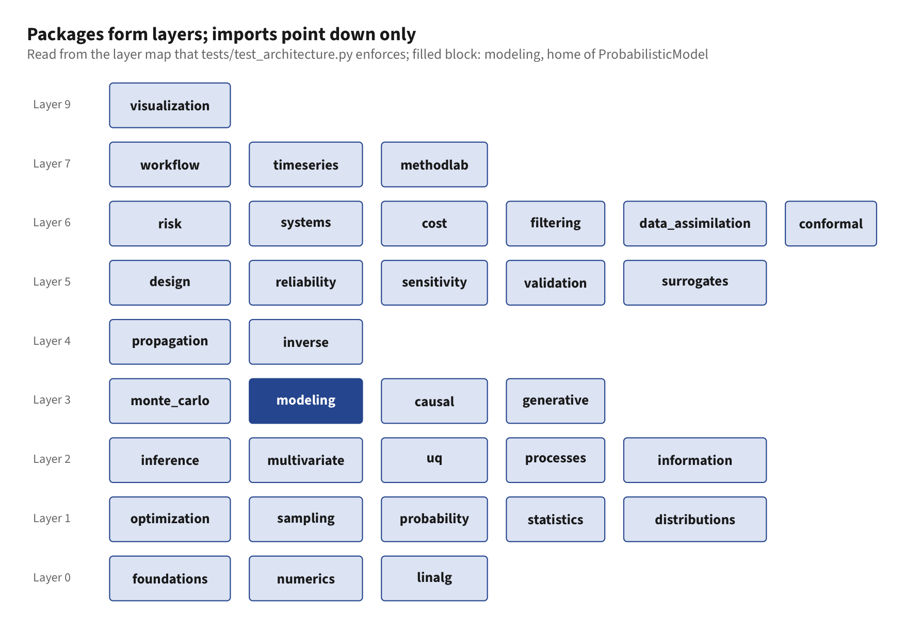</picture>

A package imports only from its own layer or a lower one, and the
architecture test rejects every upward import and import cycle. The diagram
is generated from that test's layer map by
[`tools/build_readme_figures.py`](https://github.com/ayberkdt/Stats-Lab/blob/main/tools/build_readme_figures.py).
35 packages and 3,650 public names, all documented in the
[API reference](https://github.com/ayberkdt/Stats-Lab/blob/main/docs/api-reference.md).

| Area | Packages | Highlights |
|---|---|---|
| Central model and forward | `modeling`, `propagation`, `sampling`, `monte_carlo`, `sensitivity`, `surrogates` | Gaussian, Student-t, Clayton, Gumbel, and Frank copulas, C- and D-vine copulas with sequential fitting, discrete and interval (epistemic) inputs, random fields; nested aleatory-epistemic propagation and p-boxes; Sobol (to 1,024 dimensions, Owen scrambling), Halton, maximin and Iman-Conover LHS; zero-variance control variates, control functionals, and kernel Stein discrepancy; Sobol (six estimators, including stochastic simulators), Shapley, Morris, DGSM, Taylor importance factors, regression (SRC, PRCC) and HSIC indices; polynomial chaos (sparse by LAR or OMP), Gaussian processes (kernel algebra, derivative, sparse, heteroscedastic, multi-output and operator-constrained; fully Bayesian hyperparameters and emulator diagnostics), universal kriging, PC-Kriging, deep ensembles; POD, operator inference, DMD, SINDy, physics-informed networks, hybrid ODEs and DeepONet |
| Reliability and risk | `reliability`, `risk`, `systems` | FORM/SORM, multiple design points, importance, subset (modified Metropolis, aCS, and HMC kernels), line and directional sampling, moving particles, AK-MCS (U, EFF, H) and AK-SS, Wilks bounds and Monte Carlo certification; exact system reliability on BDDs with sifting, dynamic fault trees (PAND, SPARE, FDEP, SEQ), CCF with epistemic parameters, phased missions, Markov and semi-Markov availability; VaR/CVaR, fault and event trees, fragility, GEV/GPD return levels, risk registers, FMECA, value of information, Beta-Bernoulli and linear Thompson-sampling bandits |
| Method development | `methodlab` | Estimator combinators with a derivation lineage (randomized truncation, thinning, extrapolation, best linear unbiased combination, control variates, bias corrections, influence functions), certification checks with scoped verdicts and method cards, pre-specified ADEMP simulation studies with a protocol fingerprint, efficiency ranking, sequential halving, anytime-valid comparison |
| Aerospace engineering | `aerospace` | Liquid-engine performance with the area-Mach inversion and the separation flag, solid-motor ballistics with burst margin, linear thermoacoustic stability with eigenvalue sensitivities, planar ascent through the 1976 standard atmosphere with dispersion budgets, engine and cluster reliability demonstration, atmospheric entry with heat-shield sizing, nozzle wall cooling, debris penetration risk, shell buckling with knockdown factors, engine health monitoring with prognostics, turbopump cavitation, entry reconstruction, orbital lifetime, wind loads, attitude estimation with pointing budgets, power budgets, reentry casualty risk, and conjunction probability with dilution analysis, each as a `ProbabilisticModel` or a function of one |
| Cost | `cost` | Discounting, life-cycle cost models, cost-risk S-curves and JCL, learning curves, maintenance optimisation, spares, cost of unreliability |
| Backward and validation | `inverse`, `inference`, `validation` | Matrix-free inverse problems (Tikhonov, Krylov and hybrid regularization, TV and TGV, Gauss-Newton with adjoints, function-space, ensemble and SMC posteriors; Laplace, RTO, DILI and transport-map posteriors, local-approximation MCMC, the Aristoff-Bangerth benchmark, the inverse heat conduction problem, and the `InverseStudy` report); nonlinear calibration, model discrepancy (Kennedy-O'Hagan with a GP emulator, and for field outputs), transitional MCMC with model-class evidence, adaptive Metropolis, HMC/NUTS, ADVI, a probabilistic-programming interface with reverse-mode gradients, structured (simplex, correlation, covariance) latent sites, marginalized discrete sites, Markov-chain elimination, and dynamic structure, amortized posteriors; stacking and pseudo-BMA model weights; area metric, ASME V&V 20, CRPS and proper scores, PIT, distribution-shift tests |
| Statistical modelling | `inference`, `timeseries`, `conformal` | Regression and GLMs, regularization, hierarchical models, EM and mixtures, missing data and multiple imputation, ARIMA, survival, conformal prediction (split and adaptive under shift) |
| Generative models | `generative` | Planar, radial, and affine-coupling normalizing flows; energy-based models by score matching; Langevin (ULA, MALA) sampling; normalizing-constant and KL diagnostics |
| Decisions | `causal`, `design` | Back-door and front-door identification, IPW/AIPW, E-values; D-optimal and Bayesian experimental design; linear A-, D- and goal-oriented sensor selection, sequential and robust |
| Probability and statistics | `probability`, `distributions`, `statistics`, `multivariate`, `processes`, `information` | 29 distribution families plus affine, truncated, mixture, and empirical wrappers and maximum-entropy laws built from moment constraints; Dirichlet, multinomial, Dirichlet-multinomial, multivariate Student-t, Wishart, and inverse-Wishart laws with conjugate updates; LKJ correlation laws; finite measure spaces, Radon-Nikodym derivatives, conditional expectation, and completeness checks; calibrated goodness of fit and count models with five historical real-data case studies; tests and bootstrap, kernel density, streaming summaries, limit theorems, contingency tables, stochastic and semi-Markov processes, score-based diffusion and neural SDEs, entropy, optimal transport |
| Foundations and dynamics | `foundations`, `linalg`, `optimization`, `numerics`, `filtering`, `data_assimilation`, `uq`, `workflow`, `visualization` | Dense linear algebra, optimizers with bounds and multi-start, forward- and reverse-mode automatic differentiation, adaptive quadrature; an optional NumPy dense backend; a multiple-precision reference backend and performance profiles; Kalman, particle, and ensemble filters; the `UQStudy` workflow and the accessible themed figure library; a batch evaluation contract (`EvaluationRequest`, `run_procedure`, `AskTellSession`) that lets an adaptive algorithm request whole batches of points from a simulator it does not own |

The [ATHENS 2026 coverage matrix](https://github.com/ayberkdt/Stats-Lab/blob/main/docs/curriculum/athens-2026-coverage.md)
tracks all 110 topics of the ATHENS 2026 VV-UQ course; all 110 are
implemented, each with source, tests, and documentation as evidence.

## Documentation: pick the entry point that fits your question

| You want to | Start here |
|---|---|
| Learn the subject in order | [Learning paths](https://github.com/ayberkdt/Stats-Lab/blob/main/docs/learning-path.md): six ordered tracks with prerequisites, labs, and decision records |
| Understand one method | [Foundation guides](https://github.com/ayberkdt/Stats-Lab/tree/main/docs/foundations), starting with [the central model and `UQStudy`](https://github.com/ayberkdt/Stats-Lab/blob/main/docs/foundations/probabilistic-modeling.md); each ends with its common pitfalls |
| Look up a formula or a function | [Mathematical reference](https://github.com/ayberkdt/Stats-Lab/blob/main/docs/math-reference/index.md) (the equation registry by topic) and [API reference](https://github.com/ayberkdt/Stats-Lab/blob/main/docs/api-reference.md) |
| See the library in one sitting | [Overview presentation](https://github.com/ayberkdt/Stats-Lab/blob/main/docs/presentation/README.md): sixteen slides in English and Turkish, every number bound to a fixed-seed run |
| Build intuition by playing | [Interactive explainers](https://github.com/ayberkdt/Stats-Lab/blob/main/examples/interactive_explainers_lab.py): the central limit theorem, Bayesian updating, and Monte Carlo error as offline pages in English and Turkish |
| Run a complete analysis | [Labs](https://github.com/ayberkdt/Stats-Lab/tree/main/examples) and [benchmarks](https://github.com/ayberkdt/Stats-Lab/blob/main/docs/benchmarks.md) |
| Follow the design | [Architecture](https://github.com/ayberkdt/Stats-Lab/blob/main/docs/architecture.md), [decision records](https://github.com/ayberkdt/Stats-Lab/tree/main/docs/adr), [visual language](https://github.com/ayberkdt/Stats-Lab/blob/main/docs/foundations/visual-language.md), [roadmap](https://github.com/ayberkdt/Stats-Lab/blob/main/docs/roadmap.md), and [changelog](https://github.com/ayberkdt/Stats-Lab/blob/main/CHANGELOG.md) |

## Installation: the core needs no dependencies; extras add figures, NumPy, and tools

Python 3.11 or newer. Install straight from the repository, with any extras
in brackets:

```bash
python -m pip install "probstat-library @ git+https://github.com/ayberkdt/Stats-Lab.git"
python -m pip install "probstat-library[visualization] @ git+https://github.com/ayberkdt/Stats-Lab.git"
```

| Extra | Installs | Enables |
|---|---|---|
| none | nothing beyond the standard library | every analysis, report, and number |
| `visualization` | Matplotlib | themed light and dark figures and the HTML study report |
| `numerics` | NumPy | the optional dense linear-algebra backend, selected with `linalg.set_backend("numpy")` |
| `dev` | pytest, ruff, mypy | the checks CI runs |

To work on the library itself:

```bash
python -m pip install -e ".[dev,visualization]"
python -m unittest discover -s tests -v
python -m ruff check .
python -m mypy src/probstat
python benchmarks/run.py --quick     # accuracy, error calibration, and cost per method
```

Before opening a pull request, read the
[contribution contract](https://github.com/ayberkdt/Stats-Lab/blob/main/CONTRIBUTING.md):
a new public function needs a docstring, an equation record, and a citation.

## Citing

If you use Stats-Lab in research, cite the repository release
([`CITATION.cff`](https://github.com/ayberkdt/Stats-Lab/blob/main/CITATION.cff))
and the primary sources linked from the equation records you rely on.

```text
@software{stats_lab,
  title   = {Probability and Statistics Library (Stats-Lab)},
  author  = {{Probability and Statistics Library contributors}},
  version = {0.27.0},
  year    = {2026},
  url     = {https://github.com/ayberkdt/Stats-Lab}
}
```

## Licence

Released under the
[BSD 3-Clause](https://github.com/ayberkdt/Stats-Lab/blob/main/LICENSE)
license. The embedded Joe–Kuo Sobol direction numbers keep their authors'
BSD-style licence
([`LICENSES/JOE-KUO-SOBOL.txt`](https://github.com/ayberkdt/Stats-Lab/blob/main/LICENSES/JOE-KUO-SOBOL.txt)).
