# Stats-Lab

**One probabilistic model answers forward, inverse, risk, and
system-reliability questions, and every formula in the code is traced to a
published source.**


Stats-Lab is a Python library for engineers, analysts, and students who need
to say how uncertain a simulator's answer is, how likely failure is, and what
the data say about the inputs. Those questions are usually answered with
scattered tools: a sampler, a sensitivity package, a reliability code, an
MCMC library, a fault-tree program. Each redefines the inputs, draws from its
own random seed, and reports in its own format, so the answers do not line
up.

Here you define the uncertain inputs and the simulator once, as a
`ProbabilisticModel`. A `UQStudy` runs every analysis on that one object,
derives each stage's random stream from one root seed, counts model
evaluations, and writes one report. Every formula carries an equation ID that
resolves to a primary source, and the core library runs on the Python
standard library alone.

<picture><source media="(prefers-color-scheme: dark)" srcset="https://raw.githubusercontent.com/ayberkdt/Stats-Lab/main/docs/images/readme-one-model-workflow-dark.png">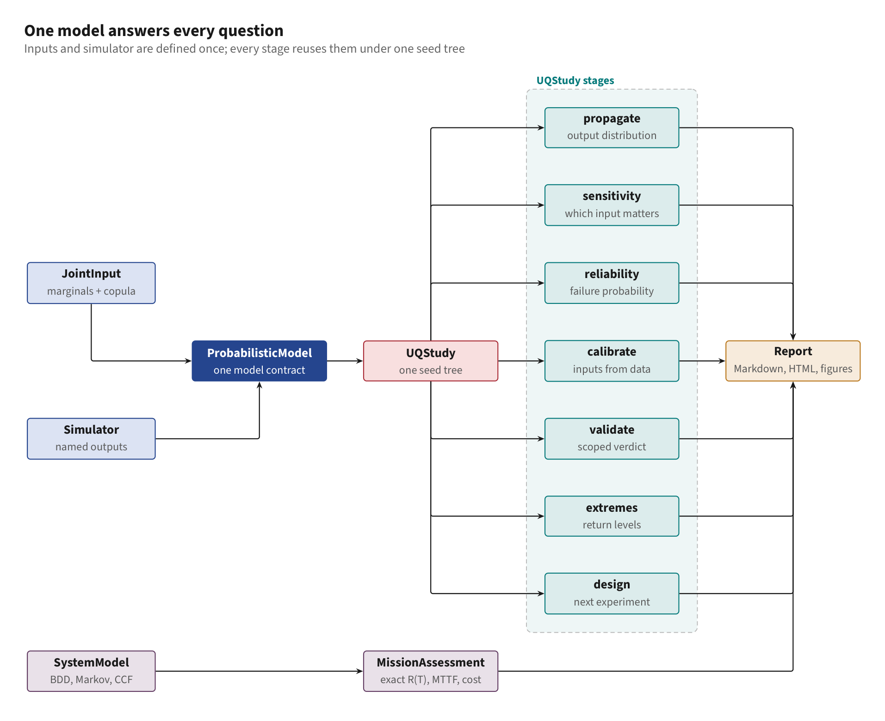</picture>

## Quick start: one model, four answers, one report

Install from a clone (other options are under Installation below):

```bash
git clone https://github.com/ayberkdt/Stats-Lab.git
cd Stats-Lab
python -m venv .venv
source .venv/bin/activate        # Windows: .venv\Scripts\Activate.ps1
python -m pip install -e ".[visualization]"
```

One model, every analysis:

```python
from probstat.distributions import LogNormal, Normal
from probstat.modeling import JointInput, ProbabilisticModel, RandomInput
from probstat.risk import custom_loss
from probstat.uq import QuantityOfInterest
from probstat.workflow import UQStudy

inputs = JointInput.independent(
    RandomInput("load", LogNormal(0.9, 0.25), unit="kN"),
    RandomInput("strength", Normal(4.0, 0.4), unit="kN"),
)
model = ProbabilisticModel(
    inputs,
    lambda p: {"margin": p["strength"] - p["load"]},
    (QuantityOfInterest("margin", "capacity minus demand", "kN"),),
)

study = UQStudy(model, seed=2026)
forward = study.propagate(4096, design="sobol")           # output distribution
sobol = study.sensitivity("margin", 1024)                  # which input matters
methods = study.reliability("margin", 0.0, failure="below")  # FORM, SORM, IS, subset, MC
risk = study.risk("margin", custom_loss(lambda m: 50.0 * max(0.0, -m)), 20_000)

forward["margin"].quantile(0.05)        # 0.124
sobol.ranking()                          # ('load', 'strength')
methods.row("FORM").probability          # 0.0362, first-order approximation
methods.row("MC").probability            # 0.0395, crude Monte Carlo (10 000 runs)
risk.conditional_value_at_risk[0.99]     # 49.8, mean loss in the worst 1%
print(study.report())                    # Markdown: every stage, cost, and seed

from probstat.visualization.study import write_study_html
write_study_html(study, "study.html")    # one page, every stage, light and dark figures
```

The commented values are not illustrations: the test suite runs every Python
block of this README and fails if a computed value differs from the quoted
one at the precision shown.

## Why trust it: the test suite re-checks every number here

| Check | Scale | Enforced by |
|---|---|---|
| Tests | 2,200+ test cases, run in CI on Python 3.11 to 3.13 with lint and strict type checks | [`tests/`](https://github.com/ayberkdt/Stats-Lab/tree/main/tests), [CI workflow](https://github.com/ayberkdt/Stats-Lab/blob/main/.github/workflows/ci.yml) |
| Equations | 1,114 entries in the [equation registry](https://github.com/ayberkdt/Stats-Lab/blob/main/docs/equation-registry.md), each with symbols, assumptions, and a code location | every docstring cites an `EQ-` or `REF-` key that must exist |
| Sources | 550+ primary sources in the [bibliography](https://github.com/ayberkdt/Stats-Lab/blob/main/docs/references.md), each cited at least once | no unused or unknown reference key |
| Decisions | 90+ decision records in [`docs/adr/`](https://github.com/ayberkdt/Stats-Lab/tree/main/docs/adr), each with its verification evidence | [contribution contract](https://github.com/ayberkdt/Stats-Lab/blob/main/CONTRIBUTING.md) |
| Documentation | 50+ Markdown files whose Python examples run, with quoted values compared | [`tests/test_documentation_examples.py`](https://github.com/ayberkdt/Stats-Lab/blob/main/tests/test_documentation_examples.py) |
| Properties | 80+ property-based and metamorphic tests, drawing random valid parameters for every distribution family | [`tests/_properties.py`](https://github.com/ayberkdt/Stats-Lab/blob/main/tests/_properties.py) |
| Figures | text of at least 9 pt inside the canvas; WCAG AA contrast of 4.5:1 for text and 3:1 for marks | [canvas](https://github.com/ayberkdt/Stats-Lab/blob/main/tests/test_figure_canvas.py) and [contrast](https://github.com/ayberkdt/Stats-Lab/blob/main/tests/test_visualization_accessibility.py) tests |
| Packaging | the built wheel passes `twine check --strict`, installs in a clean environment, and passes a smoke test | [`tools/smoke_test_wheel.py`](https://github.com/ayberkdt/Stats-Lab/blob/main/tools/smoke_test_wheel.py) |

Two habits sit behind the table. **Defects are demonstrated, not
suspected:** each is reproduced against an independent oracle (closed form,
exact arithmetic, enumeration, or the multiple-precision reference backend)
and kept as a regression test, and the
[benchmark suite](https://github.com/ayberkdt/Stats-Lab/blob/main/docs/benchmarks.md)
tracks accuracy, error calibration, and cost per method. **Boundaries are
stated:** estimators report their assumptions, model-evaluation cost, and
convergence; unconverged results are flagged; validation returns a scoped
verdict, never "validated".

## One study, every question

Each stage below is a method of `UQStudy`. It reuses the same model, draws
from its own named child stream of the root seed, counts model evaluations,
and adds a section (with a figure) to the report.

| Question | Stages |
|---|---|
| What does the output look like? | `propagate`, `propagate_until` (stops at a target accuracy), `emulate` (polynomial chaos or Gaussian process) |
| Which inputs matter? | `sensitivity` (Sobol), `shapley` (dependent inputs), `screening` (Morris), `information_sensitivity` (mutual information) |
| How likely is failure, and what does it cost? | `reliability`, `form`, `design_points`, `active_reliability` (AK-MCS), `extremes`, `risk` |
| What do the data say about the inputs? | `calibrate`, `calibrate_with_discrepancy` (Kennedy-O'Hagan), `predict` |
| Can the model be trusted, and what should be measured next? | `verify` (solution verification), `validate` (with CRPS, PIT, and coverage), `design` (Bayesian experimental design) |

## Systems engineering: exact mission reliability, risk, and cost

Describe a mission from its subsystems and get exact answers, not samples:

```python
from probstat.systems import (
    BetaFactorGroup, ExponentialComponent, MarkovComponent, SystemModel,
    k_out_of_n, series, standby_system,
)
from probstat.workflow import MissionAssessment

system = SystemModel(
    series(
        "pumps",                                   # a Markov subsystem
        k_out_of_n(2, "cpu1", "cpu2", "cpu3"),     # 2-out-of-3 computers
    ),
    {
        "pumps": MarkovComponent(standby_system(spares=1, failure_rate=1e-4)),
        **{f"cpu{i}": ExponentialComponent(3e-6) for i in (1, 2, 3)},
    },
    ccf_groups=(BetaFactorGroup(("cpu1", "cpu2", "cpu3"), 0.05),),
)
mission = MissionAssessment(system, 720.0, mission_loss_cost=4.5e8)
print(mission.report())   # exact R(T), MTTF, cut sets, importance, cost, risk
```

| Question | Tools |
|---|---|
| Does the system work for the mission? | Exact reliability on binary decision diagrams (`systems.SystemModel`): series, parallel, k-out-of-n, bridges, fault trees; minimal cut/path sets, bounds, MTTF, availability |
| Which component matters? | Birnbaum, criticality, Fussell-Vesely, RAW, RRW, improvement potential |
| Repair, standby, switching, shared crews? | Continuous-time Markov chains solved by uniformization with error bounds (`processes.ContinuousTimeMarkovChain`, `systems.markov`) |
| Phases, retries, aborts? | `PhasedMission` (exact, phase-dependent rates), `MarkovPhasedMission`, `MissionStageModel` (absorbing success/abort/loss outcomes) |
| Redundancy defeated by a shared cause? | Beta-factor, multiple Greek letter, and alpha-factor common-cause groups |
| What do the test data say, and how uncertain is R? | Beta/Gamma posteriors, chi-square bounds, Crow-AMSAA growth (`reliability.data`); exact epistemic moments and Sobol ranking of which data matter |
| What does it cost, and what is at risk? | Life-cycle cost, cost-risk S-curves with correlation, maintenance optimisation, spares, cost of unreliability (`cost`); risk register, FMECA, MIL-STD-882E matrix, F-N curves (`risk`); reliability allocation |

Read the
[systems engineering guide](https://github.com/ayberkdt/Stats-Lab/blob/main/docs/foundations/systems-engineering-guide.md)
and run
[`examples/mission_systems_lab.py`](https://github.com/ayberkdt/Stats-Lab/blob/main/examples/mission_systems_lab.py).

## Visual tour: every figure states its finding in its title

Every lab in [`examples/`](https://github.com/ayberkdt/Stats-Lab/tree/main/examples)
(34 of them) is seeded and reproducible and writes its figures to
`examples/generated/`. All figures share one theme: colour follows meaning
(observed data, model, reference), labels sit on the data, and every figure
exists in a light and a dark palette.

| | |
|---|---|
| <picture><source media="(prefers-color-scheme: dark)" srcset="https://raw.githubusercontent.com/ayberkdt/Stats-Lab/main/docs/images/central-model-design-comparison-dark.png">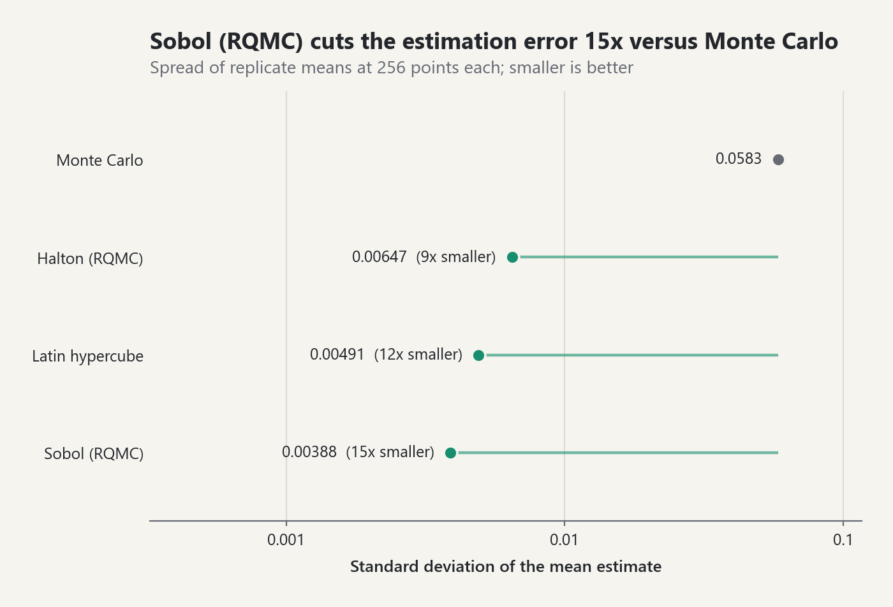</picture> | <picture><source media="(prefers-color-scheme: dark)" srcset="https://raw.githubusercontent.com/ayberkdt/Stats-Lab/main/docs/images/ishigami-sobol-indices-dark.png">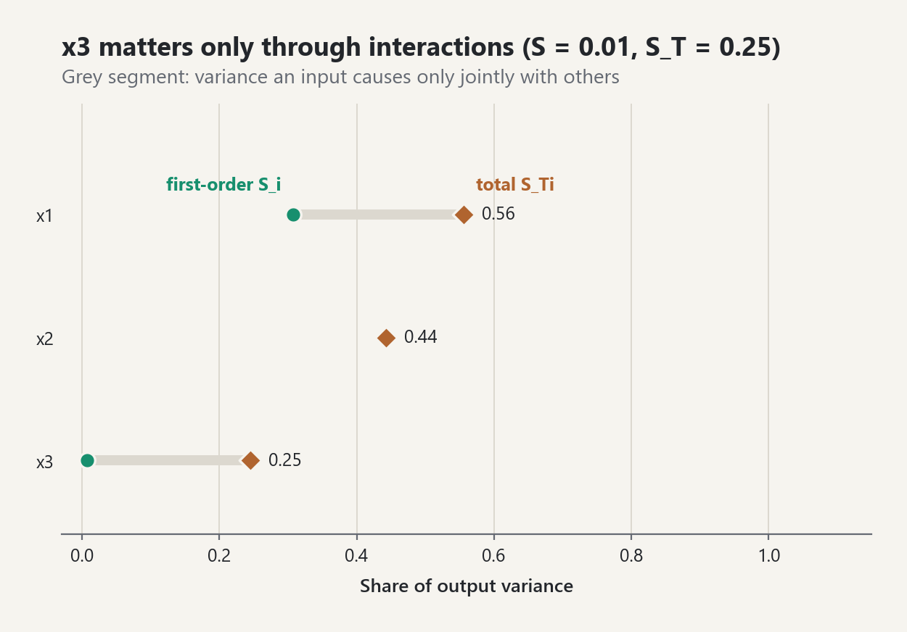</picture> |
| **Forward:** at 256 points, scrambled Sobol cuts the spread of the mean 15x, from 0.0583 to 0.00388. | **Sensitivity:** x3 has a first-order index of 0.01 but a total index of 0.25; it acts only through interactions. |
| <picture><source media="(prefers-color-scheme: dark)" srcset="https://raw.githubusercontent.com/ayberkdt/Stats-Lab/main/docs/images/central-model-form-geometry-dark.png">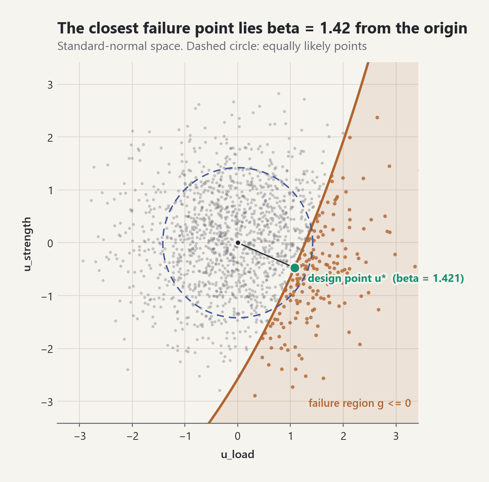</picture> | <picture><source media="(prefers-color-scheme: dark)" srcset="https://raw.githubusercontent.com/ayberkdt/Stats-Lab/main/docs/images/adaptive-reliability-design-points-dark.png">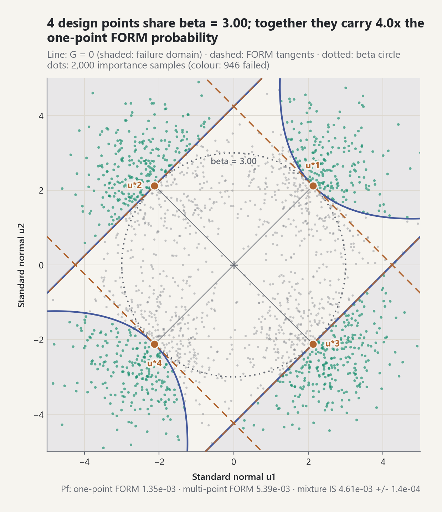</picture> |
| **Reliability:** FORM finds the most likely failure point at β = 1.42 from the origin. | **Rare events:** four design points at β = 3.00 carry 4.0x the one-point FORM probability. |
| <picture><source media="(prefers-color-scheme: dark)" srcset="https://raw.githubusercontent.com/ayberkdt/Stats-Lab/main/docs/images/central-model-loss-exceedance-dark.png">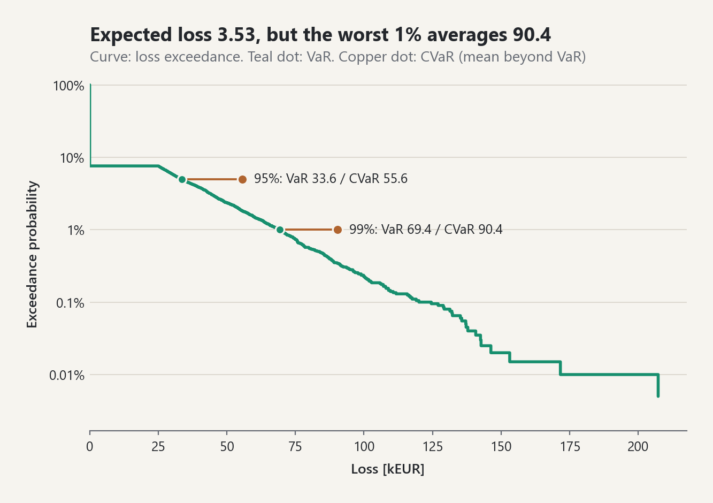</picture> | <picture><source media="(prefers-color-scheme: dark)" srcset="https://raw.githubusercontent.com/ayberkdt/Stats-Lab/main/docs/images/extremes-return-levels-dark.png">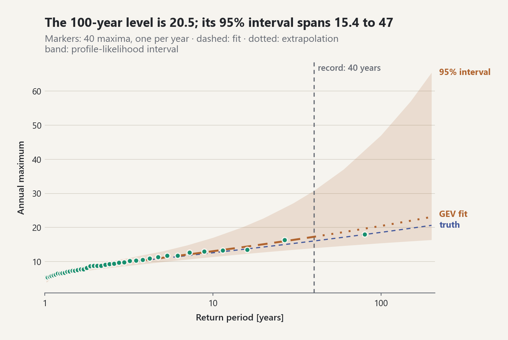</picture> |
| **Risk:** the expected loss is 3.53 kEUR, but the worst 1% of outcomes average 90.4. | **Extremes:** 40 annual maxima give a 100-year level of 20.5 with a 95% interval of 15.4 to 47. |
| <picture><source media="(prefers-color-scheme: dark)" srcset="https://raw.githubusercontent.com/ayberkdt/Stats-Lab/main/docs/images/calibration-forecast-dark.png">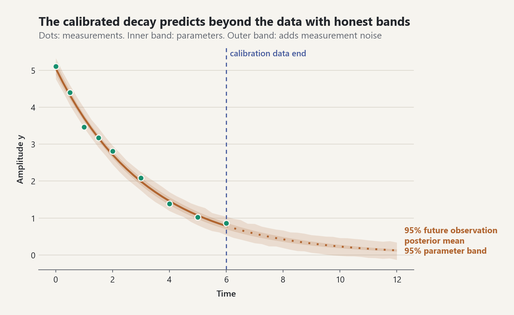</picture> | <picture><source media="(prefers-color-scheme: dark)" srcset="https://raw.githubusercontent.com/ayberkdt/Stats-Lab/main/docs/images/discrepancy-predictions-dark.png">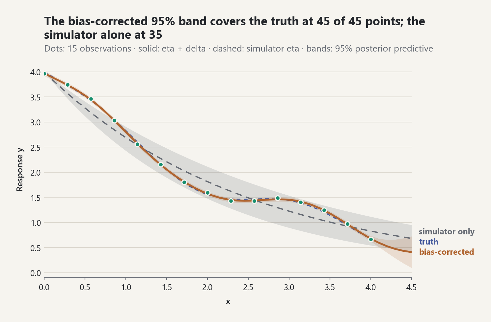</picture> |
| **Calibration:** 9 measurements up to t = 6 calibrate the decay; the 95% bands carry it to t = 12. | **Model error:** with a discrepancy term the 95% band covers the truth at 45 of 45 points; the simulator alone at 35. |
| <picture><source media="(prefers-color-scheme: dark)" srcset="https://raw.githubusercontent.com/ayberkdt/Stats-Lab/main/docs/images/filtering-velocity-dark.png">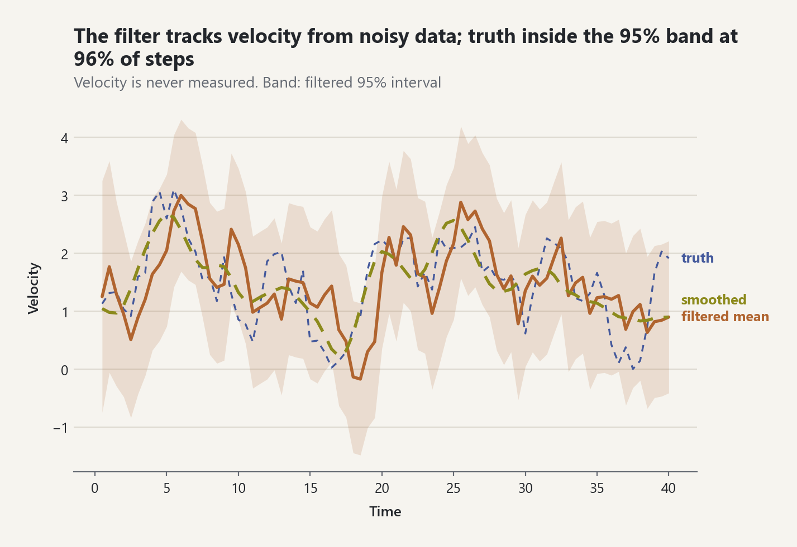</picture> | <picture><source media="(prefers-color-scheme: dark)" srcset="https://raw.githubusercontent.com/ayberkdt/Stats-Lab/main/docs/images/causal-effect-estimates-dark.png">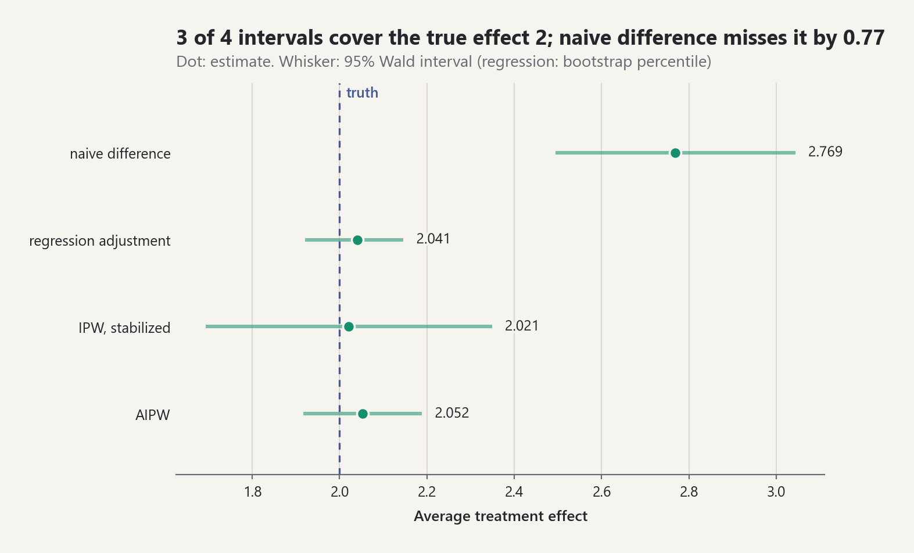</picture> |
| **Filtering:** the velocity is never measured, yet it stays inside the filter's 95% band at 96% of steps. | **Causal:** 3 of 4 intervals cover the true effect 2; the naive difference misses it by 0.77. |

Start with
[`examples/uq_study_complete_lab.py`](https://github.com/ayberkdt/Stats-Lab/blob/main/examples/uq_study_complete_lab.py)
(one study through every stage, written to an HTML report) or
[`examples/central_model_lab.py`](https://github.com/ayberkdt/Stats-Lab/blob/main/examples/central_model_lab.py)
(the same steps with the low-level APIs).

## What's inside: 33 packages in 9 dependency layers

<picture><source media="(prefers-color-scheme: dark)" srcset="https://raw.githubusercontent.com/ayberkdt/Stats-Lab/main/docs/images/readme-package-layers-dark.png">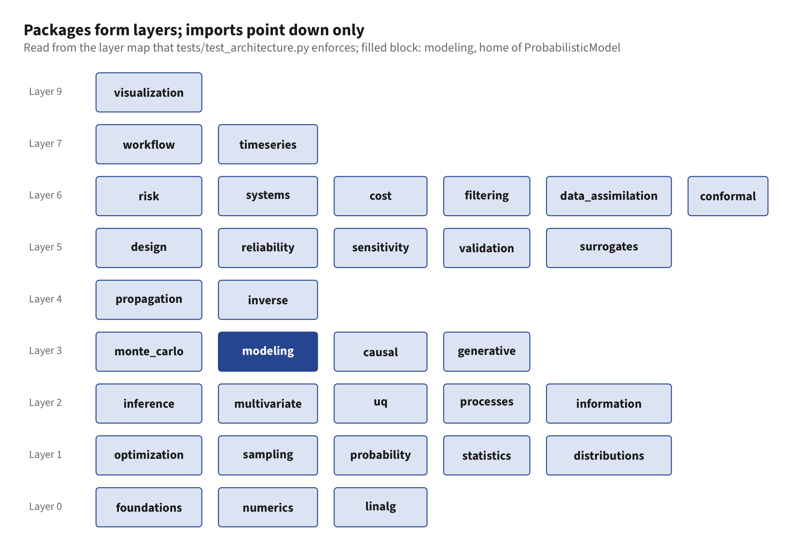</picture>

A package imports only from its own layer or a lower one, and the
architecture test rejects every upward import and import cycle. The diagram
is generated from that test's layer map by
[`tools/build_readme_figures.py`](https://github.com/ayberkdt/Stats-Lab/blob/main/tools/build_readme_figures.py).
33 packages and 1,654 public names, all documented in the
[API reference](https://github.com/ayberkdt/Stats-Lab/blob/main/docs/api-reference.md).

| Area | Packages | Highlights |
|---|---|---|
| Central model and forward | `modeling`, `propagation`, `sampling`, `monte_carlo`, `sensitivity`, `surrogates` | Gaussian, Student-t, Clayton, Gumbel, and Frank copulas, C- and D-vine copulas with sequential fitting, discrete and interval (epistemic) inputs, random fields; nested aleatory-epistemic propagation and p-boxes; Sobol (to 1,024 dimensions, Owen scrambling), Halton, maximin and Iman-Conover LHS; zero-variance control variates, control functionals, and kernel Stein discrepancy; Sobol (including stochastic simulators), Shapley, Morris, DGSM, and given-data indices; polynomial chaos and Gaussian processes |
| Reliability and risk | `reliability`, `risk`, `systems` | FORM/SORM, multiple design points, importance, subset, and line sampling, AK-MCS; exact system reliability on BDDs with sifting, dynamic fault trees (PAND, SPARE, FDEP, SEQ), CCF with epistemic parameters, phased missions, Markov and semi-Markov availability; VaR/CVaR, fault and event trees, fragility, GEV/GPD return levels, risk registers, FMECA, value of information |
| Cost | `cost` | Discounting, life-cycle cost models, cost-risk S-curves and JCL, learning curves, maintenance optimisation, spares, cost of unreliability |
| Backward and validation | `inverse`, `inference`, `validation` | Nonlinear calibration, model discrepancy, adaptive Metropolis, HMC/NUTS, ADVI, a probabilistic-programming interface with reverse-mode gradients, structured (simplex, correlation, covariance) latent sites, marginalized discrete sites, Markov-chain elimination, and dynamic structure, amortized posteriors; stacking and pseudo-BMA model weights; area metric, ASME V&V 20, CRPS and proper scores, PIT, distribution-shift tests |
| Statistical modelling | `inference`, `timeseries`, `conformal` | Regression and GLMs, regularization, hierarchical models, EM and mixtures, missing data and multiple imputation, ARIMA, survival, conformal prediction (split and adaptive under shift), Thompson-sampling bandits |
| Generative models | `generative` | Planar, radial, and affine-coupling normalizing flows; energy-based models by score matching; Langevin (ULA, MALA) sampling; normalizing-constant and KL diagnostics |
| Decisions | `causal`, `design` | Back-door and front-door identification, IPW/AIPW, E-values; D-optimal and Bayesian experimental design |
| Probability and statistics | `probability`, `distributions`, `statistics`, `multivariate`, `processes`, `information` | 29 distribution families plus affine, truncated, mixture, and empirical wrappers; Dirichlet, multinomial, Dirichlet-multinomial, multivariate Student-t, Wishart, and inverse-Wishart laws with conjugate updates; LKJ correlation laws; finite measure spaces, Radon-Nikodym derivatives, conditional expectation, and completeness checks; calibrated goodness of fit and count models with five historical real-data case studies; tests and bootstrap, kernel density, streaming summaries, limit theorems, contingency tables, stochastic and semi-Markov processes, score-based diffusion and neural SDEs, entropy, optimal transport |
| Foundations and dynamics | `foundations`, `linalg`, `optimization`, `numerics`, `filtering`, `data_assimilation`, `uq`, `workflow`, `visualization` | Dense linear algebra, optimizers with bounds and multi-start, forward- and reverse-mode automatic differentiation, adaptive quadrature; an optional NumPy dense backend; a multiple-precision reference backend and performance profiles; Kalman, particle, and ensemble filters; the `UQStudy` workflow and the accessible themed figure library |

The [ATHENS 2026 coverage matrix](https://github.com/ayberkdt/Stats-Lab/blob/main/docs/curriculum/athens-2026-coverage.md)
tracks all 110 topics of the ATHENS 2026 VV-UQ course; all 110 are
implemented, each with source, tests, and documentation as evidence.

## Documentation: pick the entry point that fits your question

| You want to | Start here |
|---|---|
| Learn the subject in order | [Learning paths](https://github.com/ayberkdt/Stats-Lab/blob/main/docs/learning-path.md): six ordered tracks with prerequisites, labs, and decision records |
| Understand one method | [Foundation guides](https://github.com/ayberkdt/Stats-Lab/tree/main/docs/foundations), starting with [the central model and `UQStudy`](https://github.com/ayberkdt/Stats-Lab/blob/main/docs/foundations/probabilistic-modeling.md); each ends with its common pitfalls |
| Look up a formula or a function | [Mathematical reference](https://github.com/ayberkdt/Stats-Lab/blob/main/docs/math-reference/index.md) (the equation registry by topic) and [API reference](https://github.com/ayberkdt/Stats-Lab/blob/main/docs/api-reference.md) |
| See the library in one sitting | [Overview presentation](https://github.com/ayberkdt/Stats-Lab/blob/main/docs/presentation/README.md): sixteen slides in English and Turkish, every number bound to a fixed-seed run |
| Build intuition by playing | [Interactive explainers](https://github.com/ayberkdt/Stats-Lab/blob/main/examples/interactive_explainers_lab.py): the central limit theorem, Bayesian updating, and Monte Carlo error as offline pages in English and Turkish |
| Run a complete analysis | [Labs](https://github.com/ayberkdt/Stats-Lab/tree/main/examples) and [benchmarks](https://github.com/ayberkdt/Stats-Lab/blob/main/docs/benchmarks.md) |
| Follow the design | [Architecture](https://github.com/ayberkdt/Stats-Lab/blob/main/docs/architecture.md), [decision records](https://github.com/ayberkdt/Stats-Lab/tree/main/docs/adr), [visual language](https://github.com/ayberkdt/Stats-Lab/blob/main/docs/foundations/visual-language.md), [roadmap](https://github.com/ayberkdt/Stats-Lab/blob/main/docs/roadmap.md), and [changelog](https://github.com/ayberkdt/Stats-Lab/blob/main/CHANGELOG.md) |

## Installation: the core needs no dependencies; extras add figures, NumPy, and tools

Python 3.11 or newer. Install straight from the repository, with any extras
in brackets:

```bash
python -m pip install "probstat-library @ git+https://github.com/ayberkdt/Stats-Lab.git"
python -m pip install "probstat-library[visualization] @ git+https://github.com/ayberkdt/Stats-Lab.git"
```

| Extra | Installs | Enables |
|---|---|---|
| none | nothing beyond the standard library | every analysis, report, and number |
| `visualization` | Matplotlib | themed light and dark figures and the HTML study report |
| `numerics` | NumPy | the optional dense linear-algebra backend, selected with `linalg.set_backend("numpy")` |
| `dev` | pytest, ruff, mypy | the checks CI runs |

To work on the library itself:

```bash
python -m pip install -e ".[dev,visualization]"
python -m unittest discover -s tests -v
python -m ruff check .
python -m mypy src/probstat
python benchmarks/run.py --quick     # accuracy, error calibration, and cost per method
```

Before opening a pull request, read the
[contribution contract](https://github.com/ayberkdt/Stats-Lab/blob/main/CONTRIBUTING.md):
a new public function needs a docstring, an equation record, and a citation.

## Citing

If you use Stats-Lab in research, cite the repository release
([`CITATION.cff`](https://github.com/ayberkdt/Stats-Lab/blob/main/CITATION.cff))
and the primary sources linked from the equation records you rely on.

```text
@software{stats_lab,
  title   = {Probability and Statistics Library (Stats-Lab)},
  author  = {{Probability and Statistics Library contributors}},
  version = {0.19.0},
  year    = {2026},
  url     = {https://github.com/ayberkdt/Stats-Lab}
}
```

## Licence

Released under the
[BSD 3-Clause](https://github.com/ayberkdt/Stats-Lab/blob/main/LICENSE)
license. The embedded Joe–Kuo Sobol direction numbers keep their authors'
BSD-style licence
([`LICENSES/JOE-KUO-SOBOL.txt`](https://github.com/ayberkdt/Stats-Lab/blob/main/LICENSES/JOE-KUO-SOBOL.txt)).
