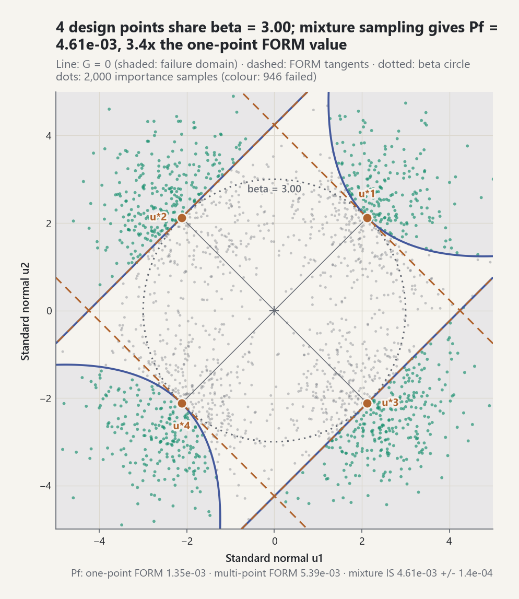
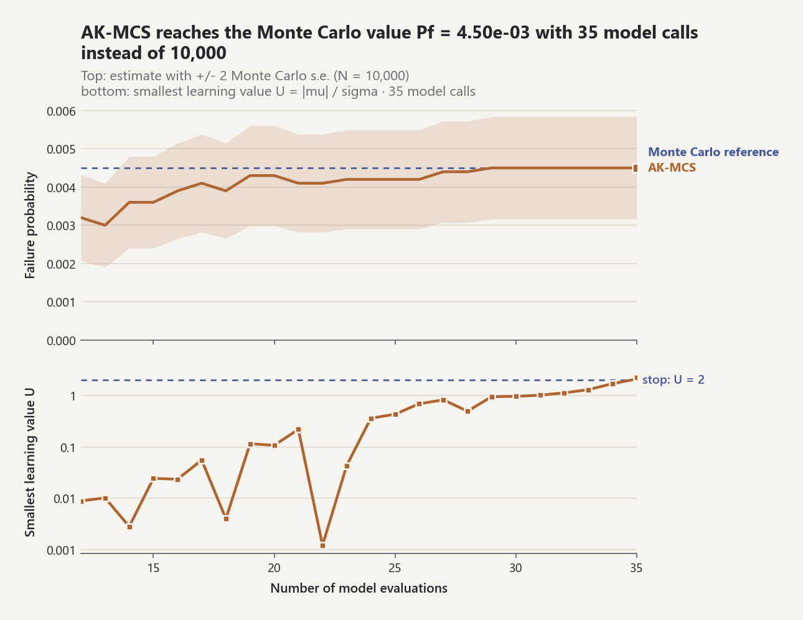

# Adaptive Reliability: Lines, Multiple Design Points, and AK-MCS

This guide extends [model-based reliability](advanced-reliability.md). All
methods work on a `ModelLimitState` in independent standard-normal space `u`,
and every number below comes from runs of this release (the lab
`examples/adaptive_reliability_lab.py` prints most of them).

## 1. A guard for covariance-adapted CE-IS

`cross_entropy_importance_sampling(adapt_covariance=True)` fits the elite
covariance at every level. For a near-planar failure domain the elite points
are a thin slab, so the variance along the important direction collapses. With
a Gaussian proposal `h = N(mu, Sigma)` the weight second moment
`int phi_n^2 / h` is finite only when every eigenvalue of `Sigma` exceeds `1/2`
[EQ-REL-CE-003]. Below that the weights are heavy-tailed. The sample variance
cannot see a tail it never sampled, so the estimate is biased low and its
c.o.v. looks small.

Two changes follow:

- Adapted covariances are projected onto `lambda_min >= covariance_floor`
  (default `0.55`) at every level. `covariance_floor=None` keeps the old
  behaviour for study.
- The result reports `failure_effective_sample_size` (Kish ESS of the failure
  weights), `min_covariance_eigenvalue`, and `weights_degenerate`. A
  `UserWarning` fires when an eigenvalue is `<= 1/2` or when the failure ESS
  is below `0.01 * final_samples`.

The Kish ESS alone does not detect the collapse. In the runs below several
unguarded estimates are 35-62% low while their failure ESS is 60-402. The
eigenvalue test catches every one of them.

`G = 4 - (u1 + u2)/sqrt 2`, exact `P_f = 3.1671e-5`, `N = 1000` per level:

| seed | floor | `P_f` | ratio | c.o.v. | z | `lambda_min` | flagged |
| --- | --- | --- | --- | --- | --- | --- | --- |
| 1 | none | 1.2129e-5 | 0.383 | 0.125 | -12.89 | 0.0005 | yes |
| 1 | 0.55 | 3.2865e-5 | 1.038 | 0.055 | 0.66 | 0.55 | no |
| 2 | none | 2.0614e-5 | 0.651 | 0.039 | -13.90 | 0.0035 | yes |
| 2 | 0.55 | 3.1232e-5 | 0.986 | 0.058 | -0.24 | 0.55 | no |
| 3 | none | 0 | 0 | inf | — | 0.0000 | yes |
| 3 | 0.55 | 3.3558e-5 | 1.060 | 0.055 | 1.03 | 0.55 | no |

With `N = 500` and seeds 1-8, the guarded ratios to the exact value were
1.013, 1.080, 1.089, 0.912, 0.965, 0.966, 0.784, and 0.949. The z-scores were
0.17, 0.95, 1.10, -1.17, -0.45, -0.45, -3.16, and -0.64, so one of eight runs
was just outside 3 SE. All eight unguarded runs were flagged. One of them
(seed 2, ratio 1.009) was accurate by luck: the flag is conservative. The
mean-shift default never builds a covariance, so it gives the same numbers as
before. At `N = 1000`, seeds 1-5 gave 3.357e-5, 3.175e-5, 2.954e-5, 3.313e-5,
and 2.827e-5 both before and after the change.

**Several failure regions.** One Gaussian proposal follows one failure
region. The others get almost no samples, their weights are never observed,
and the weight diagnostics above stay healthy. On the four-branch system
(exact `4.457e-3`, mean-shift default, `N = 500`, integer seeds 1-10), seven
runs converged on one region and returned `0.95e-3` to `1.76e-3` with
`z = -7` to `-32` and failure ESS 21-126. Until ADR-0054 none of them warned.
The first adaptation level is drawn from the starting density before any
adaptation, so its elite points show where `G` is small in every direction.
`uncovered_elite_fraction` is the share of them behind the origin as seen from
the final proposal mean (`u . mu / ||mu|| <= 0`) [EQ-REL-CE-004]. Above
`CE_MAX_UNCOVERED_ELITE_FRACTION = 0.1` a `UserWarning` recommends
`find_design_points` with `mixture_importance_sampling`, or
`subset_simulation`, and `multiple_failure_regions_suspected` is set. The
seven runs gave 0.48-0.58. In the other three the mean stalled near the
origin (`||mu|| < 1`, 20 levels without converging). The check is skipped
there, and the existing failure-ESS warning fired (ESS 2-4). On the
single-region benchmark problems (both linear cases, the parabola, the
lognormal capacity-demand case; 10 seeds each) the fraction was 0.00 in 39 of
40 runs and 0.02 in one, so none warned. With `adapt_covariance=True` and
`N = 1000` the four-branch proposal stayed centred near the origin with a wide
covariance and covered all four regions (`|z| <= 1.2`, check skipped). The
check costs no model calls. It cannot see a region with no first-level elite
point, and an `initial_mean` weakens it.

## 2. Line sampling

`line_sampling` draws `u ~ N(0, I)`, removes its component along the
important direction `alpha` (the FORM `alpha` by default), and finds the
crossing `c_k` of `G(u_perp + c alpha) = 0` by bracket doubling and Brent's
method. The line contributes `p_k = Phi(-c_k)` [EQ-REL-LINE-001]. A line with
no crossing in `|c| <= max_distance` contributes exactly 0 if it is safe at
`+max_distance` (distance `+inf`) and exactly 1 if it fails at
`-max_distance` (distance `-inf`). The neglected mass is at most
`Phi(-max_distance)` per line. Before this release the public docstring said
such lines contribute `Phi(-max_distance)`, while the code returned exactly 0
or 1. The docstrings now state the code's behaviour, which also matches the
equation registry.

| case | `P_f` | reference | SE / c.o.v. | calls |
| --- | --- | --- | --- | --- |
| plane, `d = 3`, `beta = 3.5`, 30 lines | 2.326291e-4 | `Phi(-3.5)` = 2.326291e-4 | c.o.v. 0 | 90 + 14 (FORM) |
| `G = 3 - u2 + 0.15 u1^2`, 200 lines | 9.77749e-4 | quadrature 9.50811e-4 | SE 2.78e-5 (z = 0.97) | 826 |
| safe band (`G = 5 + u2^2` for `abs(u1) >= 1`), 400 lines | 9.58428e-4 | 9.21561e-4 | SE 3.07e-5 | — |

In the band case 116 of 400 lines never cross and contribute exactly 0.

## 3. Multiple design points

`find_design_points` follows the bulging idea of Der Kiureghian and Dakessian
[REF-DERKIUREGHIAN-DAKESSIAN-1998]. After the FORM point `u_1`, HL-RF runs on

`G_b(u) = G(u) + sum_j h_j (1 - ||u - u_j||^2 / r_j^2)^2_+`

with `r_j = 1.1 beta_j` and `h_j = 0.75 G(0)` [EQ-REL-MDP-001]. Each point
found on the bulged surface is refined on the original `G` and accepted only
if it is new. The quartic profile, the scaling by `G(0)`, and the defaults are
this library's choices. The exact profile used in the paper was not checked
(the full text was not available).

HL-RF is local, and the bulge gradient at the origin points along `u_1`. A
single restart from the origin is therefore drawn back towards `u_1` whenever
`grad G(0)` points there. On `G = min(3 - u1, 3.2 - (-0.6 u1 + 0.8 u2))` the
origin-only rule (`starts="origin"`) finds one point and stops. The default
`starts="axes"` also starts from `+-beta_1 e_i` and keeps the nearest new
point. It finds both points (`beta = 3.0, 3.2`) in 504 calls.

`multi_point_form` treats the modes as a series system:
`P_f ~= 1 - Phi_m(beta; R)` with `R_ij = alpha_i . alpha_j` [EQ-REL-MDP-002].
One or two points use closed forms (the second via the existing bivariate
normal CDF). Three or more use Genz's separation of variables with a standard
error [EQ-REL-MVN-001]. Rank-deficient rows (`rho = +-1`) are folded into
two-sided bounds, so antipodal modes cost no sampling noise.
`mixture_importance_sampling` samples `sum_k pi_k N(u_k*, I)` and is unbiased
[EQ-REL-MDP-003].

| problem | exact / reference | FORM (one point) | multi-point FORM | mixture IS |
| --- | --- | --- | --- | --- |
| two planes | 2.037036e-3 (bivariate) | 1.349898e-3 | 2.037036e-3 | 1.9027e-3 +- 8.6e-5 (2000) |
| four-branch, `k = 6` | crude MC 4.4750e-3 +- 1.5e-4 (2e5) | 1.3499e-3 | 5.3923e-3 (4 points, SE 3e-15) | 4.6069e-3 +- 1.4e-4 (4000) |

The four-branch function has four design points, all with `beta = 3` (1010
calls with the axes rule). Multi-point FORM equals the linearized value
`1 - (1 - 2 Phi(-3))^2`, which overestimates because two branches curve away
from the origin. Mixture IS agrees with crude Monte Carlo. The four-branch
`G` has a kink at the origin, where the central-difference gradient vanishes,
so the first FORM run is started at `(0.3, 0.1)`.

<picture><source media="(prefers-color-scheme: dark)" srcset="../images/guides/adaptive-reliability-design-points-dark.png"></picture>

*All 4 design points of the four-branch function lie on the beta circle at beta = 3.00, and one FORM point sees only one of the four failure regions; importance samples from the mixture centred on all of them give Pf = 4.61e-03, 3.4x the one-point FORM value and in line with crude Monte Carlo.*

## 4. AK-MCS

`ak_mcs` follows Echard, Gayton, and Lemaire
[REF-ECHARD-GAYTON-LEMAIRE-2011]:

1. Draw a Monte Carlo population in `u` space.
2. Fit a GP to `G` on a small space-filling design.
3. Repeatedly add the population point with the smallest
   `U = |mu| / sigma` (or the largest `EFF` or `H`, §4.1).
4. Stop when `min U >= 2` [EQ-REL-AKMCS-001] (or on the `P_f` bounds,
   §4.2).
5. Estimate `P_f = N_f / N` from the predicted signs, and enlarge the
   population while its c.o.v. exceeds the target [EQ-REL-AKMCS-002].

`evaluations` is read from the model's evaluation counter.
`compare_with_monte_carlo=True` evaluates the true `G` on the final population
and reports the same-population crude MC value and the number of
misclassified signs. These calls are counted separately.

Implementation choices that are not part of the published method:

- The GP is a library `matern52` GP in `u` space. Its hyperparameters are
  re-estimated (warm-started) when the training set has grown by a factor of
  `1.5`, and again before learning may stop. Between fits the posterior over
  the population is updated exactly by rank-one Cholesky updates, at `O(n)`
  per point per step.
- The initial design is an LHS in the box `[-5, 5]^d` (`design_bound`).
  Echard et al. draw it from the population. With a design mapped through
  `Phi^-1` (`design_bound=None`), seed 3 stopped at once: 12 points, all
  inside `abs(u) < 2`, gave a confidently wrong GP with `min U >= 2` and no
  predicted failure. It returned `P_f = 0` after enlarging the population to the 200 000 cap, where crude MC on the same points gave 4.175e-3.
  Such a run is now reported as not converged. The GP regularization below
  does not change this run.
- GP hyperparameters are fitted with `GaussianProcessRegularization()` by
  default (ADR-0054, [EQ-SUR-GP-006]). Length scales stay between a tenth of
  the smallest coordinate gap and 20 times the extent of the training set,
  and the diagonal keeps at least `1e-8 sigma_f^2`. `regularization=None`
  restores plain maximum likelihood. Without it, `G = 3 + u1^2/4 - u2` gave
  length scales `8e2`-`2e5`, a signal-to-noise ratio of about `1e18`, and
  `min U` of 231-1370 right after the 12-point design (seeds 1-10,
  `N = 2000`, `target_cov = 1`), so learning stopped without adding a point.
  These surrogates happened to classify every population point correctly,
  also when the population grew from `10^4` to `5 * 10^4`
  (`target_cov = 0.1`, seeds 1-5, `min U` up to 545): the misclassification
  count does not reveal the overconfidence, and `min U` no longer measures
  sign uncertainty. Regularized, the same runs added 3-7 points,
  misclassified none, and stopped at `min U` 2.05-4.6. On the four-branch
  function (`N = 2000`, seeds 1-10) both fits used 20-30 calls and
  misclassified nothing.

Four-branch system (`k = 6`), `N = 10^4`, `target_cov` not binding:

| seed | calls | added | `P_f` AK-MCS | `P_f` crude MC, same population | misclassified |
| --- | --- | --- | --- | --- | --- |
| 1 | 35 | 23 | 4.5000e-3 | 4.5000e-3 | 0 |
| 2 | 34 | 22 | 3.7000e-3 | 3.7000e-3 | 0 |
| 3 | 43 | 31 | 5.1000e-3 | 5.1000e-3 | 0 |
| 4 | 37 | 25 | 4.8000e-3 | 4.8000e-3 | 0 |
| 5 | 41 | 29 | 3.8000e-3 | 3.9000e-3 | 1 |

<picture><source media="(prefers-color-scheme: dark)" srcset="../images/guides/adaptive-reliability-ak-mcs-learning-dark.png"></picture>

*Seed 1 of the table: the estimate settles on the same-population Monte Carlo value Pf = 4.50e-03 as the smallest learning value U climbs past 2, after 35 model calls instead of the 10,000 that crude Monte Carlo on the population would spend.*

Starting from `N = 5000` with `target_cov = 0.15`, the population grew to
10 000 and the run used 36 calls (`P_f = 4.5e-3`, the same as crude MC on the
same points, c.o.v. 0.149).

All five seeds and the growing-population run give the same calls and
estimates with `regularization=None`. Seed 5 misclassified one point
(`min U = 2.19`). The `min U >= 2` rule bounds each point's sign error by
about 2.3%, not the count over `10^4` points.

On this problem the kernel choice did not change the outcome. With
`squared_exponential`, `N = 5000`, and `target_cov = 1`, seeds 1 and 2
needed 34 and 26 calls and matched crude MC on the same population
(`P_f = 5.8e-3` and `4.2e-3`, nothing misclassified), with and without
regularization. The Matérn kernel remains the default.

### 4.1 Learning functions

The learning function rates every population point from the surrogate's
predictive law `G(u) ~ N(mu, sigma^2)`. The next model call goes to the best
rated point, and learning stops when the best rating is no longer worth a
call. `ak_mcs(learning=...)` offers three functions; `learning_value`,
`select_learning_point`, and `stopping_satisfied` in `probstat.reliability`
expose them for other candidate pools.

| `learning` | value | next point | default stop | source |
| --- | --- | --- | --- | --- |
| `"U"` (default) | `abs(mu) / sigma` | smallest | `min U >= 2` | [EQ-REL-AKMCS-001] |
| `"EFF"` | `E[(epsilon - abs(G))_+]`, `epsilon = 2 sigma` | largest | `max EFF <= 0.001` | [EQ-REL-AL-EFF-001] |
| `"H"` | entropy of `G` on `abs(G) <= 2 sigma` | largest | `max H <= 0.5` | [EQ-REL-AL-H-001] |

`learning_threshold=None` takes the default of the chosen function, so a
caller that passes `2.0` with `U` gets the same run as before. `U` is
scale-free. `EFF` is in the units of `G`, and `H` contains `ln sigma`, so
their published thresholds assume a limit state of order one; rescale `G` or
pass a threshold when it is not. `EFF` [REF-BICHON-ETAL-2008] is the expected
amount by which the prediction falls inside the band `abs(G) <= 2 sigma`.
`H` [REF-LV-LU-WANG-2015] is the differential entropy of the prediction on
the same band; the stopping value 0.5 is the one used by Du and Xu
[REF-DU-XU-2023].

```python
from probstat.reliability import LEARNING_THRESHOLDS, learning_value

LEARNING_THRESHOLDS["EFF"]               # 0.001
learning_value("U", 0.3, 0.2)            # 1.5
learning_value("EFF", 0.3, 0.2)          # 0.1278
learning_value("H", 0.3, 0.2)            # 0.2212
```

Four-branch system (`k = 6`), `N = 10^4`, `target_cov = 1`, seeds 1-5 (model
calls / misclassified population points against crude MC on the same
population):

| seed | `U` | `EFF` | `H` | `U` + bound stop | `U` + maximin design |
| --- | --- | --- | --- | --- | --- |
| 1 | 35 / 0 | 42 / 0 | 34 / 5 | 31 / 0 | 33 / 0 |
| 2 | 34 / 0 | 40 / 0 | 31 / 3 | 33 / 0 | 36 / 0 |
| 3 | 43 / 0 | 51 / 0 | 50 / 0 | 39 / 2 | 43 / 0 |
| 4 | 37 / 0 | 43 / 0 | 34 / 6 | 35 / 0 | 45 / 0 |
| 5 | 41 / 1 | 50 / 0 | 43 / 0 | 38 / 1 | 37 / 0 |

`EFF` spent 6-9 more calls than `U` and misclassified nothing. `H` stopped
earlier on three seeds and then left 3-6 signs wrong out of `10^4` (seed 4:
`P_f = 4.6e-3` against `4.8e-3`): with this limit state, `max H <= 0.5` is a
looser stop than `min U >= 2`. On the oscillator benchmark (`N = 10^4`, seed
1, six inputs, 14-point design) `U` used 47 calls and `EFF` 46; both gave
`P_f = 2.90e-2`, equal to crude MC on the same population, with nothing
misclassified.

### 4.2 Stopping on the failure-probability bounds

`stopping="bounds"` replaces the pointwise threshold with a statement about
the estimate itself [REF-SCHOBI-SUDRET-MARELLI-2017]. Counting a population
point as failed when `mu + 1.96 sigma <= 0` gives `P_f^-`, when
`mu - 1.96 sigma <= 0` gives `P_f^+`, and learning stops when
`(P_f^+ - P_f^-) / P_f^0 <= bounds_tolerance` (default `0.1`)
[EQ-REL-AL-BOUNDS-001]. The learning function still chooses the points. Every
`AKMCSIteration` and the result carry `lower_probability` and
`upper_probability` under either rule.

```python
from probstat.reliability import bounds_satisfied, probability_bounds

bounds = probability_bounds([-1.0, -0.1, 0.1, 1.0], [0.01] * 4)
bounds                                   # (0.25, 0.5, 0.75)
bounds_satisfied(*bounds, tolerance=0.1) # False
```

In the table above the bound rule saved 1-4 calls on every seed and stopped
with `min U` between 0.94 and 2.0. Seeds 3 and 5 then misclassified two and
one points, and the same-population MC value lay just above the upper bound
(seed 3: `5.1e-3` against `[4.7e-3, 5.0e-3]`). The bounds describe the
surrogate's own uncertainty, so they are as overconfident as its `sigma`;
the rule accepts up to 10% relative uncertainty in `P_f` and is not a
guarantee for every point.

### 4.3 The surrogate protocol

`ak_mcs` reads only a predictive mean and variance per population point
(ADR-0106). `surrogates.ProbabilisticSurrogate` is that interface
(`predict` and `predict_with_variance(x) -> (mean, variance)`), and
`surrogates.SurrogateFactory` is the refit hook
`(points, values, previous) -> surrogate`. Passing `surrogate=factory` makes
`ak_mcs` call the factory on the initial design and after every added point
and re-predict the population with the returned surrogate.
`GaussianProcessFactory` implements the hook with a warm-started likelihood
fit per call.

The population side is `PopulationPosterior`: `population`, `means`,
`variances`, and `training_points`, updated by `add_training`,
`add_population`, and `replace_population`. The default path uses
`GaussianProcessPopulationPosterior`, the incremental rank-one update above;
the factory path uses `SurrogatePopulationPosterior`, which refits and
re-predicts everything. Both keep their training data when the candidate pool
is replaced, which a method with a new pool per stage needs.

With `GaussianProcessFactory(regularization=GaussianProcessRegularization(),
seed=1)` on the four-branch system (`N = 10^4`, seed 1) the factory path used
36 calls and 25 fits and gave `P_f = 4.5e-3` with nothing misclassified, the
same estimate as the incremental path (35 calls). It ran for 78 s: each step
pays a full likelihood fit and `10^4` predictions, where the incremental path
pays `O(n)` per point between geometric refits.

### 4.4 Initial design and multiple failure regions

The learning function sees only where the surrogate is uncertain. A failure
region that no training point is near can be predicted safe with a small
`sigma`, and then no learning function will ever propose a point there. The
four-branch system has four separate failure regions, so the initial design
decides whether they are all seen. Seed 3, `N = 10^4`, population capped at
`10^4`:

| initial design | calls | `P_f` | misclassified | result |
| --- | --- | --- | --- | --- |
| LHS through `Phi^-1` (`design_bound=None`) | 12 | 0 | 51 | not converged: no failure predicted |
| maximin LHS through `Phi^-1` | 12 | 0 | 51 | not converged: no failure predicted |
| LHS through `Phi^-1` + 4 design points | 58 | 5.1e-3 | 0 | converged |
| LHS in `[-5, 5]^2` (default) | 43 | 5.1e-3 | 0 | converged |
| LHS in `[-5, 5]^2` + 4 design points | 53 | 5.1e-3 | 0 | converged |

Crude MC on the same population gives `5.1e-3`. Twelve points mapped through
`Phi^-1` stay inside `abs(u) < 2`, and spreading them better (maximin) does
not move them outwards. Three remedies are available:

- The box design (`design_bound`, default 5) covers the tails up to
  `abs(u) = b`, so distant regions get training points.
- `design="lhs-maximin"` (Morris-Mitchell maximin LHS,
  [REF-MORRIS-MITCHELL-1995]) spreads the few points evenly over the box; in
  the table of §4.1 it misclassified nothing on seeds 1-5 (33-45 calls).
- `extra_points` adds standard-space points to the design, for example the
  `design_point_u` of each FORM result of `find_design_points`. The four
  design points of this function (all at `beta = 3`) cost 633 calls of the
  bulged HL-RF search, which `ak_mcs` does not count, plus one call each
  inside `ak_mcs`. They rescued the `Phi^-1` design, but added calls to the
  box design.

None of these is a guarantee: a region far outside the box, or one missed by
the design-point search, can still be invisible. Comparing against crude MC
on the same population (`compare_with_monte_carlo=True`) is the only check
that does not rely on the surrogate, and it costs `N` model calls.

The modified Rastrigin limit state (`modeling.rastrigin_model`, crude MC
`P_f = 7.2983e-2` from `10^8` draws) is the harder test of this point: its
failure set is a union of many small regions, and published AK-MCS runs on it
use about 400 calls [REF-ECHARD-GAYTON-LEMAIRE-2011].

## Limitations

- Bulging can only find modes that some start reaches. The axes rule costs
  about `2d + 1` HL-RF searches per round, and secondary points inside a
  bulge ball are hidden.
- Separation-of-variables sampling uses no variable reordering. For three
  equicorrelated modes (`rho = 0.5`, `beta = 3`), 4000 samples (`seed=1`) gave
  a relative SE of 2.7%.
- AK-MCS cost grows with `N` times the training size (posterior updates) plus
  the GP likelihood fits. It is meant for expensive models and populations up
  to about `10^5` in pure Python. Its c.o.v. is the Monte Carlo error of the
  population and excludes misclassification. Very small `P_f` needs importance
  or subset variants of AK-MCS, which are not implemented.

## Common pitfalls

- **CE-IS adapts the mean only by default.** `adapt_covariance=False` is the
  default; with `adapt_covariance=True` the covariance is floored at
  `CE_COVARIANCE_FLOOR`, and `covariance_floor=None` removes that guard.
- **A healthy weight diagnostic does not prove coverage.** One Gaussian
  proposal follows one failure region. Read `multiple_failure_regions_suspected`
  and the `UserWarning`, and switch to `find_design_points` with
  `mixture_importance_sampling` when several regions are possible.
- **Line sampling assumes one crossing per line.** A line with no root inside
  `max_distance` (default `10.0`) contributes exactly 0 or 1.
- **`EFF` and `H` thresholds depend on the scale of `G`.** `max EFF <= 0.001`
  is in the units of `G` and `H` contains `ln sigma`; for a limit state far
  from order one, rescale it or pass `learning_threshold`. The convergence
  plot takes the threshold as an argument: pass `result.learning_threshold`.
- **The AK-MCS c.o.v. excludes misclassification.** It is the Monte Carlo
  error of the population. `misclassified` is `-1` unless
  `compare_with_monte_carlo=True`, which spends extra true-model calls.

```python
import inspect
from probstat.reliability import (
    CE_COVARIANCE_FLOOR, CE_MAX_UNCOVERED_ELITE_FRACTION, ak_mcs,
    cross_entropy_importance_sampling, line_sampling,
)

ce = inspect.signature(cross_entropy_importance_sampling).parameters
ce["adapt_covariance"].default                   # False
ce["covariance_floor"].default                   # 0.55
CE_COVARIANCE_FLOOR                              # 0.55
CE_MAX_UNCOVERED_ELITE_FRACTION                  # 0.1
inspect.signature(line_sampling).parameters["max_distance"].default         # 10.0
inspect.signature(ak_mcs).parameters["compare_with_monte_carlo"].default   # False
```

## Sources

[REF-ECHARD-GAYTON-LEMAIRE-2011], [REF-BICHON-ETAL-2008],
[REF-LV-LU-WANG-2015], [REF-DU-XU-2023], [REF-SCHOBI-SUDRET-MARELLI-2017],
[REF-MORRIS-MITCHELL-1995], [REF-DERKIUREGHIAN-DAKESSIAN-1998],
[REF-KOUTSOURELAKIS-PRADLWARTER-SCHUELLER-2004], [REF-GENZ-BRETZ-2009],
[REF-OWEN-2013], [REF-RASMUSSEN-WILLIAMS-2006].
