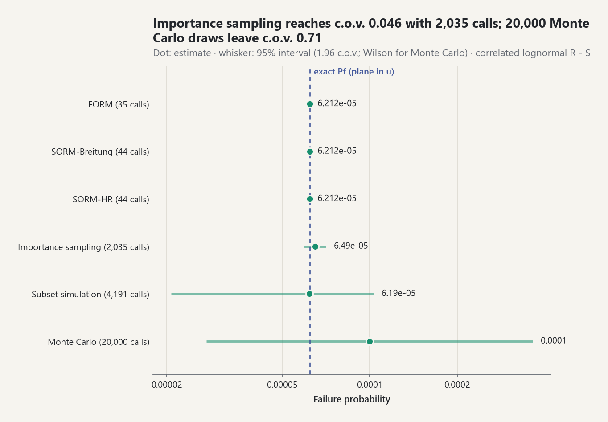
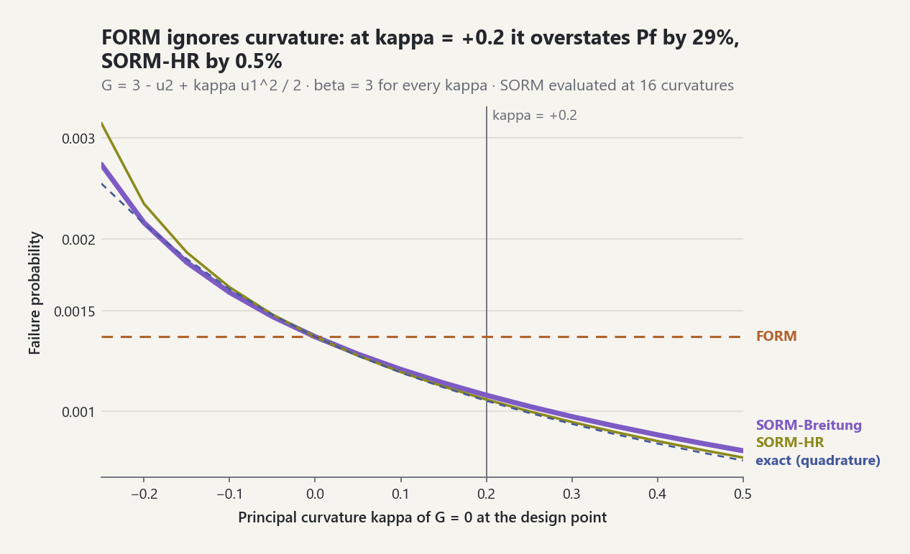
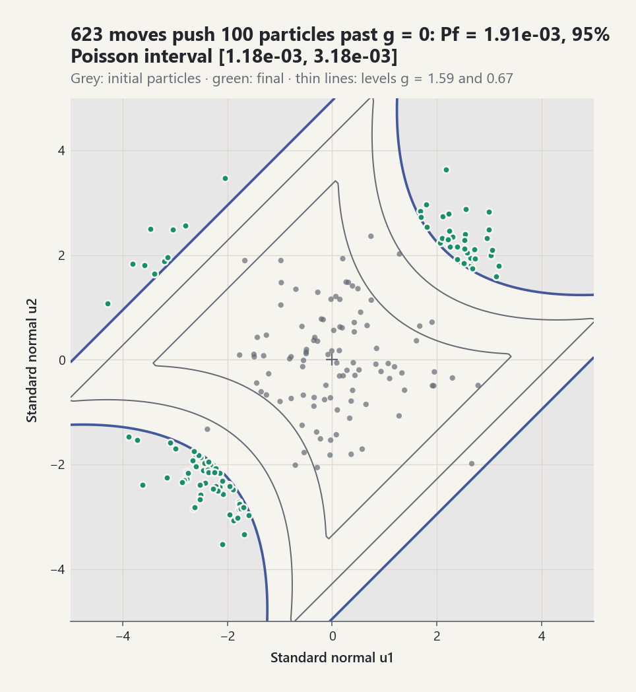
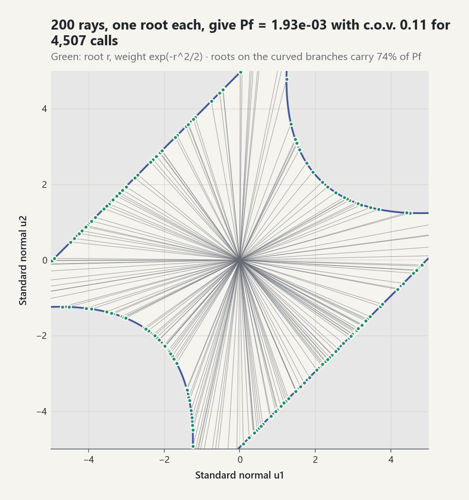

# Model-Based Reliability: FORM, SORM, Subset Simulation, and Systems

[Reliability and rare-event analysis](reliability-analysis.md) introduced the
failure convention `g <= 0` and estimators that work on explicit vectors. This
guide covers reliability methods that run on one
`probstat.modeling.ProbabilisticModel`. The model owns the joint input law, so
FORM, SORM, importance sampling, subset simulation, system analysis, and
inverse design all use the same marginals and the same Gaussian copula.

## 1. The limit state comes from the model

`ModelLimitState(model, quantity, threshold, failure)` turns one quantity of
interest `y` into a limit state [EQ-REL-MLS-001]:

| `failure` | limit state | failure event |
| --- | --- | --- |
| `"above"` | `g = t - y` | `y >= t` |
| `"below"` | `g = y - t` | `y <= t` |

Methods work in independent standard-normal space `u`. The Nataf map
[EQ-MOD-NATAF-001] links `u` to the physical inputs: `z = L u`,
`x_i = F_i^-1(Phi(z_i))`. `G(u) = g(T^-1(u))` is the same limit state written
in `u`. Every method reports how many model evaluations it used. These counts
come from the model's own counter.

## 2. FORM by HL-RF with a merit line search

The design point `u*` is the point of `G(u) = 0` closest to the origin. The
reliability index is `beta = alpha . u*`, where
`alpha = -grad G / ||grad G||`, and `P_f ~= Phi(-beta)` [EQ-REL-FORM-002].
`form_hlrf` repeats the HL-RF step [EQ-REL-HLRF-001]. By default the step
length comes from an Armijo search on the iHL-RF merit function
`||u||^2/2 + c|G|` [EQ-REL-HLRF-002]. Plain HL-RF (`line_search=False`) can
cycle on strongly nonlinear limit states. With the merit function, every HL-RF
direction lowers the merit, so the search cannot cycle.

Outputs:

- `beta` carries a sign. It is negative when the median input already fails.
- The design point is given in both `u` and `x`.
- `importance_factors` are the values `alpha_i^2`. They sum to one.
- `gamma` is the importance vector for correlated inputs.

With correlation, `u_i` is a Cholesky coordinate, so `alpha_i^2` depends on
the input order. `gamma = L^-T alpha / ||L^-T alpha||` refers to the physical
inputs instead.

FORM fails or misleads in these cases:

- The limit surface is strongly curved (use SORM, or sampling).
- There are several design points of similar distance (FORM finds one, and
  which one depends on the start point).
- The gradient vanishes. The code raises an error.
- The search does not converge within `max_iterations`. The result then has
  `converged=False`, and SORM refuses to use it.

**Upper-tail precision.** `JointInput.from_standard_normal` evaluates
`F^-1(Phi(z))`. For latent values `z > 6`, `Phi(z)` is within `1e-9` of one,
and double precision rounds it. For `z > 0` a continuous margin with an
inverse survival function is therefore evaluated as `S^-1(Phi(-z))`, which
keeps full accuracy: on the correlated lognormal margin of Section 7 with
`mu_R` raised to give `beta = 8.5`, FORM converges in 8 iterations with a
design-point coordinate of `8.3`. A margin without `isf`, and the Rosenblatt
route of a non-Gaussian copula, still clamp `Phi(z)` below one. There the
input stops changing near `z ~ 8`, finite-difference gradients become noisy,
and FORM can stall when a design-point coordinate is in that region.

## 3. SORM from principal curvatures

`sorm` takes a central-difference Hessian of `G` at `u*` (`2n^2 + 1` calls). It
rotates the Hessian so that the last axis is `alpha`. The principal curvatures
`kappa_i` are the eigenvalues of the tangent block divided by `||grad G||`
[EQ-REL-SORM-001]. A positive curvature bends the surface away from the origin
and lowers `P_f`. Two corrections are reported:

- Breitung: `Phi(-beta) prod (1 + beta kappa_i)^(-1/2)` [EQ-REL-SORM-002].
- Hohenbichler-Rackwitz: `beta` in the product is replaced by
  `psi = phi(beta)/Phi(-beta)` [EQ-REL-SORM-003].

Both corrections require `beta > 0` and `1 + beta kappa_i > 0`. If either
condition fails, the code raises an error. When `1 + beta kappa_i <= 0`, the
paraboloid does not approximate the failure domain, and continuing would give
a wrong number.

## 4. Sampling around the design point and subset simulation

`design_point_importance_sampling` draws from `N(u*, I)` and weights each draw
by `w = exp(||u*||^2/2 - u . u*)` [EQ-REL-ISDP-001]. The method is efficient
when the failure mass is concentrated near `u*`. It misses failure regions far
from `u*`, and high dimension makes the weights degenerate.

`subset_simulation` [EQ-REL-SUBSET-001] works without a design point. It
writes a small `P_f` as a product of conditional probabilities near `p0 = 0.1`.
Each intermediate threshold is a quantile of the current level. A
component-wise modified Metropolis sampler [EQ-REL-SUBSET-002] repopulates
each level.

The reported c.o.v. [EQ-REL-SUBSET-003] accounts for correlation inside each
chain. It treats the levels as independent, so it tends to understate the
error. `coefficient_of_variation_upper` is the value for fully correlated
levels.

Evidence from runs: for `G = 4 - (u1 + u2)/sqrt 2` (`P_f = 3.17e-5`) with
`N = 1000`, six seeds gave about 4150-4180 calls each. The ratio of estimate to
exact value ranged from 0.33 to 2.40, with mean 1.01. The independence c.o.v.
was 0.33-0.36 and the upper c.o.v. was 0.70-0.78. The observed spread matches
the upper value better.

### Markov-chain kernels for the conditional levels

`subset_simulation(..., sampler=...)` selects the kernel that turns the
`N p0` seeds of a level into `N` conditional samples. All kernels keep the
seed as the first state of its chain and leave the standard normal law
restricted to `F_j = {G <= b_j}` invariant; they differ in the proposal and
in whether its scale adapts. `SUBSET_SAMPLERS` lists the names.

| `sampler` | Move | Scale | Reported in `level_scales` |
| --- | --- | --- | --- |
| `"mma"` (default) | component-wise modified Metropolis [EQ-REL-SUBSET-002] | fixed spread `s` (`proposal_spread=1`) | `s` |
| `"cs"` | conditional sampling `v = rho u + sqrt(1 - rho^2) z` [EQ-REL-SUBSET-004] | fixed `rho` (`correlation=0.8`) | `rho` |
| `"acs"` | conditional sampling with `sigma_i = min(lambda sigma_0i, 1)` | `lambda` adapted toward acceptance 0.44 [EQ-REL-SUBSET-005] | final `lambda` |
| `"hmc"` | exact Gaussian flow `u(t_f) = p sin t_f + u_0 cos t_f` [EQ-REL-HMCSS-001] | `t_f` adapted into the band 0.3-0.5 [EQ-REL-HMCSS-002] | final `t_f` |

The default kernel and its seeded results are unchanged, so every number
quoted elsewhere in this guide still holds.

**Conditional sampling.** The proposal is reversible with respect to the
standard normal law, so the only test is whether `v` stays in `F_j`. There is
no per-coordinate density ratio, and the acceptance rate does not decay with
the dimension the way a full-vector random walk does. A fixed `rho`, however,
is a fixed step: at deep levels `F_j` is a thin region and the step becomes
too long.

**Adaptive conditional sampling (aCS).** The seeds are randomly permuted and
each chain gets `floor(N / N_s)` states, the remainder going to the first
chains, so `N p0` need not divide `N` (this also holds for `"cs"` and
`"hmc"`). The proposal spread is
`sigma_i = min(lambda sigma_0i, 1)` with `rho_i = sqrt(1 - sigma_i^2)`;
`sigma_0i = 1` by default, or the seed standard deviation of coordinate `i`
with `scale_reference="seeds"`. After every `N_a = ceil(100 p0)` chains
(`adaptation_chains`), the mean acceptance `a_hat` of those chains updates
`ln lambda <- ln lambda + (a_hat - 0.44) / sqrt(i + 1)`. `lambda` starts at
`initial_scale=0.6` and is carried to the next level, so a deep level starts
from the scale that suited the level above it. Unequal chain lengths enter
the level c.o.v. through the pair-count weights of [EQ-REL-SUBSET-006].

**Hamiltonian Monte Carlo (RS-HMC).** With a unit mass matrix the Gaussian
part of the Hamiltonian flow is solved exactly, so one step draws a momentum
`p ~ N(0, I)` and moves to `p sin t_f + u_0 cos t_f`; the end point is kept if
it lies in `F_j`. No gradient is needed, and the step coincides with
conditional sampling at `rho = cos t_f`. `t_f` starts at
`trajectory_time=pi/4`. After every `N_a` chains an acceptance below 0.3
shortens it and one above 0.5 lengthens it; the value is carried to the next
level. The bouncing variant of Wang, Broccardo and Song, which reflects the
momentum on the limit-state surface and needs the gradient of `G` and a
hitting-time search, is not provided.

**When each kernel helps.** In a few dimensions the default is robust and
needs no tuning. In high dimension, and especially for small `P_f` with many
levels, the modified Metropolis acceptance rate falls level after level and
consecutive levels become strongly correlated; the adaptive kernels hold the
acceptance rate near their target by shrinking the step. Plain conditional
sampling sits in between: it needs no density ratio but keeps a step that is
too long at deep levels.

`compare_reliability_methods` adds the opt-in rows `Subset-aCS`
(`methods=(..., "acs")`) and `Subset-HMC` (`"hmc-ss"`); the default rows are
unchanged.

**Comparison in 100 dimensions.** `G = beta - sum_i u_i / 10` with
`u in R^100`, so `P_f = Phi(-beta)` exactly. Each kernel ran with `N = 1000`,
`p0 = 0.1`, and seeds 1 to 50; "observed c.o.v." is the standard deviation of
the 50 estimates divided by their mean, and "reported c.o.v." is the mean of
the runs' own `coefficient_of_variation`.

| `beta` (exact `P_f`) | `sampler` | mean `P_f` | mean / exact | observed c.o.v. | reported c.o.v. | mean calls |
| --- | --- | --- | --- | --- | --- | --- |
| 3 (`1.3499e-3`) | `"mma"` | `1.402e-3` | 1.039 | 0.284 | 0.221 | 2890 |
| 3 | `"cs"` | `1.384e-3` | 1.025 | 0.222 | 0.220 | 2890 |
| 3 | `"acs"` | `1.422e-3` | 1.053 | 0.233 | 0.222 | 2890 |
| 3 | `"hmc"` | `1.463e-3` | 1.083 | 0.220 | 0.227 | 2890 |
| 5 (`2.8665e-7`) | `"mma"` | `2.636e-7` | 0.920 | 0.699 | 0.455 | 6436 |
| 5 | `"cs"` | `2.870e-7` | 1.001 | 0.471 | 0.440 | 6418 |
| 5 | `"acs"` | `3.099e-7` | 1.081 | 0.444 | 0.374 | 6400 |
| 5 | `"hmc"` | `3.293e-7` | 1.149 | 0.454 | 0.397 | 6436 |

In the `beta = 5` run with seed 1000, the modified Metropolis acceptance fell
from 0.54 at the first conditional level to 0.09 at the sixth, while aCS
stayed between 0.39 and 0.47; its `lambda` rose to 0.75 at the first level and
then shrank to 0.31. Fifty runs pin an observed
c.o.v. only roughly: a second block of 40 seeds (1000 to 1039) at `beta = 5`
gave 0.59 for `"mma"`, 0.57 for `"cs"`, 0.38 for `"acs"`, and 0.42 for
`"hmc"`. The ordering of the adaptive kernels against the default is stable;
plain conditional sampling with `rho = 0.8` is not reliably better than the
default at deep levels. The standard error of a mean-to-exact ratio is about
the observed c.o.v. divided by `sqrt(50)`, 0.03 to 0.10 here. Wang, Broccardo
and Song report, from 500 runs of the same problem, observed c.o.v. values of
0.27 (modified Metropolis) and 0.25 (RS-HMC) at `beta = 3` and 0.62 and 0.43
at `beta = 5`.

## 5. Systems of limit states

`system_failure_probability` estimates series systems (`min_k g_k <= 0`) and
parallel systems (`max_k g_k <= 0`) [EQ-REL-SYS-001] on the shared joint
input. Each distinct model is called once per sample. Two methods are
available:

- Crude Monte Carlo.
- Importance sampling from an equal mixture centered at the component design
  points. It suits series systems. It is a poor proposal for parallel systems
  whose joint design point is far from every component design point.

`series_system_bounds` linearizes each component with
`rho_ij = alpha_i . alpha_j` and returns two kinds of bounds:

- Uni-modal bounds [EQ-REL-SYS-002]. The upper bound is valid only for
  positively correlated components, which the `positively_correlated` field
  reports.
- Ditlevsen bi-modal bounds [EQ-REL-SYS-003]. They use
  `P_ij = Phi_2(-beta_i, -beta_j; rho_ij)`.

`bivariate_normal_cdf` implements Genz's version of the Drezner-Wesolowsky
Gauss-Legendre scheme [EQ-REL-BVN-001] [EQ-REL-BVN-002]. It matches an
independent quadrature (200 panels of 24-point Gauss-Legendre on
`[-12, h]`) to `2.2e-15` over 637 points: `h, k = -3, -2, ..., 3` and 13
correlations from `-0.995` to `0.995`, including `|rho| >= 0.925`.

## 6. Inverse FORM and target-reliability design

- `inverse_form(state, beta_t)` returns the threshold whose FORM index is
  `beta_t`. It runs the fixed-point iteration `u = beta_t alpha(u)` on the
  sphere `||u|| = beta_t` [EQ-REL-INV-001].
- `design_for_target_beta(state, name, beta_t, lower, upper)` finds a
  deterministic parameter in `model.fixed`. It applies Brent's method to
  `beta(theta) - beta_t` [EQ-REL-RBDO-001].

Both report whether they converged. A bracket without a sign change raises an
error.

## 7. Worked example (numbers computed with this release)

Inputs: `R ~ LogNormal(1.2, 0.15)` and `S ~ LogNormal(0.3, 0.25)`, with latent
correlation `0.4`. The margin is `y = R - S`, and failure is `y <= 0`. The
surface `G = 0` is a plane in `u`, so FORM is exact. The exact index is
`beta = 0.9 / sqrt(0.15^2 + 0.25^2 - 2(0.4)(0.15)(0.25)) = 3.837613`.

FORM results: `beta = 3.8376128944` after 6 iterations and 35 calls. The design
point is `u* = (-0.818, 3.749)` and `x* = (2.9367, 2.9367)`. The importance
factors are `alpha^2 = (0.045, 0.955)`, and the correlated importance vector is
`gamma = (-0.514, 0.857)`. Most of the importance falls on `S`.

`compare_reliability_methods(state, monte_carlo_samples=20000, seed=2026)`:

| Method | `P_f` | equivalent `beta` | calls | c.o.v. |
| --- | --- | --- | --- | --- |
| FORM | 6.2118e-5 | 3.8376 | 35 | — |
| SORM-Breitung | 6.2118e-5 | 3.8376 | 44 | — |
| SORM-HR | 6.2118e-5 | 3.8376 | 44 | — |
| IS (2000 draws) | 6.490e-5 | 3.8268 | 2035 | 0.046 |
| Subset (N = 1000) | 6.19e-5 | 3.8385 | 4191 | 0.34 |
| Crude MC | 1.0e-4 | 3.7190 | 20000 | 0.71 |

Crude MC observed two failures in 20000 draws. With the same number of calls,
it is far less precise than IS around the design point. Inverse FORM with
`beta_t = 3` returns the threshold `y = 0.5224`, after 10 iterations and 41
calls.

<picture><source media="(prefers-color-scheme: dark)" srcset="../images/guides/advanced-reliability-method-comparison-dark.png"></picture>

*FORM and both SORM corrections sit on the exact value because `G = 0` is a plane in `u`; importance sampling around the design point reaches a c.o.v. of 0.046 with 2,035 calls, while 20,000 crude Monte Carlo draws see two failures and leave a c.o.v. of 0.71, with a Wilson interval that spans more than a factor of ten.*

The curvature correction matters for the parabolic limit state
`G = 3 - u2 + kappa u1^2 / 2`. Its exact value comes from Gauss-Hermite
quadrature of `E[Phi(-(3 + kappa U^2/2))]`:

| `kappa` | exact | FORM | Breitung | Hohenbichler-Rackwitz |
| --- | --- | --- | --- | --- |
| +0.2 | 1.0436e-3 | 1.3499e-3 | 1.0672e-3 | 1.0488e-3 |
| -0.2 | 2.1257e-3 | 1.3499e-3 | 2.1344e-3 | 2.3036e-3 |

<picture><source media="(prefers-color-scheme: dark)" srcset="../images/guides/advanced-reliability-sorm-curvature-dark.png"></picture>

*Every curvature leaves `beta = 3`, so FORM is a flat line: at kappa = +0.2 it overstates the exact probability by 29% and Hohenbichler-Rackwitz by only 0.5%, while for negative curvature (a surface bending toward the origin) Breitung stays closer to the exact value, as in the table.*

The series system has three linear components with `beta = (2.5, 2.7, 2.6)`
and correlations `(0.6, 0.8, 0)`. Its bounds and estimate:

- Uni-modal bounds: `[0.00621, 0.01427]`.
- Ditlevsen bounds: `[0.011813, 0.011829]`.
- Mixture importance sampling (20000 draws, `seed=3`): `0.01195 +/- 0.00014`.

## 8. Conditioned sampling, moving particles, and directional simulation

### Conditioned sampling and its optimal strategy

Write the failure event as the last of nested events
`{G <= b_1} ⊃ {G <= b_2} ⊃ ... ⊃ {G <= b_M = 0}`. Then
`P(G <= 0) = prod_m P_m` with `P_m = P(G <= b_m | G <= b_{m-1})`, and each
`P_m` is a moderate probability that a modest sample can estimate. If the
levels are chosen so that every `P_m = p^(1/M)` and each one is estimated
from `N/M` independent draws of the conditional law, each level estimate has
squared coefficient of variation `delta_0^2 = (p^(-1/M) - 1) M / N`, and the
product has `delta^2 = (delta_0^2 + 1)^M - 1` [EQ-REL-SPLIT-001]. One level is
crude Monte Carlo, `delta^2 = (1 - p)/(p N)`.

For a large budget, `delta^2 ~ (ln p)^2 (e^x - 1)/(x^2 N)` with
`x = -ln(p)/M`. The minimum is at the root `x* = 1.5936` of
`x e^x = 2(e^x - 1)`: about `M = -0.6275 ln p` levels, each with conditional
probability `exp(-x*) = 0.2032`, whatever `p` and `N` are
[EQ-REL-SPLIT-002]. `optimal_splitting(p, budget)` returns the integer
optimum of the exact formula, the continuous optimum, and, for the same
budget, the crude Monte Carlo c.o.v. and the ideal moving-particles c.o.v.
`splitting_coefficient_of_variation(p, levels, budget)` evaluates the
formula for any level count.

For `p = 2.2245e-3` and `N = 10000`, `optimal_splitting` gives `M = 4`
levels (`p^(1/4) = 0.217`) and c.o.v. 0.076; the continuous optimum is
`M = 3.83`. Crude Monte Carlo with the same budget has c.o.v. 0.212.

The optimum is a benchmark, not a recipe. It needs the thresholds `b_m`,
which depend on the unknown `p`, and it assumes independent exact draws from
each conditional law. Practical methods set the levels adaptively from the
sample (subset simulation with `p_0 = 0.1`, moving particles) and draw the
conditional samples by Markov chains, whose correlation inflates the
variance above the ideal value.

### Moving particles

`moving_particles(state, particles=N, steps=Q, correlation=rho, seed=...)`
is the last-particle algorithm: the extreme case of adaptive splitting in
which each level discards a single particle. `N` standard-normal particles
are drawn. While the largest value `L = max G` is positive, that particle is
replaced by a draw from the standard normal law restricted to `G < L`,
obtained by a chain of `Q` steps started from another particle chosen at
random. Each step proposes `v = rho u + sqrt(1 - rho^2) z` and accepts it
exactly when `G(v) < L` [EQ-REL-PCN-001]; the proposal is reversible with
respect to the standard normal law, so the restricted law is invariant.
After `M` moves every particle fails and `p_hat = (1 - 1/N)^M`.

With exact conditional sampling, the levels form a Poisson process in
`-ln P(G <= L)` with intensity `N`. Then `M ~ Poisson(-N ln p)`, the
estimator is unbiased, `Var(p_hat) = p^2 (p^(-1/N) - 1)`, and the c.o.v. is
close to `sqrt(-ln(p)/N)` [EQ-REL-MP-001]. Garwood's exact interval
`(lambda_lo, lambda_hi)` for the Poisson mean of `M` (quantiles
`chi2_{alpha/2}(2M)/2` and `chi2_{1-alpha/2}(2M+2)/2`) maps to
`[exp(-lambda_hi/N), exp(-lambda_lo/N)]` for `p`. The endpoints swap because
`p = exp(-lambda/N)` decreases in `lambda` [EQ-REL-MP-002]. The result
carries the estimate, this interval, `M`, the model evaluations `N + M Q`,
the level sequence, the mean acceptance rate, and the final particles. The
interval and the c.o.v. assume ideal sampling: a chain with few steps or a
low acceptance rate leaves the new particle correlated with its starting
particle, and the real spread is then larger than reported.

The expected cost is `N (1 - Q ln p)` calls. At equal cost, crude Monte Carlo
has squared c.o.v. `(1 - p)/(p N (1 - Q ln p))` against `-ln(p)/N` for moving
particles, so moving particles gains only when `Q (ln p)^2` is well below
`1/p`. At `p ~ 2e-3` with `Q = 20` crude Monte Carlo is better (its c.o.v. is
0.77 times that of moving particles); at `p = 1e-6` moving particles needs
about 260 times fewer calls for the same c.o.v.

### Model-based directional simulation

`directional_simulation(state, directions, radius_max=None, grid=20,
antithetic=False, seed=...)` writes `U = R A`, with `R^2 ~ chi-square_d`
independent of the uniform direction `A`, and averages `P(R in F_A)` over
random directions [EQ-REL-DIR-002]. For each direction it evaluates `G(r a)`
on `grid + 1` radii in `[0, radius_max]`, refines every sign change with
Brent's method (the grid values at the bracket ends are reused, not
recomputed), and adds the chi-square mass
`Q(d/2, r_in^2/2) - Q(d/2, r_out^2/2)` of every failure segment. A failing
origin opens a segment at `r = 0`; a ray still failing at `radius_max` is
taken to fail out to infinity. The default `radius_max` leaves a chi mass
below `1e-15` beyond it (8.31 for `d = 2`). `G(0)` is computed once for all
rays. The estimate is a mean over independent directions with a
central-limit interval; `antithetic=True` pairs each direction with its
opposite. Unlike `estimate_directional_failure_probability`, which needs a
caller-supplied entry radius and a star-shaped failure set, this function
handles several crossings per ray. Two crossings inside one grid interval
are missed, so the grid must be finer than the narrowest radial segment. For
a sphere `G = r_0 - ||u||` every ray gives the exact answer and the variance
is zero.

### Worked example: the four-branch function

`ModelLimitState(four_branch_model(), "g", 0.0, "below")` with `k = 7`
[EQ-REL-WAARTS-001] has reference probability `2.2245e-3`
(`FOUR_BRANCH_REFERENCE_PROBABILITY`, crude Monte Carlo with `2e8` draws).
In the rotated coordinates `z_1 = (u_1 + u_2)/sqrt 2` and
`z_2 = (u_1 - u_2)/sqrt 2` the four branches fail when
`|z_1| >= 3 + z_2^2/5` or `|z_2| >= 3.5`. The failure set has four design
points: two at distance 3 on the `z_1` axis and two at distance 3.5 on the
`z_2` axis.

FORM sees one of them. `form_hlrf` started at the origin raises an error:
`G(0) = 3` sits on the kinks of `|u_1 + u_2|` and `|u_1 - u_2|`, the
symmetric finite-difference gradient there is exactly zero, and the HL-RF
direction is undefined. Started at `(0.5, 0.5)` it converges in 10 calls to
`u* = (2.121, 2.121)`, `beta = 3`, and `P_f = Phi(-3) = 1.35e-3`, which is
61 % of the reference. Started at `(1, -1)` it finds a `beta = 3.5` point
instead (`Phi(-3.5) = 2.33e-4`). Single-point FORM ignores the opposite
design point, the two outer branches, and the curvature of the inner
branches. `find_design_points(state, 4, first=form_hlrf(state, start=(0.1,
0.0)))` locates all four points (`beta = 3, 3, 3.5, 3.5`, 1775 calls), and
`multi_point_form` gives the probability of the union of the four tangent
half-spaces, `3.164e-3`, close to `2 Phi(-3) + 2 Phi(-3.5)`. That
overestimates the reference by 42 %, because the inner branches
`|z_1| >= 3 + z_2^2/5` curve away from the origin and lie inside their
tangent half-spaces.

Sampling methods, all with `seed=2026`:

| Method | settings | `P_f` | uncertainty | calls |
| --- | --- | --- | --- | --- |
| Moving particles | `N = 100`, `Q = 20`, `rho = 0.8` | 1.91e-3 | 95 % Poisson `[1.18e-3, 3.18e-3]`, c.o.v. 0.25 | 12560 |
| Moving particles | `N = 200`, `Q = 20`, `rho = 0.8` | 2.95e-3 | 95 % Poisson `[2.13e-3, 4.17e-3]`, c.o.v. 0.17 | 23440 |
| Directional simulation | 200 directions, `grid = 20` | 1.93e-3 | SE 2.1e-4, c.o.v. 0.11 | 4507 |
| Directional simulation | 50 directions, `grid = 20` | 1.83e-3 | SE 4.1e-4, c.o.v. 0.22 | 1130 |
| Subset simulation | `N = 1000`, `p_0 = 0.1` | 2.23e-3 | c.o.v. 0.23 | 2580 |

The `N = 100` run needed `M = 623` moves (`-N ln p = 611` expected) with a
mean acceptance rate of 0.45. Both moving-particles intervals contain the
reference; the `N = 200` estimate lies 1.9 ideal standard deviations above
it. Crude Monte Carlo with 12560 calls would have c.o.v. 0.19, so at this
moderate probability moving particles brings no gain, as the cost comparison
above predicts. Directional simulation found one root per ray and reached
c.o.v. 0.11 with 4507 calls, where crude Monte Carlo would have c.o.v. 0.32.
On this function `G(u) = G(-u)`, so antithetic pairs repeat the same ray
value and give no variance reduction.

<picture><source media="(prefers-color-scheme: dark)" srcset="../images/guides/advanced-reliability-moving-particles-dark.png"></picture>

*The 100 initial particles (grey) fill the safe region around the origin; each of the 623 moves replaces the particle with the largest `g` by a draw below that level, so the level sets `g = L` (thin lines) expand toward `g = 0`. The final particles crowd the two inner design points at distance 3 and a few cross the straight outer branches, the regions that carry the failure probability: Pf = 1.91e-03 with the exact 95% Poisson interval [1.18e-03, 3.18e-03].*

<picture><source media="(prefers-color-scheme: dark)" srcset="../images/guides/advanced-reliability-directional-rays-dark.png"></picture>

*Each of the 200 random rays (grey) is scanned on 20 radial steps and its sign change refined to a root on `g = 0`; the ray contributes the chi-square tail `exp(-r^2/2)` beyond that root. Roots on the two curved inner branches, which come as close as radius 3, carry 74% of the estimate; the straight outer branches, at radius 3.5 and beyond, carry the rest, which one-point FORM ignores. The mean over rays is Pf = 1.93e-03 with c.o.v. 0.11 for 4,507 calls.*

`examples/risk_analysis_lab.py` runs every method of this example, draws the
two figures above, and continues with the optimal-splitting benchmark, Wilks
bounds, and certification.

Sources: [REF-GUYADER-HENGARTNER-MATZNER-LOBER-2011], [REF-WALTER-2015],
[REF-LAGNOUX-2006], [REF-COTTER-ROBERTS-STUART-WHITE-2013],
[REF-GARWOOD-1936], [REF-BJERAGER-1988], [REF-DITLEVSEN-MADSEN-1996],
[REF-WAARTS-2000].

## Sources

- [REF-HASOFER-LIND-1974], [REF-RACKWITZ-FIESSLER-1978],
  [REF-ZHANG-DERKIUREGHIAN-1995], [REF-DERKIUREGHIAN-2005].
- [REF-BREITUNG-1984], [REF-HOHENBICHLER-RACKWITZ-1988].
- [REF-AU-BECK-2001], [REF-PAPAIOANNOU-BETZ-ZWIRGLMAIER-STRAUB-2015],
  [REF-WANG-BROCCARDO-SONG-2019].
- [REF-CORNELL-1967], [REF-DITLEVSEN-1979], [REF-GENZ-2004],
  [REF-DREZNER-WESOLOWSKY-1990].
- [REF-DERKIUREGHIAN-ZHANG-LI-1994], [REF-TU-CHOI-PARK-1999].
- [REF-MELCHERS-BECK-2018, Chapters 5 and 6], [REF-DITLEVSEN-MADSEN-1996].

## 9. Cross-entropy importance sampling and line sampling

Two further estimators in `probstat.reliability.adaptive` work on the same
`ModelLimitState` in standard-normal space. Both are opt-in rows of
`compare_reliability_methods`: `methods=(..., "ce", "line")` adds the rows
`"CE-IS"` and `"Line"`. The default `METHODS` tuple is unchanged, so existing
comparisons and the study workflow give the same numbers as before;
`AVAILABLE_METHODS` lists all seven keys.

### Cross-entropy adaptive importance sampling

`cross_entropy_importance_sampling` needs no design point. It starts from
`N(0, I)`, draws `N` points per level, and sets the intermediate threshold to
the `rho = 0.1` sample quantile of `G` (clipped at 0). The proposal mean (and,
optionally, covariance) is refitted to the elite points `G <= gamma_t` with
likelihood-ratio weights `phi_n(u) / h(u)` [EQ-REL-CE-001]. When a level
reaches `gamma = 0`, a fresh sample from the final proposal gives the
importance-sampling estimate and its c.o.v. [EQ-REL-CE-002]. The result
reports the thresholds, final mean and covariance, the Kish effective sample
size, the number of levels, and every model evaluation (levels plus final
stage).

The default adapts the **mean only**. `adapt_covariance=True` also fits the
covariance, but the elite covariance shrinks along the important direction.
On `G = 4 - (u1 + u2)/sqrt 2` (`P_f = 3.17e-5`) with `N = 500` and seeds 1-5:

| seed | mean-shift ratio to exact | c.o.v. | covariance-adapted ratio | c.o.v. |
| --- | --- | --- | --- | --- |
| 1 | 1.063 | 0.094 | 0.429 | 0.35 |
| 2 | 1.007 | 0.094 | 1.009 | 0.045 |
| 3 | 0.975 | 0.096 | 0 (stalled, 20 levels) | — |
| 4 | 0.856 | 0.104 | 0 (stalled, 20 levels) | — |
| 5 | 1.046 | 0.094 | 0 (stalled, 20 levels) | — |

Each mean-shift run took 3 levels and 2000 calls. With covariance adaptation
the levels stall on this planar limit state, and a finished run can still be
far off (seed 1: 0.43 of the exact value). In a trial with `rho = 0.2`, seed 1
returned 0.73 of the exact value with a reported c.o.v. of 0.04, so the
reported c.o.v. can understate the error badly. Gaussian-mixture proposals
[REF-KURTZ-SONG-2013] address multiple failure regions and are not implemented.

The table above shows the unguarded adaptation, still available as
`covariance_floor=None`. Adapted covariances are now floored at eigenvalue
`0.55` by default (the weight variance is infinite once an eigenvalue drops to
`1/2` or below [EQ-REL-CE-003]), and a collapsed or degenerate run warns and
sets `weights_degenerate`. See
[Adaptive reliability](adaptive-reliability.md) for the guarded numbers.

### Line sampling

`line_sampling` uses an important direction `alpha`: the FORM `alpha` by
default (FORM runs once unless a `FORMResult` or a `direction` is supplied).
Each line draws `u ~ N(0, I)`, projects it onto the hyperplane orthogonal to
`alpha`, and finds the crossing `c_k` of `G(u_perp + c alpha) = 0` by bracket
doubling from the previous root followed by Brent's method (cached, so the
bracket ends are not re-evaluated). The line contributes `p_k = Phi(-c_k)`, and
`P_f = mean(p_k)` with variance `sum (p_k - P_f)^2 / (N (N - 1))`
[EQ-REL-LINE-001]. A line that does not cross within `|c| <= max_distance`
contributes 0 (safe) or 1 (failed). The estimator assumes at most one crossing
per line with failure beyond it.

For a planar limit state every `p_k` equals `Phi(-beta)`, so line sampling is
exact with zero variance. For curved limit states it is conditional Monte
Carlo along `alpha` and is far more precise per call than crude Monte Carlo.

### Numbers computed with this release

Correlated lognormal `R - S` example of Section 7,
`compare_reliability_methods(state, methods=("form", "is", "ce", "line"),
seed=2026)` (defaults: 2000 IS draws, 1000 CE samples per level, 100 lines):

| Method | `P_f` | equivalent `beta` | calls | c.o.v. |
| --- | --- | --- | --- | --- |
| FORM | 6.2118e-5 | 3.8376 | 35 | — |
| IS | 6.490e-5 | 3.8268 | 2035 | 0.046 |
| CE-IS | 6.002e-5 | 3.8460 | 4000 | 0.064 |
| Line | 6.2118e-5 | 3.8376 | 335 | 0 (planar) |

Parabolic limit state `G = 3 - u2 + kappa u1^2 / 2` (seed 1; exact values by
Gauss-Hermite quadrature):

| `kappa` | exact | CE-IS (`N = 500`) | calls | Line (100 lines) | calls |
| --- | --- | --- | --- | --- | --- |
| +0.2 | 1.0436e-3 | 9.86e-4 (c.o.v. 0.091) | 2000 | 1.0153e-3 (c.o.v. 0.034) | 402 + 10 FORM |
| -0.2 | 2.1257e-3 | 1.90e-3 (c.o.v. 0.097) | 1500 | 2.1733e-3 (c.o.v. 0.069) | 401 + 10 FORM |

Line sampling needs about four calls per line here. CE-IS spends most of its
calls on adaptation but needs neither a gradient nor a design point.

Sources: [REF-RUBINSTEIN-KROESE-2004], [REF-KURTZ-SONG-2013],
[REF-KOUTSOURELAKIS-PRADLWARTER-SCHUELLER-2004], [REF-BRENT-1973].

## 10. Smooth indicator levels and Bayesian updating as a rare event

Subset simulation and classical cross entropy move towards the failure set
through nested events `G <= b_j`, so each level uses only the tenth of its
sample below the threshold. Three further methods of `probstat.reliability`
work on the same `ModelLimitState`.

### Improved cross entropy

`improved_cross_entropy` replaces the indicator by `Phi(-G / sigma)` and
lets `sigma` decrease: the targets `h_k` proportional to
`Phi(-G / sigma_k) phi_n` run from the input law (`sigma = inf`) to the
optimal importance-sampling density (`sigma -> 0`) [EQ-REL-ICE-001]. At each
level `smoothing_scale` picks the next `sigma` so that the weights towards
the next target have a coefficient of variation of `1.5` [EQ-REL-ICE-002],
every sample enters the weighted maximum-likelihood refit
[EQ-REL-ICE-003], and the run stops when `I(G <= 0) / Phi(-G / sigma_k)`
varies by no more than the same target [EQ-REL-ICE-004]. The last sample
gives the importance-sampling estimate with its standard error
[EQ-REL-ICE-005]; the cost is `N (levels + 1)`. Because the stopping
rule looks at that last sample, the estimate has a small upward bias for
small `N` (2 % at `N = 100`, not measurable at `N = 1000`).

Two families are available: one Gaussian with full covariance
(`family="gaussian"`) and a Gaussian mixture fitted by weighted EM
(`family="mixture"`, `components=K`). The von Mises-Fisher-Nakagami mixture
of the source paper is not implemented. Fitted covariances have their
eigenvalues raised to `0.55` by default, the guard of Section 9: a
covariance that follows the failure region is narrower than `1/2` along the
important direction, and the importance weights then have infinite variance.
This guard is a choice of this library; `covariance_floor=None` removes it
and sets `weights_heavy_tailed` when it matters.

One Gaussian follows one failure region. On the four-branch function it
spreads over all four regions, never meets the stopping rule (0 of 20 seeds
within 50 levels), and returns a c.o.v. of 0.11 after 51000 calls; the
mixture with four components converges in three levels.

### Sequential importance sampling

`sequential_importance_sampling` samples the same targets without a
parametric density. The level sample is reweighted by
`Phi(-G / sigma_(k+1)) / Phi(-G / sigma_k)`, resampled, and moved by
conditional-sampling chains whose acceptance probability is the ratio of the
two smooth indicators [EQ-REL-SIS-002]. The estimate is the product of the
mean weights times the mean of `I(G <= 0) / Phi(-G / sigma_L)`
[EQ-REL-SIS-001]. The first target is the input law itself, so the first
weight is `Phi(-G / sigma_1)` without the factor `Phi(0) = 1/2`.

Its reported c.o.v. is a batch-means heuristic [EQ-REL-SIS-004] that ignores
the dependence between levels: over 20 seeds on six test cases the scatter
between runs was 0.84 to 1.50 times the reported value, and 1.3 to 1.4
times in an independent check with 60 seeds on four linear cases, so read
the reported value as a lower bound. With the library
defaults (20 chains of 50 states and 10 burn-in steps per 1000 samples) its
precision per call was close to that of subset simulation and well below
that of improved cross entropy on the cases of ADR-0124; with many short
chains it was several times worse.

### BUS: posterior sampling as a reliability problem

Rejection sampling accepts a prior draw `theta` when `p <= c L(theta)` for an
independent `p ~ U(0, 1)` and a constant with `c L <= 1`. BUS treats the
acceptance as a failure event in the space of `(theta, p)`:
`bus_limit_state` returns
`g = log Phi(u_p) - log c - log L(theta(u))` on standard-normal inputs
[EQ-REL-BUS-001], which any method of this guide can analyse.
`bus_subset_simulation` runs subset simulation on it, keeps the accepted
states as posterior draws, and returns the evidence
`Z = P(g <= 0) / c` [EQ-REL-BUS-002]. Every evaluated point is checked for
`c L <= 1`; `constant_violated` reports a constant that is too large
[EQ-REL-BUS-003], in which case the draws follow the truncated likelihood
`min(L, 1/c)`. A clean check covers the evaluated points only. The draws are
correlated chain states with repeated values: in the example below about
half of the 1000 draws are distinct, and over 60 seeds the posterior mean
scattered like that of about 250 independent draws.

```python
import math

from probstat.distributions import Normal
from probstat.modeling import JointInput, RandomInput, four_branch_model
from probstat.reliability import (
    ModelLimitState,
    bus_subset_simulation,
    improved_cross_entropy,
    sequential_importance_sampling,
)

state = ModelLimitState(four_branch_model(), "g", 0.0, "below")
ice = improved_cross_entropy(state, family="mixture", components=4, seed=1)
ice.probability  # 0.00227
ice.coefficient_of_variation  # 0.053
ice.evaluations  # 4000
sis = sequential_importance_sampling(state, seed=1)
sis.probability  # 0.00244
sis.coefficient_of_variation  # 0.198
sis.evaluations  # 4540

data = (3.1, 2.7, 3.4, 2.9, 3.3)
noise = Normal(0.0, 0.5)


def log_likelihood(theta):
    return math.fsum(noise.log_pdf(y - theta[0]) for y in data)


prior = JointInput((RandomInput("theta", Normal(1.0, 2.0)),))
log_c = -log_likelihood((math.fsum(data) / len(data),))
bus = bus_subset_simulation(log_likelihood, prior, log_constant=log_c, seed=1)
bus.mean()[0]  # 3.041
bus.log_evidence  # -4.412
bus.constant_violated  # False
bus.evaluations  # 2400
```

The reference probability of the four-branch function is `2.2245e-3`. The
normal-normal problem has posterior mean `3.0543`, posterior variance
`0.0494`, and log evidence `-4.5163` in closed form; the run above reports a
c.o.v. of 0.10 for the evidence and a sample variance of 0.058 from its
1000 correlated draws.

Sources: [REF-PAPAIOANNOU-GEYER-STRAUB-2019],
[REF-PAPAIOANNOU-PAPADIMITRIOU-STRAUB-2016], [REF-STRAUB-PAPAIOANNOU-2015].

## Common pitfalls

- **The default failure side is `"above"`.** `ModelLimitState` fails when
  `y >= t` unless `failure="below"` is given. For a safety margin the wrong
  side is silent: FORM converges and reports the index with the opposite sign
  and `P_f` close to one.
- **An unconverged FORM result is returned, not raised.** Check `converged`;
  `sorm` refuses a result with `converged=False`.
- **`importance_factors` depend on the input order under correlation.** They
  are `alpha_i^2` in Cholesky coordinates. Use `gamma` for the physical inputs.
- **`METHODS` is not every method.** `compare_reliability_methods` runs
  `METHODS` by default; `"ce"` and `"line"` must be requested explicitly.
- **`seed=None` means fresh entropy.** Pass an integer seed to reproduce a
  sampling result.

The correlated lognormal margin of Section 7:

```python
import math
from probstat.distributions import LogNormal
from probstat.modeling import JointInput, ProbabilisticModel, RandomInput
from probstat.reliability import (
    AVAILABLE_METHODS, METHODS, ModelLimitState, form_hlrf, sorm,
)
from probstat.uq import QuantityOfInterest

def margin_model(order):
    laws = {"R": LogNormal(1.2, 0.15), "S": LogNormal(0.3, 0.25)}
    inputs = JointInput(
        tuple(RandomInput(name, laws[name]) for name in order),
        ((1.0, 0.4), (0.4, 1.0)),
    )
    return ProbabilisticModel(
        inputs, lambda p: {"y": p["R"] - p["S"]}, (QuantityOfInterest("y", "margin"),)
    )

wrong = ModelLimitState(margin_model("RS"), "y", 0.0)
wrong.failure                                    # 'above'
wrong_form = form_hlrf(wrong)
wrong_form.converged                             # True
round(wrong_form.beta, 4)                        # -3.8376
state = ModelLimitState(margin_model("RS"), "y", 0.0, failure="below")
form = form_hlrf(state)
round(form.beta, 4)                              # 3.8376
round(form.importance_factors["R"], 3)           # 0.045
swapped = form_hlrf(ModelLimitState(margin_model("SR"), "y", 0.0, failure="below"))
round(swapped.importance_factors["R"], 3)        # 0.344, same model, other order
round(form.gamma["R"], 3), round(swapped.gamma["R"], 3)   # (-0.514, -0.514)
short = form_hlrf(state, max_iterations=1)
short.converged                                  # False
try:
    sorm(state, form_result=short)
except ValueError as error:
    message = str(error)
message                                          # 'SORM requires a converged FORM design point'
("ce" in METHODS, "ce" in AVAILABLE_METHODS)     # (False, True)
```
