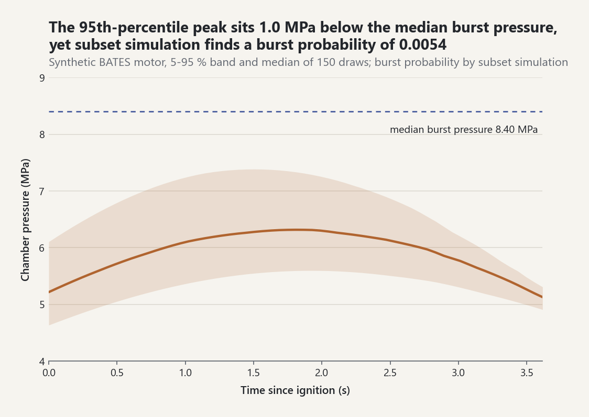
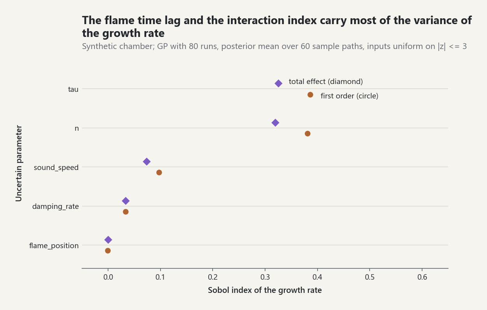
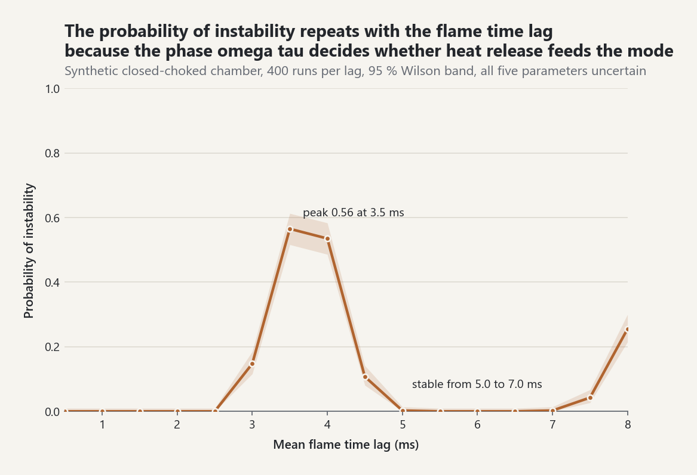

# Uncertainty quantification for rocket propulsion

A rocket engine is designed against requirements (specific impulse, thrust,
peak chamber pressure, stability, mission reliability) that its hardware only
meets within scatter: propellant lots burn at slightly different rates,
throats erode, combustion efficiency drifts, a grain is fired cold or hot.
This guide applies the library's uncertainty-quantification tools to ten
engineering questions, five about propulsion hardware (sections 3 to 7) and five
about the flight and space environment around it (sections 8 to 12: ascent,
entry, nozzle cooling, debris penetration and conjunction), and shows what each
tool is for and where it stops being trustworthy. The physical models live in
`probstat.aerospace` (experimental since 0.28); each is a textbook
idealization with stated units, assumptions and validity range.

**Every case in this guide is synthetic.** The propellant table, the motor,
the chamber, the test data, the launch vehicle, the capsule and its heat shield,
the cooling channels, the debris flux and ballistic-limit coefficients, the
covariances and the failure probabilities are invented demonstration values. None is data from a real engine, motor or vehicle, and
none of the numbers below is a statement about any real hardware. Every number
quoted was produced by running the code shown with the seed given; the
laboratory [`examples/rocket_propulsion_uq_lab.py`](../../examples/rocket_propulsion_uq_lab.py)
runs the cases of sections 3 to 7 with larger budgets and prints more.

Prerequisites: the central probabilistic model
([probabilistic modeling](probabilistic-modeling.md)), rare-event
reliability ([model-based reliability](advanced-reliability.md)), Sobol
indices ([sensitivity analysis](sensitivity-analysis.md)), the Bayesian
reading of calibration ([nonlinear calibration and MCMC](nonlinear-calibration-and-mcmc.md)),
and Gaussian-process emulators ([surrogate models](surrogate-models.md)).

## 1. What is uncertain and what is asked

A propulsion study asks a small number of questions of very different cost:

| Question | Quantity | Method of this guide |
| --- | --- | --- |
| How much does performance scatter? | mean, spread, quantiles | propagation (section 3) |
| Which inputs matter? | Sobol indices | variance-based sensitivity (section 3) |
| How often is a requirement missed? | `P(Isp <= requirement)` | FORM, simulation (section 3) |
| How likely is a case burst? | `P(MEOP >= p_burst)`, a few `1e-3` | subset simulation (section 4) |
| What do static-fire data say? | posterior of the burn-rate law | transitional MCMC (section 5) |
| Which model class do the data support? | posterior model probabilities | Bayesian model selection (section 5) |
| Is the chamber stable? | `P(growth rate > 0)` | Monte Carlo, emulator (section 6) |
| Will the stage deliver the mission? | cluster reliability | epistemic propagation (section 7) |
| How far does the insertion orbit scatter? | perigee, apogee, dispersion ellipse | Monte Carlo, RSS budget (section 8) |
| Does the heat shield survive the entry? | peak load, heat flux, thickness margin | Allen-Eggers check, simulation, FORM (section 9) |
| Does the nozzle wall stay below its limit? | peak wall temperature | wall network, coolant marching, Sobol, FORM (section 10) |
| How likely is a debris penetration? | `PNP = exp(-N)`, required thickness | Poisson algebra, epistemic factors, Gamma-Poisson update (section 11) |
| Is a small collision probability trustworthy? | `Pc`, dilution maximum | encounter-plane integral, dilution analysis (section 12) |

Two kinds of uncertainty appear and must not be mixed. Hardware-to-hardware
scatter (a lot of propellant, a throat diameter, a grain temperature) is
aleatory: it is sampled with a fixed law. Not knowing the law itself (a burn
rate exponent, an engine failure probability) is epistemic: it is reduced by
data, and it is propagated as a distribution of the answer.

## 2. The physical models

### 2.1 Ideal-rocket performance of a liquid engine

`liquid_engine_model` follows ideal-rocket theory ([REF-SUTTON-BIBLARZ-2017]):
frozen composition, a calorically perfect gas, quasi-one-dimensional
isentropic flow, uniform stagnation conditions. In SI units the characteristic
velocity is
`c* = sqrt(R T_c / gamma) / (2/(gamma+1))^((gamma+1) / (2 (gamma-1)))`
with `R = R_u / M` [EQ-AERO-LRE-001], the supersonic exit Mach number follows
from the area ratio `epsilon = A_e / A_t` [EQ-AERO-LRE-002], the thrust is
`F = C_F p_c A_t`, and
`Isp = F / (mdot g0) = C_F c* / g0` [EQ-AERO-LRE-005]. A combustion
efficiency `eta_c*` multiplies `c*`, and a conical nozzle multiplies the
momentum term of `C_F` by `lambda = (1 + cos alpha) / 2`.

The pair `(T_c, gamma, M)` comes from a mixture-ratio table interpolated at the
sampled `O/F`. The default table is an illustrative synthetic one with a
plausible shape and is not chemical-equilibrium output; no extrapolation is
allowed, so a sample outside the table range fails the run, which is why the
mixture ratio below is a truncated normal law.

Validity limits: no heat loss, boundary layer, two-phase flow, finite-rate
chemistry or cycle losses beyond the two efficiency factors; only `gamma > 1`
and `epsilon >= 1` are enforced, although realistic `gamma` lies near 1.1 to
1.4. In the vacuum value `Isp = C_F c* / g0` only `gamma`, `T_c`, `M`, `epsilon`
and the two efficiencies enter, so ideal theory predicts that the vacuum
specific impulse does **not** depend on `p_c`; this is a property of the model
(frozen flow, no pressure-dependent chemistry), not of engines.

### 2.2 Internal ballistics of a solid motor

`simulate_solid_motor` is a lumped (0D) model: one control volume fed by a
burning grain and drained through a choked throat. The burn rate follows the
Saint-Robert / Vieille law with a propellant-temperature sensitivity,
`r = a exp(sigma_p (T - T_ref)) (p / p_ref)^n` [EQ-AERO-SRM-001], and the
quasi-steady chamber pressure balances gas generation and discharge,
`p = (a rho_p c* Kn / p_ref^n)^(1/(1-n))` with `Kn = A_b / A_t`
[EQ-AERO-SRM-002]. The burning area is an exact function of the web burned for
tubular, end-burning and BATES grains. Units are SI; `sigma_p` is in 1/K.

Validity limits: `0 <= n < 1` (the equilibrium does not exist for `n >= 1`,
and such inputs are refused), a choked nozzle at all times, no erosive burning,
igniter or slag. The quasi-steady mode has no start-up and no tail-off; the
transient mode integrates the gas mass balance but still does not model the
igniter. Thrust is the ideal `F = C_F p A_t` of a fixed-exit-area nozzle.

### 2.3 Linear thermoacoustic stability

`ChamberConfig` is a one-dimensional duct of length `L` with a compact flame at
`x_f` and the Crocco `n-tau` heat-release law: the velocity jumps across the
flame by `Theta n u'(t - tau)` ([REF-MAGRI-JUNIPER-2013] for the sensitivity
viewpoint, [REF-RAYLEIGH-1878] for the criterion). The complex eigenfrequency
`omega = 2 pi f + i sigma` of a mode solves an analytic dispersion relation by
Newton's method; the growth rate `sigma = Im(omega)` is positive for an
unstable mode [EQ-AERO-CI-006]. A friction rate `alpha` damps every mode of a
flameless closed duct at exactly `alpha / 2`.

Validity limits: uniform temperature and no mean flow in the duct, a compact
flame (`omega x_f / c` small), a compact choked nozzle with isentropic
perturbations, linear growth only. It says whether a mode starts to grow, not
what limit cycle it reaches, and it is not a validated model of any combustor.

### 2.4 Cluster reliability

`EngineClusterModel` is a `k`-out-of-`n` cluster with a beta-factor
common-cause failure and a catastrophic fraction of outages
([REF-MOSLEH-ETAL-1998], [REF-NASA-PRA-2011]); engine outcomes are Bernoulli
per mission and the engines are exchangeable. Its failure probabilities are
themselves uncertain (Beta laws), and one draw is shared by all engines of the
cluster.

## 3. Dispersion, ranking and a requirement: the liquid engine

Six inputs are uncertain: chamber pressure and throat diameter (normal), the
mixture ratio and combustion efficiency (truncated normal), and the expansion
ratio (normal); the nozzle exhausts to vacuum with a 15 degree cone. The
spreads are assumptions, not measurements.

```python
from probstat.aerospace import liquid_engine_model
from probstat.distributions import Normal, TruncatedNormal
from probstat.workflow import UQStudy

engine = liquid_engine_model(
    chamber_pressure=Normal(7.0e6, 0.2e6),
    mixture_ratio=TruncatedNormal(2.6, 0.08, lower=2.0, upper=3.2),
    combustion_efficiency=TruncatedNormal(0.975, 0.008, lower=0.9, upper=1.0),
    throat_diameter=Normal(0.200, 0.0008),
    expansion_ratio=Normal(45.0, 0.5),
    ambient_pressure=0.0,          # vacuum
    divergence_half_angle=0.2618,  # 15 degrees
)
study = UQStudy(engine, seed=2026)
forward = study.propagate(1024)
isp = forward["vacuum_specific_impulse"]
round(isp.mean, 1)  # 404.0
round(isp.standard_deviation, 2)  # 3.92
round(forward["thrust"].mean / 1e3, 0)  # 408.0
```

The mean vacuum specific impulse is 404.0 s with a standard deviation of
3.92 s, and the mean thrust is 408 kN. The Sobol design says where the
scatter comes from:

```python
sobol = study.sensitivity("vacuum_specific_impulse", 256, bootstrap=0)
sobol.ranking()[:2]  # ('combustion_efficiency','mixture_ratio')
round(sobol.first_order[sobol.input_names.index("combustion_efficiency")].estimate, 2)  # 0.71
round(sobol.first_order[sobol.input_names.index("chamber_pressure")].estimate, 2)  # 0.0
```

Combustion efficiency alone explains about 71 % of the variance and the
mixture ratio most of the rest; the chamber pressure explains none, as section
2.1 predicted. The ranking changes with the output: thrust is driven by
chamber pressure and throat diameter, which is why a ranking is always stated
for one quantity of interest.

A requirement `Isp_vac >= 394 s` is a one-sided limit state `g = Isp_vac - 394`
with failure at `g <= 0`. The library compares FORM (a design-point search that
linearizes `g` in standard-normal space) with simulation on the same limit
state:

```python
comparison = study.reliability(
    "vacuum_specific_impulse", 394.0, failure="below",
    methods=("form", "mc"), monte_carlo_samples=5000,
)
round(comparison.row("FORM").probability, 4)  # 0.0052
round(comparison.row("MC").probability, 4)  # 0.0056
```

FORM gives 0.0052 and 5000 Monte Carlo runs give 0.0056 (a binomial standard
error of about 0.001, so about 28 failures were seen). They agree because the
limit state is nearly linear in its inputs; section 4 shows a case where
the probability is smaller and simulation must be made efficient.

## 4. A rare event and its sensitivities: the solid motor

A BATES grain with a 6 MPa reference pressure is fired quasi-steadily. The
nominal burn has a peak pressure (MEOP) and a burn time that the closed form
of [EQ-AERO-SRM-002] predicts at ignition:

```python
from dataclasses import replace
from probstat.aerospace import (
    BatesGrain, SolidMotorParameters, equilibrium_pressure,
    simulate_solid_motor, solid_motor_model,
)
from probstat.reliability import ModelLimitState, subset_simulation

grain = BatesGrain(0.100, 0.030, 0.150, 4)
motor = SolidMotorParameters(
    burn_rate_coefficient=8.0e-3, pressure_exponent=0.35,
    characteristic_velocity=1550.0, propellant_density=1750.0,
    throat_diameter=0.024, chamber_volume=0.0050, expansion_ratio=8.0,
    gamma=1.22, temperature_sensitivity=2.5e-3, reference_pressure=6.0e6,
    erosion_rate=5.0e-5, ambient_pressure=0.0,
)
burn = simulate_solid_motor(grain, motor, steps=60)
round(burn.meop / 1e6, 3)  # 6.27
round(burn.burn_time, 3)  # 4.476
kn = grain.burning_area(0.0) / motor.throat_area(0.0)
p0 = equilibrium_pressure(8.0e-3, 0.35, 1550.0, 1750.0, kn, reference_pressure=6.0e6)
round(p0 / 1e6, 3)  # 5.183
round(burn.pressures[0] / 1e6, 3)  # 5.183
```

The nominal MEOP is 6.27 MPa after 4.476 s; the pressure at ignition from the
closed form (5.183 MPa) equals the first point of the simulated trace, which is
the check that the simulator and the formula describe the same balance.
Pressure then rises as the BATES burning area progresses and falls when the
throat erodes and the area regresses.

`solid_motor_model` makes nine inputs uncertain (burn-rate coefficient and
exponent, `c*`, density, temperature sensitivity, grain temperature, throat
diameter, erosion rate and burst pressure) and adds the quantity
`burst_margin = p_burst - MEOP`. A case burst is a margin `<= 0`. With a median
burst pressure of 8.4 MPa the probability is a few times `1e-3`, where a crude
Monte Carlo needs thousands of burns per failure; subset simulation reaches it
through a sequence of conditional levels ([REF-AU-BECK-2001]):

```python
motor_model = solid_motor_model(grain, motor, 8.4e6, steps=40)
limit = ModelLimitState(motor_model, "burst_margin", 0.0, failure="below")
rare = subset_simulation(limit, samples_per_level=500, seed=3)
round(rare.probability, 4)  # 0.0057
rare.converged  # True
rare.evaluations  # 1400
```

Subset simulation estimates 0.0057 with 1400 burns. Its coefficient of
variation is large (about 0.5 at 500 samples per level), and it is a random
estimate: four further seeds gave 0.0024 to 0.0030, and a crude Monte Carlo
reference of 40 000 burns gives 0.0033 (standard error 0.0003). This seed
drew high; quote such a probability with its coefficient of variation, or
average several seeds. The estimate is also not conditional on anything physical;
it inherits the assumed spreads of section 3.

<picture><source media="(prefers-color-scheme: dark)" srcset="../images/guides/propulsion-motor-pressure-band-dark.png"></picture>

*Pressure-time dispersion of the synthetic BATES motor (150 draws): the mean peak pressure is 6.37 MPa and its 95th percentile 7.39 MPa, 1.0 MPa below the median burst pressure of 8.40 MPa; subset simulation puts the burst probability at 5.4e-03 with 1400 model runs.*

The quantity that tells a designer how to act is not the probability but how it
moves. FORM provides the derivatives of the reliability index `beta` with respect
to any distribution parameter at the cost of a few extra runs: by the envelope
theorem `d beta / d theta = (dG/dtheta)(u*) / ||grad_u G(u*)||`
[EQ-REL-RSENS-001], [REF-HOHENBICHLER-RACKWITZ-1986]. Take the margin of a
reduced three-input problem (burn-rate coefficient, `c*` and burst pressure
normal; everything else fixed). The elasticity `theta d beta / d theta` is
dimensionless and comparable across parameters:

```python
from probstat.reliability.reliability_sensitivity import (
    form_sensitivities, normal_input_limit_state,
)


def margin(x):
    realized = replace(motor, burn_rate_coefficient=x[0], characteristic_velocity=x[1])
    return x[2] - simulate_solid_motor(grain, realized, steps=40).meop


theta = (8.0e-3, 1550.0, 8.4e6, 0.04 * 8.0e-3, 0.01 * 1550.0, 0.05 * 8.4e6)
fs = form_sensitivities(normal_input_limit_state(margin, 3), theta, 3)
fs.converged  # True
round(fs.beta, 2)  # 3.59
round(theta[0] * fs.dbeta[0], 1)  # -17.4
round(theta[1] * fs.dbeta[1], 1)  # -18.7
round(theta[2] * fs.dbeta[2], 1)  # 13.9
```

The three-input index is 3.59 (a probability near `1.7e-4`, much smaller than
the nine-input result because temperature, exponent and erosion are fixed
here). A 1 % rise of the mean burn-rate coefficient lowers `beta` by 0.17 and a 1 %
rise of the mean characteristic velocity lowers it by 0.19, while a 1 % rise of
the mean burst pressure raises it by 0.14: per unit of relative change the
propellant parameters are slightly more influential than the case strength,
which a designer can compare directly with the cost of tightening each.

## 5. Calibration and model selection from static fires

The burn-rate law is the main epistemic uncertainty of a solid motor. Nine
synthetic static fires (three grain temperatures times three throat diameters)
give plateau chamber pressures with a 1.5 % lognormal noise, generated from a
law the analysis does not see: `a = 8.3e-3` m/s, `n = 0.38`,
`sigma_p = 2.6e-3` 1/K. Two model classes are compared: the Vieille law
without temperature sensitivity (`sigma_p = 0`), and the same law with it.
Transitional MCMC ([REF-CHING-CHEN-2007]) samples each posterior by tempering
the likelihood and returns the log evidence `log Z` of each class
[EQ-INF-TMCMC-003], which feeds Bayesian model class selection
([REF-BECK-YUEN-2004]): `P(M_k | D) = P(M_k) Z_k / sum_l P(M_l) Z_l`
[EQ-INF-TMCMC-005].

```python
import math
from probstat.aerospace import BatesGrain, equilibrium_pressure
from probstat.foundations.random_streams import resolve_stream
from probstat.inference.transitional_mcmc import model_class_selection, transitional_mcmc

grain = BatesGrain(0.100, 0.030, 0.150, 4)
Kn0 = grain.burning_area(0.0)
tests = [(T, d) for T in (258.15, 293.15, 323.15) for d in (0.022, 0.024, 0.026)]


def pressure(a, n, sigma, T, d):
    area = 0.25 * math.pi * d * d
    return equilibrium_pressure(
        a * math.exp(sigma * (T - 293.15)), n, 1550.0, 1750.0, Kn0 / area,
        reference_pressure=6.0e6,
    )


rng = resolve_stream(7).generator()
data = [pressure(8.3e-3, 0.38, 2.6e-3, T, d) * math.exp(rng.gauss(0.0, 0.015))
        for T, d in tests]
S = 0.015


def log_likelihood(x, with_sigma):
    total = 0.0
    for (T, d), p in zip(tests, data):
        model = pressure(math.exp(x[0]), x[1], x[2] if with_sigma else 0.0, T, d)
        z = (math.log(p) - math.log(model)) / S
        total += -0.5 * z * z - math.log(S * p) - 0.5 * math.log(2.0 * math.pi)
    return total


def log_prior(x, with_sigma):
    if not 0.0 < x[1] < 0.95 or (with_sigma and x[2] < 0.0):
        return -math.inf
    value = -0.5 * ((x[0] - math.log(8e-3)) / 0.15) ** 2 - 0.5 * ((x[1] - 0.35) / 0.08) ** 2
    return value - (0.5 * ((x[2] - 2.5e-3) / 1.5e-3) ** 2 if with_sigma else 0.0)


def sampler(with_sigma):
    def draw(g):
        while True:
            x = [g.gauss(math.log(8e-3), 0.15), g.gauss(0.35, 0.08)]
            if with_sigma:
                x.append(g.gauss(2.5e-3, 1.5e-3))
            if log_prior(x, with_sigma) > -math.inf:
                return tuple(x)
    return draw


runs = {
    name: transitional_mcmc(
        sampler(flag), lambda x, f=flag: log_prior(x, f),
        lambda x, f=flag: log_likelihood(x, f), particles=500, seed=11,
    )
    for name, flag in (("Vieille", False), ("Vieille + T", True))
}
runs["Vieille + T"].converged  # True
round(sum(s[1] for s in runs["Vieille + T"].particles) / 500, 2)  # 0.38
round(sum(s[2] for s in runs["Vieille + T"].particles) / 500, 4)  # 0.0027
selection = model_class_selection(runs)
tuple(round(z, 0) for z in selection.log_evidences)  # (-388.0,-120.0)
selection.posterior_probabilities[1] > 0.999999  # True
```

The posterior of the richer class recovers the generating law (`n` near
0.38 and `sigma_p` near `2.7e-3` 1/K, the generating value being `2.6e-3`), and the evidence
favors it by 268 nats, so the posterior probability of the class without
temperature sensitivity is below `1e-100`. That is not a statement about
propellants: it is what nine pressures with a 1.5 % scatter say about a
sensitivity that moves the plateau by about 29 % between 258 K and 323 K.
The Bayes factor is also only as good as the prior of each class: the
evidence of the richer class carries an Occam penalty for its extra parameter,
which here is far smaller than the gain in fit.

The same machinery says when the data cannot decide. Fired only at the
reference temperature, the temperature term does not enter the likelihood at
all, the two evidences agree up to Monte Carlo error, and the posterior
probabilities stay near one half (the laboratory prints 0.53 and 0.47 for
1000 particles). A posterior model probability of one half is a message about
the experiment, not about the classes.

The posterior predictive is what a design review uses. Pushing posterior
samples through the simulator at the hot end of the temperature range
(323.15 K, nominal throat and erosion) is done in the laboratory: it prints a
mean peak pressure of 7.497 MPa with a standard deviation of 0.062 MPa for 300
draws, small compared with the assumed 5 % scatter of the burst pressure
(about 0.42 MPa at the median). Once calibrated, the burn-rate uncertainty is
no longer the dominant contribution to the burst margin; the case strength is.

## 6. Instability: emulators that earn their trust

A closed-choked duct of length 1 m (sound speed 400 m/s) has a flame at
`x_f = 0.25 m` with interaction index `n = 0.05`, time lag `tau = 3 ms`,
heat-release ratio 2, friction rate 20 1/s and a choked nozzle at Mach 0.1.
Interaction index, lag, damping, sound speed and flame position are
uncertain (20 %, 5 %, 10 %, 2 %, 2 % relative standard deviations by default),
and the question is the probability that the first mode grows. The library's
`instability_probability` compares Monte Carlo on the exact mode solve, a
polynomial-chaos surrogate, and FORM:

```python
from probstat.aerospace import ChamberConfig, instability_probability, thermoacoustic_model
from probstat.sampling import latin_hypercube
from probstat.surrogates.gaussian_process import fit_gaussian_process
from probstat.surrogates.gp_bayes import gp_sobol_posterior, validate_gp_emulator

chamber = ChamberConfig(1.0, 400.0, 0.25, 0.05, 0.003, damping_rate=20.0,
                        heat_release_ratio=2.0, outlet="choked", nozzle_mach=0.1)
model = thermoacoustic_model(chamber)
model.inputs.names  # ('n','tau','damping_rate','sound_speed','flame_position')
route = instability_probability(model, mc_samples=1000, pce_degree=3, seed=5)
round(route.monte_carlo_probability, 3)  # 0.151
round(route.surrogate_probability, 3)  # 0.147
round(route.form_probability, 3)  # 0.17
route.form_converged  # True
```

Monte Carlo gives 0.151 (standard error 0.011), the polynomial-chaos surrogate
0.147, and FORM 0.170. FORM is the highest of the three: against the 5000-run Monte Carlo of the
laboratory (0.151, standard error 0.005) it is off by more than three standard
errors, so the linearization is not exact here (curvature of the boundary is the
usual cause; it was not isolated in this run). It converged, which does not mean
it is right. Nothing in the answer is exact
until the surrogate is validated.

A Gaussian-process emulator of the growth rate is trained in standardized
normal coordinates `z` and checked against held-out runs with the diagnostics
of [REF-BASTOS-OHAGAN-2009]: the Mahalanobis distance of the held-out errors
should be near the number of held-out points (30), and the credible-interval
coverage near its nominal level [EQ-SUR-GPB-004]:

```python
mean, sd = model.inputs.means(), model.inputs.standard_deviations()
to_z = lambda x: tuple((v - m) / s for v, m, s in zip(x, mean, sd))
held = model.inputs.sample_design(latin_hypercube(30, 5, seed=3))
held_growth = model.evaluate_many(held)["growth_rate"]


def emulate(runs):
    design = model.inputs.sample_design(latin_hypercube(runs, 5, seed=1))
    gp = fit_gaussian_process([to_z(x) for x in design],
                              model.evaluate_many(design)["growth_rate"],
                              seed=2, restarts=1)
    return gp, validate_gp_emulator(gp, [to_z(x) for x in held], held_growth)


gp60, check60 = emulate(60)
check60.passed  # False
round(check60.mahalanobis, 0)  # 173.0
gp80, check80 = emulate(80)
round(check80.mahalanobis, 0)  # 14.0
check80.coverage  # 1.0
so = gp_sobol_posterior(gp80, (-3.0,) * 5, (3.0,) * 5, base_samples=32, paths=40, seed=4)
[model.inputs.names[i] for i in sorted(range(5), key=lambda i: -so.first_order_mean[i])[:2]]  # ['n','tau']
```

The 60-run emulator fails the check by a wide margin (Mahalanobis distance 173
against an expected 30): it must not be used, even though a plot of its mean
looks reasonable. Passing is a property of the design as much as of its size:
the laboratory trains a 60-run emulator on another Latin hypercube and it
passes the same check. The 80-run emulator has a Mahalanobis distance of 14, below
the expected 30, with every held-out value inside its 95 % interval. That
passes the accuracy criteria; the validator still raises a flag that the
distance is "too small" for its chi-square reference, which marks an emulator
that is conservative (its predicted variance is larger than its errors), not a
wrong one.

With a validated emulator, the Sobol indices of the growth rate come with the
emulator uncertainty attached: `gp_sobol_posterior` evaluates the estimator on
sample paths of the GP posterior [EQ-SUR-GPB-006] ([REF-OAKLEY-OHAGAN-2004]).
The two leading inputs are the interaction index `n` and the time lag `tau`.
Note that this routine assumes inputs uniform on a box (here `|z| <= 3`), a
different input law from the normal one; the true-model ranking under the normal
law is printed beside it in the laboratory.

<picture><source media="(prefers-color-scheme: dark)" srcset="../images/guides/propulsion-growth-rate-sobol-dark.png"></picture>

*Sobol indices of the growth rate from an 80-run Gaussian process (60 posterior paths): the leading first-order indices are tau (0.39) and n (0.38), and the third-ranked total effect is only 0.07; the validation coverage of the emulator is 1.00. A total effect below a first-order index (tau, n) is design noise of the estimator, which a 64-row Saltelli design does not average out.*

The reason the lag matters so much is the phase `omega tau`: heat release
feeds the acoustic mode only when it is roughly in phase with the pressure. The
instability probability is therefore not monotone in the mean lag, and a
design that tunes it must be checked over the whole range of lags it may see:

<picture><source media="(prefers-color-scheme: dark)" srcset="../images/guides/propulsion-instability-flame-lag-dark.png"></picture>

*Probability of instability against the mean flame time lag (400 runs per lag, 95 % Wilson band): it peaks at 0.56 at 3.5 ms, the chamber is stable from 5.0 to 7.0 ms, and the probability is 0.26 again at 8.0 ms (the last lag shown).*

## 7. Engine clusters and epistemic reliability

Mission reliability of a cluster depends on probabilities that are themselves
estimates. A heritage test series of 99 successes and 1 failure, discounted by
a relevance weight of 0.5, gives a Beta prior on engine reliability
([REF-HAMADA-ETAL-2008] for the power-prior form); its mirror is the outage
law. A nine-engine stage that tolerates one engine out (`k = 8`), with a
common-cause beta factor and a catastrophic fraction that are also uncertain,
has a distribution of its success probability, not a number:

```python
from probstat.aerospace import (
    ClusterUncertainty, cluster_reliability_distribution,
    cluster_reliability_moments, heritage_prior,
)
from probstat.distributions import Beta

prior = heritage_prior(99, 1, weight=0.5)
outage = Beta(prior.beta, prior.alpha)
uncertainty = ClusterUncertainty(9, 8, outage, Beta(2.0, 18.0), Beta(3.0, 7.0))
exact_mean, exact_var = cluster_reliability_moments(uncertainty)
round(exact_mean, 4)  # 0.9165
dist = cluster_reliability_distribution(uncertainty, samples=4000, sobol_samples=1000, seed=2026)
round(dist.mean, 4)  # 0.9173
tuple(round(v, 4) for v in dist.interval)  # (0.7617,0.9934)
dist.ranking  # ('failure_probability','catastrophic_fraction','ccf_beta')
```

The exact mean success probability is 0.9165 and the Monte Carlo mean 0.9173,
which checks the sampling against the closed-form moments. The 90 % credible
interval, 0.7617 to 0.9934, is wide, because one failure in a heritage
series fixes the outage probability only to within a factor of several. The
Sobol ranking shows that this one parameter dominates; the catastrophic fraction
comes next and the common-cause beta factor last, so reducing the uncertainty of
the outage probability buys more than a better common-cause model.

## 8. Ascent: dispersion of the insertion orbit

A launch vehicle ends its burn on an orbit whose perigee and apogee depend on
thrust, specific impulse, propellant and inert mass, drag, density and the
pitch-over kick. `simulate_ascent` integrates the planar point-mass equations
of motion over a spherical, non-rotating Earth with the 1976 standard
atmosphere ([EQ-AERO-ASC-001], [EQ-AERO-ASC-002]; [REF-CURTIS-2014],
[REF-US-STANDARD-ATMOSPHERE-1976]): the vehicle rises vertically, rotates its
velocity by the kick angle at the kick time, and then follows a gravity turn.
Staging, the ambient-pressure thrust loss and a tabulated drag coefficient are
included ([EQ-AERO-ASC-003], [EQ-AERO-ASC-004]), and the osculating orbit of
the burnout state is checked against an insertion window ([EQ-AERO-ASC-005]).

Not modelled: Earth rotation, oblateness (J2), wind, out-of-plane motion,
guidance closed on the orbit (the kick is open loop) and any structural or
control limit. The vehicle below is invented and is not a real launcher.

```python
from probstat.aerospace import (
    DragModel, GuidanceSpec, InsertionWindow, StageSpec, VehicleSpec,
    ascent_model, dispersion_budget, dispersion_ellipse, dispersion_intervals,
    simulate_ascent,
)
from probstat.distributions import Normal

drag = DragModel.tabulated(
    [(0.0, 0.3), (0.8, 0.3), (1.2, 0.5), (2.0, 0.4), (5.0, 0.25), (50.0, 0.2)]
)
first = StageSpec(4000.0, 42000.0, 1.4e6, 300.0, 1.0, 3.0, coast_after=2.0)
second = StageSpec(800.0, 4500.0, 60e3, 340.0, 0.1, 3.0)
vehicle = VehicleSpec((first, second), 500.0)
guidance = GuidanceSpec(8.0, 0.5)  # kick at 8 s by 0.5 rad
window = InsertionWindow(100e3, 2000e3, 8000e3)
nominal = simulate_ascent(vehicle, guidance, drag=drag, max_step=4.0, window=window)
nominal.status  # 'burnout'
nominal.insertion_success  # True
round(nominal.elements.perigee_altitude / 1e3, 1)  # 145.4
round(nominal.speed, 0)  # 8769.0
round(nominal.thrust_delta_v - nominal.gravity_loss - nominal.drag_loss - nominal.speed, 6)  # 0.0
round(nominal.gravity_loss, 0)  # 743.0
round(nominal.drag_loss, 0)  # 296.0
```

The nominal burn reaches 8769 m/s at burnout and a perigee of 145.4 km, inside
the window. The velocity budget closes exactly in the integration (thrust
increment minus gravity loss minus drag loss equals the burnout speed) and
shows that gravity costs 743 m/s and drag 296 m/s of the 9809 m/s that the
engines deliver. The step is 4 s here for speed; a smaller `max_step` reduces
the fourth-order integration error.

Eight inputs are uncertain: scale factors on thrust, specific impulse,
propellant mass, inert mass, drag coefficient and density, and the kick angle
and time. `ascent_model` wraps the simulator so that the usual tools apply, and
`dispersion_intervals` returns the mean, the standard deviation and a coverage
interval of any outputs (default 99.73 %, three standard deviations):

```python
model_asc = ascent_model(
    vehicle, guidance, drag,
    thrust_scale=Normal(1.0, 0.002), isp_scale=Normal(1.0, 0.002),
    propellant_scale=Normal(1.0, 0.002), dry_mass_scale=Normal(1.0, 0.01),
    drag_scale=Normal(1.0, 0.05), density_scale=Normal(1.0, 0.03),
    pitch_kick_angle=Normal(0.5, 0.004), pitch_kick_time=Normal(8.0, 0.1),
    window=window, max_step=4.0,
)
perigee, apogee = dispersion_intervals(
    model_asc, ["perigee_altitude", "apogee_altitude"], 100, seed=1
)
round(perigee.mean / 1e3, 1)  # 141.9
round(perigee.standard_deviation / 1e3, 2)  # 8.96
tuple(round(v / 1e3, 0) for v in perigee.normal_interval)  # (115.0,169.0)
tuple(round(v / 1e3, 0) for v in perigee.empirical_interval)  # (106.0,150.0)
round(apogee.standard_deviation / 1e3, 0)  # 322.0
```

The perigee has a mean of 141.9 km and a standard deviation of 8.96 km, so the
normal interval is 115 to 169 km. That interval is symmetric by construction;
the empirical one (106 to 150 km) is not, and with 100 runs its order-statistic
quantiles at 99.73 % are not reliable (they need far more than
`1/(1 - coverage)` samples), so it is shown only as a warning that the tails
are not Gaussian. The apogee is far more dispersed (standard deviation 322 km)
because it depends on the energy of the orbit, a difference of two large
terms.

Two outputs are rarely independent. `dispersion_ellipse` fits the bivariate
Gaussian ellipse that holds a stated fraction of the probability; at 99.73 % its
Mahalanobis radius is 3.44, not the one-dimensional 3:

```python
points = model_asc.inputs.sample(100, seed=4)
runs_asc = [model_asc.evaluate(p) for p in points]
ellipse = dispersion_ellipse(
    [r["perigee_altitude"] for r in runs_asc],
    [r["burnout_altitude"] for r in runs_asc],
)
round(ellipse.radius, 3)  # 3.439
round(ellipse.correlation, 2)  # -0.79
ellipse.empirical_coverage  # 0.99
```

Perigee and burnout altitude are anti-correlated (correlation -0.79): a steeper
trajectory burns out higher and leaves a lower perigee. The ellipse contains
99 % of the sample against the nominal 99.73 %; the Gaussian shape is an
assumption and this number tests it.

A one-at-a-time budget is the cheap alternative to Monte Carlo.
`dispersion_budget` perturbs each input alone around the means, gives the slope,
and combines the linear contributions by root-sum-square (RSS):

```python
budget = dispersion_budget(model_asc, "perigee_altitude", 100, seed=2)
ranked_asc = sorted(zip(budget.input_names, budget.contributions), key=lambda t: -t[1])
[name for name, _ in ranked_asc[:2]]  # ['pitch_kick_angle','pitch_kick_time']
round(budget.rss / 1e3, 2)  # 6.04
round(budget.monte_carlo_std / 1e3, 2)  # 5.7
round(budget.ratio, 2)  # 1.06
round(budget.mean_shift / 1e3, 1)  # -2.0
round(budget.nonlinearity, 2)  # 0.91
```

The RSS standard deviation is 6.04 km against 5.7 km from Monte Carlo (ratio
1.06), so the linear budget predicts the spread within about 6 % here, and the
largest contributors are the kick angle and the kick time. The same run exposes
what the budget cannot see: the Monte Carlo mean lies 2.0 km below the nominal
perigee (`mean_shift`), and the responses at plus and minus three standard
deviations are strongly asymmetric (`nonlinearity` 0.91, where 0 means
linear).
A budget that matches the standard deviation can still misplace the mean and
the tails. It also assumes independent inputs, sees no interactions, and stops
at a cliff where a perturbation makes the vehicle fail to reach orbit.

## 9. Atmospheric entry: heating, heat shield and corridor

A capsule entering the atmosphere is characterised by its ballistic
coefficient `beta = m / (C_D A)`, its nose radius, its lift-to-drag ratio and
the entry state. `simulate_entry` integrates the planar equations
([EQ-AERO-ENTRY-001]) with either the 1976 atmosphere or an exponential
atmosphere, and accumulates the Sutton-Graves convective stagnation-point heat
flux `q = k sqrt(rho / R_n) V^3` ([EQ-AERO-ENTRY-002], [REF-SUTTON-GRAVES-1971]).
The constant `k` is an Earth-air value and the correlation is cold-wall and
convective only: **there is no radiative heating, no real-gas or catalytic
effect and no blowing correction**, so at lunar-return speed the heating below
is a lower estimate of what a radiating shock layer would give. Peaks are
refined by a parabola through the grid maximum ([EQ-AERO-ENTRY-011]), and the
result states whether a peak was passed before the run ended.

Before trusting the integrator, compare it with the closed-form Allen-Eggers
solution ([EQ-AERO-ENTRY-003] to [EQ-AERO-ENTRY-005], [REF-ALLEN-EGGERS-1958]),
which holds for a straight path, an exponential atmosphere, no gravity and a
constant `beta`. Peak deceleration is `V_e^2 sin|gamma| / (2 e H)` and the heat
load tends to `k V_e^2 sqrt(pi beta H / (R_n sin|gamma|))`.

```python
import math
from probstat.aerospace import (
    AllenEggersEntry, EntryVehicle, ExponentialAtmosphere, HeatShield,
    entry_corridor, entry_model, heat_shield_sizing, simulate_entry,
    sutton_graves_heat_flux,
)
from probstat.reliability import ModelLimitState, form_hlrf, model_monte_carlo

round(sutton_graves_heat_flux(1.0e-4, 1.0e4, 1.0) / 1e6, 4)  # 1.7483
atm = ExponentialAtmosphere()
angle = math.radians(-30.0)
ae = AllenEggersEntry(300.0, angle, 7500.0, 4.7, atm, entry_altitude=160e3)
kwargs = dict(altitude=160e3, speed=7500.0, flight_path_angle=angle, atmosphere=atm,
              terminal_altitude=20e3, max_step=1.0)
ideal = simulate_entry(EntryVehicle(300.0, 4.7), idealised=True, **kwargs)
full = simulate_entry(EntryVehicle(300.0, 4.7), **kwargs)
round(ae.peak_deceleration / 9.80665, 1)  # 73.3
round(ae.peak_heat_flux / 1e6, 3)  # 1.72
round(100 * abs(ideal.peak_deceleration_g * 9.80665 / ae.peak_deceleration - 1), 3)  # 0.007
round(100 * abs(ideal.heat_load / ae.heat_load(ideal.altitude) - 1), 4)  # 0.0
round(100 * (full.peak_deceleration_g * 9.80665 / ae.peak_deceleration - 1), 1)  # 5.4
round(100 * (full.peak_heat_flux / ae.peak_heat_flux - 1), 1)  # 6.7
```

With gravity and path curvature switched off (`idealised=True`) the integrator
reproduces the Allen-Eggers peak deceleration to 0.007 % and the heat load to
about `2e-5` %, which verifies the integrator and the formulas against each
other. With gravity and curvature on, the full model peaks 5.4 % higher in
deceleration and 6.7 % higher in heat flux than the formula at this 30 degree
entry: that gap is the cost of the closed-form assumptions, not an error of
either code path. The exponential atmosphere is a single-scale-height
idealisation (7.2 km), not a fit to the 1976 model.

A synthetic lifting capsule enters at lunar-return speed. The ablative shield
is sized by adding the recession of the ablator, `s = f Q / (rho_a H_eff)`
([EQ-AERO-ENTRY-006]), to the conduction depth that keeps the bond line below
its limit for the equivalent heating time `Q / q_peak` ([EQ-AERO-ENTRY-007],
[EQ-AERO-ENTRY-008]). All material numbers are placeholders:

```python
capsule = EntryVehicle.from_mass(5000.0, 1.30, 12.0, 4.7, 0.3)
shield = HeatShield(500.0, 2.5e7, 1.2, 2.7e-7, 2500.0, 450.0, 250.0, 0.027)
fast = {"max_step": 3.0, "resolution": 0.5}
entry = simulate_entry(
    capsule, altitude=120e3, speed=11000.0,
    flight_path_angle=math.radians(-7.9), **fast,
)
entry.status  # 'landed'
round(entry.peak_deceleration_g, 1)  # 14.2
round(entry.peak_heat_flux / 1e6, 2)  # 2.11
round(entry.heat_load / 1e6, 1)  # 134.2
sizing = heat_shield_sizing(shield, entry.heat_load, entry.peak_heat_flux)
round(sizing.recession * 1e3, 1)  # 12.9
round(sizing.insulation_thickness * 1e3, 1)  # 10.0
round(sizing.required_thickness * 1e3, 1)  # 22.8
round(sizing.margin * 1e3, 1)  # 4.2
```

The nominal entry peaks at 14.2 g and 2.11 MW/m2, and the 27 mm design
thickness leaves a 4.2 mm margin over the 22.8 mm required (12.9 mm of
recession plus 10.0 mm of insulation). A nominal margin says nothing yet about
the scatter of the entry. The entry corridor is the set of flight-path angles
that neither skip out of the atmosphere nor exceed the load limit; two
bisections find its edges ([EQ-AERO-ENTRY-010]):

```python
corridor = entry_corridor(
    capsule, entry_speed=11000.0, g_limit=15.0, tolerance=1e-4, **fast
)
round(math.degrees(corridor.shallow_angle), 2)  # -7.08
round(math.degrees(corridor.steep_angle), 2)  # -8.05
round(math.degrees(corridor.width), 2)  # 0.97
corridor.evaluations  # 30
```

At 11 km/s the corridor is 0.97 degrees wide, from -7.08 degrees (skip-out) to
-8.05 degrees (15 g), so a delivery error of a tenth of a degree is a sizeable
fraction of it. The bounds assume that capture and peak load are monotone in
the angle; the function checks its brackets and raises when that fails, instead
of returning a wrong edge.

`entry_model` makes the entry speed, flight-path angle, ballistic coefficient,
nose radius, atmospheric density, heating constant and heat of ablation
uncertain and adds `thickness_margin` (design minus required) to the outputs.
A negative margin is a burn-through. Its probability is estimated by crude
Monte Carlo and by FORM, which also reports which inputs drive it:

```python
from probstat.distributions import Normal
model_entry = entry_model(
    capsule, shield,
    entry_speed=Normal(11000.0, 100.0),
    flight_path_angle=Normal(math.radians(-7.9), math.radians(0.12)),
    ballistic_coefficient=Normal(320.0, 25.0), nose_radius=Normal(4.7, 0.1),
    density_scale=Normal(1.0, 0.1), heating_scale=Normal(1.0, 0.1),
    heat_of_ablation=Normal(2.5e7, 2.5e6), **fast,
)
shortfall = ModelLimitState(model_entry, "thickness_margin", 0.0, "below")
mc_entry = model_monte_carlo(shortfall, 400, seed=3)
round(mc_entry.probability, 3)  # 0.03
round(mc_entry.standard_error, 4)  # 0.0085
form_entry = form_hlrf(shortfall)
form_entry.converged  # True
round(form_entry.probability, 3)  # 0.037
ranked_entry = sorted(form_entry.importance_factors.items(), key=lambda t: -t[1])
[name for name, _ in ranked_entry[:2]]  # ['heat_of_ablation','heating_scale']
round(ranked_entry[0][1], 2)  # 0.51
```

Both estimates put the burn-through probability at a few per cent (Monte Carlo
0.030 with a standard error of 0.0085, FORM 0.037); neither is a statement about
a real shield. The FORM importance factors say that the heat of ablation (0.51)
and the heating constant (0.32) account for most of the failure, far more than
the trajectory inputs: the uncertainty that matters sits in the heating and
material models, which are epistemic, not in the delivery of the capsule. A
flight-path-angle dispersion wide enough to straddle the skip-out edge does not
give a number: such a run raises, and `on_failure` decides whether it is
skipped or recorded.

## 10. Nozzle cooling: wall temperature under correlation uncertainty

A regeneratively cooled chamber survives because coolant carries away the heat
that the hot gas delivers to the wall. `probstat.aerospace` provides three
layers: the gas-side coefficient of Bartz ([EQ-AERO-COOL-001],
[EQ-AERO-COOL-002], [REF-BARTZ-1957]) with the recovery temperature
([EQ-AERO-COOL-003]); a thermal-resistance network through the wall with the
Dittus-Boelter coolant coefficient ([EQ-AERO-COOL-004], [EQ-AERO-COOL-005],
[REF-BERGMAN-2011]); and a one-dimensional marching of the coolant along the
contour in either direction ([EQ-AERO-COOL-006]). The wall network at one
station has a closed form when the gas coefficient is constant, which is the
first check:

```python
from probstat.aerospace import (
    ChannelGeometry, CoolantProperties, GasProperties, conical_contour,
    nozzle_cooling_model, solve_regenerative_cooling, solve_wall_network,
    station_profile,
)
from probstat.distributions import LogNormal, TruncatedNormal
from probstat.sensitivity import sobol_analysis

wall = solve_wall_network(
    recovery_temperature=3000.0, coolant_temperature=400.0,
    gas_coefficient=2e4, wall_resistance=1e-3 / 300.0, coolant_coefficient=5e4,
)
round(wall.heat_flux / 1e6, 3)  # 35.455
round(wall.gas_wall_temperature, 2)  # 1227.27
round(wall.coolant_wall_temperature, 2)  # 1109.09
```

By hand, the resistances add to `5e-5 + 3.33e-6 + 2e-5 = 7.33e-5` m2 K/W, so
`q = 2600 / 7.33e-5 = 35.45` MW/m2, which the solver reproduces. With the Bartz
property factor the gas coefficient depends on the unknown wall temperature;
the solver then finds the unique root of a strictly decreasing function by a
safeguarded Newton iteration.

The synthetic case is a 100 kN-class kerosene-type engine: throat radius
50 mm, chamber pressure 6 MPa, expansion ratio 15 and a thin copper-like wall.
The gas, coolant and channel properties are constants (no temperature
dependence) and the coolant pressure drop is not modelled, so the marching
solution is a screening estimate:

```python
contour = conical_contour(
    throat_radius=0.05, chamber_radius=0.09, cylinder_length=0.20, expansion_ratio=15.0
)
gas = GasProperties(1.2, 23.0, 3400.0, 8e-5)
coolant = CoolantProperties(2100.0, 0.12, 3.5e-4, 700.0)
channel = ChannelGeometry(100, 1.2e-3, 2.0e-3, 3.0)
profile = station_profile(contour, 1.2, 41)
operating = dict(
    chamber_pressure=6.0e6, characteristic_velocity=1750.0, coolant_mass_flow=11.0,
    coolant_inlet_temperature=290.0, wall_conductivity=320.0, wall_thickness=1.0e-3,
)
counter = solve_regenerative_cooling(
    profile, gas=gas, coolant=coolant, channel=channel, flow="counter", **operating
)
co = solve_regenerative_cooling(
    profile, gas=gas, coolant=coolant, channel=channel, flow="co", **operating
)
counter.converged  # True
counter.peak_wall_index == counter.throat_index  # True
round(counter.peak_wall_temperature, 1)  # 778.3
round(co.peak_wall_temperature, 1)  # 744.9
round(counter.total_heat_load / 1e6, 3)  # 6.586
round(counter.coolant_heat_gain / counter.total_heat_load, 6)  # 1.0
round(counter.coolant_outlet_temperature, 1)  # 575.1
counter.boiling_flag, counter.correlation_valid  # (False, True)
```

The wall is hottest at the throat, as expected: 778.3 K with counter-flow and
744.9 K with co-flow, for a total heat load of 6.586 MW. The coolant energy
gain equals the integrated wall heat to the iteration tolerance, which checks
the marching. The 33 K difference between flow directions is a result for this
contour and this wall, not a rule. Two flags must always be read:
`correlation_valid` states that the Dittus-Boelter conditions held, and
`boiling_flag` that the coolant-side wall stayed below its limit.

The Bartz and Dittus-Boelter correlations are the dominant uncertainty, so the
model exposes a multiplier on each (log-normal, 15 % and 10 % here) beside six
operating inputs:

```python
cooling_model = nozzle_cooling_model(
    profile=profile, gas=gas, coolant=coolant, channel=channel,
    wall_temperature_limit=900.0,
    bartz_multiplier=LogNormal(0.0, 0.15), coolant_multiplier=LogNormal(0.0, 0.10),
    wall_conductivity=TruncatedNormal(320.0, 20.0, lower=200.0),
    wall_thickness=TruncatedNormal(1.0e-3, 5.0e-5, lower=5e-4, upper=1.5e-3),
    coolant_mass_flow=TruncatedNormal(11.0, 0.4, lower=8.0),
    chamber_pressure=Normal(6.0e6, 1.5e5),
    characteristic_velocity=Normal(1750.0, 20.0),
    coolant_inlet_temperature=Normal(290.0, 5.0),
)
cooling_sobol = sobol_analysis(cooling_model, "peak_wall_temperature", 64, seed=1)
cooling_sobol.ranking()[:2]  # ('bartz_multiplier','coolant_multiplier')
round(cooling_sobol.first_order[0].estimate, 2)  # 0.83
over = ModelLimitState(cooling_model, "peak_wall_temperature", 880.0, "above")
round(model_monte_carlo(over, 500, seed=3).probability, 3)  # 0.05
form_cooling = form_hlrf(over)
round(form_cooling.probability, 3)  # 0.07
round(form_cooling.importance_factors["bartz_multiplier"], 2)  # 0.87
```

The Bartz multiplier alone explains 83 % of the variance of the peak wall
temperature (first-order index of a 64-point Sobol design, so the small indices
are within the estimator noise), the coolant multiplier is second, and wall
thickness, conductivity and the operating inputs matter little by comparison.
The probability that the peak exceeds a (synthetic) 880 K limit is 0.05 by 500
Monte Carlo runs (standard error about 0.01) and 0.07 by FORM, with 87 % of the
FORM importance on the Bartz multiplier. The design lever is therefore the
correlation, not the manufacturing tolerance: a measured heat-flux calibration
of the gas side would shrink the risk far more than a tighter wall, which
connects to the Bayesian calibration of section 5.

## 11. Debris and micrometeoroid penetration risk

A surface of area `A` exposed for a time `T` to a cumulative flux `F(>d)` of
particles larger than `d` suffers a Poisson number of penetrating impacts: a
particle penetrates when its diameter exceeds the critical diameter `d_c` given
by a ballistic limit equation (BLE) of the shield. The expected number of
penetrations is `N = sum_i A_i T F_i(>d_c,i)` and the probability of no
penetration is `PNP = exp(-N)` ([EQ-AERO-MMOD-001], [EQ-AERO-MMOD-002];
[REF-CHRISTIANSEN-1993], [REF-COUR-PALAIS-1987]).

**The flux and the ballistic-limit coefficients in this section are synthetic.**
`demonstration_flux`, `demonstration_single_wall_limit` and
`demonstration_dual_wall_limit` are invented power laws chosen to give
millimetre-scale critical diameters; they are not ORDEM or MASTER output and
not a published equation. `PowerLawBallisticLimit` and `DualWallBallisticLimit`
are parameterised families only: published coefficients and environment fluxes
must be taken from their sources, in the units of those sources. Penetration is
taken as `d >= d_c` with no probabilistic limit and no secondary damage, and
shielding of one surface by another is not modelled.

The first case can be done by hand. With `d_c = t / 2` and a flux
`F = 1e-3 (d / 1 mm)^-2` per m2 and year, a 10 m2 plate of 4 mm exposed for 5
years has `d_c = 2 mm`, `F = 2.5e-4` and `N = 10 * 5 * 2.5e-4 = 0.0125`:

```python
from probstat.aerospace import (
    DualWallShield, EpistemicFactors, ImpactEnvironment, PowerLawBallisticLimit,
    PowerLawFlux, SingleWallShield, Surface, demonstration_dual_wall_limit,
    demonstration_flux, demonstration_single_wall_limit, gamma_prior_from_mean_cv,
    isotropic_angle_bins, mean_pnp_gamma_flux, mean_pnp_quadrature, mmod_risk_model,
    penetration_risk, pnp_distribution, required_thickness, update_flux_factor,
)

half = PowerLawBallisticLimit(0.5, 1.0, 0.0, 0.0, 0.0, 0.0)  # d_c = t / 2
flux = PowerLawFlux(1.0e-3, 1.0e-3, 2.0)
normal_impacts = ImpactEnvironment.single_bin(0.0, 1.0e4, 2700.0)
plate = Surface("plate", 10.0, SingleWallShield(half, 4.0e-3, 2800.0), flux)
hand = penetration_risk([plate], normal_impacts, 5.0)
round(hand.expected_penetrations, 4)  # 0.0125
round(hand.pnp, 5)  # 0.98758
```

Impact angle and speed are carried by weighted bins. `isotropic_angle_bins`
returns equal-probability midpoints for an isotropic flux. The next two cases
use the synthetic single-wall limit with 8 angle bins and 2 speeds, and the
synthetic dual-wall limit, whose regime (ballistic, transition, hypervelocity)
changes with speed:

```python
angles, weights = isotropic_angle_bins(8)
bins = ImpactEnvironment.product(angles, weights, (5.0e3, 1.0e4), (0.5, 0.5), 2700.0)
panel = Surface(
    "panel", 10.0,
    SingleWallShield(demonstration_single_wall_limit(), 4.0e-3, 2800.0),
    demonstration_flux(),
)
binned = penetration_risk([panel], bins, 5.0)
binned.bins  # 16
round(binned.expected_penetrations, 5)  # 0.02568
whipple = Surface(
    "whipple", 5.0,
    DualWallShield(demonstration_dual_wall_limit(), 1.0e-3, 3.0e-3, 0.1, 2800.0),
    demonstration_flux(),
)
speeds = ImpactEnvironment.product(
    (0.0, 0.5), (0.5, 0.5), (2.0e3, 5.0e3, 9.0e3), (0.3, 0.3, 0.4), 2700.0
)
dual = penetration_risk([whipple], speeds, 4.0)
round(dual.expected_penetrations, 5)  # 0.00472
round(dual.pnp, 4)  # 0.9953
```

Expected counts add over surfaces and the PNP of independent surfaces
multiplies. The bin sum is a midpoint rule, so the result converges with the
number of bins and is not exact on a coarse grid.

The flux and the ballistic limit are not known precisely, and the library keeps
apart the two kinds of uncertainty of section 1. The impacts are aleatory:
given the flux, the count is Poisson and `exp(-N)` is analytic. The flux level
`f` and the critical-diameter scale `g` are epistemic, modelled as log-normal
multiplicative factors ([EQ-AERO-MMOD-006]); the nested `pnp_distribution`
draws them and keeps the Poisson part analytic, and `mean_pnp_quadrature` is the
noise-free reference by Gauss-Hermite quadrature ([EQ-AERO-MMOD-007],
[REF-GELMAN-ETAL-2013] for the nested-simulation view). Take a large surface
(`N = 0.3` at the median flux) and a log-standard deviation of 1 on the flux:

```python
large = Surface("plate", 240.0, SingleWallShield(half, 4.0e-3, 2800.0), flux)
flux_only = EpistemicFactors(1.0)
sampled = pnp_distribution([large], normal_impacts, 5.0, flux_only, samples=2000, seed=8)
reference = mean_pnp_quadrature([large], normal_impacts, 5.0, flux_only, order=60)
round(reference.pnp_at_median_inputs, 4)  # 0.7408
round(reference.pnp_at_mean_inputs, 4)  # 0.6098
round(reference.mean_pnp, 4)  # 0.6815
round(reference.jensen_gap, 4)  # 0.0717
abs(sampled.mean_pnp - reference.mean_pnp) < 4 * sampled.mean_pnp_standard_error  # True
```

Three different "PNP" values appear: 0.741 at the median flux (the nominal
case), 0.610 at the mean flux factor, and 0.682 as the expected PNP over the
epistemic law. The expected PNP exceeds the PNP at the mean inputs by 0.072
(the Jensen gap), because `exp(-N)` is convex in the flux factor. **The sign of
the gap is not fixed in general.** For the quadratic flux law `N` is
proportional to `g^-2`, which is convex in the limit factor, so when the
uncertainty of the critical diameter matters, the gap against the PNP at the
mean inputs can turn negative even though its Poisson component never does:

```python
small = Surface("plate", 16.0, SingleWallShield(half, 4.0e-3, 2800.0), flux)
both = mean_pnp_quadrature(
    [small], normal_impacts, 5.0, EpistemicFactors(0.5, 0.1), order=30
)
round(both.jensen_gap, 5)  # -0.00058
round(both.poisson_jensen_gap, 5)  # 9e-05
```

With a 50 % flux and a 10 % limit uncertainty on a surface with `N = 0.02`, the
gap is -0.00058 while the Poisson component is +0.00009 (rounded): the two effects have
opposite signs and the total is a property of the model. Quoting the PNP at
the mean or median inputs instead of the epistemic average misstates the risk,
in a direction that has to be computed.

When the flux factor is Gamma-distributed the average is exact,
`E[exp(-N0 f)] = (b / (b + N0))^a` for shape `a` and rate `b`:

```python
round(mean_pnp_gamma_flux(0.3, 4.0, 4.0), 4)  # 0.7488
```

The same closed form is the posterior predictive of the Gamma-Poisson update
([EQ-AERO-MMOD-009], [EQ-AERO-MMOD-010]). A prior of mean 1 and coefficient of
variation `1/sqrt(3)` is Gamma(3, 3); impact counts `(2, 0, 5)` on returned
surfaces whose baseline expected counts are `(0.7, 1.1, 2.3)` update it to
Gamma(10, 7.1), whose mean exceeds 1 because more impacts were seen than the
baseline predicted:

```python
prior_a, prior_b = gamma_prior_from_mean_cv(1.0, 1.0 / math.sqrt(3.0))
(round(prior_a, 3), round(prior_b, 3))  # (3.0,3.0)
posterior = update_flux_factor(prior_a, prior_b, (2, 0, 5), (0.7, 1.1, 2.3))
(posterior.shape, round(posterior.rate, 1))  # (10.0,7.1)
round(posterior.mean, 3)  # 1.408
round(posterior.pnp_mean(0.4), 3)  # 0.578
round(posterior.pnp_credible_bound(0.4, 0.9), 3)  # 0.449
```

At a baseline expected count of 0.4 the posterior-predictive PNP is 0.578 (the
prior predictive was 0.687), and with posterior probability 0.9 the PNP is at
least 0.449. The update is only as good as the assumption that the returned
surfaces sample the same flux and carry the same shield as the design.

A design question closes the section: what thickness meets `PNP >= 0.99`?
`required_thickness` solves it for the nominal factors or with an epistemic
margin, here the 90th percentile of `N` ([EQ-AERO-MMOD-008]):

```python
def build(thickness):
    return [Surface("plate", 10.0, SingleWallShield(half, thickness, 2800.0), flux)]


nominal_design = required_thickness(build, normal_impacts, 5.0, 0.99, bracket=(1e-4, 1.0))
margin_design = required_thickness(
    build, normal_impacts, 5.0, 0.99, bracket=(1e-4, 1.0), basis="quantile",
    factors=EpistemicFactors(0.5, 0.1), level=0.9, samples=2000, seed=4,
)
round(nominal_design.thickness * 1e3, 3)  # 4.461
round(margin_design.thickness * 1e3, 2)  # 6.29
round(margin_design.thickness / nominal_design.thickness, 2)  # 1.41
```

The nominal thickness is 4.461 mm; sizing on the 90th percentile of the
epistemic `N` needs 6.29 mm, a factor 1.41 more wall. Because `N` is log-normal
with log-standard deviation `s = hypot(sigma_f, 2 sigma_g)` here, the closed-form
factor is `exp(z s / 2)` for this quadratic flux law, and the sample-based value
agrees within sampling error.

`mmod_risk_model` exposes the same algebra as a probabilistic model whose
inputs are tagged epistemic or aleatory, so Sobol indices, FORM and subset
simulation apply ([EQ-AERO-MMOD-011]):

```python
risk_model = mmod_risk_model(
    [small], normal_impacts,
    flux_factor=LogNormal(0.0, 0.5), limit_factor=LogNormal(0.0, 0.1),
    exposure_time=5.0,
)
risk_sobol = sobol_analysis(risk_model, "expected_penetrations", 256, seed=1)
[round(i.estimate, 2) for i in risk_sobol.first_order]  # [0.83,0.16]
```

The flux level carries about 83 % of the variance of `N` and the limit factor 16
%, so on these synthetic numbers a better environment model buys more than a
better ballistic limit; a different ratio of the two standard deviations would
reverse that.

## 12. Conjunction assessment: collision probability and dilution

When two objects pass close to each other, the short-term-encounter model
treats the relative motion as a straight line at constant speed and the
position error as a constant Gaussian. The relative position at the time of
closest approach is then Gaussian in the plane perpendicular to the relative
velocity, and the probability of collision is the mass of that Gaussian inside
the hard-body disc of radius `R_1 + R_2` ([EQ-AERO-PC-001], [EQ-AERO-PC-002];
[REF-FOSTER-ESTES-1992], [REF-AKELLA-ALFRIEND-2000], [REF-NASA-CARA-HANDBOOK]).
The model needs a high relative speed and a short encounter; it fails for
co-orbital or slow encounters and for strongly non-Gaussian errors, and it
assumes spherical hard bodies with independent errors. Every case below is
synthetic.

The first case is built to be checked by simulation. Its hard-body radius is 300
m, far larger than any spacecraft, so that crude Monte Carlo sees thousands of
hits; the geometry is projected from three-dimensional covariances:

```python
from probstat.aerospace import (
    chan_series_probability, collision_probability, collision_probability_sensitivity,
    dilution_analysis, encounter_plane_geometry, monte_carlo_collision_probability,
    pc_under_scale_uncertainty, plane_encounter,
)

position, velocity = (150.0, -200.0, 30.0), (2000.0, 3000.0, -6000.0)
cov_1 = ((9.0e4, 1.0e4, 0.0), (1.0e4, 4.0e4, 5.0e3), (0.0, 5.0e3, 2.0e4))
cov_2 = ((4.0e4, 0.0, 0.0), (0.0, 2.5e4, 0.0), (0.0, 0.0, 3.0e4))
geometry = encounter_plane_geometry(position, velocity, cov_1, cov_2, 150.0, 150.0)
round(geometry.miss_distance, 1)  # 242.3
exact = collision_probability(geometry)
round(exact.probability, 4)  # 0.2998
round(collision_probability(geometry, method="foster").probability, 4)  # 0.2998
small_object = collision_probability(geometry, method="small-object")
round(small_object.probability, 3)  # 0.35
mc_pc = monte_carlo_collision_probability(
    position, velocity, cov_1, cov_2, 150.0, 150.0, samples=20000, seed=2024
)
round(mc_pc.probability, 3)  # 0.3
mc_pc.lower <= exact.probability <= mc_pc.upper  # True
```

The exact rotated quadrature and the polar integration of Foster's method agree
to the digits shown, and the Monte Carlo estimate, which samples
three-dimensional positions and never uses the projection, brackets the exact
value with its Wilson interval; that checks the projection as well as the
integrals. The small-object approximation `pi R^2 f(0)` gives 0.350, an
overestimate of 0.05, and its own error estimate is of the same size: it is
meant for a radius that is small against the covariance, which is not true here.

A realistic hard-body radius is a few metres, and the interesting behaviour is
then in the covariance. Take an isotropic encounter with a 1000 m miss and a 5
m radius. Chan's series is an independent oracle for the isotropic case. As the
covariance scale `c` varies, `Pc(c)` rises, peaks and falls ([EQ-AERO-PC-003],
[EQ-AERO-PC-005], [REF-CHAN-2008], [REF-ALFANO-2005B]); for a small disc the
maximum is `R^2 / (e d^2)` at `c sigma^2 = d^2 / 2`, whatever `sigma` is:

```python
sharp = plane_encounter((1000.0, 0.0), ((300.0**2, 0.0), (0.0, 300.0**2)), 5.0)
loose = plane_encounter((1000.0, 0.0), ((1000.0**2, 0.0), (0.0, 1000.0**2)), 5.0)
format(collision_probability(sharp).probability, ".3e")  # 5.371e-07
format(chan_series_probability(1000.0, 300.0, 5.0).probability, ".3e")  # 5.371e-07
sharp_scan = dilution_analysis(sharp)
loose_scan = dilution_analysis(loose)
format(5.0**2 / (math.e * 1000.0**2), ".3e")  # 9.197e-06
format(sharp_scan.maximum_probability, ".3e")  # 9.197e-06
(sharp_scan.in_dilution_region, loose_scan.in_dilution_region)  # (False,True)
round(sharp_scan.maximum_ratio, 1)  # 17.1
round(loose_scan.maximum_ratio, 2)  # 1.21
```

With a 300 m standard deviation, `Pc = 5.4e-07` and the covariance scale is below
the maximizer (`c* = 5.6`): more uncertainty would raise the probability, by up
to a factor 17.1. With a 1000 m standard deviation, `Pc = 7.6e-06` is past the
maximum (`c* = 0.5`): the covariance is so large that the probability is
*diluted* and a larger covariance would lower it further. A small `Pc` in the
second regime does not show that the objects are safe; the maximum `9.2e-06` is
the largest probability reachable by changing the covariance scale alone. The
derivatives ([EQ-AERO-PC-006]) give the same message as elasticities:

```python
sens_sharp = collision_probability_sensitivity(sharp)
sens_loose = collision_probability_sensitivity(loose)
round(sens_sharp.scale_elasticity, 2)  # 4.55
round(sens_loose.scale_elasticity, 2)  # -0.5
round(sens_loose.radius_elasticity, 2)  # 2.0
```

A 1 % larger covariance raises the first probability by 4.6 % and lowers the
second by 0.5 %, while a 1 % larger radius raises both by 2 % (`Pc` scales with
`R^2` for a small disc). If the covariance scale itself is uncertain, with
log-standard deviation 0.5, `pc_under_scale_uncertainty` integrates `Pc(c)` over
the log-normal scale ([EQ-AERO-PC-007]):

```python
rough = pc_under_scale_uncertainty(sharp, 0.5)
format(rough.nominal_probability, ".3e")  # 5.371e-07
format(rough.mean_probability, ".3e")  # 1.320e-06
rough.converged  # True
format(pc_under_scale_uncertainty(loose, 0.5).mean_probability, ".3e")  # 7.282e-06
```

For the first case the mean over the scale uncertainty is 1.32e-06, about 2.5
times the nominal value; for the second it is 7.28e-06, slightly below the
nominal 7.58e-06, because the nominal point is already past the maximum.
Quantiles of `Pc` cannot be read off scale quantiles when `Pc(c)` is not
monotone, so they come from sampled scales (the `samples` argument). The
covariance scale is itself checked, not assumed, by `conjunction_realism`, which
compares residuals with their covariances and pushes the confidence interval of
the fitted scale through `Pc` ([EQ-AERO-PC-009], [REF-HORWOOD-ETAL-2014]); a
wide interval, or a geometry near the maximum, gives a wide range of
probabilities.

## Common pitfalls

- Treating a synthetic demonstration table or motor as engine data; every
  number here is invented to exercise the tools.
- Reading `P(Isp <= requirement)` from FORM without a simulation check: FORM
  is exact only for a linear limit state, and the instability example shows it
  overstating a curved one.
- Quoting a subset-simulation probability without its coefficient of
  variation, or from one seed; at 500 samples per level it is a band, not a
  digit.
- Ranking inputs once and forgetting that the ranking belongs to one quantity
  (impulse is independent of chamber pressure in ideal theory, thrust is not).
- Mixing aleatory scatter and epistemic uncertainty: sampling a failure
  probability per engine instead of once per cluster understates the
  uncertainty of the cluster.
- Computing a Bayes factor without checking that the data can discriminate: with
  data at one temperature, the evidence of the richer class is not larger.
- Using a Gaussian-process emulator without a held-out validation
  (Mahalanobis distance, coverage); a smooth-looking mean is not evidence.
- Reading GP Sobol indices of a box law as indices of a normal law, and
  trusting an ordering of indices closer than the design noise.
- Calibrating a burn-rate law and then extrapolating beyond the tested
  temperature or pressure range: `n` is only constrained where it was fired.
- Using the quasi-steady motor model for ignition or tail-off transients and
  the linear thermoacoustic model for limit-cycle amplitude.
- Reading an ascent dispersion as a flight prediction: the model has no Earth
  rotation, J2, wind or closed-loop guidance, and a 99.73 % empirical interval
  from a few hundred runs is not an estimate of the tail. A matching RSS
  standard deviation does not mean the mean and the tails are right.
- Quoting entry heating as total heating: the Sutton-Graves flux is convective,
  cold-wall and has no radiative part, and the Allen-Eggers formulas need a
  straight path and no gravity; the heat-shield thickness uses placeholder
  material constants.
- Calling a cooling margin conservative when the correlations are uncertain by
  tens of per cent: the Bartz and Dittus-Boelter multipliers dominate it, and
  constant properties, no pressure drop and an unread `correlation_valid` or
  `boiling_flag` can hide a failure.
- Using the demonstration debris flux or ballistic-limit coefficients for a
  real spacecraft, reporting PNP at the mean inputs when the epistemic average
  is what was asked (the sign of the Jensen gap is not fixed), or updating a
  flux factor from surfaces that do not sample the design environment.
- Reading a small collision probability as safety without the dilution check:
  past the covariance scale that maximizes `Pc`, more uncertainty lowers the
  probability; and applying the short-term-encounter model to slow or
  long-duration encounters.

## Exercises

1. Change the requirement in section 3 to 390 s and 398 s. At which one does
   FORM stay within a factor of two of simulation, and why does it fail at the
   other? *Hint:* compare each with a Monte Carlo run large enough to see at
   least 100 failures; FORM error is a property of the limit state, simulation
   error of the sample size.
2. Repeat the calibration of section 5 with all nine tests at the reference
   temperature but different throat diameters repeated twice. Compute the
   Bayes factor and explain why it is close to one. *Solution sketch:* at
   `T = T_ref` the factor `exp(sigma_p (T - T_ref))` equals one for every
   `sigma_p`, so the likelihood is identical for both classes and the
   evidences differ only by Monte Carlo error.
3. For the cluster of section 7, compute `cluster_reliability_distribution`
   with `required=9` and compare the ranking of the Sobol indices with
   `required=8`. Which parameter becomes more important and why?
4. Fit the thermoacoustic emulator with 100 runs and report both the
   Mahalanobis distance and the coverage. Under which conditions would you
   accept it to compute the Sobol indices?
5. For the motor of section 4, move the median burst pressure to 9.0 MPa and
   report the subset-simulation probability with three seeds. How large is the
   seed-to-seed spread relative to the mean?
6. In section 8, double the standard deviation of the kick angle and compare
   the RSS standard deviation of the perigee with Monte Carlo. Which of
   `ratio`, `mean_shift` and `nonlinearity` changes first, and what does it
   say about the linear budget?
7. In section 9, repeat the entry of the capsule at -7.2 and -7.9 degrees and
   compare peak load, heat load and thickness margin. Why is the shallow
   angle not the safe one for the shield?
8. For the isotropic encounter of section 12 (1000 m miss, 5 m radius), find
   with `dilution_analysis` the standard deviation above which the nominal
   point lies in the dilution region. *Hint:* the maximum is at
   `c sigma^2 = d^2 / 2`; confirm the value of the maximum with
   `chan_series_probability`.

## References

[REF-SUTTON-BIBLARZ-2017], [REF-GORDON-MCBRIDE-1994], [REF-MELCHERS-BECK-2018],
[REF-AU-BECK-2001], [REF-SALTELLI-2010], [REF-HOHENBICHLER-RACKWITZ-1986],
[REF-DITLEVSEN-MADSEN-1996], [REF-CHING-CHEN-2007], [REF-BECK-YUEN-2004],
[REF-KASS-RAFTERY-1995], [REF-MAGRI-JUNIPER-2013], [REF-RAYLEIGH-1878],
[REF-BASTOS-OHAGAN-2009], [REF-OAKLEY-OHAGAN-2004], [REF-RASMUSSEN-WILLIAMS-2006],
[REF-MOSLEH-ETAL-1998], [REF-NASA-PRA-2011], [REF-ATWOOD-NUREG-6823-2003],
[REF-HAMADA-ETAL-2008], [REF-APOSTOLAKIS-KAPLAN-1981], [REF-CURTIS-2014],
[REF-US-STANDARD-ATMOSPHERE-1976], [REF-ALLEN-EGGERS-1958],
[REF-SUTTON-GRAVES-1971], [REF-BARTZ-1957], [REF-BERGMAN-2011],
[REF-CHRISTIANSEN-1993], [REF-COUR-PALAIS-1987], [REF-GELMAN-ETAL-2013],
[REF-FOSTER-ESTES-1992], [REF-AKELLA-ALFRIEND-2000], [REF-CHAN-2008],
[REF-ALFANO-2005B], [REF-NASA-CARA-HANDBOOK], [REF-HORWOOD-ETAL-2014].
