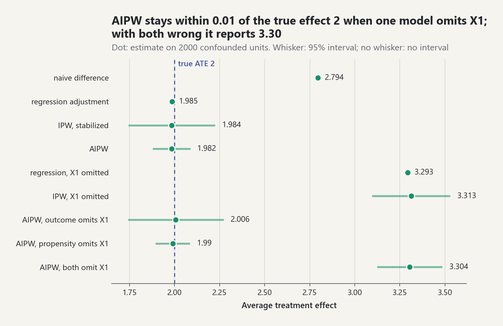

# Causal Inference: Graphs, Interventions, and Effect Estimation

`probstat.causal` (layer 3) covers three steps of a causal analysis:

1. **Graphs.** Encode assumptions as a DAG and decide whether an effect is
   identified.
2. **Discrete structural models.** Compute exact interventional
   distributions.
3. **Estimation.** Estimate an average treatment effect (ATE) from data and
   ask how strong unmeasured confounding would have to be to explain it away.

The package is pure Python. It reuses `inference.fit_glm` for logistic
propensity scores, `inference.fit_linear_model` for outcome models, and
`inference.bootstrap_confidence_interval` for seeded bootstrap intervals.

Every number below was produced by running the library. The tests in
`tests/test_causal_inference.py` check the same quantities against
independent computations:

- d-separation by brute-force path enumeration (4032 queries on six random
  DAGs);
- interventional probabilities by hand-written sums of products;
- saturated-covariate estimates by explicit stratification;
- E-values by the closed form.

## 1. Causal graphs and identification

`CausalGraph(edges, nodes=())` validates that the graph is acyclic
(`CyclicGraphError` otherwise). It stores the nodes in a deterministic
topological order.

### d-separation

`is_d_separated(x, y, given)` uses the moralized ancestral graph
(EQ-CAUSAL-DSEP-001):

1. Keep the ancestors of `X u Y u Z`.
2. Join co-parents.
3. Drop directions and delete `Z`.
4. Test reachability.

| Graph | Query | Result |
|---|---|---|
| chain `A -> B -> C` | `A _||_ C` / `A _||_ C | B` | no / yes |
| fork `A <- B -> C` | `A _||_ C` / `A _||_ C | B` | no / yes |
| collider `A -> B <- C`, `B -> D` | `A _||_ C` / `| B` / `| D` | yes / no / no |

### Backdoor criterion and minimal adjustment sets

`satisfies_backdoor(graph, X, Y, Z)` checks two conditions
(EQ-CAUSAL-BD-001):

- no member of `Z` descends from `X`;
- `X _||_ Y | Z` holds in the graph with the edges leaving `X` removed.

`minimal_adjustment_sets` searches subsets exhaustively by increasing size.
It only considers candidates inside the ancestral set of `X u Y` of that
graph, because every minimal set lies there. It raises an error when more
than `max_candidates` (default 20) candidates remain.

Example graph: `Z1 -> Z3 <- Z2`, `Z1 -> X`, `Z3 -> X`, `Z3 -> Y`,
`Z2 -> Y`, `X -> W -> Y`.

| Query | Result |
|---|---|
| `{Z3}` satisfies backdoor? | `False`, because conditioning on the collider `Z3` opens `X <- Z1 -> Z3 <- Z2 -> Y` |
| minimal sets | `(('Z1', 'Z3'), ('Z2', 'Z3'))` |
| minimal sets with `Z1` latent | `(('Z2', 'Z3'),)` |
| minimal sets with `Z3` latent | `()`: no observed backdoor set exists |

**M-bias.** Take `X <- U1 -> M <- U2 -> Y` with `X -> Y`. The empty set is
the only minimal set. Adjusting for `M` alone *fails* the criterion. `{M, U1}`
and `{M, U2}` repair it.

### Frontdoor criterion

`satisfies_frontdoor(graph, X, Y, M)` checks three conditions
(EQ-CAUSAL-FDC-001). For `U -> X`, `U -> Y`, `X -> M -> Y` with `U` latent:

- `{M}` satisfies the criterion, while no observed backdoor set exists.
- Adding `X -> Y` breaks condition (i).
- Adding `U -> M` breaks condition (ii).

### Graph surgery

`graph.do(nodes)` deletes the edges into the intervened nodes.
`graph.remove_outgoing(nodes)` deletes the edges leaving them.

## 2. Discrete structural causal models

`DiscreteCausalModel(domains, parents, tables)` takes one conditional table
per variable. Each row lists probabilities in domain order and must sum to
one; rows must not be missing.

- `joint()` is the Markov factorization (EQ-CAUSAL-FACT-001).
- `interventional_joint({X: x})` and `interventional_distribution(Y, {X: x})`
  use the truncated factorization (EQ-CAUSAL-TRUNC-001).
- `intervene({X: x})` returns the mutilated model. Its `joint()` equals the
  truncated factorization.

### Truncated factorization by hand

The model has binary variables and the edges `Z -> X -> W -> Y` and
`Z -> Y`, with:

- `P(Z=1) = 0.3`;
- `P(X=1 | Z) = 0.4, 0.7`;
- `P(W=1 | X) = 0.2, 0.6`;
- `P(Y=1 | W, Z) = 0.1 (0,0), 0.5 (0,1), 0.4 (1,0), 0.9 (1,1)`.

```text
P(Y=1 | do(X=1)) = 0.7 (0.4*0.1 + 0.6*0.4) + 0.3 (0.4*0.5 + 0.6*0.9) = 0.418
P(Y=1 | do(X=0)) = 0.7 (0.8*0.1 + 0.2*0.4) + 0.3 (0.8*0.5 + 0.2*0.9) = 0.286
```

| Quantity | `X = 1` | `X = 0` |
|---|---|---|
| `P(Y=1 | do(X))`, truncated factorization | 0.418 | 0.286 |
| backdoor formula on the joint, adjusting for `Z` (EQ-CAUSAL-ADJ-001) | 0.418 | — |
| frontdoor formula on `(X, W, Y)` only (EQ-CAUSAL-FD-001) | 0.418 | — |
| naive `P(Y=1 | X)` | 0.477143 | 0.234118 |

The naive contrast is 0.243 and the causal contrast is 0.132.

`backdoor_adjustment` and `frontdoor_adjustment` work on any `JointTable`,
including `JointTable.from_counts(...)` built from data. When positivity fails
(`P(z) > 0` but `P(x, z) = 0`) they raise an error instead of returning a
number.

### Simpson's paradox

The model is `Z -> X`, `Z -> Y`, `X -> Y`, with a binary severity `Z`:

- `P(Z=1) = 0.5`;
- `P(X=1 | Z) = 0.2, 0.8`;
- `P(Y=1 | X, Z)`: `0.8, 0.9` when mild and `0.3, 0.4` when severe.

So treatment raises recovery by 0.10 in each stratum.
`compare_naive_and_adjusted(joint, "X", "Y", ["Z"], outcome_value=1,
treated=1, control=0)` returns:

| | treated | control | difference |
|---|---|---|---|
| naive `P(Y=1 | X)` | 0.50 | 0.70 | -0.20 |
| adjusted `P(Y=1 | do(X))` | 0.65 | 0.55 | +0.10 |

`reversal=True`. The severely ill are mostly treated, so the naive
comparison credits the treatment with their poor prognosis.

## 3. Estimating an ATE from data

The estimators assume:

- conditional exchangeability given `X`;
- positivity, `0 < e(X) < 1`;
- consistency.

They take covariate rows, a 0/1 treatment, and outcomes, and return an
`EffectEstimate` (estimate, standard error, `E[Y(1)]`, `E[Y(0)]`, trimming
counts).

| Function | Method | Standard error |
|---|---|---|
| `estimate_regression_adjustment` | Per-arm OLS outcome models, averaged over everyone (EQ-CAUSAL-REG-001) | `nan`; use the bootstrap |
| `estimate_ipw(..., stabilized=False)` | Horvitz-Thompson (EQ-CAUSAL-IPW-001) | influence function, `e` treated as known |
| `estimate_ipw(..., stabilized=True)` | Stabilized weights, Hajek form (EQ-CAUSAL-SW-001) | same |
| `estimate_aipw` | Doubly robust (EQ-CAUSAL-AIPW-001) | `sd(psi)/sqrt(n)` |

The logistic propensity model (EQ-CAUSAL-PS-001) is fitted by IRLS.
Separation raises `SeparationError`. Scores outside `[0.01, 0.99]` emit a
`PositivityWarning`.

`trim=a` drops units with `e < a` or `e > 1 - a`. That changes the estimand
to the ATE of the overlap population, which the result labels
`"ATE (trimmed population)"`.

### Simulated confounded data

The data come from `simulate(2000, 20261012)` in the test file:

- `X1, X2 ~ N(0, 1)`;
- `logit e = -0.3 + 0.8 X1 - 0.5 X2`;
- `Y = 1 + 2T + 1.5 X1 + X2 + 0.5 T X1 + N(0, 1)`.

The true ATE is 2. The sample has 873 treated units.

| Estimator | Estimate | SE |
|---|---|---|
| naive difference of means | 2.7944 | — |
| regression adjustment | 1.9849 | — |
| IPW, Horvitz-Thompson | 1.9696 | 0.1475 |
| IPW, stabilized | 1.9836 | 0.1230 |
| IPW, stabilized, `trim=0.1` (61 dropped) | 1.9700 | 0.1231 |
| AIPW | 1.9825 | 0.0530 |

The stabilized weights have mean 0.998 and maximum 5.88.

Covariate balance (`standardized_mean_differences`, EQ-CAUSAL-SMD-001) uses
the unweighted pooled SD in both rows, so the two rows share one scale:

| Covariate | SMD raw | SMD after stabilized IPW |
|---|---|---|
| x1 | 0.727 | 0.008 |
| x2 | -0.426 | -0.016 |

### Double robustness: misspecifying one model at a time

The misspecified working model omits the confounder `X1`.

| Outcome model | Propensity model | AIPW (SE) | Single-model comparator |
|---|---|---|---|
| wrong | right | 2.0063 (0.1355) | regression adjustment 3.2925 |
| right | wrong | 1.9897 (0.0488) | IPW 3.3127 (0.1110) |
| wrong | wrong | 3.3043 (0.0925) | — |

AIPW stays within 3 SE of 2 whenever one model is correct. It fails, like
both comparators, when both models are wrong. Double robustness is not
robustness to unmeasured confounding.

<picture><source media="(prefers-color-scheme: dark)" srcset="../images/guides/causal-double-robustness-dark.png"></picture>

*With correct working models every adjusted estimator lands near the true effect 2, while the naive contrast reports 2.79; when one model omits the confounder X1, regression or IPW alone moves to about 3.3 but AIPW stays within 0.01 of the truth, and only with both models wrong does it fail as well, at 3.30.*

### Bootstrap intervals

`bootstrap_effect(..., method="aipw", replicates=40, seed=11)` was run on
`simulate(250, 77)`. It resamples whole units and refits both models in each
replicate. The percentile interval is `[1.861, 2.348]`; the estimate is
2.075 and the bootstrap SE is 0.128. Equal seeds reproduce the replicates
exactly. Use at least 1000 replicates for reporting; the tests use 40 to
stay fast.

## 4. Sensitivity to unmeasured confounding: E-values

`e_value(rr, lower=, upper=)` computes
`E = RR + sqrt(RR (RR - 1))` (EQ-CAUSAL-EVALUE-001). A protective `RR < 1`
is inverted first. The interval E-value uses the limit closest to one, and
is 1 when the interval covers one.

| Input | E (point) | E (CI limit) |
|---|---|---|
| RR 3.9, CI 1.8-8.7 | 7.263 | 3.000 |
| RR 0.5, CI 0.3-0.8 | 3.414 | 1.809 |
| RR 1.5, lower 0.9 | 2.366 | 1.000 |

The RR 3.9 (1.8-8.7) row matches the worked example usually quoted from
VanderWeele and Ding (2017). That match is cited from secondary sources; the
paper itself was not re-read for this guide.

`confounding_bias_factor(rr_eu, rr_ud)` (EQ-CAUSAL-BIAS-001) satisfies
`B(E, E) = RR`, and the tests check this identity.
`risk_ratio_from_odds_ratio` and `risk_ratio_from_standardized_difference`
are approximate conversions (EQ-CAUSAL-RRAPPROX-001).

## 5. Quasi-experimental and debiased estimators

Sections 3 and 4 assume a binary treatment, parametric working models and a
risk-ratio scale for sensitivity. Five further modules relax one of these at
a time (ADR-0121). All of their standard errors are asymptotic, and each
method replaces "no unmeasured confounding given a parametric model" by a
different, equally untestable, identifying assumption.

| Entry point | Identifying assumption | What is reported |
|---|---|---|
| `sensitivity_statistics`, `adjust_for_confounder` | none: a what-if analysis of a linear regression | partial R-squared, robustness values, adjusted estimate / SE / t |
| `dml_partially_linear`, `dml_average_treatment_effect` | unconfoundedness given `X`; nuisance errors with product `o(n^(-1/2))` | cross-fitted estimate, sandwich SE, out-of-fold nuisance R-squared |
| `did_two_by_two`, `group_time_effects` | parallel trends, no anticipation | `ATT(g, t)`, event-study and overall averages, influence-function SEs |
| `synthetic_control`, `synthetic_control_placebo` | a stable convex donor combination | weights, effect path, RMSPE, placebo rank |
| `two_stage_least_squares` | instrument relevance, exclusion, exchangeability | coefficients, robust SEs, first-stage F |

### Omitted-variable bias in partial R-squared form

If a confounder `Z` is omitted from the regression of `Y` on `(D, X)`, the
coefficient of `D` changes by exactly (EQ-CAUSAL-OVB-002)

`|bias| = se sqrt(df) sqrt(R2_Y R2_D / (1 - R2_D))`,

where `R2_Y` is the partial R-squared of `Z` with the outcome given `(D, X)`
and `R2_D` its partial R-squared with the treatment given `X`. This is
least-squares algebra, not an approximation: the tests omit a simulated
confounder, fit both regressions with `fit_linear_model`, and recover the
observed change, the long regression's standard error and its t statistic
to 12 decimal places. The robustness value `RV_q` (EQ-CAUSAL-OVB-003) is
the common strength `R2_Y = R2_D` that removes the fraction `q` of the
estimate; `robustness_value(..., alpha=)` gives the common strength that
leaves the adjusted t statistic at the critical value
(EQ-CAUSAL-OVB-005, the equal-strength definition). The partial R-squared
values do not fix the *sign* of the bias; `reduce=True` assumes the
confounder inflated the estimate.

### Double/debiased machine learning

`dml_partially_linear` estimates `theta` in `Y = theta D + g(X) + e`. It
fits `E[Y | X]` and `E[D | X]` with any learner (a callable
`fit(rows, targets) -> predict`), forms out-of-fold residuals by K-fold
cross-fitting, and regresses residual on residual (EQ-CAUSAL-DML-001). The
score is Neyman orthogonal, so first-order errors of the two learners
cancel. `linear_learner`, `ridge_learner`, `knn_learner` and
`logistic_learner` wrap library routines. With `folds=1` and linear
learners the estimate equals the least-squares coefficient of `D` and the
standard error equals its HC0 standard error (Frisch-Waugh-Lovell; checked
to 12 decimals). In 120 seeded replicates with nonlinear `g` and `m`
(`n = 300`, 15 nearest neighbours, 4 folds, true `theta = 0.5`) the mean
estimate was 0.515, the 95 % interval covered the truth in 91.7 % of
replicates, and the mean standard error was 0.92 of the Monte Carlo
standard deviation; removing `E[Y | X]` from the outcome without
residualizing the treatment averaged 0.253. The small remaining bias is the
smoothing bias of nearest neighbours, which the interval does not show.
`dml_average_treatment_effect` is the cross-fitted AIPW estimator
(EQ-CAUSAL-DML-003) for a binary treatment; with `folds=1` and the default
learners it reproduces `estimate_aipw`.

### Difference-in-differences

`did_two_by_two` is the textbook estimator on unit-level changes
(EQ-CAUSAL-DID-001). For staggered adoption `group_time_effects` estimates
`ATT(g, t) = E[Y_t - Y_{g-1} | G = g] - E[Y_t - Y_{g-1} | C]` for every
group `g` and period `t >= g` (EQ-CAUSAL-DID-002), with `C` the
never-treated units (`comparison="never"`) or the units not yet treated at
`t` (`"notyet"`). `event_study()` averages the cells by exposure time with
group-size weights (EQ-CAUSAL-DID-004); `overall()` averages every
post-treatment cell with weight proportional to its group size
(EQ-CAUSAL-DID-005), so early adopters, who contribute more cells, weigh
more. Panels must be balanced; `panel_from_long` reshapes long records and
raises otherwise. No covariates, no pre-trend (placebo) cells and no
simultaneous confidence bands are provided.

A static two-way fixed-effects regression is not a substitute: in a
noise-free panel with adoption at periods 2 and 4, effects that grow with
exposure and a true average effect of 3.0 over the post-treatment cells,
the TWFE coefficient is 1.875 while every `ATT(g, t)` is recovered exactly
(`tests/test_causal_extensions.py`).

### Synthetic control

`synthetic_control_weights` solves
`min (x1 - X0 w)' V (x1 - X0 w)` over the simplex (EQ-CAUSAL-SC-001) by
projected gradient with the exact simplex projection `project_to_simplex`
and an exact solve on the current support. The result carries the duality
gap `g'w - min_j g_j`, which bounds the distance to the optimum and is zero
exactly at a KKT point; `converged` is `False` if the iteration limit was
reached first. `V` is the identity unless `importance=` is given; the
data-driven choice of `V` is not implemented. `synthetic_control` returns
the gap path `tau_t` and the pre- and post-period RMSPE;
`synthetic_control_placebo` re-runs the method for every donor and ranks
the treated unit's post/pre RMSPE ratio (EQ-CAUSAL-SC-004). That p-value is
a placebo rank among `J + 1` units, not a sampling-based p-value.

### Instrumental variables

`two_stage_least_squares` fits `y = X beta + u` when some regressors are
endogenous (EQ-CAUSAL-IV-001), with HC0 or HC1 sandwich standard errors
(EQ-CAUSAL-IV-002) and the first-stage F statistic of the excluded
instruments (EQ-CAUSAL-IV-003). With one binary instrument it is the Wald
ratio. The estimator is consistent, not unbiased, and unreliable when the
first stage is weak (`weak_instruments` flags `F < 10`, a rule of thumb).

### One data set, three answers

The example has a nonlinear confounder `x`, an unmeasured confounder `u`
and an instrument `z`; the true coefficient of `d` is 0.5.

```python
import math
import random
from probstat.causal import (
    adjust_for_confounder, dml_partially_linear, group_time_effects,
    knn_learner, sensitivity_statistics, synthetic_control_placebo,
    two_stage_least_squares,
)
from probstat.inference import fit_linear_model

rng = random.Random(7)
x = [(rng.uniform(-2, 2),) for _ in range(400)]
z = [rng.gauss(0, 1) for _ in range(400)]
u = [rng.gauss(0, 1) for _ in range(400)]
d = [math.sin(2 * a[0]) + 0.8 * b + 0.6 * c + rng.gauss(0, 1)
     for a, b, c in zip(x, z, u)]
y = [0.5 * di + a[0] ** 2 + 0.9 * c + rng.gauss(0, 1)
     for di, a, c in zip(d, x, u)]

# Linear regression and its sensitivity to an omitted confounder
ols = fit_linear_model([(1.0, di, a[0]) for di, a in zip(d, x)], y)
stats = sensitivity_statistics(
    ols.coefficients[1], ols.standard_errors[1], ols.df_residual)
stats.estimate                 # 0.733
stats.partial_r2               # 0.256
stats.robustness_value         # 0.439
stats.robustness_value_alpha   # 0.383
adjusted = adjust_for_confounder(
    stats.estimate, stats.standard_error, stats.degrees_of_freedom,
    r2_outcome=0.2, r2_treatment=0.1)
adjusted.adjusted_estimate     # 0.547
adjusted.adjusted_t            # 9.23

# Double ML handles the nonlinear g(x), not the unmeasured u
dml = dml_partially_linear(
    x, d, y, outcome_learner=knn_learner(20),
    treatment_learner=knn_learner(20), folds=5, seed=1)
dml.estimate                   # 0.742
dml.standard_error             # 0.048

# The instrument does (truth 0.5), at the price of a wider interval
iv = two_stage_least_squares(
    y, d, z, exogenous=[(a[0], a[0] ** 2) for a in x])
iv.coefficient("d0")           # 0.358
iv.standard_errors[1]          # 0.105
iv.first_stage_f[0]            # 104.1

# Staggered adoption: the effect is (periods since adoption) + 1
panel, first = [], []
for g in (2, 4, None):
    for _ in range(40):
        level = rng.gauss(0, 1)
        panel.append([
            level + 0.3 * t
            + ((t - g + 1.0) if g is not None and t >= g else 0.0)
            + rng.gauss(0, 0.5) for t in range(6)])
        first.append(g)
att = group_time_effects(panel, first, comparison="notyet")
att.effect(2, 3).estimate           # 2.03
att.effect(2, 3).standard_error     # 0.132
[round(a.estimate, 2) for a in att.event_study()]  # [0.88, 2.05, 2.85, 4.04]
att.overall().estimate              # 2.12

# Synthetic control: an effect of 3 from period 10 on, nine donors
factor = [math.sin(0.5 * t) + 0.1 * t for t in range(14)]
donors = [[rng.uniform(0.5, 1.5) * f + rng.gauss(0, 0.05) for f in factor]
          for _ in range(9)]
treated = [f + rng.gauss(0, 0.05) + (3.0 if t >= 10 else 0.0)
           for t, f in enumerate(factor)]
placebo = synthetic_control_placebo(treated, donors, 10)
placebo.treated.average_effect      # 3.00
placebo.treated.pre_rmspe           # 0.022
placebo.rank, placebo.p_value       # (1, 0.1)
placebo.all_converged               # True
```

The regression estimate 0.733 has a robustness value of 0.439: a confounder
would need to explain 44 % of the residual variance of both treatment and
outcome to remove it entirely. Here the confounder exists by construction
and is weaker than that, so the estimate is biased but not spurious; the
sensitivity analysis cannot tell which strength is the true one.

## Limitations

- Identification covers the backdoor and frontdoor criteria only. There is
  no do-calculus engine and no complete ID algorithm
  [REF-SHPITSER-PEARL-2006].
- For treatment *sets*, the backdoor check uses d-separation in the graph
  with the treatments' outgoing edges cut.
- Discrete models enumerate all assignments, so the cost is the product of
  the domain sizes.
- The estimators of section 3 cover a binary treatment and the ATE only,
  not the ATT or ATC, with linear outcome models and a logistic propensity
  model. Section 5 adds cross-fitting with user-supplied learners; the
  built-in flexible learner is a plain nearest-neighbour average.
- Double ML has no automatic learner tuning and no repeated cross-fitting.
  Difference-in-differences has no covariates, no pre-trend tests and no
  simultaneous bands, and needs a balanced panel. Synthetic control takes
  the predictor importances as given. Instrumental variables offer no
  weak-instrument-robust intervals and no over-identification test.
- IPW standard errors ignore propensity estimation. Use `bootstrap_effect`
  for a full accounting.

## Common pitfalls

- **More adjustment is not safer.** Conditioning on a collider or its
  descendant opens a path: in the M-bias graph `satisfies_backdoor` rejects
  `{M}` and accepts the empty set. Let `minimal_adjustment_sets` choose
  from the graph rather than adding every pre-treatment variable.
- **No standard error from regression adjustment.**
  `estimate_regression_adjustment` reports `standard_error = nan`; use
  `bootstrap_effect` for an interval.
- **Defaults and estimands.** `estimate_ipw` defaults to stabilized
  (Hajek) weights; pass `stabilized=False` for Horvitz-Thompson. Any `trim`
  changes the estimand to the overlap population, and the result's
  `estimand` says so.
- **Reading E-values.** The confidence-limit E-value is `1` whenever the
  interval covers one, and a protective `RR < 1` is inverted before the
  formula is applied.
- **Double robustness is not robustness to unmeasured confounding.** AIPW
  needs one of its two working models to be right *and* exchangeability
  given the measured covariates (section 3).
- **A robustness value is not evidence.** It states how strong a
  confounder would have to be, not that none that strong exists; the sign
  of the bias is an extra assumption (`reduce=`).
- **`folds=1` is not cross-fitted.** The result says so in
  `cross_fitted`; a 1-nearest-neighbour learner then interpolates the
  treatment and the estimator refuses to divide by zero.
- **TWFE under staggered timing.** A single treatment dummy with unit and
  period effects is not an average of the `ATT(g, t)` when effects vary
  with exposure; use `group_time_effects` and choose the aggregation.
- **Placebo ranks are coarse.** With nine donors the smallest possible
  synthetic-control p-value is 0.1, and it is not a sampling probability.
- **Weak instruments.** A small `first_stage_f` makes two-stage least
  squares biased towards the regression estimate and its interval too
  narrow.

```python
import math
from probstat.causal import (
    CausalGraph, e_value, estimate_ipw, estimate_regression_adjustment,
    minimal_adjustment_sets, satisfies_backdoor,
)

m_bias = CausalGraph([("U1", "X"), ("U1", "M"), ("U2", "M"), ("U2", "Y"),
                      ("X", "Y")])
satisfies_backdoor(m_bias, "X", "Y", ["M"])          # False
satisfies_backdoor(m_bias, "X", "Y", ["M", "U1"])    # True
minimal_adjustment_sets(m_bias, "X", "Y")            # ((),)

rows = [[0.1 * i] for i in range(20)]
treated = [0, 1, 0, 0, 1, 0, 1, 0, 1, 1, 0, 1, 0, 1, 1, 1, 0, 1, 1, 1]
outcome = [1.0 + 2 * t + r[0] + 0.01 * ((7 * i) % 5)
           for i, (t, r) in enumerate(zip(treated, rows))]
math.isnan(estimate_regression_adjustment(rows, treated, outcome).standard_error)  # True
estimate_ipw(rows, treated, outcome).method                 # 'ipw-stabilized'
estimate_ipw(rows, treated, outcome, trim=0.3).estimand     # 'ATE (trimmed population)'

e_value(1.5, lower=0.9).confidence_limit    # 1.0
e_value(0.5, lower=0.3, upper=0.8).point    # 3.414, the E-value of 1/0.5 = 2
```
