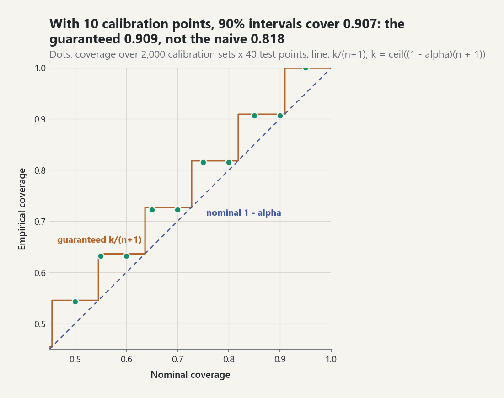
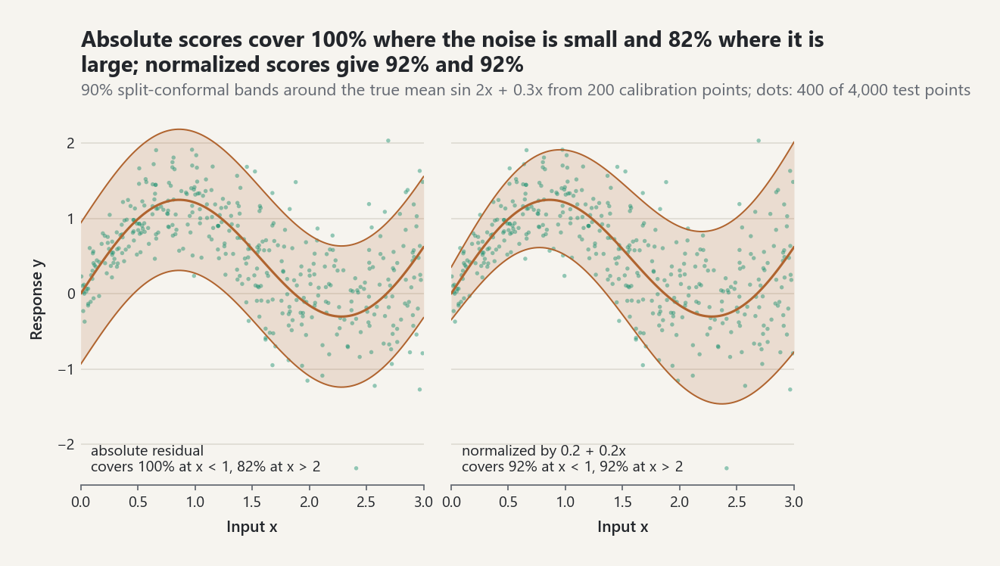

# Conformal Prediction Intervals

`probstat.conformal` turns any point predictor into prediction intervals with
a finite-sample coverage guarantee. The predictor can be a callable, a fitted
PCE or GP surrogate, or a refitting procedure. The guarantee assumes nothing
about the model and needs only that the data are exchangeable. Every number
below was computed with the library and is asserted, or recomputed, in
`tests/test_conformal_prediction.py` or, for Sections 7 to 13, in
`tests/test_conformal_extensions.py`.

## 0. What is guaranteed, and what is not

Let `C(x)` be the interval built from `n` calibration points. For a new pair
`(X, Y)` exchangeable with them,

```text
1 - alpha  <=  k / (n + 1)  <=  P(Y in C(X)),    k = ceil((1 - alpha)(n + 1)).
```

When the scores are almost surely distinct, the probability equals `k/(n+1)`,
which is less than `1 - alpha + 1/(n+1)` (EQ-CONF-005).

The probability is **marginal**. It averages over the calibration set *and*
the test point. Three consequences:

- It does **not** promise `1 - alpha` coverage at every `x`. A test region
  where the model is poor can be under-covered while another is over-covered.
- It does **not** promise `1 - alpha` coverage for one fixed calibration set.
  For a single calibration set, the coverage of later points varies around
  `k/(n+1)`; it follows a `Beta(k, n + 1 - k)` law because it equals the law
  probability below the `k`-th order statistic of `n` uniforms.
- A bad model still gets *valid* intervals, but they are wide.

Exchangeability is the key assumption. Distribution shift, time ordering, or
a calibration set reused for fitting all break it.

## 1. The finite-sample quantile (EQ-CONF-001)

`conformal_rank(n, alpha)` returns `k = ceil((1 - alpha)(n + 1))`.
`conformal_quantile(scores, alpha)` returns the `k`-th smallest score, or
`+inf` when `k = n + 1`. This is the empirical `(1 - alpha)(n+1)/n` quantile.

The index is computed in exact rational arithmetic from the decimal text of
`alpha`. Binary rounding therefore cannot move `k`; `(n, alpha) = (9, 0.3)`
gives exactly `k = 7`.

| `n` | `alpha` | `k` | `k/(n+1)` | Naive `ceil((1-alpha) n)` |
|---|---|---|---|---|
| 9 | 0.1 | 9 | 0.900 | 9 |
| 10 | 0.1 | 10 | 0.909 | 9 (would give 0.818) |
| 19 | 0.1 | 18 | 0.900 | 18 |
| 99 | 0.05 | 95 | 0.950 | 95 |
| 5 | 0.1 | 6 > n | 1 (infinite intervals) | 5 |

The `n = 10` row shows why the `(n+1)/n` correction matters. The seeded
replicates below land on `0.909`, not on `0.818`.

<picture><source media="(prefers-color-scheme: dark)" srcset="../images/guides/conformal-coverage-staircase-dark.png"></picture>

*With n = 10 calibration points the empirical coverage of split-conformal intervals follows the staircase k/(n+1), on or above the nominal diagonal at every level: at nominal 90% it is 0.907 against the guaranteed 0.909, far from the 0.818 the uncorrected index would give.*

## 2. Split conformal regression (EQ-CONF-002)

`split_conformal_regression(predictor, x_cal, y_cal, alpha=0.1)` scores the
held-out residuals `|y - mu(x)|` and returns `mu(x) +/- q_hat`. Passing
`scale=s` switches to normalized (locally weighted) scores
`|y - mu(x)| / s(x)`, and the interval becomes `mu(x) +/- q_hat s(x)`. The
guarantee is unchanged, and the width now follows `s(x)`.

The predictor and `s` must not have seen the calibration data.

<picture><source media="(prefers-color-scheme: dark)" srcset="../images/guides/conformal-normalized-scores-dark.png"></picture>

*Built around the true mean from the same 200 calibration points, both bands carry the same marginal guarantee, but absolute scores give one width everywhere and so cover 100% of test points where the noise is small (x < 1) and 82% where it is large (x > 2); scores normalized by the noise scale make the width follow it and cover 92% and 92% in the two regions.*

Seeded check (`tests/test_conformal_prediction.py`):

- data: `x ~ U(0, 3)`, `y = sin 2x + 0.3x + N(0, (0.2 + 0.2x)^2)`;
- predictor: a deliberately wrong line `0.1 + 0.3x`;
- design: `n = 10`, `alpha = 0.1`, 500 calibration/test replicates with 40
  test points each;
- target: `k/(n+1) = 10/11 = 0.9091`.

| Method | Mean coverage | Monte Carlo se |
|---|---|---|
| absolute residual | 0.9035 | 0.0044 |
| normalized, `s(x) = 0.2 + 0.2x` | 0.9099 | 0.0044 |
| CQR (Section 3) | 0.9050 | 0.0043 |

All three are within 1.3 standard errors of `10/11`. The naive index would
give `0.818`; the absolute-residual mean is about 20 standard errors above
that value.

## 3. Conformalized quantile regression (EQ-CONF-003)

`conformalized_quantile_regression(q_lo, q_hi, x_cal, y_cal)` takes any lower
and upper quantile predictors. It scores `max(q_lo(x) - y, y - q_hi(x))` and
returns `[q_lo(x) - q_hat, q_hi(x) + q_hat]`.

The bands keep their adaptive shape, and the shift repairs their calibration.
In the test, bands only half as wide as the noise end with mean coverage
`0.9050` (target `0.9091`). A negative `q_hat` narrows bands that were too
wide. Fitting the quantile predictors themselves (for example by pinball-loss
regression) is outside this module.

## 4. Jackknife+ (EQ-CONF-004)

`jackknife_plus_regression(fit, x_train, y_train)` refits the model `n` times,
leaving out one point each time, and uses the leave-one-out residuals. The
interval at `x` takes:

- as lower limit, the `floor(alpha(n+1))`-th smallest `mu_{-i}(x) - R_i`;
- as upper limit, the `ceil((1-alpha)(n+1))`-th smallest `mu_{-i}(x) + R_i`.

No data are held out. The guarantee is `1 - 2 alpha` for any symmetric
fitting rule. Coverage is usually near `1 - alpha`.

Seeded check: least-squares lines, `n = 20`, `alpha = 0.1`, 150 replicates of
20 test points.

- mean coverage: `0.908`;
- mean width: `2.51`;
- bound: `0.8`; asserted window: `[0.85, 0.97]`.

## 5. Error bars for a surrogate of a probabilistic model

`conformalize_surrogate(model, surrogate, alpha=0.1, size=n, seed=...)`
quantifies how far an emulator's prediction can be from the true model QoI:

1. It draws `n` independent inputs from `model.inputs`, using stream child
   `"conformal-calibration"`.
2. It runs the true model there; this costs `n` evaluations, which are
   counted in `model.evaluations`.
3. It calibrates split conformal intervals around `surrogate.predict`.

The calibration inputs are plain Monte Carlo draws by design. LHS or Sobol
points are not exchangeable with a random test input, so the guarantee would
not apply. The inputs must also be independent of the surrogate's training
design.

| Surrogate | Calibration | Interval | Coverage on 2000 fresh inputs |
|---|---|---|---|
| Degree-1 PCE (30-run LHS; relative LOO error 0.178) of `x1 + 0.5 x2 + 0.3 x1^2` | 99 runs | `+/- 0.459` | 0.851 |
| 20-point GP of `sin x1 + 0.5 x1 sin x2` | 99 runs | `+/- 0.153` (absolute scores) | 0.937 |
| Same GP | 99 runs | `+/- q sd(x)` (normalized) | 0.933 |

The guarantee for the PCE row is `k/(n+1) = 0.9`. The observed `0.851` is
about 1.7 standard deviations below 0.9 under the `Beta(90, 10)` law of
fixed-calibration coverage (standard deviation about 0.03). That is the
calibration-set variability described in Section 0, not a failure.

For the GP rows, normalized scores divide residuals by the GP predictive
standard deviation. The median width drops from `0.306` to `0.050`, while the
intervals widen far from the data: at `(3, -3)` the interval is `2.53` wide.

**Pathology found while testing.** A GP fitted to the smooth quadratic chose
very long length scales. Its predictive variance then cancelled to exactly 0
at some calibration inputs. A normalized score is meaningless there, so
`conformalize_surrogate` raises and asks for a `scale_offset`. That positive
constant is added to the standard deviation and must be chosen before seeing
the calibration data. A GP fitted with
`regularization=GaussianProcessRegularization()` keeps a noise floor of
`1e-8 sigma_f^2` and bounded length scales; on the test case above its variance
stays positive and no offset is required (ADR-0054). The default fit is
unchanged.

## 6. Coverage checks

`empirical_coverage(intervals, y_test, nominal=0.9)` reports:

- the covered count and rate;
- an exact Clopper-Pearson interval for the rate;
- mean and median widths;
- whether the nominal level is inside that interval.

Use it on a test set disjoint from calibration. Repeat it within subgroups to
look for conditional under-coverage.

## 7. Covariate shift: weighted conformal (EQ-CONF-006)

Split conformal gives each calibration score and the unseen test score the
mass `1/(n+1)`. If the test inputs follow a law `Q` different from the
calibration law `P`, while `Y | X` is unchanged, the scores are no longer
exchangeable, but they are *weighted* exchangeable with the likelihood ratio
`w = dQ/dP`. `weighted_split_conformal_regression(predictor, x_cal, y_cal, w)`
uses

```text
p_i(x) = w(X_i) / (sum_j w(X_j) + w(x)),    p_{n+1}(x) = w(x) / (same),
q(x)   = (1 - alpha)-quantile of  sum_i p_i(x) delta_{S_i} + p_{n+1}(x) delta_{+inf}.
```

The threshold depends on the test point: where `w(x)` is large the mass at
`+inf` is large, and the interval can be the whole line. `w` may be a
callable or the calibration values (then pass `weight=w(x)` to `interval`);
only ratios matter. `effective_sample_size` reports the Kish heuristic
`(sum w)^2 / sum w^2`.

**What is guaranteed:** `P_Q(Y in C(X)) >= 1 - alpha`, marginally, *when the
weights are the true likelihood ratio*. With estimated weights the statement
is approximate, and a shift in `Y | X` is not covered at all. `w = 1`
reproduces split conformal exactly (the quantile is located in rational
arithmetic).

Seeded check: `X ~ N(0, 1)` in calibration, `N(1, 1)` at test time,
`w(x) = exp(x - 1/2)`, `Y = X + N(0, e^X)`, predictor `x`, `n = 200`,
`alpha = 0.1`, 300 replicates of 25 test points.

| Method | Mean coverage under `Q` | Monte Carlo se |
|---|---|---|
| weighted, exact `w` | 0.9116 | 0.0045 |
| unweighted split conformal | 0.7557 | 0.0057 |

## 8. Fixed weights without exchangeability (EQ-CONF-007)

`nonexchangeable_split_conformal_regression(predictor, x_cal, y_cal, weights)`
takes weights `w_i` in `[0, 1]` that were fixed before seeing the data,
typically decaying with the distance from the test point, such as
`rho^(n+1-i)` for a time series. It normalizes them as
`w~_i = w_i / (sum_j w_j + 1)`, puts `w~_{n+1} = 1/(sum_j w_j + 1)` at `+inf`,
and uses the weighted `1 - alpha` quantile.

The guarantee is

```text
P(Y in C(X))  >=  1 - alpha - sum_i w~_i d_TV(R(Z), R(Z^i)),
```

where `Z^i` swaps points `i` and `n+1`. For exchangeable data every distance
is zero and nothing is lost. Otherwise the gap is small when points that
differ from the test point carry little weight. **The gap cannot be computed
from data**: the distances are properties of the unknown law.
`nonexchangeable_coverage_gap(weights, bounds)` only evaluates the sum for
bounds you are willing to assume.

Seeded checks, `alpha = 0.1`, 300 replicates: with i.i.d. data and
`w_i = 0.97^(60-i)` the mean coverage is `0.9165` (se `0.0042`). After a
changepoint (70 scores from `N(0, 1)`, then 30 and the test point from
`N(0, 9)`), `w_i = 0.9^(100-i)` covers `0.962` where unweighted split
conformal covers `0.693`.

## 9. Conformal risk control (EQ-CONF-008)

Coverage is the expectation of one particular loss, the miss indicator.
`conformal_risk_control(losses, lambdas, alpha=..., bound=B)` handles any
loss `L_i(lambda)` that is bounded by `B` and non-increasing in `lambda`
(larger `lambda` means a larger prediction set). `losses[i][j]` is the loss
of calibration observation `i` at grid value `lambda_j`. The result is the
smallest grid value with

```text
(n/(n+1)) Rhat_n(lambda) + B/(n+1)  <=  alpha,
```

and then `E[L_{n+1}(lambda_hat)] <= alpha` for exchangeable data, marginally
over the calibration set and the test point.

- The search is restricted to the grid you pass. The guarantee is unchanged,
  and the answer is at most one grid step more conservative than the
  continuous infimum.
- Monotonicity and the bound are checked, and a violation raises. A loss
  that is not monotone is not repaired silently.
- If no grid value qualifies, the largest is returned with `feasible=False`.
  The bound then holds only if the loss at that value never exceeds `alpha`.
- With `L_i = 1{s_i > lambda}`, `B = 1`, and the scores as the grid,
  `lambda_hat` equals `conformal_quantile(scores, alpha)` exactly.

Seeded check (false-negative rate of a multilabel set
`{k : score_k >= 1 - lambda}`, six classes, `n = 40`, `alpha = 0.1`, grid
step `0.02`, 400 replicates of 20 test items): mean test risk `0.0697`
(se `0.0032`), below `alpha` as required. The distance from `alpha` is the
`B/(n+1)` term and the grid.

## 10. Conformal p-values and outlier detection (EQ-CONF-009, EQ-CONF-010)

`conformal_p_values(calibration_scores, test_scores)` returns
`p_j = (1 + #{i : s_i >= s_j}) / (n + 1)`, where a larger score means "more
unusual" and the calibration scores come from known inliers. For an inlier
test point `P(p_j <= u) <= u`; with continuous scores `p_j` is exactly
uniform on `{1/(n+1), ..., 1}` (the tests enumerate all orderings for
`n = 1, 3, 5`).

`conformal_outlier_detection(calibration_scores, test_scores, alpha=0.1)`
applies the library's Benjamini-Hochberg procedure to these p-values.
p-values that share a calibration set are dependent, but positively (PRDS),
so the false discovery rate is at most `pi0 alpha <= alpha`, with `pi0` the
fraction of inliers among the test points. This needs calibration points
and test inliers that are independent draws from one law, and test points
independent of each other; the source states the PRDS property for scores
without ties.

Both statements are **marginal over the calibration set**. For one fixed
calibration set the p-values can be anti-conservative. Also note the
resolution `1/(n+1)`: with `m` test points and one outlier, nothing can be
rejected unless `1/(n+1) <= alpha/m`.

Seeded check: `n = 199` standard normal calibration scores, 40 inliers and
10 outliers from `N(3.5, 1)`, `alpha = 0.1`, 400 replicates: FDR `0.0698`
(se `0.0042`), against the Benjamini-Hochberg level `0.8 alpha = 0.08` for
80% inliers.

## 11. Group-conditional (Mondrian) calibration (EQ-CONF-011)

`mondrian_conformal_regression(predictor, x_cal, y_cal, groups)` computes one
calibration quantile per group label; `interval(x, group)` uses the quantile
of the test point's group. Coverage is then at least `1 - alpha`
*conditionally on the group*, provided the points are exchangeable within
each group. It is still not conditional on `x` inside a group.

Each group pays the `+inf` rule on its own count: at `alpha = 0.1` a group
with fewer than nine calibration points, or a label never seen, gets the
whole line. `group_sizes`, `groups` (size, rank, quantile, guaranteed
coverage per group) and `infinite_groups` report this.

Seeded check: two groups with noise standard deviations 0.5 and 2.0, 49
calibration points each, `alpha = 0.1`, 300 replicates of 20 test points per
group.

| Method | Quiet group | Noisy group |
|---|---|---|
| marginal split conformal | 1.000 | 0.822 |
| Mondrian | 0.902 | 0.902 |

## 12. CV+ (EQ-CONF-012)

`cv_plus_regression(fit, x_train, y_train, folds=K)` is jackknife+ with `K`
model fits instead of `n`: every point is scored by the model that was
fitted without its fold, and the interval takes the same order statistics as
Section 4 over all `n` points. `folds = n` reproduces
`jackknife_plus_regression` exactly. Folds are contiguous blocks unless a
`seed` is given, which shuffles the balanced fold labels.

The guarantee is `1 - 2 alpha - sqrt(2/n)` for every `K` (Theorem 4 of
Barber et al. 2021, for folds of equal size; the source also gives a
sharper slack in `n` and `K`), and `1 - 2 alpha` at `K = n`. For `n = 20`
and `alpha = 0.1` that is `0.48`, far below what is observed. Typical
coverage is
near `1 - alpha`: least-squares lines, `n = 20`, `K = 5`, `alpha = 0.1`, 200
replicates give `0.908` (se `0.006`).

## 13. Online quantile tracking (EQ-CONF-013, EQ-CONF-014)

`adaptive_conformal_intervals` adapts the *level* of a quantile of past
scores. `online_quantile_intervals(predictions, observations, alpha=...,
step=eta, decay=c)` tracks the threshold itself and stores no scores:

```text
err_t = 1{s_t > q_t},    q_{t+1} = q_t + eta_t (err_t - alpha),    eta_t = eta t^(-c).
```

`c = 0` is the fixed-step quantile tracker; `c = 1/2 + eps` is the decaying
schedule, which lets `q_t` settle when the score law is stable. The
integrator and scorecaster of conformal PID control are not implemented.

**What is guaranteed** is a long-run frequency, for any sequence
whatsoever: if the scores lie in `[0, b]` and `q_1` in `[0, b]`,

```text
|mean(err_1..err_T) - alpha|  <=  (b + eta_1) / (eta_T T).
```

It follows from telescoping the update, because `q_t` can never leave
`[-alpha eta_1, b + (1 - alpha) eta_1]`. For a fixed step the bound is
`(b + eta)/(eta T)`; for decaying steps it is `(b + eta) T^(c-1) / eta`,
which shrinks more slowly and does not vanish at `c = 1`. Nothing is said
about coverage at a given step. Pass `score_bound=b` to get the bound; if a
score exceeds it, the result reports `bound_valid=False` and an infinite
bound. Choose `eta` on the scale of the scores.

Seeded check: 20000 i.i.d. `U(0, 1)` scores, `alpha = 0.1`, `eta = 0.5`,
`q_1 = 0.5`. The true quantile is 0.9.

| Steps | Miss frequency | Bound on its error | Range of `q_t` over the last 10000 steps |
|---|---|---|---|
| fixed (`c = 0`) | 0.10005 | 0.00015 | 0.25 to 1.40 |
| decaying (`c = 0.6`) | 0.10035 | 0.0571 | 0.878 to 0.919 |

The fixed step pins the frequency tightly while its threshold keeps
swinging. The decaying step gives a threshold near the true quantile with a
weaker frequency bound.

```python
import math
from probstat.conformal import (
    conformal_outlier_detection, conformal_p_values, conformal_risk_control,
    mondrian_conformal_regression, nonexchangeable_conformal_quantile,
    online_quantile_intervals, weighted_conformal_quantile,
)

scores = [0.1 * i for i in range(1, 10)]                  # nine scores up to 0.9
weighted_conformal_quantile(scores, [1.0] * 9, 1.0, 0.2)  # 0.8, split conformal
math.isinf(weighted_conformal_quantile(scores, [1.0] * 9, 3.0, 0.2))   # True
recent = [0.8 ** (9 - i) for i in range(1, 10)]           # the newest weighs most
nonexchangeable_conformal_quantile(scores, recent, 0.2)   # 0.9

losses = [[float(s > lam) for lam in scores] for s in scores]
crc = conformal_risk_control(losses, scores, alpha=0.2)
crc.lambda_hat, crc.feasible                              # (0.8, True)
crc.adjusted_risk                                         # 0.2

conformal_p_values(scores, [0.05, 0.55, 0.95])            # (1.0, 0.5, 0.1)
found = conformal_outlier_detection(
    [0.01 * i for i in range(1, 100)], [0.2, 0.5, 1.2, 1.5], alpha=0.1)
found.rejected                           # (False, False, True, True)

groups = mondrian_conformal_regression(
    lambda x: 0.0, [[0.0]] * 18, scores + [10 * s for s in scores],
    ["a"] * 9 + ["b"] * 9, alpha=0.2)
groups.quantile("a"), groups.quantile("b")                # (0.8, 8.0)
math.isinf(groups.quantile("never seen"))                 # True

track = online_quantile_intervals(
    [0.0] * 4, [0.5, 0.2, 1.5, 0.1], alpha=0.2, step=0.5, score_bound=2.0)
track.errors                             # (True, False, True, False)
track.long_run_bound                     # 1.25, = (2 + 0.5)/(0.5 * 4)
```

## Limitations

- Interval methods cover regression with scalar responses. Classification
  sets and multi-output are not implemented as such; conformal risk control
  (Section 9) works on any loss table you compute. For sequential data
  under drift, `adaptive_conformal_intervals` and `online_quantile_intervals`
  are provided; their guarantees bound the long-run miscoverage frequency,
  not exchangeable finite-sample coverage.
- Weighted conformal (Section 7) needs the likelihood ratio. Estimating it
  (for example by a probabilistic classifier) is outside this module and
  makes the guarantee approximate.
- The coverage gap of fixed-weight conformal (Section 8) is not computable
  from data.
- Split conformal spends data on calibration. Jackknife+ spends `n` refits
  and CV+ spends `K`. Full conformal is not implemented.
- Normalized scores are only as useful as `s(x)`. A GP standard deviation can
  vanish numerically (Section 5).
- Coverage is marginal. Nothing here certifies coverage at a particular input
  or for a particular calibration draw.

## Common pitfalls

- **`alpha` is the miscoverage.** `alpha=0.1` asks for 90% intervals.
  The guaranteed level is `k/(n+1)` (`guaranteed_coverage`), which can sit
  above `1 - alpha`.
- **Too few calibration points give infinite intervals.** When
  `ceil((1 - alpha)(n + 1)) > n`, the quantile is `+inf`; with
  `alpha = 0.1` this happens for `n < 9`.
- **Calibration data must be fresh and random.** The predictor (and any
  `scale`) must not have seen the calibration points, and
  `conformalize_surrogate` draws plain Monte Carlo inputs because LHS or
  Sobol points are not exchangeable with a random test input.
- **Jackknife+ guarantees `1 - 2 alpha`.** Its typical coverage is near
  `1 - alpha`, but the bound is weaker than that of split conformal.
- **Normalized scores need a positive spread.** A GP standard deviation
  that vanishes makes `conformalize_surrogate(..., normalized=True)` raise;
  set `scale_offset` before seeing the calibration data.

```python
import math
from probstat.conformal import (
    conformal_quantile, conformal_rank, split_conformal_regression,
)

conformal_rank(5, 0.1)                                  # 6, more than n = 5
math.isinf(conformal_quantile([0.1, 0.2, 0.3, 0.4, 0.5], 0.1))   # True
ten = split_conformal_regression(
    lambda x: 0.0, [[float(i)] for i in range(10)],
    [0.1 * (-1) ** i * (i + 1) for i in range(10)], alpha=0.1)
ten.rank, ten.quantile          # (10, 1.0)
ten.guaranteed_coverage         # 0.9091, = 10/11
ten.interval([1.0]).lower, ten.interval([1.0]).upper   # (-1.0, 1.0)
```

## Sources

[REF-VOVK-GAMMERMAN-SHAFER-2005], [REF-LEI-ETAL-2018],
[REF-ROMANO-PATTERSON-CANDES-2019], [REF-BARBER-ETAL-2021],
[REF-ANGELOPOULOS-BATES-2023], [REF-CLOPPER-PEARSON-1934],
[REF-RASMUSSEN-WILLIAMS-2006], [REF-SUDRET-2008],
[REF-TIBSHIRANI-ETAL-2019], [REF-BARBER-ETAL-2023],
[REF-ANGELOPOULOS-ETAL-2024], [REF-BATES-ETAL-2023],
[REF-BENJAMINI-HOCHBERG-1995], [REF-ANGELOPOULOS-CANDES-TIBSHIRANI-2023],
[REF-ANGELOPOULOS-BARBER-BATES-2024].
