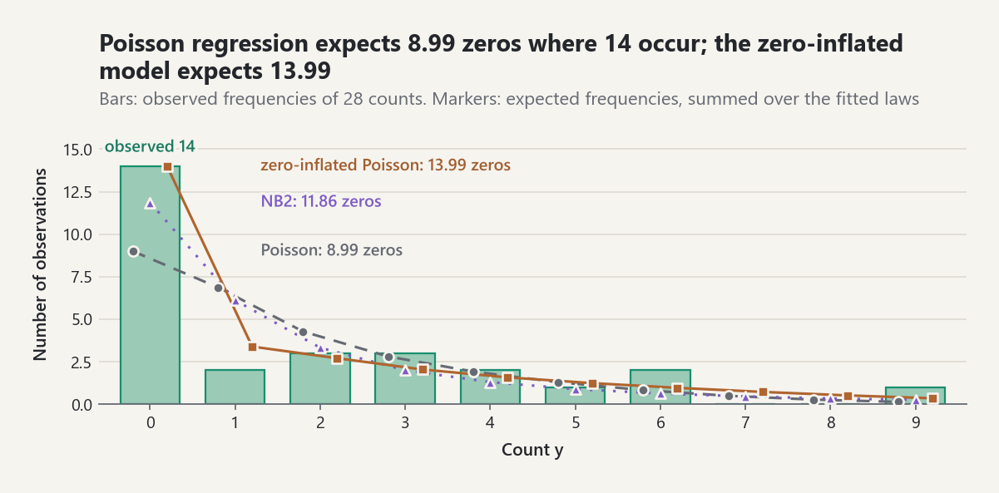
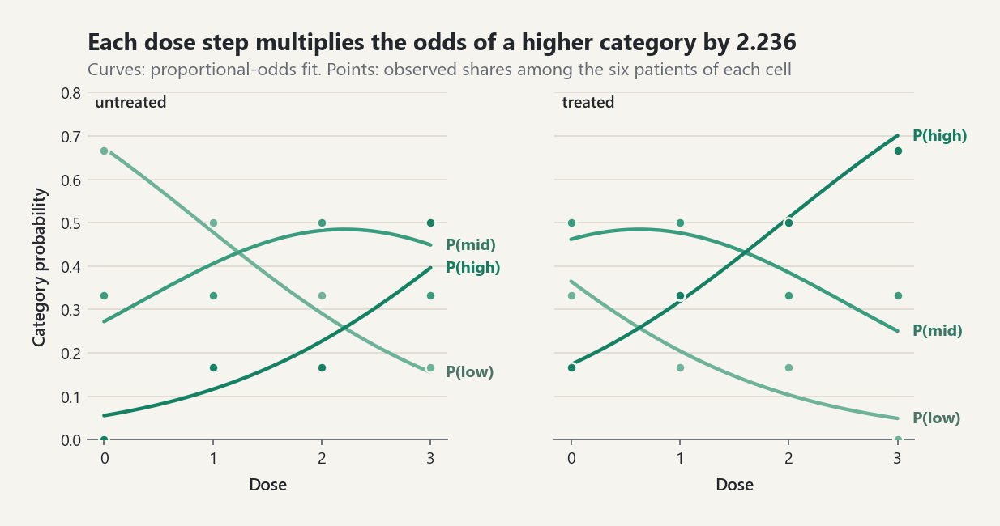

# Count and Categorical Regression

`probstat.inference` fits regression models for counts (Poisson and
negative binomial regression with exposures, zero-inflated and hurdle
models) and for categorical responses (the proportional-odds model for
ordered categories and the baseline-category multinomial logit). Every model
is fitted by maximum likelihood with analytic scores. The results report
Wald standard errors from the information matrix, and the count and
categorical results give average marginal effects with delta-method
standard errors (EQ-REG-AME-001).

The numbers below come from running the library on the data shown. The
test file `tests/test_count_and_categorical_regression.py` checks the
methods against closed forms (intercept-only and saturated factor models),
exact identities (a two-category ordinal or multinomial fit is a logistic
regression), likelihoods written independently in the test file, and seeded
simulations judged by the reported standard errors.

## 1. Which model for which response

| Response | Symptom | Model | Call |
|---|---|---|---|
| Counts, variance close to the mean | Pearson `X^2/(n-p)` near 1 | Poisson regression | `fit_poisson_regression` |
| Counts, variance above the mean | overdispersion test rejects | NB2 regression, or Poisson with robust errors | `fit_negative_binomial_regression`, `covariance="robust"` |
| Counts with more zeros than the count law allows | zeros explained by a separate process | zero-inflated Poisson or NB2 | `fit_zero_inflated` |
| Counts where zero versus positive is its own decision | a "hurdle" must be crossed first | hurdle Poisson or NB2 | `fit_hurdle` |
| Ordered categories | one latent scale with cut points | proportional odds | `fit_ordinal_logistic`, `brant_test` |
| Unordered categories | no ordering | baseline-category logit | `fit_multinomial_logit` |

Counts per unit of time, area, or population need an **exposure**: the model
`log mu_i = x_i' beta + log t_i` is a model for the rate `mu_i / t_i`
(EQ-CNT-REG-001), and `exp(beta_j)` is an incidence-rate ratio.

## 2. Poisson regression, exposures, and robust errors

Sixteen production batches from two lines were inspected for different
numbers of hours:

```python
from probstat.inference import (
    fit_negative_binomial_regression,
    fit_poisson_regression,
    poisson_overdispersion_test,
)

line = [0] * 8 + [1] * 8
hours = [2, 3, 1, 4, 2, 5, 3, 2, 2, 4, 1, 3, 5, 2, 3, 4]
defects = [0, 7, 0, 12, 1, 3, 9, 0, 9, 4, 0, 21, 30, 2, 6, 19]
rows = [(1.0, float(g)) for g in line]
names = ["(Intercept)", "line"]

poisson = fit_poisson_regression(rows, defects, exposure=hours, column_names=names)
round(poisson.incidence_rate_ratios()[1][0], 4)  # 2.6068
round(poisson.standard_errors[1], 4)  # 0.2055
round(poisson.pearson_chi2 / 14, 2)  # 4.19
```

With one factor the Poisson fit is saturated in the mean: the rate ratio is
`(sum y / sum t)` of line 1 over that of line 0, `125/24` against
`32/22`. The Pearson ratio of 4.19 says the counts vary far more than a
Poisson law allows, so the model-based standard error is too small.

The sandwich covariance `A^-1 B A^-1` (EQ-CNT-REG-002, HC0) keeps the
Poisson coefficients, which stay consistent whenever the mean model is
right, and corrects their standard errors:

```python
robust = fit_poisson_regression(
    rows, defects, exposure=hours, column_names=names, covariance="robust"
)
round(robust.standard_errors[1], 4)  # 0.3963
```

The regression test of Cameron and Trivedi (EQ-CNT-REG-004) regresses
`((y - mu)^2 - y)/mu` on `mu` without intercept; under the Poisson null
the slope `alpha` is zero:

```python
test = poisson_overdispersion_test(poisson)
round(test.alpha, 3)  # 0.305
round(test.statistic, 2)  # 4.68
test.p_value < 1e-5  # True
```

## 3. Negative binomial (NB2) regression

The NB2 model has `Var(y) = mu + alpha mu^2` with `alpha = 1/theta`. The
fit maximizes the likelihood jointly in `beta` and `log theta` by Newton's
method (EQ-CNT-REG-003):

```python
nb = fit_negative_binomial_regression(
    rows, defects, exposure=hours, column_names=names
)
round(nb.theta, 3)  # 1.443
round(nb.theta_standard_error, 3)  # 0.781
round(nb.incidence_rate_ratios()[1][0], 3)  # 2.623
round(nb.standard_errors[1], 3)  # 0.478
round(nb.aic, 2), round(poisson.aic, 2)  # (94.07, 120.54)
```

The coefficient standard errors come from the expected information
`(X'WX)^-1`, `W = mu/(1 + alpha mu)`, which is block-diagonal against
`theta`. When the data are not overdispersed (`sum[(y - mu)^2 - y] <= 0` at
the Poisson fit) the maximum lies on the Poisson boundary: the result has
`theta = inf`, `at_boundary = True`, and the Poisson coefficients, instead
of a huge finite `theta`.

The average marginal effect of a column is the average change of the
expected count. For an indicator the discrete change from 0 to 1 is the
right summary:

```python
effect = nb.average_marginal_effect("line", discrete=True)
round(effect.estimates[0], 2)  # 6.03
round(effect.standard_errors[0], 2)  # 3.37
```

The marginal effect averages over the observed exposures, so it is the
change in defects per batch, not per hour.

## 4. Zero inflation and hurdles

A zero-inflated model (EQ-CNT-ZI-001) mixes a point mass at zero with
probability `pi_i` (logit link) and a Poisson or NB2 count law, so zeros come
from both parts. A hurdle model (EQ-CNT-HURDLE-001) separates them: a logit
decides whether `y > 0`, and a zero-truncated count law describes the
positive counts. Both take an optional `zero_design`; by default the zero
part uses the count design.

```python
import math

from probstat.inference import fit_hurdle, fit_zero_inflated, vuong_test

x = [0.0, 0.5, 1.0, 1.5, 2.0, 2.5, 3.0] * 4
y = [0, 0, 1, 0, 3, 0, 6, 0, 2, 0, 2, 0, 5, 4,
     0, 0, 0, 3, 4, 6, 0, 1, 0, 2, 0, 3, 0, 9]
rows = [(1.0, v) for v in x]

poisson = fit_poisson_regression(rows, y)
sum(v == 0 for v in y)  # 14
round(sum(math.exp(-m) for m in poisson.fitted_values), 2)  # 8.99
round(poisson_overdispersion_test(poisson).p_value, 4)  # 0.0036

zip_fit = fit_zero_inflated(rows, y)
hurdle = fit_hurdle(rows, y)
nb = fit_negative_binomial_regression(rows, y)
round(zip_fit.aic, 2), round(hurdle.aic, 2)  # (85.98, 86.11)
round(nb.aic, 2), round(poisson.aic, 2)  # (95.97, 101.14)
round(zip_fit.count_coefficients[1], 3)  # 0.793
```

<picture><source media="(prefers-color-scheme: dark)" srcset="../images/guides/count-regression-zero-frequencies-dark.png"></picture>

*Summed over the 28 fitted laws, Poisson regression expects 8.99 zeros where 14 occur, NB2 expects 11.86, and the zero-inflated Poisson model expects 13.99; the Poisson fit pays for its missing zeros with too many ones.*

The Poisson fit expects 9 zeros where 14 occur, and the overdispersion test
rejects. Here the overdispersion *is* the excess of zeros: the
zero-inflated Poisson model has a much lower AIC than NB2, and the
zero-inflated NB2 model drives `theta` to the Poisson boundary. The two
zero models answer different questions about the zeros and are compared by
AIC here; their fitted means at `x = 1` are close:

```python
round(zip_fit.predict([(1.0, 1.0)])[0][0], 3)  # 0.805
round(hurdle.predict([(1.0, 1.0)])[0][0], 3)  # 0.775
```

**The Vuong statistic is not a test for zero inflation.** `vuong_test`
computes Vuong's normalized log-likelihood ratio (EQ-CNT-VUONG-001), whose
normal reference holds for *strictly non-nested* models. A Poisson model is
the zero-inflated Poisson model at the boundary `pi = 0` (logit intercept
`-> -infinity`), so the two are not strictly non-nested and the normal
reference does not apply [REF-WILSON-2015]. The statistic is reported for
comparisons that are genuinely non-nested (for example zero-inflated against
hurdle with different covariates); for zero inflation compare information
criteria or the fitted zero counts.

```python
test = vuong_test(
    zip_fit.pointwise_log_likelihood,
    poisson.pointwise_log_likelihood,
    parameters_a=zip_fit.parameter_count,
    parameters_b=poisson.parameter_count,
)
round(test.statistic, 3)  # 2.039
```

The value is shown only to make the point: its p-value would be misread as
evidence for zero inflation.

## 5. Ordered categories: the proportional-odds model

The model `logit P(Y <= k | x) = theta_k - x' beta` (EQ-CAT-ORD-001) has
one threshold per cut and one slope vector for all cuts. A positive slope
moves the response towards higher categories, and `exp(beta_j)` multiplies
the odds of `Y > k` for every `k`. The thresholds take the place of the
intercept, so the design must not contain a constant column.

```python
from probstat.inference import brant_test, fit_multinomial_logit, fit_ordinal_logistic

dose = [0, 0, 0, 0, 0, 0, 1, 1, 1, 1, 1, 1,
        2, 2, 2, 2, 2, 2, 3, 3, 3, 3, 3, 3] * 2
treated = [0] * 24 + [1] * 24
response = [
    "low", "low", "low", "mid", "low", "mid", "low", "mid", "low", "mid",
    "high", "low", "mid", "mid", "low", "high", "mid", "low", "mid", "high",
    "mid", "high", "low", "high", "low", "mid", "low", "mid", "mid", "high",
    "mid", "low", "high", "mid", "mid", "high", "high", "mid", "high", "mid",
    "high", "low", "high", "high", "mid", "high", "high", "mid",
]
rows = [(float(d), float(t)) for d, t in zip(dose, treated)]
levels = ["low", "mid", "high"]

ordinal = fit_ordinal_logistic(
    rows, response, levels=levels, column_names=["dose", "treated"]
)
[round(b, 3) for b in ordinal.coefficients]  # [0.805, 1.272]
[round(t, 3) for t in ordinal.thresholds]  # [0.719, 2.835]
round(ordinal.odds_ratios()[0][0], 3)  # 2.236
```

<picture><source media="(prefers-color-scheme: dark)" srcset="../images/guides/count-regression-ordinal-probabilities-dark.png"></picture>

*One dose coefficient moves all three category curves: each step multiplies the odds of a higher category by 2.236 at both cuts, and treatment multiplies them by 3.57, so the treated panel reaches a likely high outcome at a lower dose.*

Each dose step multiplies the odds of a better outcome by about 2.2, at both
cuts. That *proportional-odds assumption* can be checked with Brant's test
(EQ-CAT-BRANT-001), which fits a separate logit of `1{Y > k}` for each cut
and tests whether the slopes agree:

```python
brant = brant_test(ordinal)
round(brant.statistic, 3), brant.degrees_of_freedom  # (0.212, 2)
round(brant.p_value, 3)  # 0.899
```

Average marginal effects translate the slopes into probabilities; over the
categories they sum to zero:

```python
dose_effect = ordinal.average_marginal_effects("dose")
[round(v, 3) for v in dose_effect.estimates]  # [-0.135, -0.005, 0.14]
[round(v, 3) for v in dose_effect.standard_errors]  # [0.038, 0.021, 0.039]
treated_effect = ordinal.average_marginal_effects("treated", discrete=True)
round(treated_effect.estimates[2], 3)  # 0.228
```

## 6. Unordered categories: the multinomial logit

The baseline-category logit `log(P(Y = k)/P(Y = ref)) = x' beta_k`
(EQ-CAT-MNL-001) has one coefficient vector per non-reference category and
needs an intercept column. It ignores the ordering, so it spends more
parameters on the same data:

```python
multinomial = fit_multinomial_logit(
    [(1.0, *r) for r in rows],
    response,
    levels=levels,
    column_names=["(Intercept)", "dose", "treated"],
)
multinomial.levels[0]  # 'low'
[round(b, 3) for b in multinomial.coefficients[1]]  # [-2.797, 1.248, 2.003]
round(multinomial.aic, 2), round(ordinal.aic, 2)  # (102.07, 98.62)
round(multinomial.average_marginal_effects("dose").estimates[2], 3)  # 0.15
```

`coefficients[1]` belongs to `"high"` against the reference `"low"`. The
ordinal model has the lower AIC, and its marginal effect of dose on
`P(high)` (0.140) is close to the multinomial one (0.150).

## Common pitfalls

- **Offsets are not covariates.** `exposure=t` adds `log t` with its
  coefficient fixed at one; putting `log t` into the design estimates that
  coefficient instead and no longer models a rate. Without an exposure,
  `exp(beta)` compares counts per observation, not rates.
- **Rate ratios and odds ratios are multiplicative.** `exp(beta_j) = 2.6`
  means 2.6 times the rate (or odds), not 2.6 more events; the change in the
  expected count or probability depends on the other covariates, which is
  what the average marginal effect reports.
- **Odds ratios are not risk ratios.** In the ordinal and multinomial
  models `exp(beta)` multiplies odds; for common outcomes the probability
  changes much less, so quote the marginal effect as well.
- **Zero inflation is not the same as overdispersion.** Excess zeros make a
  Poisson fit look overdispersed, and NB2 can absorb either. Compare the
  observed zero count with `sum exp(-mu_i)` and fit both kinds of model
  before choosing.
- **The Vuong test does not test zero inflation.** The models are nested on
  the boundary of the parameter space, so its normal reference fails
  [REF-WILSON-2015]; use information criteria for that comparison.
- **The zero coefficients have opposite meanings.** In `fit_zero_inflated`
  they model the log odds of a *structural zero*; in `fit_hurdle` the log
  odds of a *positive* count.
- **The proportional-odds assumption is an assumption.** A single slope per
  covariate is a strong restriction; run `brant_test` and look at
  `binary_slopes`. A small Brant p-value means the effect differs across
  cuts; a large one in a small sample is weak evidence for proportionality.
- **Sign conventions differ between software.** Here, as in MASS `polr`,
  `logit P(Y <= k) = theta_k - x' beta`, so a positive slope raises the
  response. Some packages write `+ x' beta`.
- **Separation.** When a covariate predicts a category perfectly the
  ordinal and multinomial estimates do not exist, and the fits raise
  `SeparationError`.
- **Derivative marginal effects of indicators are approximations.** Pass
  `discrete=True` for 0/1 columns.

## References

- [REF-CAMERON-TRIVEDI-2013] count regression, robust errors, zero
  inflation, and hurdles; [REF-CAMERON-TRIVEDI-1990] the overdispersion
  test; [REF-WHITE-1982] the sandwich covariance.
- [REF-LAMBERT-1992] zero-inflated Poisson regression; [REF-MULLAHY-1986]
  hurdle models; [REF-VUONG-1989] and [REF-WILSON-2015] the Vuong statistic
  and its misuse for zero inflation.
- [REF-MCCULLAGH-1980] the proportional-odds model; [REF-BRANT-1990] the
  test of proportionality; [REF-AGRESTI-2013] cumulative and
  baseline-category logits.
- Decision record: [ADR-0103](../adr/ADR-0103-count-and-categorical-regression.md).
