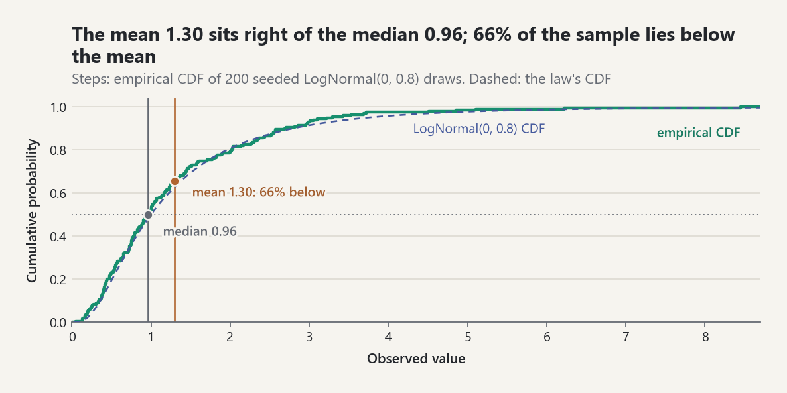

# Descriptive Statistics

Let `x_1, ..., x_n` be a non-empty finite sample of real observations.

## Center and spread

The arithmetic mean [EQ-STAT-001] locates the balance point. Variance
[EQ-STAT-002] averages squared deviations from that center with denominator
`n - d`, where `d` is the explicit degrees-of-freedom offset. Standard
deviation [EQ-STAT-003] returns spread to the original units.

Use `d = 0` for the variance of the finite values as the complete population.
Use `d = 1` when the familiar sample variance is intended as an unbiased
estimator under the independent, identically distributed finite-variance
model. The software never guesses which interpretation the user means.

## Standardization

A z-score [EQ-STAT-004] reports signed distance from the mean in standard
deviation units. It is undefined when all values are identical because the
scale is zero.

Standardization changes location and scale, not distributional shape. A
z-score is not automatically a normal probability.

## Empirical distribution

The empirical CDF [EQ-STAT-005] assigns mass `1/n` to every observation. It is
a right-continuous step function and is defined without assuming a parametric
distribution. It is the bridge from observed data to distributional thinking.

<picture><source media="(prefers-color-scheme: dark)" srcset="../images/guides/descriptive-statistics-skewed-ecdf-dark.png"></picture>

*The mean 1.30 is pulled right by the long upper tail and sits above the median 0.96, so 66% of the 200 draws fall below it; the empirical CDF follows the LogNormal(0, 0.8) CDF closely without assuming it.*

## Paired variation

Covariance [EQ-STAT-006] measures joint centered movement in the product of the
input units. Pearson correlation [EQ-STAT-007] divides covariance by both
standard deviations, producing a dimensionless measure of linear association.

Correlation does not establish causation, can miss nonlinear dependence, and
is sensitive to outliers. A scatter plot and data-generating assumptions belong
beside the coefficient.

## Numerical note

The implementation uses `math.fsum` and a centered two-pass variance. This is
more stable than the algebraically equivalent one-pass expression
`mean(x^2) - mean(x)^2`, which can suffer catastrophic cancellation when values
are large and tightly clustered.

References: [REF-NIST-EDA], [REF-WASSERMAN-2004, Chapter 7].

## Streaming (one-pass) summaries

`probstat.statistics.streaming` summarizes data that arrive one value at a
time, or that are too long to store, in constant memory.

| Accumulator | Keeps | Mergeable | Equation |
| --- | --- | --- | --- |
| `RunningMoments` | count, mean, `M2`, `M3`, `M4` | yes | [EQ-STAT-STREAM-001], [EQ-STAT-STREAM-003] |
| `WeightedRunningMoments` | `W`, `sum w^2`, mean, `S` | yes | [EQ-STAT-STREAM-004] |
| `RunningCovariance(d)` | count, mean vector, co-moment matrix | yes | [EQ-STAT-STREAM-002] |
| `ExceedanceCounter` | trials, events | yes | [EQ-INF-CI-WILSON-001] |
| `P2Quantile(p)` | five markers | no | [EQ-STAT-STREAM-005] |
| `ReservoirSampler(k)` | uniform subset of size `k` | no | [EQ-STAT-STREAM-006] |

`merge` combines the summaries of two disjoint chunks into the summary of
their concatenation (Chan, Golub, and LeVeque; Pébay), so chunks can be
summarized in parallel and combined in any order.

### Large offsets

Each moment accumulator subtracts its first observation `K` before updating.
For tightly clustered values far from zero, `x - K` is exact and the
recurrence works on numbers of order one. The block below draws 2000 values
`1e9 + Exp(1)` and compares the shifted Welford/Pébay accumulator (single
pass, and seven merged chunks of 286 values), the two-pass `variance` and
`skewness`, an unshifted Welford recurrence, and the textbook formula
`mean(x^2) - mean(x)^2` with an exact rational computation:

```python
import random
from decimal import Decimal, localcontext
from fractions import Fraction
from functools import reduce

from probstat.statistics import RunningMoments, skewness, variance

generator = random.Random(7)
values = [1e9 + generator.expovariate(1.0) for _ in range(2000)]

exact = [Fraction(value) for value in values]
center = sum(exact) / len(exact)
m2 = sum((value - center) ** 2 for value in exact) / len(exact)
m3 = sum((value - center) ** 3 for value in exact) / len(exact)
with localcontext() as context:
    context.prec = 50
    d2 = Decimal(m2.numerator) / Decimal(m2.denominator)
    d3 = Decimal(m3.numerator) / Decimal(m3.denominator)
    true_skewness = Fraction(d3 / (d2 * d2.sqrt()))


def error(value, truth):
    return float(abs(Fraction(value) - truth) / truth)


streamed = RunningMoments()
streamed.extend(values)
chunks = []
for start in range(0, len(values), 286):
    chunk = RunningMoments()
    chunk.extend(values[start : start + 286])
    chunks.append(chunk)
merged = reduce(RunningMoments.merge, chunks)

mean = welford = 0.0
for count, value in enumerate(values, start=1):
    delta = value - mean
    mean += delta / count
    welford += delta * (value - mean)
naive = sum(v * v for v in values) / len(values) - (sum(values) / len(values)) ** 2

print("relative error      variance  skewness")
print(f"RunningMoments      {error(streamed.variance(), m2):.1e}   "
      f"{error(streamed.skewness(), true_skewness):.1e}")
print(f"{len(chunks)} merged chunks     {error(merged.variance(), m2):.1e}   "
      f"{error(merged.skewness(), true_skewness):.1e}")
print(f"two-pass            {error(variance(values), m2):.1e}   "
      f"{error(skewness(values), true_skewness):.1e}")
print(f"unshifted Welford   {error(welford / len(values), m2):.1e}")
print(f"mean(x^2) - mean(x)^2 < 0: {naive < 0} (true variance {float(m2):.3f})")
```

```text
relative error      variance  skewness
RunningMoments      3.3e-16   2.9e-16
7 merged chunks     9.8e-17   4.2e-16
two-pass            2.4e-15   8.8e-08
unshifted Welford   2.0e-08
mean(x^2) - mean(x)^2 < 0: True (true variance 0.956)
```

The shifted accumulators stay at the rounding level of the data, merged or
not; the unshifted recurrence loses eight digits and the textbook formula
returns a negative variance. Its value is pure rounding noise of order
`1e18 * 2^-52`, so it even depends on how `sum` adds (Python 3.12 made the
built-in `sum` of floats compensated): -128 on 3.12 and later, -3840 on
3.11. The two-pass skewness error comes from the
rounded mean: at `1e9` the mean can only be stored to about `1e-7`, and the
third moment is sensitive to the center to first order.

### Streaming quantiles

`P2Quantile` (Jain and Chlamtac) keeps five markers and moves the three
interior ones by a piecewise-parabolic prediction. Over the five streams
`random.Random(seed)`, `seed = 0, ..., 4` (`gauss(0, 1)` or
`expovariate(1)`), the largest errors were:

| Law, `p` | `n` | max rank error | max absolute error |
| --- | --- | --- | --- |
| N(0,1), 0.5 | 1e4 / 1e5 | 0.0013 / 0.0002 | 0.011 / 0.004 |
| N(0,1), 0.9 | 1e4 / 1e5 | 0.0005 / 0.0001 | 0.008 / 0.010 |
| N(0,1), 0.99 | 1e4 / 1e5 | 0.0008 / 0.0001 | 0.045 / 0.013 |
| Exp(1), 0.5 | 1e4 / 1e5 | 0.0016 / 0.0003 | 0.011 / 0.004 |
| Exp(1), 0.9 | 1e4 / 1e5 | 0.0026 / 0.0005 | 0.066 / 0.025 |
| Exp(1), 0.99 | 1e4 / 1e5 | 0.0007 / 0.0001 | 0.110 / 0.065 |

The rank error is `abs(F_n(q) - p)`, with `F_n` the empirical CDF of the same
stream: the error of P² as a substitute for the sample quantile. Most of the
absolute error `abs(q - q_true)` is sampling error that a stored sample quantile has too. Accuracy limits: P²
has no worst-case bound, depends on arrival order (sorted or drifting
streams are the worst case), is weakest for extreme `p` and heavy tails, and
cannot be merged. For mergeable or exact summaries use `ReservoirSampler`
(Vitter's Algorithm R), which keeps a uniform random subset of fixed size and
is reproducible from a seed or `RandomStream`.

### Exceedance probabilities and stopping

`ExceedanceCounter(threshold)` counts strict exceedances `x > t` (or Boolean
events) and reports the Wilson interval with the same formula as
`inference.wilson_score_interval`. `monte_carlo.estimate_probability` now
counts its indicators in one pass.

`run_until(sampler, target_relative_error=..., max_samples=...)` draws into a
`RunningMoments` until `SE / |mean| <= target` [EQ-STAT-STREAM-007]. For
`Exp(1)` with a 1 % target (seed 17) it stopped after 10 200 draws with mean
0.9918, standard error 0.0099, and relative error 0.00999; theory predicts
about `1 / 0.01^2 = 10 000` draws. Data-dependent stopping makes the reported
error slightly optimistic, and a mean near zero makes a relative target
unreachable. `monte_carlo.estimate_mean_streaming` wraps the same rule and
returns a `MonteCarloEstimate` whose work count is the number of draws.

References: [REF-WELFORD-1962], [REF-WEST-1979],
[REF-CHAN-GOLUB-LEVEQUE-1983], [REF-PEBAY-2008], [REF-JAIN-CHLAMTAC-1985],
[REF-VITTER-1985], [REF-WILSON-1927].

## Common pitfalls

- **`ddof` defaults to 0.** `variance`, `standard_deviation`, `covariance`,
  `z_scores`, and `RunningMoments.variance()` divide by `n`; the
  standard-library `statistics.variance` divides by `n - 1`. Pass `ddof=1`
  for the unbiased sample variance. `RunningMoments.standard_error()`
  already uses `ddof=1`.
- **The robust scale is rescaled.** `median_absolute_deviation` multiplies
  the raw median absolute deviation by `1/Phi^-1(3/4)`, about `1.4826`,
  unless `normal_consistent=False`.
- **The default trimmed mean may trim nothing.** `trimmed_mean` removes
  `floor(0.1 n)` values from each end, so for fewer than ten observations it
  equals the arithmetic mean, outlier included.
- **Only two quantile definitions exist.** `quantile` accepts `method=7`
  (default, linear interpolation) and `method=1` (inverse empirical CDF);
  any other value raises `ValueError`.
- **`P2Quantile` cannot be merged.** Only `RunningMoments`,
  `WeightedRunningMoments`, `RunningCovariance`, and `ExceedanceCounter`
  have `merge`; keep a `ReservoirSampler` when chunks must be combined.

```python
import statistics as standard_library

from probstat.statistics import (
    P2Quantile,
    RunningMoments,
    median_absolute_deviation,
    quantile,
    trimmed_mean,
    variance,
)

x = [2.0, 4.0, 4.0, 4.0, 5.0, 5.0, 7.0, 9.0]
variance(x), variance(x, ddof=1)  # (4.0, 4.5714)
standard_library.variance(x)  # 4.5714
running = RunningMoments()
running.extend(x)
running.variance(), running.standard_error()  # (4.0, 0.7559)
median_absolute_deviation(x), median_absolute_deviation(x, normal_consistent=False)  # (0.7413, 0.5)
trimmed_mean([1.0, 2.0, 3.0, 4.0, 100.0])  # 22.0
trimmed_mean([1.0, 2.0, 3.0, 4.0, 100.0], 0.2)  # 3.0
quantile(x, 0.9), quantile(x, 0.9, method=1)  # (7.6, 9.0)
hasattr(RunningMoments, "merge"), hasattr(P2Quantile, "merge")  # (True, False)
```
