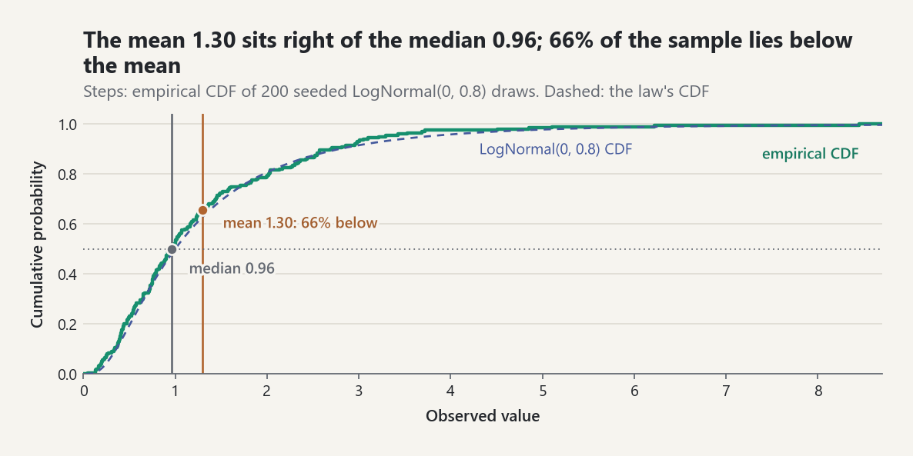

# Descriptive Statistics

Let `x_1, ..., x_n` be a non-empty finite sample of real observations.

## Center and spread

The arithmetic mean [EQ-STAT-001] locates the balance point. Variance
[EQ-STAT-002] averages squared deviations from that center with denominator
`n - d`, where `d` is the explicit degrees-of-freedom offset. Standard
deviation [EQ-STAT-003] returns spread to the original units.

Use `d = 0` for the variance of the finite values as the complete population.
Use `d = 1` when the familiar sample variance is intended as an unbiased
estimator under the independent, identically distributed finite-variance
model. The software never guesses which interpretation the user means.

## Standardization

A z-score [EQ-STAT-004] reports signed distance from the mean in standard
deviation units. It is undefined when all values are identical because the
scale is zero.

Standardization changes location and scale, not distributional shape. A
z-score is not automatically a normal probability.

## Empirical distribution

The empirical CDF [EQ-STAT-005] assigns mass `1/n` to every observation. It is
a right-continuous step function and is defined without assuming a parametric
distribution. It is the bridge from observed data to distributional thinking.

<picture><source media="(prefers-color-scheme: dark)" srcset="../images/guides/descriptive-statistics-skewed-ecdf-dark.png"></picture>

*The mean 1.30 is pulled right by the long upper tail and sits above the median 0.96, so 66% of the 200 draws fall below it; the empirical CDF follows the LogNormal(0, 0.8) CDF closely without assuming it.*

## Quantile and shape conventions

A sample quantile is a weighted average of two adjacent order statistics,
`Q(p) = (1 - gamma) x_(j) + gamma x_(j+1)`, and statistical packages
disagree on `j` and `gamma`. Hyndman and Fan [REF-HYNDMAN-FAN-1996] list
nine definitions [EQ-STAT-QUANT-001], [EQ-STAT-QUANT-002]; `quantile` and
`quantiles` take them as `method=1` to `method=9`, numbered as R's
`quantile(type = )`, with type 7 as the default.

| Type | Definition | Use it when |
|---|---|---|
| 1 | inverse empirical CDF, `x_(j)` with the smallest `j / n >= p` | the quantile must be an observed value |
| 2 | type 1, averaged where `n p` is an integer (SAS default) | an observed value or a midpoint, with the usual median |
| 3 | nearest even order statistic to `n p` | reproducing older SAS output |
| 4 | linear interpolation of the empirical CDF, `p_k = k / n` | a continuous version of type 1 |
| 5 | `p_k = (k - 1/2) / n`, midpoints of the CDF steps | hydrology conventions |
| 6 | `p_k = k / (n + 1) = E[F(X_(k))]` (Minitab, SPSS) | matching Minitab or SPSS; Weibull's plotting positions |
| 7 | `p_k = (k - 1) / (n - 1)` (R, NumPy, and probstat default) | matching R's and NumPy's defaults |
| 8 | `p_k = (k - 1/3) / (n + 1/3)`, approximately median-unbiased | the distribution is unknown; Hyndman and Fan recommend it |
| 9 | `p_k = (k - 3/8) / (n + 1/4)` | normal data (approximately unbiased for normal order statistics) |

Types 1-3 are step functions of `p`; types 4-9 interpolate linearly between
the points `(p_k, x_(k))`. The differences matter in small samples and in the
tails, and vanish as `n` grows. When `p` is the floating-point value of a
level at which the position is an integer, the position is that integer:
with `n = 100` and `p = 0.07`, type 1 returns `x_(7)` although
`100 * 0.07` rounds to `7.000000000000001`. R compares the rounded product,
so `quantile(1:100, 0.07, type = 1)` returns 8 there (and type 2 returns 8
instead of 7.5); away from such levels the two agree to rounding, as the
R parity cases for all nine types check.

Skewness and excess kurtosis have three conventions in common use
[REF-JOANES-GILL-1998], selected by `type=` as in R's e1071 package
[EQ-STAT-SHAPE-001], [EQ-STAT-SHAPE-002]: type 1 is the moment ratio
`g1 = m3 / m2^(3/2)`, `g2 = m4 / m2^2 - 3` (the default); type 2 is the ratio
of unbiased cumulant estimators, `G1 = g1 sqrt(n (n - 1)) / (n - 2)` and
`G2 = ((n + 1) g2 + 6)(n - 1) / ((n - 2)(n - 3))` (SAS, SPSS); type 3
standardizes by the sample standard deviation, `b1 = g1 ((n - 1) / n)^(3/2)`
and `b2 = (g2 + 3)(1 - 1/n)^2 - 3` (MINITAB, BMDP, and e1071's default). Of
the three kurtosis measures only `G2` is unbiased for normal data.

```python
from probstat.statistics import excess_kurtosis, quantile, skewness

x = [3.0, 1.0, 4.0, 1.0, 5.0, 9.0, 2.0, 6.0]
tuple(quantile(x, 0.25, method=k) for k in range(1, 10))
# (1.0, 1.5, 1.0, 1.0, 1.5, 1.25, 1.75, 1.4167, 1.4375)
tuple(quantile(x, 0.5, method=k) for k in range(1, 10))
# (3.0, 3.5, 3.0, 3.0, 3.5, 3.5, 3.5, 3.5, 3.5)

y = [1.0, 2.0, 3.0, 10.0]
tuple(skewness(y, type=k) for k in (1, 2, 3))  # (1.0182, 1.7636, 0.6614)
tuple(excess_kurtosis(y, type=k) for k in (1, 2, 3))  # (-0.7696, 3.228, -1.7454)
```

With eight observations the lower quartile ranges from 1.0 to 1.75 across
the nine definitions, and only types 2 and 5-9 return the conventional
median 3.5. With four observations the three kurtosis conventions do not
even agree in sign: at `n = 4`, `G2 = 7.5 g2 + 9` and
`b2 = 0.5625 (g2 + 3) - 3`.

## Paired variation

Covariance [EQ-STAT-006] measures joint centered movement in the product of the
input units. Pearson correlation [EQ-STAT-007] divides covariance by both
standard deviations, producing a dimensionless measure of linear association.

Correlation does not establish causation, can miss nonlinear dependence, and
is sensitive to outliers. A scatter plot and data-generating assumptions belong
beside the coefficient.

## Numerical note

The implementation uses `math.fsum` and a centered two-pass variance. This is
more stable than the algebraically equivalent one-pass expression
`mean(x^2) - mean(x)^2`, which can suffer catastrophic cancellation when values
are large and tightly clustered.

References: [REF-NIST-EDA], [REF-WASSERMAN-2004, Chapter 7].

## Streaming (one-pass) summaries

`probstat.statistics.streaming` summarizes data that arrive one value at a
time, or that are too long to store, in constant memory.

| Accumulator | Keeps | Mergeable | Equation |
| --- | --- | --- | --- |
| `RunningMoments` | count, mean, `M2`, `M3`, `M4` | yes | [EQ-STAT-STREAM-001], [EQ-STAT-STREAM-003] |
| `WeightedRunningMoments` | `W`, `sum w^2`, mean, `S` | yes | [EQ-STAT-STREAM-004] |
| `RunningCovariance(d)` | count, mean vector, co-moment matrix | yes | [EQ-STAT-STREAM-002] |
| `ExceedanceCounter` | trials, events | yes | [EQ-INF-CI-WILSON-001] |
| `P2Quantile(p)` | five markers | no | [EQ-STAT-STREAM-005] |
| `ReservoirSampler(k)` | uniform subset of size `k` | no | [EQ-STAT-STREAM-006] |

`merge` combines the summaries of two disjoint chunks into the summary of
their concatenation (Chan, Golub, and LeVeque; Pébay), so chunks can be
summarized in parallel and combined in any order.

### Large offsets

Each moment accumulator subtracts its first observation `K` before updating.
For tightly clustered values far from zero, `x - K` is exact and the
recurrence works on numbers of order one. The block below draws 2000 values
`1e9 + Exp(1)` and compares the shifted Welford/Pébay accumulator (single
pass, and seven merged chunks of 286 values), the two-pass `variance` and
`skewness`, an unshifted Welford recurrence, and the textbook formula
`mean(x^2) - mean(x)^2` with an exact rational computation:

```python
import random
from decimal import Decimal, localcontext
from fractions import Fraction
from functools import reduce

from probstat.statistics import RunningMoments, skewness, variance

generator = random.Random(7)
values = [1e9 + generator.expovariate(1.0) for _ in range(2000)]

exact = [Fraction(value) for value in values]
center = sum(exact) / len(exact)
m2 = sum((value - center) ** 2 for value in exact) / len(exact)
m3 = sum((value - center) ** 3 for value in exact) / len(exact)
with localcontext() as context:
    context.prec = 50
    d2 = Decimal(m2.numerator) / Decimal(m2.denominator)
    d3 = Decimal(m3.numerator) / Decimal(m3.denominator)
    true_skewness = Fraction(d3 / (d2 * d2.sqrt()))


def error(value, truth):
    return float(abs(Fraction(value) - truth) / truth)


streamed = RunningMoments()
streamed.extend(values)
chunks = []
for start in range(0, len(values), 286):
    chunk = RunningMoments()
    chunk.extend(values[start : start + 286])
    chunks.append(chunk)
merged = reduce(RunningMoments.merge, chunks)

mean = welford = 0.0
for count, value in enumerate(values, start=1):
    delta = value - mean
    mean += delta / count
    welford += delta * (value - mean)
naive = sum(v * v for v in values) / len(values) - (sum(values) / len(values)) ** 2

print("relative error      variance  skewness")
print(f"RunningMoments      {error(streamed.variance(), m2):.1e}   "
      f"{error(streamed.skewness(), true_skewness):.1e}")
print(f"{len(chunks)} merged chunks     {error(merged.variance(), m2):.1e}   "
      f"{error(merged.skewness(), true_skewness):.1e}")
print(f"two-pass            {error(variance(values), m2):.1e}   "
      f"{error(skewness(values), true_skewness):.1e}")
print(f"unshifted Welford   {error(welford / len(values), m2):.1e}")
print(f"mean(x^2) - mean(x)^2 < 0: {naive < 0} (true variance {float(m2):.3f})")
```

```text
relative error      variance  skewness
RunningMoments      3.3e-16   2.9e-16
7 merged chunks     9.8e-17   4.2e-16
two-pass            2.4e-15   8.8e-08
unshifted Welford   2.0e-08
mean(x^2) - mean(x)^2 < 0: True (true variance 0.956)
```

The shifted accumulators stay at the rounding level of the data, merged or
not; the unshifted recurrence loses eight digits and the textbook formula
returns a negative variance. Its value is pure rounding noise of order
`1e18 * 2^-52`, so it even depends on how `sum` adds (Python 3.12 made the
built-in `sum` of floats compensated): -128 on 3.12 and later, -3840 on
3.11. The two-pass skewness error comes from the
rounded mean: at `1e9` the mean can only be stored to about `1e-7`, and the
third moment is sensitive to the center to first order.

### Streaming quantiles

`P2Quantile` (Jain and Chlamtac) keeps five markers and moves the three
interior ones by a piecewise-parabolic prediction. Over the five streams
`random.Random(seed)`, `seed = 0, ..., 4` (`gauss(0, 1)` or
`expovariate(1)`), the largest errors were:

| Law, `p` | `n` | max rank error | max absolute error |
| --- | --- | --- | --- |
| N(0,1), 0.5 | 1e4 / 1e5 | 0.0013 / 0.0002 | 0.011 / 0.004 |
| N(0,1), 0.9 | 1e4 / 1e5 | 0.0005 / 0.0001 | 0.008 / 0.010 |
| N(0,1), 0.99 | 1e4 / 1e5 | 0.0008 / 0.0001 | 0.045 / 0.013 |
| Exp(1), 0.5 | 1e4 / 1e5 | 0.0016 / 0.0003 | 0.011 / 0.004 |
| Exp(1), 0.9 | 1e4 / 1e5 | 0.0026 / 0.0005 | 0.066 / 0.025 |
| Exp(1), 0.99 | 1e4 / 1e5 | 0.0007 / 0.0001 | 0.110 / 0.065 |

The rank error is `abs(F_n(q) - p)`, with `F_n` the empirical CDF of the same
stream: the error of P² as a substitute for the sample quantile. Most of the
absolute error `abs(q - q_true)` is sampling error that a stored sample quantile has too. Accuracy limits: P²
has no worst-case bound, depends on arrival order (sorted or drifting
streams are the worst case), is weakest for extreme `p` and heavy tails, and
cannot be merged. For mergeable or exact summaries use `ReservoirSampler`
(Vitter's Algorithm R), which keeps a uniform random subset of fixed size and
is reproducible from a seed or `RandomStream`.

### Exceedance probabilities and stopping

`ExceedanceCounter(threshold)` counts strict exceedances `x > t` (or Boolean
events) and reports the Wilson interval with the same formula as
`inference.wilson_score_interval`. `monte_carlo.estimate_probability` now
counts its indicators in one pass.

`run_until(sampler, target_relative_error=..., max_samples=...)` draws into a
`RunningMoments` until `SE / |mean| <= target` [EQ-STAT-STREAM-007]. For
`Exp(1)` with a 1 % target (seed 17) it stopped after 10 200 draws with mean
0.9918, standard error 0.0099, and relative error 0.00999; theory predicts
about `1 / 0.01^2 = 10 000` draws. Data-dependent stopping makes the reported
error slightly optimistic, and a mean near zero makes a relative target
unreachable. `monte_carlo.estimate_mean_streaming` wraps the same rule and
returns a `MonteCarloEstimate` whose work count is the number of draws.

References: [REF-WELFORD-1962], [REF-WEST-1979],
[REF-CHAN-GOLUB-LEVEQUE-1983], [REF-PEBAY-2008], [REF-JAIN-CHLAMTAC-1985],
[REF-VITTER-1985], [REF-WILSON-1927].

## Robust means, shrinkage covariance, and dependence measures

The summaries above are the right tools for well-behaved samples of
moderate dimension. Three situations call for something else.

### Heavy tails: median-of-means and Catoni's estimator

With only a finite variance `sigma^2`, Chebyshev's inequality bounds the
error of the sample mean by `sigma / sqrt(n delta)` at confidence
`1 - delta`: the price of a small `delta` is polynomial. Two estimators
bring it down to the Gaussian-like `sigma sqrt(log(1/delta) / n)` without
any further assumption.

- `median_of_means` [EQ-STAT-ROB-001] splits the sample into `k` blocks,
  averages each, and returns the median of the averages. A single wild
  observation can spoil only one block. The helper
  `median_of_means_block_count` returns `k = ceil(8 log(1/delta))`, for
  which the bound derived for this library [EQ-STAT-ROB-002] reads: the
  error exceeds `2 sigma / sqrt(floor(n/k))` with probability at most
  `exp(-k/8) <= delta`. The argument is two lines long (Chebyshev in each
  block, Hoeffding for the number of bad blocks) and its constants are not
  sharp; `MedianOfMeansResult.deviation_bound` evaluates it. The blocks must
  be chosen without looking at the values: the default assignment is a
  seeded random permutation, `assignment="sequential"` cuts the data in
  their given order.
- `catoni_mean` [EQ-STAT-ROB-003] solves `sum_i psi(a (x_i - theta)) = 0`
  with `psi(x) = sign(x) log(1 + |x| + x^2/2)`, which behaves like `x` near
  zero and grows only logarithmically. The equation is monotone in `theta`
  and is solved by Brent's method on the sample range. The scale defaults to
  `a = sqrt(2 log(1/delta) / (n v))` [EQ-STAT-ROB-004] for a variance bound
  `v`; this is a choice of the order analysed by Catoni (2012), whose paper
  gives the exact constants. Without `variance_bound` the sample variance
  is plugged in, which is a heuristic and is flagged in the result.

Both estimators are tuned to one `delta` and both are biased for skewed
laws at a fixed tuning, so they do not replace the mean when the data are
well behaved. In the tests, on 200 draws from a Student-t law with 2.5
degrees of freedom and from a Pareto law with shape 2.5, the 99th
percentile of the absolute error over 1500 replicates (`delta = 0.01`) is
0.43 and 0.34 for the sample mean, 0.36 and 0.27 for median-of-means, and
0.36 and 0.20 for Catoni's estimator with the true variance as bound.

### Many variables: Ledoit-Wolf shrinkage

For `p` variables and `n` observations with `p` comparable to `n` the
sample covariance matrix `S` is badly conditioned, and singular for
`p > n`. `ledoit_wolf_covariance` [EQ-STAT-LW-001] returns
`rho m I + (1 - rho) S` with `m = tr(S)/p` and the intensity
`rho = b^2/d^2`, where `d^2 = ||S - m I||^2` measures how far `S` is from
its target and `b^2` estimates the squared error of `S` (norm
`||A||^2 = tr(AA')/p`). Every eigenvalue moves towards the mean eigenvalue,
so the result is positive definite whenever `rho > 0`.

Conventions: `S` divides by `n`, and the column means are subtracted first
(`center=False` gives the mean-zero setting of the paper exactly). The
optimality statement of Ledoit and Wolf (2004) is asymptotic and concerns
the Frobenius loss of the covariance itself. In a simulation with `p = 20`,
`n = 25` and true variances from 1 to 4, the mean squared Frobenius loss
over 40 replicates falls from 102 for `S` to 16 (mean intensity 0.81).

### Dependence beyond correlation

Pearson and Spearman correlations vanish for many dependent pairs.

- `chatterjee_correlation(x, y)` [EQ-STAT-DEP-001] sorts the pairs by `x`
  and measures how much the ranks of `y` jump between neighbours:
  `xi_n = 1 - 3 sum |r_{i+1} - r_i| / (n^2 - 1)`. Its limit is 0 exactly
  under independence and 1 exactly when `y` is a function of `x`. It is not
  symmetric, and for a strictly monotone relation it equals
  `(n - 2)/(n + 1)`, not 1. Under independence `sqrt(n) xi_n` is
  asymptotically `N(0, 2/5)` [EQ-STAT-DEP-002], which gives the reported
  one-sided p-value. Ties in `x` are broken at random with the seed; ties in
  `y` raise `ValueError`, because the formula and the null variance hold
  only without them.
- `distance_correlation(x, y)` [EQ-STAT-DEP-003], [EQ-STAT-DEP-004] works
  for vector observations of any two dimensions. It double-centres the two
  matrices of pairwise distances and correlates them. The value lies in
  `[0, 1]`, equals 1 for `y = a + b x`, and is invariant to shifts,
  rotations, and rescaling. The sample value is biased upwards (it is
  positive for independent data), so use `permutations=R` for a seeded
  permutation test. For a bivariate normal pair the population value is the
  closed form `distance_correlation_bivariate_normal(rho)`
  [EQ-STAT-DEP-005], which is below `|rho|`.

```python
import math
import random

from probstat.statistics import (
    catoni_mean,
    chatterjee_correlation,
    distance_correlation,
    distance_correlation_bivariate_normal,
    ledoit_wolf_covariance,
    mean,
    median_of_means,
    median_of_means_block_count,
    pearson_correlation,
)

rng = random.Random(7)
heavy = [rng.paretovariate(2.5) for _ in range(400)]  # true mean 5/3
dirty = [*heavy, 1e4]                                 # one gross error
median_of_means_block_count(0.05)                     # 24
mom = median_of_means(dirty, delta=0.05, seed=1)
cat = catoni_mean(dirty, variance_bound=20 / 9, delta=0.05)
mean(dirty), mom.estimate, cat.estimate               # (26.545, 1.614, 1.998)
median_of_means(heavy, delta=0.05, seed=1).deviation_bound(math.sqrt(20 / 9))  # 0.745

data = [[rng.gauss(0.0, 1.0 + 0.1 * j) for j in range(12)] for _ in range(8)]
shrunk = ledoit_wolf_covariance(data)                 # p = 12 > n = 8
shrunk.shrinkage, shrunk.target_scale                 # (0.459, 2.030)

x = [rng.gauss(0.0, 1.0) for _ in range(200)]
y = [v * v + 0.1 * rng.gauss(0.0, 1.0) for v in x]
pearson_correlation(x, y)                             # 0.265
chatterjee_correlation(x, y).statistic                # 0.785
dependence = distance_correlation(x, y, permutations=199, seed=3)
dependence.distance_correlation, dependence.p_value   # (0.583, 0.005)
chatterjee_correlation(range(10), [v**3 for v in range(10)]).statistic  # 0.727
distance_correlation_bivariate_normal(0.5)            # 0.454
```

References: [REF-LUGOSI-MENDELSON-2019], [REF-CATONI-2012],
[REF-LEDOIT-WOLF-2004], [REF-CHATTERJEE-2021],
[REF-SZEKELY-RIZZO-BAKIROV-2007].

## Common pitfalls

- **`ddof` defaults to 0.** `variance`, `standard_deviation`, `covariance`,
  `z_scores`, and `RunningMoments.variance()` divide by `n`; the
  standard-library `statistics.variance` divides by `n - 1`. Pass `ddof=1`
  for the unbiased sample variance. `RunningMoments.standard_error()`
  already uses `ddof=1`.
- **The robust scale is rescaled.** `median_absolute_deviation` multiplies
  the raw median absolute deviation by `1/Phi^-1(3/4)`, about `1.4826`,
  unless `normal_consistent=False`.
- **The default trimmed mean may trim nothing.** `trimmed_mean` removes
  `floor(0.1 n)` values from each end, so for fewer than ten observations it
  equals the arithmetic mean, outlier included.
- **Quantile and shape conventions differ between packages.** `quantile`
  defaults to Hyndman-Fan type 7 (R and NumPy); SAS uses type 2 and Minitab
  type 6, so pass `method=` to match them. `skewness` and `excess_kurtosis`
  default to `type=1` (`g1`, `g2`), whereas `e1071::skewness` and
  `e1071::kurtosis` default to type 3 (`b1`, `b2`); call R with
  `type = 1` or probstat with `type=3` before comparing.
- **Robust means are tuned to one confidence level.** `median_of_means`
  and `catoni_mean` take `delta` (or `blocks`, `scale`) as input, depend on
  it, and are biased for skewed laws; `median_of_means` with the random
  assignment also depends on the seed.
- **`chatterjee_correlation(x, y)` is directional.** It measures how well
  `y` is a function of `x`; swapping the arguments changes the value, and a
  perfect monotone relation gives `(n - 2)/(n + 1)`.
- **A positive distance correlation is not evidence by itself.** The sample
  value is positive for independent data; read the permutation p-value.
- **`ledoit_wolf_covariance` divides by `n`** and centres by default,
  unlike `covariance(..., ddof=1)`.
- **`P2Quantile` cannot be merged.** Only `RunningMoments`,
  `WeightedRunningMoments`, `RunningCovariance`, and `ExceedanceCounter`
  have `merge`; keep a `ReservoirSampler` when chunks must be combined.

```python
import statistics as standard_library

from probstat.statistics import (
    P2Quantile,
    RunningMoments,
    median_absolute_deviation,
    quantile,
    trimmed_mean,
    variance,
)

x = [2.0, 4.0, 4.0, 4.0, 5.0, 5.0, 7.0, 9.0]
variance(x), variance(x, ddof=1)  # (4.0, 4.5714)
standard_library.variance(x)  # 4.5714
running = RunningMoments()
running.extend(x)
running.variance(), running.standard_error()  # (4.0, 0.7559)
median_absolute_deviation(x), median_absolute_deviation(x, normal_consistent=False)  # (0.7413, 0.5)
trimmed_mean([1.0, 2.0, 3.0, 4.0, 100.0])  # 22.0
trimmed_mean([1.0, 2.0, 3.0, 4.0, 100.0], 0.2)  # 3.0
quantile(x, 0.9), quantile(x, 0.9, method=1)  # (7.6, 9.0)
hasattr(RunningMoments, "merge"), hasattr(P2Quantile, "merge")  # (True, False)
```
