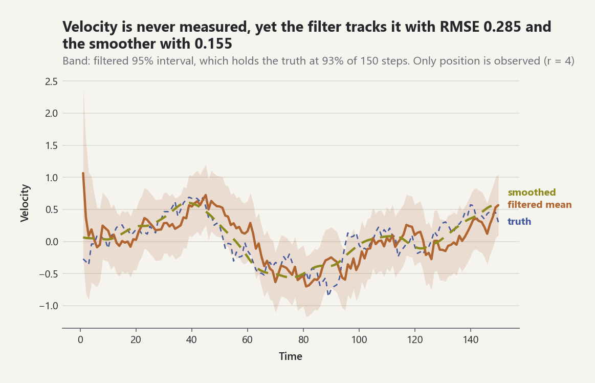

# Filtering, Smoothing, and Data Assimilation

State estimation asks what a dynamical system is doing *now* (filtering) or
*was doing* (smoothing) given noisy, indirect observations. This guide covers
`probstat.filtering` and `probstat.data_assimilation`. All numbers below were
produced by the library itself with the seeds stated; re-running the calls
reproduces them.

## 1. State-space models

A discrete-time state-space model has two equations [EQ-FILT-SSM-001]:

- **dynamics** `x_k = F x_(k-1) + B u_k + w_k`, with process noise
  `w_k ~ N(0, Q)`;
- **observation** `y_k = H x_k + v_k`, with measurement noise `v_k ~ N(0, R)`.

The prior state is `x_0 ~ N(m_0, P_0)`; observations `y_1..y_T` follow the
transitions. `LinearGaussianStateSpace` holds `F, Q, H, R, m_0, P_0` and an
optional control matrix `B`; `NonlinearStateSpace` replaces `F x` and `H x` by
callables `f(x)` and `h(x)` with optional analytic Jacobians
[EQ-FILT-SSM-002]. `simulate(model, T, seed=...)` draws a true trajectory and
observations, using separate random streams for the initial state, the
process noise, and the measurement noise.

**Process versus measurement noise.** `Q` says how much the dynamics are
trusted; `R` says how much the sensor is trusted. They push the gain in
opposite directions. For the scalar random walk (`F = H = 1`) the steady-state
gain from `steady_state_kalman` [EQ-FILT-KF-005] is:

| `q` | `r` | steady predicted variance `P^-` | gain `K` | filtered variance |
|---|---|---|---|---|
| 0.5 | 2.0 | 1.2808 | 0.3904 | 0.7808 |
| 2.0 | 2.0 | 3.2361 | 0.6180 | 1.2361 |
| 0.5 | 8.0 | 2.2656 | 0.2207 | 1.7656 |

More process noise means older information ages faster, so the filter leans
harder on new data (larger `K`). More measurement noise means each reading is
less informative (smaller `K`). For `q = r = 2` the predicted variance is
`1 + sqrt(5)` and the gain is the golden-ratio conjugate `0.6180`, matching
the closed form `P^- = (q + sqrt(q^2 + 4qr))/2`.

## 2. Sequential Bayesian updating

Every filter here implements, exactly or approximately, the two-step
recursion [EQ-FILT-BAYES-001]: **predict** with the dynamics, then **update**
with Bayes' rule using the new observation. For linear-Gaussian models both
steps stay Gaussian and the recursion is the Kalman filter.

- Prediction / covariance propagation [EQ-FILT-KF-001]:
  `m^- = F m + B u`, `P^- = F P F' + Q` (`kalman_predict`).
- Measurement update [EQ-FILT-KF-002]: innovation `v = y - H m^-`,
  `S = H P^- H' + R`, gain `K = P^- H' S^-1`, `m = m^- + K v`
  (`kalman_update`). The gain is formed by Cholesky solves.
- Covariance update in Joseph form [EQ-FILT-KF-003]:
  `P = (I - K H) P^- (I - K H)' + K R K'`, which stays symmetric positive
  semidefinite under rounding.

**Worked example.** Random walk with `q = 0.5`, `r = 2`, `m_0 = 0`,
`P_0 = 10`, observations `1.0, 2.0, 1.5`:

| step | `m^-` | `P^-` | `K` | `m` | `P` | log-likelihood term |
|---|---|---|---|---|---|---|
| 1 | 0.0000 | 10.5000 | 0.8400 | 0.8400 | 1.6800 | -2.2218 |
| 2 | 0.8400 | 2.1800 | 0.5215 | 1.4450 | 1.0431 | -1.7951 |
| 3 | 1.4450 | 1.5431 | 0.4355 | 1.4689 | 0.8710 | -1.5519 |

The first gain is large because the vague prior (`P_0 = 10`) is overwhelmed
by the first reading; the gain then shrinks towards the steady value 0.3904.
The sum of the last column is the log marginal likelihood
[EQ-FILT-KF-004], returned as `KalmanFilterResult.log_likelihood`. A `None`
observation is treated as missing: the update is skipped and the likelihood
term is zero.

`tests/test_uq7_filtering.py` checks the filter against batch Gaussian
conditioning: stacking `x_0..x_4` of a constant-velocity model into one
Gaussian vector and conditioning it with `inference.condition_linear_gaussian`
gives the same last filtered state, the same smoothed marginals, and the same
log-likelihood to nine decimals.

## 3. Filtering versus smoothing

The filter gives `p(x_k | y_1:k)`; the Rauch-Tung-Striebel smoother
(`rts_smoother`) runs backwards to give `p(x_k | y_1:T)` [EQ-FILT-RTS-001].
Because it also uses future observations, its marginal variances are never
larger than the filter's; at the last step the two coincide. For the worked
example above the smoothed means and variances are:

| `k` | 0 | 1 | 2 | 3 |
|---|---|---|---|---|
| smoothed mean | 1.2559 | 1.3187 | 1.4612 | 1.4689 |
| smoothed variance | 1.2221 | 0.8224 | 0.7360 | 0.8710 |

At `k = 1` the smoothed variance 0.8224 is half the filtered 1.6800.

**Constant-velocity tracking.** State `(position, velocity)`, `dt = 1`,
white-noise acceleration `Q = q [[1/3, 1/2], [1/2, 1]]` with `q = 0.01`, and
position measured with `r = 4` [REF-BAR-SHALOM-LI-KIRUBARAJAN-2001], prior
mean `(0, 1)` and prior covariance `diag(1, 0.5)`. Over 150 steps
(`simulate(..., seed=11)`):

| estimate | position RMSE | velocity RMSE |
|---|---|---|
| raw measurements | 2.050 | not measured |
| Kalman filter | 1.095 | 0.285 |
| RTS smoother | 0.615 | 0.155 |

The filter recovers the velocity, which is never observed, from the
correlation that `F` builds between position and velocity. 94.7% of the
filtered position errors fall inside two filtered standard deviations, close
to the nominal 95%.

<picture><source media="(prefers-color-scheme: dark)" srcset="../images/guides/filtering-hidden-velocity-dark.png"></picture>

*Only position is measured, yet the filter infers the velocity from the correlation the dynamics build between the two states, with RMSE 0.285; the smoother, which also uses later observations, lowers it to 0.155, and the filtered 95% band holds the true velocity at 93% of the steps.*

## 4. Nonlinear Gaussian filters

- **Extended Kalman filter** (`extended_kalman_filter`) linearizes `f` and
  `h` at the current mean [EQ-FILT-EKF-001]. Jacobians are analytic when
  supplied, otherwise central differences [EQ-OPT-FD-001].
- **Unscented Kalman filter** (`unscented_kalman_filter`) pushes `2n + 1`
  sigma points through the exact maps and re-fits mean and covariance
  [EQ-FILT-UKF-001], [EQ-FILT-UKF-002]. Default weights use `alpha = 1`,
  `beta = 2`, `kappa = 0`.

On a linear model both reduce to the Kalman filter; the tests confirm equal
log-likelihoods to ten (EKF) and nine (UKF) decimals. The unscented transform
reproduces `E[X^2] = m^2 + P` exactly. `rts_smoother` also smooths EKF and
UKF output because every filter result stores `Cov(x_(k-1), x_k^-)`.

Neither filter reports its own linearization error. Strong nonlinearity
relative to the spread of `P`, or a multimodal posterior, calls for a particle
filter.

## 5. Particle filtering

`bootstrap_particle_filter` [EQ-FILT-PF-001] represents the filtering law by
weighted samples, propagates them with sampled process noise, weights them by
the observation likelihood, and resamples systematically [EQ-FILT-PF-003]
when the effective sample size [EQ-FILT-PF-002] drops below
`resample_threshold * N` (default 0.5). On the 10-step random walk
(`simulate(..., seed=1)`, filter `seed=3`):

| particles | log-likelihood estimate | resampling steps | minimum ESS |
|---|---|---|---|
| exact (Kalman) | -19.6049 | — | — |
| 200 | -19.2668 | 3 | 69.8 |
| 2000 | -19.4587 | 3 | 616.8 |

The likelihood estimate is unbiased, but its logarithm is biased downward and
its error falls only like `N^-1/2`. Particle filters degenerate in high state
or observation dimension.

**Proposals that look at `y_k`.** The bootstrap filter moves particles blind
to the new observation, so precise observations leave few particles with
weight. Two classical remedies return the same `ParticleFilterResult`:

- `auxiliary_particle_filter` [EQ-FILT-APF-001] (Pitt and Shephard)
  resamples the previous particles with first-stage weights
  `W_(k-1)^i g(y_k | f(x_(k-1)^i))`, propagates, and corrects with
  second-stage weights `g(y_k | x_k^j) / g(y_k | f(x_(k-1)^(a_j)))`. Its
  likelihood increment is `[sum_i W_(k-1)^i g(y_k | mu^i)] (1/N) sum_j w_k^j`
  [REF-DOUCET-JOHANSEN-2011, Section 4.2].
- `optimal_proposal_particle_filter` [EQ-FILT-OPT-001] samples
  `p(x_k | x_(k-1), y_k)` exactly. For a linear observation operator it is a
  Gaussian with the Kalman gain `K = Q H' (H Q H' + R)^-1`, and the weight is
  the predictive density `N(y_k; H f(x_(k-1)), H Q H' + R)`, which does not
  depend on the new particle. A nonlinear `h` raises `ValueError`; a
  `NonlinearStateSpace` whose `h` is linear passes `observation_matrix=H`,
  which is checked against `h`.

On an AR(1) with precise observations (`F = 0.9`, `q = 1`, `r = 0.5`, 10
steps, `simulate(..., seed=4)`, exact log-likelihood -18.4401), 100 runs with
`N = 100` and seeds 0-99 give:

| filter | mean log-likelihood | sd of log-likelihood | mean of `exp(estimate - exact)` |
|---|---|---|---|
| bootstrap | -18.6027 | 0.4175 | 0.927 ± 0.040 |
| auxiliary | -18.8829 | 0.7901 | 0.950 ± 0.133 |
| optimal proposal | -18.4756 | 0.1869 | 0.982 ± 0.019 |

(± is one standard error over the 100 runs.) The optimal proposal cuts the
standard deviation of the log-likelihood by more than half. The auxiliary
filter is worse than the bootstrap here: its look-ahead `g(y_k | mu)` uses
only `R = 0.5`, while the true predictive `p(y_k | x_(k-1))` has variance
`q + r = 1.5`, so the second-stage weights are heavy-tailed. Doucet and
Johansen warn about exactly this point-estimate first stage; the auxiliary
filter helps when `R` dominates the predictive spread. All three ratio means
are consistent with 1 (unbiasedness); the shortfall of the bootstrap and
auxiliary means is the right skew of the ratio, whose sample mean falls below
its expectation in most finite samples. `tests/test_particle_extensions.py`
checks unbiasedness with 200 replications and four standard errors.

**Particle smoothing.** `ffbs_particle_smoother` [EQ-FILT-FFBS-001]
(Godsill, Doucet, and West) needs a filter run made with
`store_history=True`, which keeps the weighted cloud of every step (the flag
changes no random draw and no returned number). Each trajectory is drawn
backwards: `x~_T` from the last cloud, then `x~_k = x_k^i` with weights
`W_k^i N(x~_(k+1); f(x_k^i), Q)`. The cost is `O(N T)` per trajectory, and
`Q` must be positive definite. On the AR(1) above (bootstrap filter `N = 500`,
`seed=3`; 200 trajectories, `seed=4`):

| `k` | filter mean, variance | FFBS mean, variance | RTS mean, variance |
|---|---|---|---|
| 0 | 0.0993, 0.9059 | 0.8802, 0.6055 | 0.8710, 0.6313 |
| 5 | 0.8049, 0.3704 | 1.0342, 0.2980 | 1.0982, 0.2978 |
| 10 | 3.2662, 0.3617 | 3.2424, 0.3372 | 3.3427, 0.3605 |

At `k = 0` the smoother moves the prior mean 0.10 to 0.88 using all ten
observations, as the RTS smoother does. The differences between FFBS and RTS
are Monte Carlo error of one run; the tests average 30 independent runs and
compare means and variances with the RTS values within four standard errors.

## Parameter estimation in state-space models

The filters above assume known `F, Q, H, R`. `probstat.filtering` estimates
static parameters `theta` three ways, all built on the filter likelihood
`l(theta) = log p(y_1:T | theta)`.

**Maximum likelihood.** `fit_state_space_mle(builder, theta_0, y)` takes a
builder `theta -> model`, minimizes `-l(theta)` with `minimize_bfgs`
(Kalman filter by default; `filter="ekf"` or `"ukf"` for nonlinear models,
whose likelihood is then approximate), and inverts the observed information
from `central_hessian` [EQ-FILT-MLE-001]. Variances are best passed on the
log scale. For the Nile series (100 annual flows) with the local-level model
`x_k = x_(k-1) + w_k`, `y_k = x_k + v_k`, and R's `StructTS` initialization
`x_0 ~ N(y_1, 1e4 var(y))`, the fit from `log(var(y)/100)` converges in 20
BFGS iterations to

| | level variance `q` | noise variance `r` | log-likelihood |
|---|---|---|---|
| `fit_state_space_mle` | 1469.17 | 15098.52 | -643.200988 |
| R `StructTS(Nile, "level")` | 1469.15 | 15098.58 | -643.200988 |

The two optimizers stop at slightly different points of a flat likelihood
(the log-likelihoods differ by `2e-10`). The standard error of `log q` is
0.87, against 0.21 for `log r`: the level variance is poorly determined from
100 points.

**EM.** `linear_gaussian_em(model, y, estimate=...)` is the algorithm of
Shumway and Stoffer [EQ-FILT-EM-001]. The E-step is the RTS smoother with the
lag-one covariances `Cov(x_k, x_(k-1) | y_1:T) = P^s_k G_(k-1)'`
(`smoothed_lag_one_covariances`); the M-step updates any subset of
`"transition"`, `"observation"`, `"process_covariance"`,
`"observation_covariance"`, and `"initial"` in closed form. Each step can
only raise the exact log-likelihood, and the returned trace lets you check
that. On an AR(1) plus noise (`F = 0.8`, `q = 1`, `r = 0.5`, 100 steps,
`simulate(..., seed=2026)`), estimating `F`, `Q`, `R` from `(0.5, 0.5, 1)`
raises the log-likelihood from -184.0309 to -167.94368 in 161 iterations
(tolerance `1e-10`); BFGS reaches the same maximum:

| | `F` | `q` | `r` |
|---|---|---|---|
| EM | 0.77879 | 0.96884 | 0.50151 |
| `fit_state_space_mle` | 0.77875 | 0.96906 | 0.50135 |
| truth | 0.8 | 1.0 | 0.5 |

EM is simple and stable but converges linearly: on the Nile model it needs
211 iterations to reach tolerance `1e-10` from `(1000, 10000)`, where BFGS
needs 20.

**Particle marginal Metropolis-Hastings.** For nonlinear models, or to get a
posterior instead of a point estimate,
`particle_marginal_metropolis_hastings(builder, log_prior, theta_0, y, ...)`
[EQ-FILT-PMMH-001] runs random-walk Metropolis-Hastings with a fresh
particle-filter estimate `p_hat(y | theta')` at each proposal. The estimate of
the current state is stored and reused, never recomputed; with an unbiased
`p_hat` this makes the chain target the exact posterior for any particle count
(Andrieu, Doucet, and Holenstein). Fewer particles make the estimate noisier,
which shows up as a lower acceptance rate and stickier chains, not as bias.
The result is an `inference.MCMCResult`, so `summary()` and the convergence
diagnostics apply. `tests/test_filtering_parameter_estimation.py` samples the
AR coefficient of a 12-step AR(1) plus noise with a uniform prior, 20
particles, and the optimal proposal, and compares the posterior mean and
variance with quadrature of the exact Kalman posterior within four Monte
Carlo standard errors.

**Out of scope: Rao-Blackwellized particle filters.** They sample only the
nonlinear part of the state and handle a conditionally linear-Gaussian part
with one Kalman filter per particle. `StateSpaceModel` has no way to declare
that split, so this would need a new model class (ADR-0113).

## 6. Data assimilation

Data assimilation combines a model forecast with observations to estimate the
state of a large system. `probstat.data_assimilation` consumes the same model
objects structurally (it does not import `probstat.filtering`).
`ensemble_kalman_filter` runs every ensemble method of the package through
one forecast-analysis cycle: forecast each member with its own process noise,
apply the declared multiplicative inflation to the forecast anomalies,
analyse the observation (skipped for `None`), and apply the optional
relaxation. `analysis=` selects the update, and the result records the
analysis, localization, and relaxation that were used. The default options
reproduce the stochastic filter of earlier releases bit for bit.

**Stochastic ensemble Kalman filter.** The default `analysis="stochastic"`
replaces the Kalman covariance with the sample covariance of `N` model runs.
Each member is updated with its own perturbed observation `y + e_i`,
`e_i ~ N(0, R)` [EQ-DA-ENKF-001]. Without the perturbation the analysis
ensemble would be too narrow. On the constant-velocity model (`q = 0.05`,
`r = 1`, the same prior, 5 steps, `seed=7` data, `seed=0` filter), the final
analysis compared with the exact filter is:

| | mean (pos, vel) | variance (pos, vel) |
|---|---|---|
| Kalman filter | (4.738, 0.636) | (0.537, 0.138) |
| EnKF, `N = 50` | (4.609, 0.675) | (0.670, 0.121) |
| EnKF, `N = 1000` | (4.716, 0.651) | (0.527, 0.135) |
| ETKF, `N = 50` | (4.829, 0.685) | (0.521, 0.105) |
| ETKF, `N = 1000` | (4.727, 0.637) | (0.537, 0.132) |

The ensemble covariance has rank at most `N - 1` and relative error of order
`N^-1/2` [EQ-DA-ENKF-002]. Small ensembles therefore produce sampling error,
spurious long-range correlations, and usually under-dispersion. Nothing is
inflated, localized, or relaxed unless the corresponding argument is given.

### Square-root filters

A square-root filter updates the ensemble deterministically, so the analysis
moments equal the Kalman update of the forecast ensemble moments exactly for
a linear `h`, not only in expectation.

- `analysis="etkf"` is the ensemble transform Kalman filter of Bishop,
  Etherton & Majumdar in the symmetric-square-root form of Hunt, Kostelich &
  Szunyogh [EQ-DA-ETKF-001]: with forecast anomalies `X`, observed anomalies
  `Y`, and `a = N - 1`, `Ptilde = (a I + Y' R^-1 Y)^-1`,
  `wbar = Ptilde Y' R^-1 (y - ybar)`, `W = (a Ptilde)^(1/2)`, and
  `x_i^a = xbar + X (wbar + W_i)`. The symmetric root keeps the anomalies
  centred. `R^-1` is applied through its Cholesky factor, and the
  eigen-decomposition (`linalg.symmetric_eigen`) is done in the smaller of
  the ensemble space and the observation space.
- `analysis="eakf"` is the serial ensemble adjustment Kalman filter of
  Anderson in its two-step form [EQ-DA-EAKF-001]: each scalar observation
  shifts and shrinks the observed ensemble deterministically,
  `y_i^a = ybar^a + sqrt(r / (r + s_p)) (y_i - ybar)`, and the increments are
  regressed onto the state and the remaining observed components. It needs a
  diagonal `R`.

On the example above the EAKF agrees with the ETKF row to the three decimals
shown. One analysis gives both the same mean and covariance, but different
members, so the forecast noise of later cycles makes them drift apart in the
fourth digit.
`tests/test_data_assimilation_advanced.py` checks one ETKF and one EAKF
analysis against the Kalman update of the ensemble mean and covariance to
`1e-10`, with fewer and with more observations than members. The table also
shows the price of determinism: the square-root filters carry no
perturbation noise, but their spread still comes from `N` members, and at
`N = 50` the velocity variance 0.105 is 24% below the exact 0.138.

### Localization and the LETKF

`Localization(state_coordinates, observation_coordinates, half_width,
period=None)` assigns one point to every state and observation component.
Weights come from the fifth-order Gaspari-Cohn function [EQ-DA-LOC-001]:
`rho(0) = 1`, `rho(c) = 5/24`, and `rho = 0` from `d = 2c` on, so
`half_width` is `c`, half of the cut-off. A `period` makes every axis
periodic (the Lorenz-96 circle has period `J`), and `half_width=math.inf`
switches localization off with weights of exactly one.

- With `analysis="stochastic"`, a localization tapers the ensemble
  covariances of the gain entrywise,
  `K = (rho_xy o C_xy)(rho_yy o C_yy + R)^-1` (Houtekamer & Mitchell,
  [EQ-DA-LOC-002]).
- `analysis="letkf"` runs an ETKF at every state component with only the
  nearby observations, each with its inverse error variance multiplied by
  `rho` (R-localization, [EQ-DA-LETKF-001]). A component with no
  observation within `2c` keeps its forecast. With an infinite half-width
  the LETKF reproduces the ETKF exactly.

### Inflation and relaxation

`inflation=` stays a multiplicative covariance factor applied to the
forecast anomalies. `relaxation=Relaxation("rtpp", alpha)` blends the
analysis anomalies with the forecast anomalies,
`x'^a <- (1 - alpha) x'^a + alpha x'^f` (Zhang, Snyder & Sun,
[EQ-DA-RELAX-001]); `Relaxation("rtps", alpha)` rescales the anomalies of
every component so that its spread becomes
`(1 - alpha) sigma^a + alpha sigma^f` (Whitaker & Hamill,
[EQ-DA-RELAX-002]). Both act after the analysis, keep the analysis mean, and
leave a step without an observation alone. RTPS inflates most where the
observations reduced the spread most.

### Ensemble smoothing

Every analysis above is a linear combination of the forecast members:
component `j` of the analysis ensemble is `E^f_j T_j` for an `N` by `N`
transform `T_j`. `ensemble_kalman_smoother(..., lag=L)` runs the same filter
cycle (with the same streams, so its `filter` record equals a filter run with
the same seed) and multiplies the stored ensembles of the last `L` times by
each new transform [EQ-DA-ENKS-001], following Evensen & van Leeuwen. A
localized analysis updates each lagged component with the transform of its
own component, and a relaxation relaxes each updated lagged ensemble towards
itself before the update. On the constant-velocity model over 10 steps
(`seed=7` data, `N = 1000`, `seed=0`), the smoothed initial state is:

| `x_0` | mean (pos, vel) | variance (pos, vel) |
|---|---|---|
| prior `N(m_0, P_0)` | (0.000, 1.000) | (1.000, 0.500) |
| RTS smoother | (1.339, 0.791) | (0.447, 0.102) |
| EnKS, stochastic, `lag = 2` | (0.531, 1.662) | (0.575, 0.256) |
| EnKS, stochastic, `lag = 10` | (1.240, 0.797) | (0.444, 0.100) |
| EnKS, ETKF, `lag = 10` | (1.362, 0.776) | (0.453, 0.102) |

With `lag = 10` every observation reaches `x_0` and the EnKS approaches the
RTS smoother; with `lag = 2` only the first two do.

### The Lorenz test systems

`filtering.lorenz63` and `filtering.lorenz96` return `NonlinearStateSpace`
models whose transition is `substeps` classical Runge-Kutta steps of size
`step` over one assimilation interval, built on
`numerics.integrate_fixed_step` [EQ-NUM-ODE-003]. The defaults are the
published settings: `sigma = 10`, `rho = 28`, `beta = 8/3` and step `0.01`
for Lorenz-63 [EQ-FILT-LORENZ-001]; `J = 40`, `F = 8` and one step of `0.05`
(six hours) for Lorenz-96 [EQ-FILT-LORENZ-002], observing every
`observe_every`-th component. Both are perfect models by default (`Q = 0`)
with `R = P_0 = I`; the transition Jacobian is the exact derivative of the
discrete map. The trajectory integrator is plain arithmetic, so
`numerics.reverse_gradient` differentiates through it.

**Twin experiment.** The Lorenz-96 truth starts from a state spun up for 400
steps from `x_i = 8` (with `x_0 = 8.01`), with prior `N(spun-up state, I)`;
every component is observed with `R = I` (`simulate(model, 40, seed=1)`),
and each filter uses `N = 20` members (`seed=101`). The time-averaged
analysis RMSE over cycles 16-40 is:

| filter | analysis RMSE |
|---|---|
| observations alone | 1.0 (by construction) |
| stochastic EnKF, no localization | 2.18 |
| ETKF + RTPS 0.5, no localization | 0.71 |
| stochastic EnKF, Gaspari-Cohn `c = 2` + RTPS 0.5 | 0.34 |
| LETKF, `c = 2`, + RTPS 0.5 | 0.33 |

Twenty members cannot represent the covariance of a 40-variable chaotic
system: without localization the stochastic EnKF diverges to about twice the
observation error, and the global ETKF with relaxation stays at 0.71. With
localization both the stochastic EnKF and the LETKF track the truth at a
third of the observation error. Over seeds 1-4 the LETKF ranged from 0.31 to
0.36 and the non-localized EnKF from 2.0 to 2.4; one LETKF cycle takes about
0.15 s in pure Python.

**3D-Var.** `three_dimensional_variational` minimizes the background plus
observation cost [EQ-DA-3DVAR-001] by BFGS with an analytic gradient. For a
linear observation operator the minimizer equals one Kalman update. With the
first constant-velocity prediction `(1, 1)` and observation `1.9959`, 3D-Var
returns `(1.60019, 1.20776)` after 3 iterations, the same as the Kalman update
to rounding error (about `2e-16`). For the nonlinear operator `h(x) = x^2` with `x_b = 1`,
`B = 0.5`, `y = 2`, `R = 0.1`, the analysis is `x_a = 1.4040` with cost
0.1674 and Gauss-Newton analysis variance 0.01237. Unlike the Kalman filter,
3D-Var keeps `B` fixed instead of propagating it.

### 4D-Var

4D-Var fits all observations of a window `y_1..y_K` at once with one model
trajectory. The time convention is the filters' one: `x_b` and `B` describe
`x_0`, and `y_k` observes the state after `k` transitions (`None` = missing).

- **Strong constraint** (`four_dimensional_variational`). The model is
  taken as perfect, so the control variable is `x_0` alone and
  `J(x_0) = 1/2 ||x_0 - x_b||^2_(B^-1) + 1/2 sum_k ||y_k - h(M_(0->k)(x_0))||^2_(R^-1)`
  [EQ-DA-4DVAR-001].
- **Weak constraint** (`weak_constraint_four_dimensional_variational`). The
  control variable is the whole trajectory `x_0..x_K`, and the cost adds
  `1/2 sum_k ||x_k - M(x_(k-1))||^2_(Q^-1)` [EQ-DA-4DVAR-004]. `Q` must be
  positive definite; a singular `Q` raises and points to the strong form.
- **Incremental** (`incremental_four_dimensional_variational`, Courtier,
  Thépaut & Hollingsworth). Each outer loop runs the nonlinear model from
  the current `x_0`, linearizes `h o M_(0->k)` around that trajectory, and
  solves the quadratic inner problem [EQ-DA-4DVAR-003] exactly by
  Householder QR. With the exact tangent-linear model this is Gauss-Newton.
  `outer_costs` records the nonlinear cost after every outer loop.

**The adjoint is reverse-mode differentiation.** The gradient of the
strong-constraint cost [EQ-DA-4DVAR-002] needs the transposed
tangent-linear model run backwards from the end of the window. Here the
cost of the whole window is recorded on a reverse-mode tape
(`numerics.reverse_value_and_gradient`) and swept once. That sweep is the
adjoint of the discrete model, so no adjoint code is written by hand. The
transition must therefore be plain arithmetic or `admath`: pass a model's
raw `transition_function` (the Lorenz factories qualify), not its
validating `transition` method. A model written with `math.sin` raises
`AutodiffUnsupportedError`. Central differences are used only when
`gradient="central"` is passed. BFGS (`optimization.minimize_bfgs`)
minimizes the cost from `x_b` (strong) or from the background trajectory
(weak). The analysis covariance is the inverse Gauss-Newton Hessian
`(B^-1 + sum_k G_k' R^-1 G_k)^-1`, formed from a QR factorization of the
whitened residual Jacobian, and `trajectory_covariances` gives the
marginal covariance of every `x_k`.

**Equivalence with the Kalman smoother.** For linear `M` and `h` with
Gaussian errors, 4D-Var and the Rauch-Tung-Striebel smoother give the same
answer. Take the constant-velocity model of the ensemble-smoother table
over 10 steps (`simulate(..., seed=7)` data, prior `N((0, 1), diag(1, 0.5))`,
`r = 1`):

| `x_0` | mean (pos, vel) | variance (pos, vel) | BFGS iterations |
|---|---|---|---|
| strong 4D-Var, perfect model | (2.14853, 0.26165) | (0.31412, 0.00893) | 3 |
| RTS smoother, `Q = 0` | (2.14853, 0.26165) | (0.31412, 0.00893) | |
| weak 4D-Var, `q = 0.05` | (1.33853, 0.79143) | (0.44716, 0.10179) | 79 |
| RTS smoother, `q = 0.05` | (1.33853, 0.79143) | (0.44716, 0.10179) | |

Over all 11 times, the strong form matches the `Q = 0` smoother to
`8e-15` in the means and `2e-15` in the covariances. The weak form matches
the `q = 0.05` smoother to `2e-11` and `1e-15`; its means are limited by
the BFGS tolerance on a 22-dimensional control. Incremental 4D-Var solves
the linear problem in one outer loop, lowering the cost from 52.406 to
8.779. `tests/test_four_dimensional_variational.py` checks all three
against `kalman_filter` + `rts_smoother` with a missing observation, plus
a Taylor test of the gradient and the reverse-versus-central comparison.

**Lorenz-63 and the window length.** Twin setup: Lorenz-63 with 5 RK4
steps per observation (interval 0.05) and truth spun up 1000 steps from
`(1, 1, 1)`. The background is truth plus `N(0, 4 I)`, and every component
is observed with `R = 0.25 I`; observations 3 and 7 are missing. Seeds
are `random.Random(seed)`. With `K = 10` (0.5 time units) strong 4D-Var
converges in 15-28 iterations (0.2-0.5 s per run). Over seeds 0-9 the
error of `x_0` drops to 0.04-0.42 times the background error, mean 0.20.
For seed 0 the error goes from 3.63 to 0.95, and the end of the window is
much better determined than its start (error 0.16). The error that
survives lies along directions the flow contracts, which later
observations hardly see. Incremental 4D-Var for seed 0 needs 8 outer loops
(cost 396.6, 31.0, 17.2, 17.1, ...) and agrees with BFGS to `1e-9`. Without
a line search an outer loop can raise the cost: with `R = I`, seed 1 went
from 573.7 to 643.0 before converging.

Longer windows show the chaos caveat. Over seeds 0-4 at `K = 40`
(2 time units), seed 1 stopped in a local minimum with `J = 22327`, where
the truth has `J = 54`. At `K = 80`, three of five runs ended far from the
truth (`J` above 22000 against about 120), one of them at the 500-iteration
limit. A long chaotic window makes the cost multimodal, and BFGS returns
a minimum near its start: shorten the window, improve `x_b`, or use the
weak constraint.

**Cost per iteration.** One gradient costs one recorded model run plus
one backward sweep, independent of the size of the control vector. On the
development machine, a 10-interval Lorenz-63 cost took 0.74 ms. Reverse
mode took 6.9 ms (about 9 evaluations, the pure-Python tape overhead) and
central differences 4.1 ms, cheaper for three unknowns. For the
33-dimensional weak-constraint control, reverse mode stays at 8.1 ms while
central differences need 69 ms. Each BFGS iteration costs one or a few
gradients, and the Gauss-Newton covariance needs one reverse sweep per
residual.

## Limitations

- Gaussian filters assume additive Gaussian noise; the EKF and UKF are
  approximations whose error is not estimated.
- The particle filters cover the transition-prior (bootstrap), auxiliary,
  and locally optimal proposals; the optimal proposal needs a linear
  observation operator. Particle smoothing is FFBS only (`O(M N T)`, no
  two-filter or fixed-lag smoother), and there is no Rao-Blackwellization.
  Parameter estimation has no gradient of the particle likelihood, so
  maximum likelihood is for Gaussian filters and particle models use PMMH.
- The ensemble filters have fixed multiplicative inflation and RTPP/RTPS
  relaxation but no adaptive inflation (such as Anderson's 2007 and 2009
  schemes); the serial EAKF is not localized and needs a diagonal `R`;
  localization uses one Gaspari-Cohn half-width for all components.
- The ensemble smoother is the fixed-lag EnKS; there is no iterative or
  ensemble-variational smoother.
- 3D-Var is a single-time analysis. 4D-Var uses one time-invariant `R`
  and one `Q` for every step. It has no background-covariance model or
  control-variable transform, no simplified inner-loop model, and no
  preconditioning, and its control vector is stored densely. It suits
  small states and short windows, and its Gauss-Newton covariance is
  exact only for linear models.

## Common pitfalls

- **Covariances, not standard deviations.** `Q`, `R`, and `P_0` enter
  `LinearGaussianStateSpace` as covariance matrices.
- **Observations are sequences.** A scalar reading is `(1.0,)`; a bare float
  raises `TypeError`. `None` marks a missing observation: its update is
  skipped and its log-likelihood term is zero.
- **Index offset.** `filtered[0]` is the prior state, so `filtered` has one
  entry more than `predicted`.
- **Inflation is a covariance factor.** `inflation=1.0` (the default) means no
  inflation; the anomalies are scaled by `sqrt(inflation)`, and a value below
  one raises. Nothing is localized or relaxed unless `localization=` or
  `relaxation=` is passed.
- **Unseeded runs differ.** `simulate`, `bootstrap_particle_filter`, and
  `ensemble_kalman_filter` default to `seed=None`.

The random walk of Section 2:

```python
import inspect
from probstat.data_assimilation import ensemble_kalman_filter
from probstat.filtering import LinearGaussianStateSpace, kalman_filter

walk = LinearGaussianStateSpace(((1.0,),), ((0.5,),), ((1.0,),), ((2.0,),), (0.0,), ((10.0,),))
full = kalman_filter(walk, [(1.0,), (2.0,), (1.5,)])
round(full.log_likelihood, 4)                     # -5.5687
gap = kalman_filter(walk, [(1.0,), None, (1.5,)])
gap.log_likelihood_terms[1]                       # 0.0, missing observation
len(gap.filtered), len(gap.predicted)             # (4, 3)
gap.filtered[0].mean                              # (0.0,), the prior
try:
    kalman_filter(walk, [1.0, 2.0])
except TypeError as error:
    message = str(error)
message                                           # 'observation must be iterable'
inspect.signature(ensemble_kalman_filter).parameters["inflation"].default   # 1.0
inspect.signature(ensemble_kalman_filter).parameters["analysis"].default    # 'stochastic'
```

## Sources

- [REF-KALMAN-1960], [REF-RAUCH-TUNG-STRIEBEL-1965].
- [REF-SARKKA-2013, Chapters 4, 5, 7, 8, and 12].
- [REF-SIMON-2006], [REF-BAR-SHALOM-LI-KIRUBARAJAN-2001].
- [REF-JULIER-UHLMANN-2004].
- [REF-GORDON-SALMOND-SMITH-1993], [REF-KITAGAWA-1996],
  [REF-DOUCET-JOHANSEN-2011].
- [REF-PITT-SHEPHARD-1999], [REF-DOUCET-GODSILL-ANDRIEU-2000],
  [REF-GODSILL-DOUCET-WEST-2004].
- [REF-SHUMWAY-STOFFER-1982], [REF-DURBIN-KOOPMAN-2012],
  [REF-ANDRIEU-DOUCET-HOLENSTEIN-2010].
- [REF-EVENSEN-1994], [REF-BURGERS-VANLEEUWEN-EVENSEN-1998],
  [REF-EVENSEN-2003], [REF-LORENC-1986].
- [REF-BISHOP-ETHERTON-MAJUMDAR-2001], [REF-HUNT-KOSTELICH-SZUNYOGH-2007],
  [REF-ANDERSON-2001], [REF-ANDERSON-JL-2003].
- [REF-GASPARI-COHN-1999], [REF-HOUTEKAMER-MITCHELL-2001],
  [REF-ZHANG-SNYDER-SUN-2004], [REF-WHITAKER-HAMILL-2012].
- [REF-EVENSEN-VANLEEUWEN-2000].
- [REF-LE-DIMET-TALAGRAND-1986], [REF-COURTIER-THEPAUT-HOLLINGSWORTH-1994],
  [REF-LAWLESS-GRATTON-NICHOLS-2005], [REF-TREMOLET-2006],
  [REF-CARRASSI-ETAL-2018].
- [REF-LORENZ-1963], [REF-LORENZ-2006], [REF-LORENZ-EMANUEL-1998].
