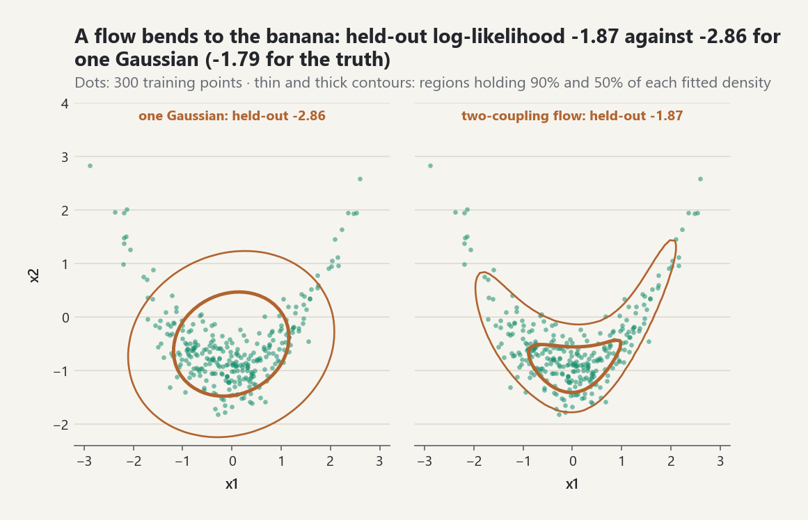

# Generative Models: Normalizing Flows and Energy-Based Models

A generative model is a probability density fitted to data that can also
produce new draws. `probstat.generative` provides two families that answer
the two hard questions of density modelling in opposite ways:

- a **normalizing flow** has an exact, normalized density, at the price of
  restricting the model to invertible maps with tractable Jacobians;
- an **energy-based model** may use any energy function, at the price of an
  unknown normalizing constant, which is avoided in training by score
  matching and in sampling by Langevin dynamics.

The package is experimental (ADR-0074). Formula identifiers resolve in the
[equation registry](../equation-registry.md), and source keys resolve in the
[bibliography](../references.md). Networks, derivatives, and the optimizer
are the shared blocks `numerics.MLP`, `numerics.reverse_value_and_gradient`,
and `optimization.adam_minimize`.

## Change of variables

A flow writes `x = T(z)` with `z ~ N(0, I)` and an invertible
`T = T_K o ... o T_1`. If `T` is a diffeomorphism, the density of `x` is

`log p(x) = log N(T^{-1}(x)) + sum_k log |det J_{T_k^{-1}}|`
[EQ-GEN-FLOW-001]

[REF-PAPAMAKARIOS-ETAL-2021, Section 2.1]. Each layer therefore needs two
things: an inverse (to evaluate the density of data) and a cheap
log-determinant. In `probstat` every layer maps the base side to the data
side with `forward` and back with `inverse`, and both return the
log-determinant of the map they apply. `NormalizingFlow.log_density` uses the
inverse direction; `sample_with_log_density` uses the forward direction and
returns `log N(z) - log |det J_T(z)|` with each draw, which needs no inverse.

```python
import random
from probstat.generative import fit_flow, real_nvp_flow

def banana(size, seed):
    # x1 ~ N(0, 1), x2 | x1 ~ N(x1^2 / 2 - 1, 0.35^2)
    rng = random.Random(seed)
    points = []
    for _ in range(size):
        a = rng.gauss(0.0, 1.0)
        points.append((a, 0.5 * a * a - 1.0 + 0.35 * rng.gauss(0.0, 1.0)))
    return points

data, test_points = banana(300, 5), banana(300, 6)
fit = fit_flow(data, real_nvp_flow(2, couplings=2, hidden=(8,)),
               iterations=300, learning_rate=0.02, heldout=test_points, seed=3)
fit.heldout_mean_log_likelihood, fit.losses[-1]
draws = fit.sample(1000, seed=4)
```

## Layers

| Layer | Map (base to data) | log-determinant | Inverse |
|---|---|---|---|
| `PlanarFlow` | `z + u_hat tanh(w'z + b)` | `log(1 + tanh'(.) w'u_hat)` | scalar root, then one Newton step |
| `RadialFlow` | `z + beta (z - z0) / (alpha + r)` | `(d-1) log(1 + beta h) + log(1 + beta alpha h^2)` | closed form (quadratic in `r`) |
| `AffineCoupling` | `x_{k+1:} = z_{k+1:} exp(s) + t`, `(s, t)` from an MLP of `z_{1:k}` | `sum s` | closed form |
| `ActNorm` | `b + exp(l) z` | `sum l` | closed form |
| `Permutation` | reorder coordinates | `0` | closed form |

**Planar and radial flows** (Rezende and Mohamed 2015) are not invertible
for every parameter value. The planar map is monotone along `w` when
`w'u > -1`; the layer enforces it by replacing `u` with
`u_hat = u + (m(w'u) - w'u) w / |w|^2`, `m(a) = -1 + softplus(a)`
[EQ-GEN-FLOW-002]. The radial map needs `alpha > 0` and `beta > -alpha`,
enforced by softplus parameterizations [EQ-GEN-FLOW-004]
[REF-REZENDE-MOHAMED-2015, Appendix A]. Both have `O(d)` log-determinants by
the matrix determinant lemma, but each layer is a single "bump", so many
are needed for a flexible density.

The planar inverse has no closed form. Projecting `x = T(z)` on `w` gives
the scalar equation `a + c tanh(a + b) = w'x` for `a = w'z`, strictly
increasing when `c = w'u_hat > -1` [REF-REZENDE-MOHAMED-2015, Equation 23].
`PlanarFlow.inverse` solves it in floating point and then evaluates one
Newton step on the parameters: at the root the step has the derivative
`-g_theta / g_a` of the implicit function theorem, so the reverse-mode
gradient of the log-density is exact to the root tolerance
[EQ-GEN-FLOW-003] [REF-GRIEWANK-WALTHER-2008, Chapter 15].

**Affine coupling layers** (Dinh, Sohl-Dickstein and Bengio 2017) pass the
first `k` coordinates through and transform the rest element-wise with a
scale and shift computed from the first `k`. The Jacobian is triangular, so
`log |det| = sum s` never differentiates the network
[REF-DINH-SOHL-DICKSTEIN-BENGIO-2017, Equations 4-8]. The log-scale is
bounded, `s = c tanh(raw / c)`, so no step can overflow `exp(s)`, and the
conditioner's output layer starts at zero, so a new layer is the identity
[EQ-GEN-FLOW-005]. Coupling layers alternate with a coordinate reversal so
that every coordinate is transformed.

**Actnorm** (Kingma and Dhariwal 2018) is an element-wise affine layer whose
initial shift and scale standardize the data reaching it
[EQ-GEN-FLOW-006] [REF-KINGMA-DHARIWAL-2018, Section 3.1].
`NormalizingFlow.data_initialization` pulls the data back through the layers
from the data side and sets each actnorm on the way; `fit_flow` does this by
default.

## Fitting a flow

`fit_flow` minimizes the mini-batch negative mean log-likelihood
[EQ-GEN-FLOW-007], equivalently the forward Kullback-Leibler divergence from
the empirical distribution [REF-PAPAMAKARIOS-ETAL-2021, Section 2.3.1]. The
loss is differentiated by reverse mode and minimized by Adam; the result
reports the loss trace, the training mean log-likelihood, and, with
`heldout`, the out-of-sample mean log-likelihood with its standard error
[EQ-GEN-DIAG-002]. A training likelihood far above the held-out one signals
overfitting, which is easy with a few hundred points.

On a banana-shaped target (`x1 ~ N(0, 1)`, `x2 | x1 ~ N(x1^2/2 - 1, 0.35^2)`,
300 training points) a two-coupling flow reaches a held-out mean
log-likelihood of `-1.87`, against `-2.86` for one Gaussian and `-1.79` for
the true density (ADR-0074).

<picture><source media="(prefers-color-scheme: dark)" srcset="../images/guides/generative-flow-versus-gaussian-dark.png"></picture>

*The single Gaussian spends its 90% region on the empty space inside the arc, while the two-coupling flow of the example above bends its contours along the banana; on the 300 held-out points the flow scores a mean log-likelihood of -1.87 against -2.86 for the Gaussian and -1.79 for the true density.*

## Energy-based models

An energy model is `p(x) = exp(-E(x)) / Z` [EQ-GEN-EBM-001]. `EnergyModel`
uses `E(x) = |L'(x - mu)|^2 / 2 + N_theta(x)`: a positive-definite quadratic
that guarantees `Z < inf` plus an optional MLP correction. Without the
network the model is the Gaussian `N(mu, (L L')^{-1})`.

Maximum likelihood would need `Z` and its gradient. Score matching does
not: the model score `psi = grad log p = -grad E` does not depend on `Z`, and
Hyvärinen's integration by parts turns the squared distance to the unknown
data score into

`J = E_data[ |grad E|^2 / 2 - Laplacian E ] + const` [EQ-GEN-EBM-002]

[REF-HYVARINEN-2005, Theorem 1]. For a Gaussian energy the minimizer is the
sample mean and the inverse sample covariance, exactly the maximum-likelihood
estimate [EQ-GEN-EBM-003] [REF-HYVARINEN-2005, Section 3.1.1];
`fit_score_matching` recovers it to `5e-6` in the tests.

The parameter gradient of `J` needs third derivatives of `E`. Reverse mode
on a tape cannot be nested, so the input gradient and Laplacian are pushed
forward through the network by the chain and product rules
[EQ-GEN-EBM-005] [REF-GRIEWANK-WALTHER-2008, Chapter 13], with every
component recorded on the parameter tape; one backward sweep then returns
the exact gradient. `score_matching_objective` evaluates the same objective
with the forward-over-reverse Hessian (EQ-AD-FOR-001) as an independent
check.

**Denoising score matching** (Vincent 2011) corrupts each point,
`x_tilde = x + s xi`, and regresses the model score on the score of the
corruption kernel, `(x - x_tilde) / s^2` [EQ-GEN-EBM-004]
[REF-VINCENT-2011, Section 4.2]. It needs first derivatives only, but its
target is the score of the data smoothed by `N(0, s^2 I)`: for a Gaussian
energy the precision tends to `(S + s^2 I)^{-1}`, not `S^{-1}`. Choose `s`
small relative to the scale of the structure to be learned.

Score matching fits the shape of the density, not its likelihood. Its
held-out likelihood can stop improving while the objective still falls, so
compare fitted energy models by a normalized density (next section).

## Sampling by Langevin dynamics

The Langevin diffusion `dX = grad log pi(X) dt / 2 + dW` has stationary law
`pi`, and its Euler-Maruyama step

`y = x + (h/2) grad log pi(x) + sqrt(h) xi` [EQ-GEN-LANG-001]

needs only the score. Run as a chain (ULA) it samples a law that differs from
`pi` by `O(h)`: on `N(0, 1)` its variance is `1 / (1 - h/4)`. Used as a
Metropolis-Hastings proposal (MALA) the bias disappears [EQ-GEN-LANG-002]
[REF-ROBERTS-TWEEDIE-1996]. `sample_langevin` takes any log-density written
with `admath`; `EnergyFit.sample_langevin` samples a fitted energy model.

```python
from probstat.generative import EnergyModel, fit_score_matching

fit = fit_score_matching(data, EnergyModel(2, hidden=(8,)), iterations=150)
chain = fit.sample_langevin((0.0, 0.0), n_samples=5000, step_size=0.2,
                            burn_in=500, seed=1)
chain.acceptance_rate, chain.mean()
```

## Comparing densities with the truth

- `quadrature_normalizing_constant(log_f, lower, upper)` integrates
  `exp(log f)` by adaptive Gauss-Kronrod quadrature (nested in 2-D) after
  shifting by its maximum on a grid [EQ-GEN-DIAG-001]
  [REF-PIESSENS-QUADPACK-1983]. Applied to a flow it checks that the density
  integrates to one; applied to `-E` it normalizes an energy model. The box
  must contain the mass.
- `importance_normalizing_constant(log_f, draws, log_q)` averages the
  weights `f/q` of draws from a normalized proposal, for instance a fitted
  flow, and reports the relative standard error and the weight effective
  sample size (EQ-MC-IS-001, EQ-MC-ESS-001) [REF-OWEN-2013, Chapter 9].
- `mean_log_likelihood(log_p, test)` is the out-of-sample score; its
  difference between two models estimates a difference of cross-entropies
  [EQ-GEN-DIAG-002].
- `kl_divergence_estimate(log_p, log_q, draws_from_p)` estimates
  `KL(p || q)` when the truth `p` is known [EQ-GEN-DIAG-003]
  [REF-COVER-THOMAS-2006, Section 2.3]. A single estimate can be negative;
  read it with its standard error.

## Scope and limits

The arithmetic is scalar Python. The methods are validated in one and two
dimensions with a few hundred points and networks of width at most 16; a
fit takes seconds, and nested 2-D quadrature 20 000 to 50 000 density
evaluations. Score matching costs about `d + 2` network evaluations per
point. Planar and radial layers are best used in small numbers or for
sampling; coupling stacks are the default for density estimation.

## Common pitfalls

- **Fixed default seeds.** `fit_flow`, `fit_score_matching`,
  `fit_denoising_score_matching`, and `sample_langevin` default to
  `seed=0`, so repeated calls without a seed return the same result; vary
  the seed to see run-to-run spread.
- **The default energy has a network.** `EnergyModel(d)` adds an MLP with
  `hidden=(16,)` to the quadratic; pass `hidden=None` for the plain
  Gaussian energy.
- **Denoising targets a smoothed density.** `fit_denoising_score_matching`
  fits the data convolved with `N(0, s^2 I)` (`noise_scale=0.1` by
  default); for a Gaussian energy the precision tends to `(S + s^2 I)^-1`.
- **The quadrature box must hold the mass.** `quadrature_normalizing_constant`
  integrates only over `[lower, upper]`, and its `error` estimates the
  quadrature error inside the box, not the mass left outside it.
- **ULA is biased.** `sample_langevin` defaults to `adjusted=True` (MALA);
  with `adjusted=False` the chain samples a law that differs from the target
  by `O(h)`. Training and held-out log-likelihoods, and single
  `kl_divergence_estimate` values, must be read with their standard errors.

```python
import inspect
from probstat.generative import (
    EnergyModel, quadrature_normalizing_constant, sample_langevin,
)

whole = quadrature_normalizing_constant(lambda x: -0.5 * x[0] ** 2, -8.0, 8.0)
inside = quadrature_normalizing_constant(lambda x: -0.5 * x[0] ** 2, -1.0, 1.0)
whole.log_value       # 0.91894, = log sqrt(2 pi)
inside.log_value      # 0.53722, only 68 % of the mass
inside.error < 1e-9   # True, the missing mass is not in the error

EnergyModel(2).hidden                              # (16,)
EnergyModel(2, hidden=None).parameter_count        # 5, quadratic terms only
inspect.signature(sample_langevin).parameters["adjusted"].default   # True
inspect.signature(fit_flow).parameters["seed"].default             # 0
```
