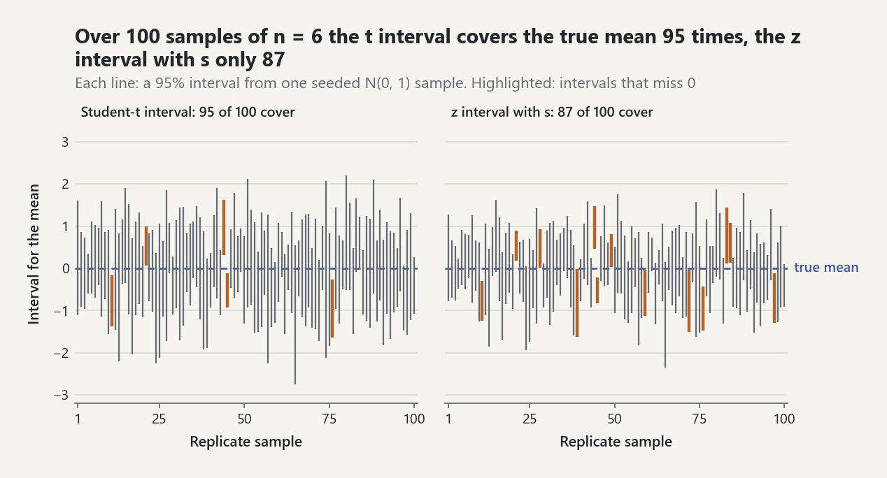
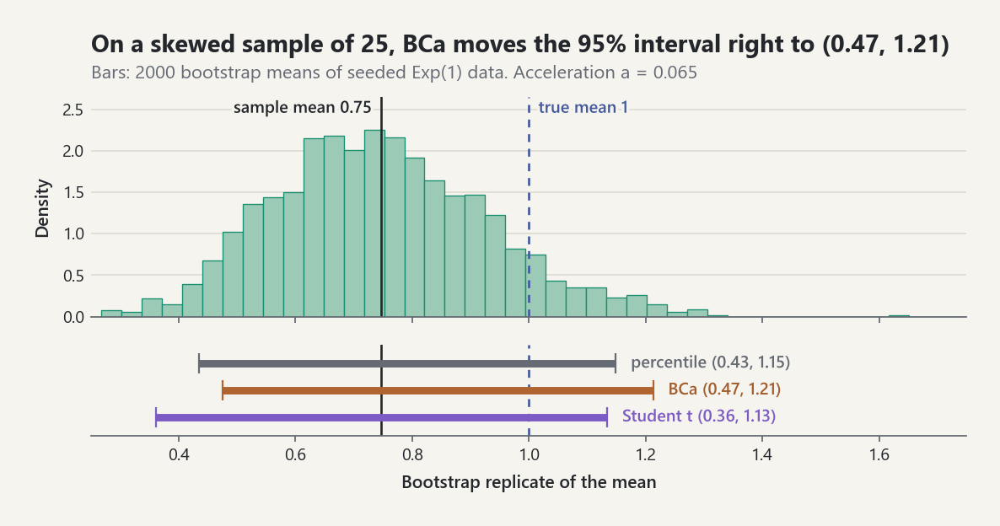

# Hypothesis Testing, Confidence Intervals, and the Bootstrap

`probstat.inference` provides classical tests, exact and resampling-based
confidence procedures, power analysis, and multiple-testing control. Every
procedure returns a frozen result that names its method, so a reader can see
which assumptions were used. All numbers below come from the library and are
also asserted in `tests/test_classical_resampling_inference.py` (section 10
in `tests/test_classical_tests.py`). Robust estimation and quantile
regression have their own guide,
[Robust estimation and quantile regression](robust-and-quantile-regression.md).

## 0. What the numbers mean

- **p-value.** Assume the null hypothesis and the test's model. The p-value is
  the probability of a test statistic at least as extreme as the observed one,
  in the direction of the alternative. It is **not** the probability that the
  null hypothesis is true. A large p-value is not evidence that the null holds.
- **Confidence level.** A 95% interval comes from a procedure that covers the
  fixed true value in 95% of repeated samples. A single computed interval
  either covers the value or does not; 95% is not a probability about that
  interval.
- **Power.** The probability of rejecting the null when a stated effect is
  true. Power is a design quantity. Computing it from the observed effect
  ("post-hoc power") adds nothing to the p-value.

## 1. Sampling distributions

When observations are independent and normal, the t, chi-square, and F laws
are the exact distributions of the classical test statistics. Each upper tail
is computed directly so that small p-values keep their accuracy:

| Function | Formula | Equation |
|---|---|---|
| `student_t_sf`, `student_t_two_sided_p` | `I_{nu/(nu+t^2)}(nu/2, 1/2)` | EQ-DIST-T-001 |
| `chi_square_sf` | `Q(k/2, x/2)` | EQ-INF-DIST-CHI2-001 |
| `f_sf` | `I_{d2/(d2+d1 f)}(d2/2, d1/2)` | EQ-INF-DIST-F-001 |
| `noncentral_t_cdf` | `E[Phi(t S - delta)]`, `S = sqrt(chi^2_nu / nu)` | EQ-INF-DIST-NCT-001 |

`noncentral_t_cdf` integrates the exact mixture representation with
2000-interval Simpson quadrature. It agrees with an independent reference
implementation to about `1e-11` on the tested points.

## 2. t tests and the Student-t interval

Assumptions: independent observations, normal data (or normal paired
differences), and, for the pooled test only, equal variances.

| Function | Statistic | df |
|---|---|---|
| `one_sample_t_test` | `(x_bar - mu_0)/(s/sqrt(n))` | `n - 1` |
| `paired_t_test` | same, on the differences | `n - 1` |
| `two_sample_t_test(equal_variances=True)` | pooled `s_p` | `n1 + n2 - 2` |
| `two_sample_t_test()` (Welch, default) | `s1^2/n1 + s2^2/n2` | Welch-Satterthwaite |

Worked example: the Cushny-Peebles sleep data used by Student (1908), ten
patients under two drugs.

- Welch test: `t = -1.8608`, `df = 17.776`, two-sided `p = 0.0794`.
- Paired test, the correct analysis because each patient received both drugs:
  `t = -4.0621`, `df = 9`, `p = 0.00283`. The 95% interval for the mean
  difference is `(-2.460, -0.700)`.

Ignoring the pairing hides a clear effect: the between-patient variation
swamps the within-patient difference.

`student_t_mean_confidence_interval` adds the exact
`x_bar +- t_{n-1,1-alpha/2} s/sqrt(n)` interval. The older
`normal_mean_confidence_interval` is unchanged and still labels its
estimated-sigma branch a large-sample approximation. A seeded simulation in
the test suite (2000 normal samples of size `n = 6`, seed 97) gives these
coverages:

- t interval: **0.953**.
- z interval with `s`: only **0.891**.

<picture><source media="(prefers-color-scheme: dark)" srcset="../images/guides/hypothesis-testing-interval-coverage-dark.png"></picture>

*In 100 seeded samples of size 6 the Student-t interval covers the true mean 95 times, while the narrower z interval with `s` covers it only 87 times, in line with the 0.953 and 0.891 of the 2000-sample simulation.*

Every `TTestResult` reports a two-sided interval at `confidence`, whatever
alternative was tested, together with Cohen's `d` (pooled for two samples,
`d_z` for pairs).

## 3. Count data

- `chi_square_goodness_of_fit` (EQ-INF-CHI2-GOF-001). For Mendel's
  `315/108/101/32` peas against `9:3:3:1`: `X^2 = 0.470`, `df = 3`,
  `p = 0.925`. A small `X^2` means the data are consistent with the model; it
  does not prove the model.
- `chi_square_independence_test` (EQ-INF-CHI2-IND-001). For the
  `2 x 3` gender-by-party table `[[762, 327, 468], [484, 239, 477]]`:
  `X^2 = 30.07`, `df = 2`, `p = 2.95e-7`, Cramer's `V = 0.104`. The p-value
  is tiny but the association is weak: significance is not magnitude.
- Expected counts below five emit `SmallExpectedCountWarning` (Cochran's
  rule) and set `small_expected_counts = True`. In that case, use an exact
  test.
- `fisher_exact_test` (EQ-INF-FISHER-001). Fisher's tea-tasting table
  `[[3, 1], [1, 3]]` gives two-sided `p = 34/70 = 0.486` and one-sided
  `p = 17/70`.
- `binomial_test` (EQ-INF-BINOM-001). Seven successes in 20 trials against
  `p_0 = 0.3` give two-sided `p = 0.629`. The two-sided rule sums every
  outcome no more probable than the observed one. The result includes the
  Clopper-Pearson 95% interval `(0.154, 0.592)` (EQ-INF-CI-CP-001), whose
  coverage is never below the nominal level.

## 4. Rank tests

`mann_whitney_u_test` and `wilcoxon_signed_rank_test` compute exact null laws
from integer generating functions (EQ-INF-MWU-001, EQ-INF-WSR-001). The
automatic method chooses between two branches:

- **Exact law:** when there are no ties and sizes are at most 50.
- **Normal approximation:** used otherwise, with the tie-corrected variance
  and a continuity correction.

In the Wilcoxon test, zero differences are discarded. In the tests, exact
p-values are checked against brute-force enumeration of all `C(m+n, m)` rank
sets or all `2^n` sign vectors. Example: for the Hamilton depression-scale
pairs, the exact one-sided test gives `W+ = 40` and `p = 0.01953 = 10/512`.
Each result reports a rank-biserial effect size.

## 5. Permutation tests

`permutation_test` compares `mean(first) - mean(second)` with its
distribution over relabelings of the pooled data (EQ-INF-PERM-001). The test
is valid whenever the observations are exchangeable under the null. It runs
in one of two modes:

- **Exact enumeration:** used when there are at most `max_exact` relabelings.
  The five-versus-six example in the tests has 462 relabelings and a one-sided
  `p = 7/462 = 0.0152`.
- **Monte Carlo:** used otherwise. It reports `(b + 1)/(M + 1)`, which is
  never zero and keeps the test's level exact (Phipson and Smyth). It is
  seeded through `RandomStream`.

## 6. Bootstrap and jackknife

`bootstrap(statistic, data, replicates, seed)` returns the replicates, the
bootstrap bias `mean(theta*) - theta`, and the standard error (EQ-INF-BOOT-001).
Observations may be any objects, for example pairs.

`jackknife` gives the deterministic leave-one-out bias and standard error
(EQ-INF-JACK-001). Two exact identities are tested:

- For the mean, the jackknife standard error equals `s/sqrt(n)`.
- For the plug-in variance, the bias-corrected estimate equals the unbiased
  variance.

`bootstrap_confidence_interval` offers five methods:

| Method | Interval | Accuracy |
|---|---|---|
| `percentile` | `[q_{alpha/2}, q_{1-alpha/2}]` | first order |
| `basic` | `[2 theta - q_{1-alpha/2}, 2 theta - q_{alpha/2}]` | first order |
| `normal` | `theta - bias +- z se` | first order |
| `studentized` | bootstrap-t with supplied or jackknife SE | second order |
| `bca` | bias correction `z_0`, jackknife acceleration `a` | second order |

Worked example: `n = 200` normal observations, seed 20261011, 2000
replicates, seed 7.

| Interval | Lower | Upper | Diagnostics |
|---|---|---|---|
| BCa | 9.710 | 10.307 | `z_0 = -0.010`, `a = 0.0018` |
| Student-t | 9.714 | 10.314 | |

For a smooth statistic on well-behaved data, the bootstrap reproduces the
analytic answer, as it should. BCa raises an error in two cases, rather than
returning a meaningless interval:

- every replicate lies on one side of the estimate;
- the jackknife values are constant.

<picture><source media="(prefers-color-scheme: dark)" srcset="../images/guides/hypothesis-testing-bootstrap-bca-dark.png"></picture>

*For a skewed statistic the methods part ways: on 25 seeded Exp(1) observations with sample mean 0.75, the percentile interval (0.43, 1.15) copies the bootstrap distribution, while BCa, with acceleration 0.065, moves to (0.47, 1.21) to correct for the skewness that the symmetric Student-t interval ignores.*

## 7. Power, effect sizes, sample size

- `cohens_d` and `hedges_g` (EQ-INF-ES-001). `g` applies Hedges' exact
  factor `J(m) = Gamma(m/2) / (sqrt(m/2) Gamma((m-1)/2))`.
- `z_test_power` (EQ-INF-POWER-001) and `t_test_power` (EQ-INF-POWER-002).
  t power uses the **exact noncentral t law** (quadrature), with no normal
  approximation and no simulation. A seeded simulation in the tests agrees
  within Monte Carlo error.
- `required_sample_size` (EQ-INF-POWER-003). Values for `d = 0.5`,
  `alpha = 0.05` two-sided, and target power 0.8:

| Design and test | Required `n` | Achieved power |
|---|---|---|
| Two-sample t | 64 per group | 0.8015 |
| One-sample or paired t | 34 | 0.8078 |
| Two-sample z | 63 per group | 0.8013 |

## 8. Multiple testing

`adjust_p_values` (EQ-INF-MT-001, EQ-INF-MT-002) returns adjusted p-values
and rejection sets. For the vector `p = (0.01, 0.04, 0.03, 0.005)`:

| Method | Adjusted p-values | Controls |
|---|---|---|
| Bonferroni | 0.04, 0.16, 0.12, 0.02 | FWER, any dependence |
| Holm | 0.03, 0.06, 0.06, 0.02 | FWER, any dependence |
| BH | 0.02, 0.04, 0.04, 0.02 | FDR, independence or PRDS |
| BY | 0.0417, 0.0833, 0.0833, 0.0417 | FDR, any dependence |

At `alpha = 0.05`, the methods reject:

- Holm: the first and fourth hypotheses;
- BH: all four.

## 9. Equivalence (TOST)

`tost_equivalence_test` (EQ-INF-TOST-001) makes equivalence the alternative
hypothesis. It runs two one-sided t tests at the margins, and its p-value is
the larger of the two.

Example: ten differences with mean 0.02 and margins `(-0.2, 0.2)`:

- p-value: `p = 5.1e-6`;
- the 90% interval `(-0.017, 0.057)` lies inside the margins, so equivalence
  is declared.

A non-significant difference test is never a substitute for TOST.

## 10. Several groups, blocks, variances, normality, and post hoc tests

These tests live in `probstat.inference` next to the two-sample tests; their
oracles (SciPy cross-checks made offline, brute-force enumeration, and
closed forms) are in `tests/test_classical_tests.py` (ADR-0101).

### Which test when

| Question | Data | Normal-theory test | Rank or robust test |
|---|---|---|---|
| Do two groups differ in location? | independent | `two_sample_t_test` (Welch) | `mann_whitney_u_test` |
| Does a paired difference have median zero? | paired | `paired_t_test` | `wilcoxon_signed_rank_test` (symmetry), `sign_test` (none) |
| Do `k` groups differ in location? | independent | `one_way_anova` | `kruskal_wallis_test` |
| Do `k` treatments differ within blocks? | complete blocks | two-way ANOVA (not provided) | `friedman_test` |
| Do `k` matched binary rates differ? | matched 0/1 | | `cochran_q_test` (`mcnemar_test` for `k = 2`) |
| Do `k` groups differ in spread? | independent | `bartlett_test` | `brown_forsythe_test`, `levene_test` |
| Are the data normal? | one sample | `shapiro_wilk_test` | `normality_tests` (EDF statistics) |
| Which pairs of means differ? | after ANOVA | `tukey_hsd_test` | `dunn_test` (after Kruskal-Wallis) |

- `kruskal_wallis_test` (EQ-INF-KW-001) mid-ranks the pooled sample and
  corrects `H` for ties. When the number of assignments `N!/prod n_g!` is at
  most `max_exact` (100000) it enumerates them all, which gives the exact
  permutation p-value given the ties; otherwise it uses chi-square with
  `k - 1` degrees of freedom. For sizes `(3, 3, 3)` without ties,
  `P(H >= 5.6) = 84/1680 = 0.05`.
- `friedman_test` (EQ-INF-FRIEDMAN-001) ranks within blocks and reports
  Kendall's `W` as its effect size.
- `sign_test` (EQ-INF-SIGN-001) is `binomial_test` on the signs of the
  non-zero differences.
- `levene_test` and `brown_forsythe_test` (EQ-INF-LEVENE-001) are the
  one-way ANOVA of absolute deviations from the group means or medians;
  `bartlett_test` (EQ-INF-BARTLETT-001) is the normal-theory likelihood-ratio
  test.
- `shapiro_wilk_test` (EQ-INF-SW-001) follows Royston's algorithm AS R94 for
  `3 <= n <= 5000`; its polynomial constants were checked against the
  published Fortran listing, and `W` and the p-value agree with SciPy's
  `swilk` to `1e-8` and `1e-6` relative.
- `tukey_hsd_test` (EQ-INF-TUKEY-001) refers each standardized difference to
  the studentized range distribution (EQ-INF-SRANGE-001), evaluated by
  numerical integration to an absolute accuracy of about `1e-12`
  (`studentized_range_cdf`, `studentized_range_sf`,
  `studentized_range_quantile`).
- `dunn_test` (EQ-INF-DUNN-001) compares mean ranks of the pooled ranking
  and adjusts its p-values with `adjust_p_values` (Holm by default).

```python
from probstat.inference import (
    bartlett_test, brown_forsythe_test, cochran_q_test, dunn_test, friedman_test,
    kruskal_wallis_test, levene_test, one_way_anova, sign_test,
    studentized_range_quantile, tukey_hsd_test,
)

a = (2.9, 3.0, 2.5, 2.6, 3.2, 3.0)
b = (3.8, 2.7, 4.0, 2.4, 3.0)
c = (2.8, 3.4, 3.7, 2.2, 2.0, 4.1, 3.9)
one_way_anova(a, b, c).p_value               # 0.665
kruskal = kruskal_wallis_test(a, b, c)
kruskal.statistic                            # 0.5641, tie-corrected H
kruskal.p_value                              # 0.754
kruskal.exact                                # False; there are 14702688 assignments

levene_test(a, b, c).p_value                 # 0.0125, mean-centred
brown_forsythe_test(a, b, c).p_value         # 0.114, median-centred
bartlett_test(a, b, c).p_value               # 0.0734

hsd = tukey_hsd_test(a, b, c)
hsd.comparison(0, 1).p_value                 # 0.7155
hsd.df                                       # 15.0
studentized_range_quantile(0.95, 3, 15)      # 3.6734
dunn = dunn_test(a, b, c)
dunn.comparison(0, 2).p_value                # 0.5049, unadjusted
dunn.comparison(0, 2).adjusted_p_value       # 1.0, Holm

blocks = [(31, 27, 24), (31, 28, 31), (45, 29, 46), (21, 18, 48),
          (42, 36, 46), (32, 17, 40), (27, 27, 30), (33, 20, 35)]
friedman_test(blocks).statistic              # 9.8
friedman_test(blocks).p_value                # 0.00745
sign_test((1, 2, 3, -1, 4, 5, 6, 7, 8, 9, 0)).p_value   # 0.02148, 22/1024
cochran_q_test([(1, 1, 0), (1, 0, 0), (1, 1, 1), (0, 1, 0),
                (1, 1, 0), (1, 0, 0), (0, 0, 0), (1, 1, 0)]).statistic  # 7.0
```

The three groups give conflicting variance verdicts: Levene's mean-centred
test rejects at 5%, Brown-Forsythe and Bartlett do not. The tests differ
only in how they centre and weigh the deviations, so a borderline verdict
should not be read as firm evidence either way; Brown and Forsythe found the
median-centred version to keep its level under skewed and heavy-tailed
data, which makes it the safer default. Bartlett's test fails in the other
direction: two outliers in otherwise similar samples make it reject while
Brown-Forsythe does not.

```python
from probstat.inference import bartlett_test, brown_forsythe_test

heavy = (0.1, -0.3, 0.2, 5.0, -0.1, 0.0, 0.3, -4.2)
light = (0.4, -0.2, 0.1, -0.5, 0.2, 0.3, -0.1, 0.0)
bartlett_test(heavy, light).p_value          # 1.27e-05
brown_forsythe_test(heavy, light).p_value    # 0.173
```

## Limitations

- Exact rank and permutation branches are pure-Python enumerations. They are
  limited to moderate sizes (`max(m, n) <= 50` for automatic exact rank
  tests, `max_exact` relabelings for permutations).
- The two-sided binomial and Fisher tests use the minimum-likelihood
  convention. Other conventions, such as doubling the smaller tail, give
  different p-values.
- Power functions cover one-sample, paired, and equal-size two-sample mean
  tests only.
- Studentized bootstrap with the default jackknife SE costs `n` statistic
  evaluations per replicate.
- The exact Kruskal-Wallis law enumerates assignments one by one and is
  limited to `max_exact` of them; Friedman, Cochran's Q, Bartlett, and Dunn
  use their large-sample reference laws only.
- Each studentized-range evaluation costs tens of milliseconds (a double
  integral), so `tukey_hsd_test` with many groups takes seconds.

## Common pitfalls

- **Unpaired analysis of paired data.** `two_sample_t_test` defaults to
  Welch's test for independent samples. When each unit is measured twice,
  use `paired_t_test`; on the sleep data the two answers differ by a factor
  of about 28 in the p-value.
- **One-sided p-value, two-sided interval.** `alternative="less"` or
  `"greater"` changes the p-value only. `confidence_interval` is always the
  two-sided Student-t interval at `confidence`.
- **Zero differences and ties in the signed-rank test.**
  `wilcoxon_signed_rank_test` drops zero differences, so `sample_sizes` can
  be smaller than the number of pairs, and with tied absolute differences
  `method="auto"` switches from the exact law to the normal approximation.
- **The z interval with an estimated sigma.**
  `normal_mean_confidence_interval` without `known_sigma` is a large-sample
  approximation and is narrower than the exact
  `student_t_mean_confidence_interval` for small `n`.
- **Ties in rank tests.** `kruskal_wallis_test`, `friedman_test`, and
  `dunn_test` use mid-ranks and tie-corrected variances; with heavy ties the
  chi-square reference is rough, and the exact Kruskal-Wallis law (small
  designs) is conditional on the observed tie pattern.
- **Unequal variances.** `one_way_anova` and `tukey_hsd_test` assume a common
  variance; Kruskal-Wallis assumes identical distributions under the null,
  so unequal spreads distort its level and a rejection does not by itself
  mean the medians differ. Check spreads with
  `brown_forsythe_test` rather than `bartlett_test`, which reacts to heavy
  tails as if they were unequal variances.
- **Multiple comparisons.** Run all pairwise t tests and the family-wise
  error grows with the number of pairs; `tukey_hsd_test` p-values are
  already simultaneous, while `dunn_test` p-values are adjusted by
  `adjust_p_values` (Holm by default; pass `adjustment="bh"` for FDR).
- **Shapiro-Wilk at large n.** With thousands of observations
  `shapiro_wilk_test` rejects for departures from normality too small to
  matter; look at a Q-Q plot as well.
- **Defaults and seeds.** `adjust_p_values` defaults to Holm (FWER control,
  not FDR); `bootstrap`, `bootstrap_confidence_interval`, and the Monte Carlo
  branch of `permutation_test` are reproducible only with an explicit `seed`
  (`seed=None` draws fresh randomness).

```python
import statistics
from probstat.inference import (
    adjust_p_values, bootstrap, normal_mean_confidence_interval, paired_t_test,
    student_t_mean_confidence_interval, two_sample_t_test,
    wilcoxon_signed_rank_test,
)

drug_a = (0.7, -1.6, -0.2, -1.2, -0.1, 3.4, 3.7, 0.8, 0.0, 2.0)
drug_b = (1.9, 0.8, 1.1, 0.1, -0.1, 4.4, 5.5, 1.6, 4.6, 3.4)
two_sample_t_test(drug_a, drug_b).method     # 'Welch two-sample t test'
two_sample_t_test(drug_a, drug_b).p_value    # 0.0794
paired_t_test(drug_a, drug_b).p_value        # 0.00283

one_sided = paired_t_test(drug_a, drug_b, alternative="less")
one_sided.p_value                            # 0.00142, half the two-sided value
one_sided.confidence_interval.lower          # -2.460, still two-sided
one_sided.confidence_interval.upper          # -0.700

signed_rank = wilcoxon_signed_rank_test(drug_a, drug_b)
signed_rank.sample_sizes                     # (9,), one zero difference dropped
signed_rank.exact                            # False, ties force the normal law

normal_mean_confidence_interval(drug_a).upper       # 1.859
student_t_mean_confidence_interval(drug_a).upper    # 2.030

adjust_p_values((0.01, 0.04, 0.03, 0.005)).method      # 'holm'
adjust_p_values((0.01, 0.04, 0.03, 0.005)).error_rate  # 'FWER'
first = bootstrap(statistics.fmean, drug_a, replicates=200, seed=1)
first.standard_error == bootstrap(
    statistics.fmean, drug_a, replicates=200, seed=1).standard_error  # True
```

## Sources

[REF-STUDENT-1908], [REF-WELCH-1947], [REF-SATTERTHWAITE-1946],
[REF-CASELLA-BERGER-2002], [REF-AGRESTI-2013], [REF-COCHRAN-1954],
[REF-CLOPPER-PEARSON-1934], [REF-MANN-WHITNEY-1947], [REF-WILCOXON-1945],
[REF-HOLLANDER-WOLFE-CHICKEN-2014], [REF-GOOD-2005], [REF-PHIPSON-SMYTH-2010],
[REF-EFRON-1979], [REF-EFRON-1987], [REF-EFRON-TIBSHIRANI-1993],
[REF-DAVISON-HINKLEY-1997], [REF-COHEN-1988], [REF-HEDGES-1981],
[REF-JOHNSON-KOTZ-BALAKRISHNAN-1995], [REF-HOLM-1979],
[REF-BENJAMINI-HOCHBERG-1995], [REF-BENJAMINI-YEKUTIELI-2001],
[REF-LEHMANN-ROMANO-2005], [REF-SCHUIRMANN-1987], [REF-KRUSKAL-WALLIS-1952],
[REF-FRIEDMAN-1937], [REF-DIXON-MOOD-1946], [REF-BROWN-FORSYTHE-1974],
[REF-BARTLETT-1937], [REF-SHAPIRO-WILK-1965], [REF-ROYSTON-1992],
[REF-ROYSTON-1995], [REF-STATLIB-AS-R94], [REF-COCHRAN-1950],
[REF-KRAMER-1956], [REF-COPENHAVER-HOLLAND-1988], [REF-LUND-LUND-1983],
[REF-HOCHBERG-TAMHANE-1987], [REF-DUNN-1964].
