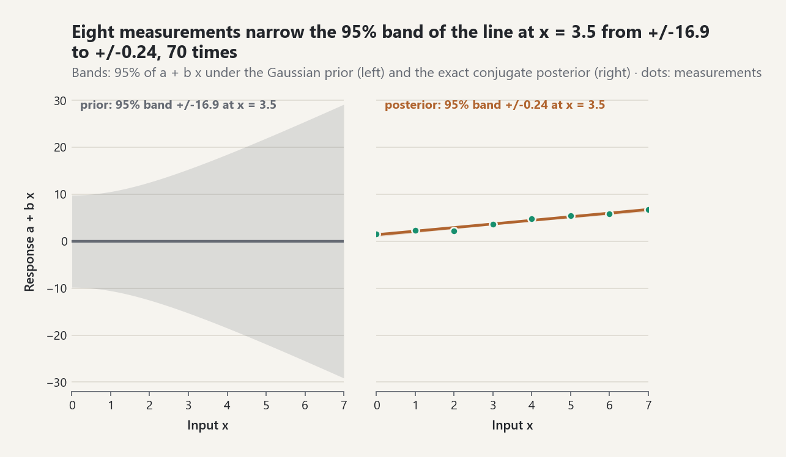
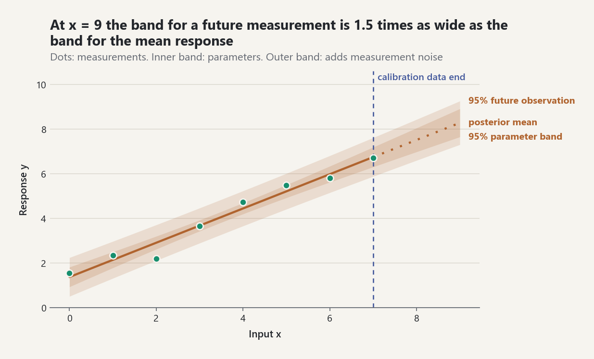

# Inverse Problems and Bayesian Calibration

## 1. Forward and inverse questions are different

A forward problem selects parameters and computes a response. An inverse
problem starts from measurements and learns which parameter values remain
plausible. The latter is not merely “running the model backward”: noise,
limited excitation, non-uniqueness, and model inadequacy can prevent exact
recovery.

For the observation model

`y_i = f(x_i, theta) + delta_i + epsilon_i`,

`epsilon_i` is measurement noise and `delta_i` is model discrepancy
([EQ-INV-OBS-001]). Their variances may add under independent Gaussian
assumptions, but their scientific meanings must remain separate. More data can
reduce parameter uncertainty while leaving a systematic discrepancy intact.

## 2. Least squares and identification

For a straight-line response `a + b x`, ordinary least squares minimizes the
residual sum of squares and gives the closed-form estimates in
[EQ-REG-OLS-001]. `fit_simple_linear_regression` reports coefficients,
residuals, residual variance, and `R^2`. These are fit diagnostics, not proof
that the observation model is adequate.

The design matrix must also identify the parameters. If every `x_i` is equal,
the intercept and slope columns are linearly dependent. The library rejects
calibration in this case. A full-rank but poorly conditioned design is accepted
with a message in the `warning` field of its identifiability diagnostic,
because practical identifiability may still be weak ([EQ-INV-IDENT-001]). The
message is not a Python warning, so it has to be read.

## 3. Bayesian update

Bayes' rule combines a prior with the likelihood; it does not turn either into
an objective fact. In the linear-Gaussian model, a Gaussian prior and known
Gaussian noise yield the analytic posterior in [EQ-BAYES-LIN-POST-001]. The
implementation supports an arbitrary finite parameter dimension and uses
positive-definite Cholesky solves rather than explicit scalar shortcuts.

The prior covariance states pre-data uncertainty. The likelihood is determined
by the declared observation model and known error variance. The posterior is a
conditional distribution given all these assumptions. If the noise variance
is estimated rather than known, the present conjugate contract is not the
correct model and a later hierarchical extension is required.

<picture><source media="(prefers-color-scheme: dark)" srcset="../images/guides/inverse-prior-to-posterior-dark.png"></picture>

*In the companion lab the prior `N((0, 0), diag(25, 4))` leaves the line `a + b x` almost unconstrained, with a 95% band of +/-16.9 at `x = 3.5`; eight measurements of `1.25 + 0.82 x` with known noise sd 0.35 make the exact conjugate posterior band +/-0.24, 70 times narrower, so the data, not the prior, now carry the calibration.*

## 4. Posterior samples and predictions

Posterior parameter draws propagate parameter uncertainty through later
calculations. For a linear design `H_*`, [EQ-BAYES-PRED-001] separates:

- parameter uncertainty `H_* Sigma_post H_*^T`;
- future measurement noise, included only when the target is a future noisy
  observation; and
- optional declared discrepancy variance.

The latent joint covariance may be positive semidefinite and singular when
there are more prediction sites than independently uncertain parameter
directions. Sampling remains defined. The Mahalanobis predictive-check
statistic, however, requires positive-definite covariance and rejects a
singular target rather than silently adding jitter.

This is the calibration-versus-prediction boundary. Calibration conditions on
data collected at the calibration inputs. Prediction declares new inputs and a
target: latent response or future observation. Extrapolation outside the
calibration domain may be numerically computable while scientifically unsafe.

<picture><source media="(prefers-color-scheme: dark)" srcset="../images/guides/inverse-calibration-prediction-dark.png"></picture>

*Both bands carry the lab's declared discrepancy sd of 0.15; adding the measurement noise makes the future-observation band 1.5 times as wide as the mean-response band at `x = 9`, past the last calibration input at `x = 7`, and the posterior-predictive tail probability of the eight measurements, 0.711, gives no sign of misfit.*

## 5. Posterior-predictive checking

`posterior_predictive_check` simulates replicate datasets and compares their
Mahalanobis discrepancies with the observed discrepancy
([EQ-BAYES-PPC-001]). An extreme tail proportion is a diagnostic signal, not a
binary model-validation certificate. The statistic can miss discrepancies to
which it is insensitive; graphical residual checks and domain knowledge remain
necessary.

## 6. Model discrepancy and confounding

`AdditiveGaussianDiscrepancy` requires a description and applicability domain.
This prevents a variance term from appearing without a scientific claim.
Calibration parameters and discrepancy can be confounded: a flexible
discrepancy may explain patterns that would otherwise update parameters.
External validation data, informative priors, replicated experiments, or
physics-based constraints are often required [REF-BRYNJARSDOTTIR-OHAGAN-2014].

## 7. Reproducible workflow

1. Declare calibration inputs, observations, and measurement-noise variance.
2. Inspect rank and conditioning before interpreting fitted parameters.
3. Fit least squares as a transparent baseline.
4. Declare and justify the prior, then compute the Gaussian posterior.
5. Draw seeded posterior samples when downstream calculations need samples.
6. Declare prediction inputs and whether the target includes measurement noise.
7. Add model discrepancy only with an applicability-domain statement.
8. Run predictive checks and inspect residual structure.

The companion `examples/bayesian_calibration_lab.py` performs this chain and
plots calibration data, posterior mean, parameter-uncertainty bands, and wider
future-observation bands without hiding their distinct meanings.

## 8. Scope and next extensions

This release assumes a linear response, a proper positive-definite Gaussian
prior, known homoscedastic Gaussian noise, and additive independent discrepancy.
Future work includes unknown variance, nonlinear forward models, robust and
heteroscedastic likelihoods, MCMC, correlated discrepancy processes,
experimental design, and formal validation experiments. These limitations are
model boundaries, not missing footnotes.

Update: unknown noise variance (Normal-inverse-gamma and log-sigma sampling),
nonlinear forward models, Student-t likelihoods, Laplace approximations, and
MCMC with convergence diagnostics are now covered in
[nonlinear calibration and MCMC](nonlinear-calibration-and-mcmc.md)
(ADR-0017). Gaussian-process discrepancy processes and heteroscedastic noise
(`DiscrepancyCalibration`, `LogLinearNoise`) are covered in
[model discrepancy and heteroscedastic noise](model-discrepancy.md), and
experimental design in [experimental design](experimental-design.md).
Correlated measurement-error models remain open.

## Common pitfalls

- **Read the identifiability message.** `calibrate_linear_gaussian` raises
  `ValueError` for an unidentifiable design but accepts a weakly conditioned
  one silently; the message is in `identifiability.warning`.
- **Latent is the default target.** `predict` uses `include_noise=False`, so
  its intervals describe the mean response. A future measurement needs
  `include_noise=True` and is much wider.
- **Least squares ignores the prior.** `CalibrationProblem.fit_least_squares`
  is the frequentist baseline; the prior enters only the Laplace and MCMC
  posteriors.
- **Discrepancy is opt-in.** `NoiseModel` has `discrepancy_variance=0.0` by
  default; without a declared discrepancy all misfit is read as noise or as
  parameter information.
- **Unseeded draws differ.** `sample_posterior` and `predict` default to
  `seed=None`.

```python
import inspect
from probstat.inverse import (
    CalibrationProblem, NoiseModel, calibrate_linear_gaussian, predict,
)
from probstat.multivariate import MultivariateNormal

prior = MultivariateNormal((0.0, 1.0), ((4.0, 0.0), (0.0, 1.0)))
try:
    calibrate_linear_gaussian([1.0, 1.0, 1.0], [1.0, 2.0, 3.0],
                              observation_variance=0.1, prior=prior)
except ValueError as error:
    message = str(error)
message                       # 'The intercept and slope are not jointly identifiable.'
weak = calibrate_linear_gaussian([100.0, 100.01, 100.02], [1.0, 2.0, 3.0],
                                 observation_variance=0.1, prior=prior)
weak.identifiability.warning  # 'The design is full rank but weakly conditioned.'
inspect.signature(predict).parameters["include_noise"].default                   # False
inspect.signature(NoiseModel).parameters["discrepancy_variance"].default         # 0.0
inspect.signature(CalibrationProblem.sample_posterior).parameters["seed"].default   # None
```
