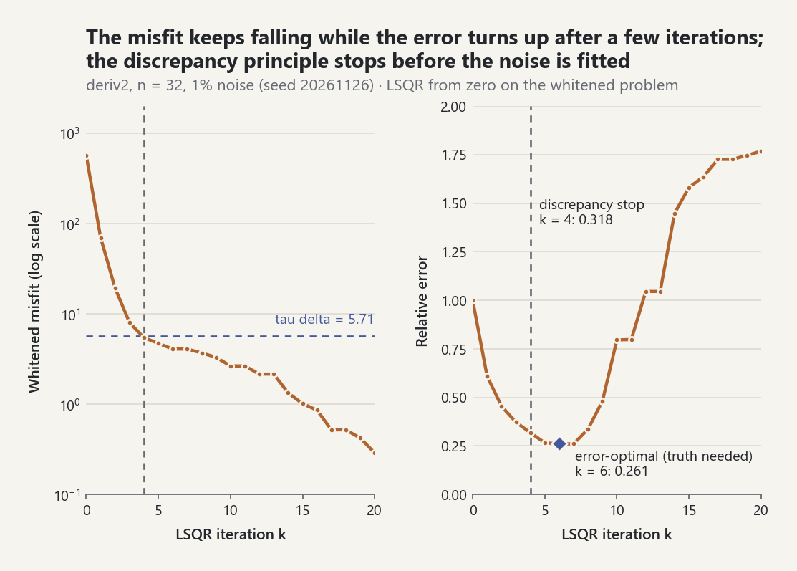
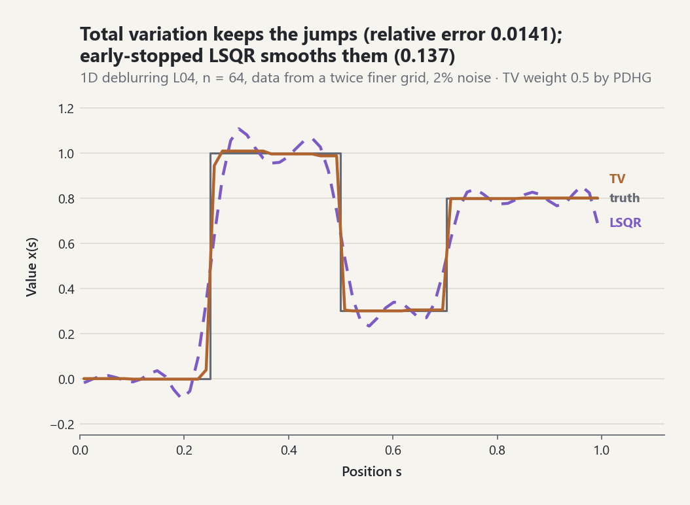
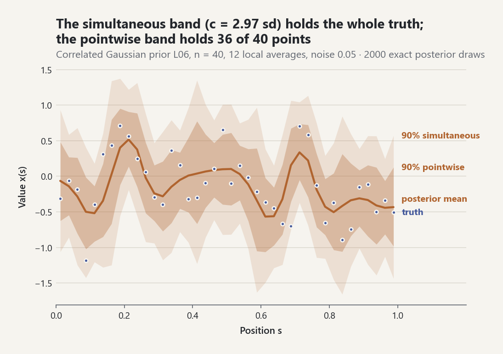
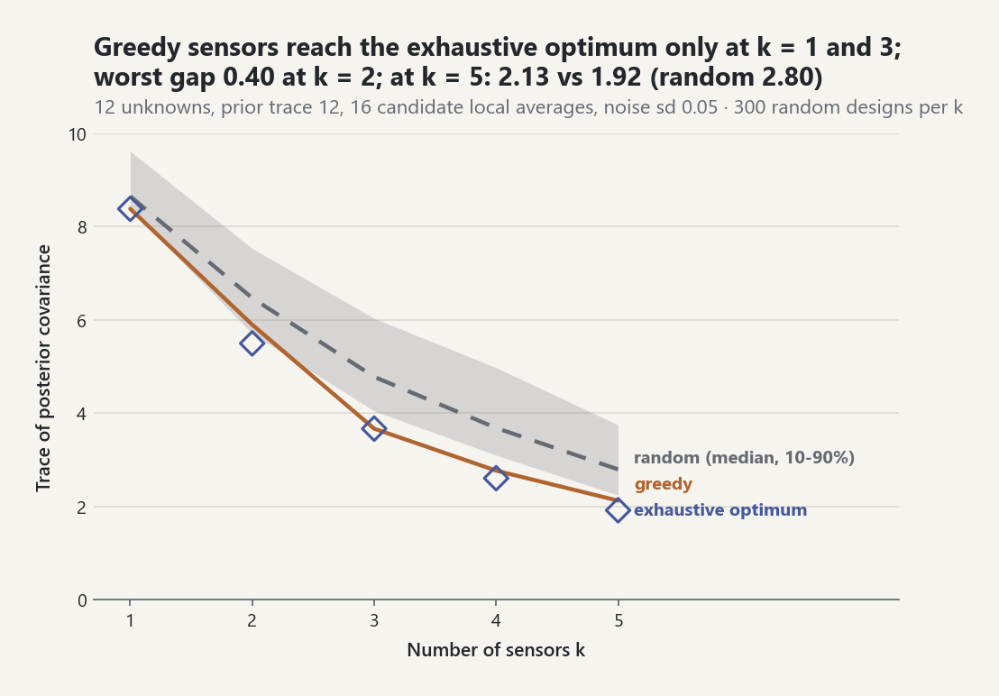

# Large-scale, non-smooth and Bayesian inverse problems

This guide continues
[Regularization and ill-posed problems](regularization-and-ill-posed-problems.md).
That chapter solved small dense problems with one SVD. Here the operator may
be too large to store, the noise may be correlated, the prior centre may be
non-zero, the truth may have edges, and the question may be "how sure are
we" rather than "what is the estimate". Every method below is implemented in
`probstat` (experimental since 0.28, [ADR-0144](../adr/ADR-0144-matrix-free-inverse-problems.md))
and every number quoted was produced by running the code with the seed given.

Prerequisites: the SVD and Tikhonov filter factors (U17), the Gaussian
likelihood and posterior ([inverse problems and calibration](inverse-problems-and-calibration.md)).

## 1. One problem statement for all methods

Observations `y = A x + e`, `e ~ N(0, Gamma)`, with `Gamma = C C'` and the
whitening `W = C^-1`. The regularized estimate minimizes

`Phi(x) = 1/2 ||W (A x - y)||^2 + lambda^2/2 ||L (x - x_ref)||^2`
[EQ-INV-LIN-001].

Three conventions matter and are easy to confuse:

- `lambda` multiplies a SQUARED penalty (`lambda^2`); the `l1` and
  total-variation weight `alpha` multiplies an UNSQUARED one.
- `x_ref` is the centre of the penalty (a prior mean), not the starting
  point of an iteration.
- The minimum-norm solution of a rank-deficient problem minimizes
  `||x - x_ref||`, which is not `||x||` unless `x_ref = 0`.

With `z = x - x_ref` the minimizer is the least-squares solution of the
stacked system `[W A; lambda L] z = [W (y - A x_ref); 0]`.

```python
from probstat.inverse import (
    LinearInverseProblem,
    second_derivative_problem,
    solve_regularized,
)
from probstat.linalg import DenseCovariance

base = second_derivative_problem(16)
Gamma = [[1e-6 * (1.0 if i == j else 0.3) for j in range(16)] for i in range(16)]
L = [[(-1.0 if j == i else 1.0 if j == i + 1 else 0.0) for j in range(16)]
     for i in range(15)]
problem = LinearInverseProblem.create(
    base.operator, base.exact_data, noise=DenseCovariance(Gamma),
    penalty=L, reference=[0.0] * 16,
)
qr = solve_regularized(problem, 0.7)                        # unique solutions only
iterative = solve_regularized(problem, 0.7, method="lsqr")  # matrix-free
assert qr.status == "unique" and iterative.status == "iterative"
```

`method="qr"` raises when the stack is rank deficient instead of returning
an arbitrary solution; `method="svd"` returns the minimum-`||x - x_ref||`
solution and says so in `status`.

### What the estimator does to the truth

For a fixed `lambda` the estimate is linear in the data,
`x = x_ref + M (y - A x_ref)` with gain
`M = (A'Gamma^-1 A + lambda^2 L'L)^-1 A'Gamma^-1` [EQ-INV-LIN-002].
`linear_estimator_analysis` returns

- the resolution matrix `R = M A`: row `i` is the averaging kernel of
  `x_i`, column `j` the image of a unit spike at `j`;
- the expected error `(R - I)(x_true - x_ref)` (regularization bias);
- the SAMPLING covariance `M Gamma M'` of the estimate under repeated noise;
- the matrix `(A'Gamma^-1 A + lambda^2 L'L)^-1`, which is the posterior
  covariance only if `lambda^2 L'L` is the precision of a proper prior.

The last two are different matrices; quoting the second as the uncertainty
of a deterministic regularized estimate understates the error, because it
ignores the bias.

## 2. Operators instead of matrices

A `LinearOperator` is anything with `shape`, `matvec` (`x -> A x`) and
`rmatvec` (`y -> A'y`). The adjoint identity `y'(A x) = (A'y)'x`
[EQ-LINALG-OP-001] is the one property every operator must satisfy, and
`adjoint_test` checks it:

```python
import random

from probstat.linalg import Convolution1DOperator, adjoint_test

generator = random.Random(1)
blur = Convolution1DOperator([0.25, 0.5, 0.25], 10_000, boundary="reflect")
x = [generator.gauss(0.0, 1.0) for _ in range(10_000)]
y = [generator.gauss(0.0, 1.0) for _ in range(10_000)]
assert adjoint_test(blur, x, y).passed
```

A 10 000-point convolution costs `O(n)` memory per application; its
transpose is one scatter-add pass, not `n` forward applications (checked
with `CountingOperator` in `tests/test_linalg_operators_krylov.py`).
Stacks such as `[W A; lambda L]` are built from parts, and their transposes
follow [EQ-LINALG-OP-002].

In weighted spaces (a mass matrix `M_X` on the parameters, `M_Y` on the
data) the adjoint is `M_X^-1 A' M_Y` [EQ-LINALG-OP-005], built explicitly
by `weighted_adjoint`; `rmatvec` is always the Euclidean transpose.

## 3. Iteration count as the regularization parameter

From `z = 0`, CGLS, LSQR and LSMR first pick up the large singular
components; the small ones, which carry mostly noise, enter later. The
residual decreases monotonically while the error first falls and then
rises: semi-convergence. Measured on deriv2 (`n = 32`, iid noise of 1 % of
`||b|| / sqrt(m)`, seed `20261126`, whitened so that `delta = sqrt(32) = 5.657`):

| LSQR iteration `k` | whitened misfit | relative error |
|---:|---:|---:|
| 0 | 565 | 1.00 |
| 2 | 19.3 | 0.455 |
| 4 | 5.46 | 0.318 |
| 6 | 4.08 | 0.261 |
| 8 | 3.70 | 0.337 |
| 12 | 2.16 | 1.05 |
| 20 | 0.289 | 1.77 |

The discrepancy principle [EQ-INV-ITER-002] stops at the first `k` with
misfit `<= tau delta` (`tau = 1.01`): here `k = 4`, error 0.318. The
error-optimal iteration (`k = 6`, error 0.261) is unattainable without the
truth and is reported only for benchmarking.

```python
from probstat.inverse import expected_noise_norm, krylov_regularization

result = krylov_regularization(problem, method="lsqr",
                               noise_norm=expected_noise_norm(16))
assert result.stop_reason in ("discrepancy", "normal_tolerance")
```

<picture><source media="(prefers-color-scheme: dark)" srcset="../images/guides/large-scale-semi-convergence-dark.png"></picture>

*Semi-convergence of LSQR on the seeded deriv2 data: the misfit falls below `tau delta = 5.71` at `k = 4` (relative error 0.318), the error is smallest at `k = 6` (0.261) and has grown to 1.77 by `k = 20` while the misfit keeps falling.*

`landweber` [EQ-INV-ITER-001] is the slow, transparent version of the same
idea; it needs a CERTIFIED upper bound of `||W A||` for its step, because
the power-iteration estimate is a lower bound. `hybrid_lsqr`
[EQ-INV-ITER-003] applies Tikhonov to the small projected problem at every
step, which removes the sharp dependence on the stopping index. On the same
data its projected discrepancy rule reached error 0.291, while projected GCV
chose `lambda = 0.0053` and error 1.79: projected GCV is a criterion on the
projected problem, and in our runs it under-regularized. Prefer the
discrepancy rule when the noise level is known.

## 4. Choosing `lambda` without the truth

`regularization_path` solves the problem on a grid and evaluates every rule
on the same solutions [EQ-INV-SEL-001], [EQ-INV-SEL-002]. On the deriv2 data
above (25 values from `1e-3` to `1e3`):

| rule | chosen `lambda` | relative error |
|---|---:|---:|
| GCV | 1.78 | 0.354 |
| UPRE | 3.16 | 0.270 |
| discrepancy (`tau = 1`) | 5.62 | 0.287 |
| L-curve corner | 3.16 | 0.270 |
| evidence (prior `N(0, I / lambda^2)`) | 1.00 | 0.622 |
| oracle (unattainable) | 3.16 | 0.270 |

One seed is an illustration, not a ranking. UPRE estimates the prediction
risk in observation space, not the parameter error; the evidence chooses
the prior that best explains the data, which need not minimize the
reconstruction error (here the smooth deriv2 solution is a poor draw from an
iid prior). `select_regularization` reports `status="boundary"` when the
optimum sits at a grid end and `"unattainable"` when the discrepancy target
is never met; it never invents a value. For matrix-free problems
`trace="hutchinson"` estimates the degrees of freedom with a Monte Carlo
standard error.

## 5. Edges and sparsity: `l1` and total variation

A quadratic penalty spreads a jump over several cells. Total variation
`alpha sum |x_(i+1) - x_i|` [REF-RUDIN-OSHER-FATEMI-1992] penalizes the size
of jumps, not their sharpness. On the deblurring benchmark L04 (`n = 64`,
Gaussian blur of width 0.03, piecewise-constant truth, data generated on a
twice finer grid, 2 % noise):

| method | relative error |
|---|---:|
| LSQR, discrepancy stop (5 iterations) | 0.137 |
| TV, `alpha = 0.5`, PDHG, converged | 0.0141 |

<picture><source media="(prefers-color-scheme: dark)" srcset="../images/guides/large-scale-tv-edges-dark.png"></picture>

*Deblurring benchmark L04 with data from a twice finer grid: LSQR stopped by the discrepancy principle after 5 iterations rounds the jumps and rings (relative error 0.137); total variation with weight 0.5 keeps them (relative error 0.0141).*

At larger weights (`alpha = 2` and `8`) PDHG reached the 20 000-iteration
cap without meeting its tolerance; such runs are reported as
`converged=False`, and their iterates should not be compared as optima.
TV produces staircases on smooth truths; `l1` shrinks the amplitudes of the
non-zeros (an optional debiased refit on the support is available, with no
guarantee of improvement). The solvers are FISTA with backtracking
[REF-BECK-TEBOULLE-2009], the primal-dual hybrid gradient method with a
certified step condition `tau sigma ||K||^2 < 1` [REF-CHAMBOLLE-POCK-2011]
and scaled ADMM [REF-BOYD-ETAL-2011]. `sparse_extended` adds iteratively
reweighted least squares for `l1` and TV (anisotropic, and isotropic on 2D
grids), Huber-TV, second-order total generalized variation in 1D and on 2D
grids (no staircases on piecewise-affine signals), and the non-convex MCP and
SCAD penalties, which only reach stationary points that depend on the start.
`flexible_hybrid_lsqr` builds the Krylov basis with a preconditioner that
changes with the reweighting [REF-CHUNG-GAZZOLA-2019]; with a fixed identity
preconditioner it reproduces `hybrid_lsqr`.

## 6. Nonlinear forward models and adjoints

A nonlinear model supplies `value(x)`, `jvp(x, v) = J v` and
`vjp(x, w) = J'w` (`DifferentiableForward`). Check them first:
`check_derivatives` sweeps the Taylor remainder
`||G(x + h v) - G(x) - h J v||`, which must fall like `h^2` until rounding
takes over, and runs the dot test `w'(J v) = (J'w)'v`. `gauss_newton_krylov`
then solves each linearized stacked problem with LSQR, so a Jacobian is
never formed; `iteratively_regularized_gauss_newton` decreases `lambda_k`
geometrically and stops by the discrepancy principle.

For a PDE the vector-Jacobian product is an adjoint solve.
`EllipticDiffusion1D` discretizes `-(k u')' = q` with `k = exp(x)` on cells;
one gradient of the misfit costs one forward and one adjoint solve for any
number of cells, while the full Jacobian costs one tangent solve per cell
(`tests/test_pde_models.py` checks this at `n = 200`).

`HeatEquation1D` maps an initial temperature to later observations with
implicit Euler or Crank-Nicolson steps; its transpose runs the adjoint
steps backwards and is exact for the discrete model, and its singular values
are known in closed form, which makes the severe ill-posedness of the
backward heat problem visible: with `n = 32`, `T = 0.01` and 20 implicit
Euler steps only 7 of 32 singular values exceed `1e-2`
(`tests/test_heat_models.py`). When negative curvature or a poor
Gauss-Newton model matters, `newton_trust_region_inversion` takes
truncated-CG steps inside a trust region [REF-STEIHAUG-1983].

## 7. The Bayesian reading

With a Gaussian prior `x ~ N(mu, C0)` the posterior is Gaussian and exact:
`linear_gaussian_posterior` returns its mean, covariance actions, the
normalized evidence and exact conditional samples
`x = x0 + C0 A'S^-1 (y - A x0 - e0)`. When `C0 = P P'` and the
prior-whitened misfit Hessian `K'K` (`K = W A P`) has a few large
eigenvalues `lambda_i`, `low_rank_posterior` keeps them:
`C_post = P (I - V diag(lambda / (1 + lambda)) V') P'`
[REF-SPANTINI-ETAL-2015]. Unresolved directions keep their prior variance;
they do not collapse to zero. For functions, `SpectralGaussianPrior`
places a prior with covariance `a^2 (kappa^2 - d^2/ds^2)^(-s)` on sine
coefficients; the variance of each coefficient is the same whatever the
number of modes kept, so refining the representation does not change the
prior (it is trace class for `s > 1/2`). The information gained is
`1/2 sum log(1 + lambda_i)` and the effective number of resolved directions
`sum lambda_i / (1 + lambda_i)`.

A posterior is a distribution over whole functions, so a band that holds
the truth everywhere must be wider than a band that holds it at each point
separately. `credible_bands` returns both from posterior draws: the
pointwise quantiles and the simultaneous band `mean +- c sd`, with `c` the
empirical quantile of the largest standardized deviation.

<picture><source media="(prefers-color-scheme: dark)" srcset="../images/guides/large-scale-posterior-bands-dark.png"></picture>

*Exact posterior of the correlated Gaussian case L06 (40 points, 12 local averages): the 90 % simultaneous band uses `c = 2.97` standard deviations and the truth lies inside it everywhere; the 90 % pointwise band holds the truth at 36 of 40 points, as a pointwise band should.*

The same eigenvalues drive experimental design: `greedy_linear_design`
adds the sensor with the largest gain in `log det(I + H)` (D-optimal), the
largest drop of `trace(C)` (A-optimal) or the largest reduction of a goal
variance, and `exhaustive_linear_design` shows how far greedy is from the
optimum on small problems.

<picture><source media="(prefers-color-scheme: dark)" srcset="../images/guides/large-scale-design-gains-dark.png"></picture>

*A-optimal sensor choice among 16 candidate local averages of 12 unknowns (prior trace 12): greedy equals the exhaustive optimum only at k = 1 and 3; its worst gap is 0.40 at k = 2, and with five sensors greedy reaches 2.13 against the optimum 1.92 and a random median of 2.80. Greedy has no optimality guarantee for the A criterion.*

For problems where the posterior covariance cannot be formed,
`operator_a_criterion` estimates `trace(C)` with Hutchinson probes and
conjugate-gradient solves and reports a standard error;
`operator_d_criterion` takes `sum log(1 + lambda_i)` from Lanczos or a
randomized SVD with a truncation bound. `sequential_linear_design` updates
the posterior after each simulated observation, and `robust_linear_design`
averages or maximizes a criterion over parameter or noise scenarios.

Counts, censored measurements and outliers need other likelihoods:
`maximum_likelihood_linear` fits a linear predictor under `PoissonLaw`,
`BinomialLaw`, `CensoredGaussianLaw` or `StudentTLaw` by Fisher scoring, and
`MissingMask` drops unobserved entries through the marginal covariance (not
by deleting rows of the precision). For nonlinear posteriors,
`WhitenedGaussianPriorTarget` writes the posterior in prior-whitened
coordinates and hands it to the existing pCN and NUTS samplers;
`simulation_based_calibration_linear_gaussian` checks a sampler against the
exact answer, which validates the algorithm under the model, not the model.
`tikhonov_ensemble_kalman_inversion` is a derivative-free optimizer whose
ensemble collapses: its final spread is not a posterior.

Other likelihoods are available in `observation_laws_extended`: negative
binomial counts, interval-censored Gaussians, a contaminated-normal outlier
model, a normalized Huber density, a multivariate Student-t with full scatter,
noise whose covariance depends on the prediction (its gradient includes the
log-determinant term), and an unknown noise scale that is either profiled or
integrated out under an inverse-gamma prior (a multivariate t marginal).

`tempered_smc_posterior` runs the library's tempered SMC on an inverse
posterior and returns the log evidence with a standard error;
`quadrature_reference` computes exact one- and two-dimensional posteriors on
a grid so that a sampler can be checked for missing modes. In the
dimension study `pcn_dimension_study` the pCN acceptance rate stayed near 0.5
(0.530, 0.505, 0.480 at `n = 8, 32, 128`) while random-walk Metropolis with
the same step fell from 0.430 to 0.065 (`tests/test_posterior_sampling.py`).
For high-dimensional posteriors `likelihood_informed_subspace` keeps the directions where the data
dominate the prior [REF-CUI-MARTIN-MARZOUK-SOLONEN-SPANTINI-2014], and
`WhittleMaternPrior1D` gives a Matérn prior through a banded SPDE precision
[REF-LINDGREN-RUE-LINDSTROM-2011]. `matrix_free_lis` and
`probe_resolution` do the same with operator actions only (Lanczos or a
randomized range finder, conjugate-gradient solves) and report a residual for
every eigenpair and every solve, so problems with thousands of unknowns stay
within reach.

Ensemble methods need care beyond the Gaussian case. On the bimodal problem
`y = x^2 + e` (60 members, six seeds), the ensemble Kalman update placed
31 % of its members between the modes, where the exact posterior has almost
no mass; the ensemble transform particle filter
(`ensemble_transform_particle_filter`, [REF-REICH-2013]) placed 1.1 % there
(`tests/test_ensemble_extended.py`).
`localized_ensemble_kalman_update` tapers spurious long-range sample
correlations, and `adaptive_inflation` estimates a spread factor from the
innovations.

For parameters that are not identified, profile the likelihood rather than
trusting a curvature: `profile_likelihood` re-optimizes the nuisance
parameters along a grid, and `profile_interval` returns `None` for a side
that does not close within the grid, instead of a fabricated endpoint
[REF-RAUE-ETAL-2009]. When the exact target is expensive,
`delayed_acceptance_metropolis` screens proposals with a cheap surrogate and
keeps the exact posterior invariant [REF-CHRISTEN-FOX-2005].
`profile_likelihood_2d` profiles two parameters jointly, and
`bootstrap_lr_calibration` replaces the chi-square threshold by a simulated
one when a parameter sits on a boundary. `ode_sensitivity` integrates the
sensitivity equations of an ODE and reports the rank of the sensitivity
matrix: for `x' = -(k1 + k2) x` only the sum is identifiable.

Time-dependent models get exact discrete adjoints as well:
`EllipticDiffusion2D` solves `-div(k grad u) = f` on the unit square with
harmonic-mean face conductivities and gives exact discrete adjoint gradients;
`HeatExplicitEuler1D` refuses a time step above the explicit stability limit
unless asked explicitly, because an unstable forward step amplifies the
highest modes. `ODEForwardModel` differentiates the classical Runge-Kutta scheme itself, so
its gradient is the exact gradient of the discrete map, and
`SimulatorAdapter` wraps an external simulator with counts, optional caching
and recorded failures. `multilevel_mcmc` combines chains on a hierarchy of
discretizations [REF-DODWELL-ETAL-2015]; on the small test hierarchies it
did not pay for itself, and the measured cost is reported rather than
assumed. Simulation-based inference (`sbi_workflow`) compares ABC, the
library's posterior and ratio estimators, flow matching and an exact
quadrature reference on the same simulator; it labels every learned posterior
as approximate and refuses proposal-based training. In the linear-Gaussian
case `diffusion_posterior_sampling` runs a reverse diffusion with the EXACT
noisy-time posterior score, so its error is pure discretization error; the
common approximation that adds the prior score to a likelihood gradient at
the noisy-time mean keeps a bias that more steps do not remove
[REF-CHUNG-ETAL-2023]. `coarse_to_fine_warm_start` and
`validate_sensitivities` report, rather than assume, whether a cheap model
saves work or gives usable gradients.

See also [Nonlinear Bayesian inversion](nonlinear-bayesian-inversion.md) for
the Laplace approximation, the prior-respecting samplers, transport maps,
local-approximation MCMC, nonlinear design and an applied heat-flux case.

## 8. Benchmarks and the inverse crime

Data generated with the same discretization that inverts them make every
method look better than it is [REF-KAIPIO-SOMERSALO-2007]. Each benchmark in
`INVERSE_BENCHMARK_CATALOG` carries `same_discretization`; the deblurring
case with `refinement > 1` generates its data on a finer grid. Truth, design
and noise come from separate random streams, so changing the noise seed never
changes the truth. The danger is concrete: on the tomography case with
data from analytic line integrals, the error of the pixel model (about
10 % of the data) is larger than 1 % noise, the discrepancy target is
never reached and early stopping fails (`tests/test_benchmark_extended.py`).
`estimate_approximation_error` estimates the mean and covariance of such a
model error from paired fine and coarse runs so that it can enter the
likelihood as `Gamma + Sigma_e`.

Two synthetic application cases show the same diagnostics on physical
models. In `synthetic_expansion_history_benchmark` (dark-energy equation
of state `w(z)` in 8 redshift bins from 30 mock distance moduli with
`sigma_mu = 0.1`) only 2 of the 8 whitened singular values exceed 1: the
data resolve about two combinations of the bins, and a free magnitude
offset is exactly degenerate with `log10 H0`. In
`orbit_determination_benchmark` a single station observing a short arc in
3D leaves one direction of the initial state unobservable. Both cases are
synthetic and support no statement about the real universe or a real
spacecraft [REF-HOGG-1999], [REF-TAPLEY-SCHUTZ-BORN-2004]. Adding a
simplified BAO observable with a free sound horizon does not remove the
offset/`H0` degeneracy (a direction proportional to `(1, 5, -1)` remains);
only an expansion-rate measurement does (`tests/test_benchmark_cosmology.py`).
`gravity_inversion_benchmark` shows the classical non-uniqueness of
potential fields: with 16 stations and 60 cells, 44 directions are invisible
and a single layer at any of five depths fits the data to within three
noise norms [REF-BLAKELY-1995], [REF-LI-OLDENBURG-1998]. On the sphere,
`gravity_sphere_benchmark` shows how satellite altitude and noise limit the
resolved spherical-harmonic degree under a Kaula-type prior
[REF-KAULA-1966], and `compare_models` gives Bayes factors of expansion
histories with the run-to-run error of the SMC evidence beside a quadrature
value where one exists.

## Common pitfalls

- Passing the noise STANDARD DEVIATION as `noise_norm`: the discrepancy
  principle needs the noise norm, `sqrt(m)` in whitened units.
- Treating the error-optimal iteration or `lambda` of a synthetic benchmark
  as a method; it uses the truth.
- Computing a Landweber or PDHG step from `power_iteration`, which
  underestimates `||A||`; supply a certified bound or a safety factor.
- Reading `bayesian_covariance` as the uncertainty of a deterministic
  regularized estimate; it ignores the regularization bias.
- Comparing `alpha` (unsquared `l1`/TV weight) with `lambda` (squared
  Tikhonov weight).
- Reporting a run with `converged=False` (for example `max_iterations`) as a
  solution of the optimization problem.
- Validating a method only on `same_discretization=True` benchmarks.

## Exercises

1. Run `krylov_regularization` on `backward_heat_problem(32)` with 0.1 %
   and 5 % noise. *Hint:* the stopping index decreases as the noise grows;
   compare with the number of Picard coefficients above the noise floor
   (`spectral_diagnostics(..., data=y)`).
2. Show numerically that `linear_estimator_analysis(problem, lam)` gives
   `estimator_covariance` smaller than `bayesian_covariance` in the
   Loewner order for `lam > 0`. *Solution sketch:*
   `M Gamma M' = N^-1 A'Gamma^-1 A N^-1 <= N^-1` with
   `N = A'Gamma^-1 A + lam^2 L'L`.
3. On `sparse_sensing_benchmark`, compare `l1_regularized_least_squares`
   with `solve_regularized(..., method="svd")`. *Hint:* the minimum-norm
   solution spreads energy over the whole nullspace.

## References

[REF-HANSEN-2008], [REF-GAZZOLA-HANSEN-NAGY-2019], [REF-PAIGE-SAUNDERS-1982],
[REF-FONG-SAUNDERS-2011], [REF-ENGL-HANKE-NEUBAUER-1996], [REF-VOGEL-2002],
[REF-STEIN-1981], [REF-GOLUB-HEATH-WAHBA-1979], [REF-STUART-2010],
[REF-SPANTINI-ETAL-2015], [REF-BECK-TEBOULLE-2009], [REF-CHAMBOLLE-POCK-2011],
[REF-BOYD-ETAL-2011], [REF-RAUE-ETAL-2009], [REF-CHRISTEN-FOX-2005],
[REF-ALEXANDERIAN-2021], [REF-KAIPIO-SOMERSALO-2007], [REF-STEIHAUG-1983],
[REF-CUI-MARTIN-MARZOUK-SOLONEN-SPANTINI-2014], [REF-LINDGREN-RUE-LINDSTROM-2011],
[REF-REICH-2013], [REF-DODWELL-ETAL-2015], [REF-BLAKELY-1995],
[REF-LI-OLDENBURG-1998], [REF-CHUNG-GAZZOLA-2019], [REF-CHUNG-ETAL-2023],
[REF-KAULA-1966].
