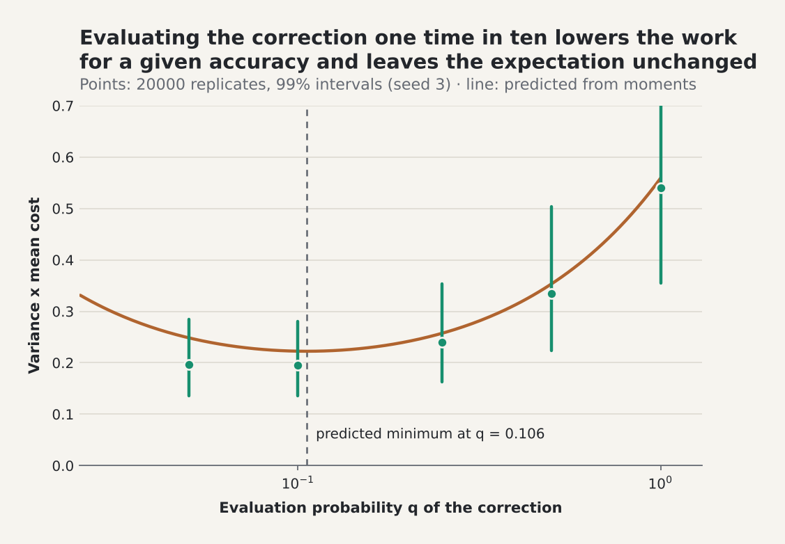

# Developing and Certifying a New Method

The other guides explain methods the library contains. This one explains how
to build a method that it does not contain, and how to find out whether the
new method does what you claim. The tools are in `probstat.methodlab`
(ADR-0131).

Three limits apply throughout, and no software removes them:

- A construction is exact only under conditions (a convergent series, a
  known bias expansion, weights independent of the data they multiply). The
  library states the conditions; it cannot prove that your problem meets
  them.
- A simulation can refute a claim. It can support a claim only for the
  mechanisms, sizes, and seeds that were run.
- The search tools choose among candidates that a person wrote down. They
  recombine known principles; they do not invent an estimand or a new idea.

## 1. The contract: a seeded draw with a cost

An `Estimator` is a name, a sampler, and a lineage. The sampler maps a
`RandomStream` to one `Draw`: a realized value and the work it cost. Whether
the estimator is unbiased for anything is a claim to be tested, not a
property of the type.

The running example is the expectation of an integral that has no closed
form inside the expectation:

`mu = E[ integral_0^1 exp(Z x) dx ]`, `Z ~ N(0, 1)`.

Exchanging the integral and the expectation gives
`mu = integral_0^1 exp(x^2 / 2) dx`, which quadrature evaluates to any
accuracy. That value is the oracle. The estimators below do not use it; they
integrate `exp(Z x)` by the trapezoid rule with `2^level` intervals, as one
would for an integrand with no shortcut.

```python
import math

from probstat.methodlab import check_unbiasedness, estimator_from_function
from probstat.numerics import integrate


def trapezoid(z, level):
    n = 2**level
    inner = math.fsum(math.exp(z * i / n) for i in range(1, n))
    return (0.5 * (1.0 + math.exp(z)) + inner) / n


def fixed(level):
    return estimator_from_function(
        f"trapezoid[{level}]",
        lambda g: trapezoid(g.gauss(0.0, 1.0), level),
        cost=2.0**level + 1.0,  # integrand evaluations
    )


truth = integrate(lambda x: math.exp(0.5 * x * x), 0.0, 1.0).value
round(truth, 6)  # 1.194958
plain = check_unbiasedness(fixed(2), truth, replicates=40_000, seed=2026)
plain.verdict  # 'not refuted'
round(plain.estimate, 4), round(plain.standard_error, 4)  # (0.0065, 0.0038)
```

The trapezoid rule at level 2 is biased: its expectation is
`(0.5 (1 + e^(1/2)) + e^(1/32) + e^(1/8) + e^(9/32)) / 4 = 1.203511`, which
is `0.0086` above `mu`. Forty thousand replicates did not show it, because
the Monte Carlo standard error (`0.0038`) is almost half the bias. **"Not
refuted" is not "unbiased"**; Section 4 returns to this estimator with a
sharper instrument and refutes it.

## 2. Construction principles as operations

Each combinator takes estimators and returns a new estimator whose lineage
records the step.

| Principle | What it removes or reduces | Condition for exactness | Function | Source |
|---|---|---|---|---|
| Randomized truncation | the bias of a fixed level | `sum_n E[Delta_n^2] / p_n` finite | `single_term_estimator`, `coupled_sum_estimator` | [REF-RHEE-GLYNN-2015], [REF-MCLEISH-2011] |
| Thinning | the cost of a rarely needed term | finite second moment | `thinned_estimator` | [REF-RHEE-GLYNN-2015] |
| Sum of independent terms | keeps a large base term out of the weighted part | independence | `sum_of_estimators` | [REF-GILES-2015] |
| Richardson extrapolation | leading bias terms | known exponents of the bias expansion | `extrapolated_estimator` | [REF-ROACHE-1998] |
| Best linear unbiased combination | variance | weights independent of the combined draws | `combine_unbiased` | [REF-SCHADEN-ULLMANN-2020] |
| Control variates | variance | known control means, frozen coefficients | `control_variate_estimator` | [REF-GLASSERMAN-2003] |
| Antithetic pair | variance for monotone integrands | none (unbiased always) | `antithetic_estimator` | [REF-GLASSERMAN-2003] |
| Jackknife, bootstrap correction | the `1/n` bias of a statistic | smooth statistic | `jackknife_bias_corrected`, `bootstrap_bias_corrected` | [REF-QUENOUILLE-1956], [REF-EFRON-TIBSHIRANI-1993] |
| Influence function | derives a standard error; one-step bias correction | differentiable functional; nuisance rates | `empirical_influence`, `one_step_estimator` | [REF-HAMPEL-1974], [REF-KENNEDY-2022] |

## 3. A derivation in three steps

**Step 1: remove the bias.** Write `mu = E[Y_2] + sum_(n>=0) E[Delta_n]`
with `Delta_n = Y_(n+3) - Y_(n+2)` computed from one `Z`, so that the
differences are small: the trapezoid error is of order `4^-level`, hence
`E[Delta_n^2]` falls like `16^-n` while the cost grows like `2^n`. The
single-term estimator `Delta_N / p_N` with a geometric level law
`p_n = 0.8 * 0.2^n` then has finite variance and finite expected cost
([EQ-MLAB-RT-001]).

**Step 2: stop paying for a correction that is almost zero.** The
correction has second moment `8e-4` and costs about 18 evaluations, against
a base term of variance `0.59` and cost 5. Evaluating it with probability
`q` and weighting by `1/q` keeps its expectation ([EQ-MLAB-THIN-001]).

```python
from probstat.methodlab import (
    Draw,
    geometric_levels,
    single_term_estimator,
    sum_of_estimators,
    summarize,
    thinned_estimator,
)


def difference(level, stream):
    z = stream.generator().gauss(0.0, 1.0)
    value = trapezoid(z, level + 3) - trapezoid(z, level + 2)
    return Draw(value, 3.0 * 2 ** (level + 2) + 2.0)


correction = single_term_estimator("correction", difference, geometric_levels(0.2))
split = sum_of_estimators(
    "split", (fixed(2), thinned_estimator("rare", correction, 0.05))
)
unbiased = check_unbiasedness(
    split, truth, replicates=40_000, seed=2026, tolerance=0.02
)
unbiased.verdict  # 'supported'
round(summarize(split, 40_000, 2026).work_normalized_variance, 2)  # 3.76
```

The verdict is "supported" because a tolerance (`0.02`) was declared before
the run and the whole 99% interval for the bias lies inside it. The
work-normalized variance, variance times mean cost ([EQ-MLAB-WNV-001]), is
`3.76`; the biased level-2 rule has `0.59 * 5 = 2.96`. Unbiasedness cost 27%
more work here.

**Step 3: reduce the variance of the base term.** The level-0 rule
`(1 + e^Z) / 2` costs nothing extra once `Z` is drawn, has the known mean
`(1 + e^(1/2)) / 2`, and is strongly correlated with the level-2 rule. It is
a control variate ([EQ-MLAB-CV-001]); its coefficient is estimated once from
a pilot and then frozen, which keeps the estimator exactly unbiased.

```python
from probstat.methodlab import control_variate_estimator

control = estimator_from_function(
    "level0", lambda g: trapezoid(g.gauss(0.0, 1.0), 0), cost=0.0
)
base_cv, beta = control_variate_estimator(
    "base+cv",
    fixed(2),
    (control,),
    ((1.0 + math.exp(0.5)) / 2.0,),
    pilot_size=2000,
    seed=1,
)
derived = sum_of_estimators(
    "derived", (base_cv, thinned_estimator("rare", correction, 0.25))
)
round(beta[0], 3)  # 0.743
len(derived.lineage)  # 4
```

## 4. Certification: claims, evidence, verdicts

Every check returns an estimate, its Monte Carlo standard error, a
confidence interval, and one of four verdicts ([EQ-MLAB-VERDICT-001]):

| Verdict | Meaning |
|---|---|
| `refuted` | the interval excludes the claimed value, or lies outside the tolerance band |
| `supported` | a tolerance was declared in advance and the interval lies inside the band |
| `not refuted` | no tolerance was declared and the interval contains the claimed value |
| `inconclusive` | the interval overlaps the edge of the tolerance band |

```python
from probstat.methodlab import (
    check_efficiency_gain,
    check_variance_stability,
    method_card,
)

bias = check_unbiasedness(
    derived, truth, replicates=40_000, seed=2027, tolerance=0.005
)
gain = check_efficiency_gain(
    derived, split, replicates=20_000, seed=2028, claimed_gain=5.0
)
bias.verdict, round(bias.standard_error, 5)  # ('supported', 0.00083)
gain.verdict, round(gain.estimate, 1)  # ('supported', 14.4)
check_variance_stability(derived, replicates=40_000, seed=2029).suspicious  # False

sharp = check_unbiasedness(base_cv, truth, replicates=40_000, seed=2027)
sharp.verdict, round(sharp.estimate, 4)  # ('refuted', 0.0086)

card = method_card(
    derived,
    "E of the integral of exp(Z x) over [0, 1], Z ~ N(0, 1); seeds 2027-2028",
    [bias, gain],
)
card.verdict  # 'supported within scope'
```

The control variate cut the standard error of the bias estimate from
`0.0038` to `0.0008`. With that precision the level-2 rule *with the same
control variate but without the correction* (`base_cv`) is refuted: its
estimated bias, `0.0086`, agrees with the exact value. The derived estimator
is 14 times more efficient than the split estimator of Step 2 (99% interval
10.3 to 20.2).

`card.render()` prints the lineage, each check with its interval, the scope
of the evidence, and the verdict. A card never says "validated".

Other checks: `check_variance` (a predicted variance), `check_coverage`
(an interval procedure, with an exact Clopper-Pearson interval for the
coverage), `check_convergence_rate` (the decay rate of the mean squared
error), and `check_invariance` (a metamorphic relation such as permutation
invariance, which needs no known answer).

## 5. Choosing among candidates

The evaluation probability `q` of the correction is a design choice. The
product of variance and cost is `(V + m/q)(c + q c')` for base variance `V`,
base cost `c`, correction second moment `m`, and correction cost `c'`; it is
smallest near `q = sqrt((m / c') / (V / c))`.

```python
from probstat.methodlab import rank_by_efficiency

candidates = [
    sum_of_estimators(f"q={q}", (base_cv, thinned_estimator("rare", correction, q)))
    for q in (0.05, 0.1, 0.25, 0.5, 1.0)
]
ranking = rank_by_efficiency(candidates, replicates=20_000, seed=3)
ranking.best  # 'q=0.1'
ranking.separated()  # False
[round(s.work_normalized_variance, 3) for s in ranking.summaries]
# [0.195, 0.196, 0.24, 0.335, 0.54]
```

<picture><source media="(prefers-color-scheme: dark)" srcset="../images/guides/methodlab-thinning-efficiency-dark.png"></picture>

*Variance times mean cost of the derived estimator against the evaluation probability `q` of its correction (20000 replicates per point, seed 3). The measured product falls from 0.540 at `q = 1` to 0.195 at `q = 0.1`; the predicted curve has its minimum at `q = 0.106`. The points at `q = 0.05` and `q = 0.1` are not separated.*

`separated()` is `False`: the two best candidates cannot be told apart with
this many replicates, so either is a defensible choice and the ranking
should not be reported as a finding about `q = 0.1`. For larger candidate
sets, `sequential_halving` spends a fixed evaluation budget and discards the
worse half each round ([EQ-MLAB-SH-001]).

The winner of any search looks better than it is, because it was chosen for
looking good. Certify the selected candidate on seeds the search did not
use, as Section 4 did.

## 6. Comparing methods on data: a pre-specified study

For methods that analyse a data set (rather than estimate an integral),
`run_simulation_study` follows the ADEMP structure of
[REF-MORRIS-WHITE-CROWTHER-2019]: aims, data-generating mechanisms,
estimand, methods, performance measures. Every measure is reported with its
Monte Carlo standard error ([EQ-MLAB-ADEMP-001] to [EQ-MLAB-ADEMP-007]),
every method sees the same data sets, and failures are counted rather than
dropped.

```python
import statistics

from probstat.methodlab import (
    DataGeneratingMechanism,
    Method,
    MethodOutput,
    StudyProtocol,
    run_simulation_study,
)

protocol = StudyProtocol(
    aims="precision of the median against the mean for normal data",
    mechanisms=("normal",),
    estimand="population mean",
    methods=("mean", "median"),
    measures=("bias", "empirical_se"),
    repetitions=4000,
    seed=7,
    primary_comparison="relative precision of median against mean",
)
registered = protocol.fingerprint()  # publish this before running
study = run_simulation_study(
    protocol,
    [DataGeneratingMechanism("normal", lambda g: [g.gauss(1.0, 2.0) for _ in range(15)], 1.0)],
    [
        Method("mean", lambda d: MethodOutput(statistics.fmean(d))),
        Method("median", lambda d: MethodOutput(statistics.median(d))),
    ],
    expected_fingerprint=registered,
)
comparison = study.compare_precision("normal", "median", "mean")
round(comparison.relative_gain, 2), round(comparison.standard_error, 2)  # (-0.35, 0.01)
```

The median needs about 54% more data than the mean for the same precision
at `n = 15` (`1 / (1 - 0.35)`); the large-sample value is `pi / 2`, 57%
more. The fingerprint is a SHA-256 hash of the protocol. If the design is
changed after results were seen, the hash changes and
`expected_fingerprint` stops the run. This guards against one specific
failure, choosing the design after seeing the outcome, which
[REF-PAWEL-KOOK-REEVE-2024] show is enough to make a useless method look
best. It does not make a one-sided design fair.

## 7. Statistics of a sample: bias corrections and standard errors

`jackknife_bias_corrected(statistic)` returns a new statistic with the
`1/n` bias term removed ([EQ-MLAB-JACK-001]); applied to the variance with
divisor `n` it returns the unbiased sample variance exactly.
`empirical_influence` differentiates any statistic written as a function of
observation weights and returns its influence values and the
infinitesimal-jackknife standard error ([EQ-MLAB-IF-001],
[EQ-MLAB-IF-002]), which gives a new smooth estimator a standard error
without a hand derivation.

```python
from probstat.methodlab import empirical_influence, jackknife_bias_corrected

data = [2.1, 3.4, 1.9, 5.6, 4.2, 3.3, 2.8]


def plug_in_variance(sample):
    centre = statistics.fmean(sample)
    return statistics.fmean((x - centre) ** 2 for x in sample)


corrected = jackknife_bias_corrected(plug_in_variance)
round(corrected(data), 6) == round(statistics.variance(data), 6)  # True


def ratio_to_first_moment(sample, weights):
    first = math.fsum(w * x for w, x in zip(weights, sample))
    second = math.fsum(w * x * x for w, x in zip(weights, sample))
    return second / first


analysis = empirical_influence(ratio_to_first_moment, data)
round(analysis.estimate, 3), round(analysis.standard_error, 3)  # (3.747, 0.519)
```

## 8. Stopping a comparison early without inflating the error

Benchmarking a new method against a baseline invites looking at the results
as they arrive and stopping when they look good. With a fixed-sample test
that inflates the error probability. `compare_sequentially` gives both
methods the same sequence of problems, bets on the loss differences, and
stops when the betting capital reaches `1 / alpha`; by Ville's inequality
the probability of ever declaring a method better that is not better is at
most `alpha`, whatever the stopping rule ([EQ-INF-CS-001],
[REF-WAUDBY-SMITH-RAMDAS-2024]).

```python
from probstat.methodlab import compare_sequentially


def loss(scale):
    return lambda index, stream: min(1.0, abs(stream.generator().gauss(0.0, scale)))


race = compare_sequentially(loss(0.5), loss(1.0), bound=1.0, max_pairs=2000, seed=1)
race.decided, race.pairs  # (True, 30)
```

The losses must be bounded (here they are clipped to `[0, 1]`), and a run
that ends without a decision is not evidence that the methods are equal.

## 9. Searching a declared space of estimators

For a mean estimated from several correlated models of different cost, the
linear unbiased estimators form a family in which multifidelity Monte
Carlo, approximate control variates, and the multilevel best linear
unbiased estimator are members ([REF-SCHADEN-ULLMANN-2020]).
`probstat.monte_carlo.compare_multifidelity_estimators` evaluates the
predicted variance of each member for one covariance matrix, cost vector,
and budget, which turns "which estimator should I build?" into a table.

```python
from probstat.monte_carlo import compare_multifidelity_estimators

covariance = ((1.0, 0.95, 0.8), (0.95, 1.0, 0.85), (0.8, 0.85, 1.0))
table = compare_multifidelity_estimators(covariance, (1.0, 0.1, 0.01), 100.0)
table.best.method  # 'MLBLUE'
[(row.method, round(row.variance_ratio, 3)) for row in table.rows]
# [('MC', 1.0), ('MFMC', 0.308), ('ACV-MF', 0.379), ('MLBLUE', 0.307)]
```

The ratios are predictions from the covariance supplied. In practice the
covariance comes from a pilot sample, the predictions inherit its error,
and the selected estimator should be certified as in Section 4.

## Common pitfalls

- **Reading "not refuted" as "correct".** Section 1 shows a biased rule
  that 40 000 replicates did not refute. Declare a tolerance and aim for
  "supported", and reduce the Monte Carlo error before concluding.
- **Infinite variance behind a plausible mean.** A randomized-truncation
  estimator whose level law decays faster than the squared differences has
  infinite variance. Its replicate mean still looks right and its standard
  error is meaningless. Compare the decay rates first and run
  `check_variance_stability`.
- **Coefficients fitted on the draws they correct.** Estimating control
  coefficients or combination weights from the same sample adds a bias of
  order `1/n`. The combinators freeze them from a pilot with its own seed.
- **Comparing variance without cost.** An estimator with a tenth of the
  variance at twenty times the cost is worse. Use the work-normalized
  variance.
- **Reporting the performance of a selected candidate.** Selection inflates
  it. Use fresh seeds for certification.
- **Extrapolating with the wrong exponents.** Richardson weights for orders
  the bias does not have increase the variance and remove nothing.
- **Treating a method card as a proof.** It records what was tested and
  where. Outside its scope it says nothing.

## References

[REF-RHEE-GLYNN-2015], [REF-MCLEISH-2011], [REF-GILES-2015],
[REF-GLASSERMAN-2003], [REF-SCHADEN-ULLMANN-2020], [REF-QUENOUILLE-1956],
[REF-EFRON-TIBSHIRANI-1993], [REF-HAMPEL-1974],
[REF-CARONE-LUEDTKE-VANDERLAAN-2019], [REF-KENNEDY-2022],
[REF-HINES-ETAL-2022], [REF-MORRIS-WHITE-CROWTHER-2019],
[REF-PAWEL-KOOK-REEVE-2024], [REF-KARNIN-KOREN-SOMEKH-2013],
[REF-SCHUIRMANN-1987], [REF-CHEN-ETAL-2018].
