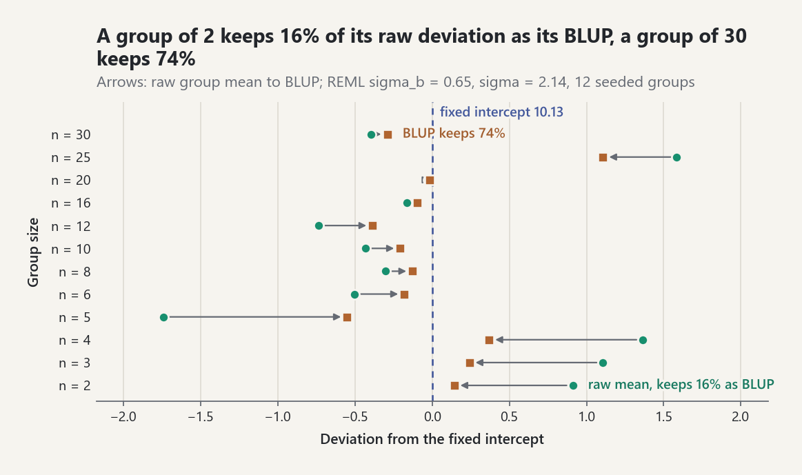
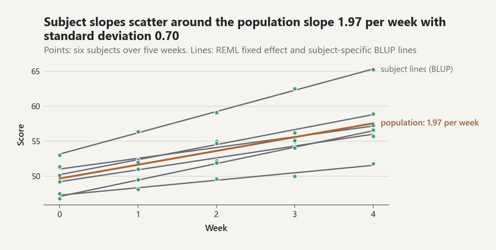

# Linear and generalized linear mixed models

Grouped data (repeated measurements on subjects, pupils in schools, parts
from batches) violate the independence assumption of ordinary regression:
observations in a group share an unobserved group effect. A mixed model
writes that effect as a random variable with an estimated covariance,

```text
y = X beta + Z b + epsilon,   b ~ N(0, Sigma_theta),   epsilon ~ N(0, sigma^2 I),
```

so that the fixed effects `beta` describe the population and the random
effects `b` describe how groups deviate from it. `probstat.inference`
fits linear mixed models (LMMs) by maximum likelihood (ML) or restricted
maximum likelihood (REML) and binomial and Poisson generalized linear mixed
models (GLMMs) by the Laplace approximation or adaptive Gauss-Hermite
quadrature. The decision record is
[ADR-0100](../adr/ADR-0100-mixed-models.md).

## When to use which method

| Question | Use | Why |
|---|---|---|
| Variance components, BLUPs, or fixed-effect tests in one model | `fit_linear_mixed_model(method="REML")` | REML accounts for the degrees of freedom spent on `beta`; balanced designs reproduce the ANOVA estimators [EQ-LMM-004] |
| Comparing models that differ in their fixed effects | `method="ML"` for both fits | REML likelihoods of different `X` are not comparable [EQ-LMM-004] |
| t test or interval for a fixed effect | default `denominator_df="satterthwaite"` | Student t on Satterthwaite df [EQ-LMM-006]; `"asymptotic"` gives z tests |
| A linear combination of fixed effects | `LinearMixedModelResult.test_contrast` | the same Satterthwaite rule for `c' beta` |
| Is a variance component zero? | `mixed_model_likelihood_ratio_test` with `bootstrap_samples` | the null lies on the boundary; read `boundary_mixture_p_value` or the parametric bootstrap [EQ-LMM-007] |
| Binary or count responses, random intercepts and slopes | `fit_generalized_linear_mixed_model(method="laplace")` | penalized IRLS around the conditional mode [EQ-GLMM-001] |
| Binary or count responses, one random intercept, small groups | `method="adaptive_quadrature"` | nodes centred and scaled at each group's mode [EQ-GLMM-002]; one node is Laplace |

A random-effect term is built with `random_effect`. `random_effect(subject)`
is a random intercept, lme4's `(1 | subject)`;
`random_effect(subject, slopes={"week": week})` adds a correlated random
slope, `(week | subject)`. A nested factor is a second term on the pair of
labels, `random_effect(list(zip(school, klass)))`, the expansion of
`(1 | school/class)`; uncorrelated intercepts and slopes are two terms on the
same factor (`intercept=False` for the slope term).

## How the fit is computed

Following lme4 (Bates et al. 2015), the random effects are written as
`b = Lambda_theta u` with spherical `u ~ N(0, sigma^2 I)`, where the relative
covariance factor `Lambda_theta` is block diagonal with one lower-triangular
block per level [EQ-LMM-001]. For fixed `theta` the conditional modes and the
fixed effects solve one penalized least-squares problem through the Cholesky
factor `L L' = Lambda' Z' Z Lambda + I` [EQ-LMM-002], which leaves a profiled
deviance in `theta` alone ([EQ-LMM-003] for ML, [EQ-LMM-004] for REML). Only
`theta` is optimized; `beta`, `sigma`, the BLUPs `b = Lambda u` and their
conditional variances follow in closed form [EQ-LMM-005].

## A random intercept: six batches

Four strength measurements were taken on each of six batches. The batch is a
random effect: the six batches stand for the population of batches.

```python
from probstat.inference import fit_linear_mixed_model, random_effect

batch = [b for b in "ABCDEF" for _ in range(4)]
strength = [
    41.2, 43.0, 42.1, 40.6,
    45.3, 46.1, 44.0, 45.9,
    39.8, 38.7, 40.9, 39.5,
    44.1, 42.8, 43.6, 44.9,
    42.0, 41.1, 43.3, 42.5,
    40.2, 41.9, 40.4, 41.5,
]
ones = [[1.0]] * len(strength)
fit = fit_linear_mixed_model(ones, strength, random_effect(batch, name="batch"))
round(fit.coefficients[0], 3)  # 42.308
round(fit.standard_errors[0], 4)  # 0.8208
round(fit.variance_components[0].standard_deviations[0], 4)  # 1.9565
round(fit.residual_sd, 4)  # 0.9256
round(fit.degrees_of_freedom[0], 3)  # 5.0
```

The design is balanced, so REML reproduces the ANOVA estimators of
[EQ-LMM-008]: `sigma^2 = MSE` and `sigma_b^2 = (MSA - MSE) / m`.

```python
means = [sum(strength[4 * i : 4 * i + 4]) / 4 for i in range(6)]
grand = sum(strength) / 24
msa = 4 * sum((v - grand) ** 2 for v in means) / 5
mse = sum((y - means[i // 4]) ** 2 for i, y in enumerate(strength)) / 18
round((msa - mse) / 4, 4)  # 3.8278
round(fit.variance_components[0].covariance[0][0], 4)  # 3.8277
```

The last digit differs because the optimizer stops at a gradient tolerance;
the closed form is the exact value. The standard error of the mean is
`sqrt(MSA / 24)`, a single mean square on `a - 1 = 5` degrees of freedom,
which is why the Satterthwaite df equal 5 [EQ-LMM-006]. The BLUPs shrink the
batch means towards the grand mean by `m sigma_b^2 / (m sigma_b^2 +
sigma^2)`:

```python
[round(v[0], 3) for v in fit.random_effects[0].values]  # [-0.552, 2.857, -2.446, 1.46, -0.079, -1.239]
```

<picture><source media="(prefers-color-scheme: dark)" srcset="../images/guides/mixed-models-blup-shrinkage-dark.png"></picture>

*In an unbalanced layout the shrinkage factor depends on the group size: with REML estimates sigma_b = 0.65 and sigma = 2.14 in 12 seeded groups, a group of 2 keeps 16% of its raw deviation from the fixed intercept and a group of 30 keeps 74%, so small groups borrow most strength from the others.*

## Testing a variance component

Is there a batch effect at all? The null `sigma_b = 0` lies on the boundary
of the parameter space, so the chi-square reference with one degree of
freedom is conservative [EQ-LMM-007]. The 50:50 mixture of `chi^2_0` and
`chi^2_1` (Self and Liang 1987; Stram and Lee 1994) halves the p-value, and a
parametric bootstrap simulates the null law directly. The comparison uses ML
fits; a model without random effects is fitted with an empty term list.

```python
from probstat.inference import mixed_model_likelihood_ratio_test

ml = fit_linear_mixed_model(ones, strength, random_effect(batch), method="ML")
null = fit_linear_mixed_model(ones, strength, [], method="ML")
test = mixed_model_likelihood_ratio_test(null, ml, bootstrap_samples=199, seed=1)
round(test.statistic, 3)  # 20.516
test.degrees_of_freedom  # 1
test.bootstrap_p_value  # 0.005
```

None of the 199 simulated statistics reached the observed one, so the
bootstrap p-value is its smallest possible value `1/200`.

## Correlated random intercepts and slopes

Six subjects were scored in five consecutive weeks. Each subject has its own
intercept and slope, correlated with each other.

```python
subject = [s for s in range(6) for _ in range(5)]
week = [float(w) for _ in range(6) for w in range(5)]
score = [
    50.1, 52.3, 55.0, 56.2, 58.9,
    47.5, 48.1, 49.6, 50.0, 51.8,
    53.0, 56.4, 59.1, 62.5, 65.2,
    49.2, 51.0, 52.2, 54.9, 55.7,
    51.4, 52.0, 54.7, 55.1, 57.3,
    46.8, 49.5, 51.9, 54.0, 56.6,
]
design = [[1.0, w] for w in week]
slopes = random_effect(subject, slopes={"week": week}, name="subject")
growth = fit_linear_mixed_model(design, score, slopes, column_names=["(Intercept)", "week"])
[round(b, 4) for b in growth.coefficients]  # [49.6533, 1.9733]
[round(s, 4) for s in growth.standard_errors]  # [0.9608, 0.2914]
[round(d, 3) for d in growth.degrees_of_freedom]  # [5.0, 5.0]
components = growth.variance_components[0]
[round(s, 4) for s in components.standard_deviations]  # [2.3331, 0.7026]
round(components.correlations[0][1], 4)  # 0.5383
```

<picture><source media="(prefers-color-scheme: dark)" srcset="../images/guides/mixed-models-growth-lines-dark.png"></picture>

*The subject-specific BLUP lines fan around the population slope 1.97 points per week with a slope standard deviation of 0.70, and subjects with higher intercepts tend to have steeper slopes (correlation 0.54).*

Every subject has the same weeks, so the per-subject least-squares lines are
sufficient and both fixed effects are single mean squares on `6 - 1 = 5`
degrees of freedom. Does the slope vary between subjects? The two models share
their fixed effects, so their REML fits may be compared; the full model adds
a slope variance and its covariance with the intercept (two parameters).

```python
intercept_only = fit_linear_mixed_model(design, score, random_effect(subject))
slope_test = mixed_model_likelihood_ratio_test(intercept_only, growth)
slope_test.degrees_of_freedom  # 2
round(slope_test.statistic, 3)  # 34.637
```

## Binary responses: clinics and a treatment

Patients in eight clinics received a treatment or not; the response is the
number cured out of the number treated in each arm, given as a proportion with
the number of trials as `weights`. The clinic has a random intercept on the
logit scale.

```python
from probstat.inference import fit_generalized_linear_mixed_model, glmm_deviance

clinic = [c for c in range(8) for _ in range(2)]
treated = [float(t) for _ in range(8) for t in (0, 1)]
trials = [20, 21, 15, 16, 30, 28, 12, 14, 25, 25, 18, 20, 22, 19, 16, 17]
cured = [9, 14, 4, 8, 18, 22, 3, 7, 10, 16, 9, 14, 13, 15, 5, 9]
proportion = [c / n for c, n in zip(cured, trials)]
rows = [[1.0, t] for t in treated]
term = random_effect(clinic, name="clinic")
laplace = fit_generalized_linear_mixed_model(rows, proportion, term, weights=trials)
quadrature = fit_generalized_linear_mixed_model(
    rows, proportion, term, weights=trials,
    method="adaptive_quadrature", quadrature_points=15,
)
[round(b, 4) for b in laplace.coefficients]  # [-0.2749, 0.8991]
[round(b, 4) for b in quadrature.coefficients]  # [-0.2752, 0.8991]
round(quadrature.theta[0], 4)  # 0.3864
```

The random-intercept standard deviation `theta` is on the logit scale. The
adaptive rule converges quickly as nodes are added; one node is the Laplace
value [EQ-GLMM-002]:

```python
for nodes in (1, 2, 3, 5, 10, 20):
    value = glmm_deviance(
        rows, proportion, term, quadrature.theta, quadrature.coefficients,
        weights=trials, quadrature_points=nodes,
    )
    print(nodes, round(value, 6))
```

```text
1 68.062742
2 68.052979
3 68.033051
5 68.032483
10 68.032477
20 68.032477
```

Here the Laplace error is 0.03 deviance units; it grows when groups are small
and binary, which is where adaptive quadrature matters.

## Common pitfalls

- **REML for comparing fixed effects.** The REML likelihood is a likelihood
  of error contrasts that depend on `X`, so models with different fixed
  effects have incomparable REML likelihoods.
  `mixed_model_likelihood_ratio_test` refuses such a comparison; refit both
  models with `method="ML"`:

  ```python
  try:
      mixed_model_likelihood_ratio_test(
          fit_linear_mixed_model([[1.0]] * 30, score, slopes), growth
      )
  except ValueError as error:
      print(error)
  ```

  ```text
  REML likelihoods are not comparable when the fixed effects differ; refit both models with method='ML'
  ```

- **Boundary estimates.** A variance estimated as zero (a *singular* fit,
  `LinearMixedModelResult.singular`) is a legitimate maximum on the boundary,
  not a failure. It happens exactly when the ANOVA solution is negative
  (`MSA <= MSE` for REML in the one-way layout) and is common with few groups.
  The Satterthwaite df then become those of the pooled residual mean square
  (`n - p` for REML), and chi-square p-values for that component are conservative; prefer the
  mixture or bootstrap p-value.
- **Convergence.** Only `theta` is optimized. The deviance is even in each
  column of `T_k`, so `theta_ii = 0` is always a stationary point; the fit
  checks trial points next to it and restarts when it is a saddle rather than
  a boundary minimum. A `MixedModelConvergenceWarning` means the optimizer hit
  its limit; try `optimizer="nelder-mead"`, rescale covariates, or simplify
  the random-effect structure (for example, uncorrelated slopes as two terms).
- **Centring.** With a random slope, the intercept variance and the
  intercept-slope correlation refer to `x = 0`. Centring a covariate changes
  them without changing the model:

  ```python
  centred = [w - 2.0 for w in week]
  growth_c = fit_linear_mixed_model(
      [[1.0, w] for w in centred], score,
      random_effect(subject, slopes={"week": centred}),
  )
  round(growth_c.deviance - growth.deviance, 6)  # 0.0
  [round(s, 4) for s in growth_c.variance_components[0].standard_deviations]  # [3.3087, 0.7026]
  round(growth_c.variance_components[0].correlations[0][1], 4)  # 0.8043
  ```

  Centring also improves the conditioning of `R_X` and of the optimization.
- **Conditional variances ignore estimation error.** The covariances in
  `RandomEffectEstimates.conditional_covariances` treat `beta`, `theta`, and
  `sigma` as known (the lme4 convention) and understate the uncertainty of a
  BLUP when there are few groups.
- **GLMM scale.** GLMM fixed effects are conditional (subject-specific)
  effects on the link scale; they are typically larger in magnitude than the
  population-averaged effects of a GLM fitted to the same data. GLMM standard
  errors come from a numerical Hessian and are Wald (normal) values.

## References

- [REF-BATES-ETAL-2015] lme4: relative covariance factor, profiled
  deviances, penalized IRLS.
- [REF-KUZNETSOVA-ETAL-2017] and [REF-SATTERTHWAITE-1946]: Satterthwaite
  degrees of freedom.
- [REF-PATTERSON-THOMPSON-1971]: REML. [REF-HENDERSON-1975]: BLUP.
  [REF-LAIRD-WARE-1982]: random-coefficient models.
- [REF-SEARLE-CASELLA-MCCULLOCH-1992]: ANOVA, ML, and REML closed forms.
- [REF-SELF-LIANG-1987] and [REF-STRAM-LEE-1994]: boundary likelihood-ratio
  tests.
- [REF-PINHEIRO-BATES-1995] and [REF-LIU-PIERCE-1994]: Laplace and adaptive
  Gauss-Hermite approximations.
