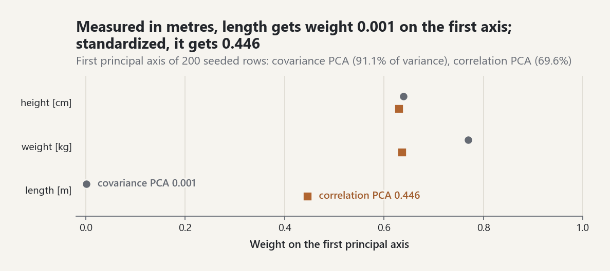
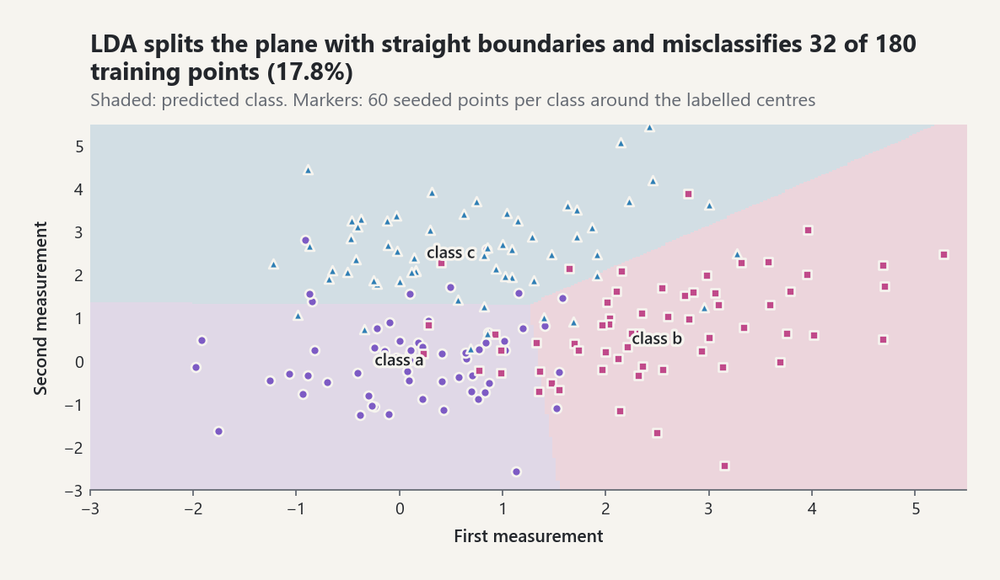

# Multivariate Analysis

`probstat.inference` provides the classical tools for a data matrix with
several correlated columns: principal component analysis (PCA) to find the
directions of largest variance, maximum-likelihood factor analysis with
varimax rotation to explain correlations by a few latent factors, linear
and quadratic discriminant analysis to classify observations into known
groups, and k-means with the silhouette coefficient to find groups that are
not known in advance. Every number below was produced by the code shown;
`tests/test_multivariate_analysis.py` checks the methods against closed
forms, NumPy 2.2.6 eigenvalues computed offline, exhaustive enumeration of
partitions, Gaussian posteriors computed with
`multivariate.MultivariateNormal`, and a seeded simulation of the Bayes
error.

Fisher's iris measurements, the traditional example for these methods, are
not bundled, because no copy has been verified row by row against the table
printed in Fisher (1936); the examples use seeded simulations instead.

## When to use which method

| Question | Method | Call |
|---|---|---|
| Which few directions carry most of the variation? | PCA | `principal_components(rows, standardize=...)` |
| Do a few latent factors explain the correlations? | ML factor analysis | `factor_analysis(rows, factors=q)` |
| Assign observations to known classes, shared covariance | LDA | `fit_linear_discriminant(rows, labels)` |
| Classes with different covariances, enough data per class | QDA | `fit_quadratic_discriminant(rows, labels)` |
| Find groups without labels | k-means and the silhouette | `kmeans(rows, k)`, `silhouette_score(rows, labels)` |

PCA is a description of the data matrix and makes no model assumption;
factor analysis is a Gaussian model with a likelihood and a test of the
number of factors. Discriminant analysis needs labels; k-means does not.

## 1. Principal components

`principal_components(rows)` diagonalizes the sample covariance matrix
`S = A L A'` (EQ-MVA-001; Pearson 1901, Hotelling 1933). The `k`-th axis
`a_k` maximizes the variance `a'Sa` among unit vectors orthogonal to the
earlier axes; that variance is the eigenvalue `l_k`, and the scores
`z_ik = a_k'(x_i - x_bar)` are uncorrelated. The eigendecomposition runs
through `linalg.get_backend().symmetric_eigen`, so selecting the NumPy
backend with `linalg.use_backend("numpy")` uses LAPACK; the tests check
that both give the same components.

With `standardize=True` the correlation matrix is analysed instead, which
is the same as standardizing every column first.

```python
import math

from probstat.foundations import resolve_stream
from probstat.inference import principal_components

generator = resolve_stream(1936).generator()
rows = []
for _ in range(200):
    size = generator.gauss(0.0, 1.0)
    rows.append([
        170 + 8 * size + generator.gauss(0.0, 3.0),            # height, cm
        70 + 9 * size + generator.gauss(0.0, 5.0),             # weight, kg
        1.0 + 0.01 * size + 0.02 * generator.gauss(0.0, 1.0),  # a length in m
    ])

raw = principal_components(rows)
[round(r, 3) for r in raw.explained_variance_ratio]  # [0.911, 0.089, 0.0]
[round(a, 3) for a in raw.axes[0]]  # [0.639, 0.77, 0.001]

scaled = principal_components(rows, standardize=True)
[round(r, 3) for r in scaled.explained_variance_ratio]  # [0.696, 0.244, 0.061]
[round(a, 3) for a in scaled.axes[0]]  # [0.63, 0.636, 0.446]
```

On the covariance scale the third variable, measured in metres, has a
variance of about `5e-4` and is invisible; on the correlation scale it
loads on the first component together with the other two. The choice is
part of the analysis, not a detail.

<picture><source media="(prefers-color-scheme: dark)" srcset="../images/guides/multivariate-pca-scaling-dark.png"></picture>

*Covariance PCA gives length, measured in metres, weight 0.001 on the first axis, which explains 91.1% of the variance; after standardizing, length gets 0.446 and the first axis explains 69.6%.*

`scores` holds the component scores of the data, `transform` those of new
rows, `reconstruct` maps scores back, and `loadings` gives
`a_jk sqrt(l_k)`, the variable-component correlations of a standardized
analysis.

## 2. Maximum-likelihood factor analysis

The factor model writes the correlation matrix as `R = Lambda Lambda' +
Psi`, with `q` common factors and specific variances `psi_j`. For fixed
`Psi` the likelihood is maximized by loadings built from the leading
eigenvectors of `Psi^-1/2 R Psi^-1/2`; the remaining discrepancy
`F(Psi) = sum_(j>q)(theta_j - log theta_j - 1)` is minimized over
`0.005 <= psi_j <= 1` by BFGS with its analytic gradient (EQ-MVA-002;
Jöreskog 1967, Lawley and Maxwell 1971). The loadings are then rotated by
varimax, which maximizes the variance of the squared loadings of each
factor so that each variable loads on few factors (EQ-MVA-003; Kaiser
1958). Rotation does not change the fitted correlations.

```python
from probstat.inference import factor_analysis

pattern = [[0.9, 0.0], [0.8, 0.1], [0.7, 0.0], [0.0, 0.8], [0.1, 0.7], [0.0, 0.6]]
data = []
for _ in range(300):
    f = [generator.gauss(0.0, 1.0), generator.gauss(0.0, 1.0)]
    data.append([
        sum(lam[k] * f[k] for k in range(2))
        + generator.gauss(0.0, math.sqrt(1.0 - sum(v * v for v in lam)))
        for lam in pattern
    ])

fa = factor_analysis(data, factors=2)
[[round(v, 2) for v in row] for row in fa.loadings]
# [[0.84, 0.04], [0.85, 0.14], [0.74, -0.06], [0.04, 0.81], [0.05, 0.7], [0.0, 0.66]]
[round(psi, 2) for psi in fa.uniquenesses]  # [0.3, 0.26, 0.46, 0.34, 0.5, 0.57]
```

Bartlett's corrected likelihood-ratio statistic
`(n - 1 - (2p + 5)/6 - 2q/3) F` tests whether `q` factors suffice, against
chi-square with `((p - q)^2 - p - q)/2` degrees of freedom (EQ-MVA-004).
Two factors are not rejected; one factor is.

```python
fa.degrees_of_freedom  # 4.0
round(fa.statistic, 2), round(fa.p_value, 3)  # (4.9, 0.297)
factor_analysis(data, factors=1).p_value < 1e-40  # True
```

`varimax(loadings)` is also available on its own; the tests check that it
rotates a perfect simple structure back exactly and that rotating its input
first does not change the criterion it reaches.

## 3. Linear and quadratic discriminant analysis

If class `k` has a normal law `N(mu_k, Sigma_k)` and prior `pi_k`, the
Bayes classifier assigns `x` to the class of largest posterior. With a
common covariance the discriminant functions are linear (LDA,
EQ-MVA-005); with class covariances they are quadratic (QDA, EQ-MVA-006).
Priors default to the class proportions. LDA also returns Fisher's
canonical directions, the projections that maximize between-class over
within-class variance (EQ-MVA-007; Fisher 1936), at most `K - 1` of them.

```python
from probstat.inference import fit_linear_discriminant, fit_quadratic_discriminant

centres = {"a": (0.0, 0.0), "b": (2.5, 0.5), "c": (0.5, 2.5)}
train, labels = [], []
for label, (cx, cy) in centres.items():
    for _ in range(60):
        train.append([cx + generator.gauss(0.0, 1.0), cy + generator.gauss(0.0, 1.0)])
        labels.append(label)

lda = fit_linear_discriminant(train, labels)
lda.predict([[2.0, 0.0], [0.0, 2.0]])  # ('b', 'c')
[round(p, 3) for p in lda.predict_proba([[1.2, 1.2]])[0]]  # [0.378, 0.331, 0.291]
[round(r, 3) for r in lda.discriminant_ratios]  # [1.287, 0.803]

qda = fit_quadratic_discriminant(train, labels)
[round(p, 3) for p in qda.predict_proba([[1.2, 1.2]])[0]]  # [0.339, 0.343, 0.318]
```

<picture><source media="(prefers-color-scheme: dark)" srcset="../images/guides/multivariate-lda-regions-dark.png"></picture>

*With a shared covariance, LDA divides the plane into three regions by straight lines, and because the classes overlap it misclassifies 32 of the 180 training points (17.8%), an optimistic resubstitution error.*

The test suite checks that the LDA and QDA posteriors equal the normalized
`pi_k N(x; mu_k, Sigma_k)` computed with `multivariate.MultivariateNormal`,
that the two-class direction is proportional to `Sigma^-1 (mu_2 - mu_1)`,
and that with 2000 training points per class the test error is within four
binomial standard errors of the Bayes error `Phi(-Delta/2)`.

## 4. k-means and the silhouette

`kmeans(rows, k)` minimizes the within-cluster sum of squares by Lloyd's
iteration, alternating nearest-centre assignment and centroid updates until
the assignment repeats (EQ-MVA-008; Lloyd 1982). Each of the `restarts`
(default 10) starts from k-means++ seeds, and the best local minimum is
kept. The silhouette width `s(i) = (b - a)/max(a, b)` compares a point's
mean distance to its own cluster, `a`, with that to the nearest other
cluster, `b` (EQ-MVA-009; Rousseeuw 1987); its average helps choose `k`.

```python
from probstat.inference import kmeans, silhouette_score

for k in (2, 3, 4, 5):
    result = kmeans(train, k, seed=1)
    print(k, round(result.inertia, 1), round(silhouette_score(train, result.labels), 3))
```

```text
2 478.3 0.351
3 287.2 0.419
4 229.2 0.375
5 183.9 0.354
```

The inertia always falls as `k` grows; the average silhouette peaks at the
three groups that generated the data. The tests compare the inertia with
the optimum over every partition of a small data set.

## Common pitfalls

- **Scaling before PCA.** Covariance PCA is dominated by the variables with
  the largest variances, which depend on the units (section 1). Standardize
  when the variables are measured on different scales; keep the covariance
  scale only when the units are common and their variances meaningful.
  The same applies to k-means, which uses Euclidean distances.
- **Choosing the number of components or clusters.** Explained-variance
  ratios and inertia only decrease; there is no automatic answer. Look for
  an elbow, use the silhouette, the factor-analysis test, or out-of-sample
  error, and state the rule that was used.
- **Signs and order are conventions.** Each PCA axis is signed so that its
  largest entry is positive; factor columns are ordered by their sums of
  squares and signed to a positive column sum. Factor loadings are
  identified only up to rotation, so interpret rotated loadings, not
  unrotated ones.
- **Heywood cases.** A uniqueness at the lower bound `0.005` means the
  model wants a negative or zero specific variance; the fit is improper and
  usually signals too many factors or too little data.
- **Discriminant analysis needs enough data.** LDA needs `n - K >= p` for a
  non-singular pooled covariance and QDA more than `p` observations in every
  class; QDA estimates `K p (p + 1)/2` covariance parameters and can be
  worse than LDA in small samples. Resubstitution error is optimistic.
- **k-means finds spherical, similar-sized groups** and only local minima.
  Keep several restarts, fix the `seed` for reproducibility, and do not
  read clusters into data whose average silhouette is small.

## References

[REF-PEARSON-1901], [REF-HOTELLING-1933], [REF-JOLLIFFE-2002],
[REF-LAWLEY-MAXWELL-1971], [REF-JORESKOG-1967], [REF-KAISER-1958],
[REF-FISHER-1936], [REF-HASTIE-TIBSHIRANI-FRIEDMAN-2009],
[REF-MARDIA-KENT-BIBBY-1979], [REF-LLOYD-1982],
[REF-ARTHUR-VASSILVITSKII-2007], [REF-ROUSSEEUW-1987].
