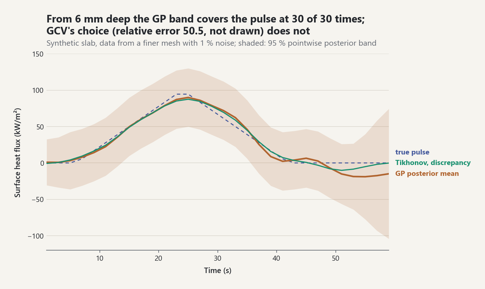

# Nonlinear Bayesian inversion

This guide continues
[Large-scale, non-smooth and Bayesian inverse problems](large-scale-inverse-problems.md),
which ends where the forward model stops being linear. There the posterior
was a Gaussian that could be written down; here it is a density that has to
be approximated or sampled, the forward model may cost seconds per call, and
the question is often which model, which sensors or which sampler to trust.
Everything below is experimental since 0.28
([ADR-0145](../adr/ADR-0145-aerospace-uq-gaussian-processes-and-hybrid-models.md))
and every number quoted was produced by the code in the same block, with the
seed given. The cases are synthetic; none is data from a real instrument,
nozzle or vehicle.

Prerequisites: the Gaussian posterior and the Gauss-Newton step (the guide
above), the elementary theory of Markov chains
([advanced Monte Carlo](advanced-monte-carlo.md)) and the effective sample
size.

## 1. When the linear-Gaussian picture breaks

For `y = A x + e` with a Gaussian prior and Gaussian noise the posterior is
Gaussian, its covariance does not depend on the data, and the directions the
data inform are the singular vectors of the whitened operator. A nonlinear
`y = G(x) + e` keeps the likelihood form
`exp(-1/2 ||W (G(x) - y)||^2)` [EQ-INV-LAPX-001], and three things change:

- the Jacobian `J(x)` depends on where it is evaluated, so "the directions
  the data inform" is a local statement;
- the posterior can be skewed, curved or multimodal, and then its moments
  are not summarized by a mean and a covariance;
- the posterior normalizing constant (the evidence) is no longer a
  determinant.

The library writes the problem in prior-whitened coordinates: with
`x = mu + P z` and `z ~ N(0, I)` the posterior is
`pi(z) ~ exp(-1/2 ||W (G(mu + P z) - y)||^2 - 1/2 ||z||^2)`, and
`NonlinearBayesProblem` counts every call of `G`, `J v` and `J' w`. The model
supplies `value`, `jvp` and `vjp` (`DifferentiableForward`); check them with
`check_derivatives` before anything else, because a wrong adjoint makes every
method below fail quietly.

```python
import math

from probstat.inverse import (
    NonlinearBayesProblem,
    check_derivatives,
    compute_map,
    laplace_approximation,
    quadrature_reference,
)
from probstat.linalg import DenseOperator, DiagonalCovariance


class Curved:
    """G(a, b) = (a + b^2 / 2, b + 0.3 a^2, a - b + 0.2 a b)."""

    input_dimension = 2
    output_dimension = 3

    def value(self, x):
        a, b = x
        return (a + 0.5 * b * b, b + 0.3 * a * a, a - b + 0.2 * a * b)

    def jacobian(self, x):
        a, b = x
        return ((1.0, b), (0.6 * a, 1.0), (1.0 + 0.2 * b, -1.0 + 0.2 * a))

    def jvp(self, x, v):
        return tuple(r[0] * v[0] + r[1] * v[1] for r in self.jacobian(x))

    def vjp(self, x, w):
        j = self.jacobian(x)
        return tuple(sum(j[i][k] * w[i] for i in range(3)) for k in range(2))


model = Curved()
data = tuple(g + e for g, e in zip(model.value((0.8, -0.6)), (0.3, -0.2, 0.25)))
problem = NonlinearBayesProblem(
    model,
    data,
    noise=DiagonalCovariance([0.25] * 3),
    prior_factor=DenseOperator(((1.0, 0.0), (0.0, 1.0))),
)
check_derivatives(model, (0.4, -0.3), (1.0, 0.5), (1.0, -1.0, 0.5)).passed  # True
reference = quadrature_reference(
    problem.log_posterior, [(-5.0, 5.0), (-5.0, 5.0)], panels=12, order=6
)
reference.warnings  # ()
[round(m, 3) for m in reference.mean]  # [0.705, -0.828]
```

`reference` is a tensor Gauss-Legendre integral of the posterior: with two
parameters it is the oracle every sampler below is compared with, and it
reports (`warnings`) when doubling the panels still changes the integral.
With more than a handful of parameters no such oracle exists, which is why
the diagnostics of the later sections matter.

A model whose Jacobian vanishes at a point shows the first difference in the
smallest case. For `G(x) = x^2` with noise sd 0.1 and datum 1, the whitened
Jacobian `W J P` is 0 at the prior mean and 20 at `x = 1`; the data inform
nothing at one point and a great deal at another, and the posterior has two
modes at `x = +-1`.

```python
class Square:
    """G(x) = x^2, observed once with noise sd 0.1: x and -x fit equally."""

    input_dimension = 1
    output_dimension = 1

    def value(self, x):
        return (x[0] ** 2,)

    def jvp(self, x, v):
        return (2.0 * x[0] * v[0],)

    def vjp(self, x, w):
        return (2.0 * x[0] * w[0],)


squared = NonlinearBayesProblem(
    Square(), (1.0,), noise=DiagonalCovariance([0.01]),
    prior_factor=DenseOperator(((1.0,),)),
)
[squared.whitened_jacobian_dense((z,))[0][0] for z in (0.0, 0.5, 1.0)]  # [0.0, 10.0, 20.0]
```

## 2. MAP and the Gauss-Newton Laplace approximation

The maximum a posteriori (MAP) point minimizes
`1/2 ||W (G(mu + P z) - y)||^2 + 1/2 ||z||^2`; `compute_map` uses
Gauss-Newton with Krylov inner solves (or a trust region) and a Jacobian
that is never formed. The Laplace approximation replaces the posterior by
the Gaussian centred at the MAP whose precision is the Gauss-Newton Hessian
`I + P' J' Gamma^-1 J P` [EQ-INV-LAPX-003]: the second derivatives of `G` are
dropped. `laplace_approximation` keeps only the dominant eigenpairs of the
prior-preconditioned Hessian (matrix-free, so it scales to many parameters),
returns the low-rank covariance action, marginal variances and the Laplace
log-evidence [EQ-INV-LAPX-004], and reports a truncation bound for the part
of the evidence it dropped.

```python
map_estimate = compute_map(problem)
laplace = laplace_approximation(problem, threshold=1e-9)
map_estimate.converged  # True
[round(m, 3) for m in laplace.mean]  # [0.817, -0.791]
[round(m, 3) for m in reference.mean]  # [0.705, -0.828]
variance_ratio = [
    v / reference.covariance[i][i]
    for i, v in enumerate(laplace.marginal_variances().values)
]
[round(r, 2) for r in variance_ratio]  # [0.66, 0.78]
log_two_pi = math.log(2.0 * math.pi)
exact_evidence = problem.log_likelihood_constant - log_two_pi + reference.log_normalizer
round(laplace.log_evidence, 3)  # -3.536
round(exact_evidence, 3)  # -3.463
```

For this mildly curved problem the Laplace mean is off by a fraction of a
posterior standard deviation and the variances are too small (the ratios
above are below one); the evidence is off by 0.07 nats. That is the typical
size of the error when the posterior is unimodal and slightly curved. The
approximation fails in recognizable ways:

- **Several modes.** For `Square` the posterior mean is 0 and its variance
  about 0.99, but the Laplace Gaussian sits on one mode with a variance of
  0.0025, and its evidence is 0.70 nats too low: the other mode carries half
  of the mass (`log 2 = 0.69`).
- **A stationary point is not a maximum.** From the default start at the
  prior mean the gradient of `Square` vanishes, `compute_map` reports
  `converged=True` with `stop_reason="gradient"`, and the point is the
  local minimum of the density between the modes. A start in each basin
  (and a check of the Hessian) is part of the method.
- **Strong curvature or skewness** in a few directions that the
  Gauss-Newton Hessian, which ignores curvature of `G`, cannot see.

```python
default_start = compute_map(squared)
default_start.physical, default_start.converged, default_start.stop_reason  # ((0.0,), True, 'gradient')
one_mode = compute_map(squared, initial=(0.5,))
mode = laplace_approximation(squared, threshold=1e-9, map_estimate=one_mode)
two_modes = quadrature_reference(
    squared.log_posterior, [(-4.0, 4.0)], panels=32, order=8
)
round(mode.mean[0], 3)  # 0.997
round(mode.marginal_variances().values[0], 4)  # 0.0025
round(two_modes.mean[0], 3)  # 0.0
round(two_modes.covariance[0][0], 3)  # 0.99
exact_squared = (
    squared.log_likelihood_constant - 0.5 * log_two_pi + two_modes.log_normalizer
)
round(mode.log_evidence - exact_squared, 2)  # -0.7
```

## 3. Samplers that respect the prior: pCN, gpCN and DILI

A random-walk Metropolis chain in `n` dimensions needs a step that shrinks
with `n`, so its acceptance rate collapses on a discretized function (the
guide above measured this). The preconditioned Crank-Nicolson proposal
`z' = sqrt(1 - beta^2) z + beta xi`, `xi ~ N(0, I)`, is reversible with
respect to the prior and accepts with probability
`min(1, exp(Phi(z) - Phi(z')))` with `Phi` the misfit
[REF-COTTER-ROBERTS-STUART-WHITE-2013]: its acceptance rate does not
degenerate as the discretization is refined, but it still explores
directions in which the data are informative slowly. `pcn_chain` is that
sampler (adaptive `beta` by default). The two Laplace-preconditioned chains
use the low-rank structure of the Hessian: `gpcn_chain` replaces the prior
covariance of the proposal by the Laplace covariance [EQ-INV-LAPX-009], and
`dili_chain` runs a Langevin move in the likelihood-informed subspace and
pCN in its complement [EQ-INV-LAPX-010]
[REF-CUI-LAW-MARZOUK-2016]. All three are exact for the stated posterior;
they differ in efficiency.

The test problem is a 1-D elliptic equation `-(e^x u')' = 1` with a
log-conductivity prior given by eight cosine modes and six noisy sensors
(noise sd 0.005). The forward value, its tangent and its adjoint are exact
discrete solves (`EllipticDiffusion1D`). `ess_per_work` is the smallest
effective sample size divided by the number of forward plus adjoint solves
spent in the post-burn-in phase.

```python
import math
import random

from probstat.inverse import EllipticDiffusion1D, dili_chain, gpcn_chain, pcn_chain

n, sigma = 8, 0.005
sensors = (0.1, 0.25, 0.4, 0.55, 0.7, 0.85)
cosines = tuple(
    tuple(
        (1 + j) ** -1.5 * (1.0 if j == 0 else math.sqrt(2.0))
        * math.cos(j * math.pi * (i + 0.5) / n)
        for j in range(n)
    )
    for i in range(n)
)
generator = random.Random(3)
xi = [generator.gauss(0.0, 1.0) for _ in range(n)]
truth = tuple(sum(row[j] * xi[j] for j in range(n)) for row in cosines)
elliptic = EllipticDiffusion1D(n, sensors=sensors, source=1.0)
readings = tuple(g + sigma * generator.gauss(0.0, 1.0) for g in elliptic.value(truth))
pde_problem = NonlinearBayesProblem(
    elliptic,
    readings,
    noise=DiagonalCovariance([sigma**2] * len(sensors)),
    prior_factor=DenseOperator(cosines),
)
pde_laplace = laplace_approximation(pde_problem, threshold=0.05, seed=1)
pde_laplace.rank  # 5
round(pde_laplace.eigenvalues[0])  # 2518
start = pde_laplace.map_estimate.whitened
chains = {
    "pcn": pcn_chain(pde_problem, draws=2500, burn_in=600, initial=start, seed=1),
    "gpcn": gpcn_chain(pde_problem, pde_laplace, draws=2500, burn_in=600, seed=2),
    "dili": dili_chain(pde_problem, pde_laplace, draws=2500, burn_in=600, seed=3),
}
for name, chain in chains.items():
    print(name, f"{chain.acceptance_rate:.2f} {chain.min_ess:.1f}"
          f" {chain.ess_per_work:.3g}")
round(chains["pcn"].beta, 3)  # 0.075
```

```text
pcn 0.29 2.6 0.00105
gpcn 0.84 125.5 0.0502
dili 0.59 654.6 0.131
```

The three chains target the same posterior (their means agree within five
posterior standard deviations, the bound of `tests/test_laplace_nonlinear.py`), and
differ widely in efficiency: per unit of work gpCN gave about 48 times and
DILI about 125 times the effective samples of pCN, even though DILI also pays
for an adjoint solve at every iteration. This is one seed and one problem,
a measurement on this case and not a ranking of the methods; a split-chain ESS
of 2.6 is itself very uncertain. The reason is structural. Five eigenvalues
of the whitened Gauss-Newton Hessian exceed the threshold 0.05 (the largest
is 2518) while the prior has eight directions: to keep accepting in the
strongly informed directions pCN has to shrink `beta` (the adapted value is
0.075) and therefore moves slowly in all of them, while gpCN and DILI propose
with the Laplace covariance in the informed subspace and keep a large step in
the rest. The efficiency of every chain is only known from the diagnostic,
never from the acceptance rate: gpCN accepted 84 % of its proposals and
still gave 0.4 of DILI's ESS per unit of work.

## 4. Randomize-then-optimize and randomized maximum likelihood

Both methods turn sampling into optimization: draw perturbed data
`y + e`, `e ~ N(0, Gamma)`, and a perturbed prior mean `zeta ~ N(0, I)`, and
return the minimizer of the perturbed objective. They are exact for a linear
Gaussian model and differ afterwards. Randomize-then-optimize
(`randomize_then_optimize`, [REF-BARDSLEY-SOLONEN-HAARIO-LAINE-2014]) solves
the perturbed problem in the `r`-dimensional range of an orthonormal basis `Q`
of the stacked whitened Jacobian at the MAP, so that the proposal density is
known [EQ-INV-LAPX-006], and corrects it with an independence
Metropolis-Hastings step or with importance weights [EQ-INV-LAPX-007]; it
needs `z -> Q' H(z)` to be a bijection, and counts failed Newton solves in
`solver_failures`. Randomized maximum likelihood
(`randomized_maximum_likelihood`, [EQ-INV-LAPX-008]) applies no correction: the
result is flagged `approximate` and is not an exact sampler for a nonlinear
problem. Both form dense `r x r` Jacobians, so they are meant for a moderate
number of whitened coordinates.

```python
from probstat.inverse import (
    compare_samples_to_reference,
    randomize_then_optimize,
    randomized_maximum_likelihood,
)

for seed in (1, 2, 3):
    run = randomize_then_optimize(problem, draws=600, seed=seed)
    comparison = compare_samples_to_reference(run.samples, reference)
    ratios = ", ".join(f"{v:.2f}" for v in comparison.variance_ratio)
    print(f"seed {seed}: accepted {run.acceptance_rate:.2f}, variance ratios {ratios}")
rml = randomized_maximum_likelihood(problem, draws=150, seed=5)
rml.approximate  # True
comparison = compare_samples_to_reference(rml.samples, reference)
[round(v, 2) for v in comparison.mean_error_in_sd]  # [0.07, 0.03]
[round(v, 2) for v in comparison.variance_ratio]  # [1.01, 0.84]
```

```text
seed 1: accepted 0.92, variance ratios 0.82, 0.88
seed 2: accepted 0.93, variance ratios 0.76, 0.86
seed 3: accepted 0.93, variance ratios 0.82, 0.98
```

`mean_error_in_sd` is the error of the sample mean in units of the reference
standard deviation and `variance_ratio` the sample variance divided by the
reference variance. Over three seeds the corrected sampler's variance ratios
range from 0.76 to 0.98 with 600 correlated draws each (all below one, but three
runs do not establish a bias), so a single run cannot certify a variance; the chain
accepted 92 % to 93 % of its proposals, which says that the proposal is close
to the posterior, not that the sample is large. RML's 150 draws are too few to separate a bias from
Monte Carlo error, and the statement that it is approximate comes from the
theory, not from this table.

## 5. Transport maps and SVGD

A transport map `T` pushes the standard normal reference onto the posterior;
if `T` is triangular (a Knothe-Rosenblatt map) it is inverted one component at
a time and its Jacobian determinant is the product of the diagonal. The map
is parametrized so that every component is strictly increasing
[EQ-INV-TMAP-001]. `fit_triangular_map_from_density` minimizes the
Kullback-Leibler divergence from the pushforward to the unnormalized
posterior on a Gauss-Hermite reference rule [EQ-INV-TMAP-004]
[REF-EL-MOSELHY-MARZOUK-2012], and reports the variance of the log weight
`w = log pi(T(z)) + log |det grad T(z)| - log rho(z)`: zero for an exact map,
and `Var[w] / 2` is a small-variance estimate of the divergence
[EQ-INV-TMAP-005]. Stein variational gradient descent (`svgd_posterior`,
[REF-LIU-WANG-2016], [EQ-INV-TMAP-006]) instead moves a set of particles
along a kernelized score, with the bandwidth chosen by the median rule.

```python
from probstat.inverse import (
    fit_triangular_map_from_density,
    svgd_posterior,
)


def posterior_score(z):
    _, likelihood_gradient = problem.likelihood_and_gradient(z)
    return tuple(g - v for g, v in zip(likelihood_gradient, z))


fit = fit_triangular_map_from_density(
    problem.log_posterior, 2, gradient=posterior_score, degree=2, slope_degree=1
)
fit.converged  # True
round(fit.log_weight_variance, 3)  # 0.014
round(fit.importance_ess_fraction, 3)  # 0.986
comparison = compare_samples_to_reference(fit.sample(2000, seed=1), reference)
[round(v, 2) for v in comparison.mean_error_in_sd]  # [0.04, 0.03]
[round(v, 2) for v in comparison.variance_ratio]  # [0.82, 0.9]
svgd = svgd_posterior(
    problem.log_posterior, posterior_score, 2, particles=30, iterations=120,
    step_size=0.05, seed=3,
)
comparison = compare_samples_to_reference(svgd.physical_particles, reference)
svgd.converged  # False
[round(v, 2) for v in comparison.mean_error_in_sd]  # [-0.22, -0.16]
[round(v, 2) for v in comparison.variance_ratio]  # [1.43, 1.22]
```

The transport-map fit comes with a quantity that says how good it is: the
log-weight variance 0.014 estimates a divergence of 0.007 nats, and the
importance-weight effective-size fraction 0.986 says the pushforward is
close to the posterior. A divergence that small still allows a variance
error of the size seen here (0.82 and 0.90): for a Gaussian, a variance
ratio of 0.82 alone costs about 0.009 nats, so the diagnostic is a
screening tool and not a bound on moments. SVGD has no such quantity, only
its particles, whose spread depends on the kernel bandwidth and whose number
is a tuning choice; in this run (30 particles, 120 iterations) it did not meet its update
tolerance and its variances are 43 % and 22 % too large, the opposite side
from the map. The map family is also restricted: a degree-2 polynomial map
cannot represent two separated modes, and the diagnostic reveals it only
through the weights.

## 6. Expensive forward models: local approximation and delayed acceptance

When one forward solve costs seconds, the cost unit is the true model
evaluation. Local-approximation Metropolis (Conrad, Marzouk, Pillai and
Smith, [REF-CONRAD-MARZOUK-PILLAI-SMITH-2016]) answers each proposal with a
weighted local polynomial regression through the stored true evaluations
nearest to the proposal [EQ-INV-LOCAL-001], and calls the true model only
when the regression is not trustworthy: too few neighbours, an
ill-conditioned fit, a leave-one-out error above a tolerance, or a random
refinement whose probability decays like `beta_0 / (iteration)^gamma`
[EQ-INV-LOCAL-003]. The chain is asymptotically exact only when the
refinement never stops (`refinement_never_stops`); with the decay exponent
above one, or no refinement at all, the surrogate error is frozen into the
answer.

The test is a two-parameter exponential decay, `G(a, k)_j = a exp(-k t_j)` at
five times, noise sd 0.05, started at `(1.9, 0.9)`. Plain random-walk
Metropolis with the same steps is the baseline: its cost is one true
evaluation per iteration.

```python
import math
import random

from probstat.inference import effective_sample_size
from probstat.inverse import (
    local_approximation_delayed_acceptance,
    local_approximation_metropolis,
)

times = (0.5, 1.0, 1.5, 2.0, 3.0)
noise = (0.03, -0.04, 0.02, -0.01, 0.05)
observed = tuple(1.8 * math.exp(-0.8 * t) + e for t, e in zip(times, noise))
start, step = (1.9, 0.9), (0.08, 0.06)


def decay(x):
    return tuple(x[0] * math.exp(-x[1] * t) for t in times)


def log_prior(x):
    return -0.5 * (x[0] - 2.0) ** 2 - 0.5 * ((x[1] - 1.0) / 0.5) ** 2


def log_posterior(x):
    misfit = sum(((y - g) / 0.05) ** 2 for y, g in zip(observed, decay(x)))
    return log_prior(x) - 0.5 * misfit


def plain_metropolis(steps, seed):
    rng = random.Random(seed)
    x, lx, kept = start, log_posterior(start), []
    for i in range(steps + 300):
        y = (x[0] + step[0] * rng.gauss(0, 1), x[1] + step[1] * rng.gauss(0, 1))
        ly = log_posterior(y)
        if math.log(1.0 - rng.random()) < ly - lx:
            x, lx = y, ly
        if i >= 300:
            kept.append(x)
    return kept


local = local_approximation_metropolis(
    decay, observed, noise_std=0.05, log_prior=log_prior, initial=start,
    step=step, samples=1600, burn_in=300, seed=1,
)
plain = plain_metropolis(3000, seed=2)
plain_ess = min(effective_sample_size([[s[j] for s in plain]]) for j in range(2))
plain_per_call = plain_ess / (3000 + 301)
local.true_evaluations  # 102
local.iterations  # 1900
local.refinement_never_stops  # True
local.refinement_counts  # {'insufficient_points': 4, 'ill_conditioned': 0, 'random': 74, 'cross_validation': 23}
round(local.ess_per_true_evaluation / plain_per_call, 1)  # 16.4
```

The local chain used 102 true evaluations in 1900 iterations (one in
nineteen) and gave 16.4 times the effective samples per true evaluation of
plain Metropolis, which needed 3301 (one seed; the slow tier of
`tests/test_local_approximation_mcmc.py` runs a longer chain). The refinement
counts say why each true call was made: 4 for lack of neighbours, 74 at
random (the part that keeps the chain asymptotically exact) and 23 because the
cross-validation indicator exceeded its tolerance. The exactness is
asymptotic: at a finite length the chain differs from the posterior by an
unquantified surrogate error, and the same module measures a frozen or fast
decaying refinement as biased.

Delayed acceptance (`local_approximation_delayed_acceptance`,
[REF-CHRISTEN-FOX-2005]) uses the same regression as a frozen first stage,
built from a design plus the start point: a proposal is first accepted or
rejected with the surrogate, the true model is evaluated for every first-stage
acceptance, and a second-stage correction keeps the exact posterior invariant
for any surrogate [EQ-INV-LOCAL-005]. It can only save work when the
surrogate rejects many proposals that the exact model would also reject.

```python
design = [(a, k) for a in (0.0, 1.5, 3.0, 4.5) for k in (0.0, 0.7, 1.4, 2.1)]
screened = local_approximation_delayed_acceptance(
    decay, observed, noise_std=0.05, log_prior=log_prior, initial=start,
    design=design, step=step, samples=1500, burn_in=300, seed=3,
)
screened.true_evaluations  # 684
screened.chain.surrogate_evaluations  # 1801
round(screened.chain.stage1_acceptance_rate, 2)  # 0.37
round(screened.ess_per_true_evaluation / plain_per_call, 2)  # 0.62
per_iteration = min(screened.chain.effective_sample_size) / 1801
round(per_iteration / (plain_ess / 3301), 2)  # 0.24
```

Here delayed acceptance is exact for the stated posterior and saved
nothing: the surrogate accepted 37 % of the proposals at the first stage,
each of which cost a true evaluation (684 in 1801 iterations, against 102 in
1900 for the adaptive chain), and its effective samples per true evaluation
were 0.62 of the plain chain's, a loss. The screen did remove 62 % of the
model calls a plain chain would make, but the chain it produces has only
0.24 of the plain chain's effective samples per iteration, which cancels the
saving. The adaptive local chain, which changes the surrogate during the
run, is the variant that reduced the cost on this case.

## 7. Model evidence and model-class choice with TMCMC

Choosing between model classes needs the evidence
`Z_k = integral of p(y | theta, M_k) p(theta | M_k) d theta`, which sampling
the posterior does not give. Transitional MCMC (`transitional_mcmc`,
[REF-CHING-CHEN-2007], [EQ-INF-TMCMC-001]) samples the sequence
`p(theta) L(theta)^q` for `q` rising from 0 to 1; the exponent steps are
chosen so that the coefficient of variation of the plausibility weights
stays at a target [EQ-INF-TMCMC-002], and the product of the mean weights is
an estimate of `log Z` [EQ-INF-TMCMC-003] [REF-BETZ-PAPAIOANNOU-STRAUB-2016].
`model_class_selection` turns log-evidences into posterior model
probabilities and `decompose_log_evidence` splits the evidence into a data
fit and an information gain, the Ockham penalty.

Three nested polynomial models (constant, line, parabola) are fitted to 12
points generated from a line plus fixed noise, with the prior
`beta ~ N(0, 2^2 I)` and noise sd 0.5. The marginal likelihood of a
linear-Gaussian model is `N(y; 0, sigma^2 I + tau^2 X X')`, so the exact
log evidence is available as an oracle.

```python
from probstat.inference import (
    decompose_log_evidence,
    model_class_selection,
    transitional_mcmc,
)
from probstat.linalg import log_det_spd, solve_spd

xs = [-1.0 + 2.0 * i / 11 for i in range(12)]
errors = (0.3, -0.5, 0.2, 0.6, -0.4, -0.1, 0.5, -0.3, 0.1, -0.6, 0.4, -0.2)
y = tuple(1.0 + 0.8 * x + e for x, e in zip(xs, errors))
designs = {
    "constant": [[1.0] for _ in xs],
    "line": [[1.0, x] for x in xs],
    "parabola": [[1.0, x, x * x] for x in xs],
}
noise_sd, prior_sd = 0.5, 2.0
log_two_pi = math.log(2.0 * math.pi)


def exact_log_evidence(design):
    covariance = tuple(
        tuple(
            (noise_sd**2 if i == j else 0.0)
            + prior_sd**2 * sum(a * b for a, b in zip(design[i], design[j]))
            for j in range(len(y))
        )
        for i in range(len(y))
    )
    solved = solve_spd(covariance, y)
    quadratic = sum(a * b for a, b in zip(y, solved))
    return -0.5 * (len(y) * log_two_pi + log_det_spd(covariance) + quadratic)


def run_tmcmc(design, seed):
    p = len(design[0])

    def log_likelihood(beta):
        residual = sum(
            (yi - sum(a * b for a, b in zip(row, beta))) ** 2
            for yi, row in zip(y, design)
        )
        return -0.5 * residual / noise_sd**2 - len(y) * (
            math.log(noise_sd) + 0.5 * log_two_pi
        )

    return transitional_mcmc(
        lambda g: tuple(g.gauss(0.0, prior_sd) for _ in range(p)),
        lambda b: sum(
            -0.5 * (v / prior_sd) ** 2 - math.log(prior_sd) - 0.5 * log_two_pi
            for v in b
        ),
        log_likelihood,
        particles=500,
        seed=seed,
    )


runs = {name: run_tmcmc(d, 7 + i) for i, (name, d) in enumerate(designs.items())}
exact = {name: exact_log_evidence(d) for name, d in designs.items()}
for name in designs:
    print(f"{name:9s} {runs[name].log_evidence:.2f} {exact[name]:.2f}")
selection = model_class_selection(runs)
selection.best  # 'line'
[round(p, 2) for p in selection.posterior_probabilities]  # [0.06, 0.74, 0.2]
[round(p, 2) for p in model_class_selection(exact).posterior_probabilities]  # [0.06, 0.78, 0.16]
round(decompose_log_evidence(runs["parabola"]).information_gain, 2)  # 5.0
```

```text
constant  -14.03 -13.82
line      -11.46 -11.26
parabola  -12.77 -12.86
```

The line wins because the parabola pays an Ockham penalty: its extra
parameter improves the fit by little and the evidence falls by the
information it has to absorb (`information_gain`). The TMCMC evidences (first column) are
within 0.21 nats of the exact ones (second column) here, but a particle method has
run-to-run variation (the test file of the module records one run of the
largest model off by 0.67 nats on other seeds), and the posterior model
probabilities inherit it.
The evidence depends on the prior of every model: widening `prior_sd`
lowers the evidence of the larger models first.

## 8. Nonlinear experimental design

For a linear model the expected information gain (EIG) of a design is
`1/2 log det(I + Sigma J' R^-1 J)`
[EQ-OED-EIG-LIN-001]. For a nonlinear model

`EIG(d) = E_{theta, y}[log p(y | theta, d) - log p(y | d)]`

must be estimated, and the estimators have a stated bias
(`design.nonlinear_optimal`):

- `nested_monte_carlo_eig`: outer draws `(theta, y)` and fresh inner draws
  for the evidence; the log of the inner mean is biased low, so the
  estimate is biased **upward** at order `1/M` [EQ-DES-NOED-001]
  [REF-RYAN-2003], [REF-HUAN-MARZOUK-2013];
- `contrastive_lower_bound_eig`: the prior contrastive bound
  [EQ-DES-NOED-002] [REF-FOSTER-ETAL-2020], a **lower bound** that never
  exceeds `log N`, at `N` model calls per observation;
- `laplace_eig`: the Gauss-Newton approximation at the data-generating
  parameter [EQ-DES-NOED-003], cheap (two evaluations per prior draw), exact
  for linear models, with **no guaranteed sign of the error**.

`greedy_nonlinear_design` and `exhaustive_nonlinear_design` choose points
from a finite candidate set with common random numbers; the exhaustive
search is the reference for the myopic greedy one. The standard errors are
Monte Carlo errors and omit the bias.

```python
from probstat.design import (
    contrastive_lower_bound_eig,
    exhaustive_nonlinear_design,
    exponential_decay_model,
    greedy_nonlinear_design,
    laplace_eig,
    nested_monte_carlo_eig,
    source_location_model,
)

decay_model = exponential_decay_model(
    amplitude=1.0, log_rate_mean=0.0, log_rate_std=0.5, noise_std=0.05
)
[round(laplace_eig(decay_model, (t,), samples=300, seed=4).value, 2)
 for t in (0.1, 1.0, 6.0)]  # [0.35, 1.21, 0.14]
nested = nested_monte_carlo_eig(decay_model, (1.0,), outer=300, inner=80, seed=4)
bound = contrastive_lower_bound_eig(decay_model, (1.0,), samples=300, seed=4)
round(nested.value, 2), round(bound.value, 2)  # (1.26, 1.24)
nested.model_evaluations, bound.model_evaluations  # (24300, 300)
```

The information of one reading peaks near the decay time `1 / lambda`
(1.2 nats at `t = 1` against 0.35 at `t = 0.1` and 0.14 at `t = 6`), and in
this nearly linear case the three estimators agree within about 0.05 nats;
the lower bound used 300 model calls where the nested estimator used 24 300.
A strongly nonlinear model breaks the agreement:

```python
source_model = source_location_model(
    strength=1.0, height=1.0, prior_mean=0.0, prior_std=1.0, noise_std=0.02
)
laplace_value = laplace_eig(source_model, (0.0,), samples=300, seed=2).value
nested_value = nested_monte_carlo_eig(
    source_model, (0.0,), outer=300, inner=60, seed=2
).value
bound_value = contrastive_lower_bound_eig(
    source_model, (0.0,), samples=300, seed=2
).value
round(laplace_value, 2), round(nested_value, 2), round(bound_value, 2)  # (2.91, 2.47, 2.33)
```

The Laplace estimate is above the upward-biased nested estimate by about
0.44 nats, so it overshoots: the local linearization sees more information
than the sampling estimators find. Use the cheap estimator to screen
designs and one of the sampling estimators (with its bias direction in mind)
to confirm the final choice. The design search is then a ranking problem:

```python
candidates = [0.0, 0.25, 0.5, 1.0, 1.5, 2.0, 3.0, 4.0]
best = exhaustive_nonlinear_design(
    decay_model, candidates, 2, method="laplace", samples=150, seed=1
)
greedy = greedy_nonlinear_design(
    decay_model, candidates, 2, method="laplace", samples=150, seed=1
)
best.design, greedy.design  # ((1.0, 1.5), (1.0, 1.5))
round(best.value, 2)  # 1.5
```

Greedy and exhaustive agree here; the guide above showed a linear case in
which greedy missed the optimum, and nothing guarantees agreement.

## 9. An applied case: heat flux from embedded thermocouples

The inverse heat conduction problem (IHCP) asks for the heat flux `q(t)`
entering one face of a slab from temperatures measured at depth `x`. The
forward model is linear (constant properties, one dimension) and the
operator is the discrete convolution of the flux with the temperature
response of the slab [EQ-INV-IHCP-001], [EQ-INV-IHCP-006]; the transpose is
the exact discrete adjoint, a backward recursion [EQ-INV-IHCP-002]. It is
verified against the semi-infinite-solid solution
[EQ-INV-IHCP-003] [REF-CARSLAW-JAEGER-1959] and an exact energy balance
[EQ-INV-IHCP-005]. The slab here is a synthetic ablator-like material
(`synthetic_ablator_slab`: conductivity 1 W/(m K), density 1450 kg/m^3,
specific heat 1250 J/(kg K), thickness 20 mm) and the data come from a finer
mesh than the inversion uses, so there is no inverse crime. The case is
mathematical, not a real vehicle.

Depth sets the resolution before any estimator does. A flux impulse reaches
a sensor at depth `x` after about `x^2 / (2 alpha)` seconds
[EQ-INV-IHCP-011], blurred over a comparable time, so a deeper sensor sees a
weaker, later and smoother copy of the flux.

```python
from probstat.inverse import (
    SlabFluxOperator,
    beck_sequential_estimate,
    bayesian_flux_posterior,
    resolution_at_noise_level,
    sensitivity_summary,
    synthetic_ablator_slab,
    synthetic_ihcp_data,
    tikhonov_flux_estimate,
    triangular_pulse,
)
from probstat.inverse.parameter_selection import logarithmic_grid

slab = synthetic_ablator_slab()
rows = sensitivity_summary(
    slab, [0.001, 0.002, 0.004, 0.006], flux_intervals=60, interval_length=2.0
)
[round(r.peak_coefficient * 1e4, 2) for r in rows]  # [4.46, 2.55, 1.32, 0.89]
[r.peak_time for r in rows]  # [2.0, 6.0, 16.0, 34.0]
[round(r.theory_peak_time, 1) for r in rows]  # [0.9, 3.6, 14.5, 32.6]
```

The peak sensitivity (in units of `1e-4` K per W/m^2) falls by a factor of
five from 1 mm to 6 mm, and the time of the peak, measured on the 2 s grid,
moves from 2 s to 34 s against the theoretical lags `x^2 / (2 alpha)` of
0.9 s to 33 s. At a fixed noise level the resolution follows:

```python
def noise_resolution(depth):
    op = SlabFluxOperator(slab, (depth,), flux_intervals=30, interval_length=2.0)
    return resolution_at_noise_level(op, 1.7287, 2.0, 3000.0).resolution


[round(noise_resolution(d).width, 1) for d in (0.002, 0.004, 0.006)]  # [2.2, 2.7, 3.9]
```

(the width of the Tikhonov averaging kernel in seconds, for noise sd
1.73 K and a target flux error sd of 3000 W/m^2): the kernel is 1.7 times as
wide at 6 mm as at 2 mm, so flux features shorter than about that width are
not resolved at this noise level. The estimators are then compared on the same pulse. The true flux is a
triangular pulse of peak `1e5 W/m^2` over 30 intervals of 2 s, and the noise
is 1 % of the largest clean reading. `beck_sequential_estimate` is Beck's
sequential function specification with three future time steps
[EQ-INV-IHCP-007] [REF-BECK-BLACKWELL-STCLAIR-1985]; `tikhonov_flux_estimate`
is whole-domain Tikhonov with a zeroth-order penalty and the parameter chosen
by GCV or by the discrepancy principle [EQ-INV-IHCP-009];
`bayesian_flux_posterior` is the exact Gaussian posterior with a Matern
process prior on `q(t)` and pointwise credible bands [EQ-INV-IHCP-010]
[REF-RASMUSSEN-WILLIAMS-2006].

```python
def flux(t):
    return triangular_pulse(t, 1.0e5, 6.0, 24.0, 42.0)


def relative_error(estimate, truth):
    top = sum((a - b) ** 2 for a, b in zip(estimate, truth))
    return math.sqrt(top / sum(b * b for b in truth))


def compare_estimators(depth):
    op = SlabFluxOperator(slab, (depth,), flux_intervals=30, interval_length=2.0)
    case = synthetic_ihcp_data(
        slab, [depth], flux, flux_intervals=30, interval_length=2.0, seed=3
    )
    matrix = op.sensitivity_matrix()
    scale = math.sqrt(sum(v * v for row in matrix for v in row)) / case.noise_std
    grid = logarithmic_grid(1e-6 * scale, scale, 24)
    beck = beck_sequential_estimate(op, case.noisy, future_steps=3)
    result = {"beck": relative_error(beck.estimate, case.truth)}
    for rule in ("gcv", "discrepancy"):
        fit = tikhonov_flux_estimate(
            op, case.noisy, case.noise_std, order=0, criterion=rule,
            regularizations=grid,
        )
        result[rule] = relative_error(fit.estimate, case.truth)
        result[rule + " status"] = fit.status
        result[rule + " lambda"] = fit.regularization
    posterior = bayesian_flux_posterior(
        op, case.noisy, case.noise_std, op.flux_times,
        amplitude=6.0e4, length_scale=12.0,
    )
    result["gp"] = relative_error(posterior.mean, case.truth)
    result["gp coverage"] = posterior.coverage(case.truth)
    return result


shallow, deep = compare_estimators(0.002), compare_estimators(0.006)
for name in ("beck", "gcv", "discrepancy", "gp"):
    print(f"{name:12s} {shallow[name]:.3f} {deep[name]:.3f}")
print("gcv status", shallow["gcv status"], deep["gcv status"])
print(f"gcv lambda {shallow['gcv lambda']:.1e} {deep['gcv lambda']:.1e}")
print(f"gp coverage {shallow['gp coverage']:.2f} {deep['gp coverage']:.2f}")
```

```text
beck         0.087 0.822
gcv          0.097 50.528
discrepancy  0.063 0.111
gp           0.124 0.191
gcv status interior interior
gcv lambda 6.2e-05 2.1e-08
gp coverage 1.00 1.00
```

The columns are the relative errors `||q_hat - q|| / ||q||` at 2 mm and
6 mm. At 2 mm every estimator recovers the pulse to within 6 % to 12 %, and
the Gaussian-process band covers the true flux. At 6 mm Beck's method with
three future steps has an error of 0.82, the discrepancy rule holds 0.11 and
the GP posterior 0.19 (its band still covers the true flux), and GCV fails:
it chose `lambda = 2.1e-8` against `6.2e-5` at 2 mm, reports
`status = "interior"` (a minimum inside the grid, as a healthy choice does)
and returns an estimate whose error is 50. A plausible reason, not tested here, is the
resolution above: at this depth the operator damps high-frequency flux
components so strongly that the residual hardly depends on them, and a
criterion that only sees the residual can have its minimum at a very small
penalty. `status` does not say that the choice is sensible; the failure is
recorded in `tests/test_heat_conduction_inverse.py`. With the noise level
known, the discrepancy rule is the safer default, and a posterior with a
checked hyperparameter selection (`select_gp_hyperparameters`, by evidence)
is the safer report, because it carries the band that says how little the
data determine.

<picture><source media="(prefers-color-scheme: dark)" srcset="../images/guides/inversion-heat-flux-6mm-dark.png"></picture>

*Heat flux recovered from one thermocouple 6 mm deep in the synthetic slab: the Gaussian-process posterior mean has a relative error of 0.191 and its 95 % pointwise band covers the true pulse at 30 of 30 times; the discrepancy-rule Tikhonov estimate has an error of 0.111; the GCV choice, with an error of 50.5, is not drawn. The band widens at the end of the window, where late flux has not yet reached the sensor.*

## 10. Validating a sampler on the Aristoff-Bangerth benchmark

Aristoff and Bangerth (2023) published a 64-parameter benchmark for Bayesian
inversion of PDE coefficients [REF-ARISTOFF-BANGERTH-2023]: `-div(a grad u) = 10`
on the unit square with `a` constant on each cell of an 8 x 8 grid, 169
observations of `u` with noise sd 0.05, a log-normal-type prior, and the
posterior means from `2e11` Metropolis-Hastings samples printed in the
paper. The library implements the forward model (bilinear finite elements on
a 32 x 32 mesh, a pure-Python banded Cholesky) with an exact discrete adjoint
[EQ-INV-ABBENCH-005], the posterior [EQ-INV-ABBENCH-004], the paper's sampler
(`metropolis_hastings` in the module, a log-normal random walk with the
Jacobian factor `prod theta~ / theta` in the acceptance ratio) and the
published means (`REFERENCE_POSTERIOR_MEAN`). A forward solve costs about
0.12 s here, which is the unit that decides what can be run.

Validation has two steps, and the cheap one comes first. A sampler that
omits the Jacobian factor targets a different density. With a flat
likelihood the target is the prior alone, `ln theta ~ N(4, 4)`, whose mean of
`ln theta` is 4; without the factor the chain would centre at 0.

```python
from probstat.inverse import benchmark_aristoff_bangerth as benchmark


class FlatLikelihood:
    """Returns the data itself, so the likelihood is constant."""

    def value(self, theta):
        return benchmark.TRUE_DATA


prior_only = benchmark.metropolis_hastings(
    steps=3000, thin=5, proposal_std=0.5, seed=2024, forward=FlatLikelihood()
)
kept = prior_only.samples[100:]
mean_log_theta = sum(math.log(v) for s in kept for v in s) / (len(kept) * 64)
round(mean_log_theta, 2)  # 4.04
```

The second step is against the published answer, and it is where a short
chain is exposed. Thirty steps started at the parameters that generated the
data (the best possible start) cost a few seconds; the paper's chains have
`2e11`.

```python
import statistics

reference_means = benchmark.REFERENCE_POSTERIOR_MEAN
forward = benchmark.AristoffBangerthForward()
short = benchmark.metropolis_hastings(
    steps=30, initial=benchmark.TRUE_THETA, seed=1, forward=forward
)
means = [statistics.fmean(s[k] for s in short.samples) for k in range(64)]
well_determined = [k for k in range(64) if reference_means[k] <= 2.0]
heavy_tailed = [k for k in range(64) if reference_means[k] > 2.0]
short.evaluations, round(short.acceptance_rate, 2)  # (31, 0.3)
len(well_determined), len(heavy_tailed)  # (36, 28)
deviation = [
    abs(means[k] - reference_means[k]) / reference_means[k] for k in well_determined
]
round(statistics.median(deviation), 3)  # 0.06
round(max(deviation), 2)  # 0.96
round(max(means[k] for k in heavy_tailed), 1)  # 9.8
round(max(reference_means), 1)  # 369.4
```

For the 36 coefficients whose published mean is below 2 the short chain is
within 6 % (median) of the published value, and at the worst coefficient
within 96 %; for the 28 coefficients with published mean above 2, which are
the weakly determined cells with a heavy upper tail, its largest mean is 9.8
against a published 369.4. A chain that never reaches the tail cannot
average it, and no diagnostic computed from the chain alone (acceptance
0.30, a reasonable value) warns about it. The slow tier of
`tests/test_benchmark_aristoff_bangerth.py` runs two chains of 4000
proposals and reports the standardized differences against the batch-means
error; the published chains need about `1e4` evaluations per independent
sample, so even those are too short for the heavy-tailed cells.

## 11. One reproducible run with `InverseStudy`

`InverseStudy` strings the stages together on one problem and one root seed,
gives every stage a child stream, counts the model work per stage and writes a
Markdown report. The stages are `spectrum`, `map`, `laplace`, `sample`,
`resolution` and `compare`; the comparison runs against a quadrature
reference when there are at most two whitened parameters
[EQ-WF-INVSTUDY-001], [EQ-WF-INVSTUDY-003], [EQ-WF-INVSTUDY-004],
[EQ-WF-INVSTUDY-005]. Here it runs on the `Curved` model of section 1.

```python
from probstat.workflow import InverseStudy


def run_study():
    study = InverseStudy(
        model, seed=5, data=data, noise=DiagonalCovariance([0.25] * 3),
        prior_factor=DenseOperator(((1.0, 0.0), (0.0, 1.0))),
        label="Curved forward model",
    )
    study.spectrum()
    study.map()
    study.laplace()
    study.sample("dili", draws=1500, burn_in=400)
    study.compare(
        bounds=((-5.0, 5.0), (-5.0, 5.0)),
        quadrature_options={"panels": 12, "order": 6},
    )
    return study


study = run_study()
report = study.report()
report == run_study().report()  # True
[record.stage for record in study.records]  # ['spectrum', 'map', 'laplace', 'sample', 'compare']
comparison = study.latest("compare").result
comparison.passed  # True
comparison.reference_kind  # 'quadrature'
[round(v, 2) for v in comparison.mean_error_sd]  # [0.03, 0.02]
[round(v, 2) for v in comparison.laplace_variance_ratio]  # [0.66, 0.78]
study.latest("sample").result.method  # 'dili'
{r.stage: r.work for r in study.records}  # {'spectrum': 2, 'map': 83, 'laplace': 21, 'sample': 3801, 'compare': 25920}
```

The report has one section per stage with its settings, its own seed, the
evaluation counts and its warnings, then the evaluation ledger and a list of
caveats; two runs with the same seed give the same text byte for byte (wall
times are omitted unless `include_timings=True`). The headings are

```python
print("\n".join(line for line in report.splitlines() if line.startswith("#")))
```

```text
# Curved forward model
## 1. spectrum #0: Spectrum of the prior-whitened Jacobian
## 2. map #0: Maximum a posteriori point
## 3. laplace #0: Laplace approximation at the MAP
## 4. sample #0: Posterior samples (dili)
## 5. compare #0: Comparison with the quadrature reference
## Evaluation ledger
## Caveats
## Warnings by stage
```

The comparison stage is charged separately, because the reference is not
sampler cost: in the ledger the sampler used 3801 model calls (value plus
adjoint) and the quadrature reference 25 920.
The report states what a pass means: that the stored sample agrees with the
reference at the stated tolerances (a screening check), and that the
Laplace entries (mean error and variance ratio in the table of the
`compare` section) are measured against the same reference. A single chain
has no between-chain R-hat; particle methods report a naive iid error that
understates their error.

## Common pitfalls

- Starting a MAP search from the prior mean and trusting
  `converged=True`: the stop reason `"gradient"` means a vanishing gradient,
  which a saddle point or a local minimum of the density also has (section 2).
- Reading a Laplace covariance as the posterior covariance of a nonlinear
  problem. It is a Gaussian at one mode with the Gauss-Newton Hessian; on the
  curved problem its variances were 0.66 and 0.78 of the quadrature values,
  and on the two-mode problem 0.0025 against 0.99.
- Comparing samplers by the acceptance rate. gpCN accepted 84 % and DILI
  59 % of their proposals; the efficiency that matters is the effective
  sample size per unit of model work, from a split-chain estimate that is
  noisy for a short chain.
- Treating randomized maximum likelihood as an exact sampler, or an
  independence-chain acceptance of 92 % to 93 % as a large sample.
- Using the transport-map or SVGD output without the comparison against a
  reference that the module offers; a small KL estimate can hide an
  18 % variance error.
- Counting surrogate calls as savings. Delayed acceptance with a surrogate
  that accepts 37 % of the proposals saved nothing; only the adaptive chain
  whose refinement never stops is asymptotically exact, and with frozen or
  fast-decaying refinement it is biased.
- Using the evidence from one TMCMC run without a replicate: the module's
  tests record a log-evidence off by 0.67 nats on other seeds, and the
  evidence depends on every model's prior.
- Using Laplace expected information gain without a sampling estimate in the
  strongly nonlinear regime: it overshot the nested estimator by 0.44 nats,
  which is on the wrong side of a bound.
- Choosing the regularization of a deep-sensor heat-flux inversion by GCV
  alone: it returned an interior minimum with an error near 50.
- Judging a sampler by a short chain: thirty steps matched the
  well-determined coefficients of the benchmark and could not reach the
  tails; a missing Jacobian factor in the proposal is found by the flat
  likelihood test, not by the posterior means.
- Reading a passed `InverseStudy.compare` as a statement about real data: it
  compares the stored sample with a reference for the stated model.

## References

[REF-KAIPIO-SOMERSALO-2007], [REF-COTTER-ROBERTS-STUART-WHITE-2013],
[REF-BARDSLEY-SOLONEN-HAARIO-LAINE-2014], [REF-CUI-LAW-MARZOUK-2016],
[REF-EL-MOSELHY-MARZOUK-2012], [REF-LIU-WANG-2016],
[REF-CONRAD-MARZOUK-PILLAI-SMITH-2016], [REF-CHRISTEN-FOX-2005],
[REF-CHING-CHEN-2007], [REF-BETZ-PAPAIOANNOU-STRAUB-2016],
[REF-RYAN-2003], [REF-HUAN-MARZOUK-2013], [REF-FOSTER-ETAL-2020],
[REF-BECK-BLACKWELL-STCLAIR-1985], [REF-CARSLAW-JAEGER-1959],
[REF-RASMUSSEN-WILLIAMS-2006], [REF-ARISTOFF-BANGERTH-2023],
[REF-BUI-THANH-ETAL-2013], [REF-STUART-2010].
