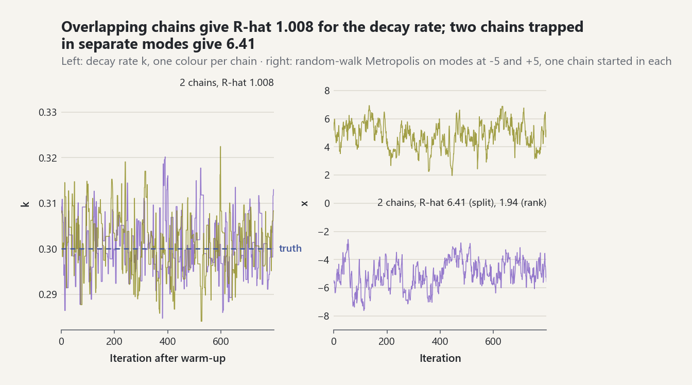
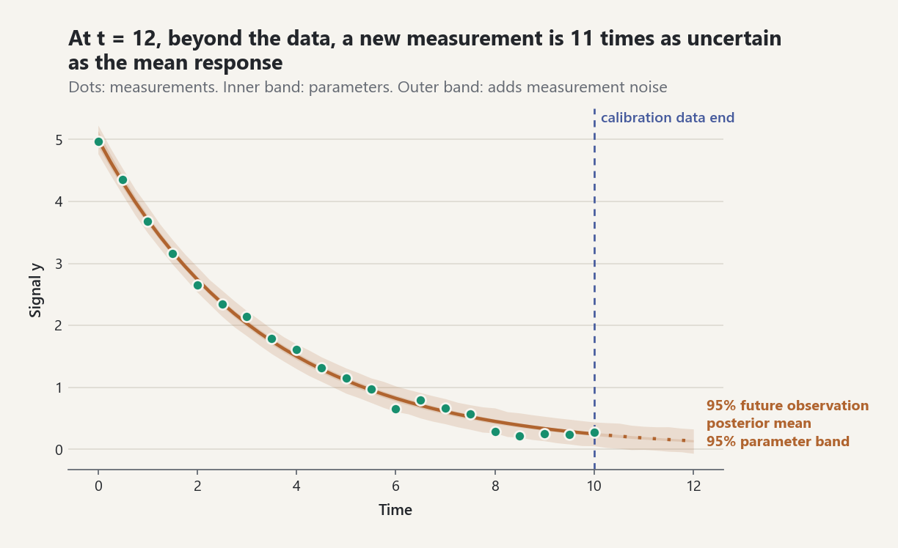
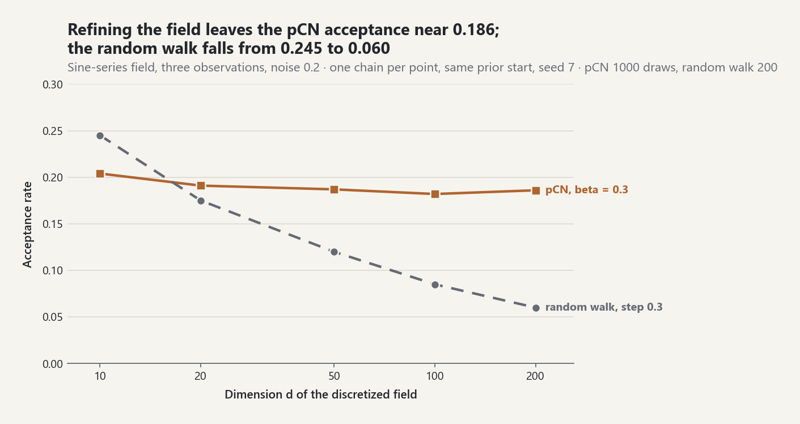
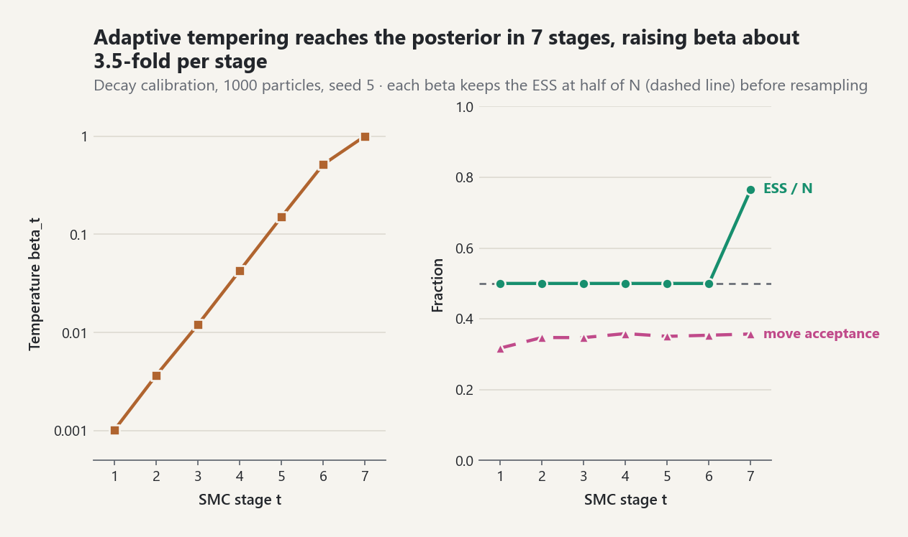
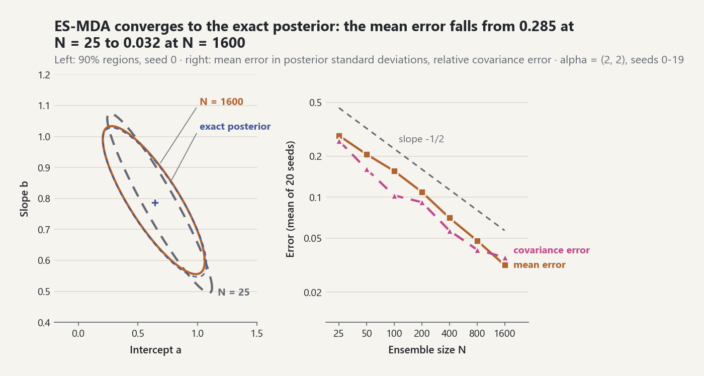

# Nonlinear Calibration and Markov Chain Monte Carlo

This guide extends [inverse problems and Bayesian calibration](inverse-problems-and-calibration.md)
from straight lines with known noise to general nonlinear forward models,
unknown or heavy-tailed noise, and sampled posteriors. Every number quoted
below was computed with this library and the seeds used in
`tests/test_uq6b_nonlinear_calibration.py` (sections 3-10) and
`tests/test_hmc_nuts_advi.py` (section 12), and with the models and seeds of
`tests/test_inference_pcn_smc_abc.py` (section 13), so it can be reproduced.

## 1. What changes when the model is nonlinear

The observation model keeps the same structure as before, but the response is
now any deterministic model `g` evaluated under experimental conditions `c_j`
([EQ-CAL-NL-001]):

`y_jq = g_q(theta; c_j) + delta_jq + eps_jq`.

Three things stop being true:

1. The posterior is no longer Gaussian, so there is no closed-form mean and
   covariance. We either approximate it (Laplace) or sample it (MCMC).
2. Identifiability depends on where you look: the Jacobian, and therefore the
   information in the data, changes with `theta`.
3. Predictions are no longer linear in `theta`, so the predictive law is found
   by pushing posterior draws through the model rather than by a covariance
   sandwich.

## 2. Declaring a calibration problem

A study is declared once as a `ProbabilisticModel`. For calibration its joint
input law is read as the **prior** on the calibration parameters.

```python
import math
import random
from probstat.distributions import LogNormal, Uniform
from probstat.modeling import JointInput, ProbabilisticModel, RandomInput
from probstat.uq import QuantityOfInterest
from probstat.inverse import CalibrationProblem, Experiment, NoiseModel, predict

def decay(p):
    return {"y": p["A"] * math.exp(-p["k"] * p["t"])}

prior = JointInput.independent(
    RandomInput("A", Uniform(1.0, 10.0)),
    RandomInput("k", LogNormal(math.log(0.5), 1.0)),
)
model = ProbabilisticModel(prior, decay, (QuantityOfInterest("y", "signal"),))
# Synthetic data of section 4: A = 5, k = 0.3, t = 0, 0.5, ..., 10, noise 0.1.
rng = random.Random(7)
data = [(t, 5.0 * math.exp(-0.3 * t) + rng.gauss(0.0, 0.1))
        for t in (0.5 * i for i in range(21))]
experiments = tuple(Experiment({"y": y}, {"t": t}) for t, y in data)
problem = CalibrationProblem(model, experiments, (NoiseModel("y", standard_deviation=0.1),))
```

Each `Experiment` carries its own conditions (here the time `t`). Conditions
override entries of `model.fixed` with the same name and may never name a
calibration parameter; an experiment index can be passed as a numeric
condition. One `NoiseModel` is required per observed quantity.

## 3. Likelihoods and the log-noise parameterization

For a residual `r` and total scale `s^2 = sigma_q^2 + sigma_delta_q^2`
([EQ-CAL-LIK-001]):

- Gaussian: `log p = -0.5 (log(2 pi s^2) + r^2 / s^2)`;
- Student-t with `nu` degrees of freedom: heavier tails, so a single outlier
  cannot dominate the fit.

`sigma_delta_q^2` is the declared model-discrepancy variance. It has the same
meaning as `validation.AdditiveGaussianDiscrepancy.variance`, but the inverse
layer accepts a plain float so it never imports the higher validation layer.

When `sigma_q` is unknown it receives its own prior and is sampled as
`eta = log sigma`. A density does not transform like a function: the prior on
`eta` is `p_sigma(e^eta) e^eta`, and the extra `e^eta` (an additive `+ eta` on
the log scale) is the Jacobian `|d sigma / d eta|` ([EQ-CAL-POST-001]).
Forgetting it silently changes the prior.

**Robustness example.** Twenty points on `1 + 2x` with noise `0.1`, one
observation shifted by `+5`. The Gaussian MAP intercept is `1.268`; with a
Student-t likelihood (`nu = 3`) it is `1.0475`. The truth is `1`.

## 4. Least squares and identifiability

`fit_least_squares` minimizes `0.5 sum (r_i / s_i)^2` by Levenberg-Marquardt
([EQ-CAL-WLS-001]) and reports the Gauss-Newton covariance
([EQ-OPT-LM-002]). It is the frequentist baseline: the prior is not used.

Exponential decay, true `A = 5`, `k = 0.3`, 21 times `t = 0, 0.5, ..., 10`,
noise `0.1`:

| Quantity | Estimate | Standard error |
|---|---:|---:|
| `A` | 5.0031 | 0.0680 |
| `k` | 0.3008 | 0.0064 |

The fit used 819 forward-model runs (finite-difference Jacobians included).
With the problem of section 2:

```python
fit = problem.fit_least_squares()
fit.estimate                       # (5.0031, 0.3008)
fit.standard_errors                # (0.0680, 0.0064)
```

Identifiability is read from the spectrum of the Fisher information
`F = J_w' J_w` ([EQ-CAL-FISHER-001]). Scaling by prior standard deviations,
`D F D`, makes it dimensionless: an eigenvalue of 100 means the data carry 100
times the prior information along that direction. At the least-squares point
the eigenvalues are `1426.6` and `51919.8` (condition number `36.4`), so both
parameter directions are strongly data-informed.

Now take `y = a b x`. Only the product is informed. At `a = b = 1` with
three observations, the prior-scaled eigenvalues are `0` and `2800`: the
rank is one, and the null direction is `(a, b) = (0.7071, -0.7071)`. Moving
along it (raising `a`, lowering `b`) leaves every prediction unchanged to
first order. The diagnostic names the **combination** that is unidentified,
which a per-parameter standard error cannot do. The result is local:
re-evaluate it at the posterior mode, not only at the prior mean.

## 5. Laplace approximation

The Laplace approximation ([EQ-LAPLACE-001]) places a Gaussian at the mode:
`N(x*, H^-1)` with `H` the Hessian of `-log p`. It also approximates the
normalizing constant,
`log Z ~= log p(x*) + (d/2) log(2 pi) - (1/2) log det H`.

For the unnormalized Gaussian with covariance `[[1, 0.8], [0.8, 2]]` the
library returns the mode `(1, -2)`, the covariance exactly, and
`log Z = 1.99161942`, which equals `0.5 log((2 pi)^2 x 1.36)`. Thirty
log-density evaluations were needed: BFGS with forward-mode
automatic-differentiation gradients plus a forward-over-forward Hessian, each
dual-number evaluation counting as one.

For a straight-line calibration `y = a + b x` (prior `a ~ N(0, 2^2)`,
`b ~ N(1, 1)`, seven points at `x = 0, 0.5, ..., 3`, known noise `0.3`),
`CalibrationProblem.laplace_posterior` reproduces the conjugate result of
`condition_linear_gaussian` to six decimals: mean `(0.641712, 0.787485)`,
variances `0.040994` and `0.012604`, covariance `-0.018846`. That agreement
is the bridge between the linear and nonlinear APIs.

## 6. Markov chain Monte Carlo

### Random-walk and adaptive Metropolis

A random-walk Metropolis step proposes `x' = x + L z` and accepts with
probability `min(1, p(x')/p(x))` ([EQ-MCMC-MH-001]). Only density **ratios**
are needed, so the unknown normalizing constant cancels.

Adaptive Metropolis ([EQ-MCMC-AM-001]) learns the proposal covariance
`s_d (Cov(history) + eps I)` with `s_d = 2.38^2 / d`. Here the adaptation runs
**only during warm-up** and the covariance is then frozen. Perpetual adaptation
can still be ergodic (Haario et al. prove it for their algorithm), but the
retained chain would no longer be a time-homogeneous Markov chain, and the
diagnostics below assume one. Freezing gives the guarantee for free.

On the correlated Gaussian above (4 chains, 600 warm-up, 2000 kept draws,
seed 7):

| Coordinate | Mean (truth) | MCSE | ESS | split R-hat | rank R-hat |
|---|---:|---:|---:|---:|---:|
| `x0` | 0.9953 (1) | 0.0320 | 1031.1 | 1.0048 | 1.0048 |
| `x1` | -1.9792 (-2) | 0.0436 | 1073.3 | 1.0033 | 1.0079 |

The acceptance rate was `0.343`. Both errors are well inside two MCSEs.

### Sampling in the prior's standard-normal space

`sample_posterior` does not sample `theta` directly. It samples `u = T(theta)`,
where `T` is the Nataf map of the prior (EQ-MOD-NATAF-001). Because `T`
pushes the prior forward to `N(0, I)`,
`pi(T^-1(u)) |det dT^-1/du| = phi(u)`, so the posterior in `u` is
`L(T^-1(u)) phi(u)` ([EQ-CAL-STD-001]). No Jacobian determinant has to be
coded: the transformation absorbs it. A test checks this numerically. At
three random points, the physical log posterior plus the log Jacobian, minus
the standard-space log posterior, equals `-log(2 pi)` (the dropped constant
for `d = 2`) to eight decimals.

The practical benefit is conditioning. Under `Uniform(1, 10)` and log-normal
priors, `A` is bounded and `k` positive and skewed. In `u` both are
unbounded and roughly isotropic, which is the geometry a Gaussian random walk
handles best. The sampler starts from the Laplace approximation in `u`, draws
over-dispersed chain starts (twice the Laplace standard deviations) so that
R-hat can detect non-convergence, and maps every draw back to
`(theta, sigma)`.

## 7. Convergence diagnostics

- **Split R-hat** ([EQ-MCMC-RHAT-001]) compares between- and within-chain
  variance after splitting each chain in half.
- **Rank-normalized R-hat** ([EQ-MCMC-RHAT-002]) repeats this on normal
  scores of ranks (bulk) and of folded draws `|x - median|` (tail).
- **ESS** ([EQ-MCMC-ESS-001]) uses Geyer's initial monotone sequence to sum
  autocorrelations without the noisy tail.
- **MCSE** ([EQ-MCMC-MCSE-001]) `= sd / sqrt(ESS)` is the simulation error of a
  posterior mean, not the posterior uncertainty.

Worked numbers:

- Two random-walk chains on a mixture with modes at `+-5`, started in
  different modes with proposal standard deviation `0.5` (500 draws each,
  seed 1), never cross. Split
  R-hat is `6.137` and rank R-hat `1.836`, both far above `1.1`.
- Chains `N(0, 1)` and `N(0, 3^2)` have the same mean. Split R-hat is `1.0002`
  and misses the difference; the folded rank R-hat is `1.1716` and flags it.
- Four AR(1) chains, `phi = 0.5`, 5000 draws each: the estimated ESS is
  `6843.1` against the theoretical `4 x 5000 x (1 - phi)/(1 + phi) = 6666.7`.
  The MCSE of the mean is `0.01211` against `1/sqrt(6666.7) = 0.01225`.

<picture><source media="(prefers-color-scheme: dark)" srcset="../images/guides/calibration-trace-convergence-dark.png"></picture>

*Left, two adaptive-Metropolis chains for the decay rate `k` of section 8 (seed 1) overlap around the true 0.3 and give rank-normalized R-hat 1.008; right, two random-walk chains of 800 draws (proposal sd 0.5, seed 4) started at -5 and +5 never cross between the modes, and split R-hat 6.41 (rank-normalized 1.94) flags them although each chain looks stationary on its own.*

R-hat near one is necessary, not sufficient: chains that all miss the same
mode agree with each other.

## 8. Worked example: exponential decay

Same data as section 4, four chains of 800 draws after 400 warm-up
iterations (seed 3). That is 4804 log-posterior evaluations, each running the model at
21 conditions.

| Parameter | Posterior mean | sd | 5% | 50% | 95% | ESS | rank R-hat |
|---|---:|---:|---:|---:|---:|---:|---:|
| `A` | 5.0073 | 0.0710 | 4.8916 | 5.0037 | 5.1253 | 408 | 1.0175 |
| `k` | 0.3011 | 0.0065 | 0.2907 | 0.3010 | 0.3121 | 443 | 1.0059 |

The posterior standard deviations (`0.0710`, `0.0065`) are close to the
least-squares standard errors (`0.0680`, `0.0064`). That is expected here:
the data dominate a weak prior, and the model is nearly linear over the
posterior region.

**Unknown noise.** Replace the known noise with
`standard_deviation_prior = LogNormal(log 0.3, 1)`. Least-squares
reweighting estimates `sigma = 0.0892`. The posterior (four chains, 800 draws
after 500 warm-up, seed 3) gives a mean of `sigma` of `0.0981` and a 90% interval of
`(0.0729, 0.1322)`, which covers the true `0.1`. `A` and `k` are essentially
unchanged (`5.0028`, `0.3009`), and their intervals widen slightly because the
noise level is now uncertain.

## 9. Prediction: closing the loop

`predict` pushes posterior draws through the forward model under new
conditions ([EQ-CAL-PRED-001]). Latent predictions carry parameter
uncertainty only. With `include_noise=True` one noise draw is added per
parameter draw: Gaussian or Student-t as declared, with the draw's own `sigma`
when it was calibrated and with the discrepancy variance included.

Using 1600 draws of the section 8 posterior (prediction seed 1):

| `t` | True mean | Latent 95% interval | Observation 95% interval |
|---:|---:|---|---|
| 12 (extrapolation) | 0.1366 | (0.1172, 0.1549) | (-0.0556, 0.3270) |
| 2 | 2.7441 | (2.6820, 2.8034) | (2.5359, 2.9375) |

At `t = 12` the latent variance is `8.86e-5` and the observation variance is
`9.98e-3`, close to `8.86e-5 + 0.1^2`. A future measurement is dominated by
noise, while the mean response is pinned down well. Reporting only one of
the two would mislead.

<picture><source media="(prefers-color-scheme: dark)" srcset="../images/guides/calibration-decay-prediction-dark.png"></picture>

*The 1600 draws of the two-chain run traced in section 7 give, at `t = 12`, a latent 95% interval of (0.119, 0.154) and an observation interval of (-0.065, 0.328), 11 times wider: the inner band is nearly invisible beyond the data while the outer band keeps the full width of the measurement noise.*

`t = 12` lies outside the calibration window `[0, 10]`. The computation is
valid as conditional mathematics, but the data cannot confirm that the model
form still holds there.

## 10. Linear regression with unknown noise variance

For `y = X beta + e`, `e ~ N(0, sigma^2 I)` with `sigma^2` unknown, the
Normal-inverse-gamma family is conjugate ([EQ-BAYES-NIG-001]). Integrating out
`sigma^2` gives Student-t marginals and predictions ([EQ-BAYES-NIG-002],
[EQ-BAYES-NIG-003], [EQ-DIST-T-001]).

Hand example: estimate a mean (`X` a column of ones) from `y = (1, 2, 3)`
with prior `m_0 = 0`, `V_0 = 1`, `a_0 = 2`, `b_0 = 2`:

- `V_n = 1/(1 + 3) = 0.25`, `m_n = 0.25 x 6 = 1.5`, `a_n = 2 + 3/2 = 3.5`;
- `b_n = 2 + ((0.5^2 + 0.5^2 + 1.5^2) + 1.5^2)/2 = 4.5`;
- `E[sigma^2] = 4.5/2.5 = 1.8`.

The library returns exactly these values. The 95% interval for the mean is
`(0.1594, 2.8406)` from `t_7(1.5, (4.5/3.5) 0.25)`. The interval for `sigma^2`
is `(0.5621, 5.3259)`, and the 95% predictive interval for a new observation
is `(-1.4977, 4.4977)`. Conditional on any fixed `sigma^2`, the coefficient
law equals `condition_linear_gaussian` with prior covariance `sigma^2 V_0`,
which the tests check to ten decimals.

## 11. Boundaries

- Random-walk samplers scale poorly beyond roughly ten to twenty parameters
  and with strongly curved posteriors. Gradient-based samplers (HMC/NUTS) and
  Gaussian ADVI are described in Section 12; pCN, for high-dimensional
  standard-normal priors that the data inform in few directions, in
  Section 13.
- The SMC evidence is as good as its mutation kernel: a kernel that mixes
  poorly biases `log Z` by more than the reported standard error, which
  measures Monte Carlo variability only (Section 13).
- ABC answers a different question: the posterior given a summary within a
  tolerance. It matches the posterior only for a sufficient summary and a
  vanishing tolerance.
- `DiscrepancyCalibration.sample_posterior` offers only adaptive
  Metropolis, HMC, and NUTS; `method="pcn"`, `"smc"`, and `log_evidence`
  exist for `CalibrationProblem` only.
- Adaptation stops at the end of warm-up. A poor warm-up gives a valid but
  inefficient chain; check ESS.
- Multimodal posteriors can defeat every diagnostic when no chain starts near
  a mode. Use over-dispersed starts and domain knowledge.
- Noise is independent across observations, and correlated measurement
  errors are not implemented. An input-dependent discrepancy process
  (Kennedy-O'Hagan Gaussian process) is not part of `CalibrationProblem`; it
  is provided by `DiscrepancyCalibration` (see
  [model discrepancy](model-discrepancy.md)).
- The Fisher diagnostic is local and assumes Gaussian errors.
- The Laplace approximation is computed in physical coordinates. Bounded
  priors with modes on the boundary make it unreliable; prefer
  `sample_posterior`.

## 12. Gradient-based sampling and variational inference

Random-walk proposals move a distance of order `d^-1/2` per step. Hamiltonian
Monte Carlo instead uses the gradient of `log p` to travel along the target's
level sets. `inference.hamiltonian_monte_carlo`, `inference.no_u_turn_sampler`,
and `inference.advi` need only a log-density (and optionally its gradient), so
they live in layer 2 next to the Metropolis samplers.

### Hamiltonian dynamics and the leapfrog integrator

A momentum `p ~ N(0, M)` is drawn and `H(x, p) = -log p(x) + p' M^-1 p / 2` is
simulated with the leapfrog scheme ([EQ-HMC-H-001], [EQ-HMC-LEAPFROG-001]).
Leapfrog is volume-preserving and reversible for any position-dependent
force. A Metropolis test on the exact `H` ([EQ-HMC-ACCEPT-001]) therefore
keeps the target invariant even when the gradient comes from central
differences; a poor gradient only lowers acceptance. Its energy error over a
fixed time is second order. On the correlated Gaussian below, for one
trajectory of length 3, the library measures:

| `eps` | max \|H(t) - H(0)\| |
|---:|---:|
| 0.1 | 7.52e-4 |
| 0.05 | 1.88e-4 |
| 0.025 | 4.68e-5 |

Each halving divides the error by 4.0.

### Static HMC and NUTS

Static HMC takes a fixed number `L` of steps. If `L eps` is close to the
period of the target's oscillation, the trajectory returns to its start and
the chain stalls. `step_size_jitter` breaks that resonance.

NUTS removes the choice of `L`. By default (`variant="multinomial"`) the next
state is drawn from the whole trajectory with weights proportional to
`exp(-H)` ([EQ-NUTS-MULTINOMIAL-001], [REF-BETANCOURT-2017]);
`variant="slice"` selects the original recursive algorithm of Hoffman and
Gelman with **slice sampling** ([EQ-NUTS-SLICE-001]). The trajectory doubles in a
random direction until its ends turn back towards each other
([EQ-NUTS-UTURN-001]), a leaf diverges, or `max_tree_depth` (default 10) is
reached.

### Warm-up: step size and metric

The step size is tuned by dual averaging towards acceptance 0.8
([EQ-HMC-DA-001]). The inverse metric `M^-1` is the shrunk sample covariance
of doubling warm-up windows ([EQ-HMC-METRIC-001]); `adaptation_windows(1000)`
returns `(75, 50, (100, 150, 250, 450, 950))`. Both are frozen at the end of
warm-up, so retained draws come from one fixed kernel and `R-hat`, ESS, and
MCSE apply unchanged. The draws are an ordinary `MCMCResult` in `result.mcmc`.

The frozen step size is the average of the warm-up iterates, which is smaller
than the last iterate. Post-warm-up acceptance is therefore above the 0.8
target: 0.90-0.96 in the runs below.

Correlated 2-D Gaussian (`mean (1, -2)`, covariance `((1, 0.8), (0.8, 2))`),
4 chains, 300 warm-up and 400 kept draws, analytic gradient, multinomial NUTS,
seed 1:

| Metric | Mean | Covariance (11, 12, 22) | Min ESS | Gradients | Mean depth |
|---|---|---|---:|---:|---:|
| diagonal | (1.06, -1.94) | (1.00, 0.76, 1.84) | 695 | 13 184 | 2.23-2.36 |
| dense | (0.98, -2.00) | (1.03, 0.84, 1.98) | 928 | 11 328 | 1.89-2.29 |

The MCSE of the means is 0.03-0.05, so the mean errors are within about 1.7
MCSE. The dense metric learns the correlation. Chain 0 ends with
`M^-1 = ((0.768, 0.473), (0.473, 1.247))`, whose off-diagonal-to-variance
ratio 0.38 is close to the target's 0.4. There were no divergences and
E-BFMI was between 0.98 and 1.32 ([EQ-HMC-BFMI-001]). Static HMC with `L = 6`
and jitter 0.3 (seed 2) gives mean `(1.03, -2.03)` (MCSE 0.015 and 0.024) and
ESS 4338 and 3513 from 1600 draws. ESS above the draw count means the draws are antithetic,
which is typical of HMC on Gaussians.

### Efficiency per gradient

10-D iid standard normal, 2 chains, 200 warm-up and 300 kept draws (seed 5).
NUTS used 7121 gradients and reached a **minimum** ESS of 780 over the ten
coordinates, or 0.110 per gradient. Random-walk Metropolis with the optimal
scale `2.38^2/d` was given the same budget of 7120 density evaluations. It
reached a **maximum** ESS of 259, or 0.036 per evaluation, at acceptance
0.264. Even comparing NUTS's worst coordinate with RWM's best, NUTS is 3.0
times as efficient here. Theory predicts the gap to grow with dimension
[REF-NEAL-2011].

### Divergences

A trajectory diverges when its energy error exceeds 1000 or it leaves the
region where `log p` and its gradient are finite. Divergences are counted per
chain (`result.divergences_per_chain`, with iteration indices in each
`HamiltonianChainStatistics`). On Neal's funnel (`v ~ N(0, 9)`,
`z_i | v ~ N(0, e^v)`, 3-D) with a fixed step of 1.0, 2 chains of 200
iterations (seed 1) gave:

| Sampler | Divergences per chain | Acceptance |
|---|---|---:|
| static HMC (`L = 16`) | (61, 74) | 0.196 |
| NUTS | (16, 13) | 0.484 |

The same NUTS settings on a standard normal give no divergences. Full
adaptation does not cure the funnel. With 400 warm-up iterations and 2 chains
of 200 draws, seed 1 gives 20 and 13 divergences during warm-up, adapted step
sizes of 0.099 and 0.279 (a factor of three apart between chains), and E-BFMI
0.27 in the second chain; seeds 2 and 3 also leave 4 divergences in one chain
after warm-up. These are the signatures of a neck the sampler cannot enter. Treat any divergence as
evidence of possible bias and reparameterize; a smaller step only hides the
symptom.

### Gradient cost

Without an analytic gradient (`gradient="auto"`, the default, or `None`) the
samplers evaluate the log-density on dual numbers (forward-mode automatic
differentiation). When the log-density does not accept dual numbers, they fall
back to central differences ([EQ-OPT-FD-001]), costing `2d` extra evaluations
per gradient, and `gradient_method` records the fallback. The tests check that
with `gradient="finite-difference"` density evaluations equal `(2d + 1)` times
gradient evaluations exactly. In calibration,
`sample_posterior(method="nuts")` or `"hmc"` samples
`standard_log_posterior`, which falls back to such finite-difference
gradients, with a diagonal metric started from the Laplace variances;
HMC/NUTS diagnostics are stored in `posterior.sampler`. The default
`method="adaptive-metropolis"` reproduces earlier results bit for bit. On the
2-parameter straight-line calibration used in the tests (`a + b x`, known
noise 0.3; 2 chains, 200 + 300 iterations, seed 11; exact posterior mean `(0.6417, 0.7875)`, sd
`(0.2025, 0.1123)`):

| Method | Means | SDs | ESS | Posterior evaluations |
|---|---|---|---|---:|
| adaptive Metropolis | (0.631, 0.801) | (0.215, 0.113) | 110, 125 | 1 002 |
| NUTS, FD gradients | (0.630, 0.798) | (0.210, 0.119) | 142, 150 | 31 487 |

The MCSE of the means is about 0.02 for `a` and 0.01 for `b` in both runs.

For two well-conditioned parameters, finite-difference NUTS spends far more
model runs per effective draw than adaptive Metropolis. It pays off for many
parameters, strongly curved posteriors, or when an analytic gradient is
available.

### Gaussian ADVI

`inference.advi` fits `q = N(mu, L L')` by maximizing the ELBO
([EQ-VI-ELBO-001]) with reparameterization gradients ([EQ-VI-REPARAM-001])
and Adam ([EQ-OPT-ADAM-001]). The mean-field family has diagonal `L`; the
full-rank family uses a lower-triangular `L` with a log-parameterized
diagonal ([EQ-VI-ADVI-001]).

Three implementation choices:

- The ELBO is monitored every `evaluation_interval` iterations on one fixed
  set of draws (common random numbers). Changes then reflect parameter
  changes, not resampling noise.
- The returned parameters average the iterates over the most recent half of
  the run (Polyak-Ruppert averaging).
- The reported `elbo` uses the returned independent draws.

On the same correlated Gaussian (4 gradient samples per step, learning rate
0.02, tolerance `1e-4`, seed 2; `log Z = 1.9916`):

| Family | Iterations | Mean | Covariance (11, 12, 22) | ELBO |
|---|---:|---|---|---:|
| full-rank | 5000 | (0.999, -2.018) | (0.992, 0.790, 1.974) | 1.963 |
| mean-field | 7300 | (1.000, -2.007) | (0.680, 0, 1.369) | 1.770 |

Full-rank recovers the target. Mean-field recovers the mean and the variances
`1/Lambda_ii = (0.68, 1.36)`, well below the true `(1, 2)`; its ELBO gap
0.222 matches the analytic KL divergence 0.193 within Monte Carlo error. The
ELBO trace rises from 1.357 (full-rank, iteration 100) to its plateau
within a few hundred iterations.

ADVI requires an unconstrained target. Transform constrained parameters
first, for example `log sigma` or the prior's standard-normal space used by
`CalibrationProblem.standard_log_posterior`, and include the Jacobian. A
Gaussian `q` underestimates the spread of skewed or heavy-tailed posteriors.
Use ADVI for fast exploration and starting points, and confirm reported
uncertainty with MCMC.

## 13. Dimension-robust, tempered, and likelihood-free sampling

Three samplers cover cases the Metropolis and Hamiltonian samplers above do
not: a high-dimensional prior that the data inform in only a few directions,
the marginal likelihood needed for model comparison, and models whose
likelihood cannot be evaluated at all (ADR-0111).

### Preconditioned Crank-Nicolson

`inference.preconditioned_crank_nicolson` targets `L(u) N(u; 0, I)`, a
likelihood times a standard-normal prior, such as the Nataf space of
`CalibrationProblem` or the Karhunen-Loeve coefficients of a random field. It
proposes `v = sqrt(1 - beta^2) u + beta xi` and accepts with probability
`min(1, L(v) / L(u))` ([EQ-MCMC-PCN-001]). The proposal is an AR(1) step that
leaves `N(0, I)` invariant, so the prior cancels from the ratio and only the
likelihood is tested.

That is why it does not degrade with dimension. A random walk must shrink its
step like `d^-1/2`, because the prior part of its ratio,
`exp((|u|^2 - |v|^2)/2)`, becomes extreme as `d` grows. For pCN the prior part
is exactly one, and when the likelihood depends on a few smooth modes the
acceptance rate for a fixed `beta` tends to a limit as the discretization is
refined. On a sine-series field with mode weights `1/k`, observed at three
points with noise 0.2, both samplers started from the same prior draw
(seed 7, `beta = 0.3` without adaptation, random-walk step 0.3):

| Dimension `d` | pCN acceptance (1000 draws) | Random-walk acceptance (200 draws) |
|---:|---:|---:|
| 10 | 0.204 | 0.245 |
| 50 | 0.187 | 0.120 |
| 200 | 0.186 | 0.060 |

The pCN rate is flat; the random-walk rate falls by a factor of four.

<picture><source media="(prefers-color-scheme: dark)" srcset="../images/guides/pcn-acceptance-dimension-dark.png"></picture>

*The table's runs with `d = 20` and `d = 100` added: pCN accepts 0.204 of its moves at `d = 10` and 0.186 at `d = 200`, while the random walk falls from 0.245 to 0.060.*

During warm-up `beta` is adapted by a Robbins-Monro recursion on its log-odds
towards the target acceptance ([EQ-MCMC-PCN-002]) and is then frozen, as for
adaptive Metropolis. The default target 0.25 follows the practice of Cotter et
al. (2013), who tune to about 0.234 or 25 % and report one problem where a
higher rate converged faster; no optimal-scaling theorem fixes it for pCN.

`CalibrationProblem.sample_posterior(method="pcn")` runs it in fully
standardized coordinates (next paragraph). On the linear-Gaussian problem of
Section 5 (4 chains, 500 warm-up, 1500 draws, seed 11) the posterior means of
`a` and `b` are `0.6366` and `0.7874` (exact `0.6417`, `0.7875`), with MCSE
`0.0140` and `0.0069`, bulk ESS 243 and 302, and frozen `beta` between 0.157
and 0.176. Adaptive Metropolis with the same settings reaches ESS 750 and 822:
when the data pin down every direction, the isotropic pCN move is the slower
choice. pCN pays off when the prior dimension is large and the likelihood is
informative in few directions.

**Unknown noise scales.** pCN and the evidence need an `N(0, I)` prior in
every sampled coordinate, but `log sigma` has the prior
`p_sigma(e^eta) e^eta`. Both methods therefore map each unknown noise scale
through its own prior quantile transform, `sigma = F^-1(Phi(w))`, and work in
`(u, w)` ([EQ-CAL-STD-002], `CalibrationProblem.standard_log_likelihood`). The
draws are mapped back to `(u, log sigma)` and `(theta, sigma)`, so the result
has the same layout as for the other methods.

### Sequential Monte Carlo with tempering and the evidence

`inference.sequential_monte_carlo` moves `N` particles from the prior to the
posterior through `p(x) L(x)^beta_t` with `0 = beta_0 < ... < beta_T = 1`
([EQ-SMC-TEMPER-001]). Each stage reweights by `L^(beta_t - beta_{t-1})`,
chooses `beta_t` by bisection so that the effective sample size stays at
`ess_fraction` (default one half) of the particles ([EQ-SMC-TEMPER-002]),
resamples, and moves every particle by a few Metropolis steps that leave the
current tempered law invariant: random walk with the weighted particle
covariance, or pCN for an `N(0, I)` prior.

The product of the mean incremental weights estimates the evidence
`Z = integral p(x) L(x) dx` ([EQ-SMC-EVID-001]). It is the marginal
likelihood only if `L` carries every normalizing constant of the data
density, which `CalibrationProblem.log_likelihood` does (Gaussian and
Student-t). Ratios of evidences for the same data are Bayes factors.

The reported standard error is the estimator of Lee and Whiteley (2018),
computed from the genealogy of one run ([EQ-SMC-EVID-002]): the relative
variance of `Z_hat` follows from the final weights and from which initial
particle each final particle descends. Its limits: the theorem assumes fixed
temperatures and kernels (here both adapt), multinomial resampling (no value
is reported for systematic resampling), and enough distinct ancestors; it
measures Monte Carlo variability, not the bias of a mutation kernel that
mixes poorly.

On the linear-Gaussian problem the exact marginal likelihood is
`log p(y) = -8.2812`. `CalibrationProblem.log_evidence(particles=1000,
mutation_steps=10, seed=5)` takes five stages and 51000 likelihood
evaluations and returns `-8.3273` with standard error `0.0684`; with 400
particles and 5 moves (seed 5) it returns `-8.2920 +- 0.1251` from 10400
evaluations. Repeating the 1000-particle run with the noise standard
deviation declared as 0.6 instead of 0.3 gives `-7.9474 +- 0.0559` (exact
`-7.9193`). The estimated log Bayes factor `0.380 +- 0.088` (standard errors
added in quadrature) agrees with the exact `0.362`: seven observations do not
separate the two noise levels.

`sample_posterior(method="smc")` returns the final particles as one pseudo
chain plus the full SMC result in `smc`. Means and quantiles of the particles
are valid; R-hat and ESS of a pseudo chain are not.

<picture><source media="(prefers-color-scheme: dark)" srcset="../images/guides/smc-tempering-schedule-dark.png"></picture>

*`log_evidence(particles=1000, seed=5)` on the decay calibration of Section 2: 7 stages from a first temperature of 0.0010, about 3.5-fold per stage, ending at `log p(y) = 13.24` with standard error 0.088.*

### Approximate Bayesian computation

When the likelihood cannot be evaluated but data can be simulated,
`inference.abc_rejection` keeps prior draws whose simulated summary lies
within `eps` of the observed one ([EQ-ABC-REJ-001]). The kept draws follow
the ABC posterior, which equals the posterior given the summary only as
`eps -> 0`, and the posterior given the data only for a sufficient summary.
Both caveats are permanent: the tolerance adds bias that costs `eps^-q`
simulations to remove for a `q`-dimensional summary, and a non-sufficient
summary loses information that no tolerance recovers. Summaries on different
scales should be standardized before the Euclidean default distance is used.

For a normal mean (prior `N(0, 1)`, ten unit-variance observations with mean
0.7 summarized by their sufficient sample mean) the posterior is
`N(0.6364, 0.0909)`. Rejection with 2000 accepted draws (seed 3) against the
exact uniform-kernel ABC posterior, computed by quadrature:

| `eps` | Simulations | Mean (exact ABC) | Variance (exact ABC) |
|---:|---:|---:|---:|
| 0.5 | 6913 | 0.6018 (0.5899) | 0.1524 (0.1565) |
| 0.2 | 16818 | 0.6379 (0.6287) | 0.0975 (0.1018) |
| 0.05 | 65677 | 0.6349 (0.6359) | 0.0914 (0.0916) |

`inference.abc_smc` is the ABC population Monte Carlo algorithm of Beaumont et
al. (2009) ([EQ-ABC-PMC-001]): each generation perturbs draws of the previous
weighted population with a Gaussian kernel of twice its weighted covariance,
keeps proposals within a tolerance set to a quantile (default the median) of
the previous distances, and corrects with importance weights
`prior / sum_j w_j K`. With 1000 particles and 7 generations (seed 5) the
tolerance falls from infinity to `0.0282` in 60579 simulations, and the final
population (ESS 931) has mean `0.6329` and variance `0.0915` against the exact
ABC values `0.6362` and `0.0911`. Rejection at the same tolerance (seed 5)
needs 61542 simulations, so this one-dimensional problem gains nothing from
the population scheme; it pays off when the prior is much wider than the
posterior in several directions.

## 14. Ensemble Kalman inversion and ES-MDA

The samplers above evaluate a log-posterior one point at a time and, for HMC
and NUTS, need its gradient. Ensemble Kalman methods need neither: they move
a whole ensemble of parameter vectors towards the data with a Kalman-type
update whose gain is estimated from the ensemble itself (ADR-0115). The
models and seeds of this section are those of
`tests/test_ensemble_inversion.py`.

### The update

`inverse.ensemble_kalman_inversion` and `inverse.ensemble_smoother_mda` work
on a `CalibrationProblem` in the Nataf standard-normal coordinates `u` of the
prior, where the prior is exactly `N(0, I)`. They draw `N` members
`u_j ~ N(0, I)`, map each to `theta_j = T^-1(u_j)`, run the forward model,
and update

`u_j <- u_j + C^up (C^pp + alpha Gamma)^-1 (y + sqrt(alpha) Gamma^1/2 z_j - G(u_j))`

with `C^up` the ensemble cross-covariance of parameters and predictions,
`C^pp` the ensemble covariance of the predictions, `Gamma` the
observation-error covariance, and `z_j ~ N(0, I)` a perturbation of the data
for each member ([EQ-INV-EKI-001]). No derivative of the model appears: the
ensemble covariances play the role of the Jacobian. The `N` forward runs of
one iteration are independent and can run in parallel, and the cost is
counted in whole ensemble evaluations: `N (updates + 1)` forward evaluations,
each running the model once per experiment (`forward_evaluations` and
`model_calls` of the result).

`Gamma` must be a fixed matrix, so only known-scale Gaussian noise models are
accepted; its diagonal is `sigma_q^2 + sigma_delta_q^2` (noise plus declared
discrepancy variance). An unknown noise scale or a Student-t model raises
`ValueError` with the reason; such problems belong to `sample_posterior`.

### ES-MDA: exact for linear-Gaussian problems

ES-MDA (Emerick and Reynolds 2013) assimilates the same data `N_a` times with
inflated covariances `alpha_i Gamma` and requires `sum 1/alpha_i = 1`
([EQ-INV-ESMDA-001]). The product of the tempered likelihoods
`L^(1/alpha_i)` is then the full likelihood. When the forward model is affine
in `u`, as it is for Gaussian priors and a model linear in `theta`, each step
is an exact Gaussian conditioning and the ensemble samples the posterior as
`N` grows; a single `alpha = 1` is the one-step ensemble smoother.

On the straight-line problem of Section 5 the conjugate posterior has mean
`(0.6417, 0.7875)`, variances `0.04099` and `0.01260`, and covariance
`-0.01885`. ES-MDA with `N = 1000` and `alpha = (2, 2)` (seed 17) gives mean
`(0.6470, 0.7827)`, variances `0.04200` and `0.01334`, and covariance
`-0.01990` from 3000 forward evaluations. The deviations are of the order of
the ensemble sampling error (`0.2 / sqrt(1000) = 0.006` for the mean of `a`).

<picture><source media="(prefers-color-scheme: dark)" srcset="../images/guides/esmda-exact-posterior-dark.png"></picture>

*ES-MDA with `alpha = (2, 2)` on the same problem, averaged over seeds 0-19: the distance of the ensemble mean from the exact posterior mean, in posterior standard deviations, falls from 0.285 at `N = 25` to 0.032 at `N = 1600`, and the relative covariance error from 0.26 to 0.036, both close to the Monte Carlo rate `N^-1/2`.*

For a nonlinear model each step linearizes through the ensemble, and the
result is an approximation. On the exponential decay of Section 2 the MCMC
posterior of Section 8 has mean `(5.0073, 0.3011)` and standard deviations
`(0.0710, 0.0065)`. ES-MDA with `N = 200` (seed 1) gives:

| `alpha` | Forward evaluations | Mean of `A`, `k` | Spread of `A`, `k` |
|---|---:|---:|---:|
| `(4, 4, 4, 4)` | 1000 | 4.9975, 0.3003 | 0.0790, 0.0093 |
| `(8,) * 8` | 1800 | 5.0053, 0.3008 | 0.0712, 0.0074 |

The means agree to a fraction of a posterior standard deviation. The spread
of `k` is 43 % too wide with four steps and 14 % with eight: smaller steps
reduce the linearization error. The ensemble spread of a nonlinear problem is
an approximation to check, not a guaranteed posterior uncertainty.

### Ensemble Kalman inversion: an optimizer whose ensemble collapses

Ensemble Kalman inversion (Iglesias, Law and Stuart 2013) repeats the update
with `alpha = 1` for as many iterations as requested. Every member stays in
the affine span of the initial ensemble, and the ensemble contracts: in the
linear case each update conditions on the same data again, so `n`
iterations with perturbed data approximate the posterior of the likelihood
raised to the power `n`, and Schillings and Stuart (2017)
prove the collapse for the unperturbed continuous-time limit. The method is
a derivative-free minimizer of the data misfit, **not** a posterior sampler;
use the ensemble mean as a point estimate.

On the decay problem (`N = 50`, 20 iterations, seed 1) the whitened misfit of
the mean prediction falls from 20.02 to 3.890 (the noise-level value is about
`sqrt(21) = 4.58`), the mean reaches `(5.0016, 0.3006)`, and the spreads
shrink from `(2.458, 0.874)` to `(0.0153, 0.0014)`, about a fifth of the
posterior standard deviations, at a cost of 1050 forward evaluations.

Iterating to convergence fits the noise when the problem is ill-posed. The
discrepancy principle ([EQ-INV-EKI-002], Iglesias 2016) stops before the
first update at which `|Gamma^-1/2 (y - mean_j G(u_j))| <= tau eta`, with the
noise level `eta` (default `sqrt(M)` for `M` observations) and `tau = 1.5` by
default. On the decay problem (seed 1) it stops after two updates at misfit
3.961 below the threshold 6.874, with mean `(4.9651, 0.2969)` after 150
forward evaluations. Early stopping is the regularization: the number of
iterations acts as the regularization parameter.

```python
from probstat.inverse import ensemble_kalman_inversion, ensemble_smoother_mda

smoother = ensemble_smoother_mda(
    problem, ensemble_size=200, inflation_coefficients=(4.0, 4.0, 4.0, 4.0), seed=1
)
smoother.forward_evaluations          # 1000
smoother.model_calls                  # 21000
round(smoother.mean()["A"], 1)        # 5.0
eki = ensemble_kalman_inversion(problem, ensemble_size=50, iterations=20, seed=1)
eki.misfit_history[-1] < 0.25 * eki.misfit_history[0]                  # True
eki.spread_history[-1][0] < 0.01 * eki.spread_history[0][0]            # True
stopped = ensemble_kalman_inversion(
    problem, ensemble_size=50, iterations=20, seed=1, stopping="discrepancy"
)
stopped.stopped_by                    # 'discrepancy'
stopped.misfit_history[-1] <= stopped.discrepancy_threshold            # True
```

### When to prefer which method

- **ES-MDA** when the forward model is expensive, gradients are unavailable,
  the model is close to linear over the posterior, and an approximate
  posterior ensemble from a few hundred parallel runs is acceptable.
- **Ensemble Kalman inversion** when a regularized point estimate is the
  goal, for example a high-dimensional field calibrated from few data,
  stopped by the discrepancy principle.
- **MCMC, pCN, or SMC** (Sections 6, 12, and 13) when the posterior is
  non-Gaussian, multimodal, or strongly nonlinear, when the noise scale is
  unknown or the errors are Student-t, or when calibrated uncertainty or the
  evidence is required. They cost more forward runs but converge to the
  exact posterior; ensemble Kalman methods do not, except for ES-MDA in the
  linear-Gaussian limit.

`examples/field_inversion_lab.py` runs pCN, adaptive Metropolis, ES-MDA, and
EKI side by side on a Karhunen-Loeve log-permeability field inverted from
pressure data, with their forward-run counts and the inverse crime measured.

## 15. Correlated measurement errors and reverse-mode gradients

### Correlated errors across experiments

Measurements of one quantity along a time axis, a load ramp, or a traverse
often share drift, warm-up, or alignment errors, so the errors of
neighbouring experiments are correlated. A `NoiseModel` declares this with
`correlation=ErrorCorrelation(...)`: the errors of that quantity are jointly
Gaussian across the experiments that observe it, with covariance
`Sigma_q = sigma_q^2 M_q + sigma_delta_q^2 I`, where `sigma_q` is the noise
scale (known or uncertain, as before) and the discrepancy variance acts as an
independent nugget. `M_q` is either a declared positive-definite matrix
(`ErrorCorrelation(matrix=M)`, rows in experiment order; a fully known
covariance `C` is `matrix=C` with `standard_deviation=1.0`) or a stationary
kernel over a numeric condition, `M_ij = rho(|c_i - c_j| / ell)`, with the
exponential, Matern 3/2, or Matern 5/2 correlation ([EQ-CAL-CORR-001]) and a
known `length` or a `length_prior`. The likelihood adds
`-0.5 (n log 2 pi + log det Sigma_q + r_q' Sigma_q^-1 r_q)` per correlated
quantity, evaluated by Cholesky ([EQ-CAL-CORR-002]); least squares and the
Fisher diagnostic use the whitened residuals `L^-1 r` ([EQ-CAL-CORR-003]),
so `fit_least_squares` becomes generalized least squares. Correlated errors
are Gaussian only: a Student-t `NoiseModel` with `correlation` raises.

Ignoring the correlation overstates the information in the data. A straight
line `a + b x` observed at 13 points `x = 0, 0.25, ..., 3` with errors of
standard deviation 0.3 and exponential correlation of length 0.6 (simulated
with seed 5; priors `a ~ N(0, 2^2)`, `b ~ N(1, 1)`):

```python
from probstat.distributions import Normal
from probstat.inverse import ErrorCorrelation
from probstat.linalg import cholesky, matvec

def line(p):
    return {"y": p["a"] + p["b"] * p["x"]}

xs = tuple(0.25 * i for i in range(13))
structure = ErrorCorrelation(condition="x", length=0.6)
shape = structure.correlation_matrix(xs)
line_rng = random.Random(5)
errors = matvec(
    cholesky(tuple(tuple(0.09 * m for m in row) for row in shape)),
    tuple(line_rng.gauss(0.0, 1.0) for _ in xs),
)
line_experiments = tuple(
    Experiment({"y": 1.0 + 0.7 * x + e}, {"x": x}) for x, e in zip(xs, errors)
)
line_model = ProbabilisticModel(
    JointInput.independent(RandomInput("a", Normal(0.0, 2.0)),
                           RandomInput("b", Normal(1.0, 1.0))),
    line, (QuantityOfInterest("y", "line"),),
)
correlated = CalibrationProblem(line_model, line_experiments, (
    NoiseModel("y", standard_deviation=0.3, correlation=structure),))
independent = CalibrationProblem(line_model, line_experiments, (
    NoiseModel("y", standard_deviation=0.3),))
exact = correlated.laplace_posterior()      # exact for a linear-Gaussian problem
naive = independent.laplace_posterior()
[round(exact.mode[i], 3) for i in range(2)]                     # [0.556, 0.83]
[round(math.sqrt(exact.covariance[i][i]), 3) for i in range(2)]  # [0.254, 0.132]
[round(naive.mode[i], 3) for i in range(2)]                     # [0.467, 0.894]
[round(math.sqrt(naive.covariance[i][i]), 3) for i in range(2)]  # [0.156, 0.088]
gls = correlated.fit_least_squares()
[round(value, 3) for value in gls.standard_errors]              # [0.258, 0.134]
```

The independent model reports posterior standard deviations a third to 40 %
smaller than the exact ones and moves the means by 0.35 (intercept) and
0.48 (slope) exact standard deviations. The Laplace result of the correlated problem equals the
conjugate posterior computed by Gaussian conditioning (the tests check
this, and MCMC within 4 MCSE).

**Correlated errors versus a discrepancy process.** Both produce smoothly
correlated residuals, but they belong to different parts of the
observation model. A correlated measurement error belongs to the instrument
or the test series: it is present in the data, absent from the physical
quantity, and is *not* added to a prediction of the true response. A
discrepancy process ([model discrepancy](model-discrepancy.md)) belongs to
the model: it corrects the simulator and *is* part of the predicted true
response. With a single data set the two are not separately identifiable,
for the same reason as the Brynjarsdottir-O'Hagan point of that guide: a
long error-correlation length and a smooth discrepancy explain the same
residual structure, and each trades off against `theta`. Declare a
correlation only when it is known to come from the measurement (repeated
calibration runs of the instrument, a drift model), and prefer a known
length estimated from such runs. Within one series the scale and the length
of a Matern correlation are themselves only weakly identified: under infill
on a fixed domain only `sigma^2 / ell^(2 nu)` can be estimated consistently
(H. Zhang, *Journal of the American Statistical Association* 99, 250-261, 2004, doi:10.1198/016214504000000241). A length prior that rules out lengths beyond the spacing
of the data matters for that reason, and also because a very long length
makes `M` numerically singular (known structures then raise; a sampled
length gets log-likelihood `-inf`).

An uncertain length is sampled as `log ell` after the log noise scales
(`log_length[q]` in `vector_names`, `length[q]` in the physical chains).
`predict(include_noise=True)` draws the noise of a kernel-correlated quantity
jointly across the prediction conditions, as a new measurement series that
is not conditioned on the calibration residuals; a declared matrix has no
meaning at new conditions, so noise draws for it raise unless
`noise_standard_deviations` supplies an independent scale.

### Reverse-mode gradients

`laplace_posterior(gradient="reverse")` and
`sample_posterior(method="hmc" | "nuts", gradient="reverse")` differentiate
the log posterior by reverse-mode automatic differentiation instead of
central differences (the default `gradient="central"` reproduces earlier
results exactly). The forward model must then be written with operators and
`numerics.admath`, because it is called with reverse-mode variables. The
prior's standard-normal map keeps its float value; its derivative comes
from the inverse-function rule `dx_i/dz_i = phi(z_i) / f_i(x_i)`
([EQ-CAL-AD-001]), so every continuous prior family with independence or a
Gaussian copula is supported. Discrete inputs, other copulas, and a model
that calls `math` functions raise `AutodiffUnsupportedError` before anything
runs; there is no silent fallback to differences.

```python
from probstat.numerics import admath

def traced_decay(p):
    return {"y": p["A"] * admath.exp(-p["k"] * p["t"])}

traced = CalibrationProblem(
    ProbabilisticModel(prior, traced_decay, (QuantityOfInterest("y", "signal"),)),
    experiments, (NoiseModel("y", standard_deviation=0.1),))
point = (0.2, -0.1)
value, slope = traced.standard_log_posterior_and_gradient(point)
step = 1e-5
central = [
    (traced.standard_log_posterior((point[0] + step * (i == 0), point[1] + step * (i == 1)))
     - traced.standard_log_posterior((point[0] - step * (i == 0), point[1] - step * (i == 1))))
    / (2 * step)
    for i in range(2)
]
max(abs(a - b) / abs(b) for a, b in zip(slope, central)) < 1e-6   # True
```

**Cost.** Central differences cost `2n` extra posterior evaluations per
gradient, each one forward-model run per experiment; one reverse-mode
recording costs one run per experiment and a backward sweep whose work is a
small multiple of the recorded evaluation, independent of `n`. On the
exponential-decay problem of Section 2 with the `admath` model (21
experiments, known noise, `n = 2`; NUTS, 2 chains, 200 + 250 iterations,
seed 21):

| Gradient | Mean `A` (MCSE) | Mean `k` (MCSE) | ESS `A`, `k` | Forward-model runs |
|---|---|---|---|---:|
| central | 5.0070 (0.0052) | 0.30143 (0.00048) | 189, 194 | 542 850 |
| reverse | 5.0091 (0.0046) | 0.30148 (0.00046) | 211, 192 | 105 861 |

The ratio 5.1 is the `2n + 1 = 5` of a two-parameter problem and grows
linearly with the number of calibrated parameters and unknown noise
parameters. Wall-clock time falls by less, because taping a Python
evaluation costs more than a float evaluation; the saving grows with the
cost of the forward model. `DiscrepancyCalibration` still uses central
differences.

## 16. Importance-sampling diagnostics and further samplers

The samplers of Sections 6, 12, and 13 cover most calibration posteriors.
This section adds a diagnostic for importance sampling, a convergence
diagnostic for many short chains, and five samplers for situations in which
those samplers are awkward (ADR-0122). The numbers quoted here come from the
seeds of `tests/test_psis.py` and `tests/test_samplers_extended.py` and from
the example below.

### Pareto-smoothed importance sampling and PSIS-LOO

Importance sampling reweights draws `x_s` from a proposal `g` by the ratios
`r_s = p(x_s) / g(x_s)`. The self-normalized estimate is dominated by the
largest ratios, and when their distribution has a heavy tail the estimate
converges slowly or not at all, while its usual standard error looks fine.
`inference.pareto_smooth` fits a generalized Pareto distribution to the
`M = ceil(min(S/5, 3 sqrt(S)))` largest ratios, replaces them by the fitted
quantiles ([EQ-INF-PSIS-001]), and reports the fitted shape `k-hat`
([EQ-INF-PSIS-002]). The tail of the ratios has about `1/k` finite moments;
the estimate is flagged reliable when `k-hat < min(1 - 1/log10(S), 0.7)`
([EQ-INF-PSIS-003]).

A case with a known answer: proposal `N(0, 1)`, target `N(0, s^2)` with
`s > 1`. The ratio is proportional to `exp(x^2 (1 - 1/s^2) / 2)`, so
`P(r > t)` decays like `t^(-1/(1 - 1/s^2))` up to a logarithmic factor and
the tail shape is `k = 1 - 1/s^2`. The logarithmic factor makes `k-hat`
approach this value slowly from below.

`inference.psis_loo` applies the same smoothing to the leave-one-out ratios
`1 / p(y_i | theta_s)` of posterior draws and returns `elpd_loo`, its
standard error over observations, `p_loo`, and one `k-hat` per observation
([EQ-INF-PSIS-004]). For a conjugate normal model with 20 observations and
4000 exact posterior draws the pointwise values agree with the closed-form
leave-one-out densities to `0.004` and the total to `0.014`
(`-26.620` against `-26.634`). When one of five observations is an outlier,
its `k-hat` is `1.1` and its `elpd` term is off by `0.7`; the result lists
that observation in `flagged`. A flagged term must be recomputed by
refitting without the observation.

### Nested R-hat

`inference.nested_rhat` is for runs of many short chains. Chains are grouped
into superchains that share a starting point; the statistic
`sqrt(1 + B/W)` compares the variance between superchain means with the
variance inside superchains ([EQ-INF-NRHAT-001]). For stationary chains
`B/W` is about `1/(M (N + 1))` with `M` chains of `N` draws per superchain,
so the value can be close to one after a few draws per chain if `M` is
large. The function cannot check that the chains of a superchain really
started together, and no universal threshold is built in.

### Slice sampling

`inference.slice_sampler` updates one coordinate at a time by Neal's
stepping-out and shrinkage procedures ([EQ-INF-SLICE-001]). The interval
width affects only the cost. It is a single-site sampler: strongly
correlated coordinates mix slowly. `inference.elliptical_slice_sampler`
targets a Gaussian prior times a likelihood ([EQ-INF-SLICE-002]); it needs
only the likelihood and the prior covariance and has no step size. Both
return an ordinary `MCMCResult` whose `acceptance_rate` is one by
construction; read `evaluations` for the cost.

### MALA

`inference.metropolis_adjusted_langevin` proposes one Euler step of the
Langevin diffusion and corrects it by Metropolis-Hastings
([EQ-INF-MALA-001]). It costs one gradient per iteration. The step is fixed;
tune it from the acceptance rate. For targets with tails lighter than
Gaussian a chain started far from the bulk can stick, because the drift
overshoots.

### The stretch move

`inference.stretch_move_sampler` moves an ensemble of walkers along the
lines that join pairs of them ([EQ-INF-STRETCH-001]). The sampler is affine
invariant: a rescaled or rotated target is sampled as easily as the
original one, and nothing is tuned. With the same random numbers the
trajectory for `pi(A^-1 (y - b))` is the image of the trajectory for `pi`;
in the tests the two agree to `1e-9` over 40 sweeps (rounding differences
grow with the number of sweeps). The walkers are dependent, so the
effective sample size the result reports is a heuristic, and the sampler
does not cross between separated modes.

### Parallel tempering

`inference.parallel_tempering` runs one replica per inverse temperature on
`p(x) L(x)^beta` and exchanges neighbouring states ([EQ-INF-PT-001]) in the
deterministic even-odd order. Hot replicas move freely between modes and
pass their states down the ladder. The result holds the cold chain, the
swap rejection rate of every pair, the number of round trips, and, when
the ladder starts at `beta = 0` with a normalized prior, a stepping-stone
estimate of the evidence ([EQ-INF-PT-002]) without a standard error.
Rejection rates near one for a pair mean the two temperatures are too far
apart; add a rung between them.

### Stein variational gradient descent

`inference.stein_variational_gradient_descent` moves a set of particles
deterministically: each particle follows the kernel-weighted scores of its
neighbours and is pushed away from them ([EQ-INF-SVGD-001],
[EQ-INF-SVGD-002]). With one particle it is gradient ascent to the mode.
The particles are not independent draws, and few particles underestimate
the variance: for a standard normal target, ten particles have a
per-coordinate variance of `0.81` in one dimension, `0.40` in four, and
`0.27` in eight. Use it for a quick deterministic summary, and check the
spread against a sampler.

### Example

```python
import math

from probstat.foundations.random_streams import RandomStream
from probstat.inference import pareto_smooth, parallel_tempering

rng = RandomStream(1).generator()
proposal_draws = [rng.gauss(0.0, 1.0) for _ in range(20000)]
squares = [x * x for x in proposal_draws]


def log_ratios(s):
    """log N(x; 0, s^2) - log N(x; 0, 1) up to a constant."""
    return [0.5 * x * x * (1.0 - 1.0 / s**2) for x in proposal_draws]


light = pareto_smooth(log_ratios(1.2))       # exact tail shape 0.31
round(light.pareto_k, 2)                     # 0.27
light.reliable                               # True
second_moment = light.expectation(squares)   # exact value 1.44
round(second_moment.estimate, 3)             # 1.437
round(second_moment.standard_error, 3)       # 0.025
heavy = pareto_smooth(log_ratios(3.0))       # exact tail shape 0.89
round(heavy.pareto_k, 2)                     # 0.79
heavy.reliable                               # False
round(heavy.expectation(squares).estimate, 2)   # 4.63  (the exact value is 9)


def two_modes(x):
    """0.3 N(-5, 0.5^2) + 0.7 N(5, 0.5^2), normalized."""
    a = math.log(0.3) - 0.5 * ((x[0] + 5.0) / 0.5) ** 2
    b = math.log(0.7) - 0.5 * ((x[0] - 5.0) / 0.5) ** 2
    top = max(a, b)
    mixture = top + math.log(math.exp(a - top) + math.exp(b - top))
    return mixture - math.log(0.5 * math.sqrt(2.0 * math.pi))


def wide_prior(x):
    """N(0, 10^2), normalized."""
    return -0.5 * (x[0] / 10.0) ** 2 - math.log(10.0 * math.sqrt(2.0 * math.pi))


tempered = parallel_tempering(
    two_modes, wide_prior, [-5.0],
    betas=[0.0, 0.003, 0.01, 0.03, 0.1, 0.3, 1.0],
    proposal_scale=[10.0, 8.0, 6.0, 4.0, 2.0, 1.0, 0.6],
    draws=5000, warmup=500, seed=2,
)
right = sum(state[0] > 0.0 for state in tempered.samples) / 5000
round(right, 2)                              # 0.7
tempered.round_trips                         # 667
round(max(tempered.swap_rejection_rates), 2)   # 0.41
round(tempered.log_evidence, 2)              # -3.38
```

The exact posterior mass of the right mode is `0.7` and the exact log
evidence is `-3.347`. A random-walk Metropolis chain with step `0.6` started
at `-5` stays in the left mode for all of 20000 iterations. For the heavy
case the importance-sampling estimate `4.63` comes with a standard error of
`0.45` that does not cover the true value `9`; only `k-hat` shows that the
estimate cannot be trusted.

## Common pitfalls

- **Conditions never name a parameter.** An `Experiment` whose conditions
  include a calibration parameter is rejected when the problem is built, and
  so is an observed quantity without a `NoiseModel`.
- **`fit_least_squares` ignores the prior.** Compare it with the Laplace or
  MCMC posterior rather than reading it as a MAP estimate.
- **R-hat near one is necessary, not sufficient.** Chains that all miss the
  same mode agree with each other (Section 7). Check ESS as well.
- **MCSE is not the posterior spread.** It is the simulation error of a
  posterior mean.
- **An evidence needs normalized likelihoods.** Bayes factors from
  `log_evidence` compare marginal likelihoods of the same observations; a
  log-likelihood without its normalizing constants gives a meaningless `Z`.
- **Latent or observation.** `predict` defaults to `include_noise=False`; a
  future measurement needs `include_noise=True` (Section 9).

With the model of Section 2:

```python
import inspect

try:
    CalibrationProblem(model, (Experiment({"y": 1.0}, {"t": 1.0, "k": 0.3}),),
                       (NoiseModel("y", standard_deviation=0.1),))
except ValueError as error:
    shadow = str(error)
shadow                        # "experiment 0 conditions shadow parameters ['k']"
try:
    CalibrationProblem(model, experiments, ())
except ValueError as error:
    missing = str(error)
missing                       # "no noise model for observed 'y'"
inspect.signature(predict).parameters["include_noise"].default   # False
```
