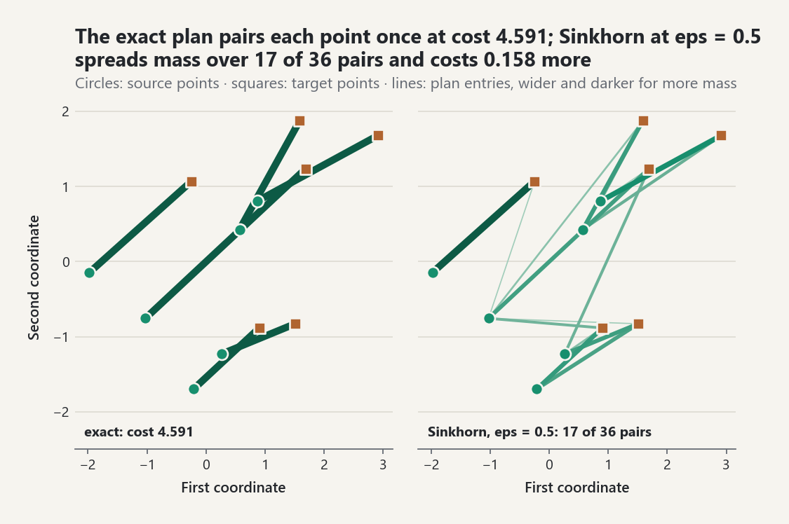
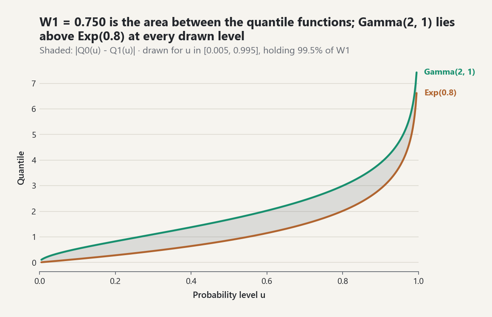

# Optimal Transport and Information Geometry

`probstat.information` (layer 2) adds four modules to the entropy and
divergence tools of [information-theory.md](information-theory.md):

| Module | Contents |
|---|---|
| `transport` | exact discrete transport with dual certificates, log-domain Sinkhorn, Sinkhorn divergence, cost matrices |
| `wasserstein` | Gaussian (Bures) `W_2`, quantile-based 1-D `W_p`, `W_2` barycenters |
| `geometry` | Fisher information (closed form and numerical), Fisher-Rao distances |
| `divergences` | total variation, Hellinger, Bhattacharyya, Rényi, alpha-divergences |

Every number below was printed by `examples/optimal_transport_lab.py`
(seed 2026) or by the checks in `tests/test_transport_and_geometry.py`
(seed 20261012). Two-sample hypothesis tests built on these distances are
not part of this package.

## 1. Exact discrete transport (EQ-OT-LP-001, EQ-OT-SIMPLEX-001)

Given weights `a` (length `m`), `b` (length `n`) of equal mass and a cost
matrix `C`, `exact_transport(a, b, C)` minimizes `sum C_ij P_ij` over
couplings `P` with row sums `a` and column sums `b`. It runs the
transportation simplex:

1. The north-west corner rule gives a starting vertex with `m + n - 1`
   basic cells that form a spanning tree.
2. Potentials with `u_i + v_j = C_ij` are solved on the tree.
3. If every reduced cost `C_ij - u_i - v_j` is non-negative (to a relative
   tolerance of `1e-12`), the plan is optimal. Otherwise the most negative
   cell enters, mass moves around the unique cycle, and one cell leaves.
4. After `m + n` degenerate pivots in a row, the solver switches to Bland's
   smallest-index rule, which cannot cycle.

The result carries the potentials. `plan.certificate()` reports the duality
gap, marginal error, dual infeasibility, and the complementary-slackness
residual `max P_ij |C_ij - u_i - v_j|`. A feasible plan and feasible
potentials with zero slackness are both optimal.

Lab, 6 + 6 points in the plane, uniform weights, squared Euclidean cost:

| Quantity | Value |
|---|---|
| simplex optimal cost | 4.5911845497 |
| brute force over 720 permutations | 4.5911845497 |
| simplex pivots | 9 |
| duality gap | 0.00e+00 |
| complementary-slackness residual | 0.00e+00 |
| max dual violation | 4.44e-16 |

In the tests, 60 random assignment problems (`n = 2..6`, a third with
integer costs so ties and degeneracy occur) match brute force to within
`2.2e-16`. On 40 rectangular problems with zero-mass atoms, every
certificate is optimal and every plan has at most `m + n - 1` positive
entries, so it is a vertex. `discrete_wasserstein` returns
`(OT cost)^(1/p)` for the cost `|x - y|^p`. For equal-weight 1-D clouds it
equals sorted matching to 12 decimals.

The solver is dense pure Python. It is meant for problems up to a few
hundred points per side.

## 2. Entropic transport (EQ-OT-SINK-001, EQ-OT-SINK-002)

`sinkhorn(a, b, C, epsilon=eps)` solves
`min <P, C> + eps KL(P || a b')`. Its updates are the soft c-transforms of
the potentials, computed with log-sum-exp, so `exp(-C/eps)` never
underflows. After each `g` update the column marginals are exact. The
iteration stops when the row marginal error `|P 1 - a|_1` is below
`tolerance` (default `1e-9`). The result also holds the per-iteration error
trace.

Lab (same problem as in section 1, exact cost 4.59118):

| eps | iterations | `<P,C>` − exact | `OT_eps` − exact | row error | `S_eps` |
|---|---|---|---|---|---|
| 2.00 | 35 | 6.63e-01 | 1.66e+00 | 9.4e-10 | 4.16780 |
| 1.00 | 63 | 3.20e-01 | 1.05e+00 | 9.6e-10 | 4.33901 |
| 0.50 | 219 | 1.58e-01 | 6.36e-01 | 9.4e-10 | 4.47883 |
| 0.25 | 3322 | 7.47e-02 | 3.71e-01 | 1.0e-09 | 4.55135 |

Both costs fall toward the LP optimum as `eps` falls, but the iteration
count rises sharply.

<picture><source media="(prefers-color-scheme: dark)" srcset="../images/guides/transport-plane-coupling-dark.png"></picture>

*On the lab's six-plus-six problem the simplex plan is a permutation, one line per point, with cost 4.591; Sinkhorn at eps = 0.5 keeps both marginals but spreads the mass over 17 of 36 pairs (entries above 0.5% of the total), which raises `<P,C>` by 0.158, the `eps = 0.50` row of the table.*

In the tests, a 5 x 5 problem with costs in `[0, 1]`
(exact cost 0.39445) gives these `<P,C>` gaps:

| eps | `<P,C>` gap | iterations |
|---|---|---|
| 0.5 | 0.13368 | 9 |
| 0.1 | 0.013172 | 42 |
| 0.02 | 0.0019373 | 94 |
| 0.005 | 5.2e-05 | 1356 |

The iteration count grows quickly once `eps` is small against the cost
spread (0.95 here): at `eps = 1/300` the same problem needs 3327 iterations,
and the lab's `eps = 0.25` row needs 3322. Choose `eps` relative to `max C`.

The optional `epsilon_scaling` (geometric annealing from `max|C|`) gives the
same transport cost as plain iteration (to `2e-10` on this problem) but
rarely saves work: with factor `0.5` it takes 49, 111, 1183, and 3688
iterations at `eps = 0.1, 0.02, 0.005, 1/300`, against 42, 94, 1356, and
3327 without it.

**Sinkhorn divergence.**

`S_eps(alpha, beta) = OT_eps(alpha, beta) - (OT_eps(alpha, alpha) + OT_eps(beta, beta))/2`

The two self terms use the averaged symmetric map of Feydy et al. (2019),
which converges in a few dozen steps where plain alternation is slow.

- The self-divergence printed by the lab is `2.2e-16`.
- In the tests, the exact `W_2^2` between two 6-point clouds is 6.04815.
  `S_eps` approaches it from below with relative errors 0.069, 0.016, and
  0.0038 at `eps = 4, 1, 0.25`.

## 3. Closed-form Wasserstein distances (EQ-OT-GAUSS-001, EQ-OT-W1D-001)

- `gaussian_wasserstein(m0, S0, m1, S1)` returns
  `sqrt(|m0 - m1|^2 + B(S0, S1)^2)`. Here `B` is the Bures distance
  `B^2 = tr S0 + tr S1 - 2 tr (S0^(1/2) S1 S0^(1/2))^(1/2)`. Matrix square
  roots come from `linalg.symmetric_eigen`.
- `normal_wasserstein` is the 1-D case `sqrt(dmu^2 + dsigma^2)`.
- `quantile_wasserstein(law0, law1, p)` integrates `|Q0(u) - Q1(u)|^p` over
  `u` in `(0, 1)`. The default `method="tanh-sinh"` integrates in `u` on
  `(0, 1/2)` and `(1/2, 1)` with nodes reaching about `1e-300` from either
  end. `method="simpson"` substitutes `u = Phi(z)` and uses Simpson
  quadrature on `[-8, 8]` with 512 intervals. Upper-tail nodes call `isf`,
  so there is no cancellation in `1 - u`.

| Distance | Reference | Quadrature (tanh-sinh) |
|---|---|---|
| `W_2(N(1, 2^2), N(-0.5, 0.7^2))` | 1.9849433241 (1-D formula; Bures form identical) | 1.9849433241 |
| `W_1(Gamma(2, 1), Exp(0.8))` | 0.7500086081 (Simpson of `\|F0 - F1\|`) | 0.7500086081 |

The `W_1` integrand has a kink where the quantile functions cross. The
tanh-sinh value agrees with the reference to `1.8e-11`; Simpson's rule in
`z` is limited by the kink and gives `0.7500086129` with 512 intervals and a
gap of `4.7e-10` with 2048. The Simpson grid also truncates probability
`2 Phi(-8) ~ 1.2e-15`. That is negligible for light tails; if `W_p` is
barely finite because of heavy tails, use the default method.

<picture><source media="(prefers-color-scheme: dark)" srcset="../images/guides/transport-quantile-w1-dark.png"></picture>

*`W_1` between `Gamma(2, 1)` and `Exp(0.8)` is the shaded area between the quantile functions, 0.750; the Gamma quantile stays above the exponential one over the drawn range, and the crossing that puts the kink into the integrand lies far out, between `u = 0.99997` and `0.99999`, where the heavier exponential tail overtakes.*

## 4. Barycenters (EQ-OT-BARY-001, EQ-OT-BARY-002)

On the line, `W_2` is the `L^2` distance between quantile functions.
`quantile_barycenter(laws, weights)` therefore averages quantiles.

- The barycenter of `N(0, 1)` and `N(4, 3^2)` is within `W_2 = 2.8e-16` (rounding error) of
  `N(2, 2^2)`: averaged mean and averaged standard deviation, not averaged
  variance.
- With weights `(0.25, 0.75)` it is `N(3, 2.5^2)`.

`gaussian_barycenter` iterates the fixed-point map of Álvarez-Esteban et
al. (2016), starting from the arithmetic mean of the covariances:

`S <- S^(-1/2) (sum_k w_k (S^(1/2) S_k S^(1/2))^(1/2))^2 S^(-1/2)`

For three 2-D laws it reaches
`S = [[1.065913, 0.060217], [0.060217, 1.065204]]` in 8 steps, with
fixed-point residual `1.9e-15`. For commuting covariances it reproduces
`(sum_k w_k S_k^(1/2))^2`, for example `diag(2.25, 4)`.

## 5. Fisher information (EQ-IG-FISHER-001, EQ-IG-FISHER-002)

Closed forms (`fisher_information(law)` dispatches on the distribution
object):

| Family | Parameters | `I(theta)` |
|---|---|---|
| Normal | `(mu, sigma)` | `diag(1/sigma^2, 2/sigma^2)` |
| Exponential | rate `lambda` | `1/lambda^2` |
| Gamma | `(k, lambda)`, rate | `[[psi'(k), -1/lambda], [-1/lambda, k/lambda^2]]` |
| Beta | `(a, b)` | `[[psi'(a) - psi'(a+b), -psi'(a+b)], [-psi'(a+b), psi'(b) - psi'(a+b)]]` |
| Bernoulli / Binomial | `p` (`n` known) | `1/(p(1-p))`, `n/(p(1-p))` |
| Poisson | `lambda` | `1/lambda` |
| Categorical | `p_1..p_{k-1}` | `delta_ij/p_i + 1/p_k` |
| MVN mean | `m` (`S` known) | `S^-1` |

`numerical_fisher_information(family, theta)` works with any family whose
`family(theta)` returns an object with `log_pdf` or `log_pmf`. It takes
central differences in `theta` and then averages over `X`:

- continuous laws: quantile quadrature;
- integer supports: a sum up to a `1e-14` upper tail;
- or Monte Carlo over draws.

The averaged quantity is either the score outer product or minus the
Hessian. Largest relative error against the closed form (lab):

| Law | `I_11` closed | score | Hessian |
|---|---|---|---|
| Normal(0.3, 1.7) | 0.346021 | 2.7e-10 | 1.6e-08 |
| Gamma(2.3, 1.4) | 0.542537 | 1.1e-12 | 1.4e-08 |
| Beta(2, 3.5) | 0.445592 | 2.4e-13 | 5.1e-08 |
| Bernoulli(0.3) | 4.761905 | 5.6e-10 | 4.2e-08 |
| Poisson(3.2) | 0.312500 | 2.5e-11 | 5.5e-10 |

The tests also cover Exponential(2.5) and Binomial(12, 0.3), with tolerance
`1e-6` throughout. The Monte Carlo estimate with 4000 draws is required to
lie within four standard errors.

## 6. Fisher-Rao distances (EQ-IG-FR-001..003)

| Model | Distance |
|---|---|
| Normal `(mu, sigma)` | `2 sqrt 2 asinh(sqrt(((dmu)^2/2 + (dsigma)^2)/(4 sigma0 sigma1)))` (scaled Poincaré half-plane) |
| Categorical | `2 arccos(sum sqrt(p q)) = 4 asin(\|sqrt p - sqrt q\|/2)` (sphere of radius 2) |
| Binomial (`n` known) | `2 sqrt n \|asin sqrt p0 - asin sqrt p1\|`; Bernoulli is `n = 1` |
| Poisson | `2 \|sqrt l0 - sqrt l1\|` |
| Exponential | `\|log l0 - log l1\|` |
| MVN mean (`S` known) | Mahalanobis distance |

Lab values:

- `N(0, 1)` to `N(1, 2^2)`: 1.189381.
- Categorical `(0.2, 0.5, 0.3)` to `(0.4, 0.4, 0.2)`: 0.448103.
- `Poisson(3)` to `Poisson(5)`: 1.008034.

The tests check four things:

- symmetry and the triangle inequality on all 84 triples of 9 random points
  for each model;
- the small-distance limit `d(theta, theta + h v) / (h sqrt(v' I v)) = 1` to
  five decimals at `h = 1e-5` (normal, Poisson, exponential, Bernoulli,
  categorical);
- agreement of the normal formula with the independent `artanh` form of
  Miyamoto et al. (2.3266584 for `N(0.3, 1.2^2)` to `N(-1.1, 0.4^2)`);
- agreement of the Bernoulli formula with the categorical arccos form.

## 7. Divergences (EQ-DIV-*)

For finite PMFs, with `p = (0.2, 0.5, 0.3)` and `q = (0.4, 0.4, 0.2)`:

| Quantity | Value |
|---|---|
| total variation | 0.2 |
| Hellinger `H` (`H^2 = 1 - BC`, range `[0, 1]`) | 0.158097 |
| Bhattacharyya distance | 0.025312 |
| Rényi `D_{1/2}` | 0.050625 |
| KL = `D_1` | 0.094582 |
| Rényi `D_2` | 0.161268 |
| Rényi `D_inf` = `log 1.5` | 0.405465 |

Rényi divergence near `alpha = 1` (lab):

| alpha | `D_alpha` − KL |
|---|---|
| 0.99 | -8.08e-04 |
| 0.9999 | -8.07e-06 |
| 1.0001 | 8.07e-06 |
| 1.01 | 8.05e-04 |

The difference is linear in `alpha - 1`. The tests also check:

- `D_B = D_{1/2}/2`;
- `D_A(1/2) = 4 H^2`;
- the Rényi-alpha identity `D_alpha = log(1 + alpha(alpha - 1) D_A)/(alpha - 1)`;
- `H^2 <= TV <= sqrt(1 - BC^2)`;
- monotonicity of `D_alpha` in `alpha`.

Gaussian closed forms come from the affinity `A_alpha = int N0^alpha N1^(1-alpha)`:

- `D_alpha = log A_alpha / (alpha - 1)`;
- `D_B = -log A_{1/2}`;
- `H = sqrt(1 - A_{1/2})`;
- `D_A = (A_alpha - 1)/(alpha(alpha - 1))`.

`total_variation_normal` integrates between the two crossing points of the
densities. For `N(0.3, 1.2^2)` against `N(-0.4, 0.7^2)`:

| Quantity | Closed form | Check |
|---|---|---|
| Bhattacharyya | 0.13283461 | `-log` of a Simpson integral, 9 decimals |
| Hellinger | 0.35268981 | same |
| total variation | 0.35895636 | Simpson with 200 000 intervals, 8 decimals |
| Rényi `D_0.3` | 0.13710431 | Simpson, 9 decimals |
| KL | 0.93039125 | `kl_multivariate_normal` |
| Rényi `D_2` | `inf` | `2 S1 - S0` is not positive definite, so the integral diverges |

The Gaussian Rényi divergence differs from KL by `-2.41e-03` at
`alpha = 1 - 1e-3` and by `-2.41e-05` at `alpha = 1 - 1e-5`.

## Limitations

- The exact solver and Sinkhorn are dense and `O(m n)` per iteration in
  pure Python. Sinkhorn needs many iterations when `eps` is small relative
  to the cost spread.
- `sinkhorn_divergence` raises `ArithmeticError` if a subproblem does not
  converge. It never returns an unconverged value silently.
- `numerical_fisher_information` assumes the support does not depend on
  `theta`. Uniform end points, the GEV shape, and similar parameters are
  outside its scope.
- Fisher-Rao distances are given only where a closed form is standard. No
  geodesic shooting is implemented, for example for the full multivariate
  normal.
- Total variation between Gaussians is closed-form only in 1-D or with a
  shared covariance.

## Common pitfalls

- **Check `converged` after `sinkhorn`.** When `max_iterations` is reached
  the result is returned with `converged=False` and an arbitrary plan; only
  `sinkhorn_divergence` raises. `epsilon` is in cost units, so choose it
  relative to `max C`.
- **Entropic cost is biased upward.** `sinkhorn(...).transport_cost` lies
  above the exact optimum and approaches it only as `epsilon` falls.
- **`W_p` versus the transport cost.** `discrete_wasserstein` returns
  `(OT cost)^(1/p)`, while `exact_transport(...).cost` is the cost itself.
- **Equal mass.** Source and target weights must have the same total;
  `exact_transport` raises `ValueError` otherwise.
- **Parameterizations and conventions.** `fisher_information(Normal(mu,
  sigma))` is in `(mu, sigma)` coordinates, not `(mu, sigma^2)`, and
  `hellinger_distance` uses the `1/2` factor, so it lies in `[0, 1]`.

```python
from probstat.distributions import Normal
from probstat.information import (
    discrete_wasserstein, exact_transport, fisher_information,
    hellinger_distance, sinkhorn,
)

a, b = (0.2, 0.3, 0.5), (0.4, 0.4, 0.2)
C = ((0.0, 1.0, 4.0), (1.0, 0.0, 1.0), (4.0, 1.0, 0.0))
exact_transport(a, b, C).cost                                   # 0.5
sinkhorn(a, b, C, epsilon=0.5).transport_cost                   # 0.526
stopped = sinkhorn(a, b, C, epsilon=0.05, max_iterations=5)
stopped.converged                                               # False
stopped.marginal_error > 0.5                                    # True

discrete_wasserstein((0.0, 1.0), (0.5, 0.5), (2.0, 3.0), (0.5, 0.5), p=2)  # 2.0, cost 4
try:
    exact_transport((0.5, 0.5), (0.3, 0.3), ((0.0, 1.0), (1.0, 0.0)))
except ValueError as error:
    unequal = str(error)
unequal   # 'source and target weights must have equal total mass'

fisher_information(Normal(0.0, 2.0))       # ((0.25, 0.0), (0.0, 0.5))
hellinger_distance((1.0, 0.0), (0.0, 1.0))  # 1.0
```
