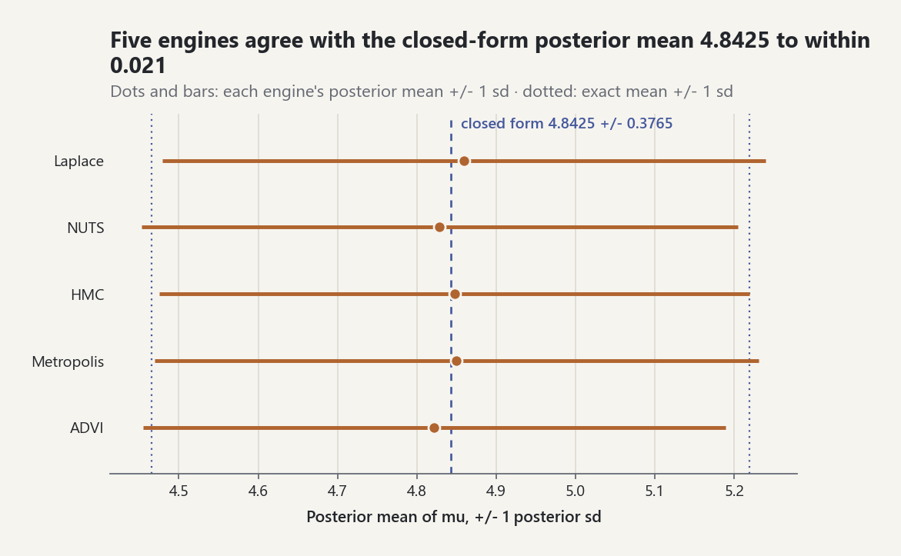
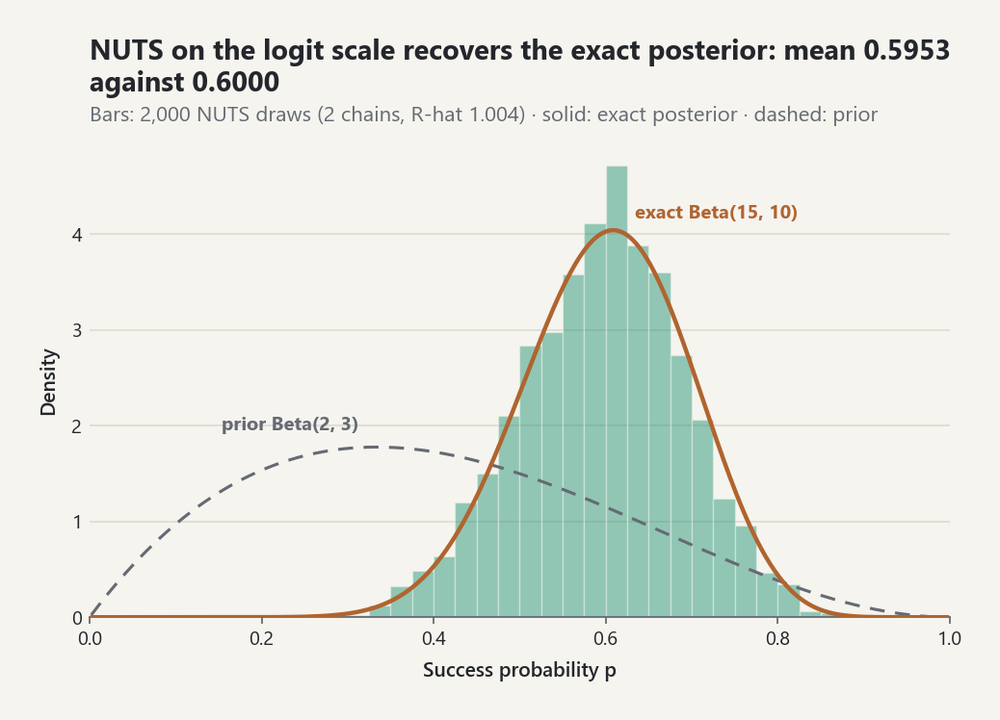

# Probabilistic Programming

`probstat.inference.ppl` lets you write a Bayesian model as an ordinary
Python function. You then hand that function to the existing engines:

- NUTS, HMC, and adaptive Metropolis;
- ADVI;
- the Laplace approximation;
- posterior predictive checks.

You do not write a log-density by hand.

Every number below was printed by `examples/ppl_lab.py`, by
`tests/test_probabilistic_programming.py`, or by short scripts that used the
same models and seeds. They are the library's own outputs. None is copied
from the literature.

## 1. A model is a function

```python
from probstat.distributions import Normal, TruncatedNormal
from probstat.inference import ppl

y = (28.0, 8.0, -3.0, 7.0, -1.0, 1.0, 18.0, 12.0)
s = (15.0, 10.0, 16.0, 11.0, 9.0, 11.0, 10.0, 18.0)

def eight_schools(m):
    mu = m.sample("mu", Normal(0.0, 5.0))
    tau = m.sample("tau", TruncatedNormal(0.0, 5.0, lower=0.0))  # half-normal
    theta = m.sample("theta", Normal(mu, tau), shape=8, reparam="noncentered")
    m.observe("y", ppl.elementwise(Normal, theta, s), y)

posterior = ppl.sample(eight_schools, draws=150, warmup=150, chains=2, seed=1)
posterior.mean("tau"); posterior["theta"]; posterior.summary()
```

This is the configuration of the test run in section 3 (seed 1, two chains
of 150 warm-up and 150 kept draws). A production run would use more draws
and four chains; the cost grows linearly in `draws + warmup` and `chains`.

The handle `m` has three methods:

- `m.sample(name, dist, shape=None, reparam=None)` declares a latent
  variable. It returns a float for a scalar site, or a tuple for a site
  with `shape=n` or a list of distributions.
- `m.observe(name, dist, value)` adds `log p(value | ...)` to the
  likelihood. The value may be omitted if you supply it later with
  `ppl.condition(model, {"y": data})`. Conditioning also turns a `sample`
  site into an observed site.
- `m.deterministic(name, value)` records a derived quantity. It is reported
  with the draws and recomputed in predictive simulation.

A distribution is any object with three members:

- `support`, a `RealSupport` for latent sites;
- `log_pdf` (or `log_pmf`);
- `sample(size, seed=)`.

Every continuous law in `probstat.distributions` works as is. The lab's
half-Cauchy is a user class of about twenty lines.

The library distributions take scalar parameters. To give each element its
own law, pass a list. `ppl.elementwise(Normal, theta, s)` builds that list
by broadcasting scalars and equal-length sequences.

## 2. The intermediate representation

`ppl.trace(model)` runs the model once and returns a `ModelIR`. Each latent
site takes the value `T(0)`, so tracing uses no randomness. The `ModelIR`
holds the ordered sites with their sizes, supports, and bijections:

| Support | Bijection `x = T(u)` | log-Jacobian |
|---|---|---|
| `R` | `u` | `0` |
| `(a, inf)` | `a + exp(u)` | `u` |
| `(-inf, b)` | `b - exp(u)` | `u` |
| `(a, b)` | `a + (b - a) / (1 + exp(-u))` | `log(b - a) - softplus(u) - softplus(-u)` |

The table rows are [EQ-PPL-TRANSFORM-001] and [EQ-PPL-TRANSFORM-002]. The
joint log-density on `R^d` ([EQ-PPL-JOINT-001]) is

`log p(u) = sum_k log p(x_k | x_<k) + log p(y | x) + sum_k log |dT_k/du_k|`.

`ModelIR.terms(u)` returns the three parts separately. For eight schools,
`unconstrained_names` begins `mu, log(tau), theta_z[0]` and `d = 10`.

**The bijection is chosen from the live support.** It is re-derived at
every evaluation from the distribution that is active then. So
`m.sample("x", Uniform(0.0, theta))` works with a latent `theta`. The map
stays lower triangular in site order, so the Jacobian is still the sum of
the per-site terms. `tests/test_probabilistic_programming.py` checks this
case against a hand-derived log-density to ten digits.

**Rules the IR enforces.** Each of these raises `ModelSpecificationError`:

- a site name used twice;
- a latent site whose support is not a continuous `RealSupport` (for
  example `Binomial`), unless it is declared with `marginalize=True`
  (section 5) or its law has a structured support;
- a distribution without `support`;
- `reparam="noncentered"` on a non-normal site;
- an observed site without data;
- a `condition` name that matches no site;
- a site structure that changes with the continuous parameter values.
  Every later execution is checked against the trace. Structure may depend
  on the data and on marginalized discrete sites outside plates (section 6).

Numerical failures inside the model, such as `Normal(0, 0)` built from a
latent value, are mapped to `-inf`. Every sampler reads `-inf` as "outside
the support". `terms(u)` lets the exception through, for debugging.

**Gradients.** NUTS, HMC, ADVI and the Laplace mode search need
`grad log p(u)`. The PPL takes it by automatic differentiation whenever the
program is *traceable*, and by central differences ([EQ-OPT-FD-001], two
model executions per coordinate) otherwise. The method and the reason for a
fallback are recorded in `posterior.gradient_method` and
`posterior.gradient_fallback_reason`.

*Reverse mode* (ADR-0069, the PPL default). The model is executed once on
`probstat.numerics.ReverseVariable` inputs. Every arithmetic operation and
every `probstat.numerics.admath` function appends a node to a tape: the
indices of its operands and its local partial derivatives `c_ij`. One
backward sweep from `ubar = 1` then accumulates `vbar_j += vbar_i c_ij` in
reverse order ([EQ-AD-REVERSE-001]); the adjoints of the inputs are the
gradient, exact up to rounding. The work of the sweep is a small multiple of
the work of one evaluation, whatever the dimension
([REF-GRIEWANK-WALTHER-2008, Chapters 3 and 4], [REF-BAYDIN-ETAL-2018,
Section 3.2]). Recording the tape on dual numbers and sweeping once gives the
Hessian used by `laplace` (forward over reverse, [EQ-AD-FOR-001],
[REF-PEARLMUTTER-1994]).

*Forward mode* (`gradient="autodiff"` or `"forward"`, ADR-0065) carries a
length-`d` tangent through every operation ([EQ-AD-DUAL-001]). It also needs
one model execution per gradient, but its arithmetic grows with `d`. For a
100-coordinate Gaussian log-density one reverse gradient cost 34-61 float
evaluations against 246-422 for forward mode and 152-262 for central
differences (200 model executions); at `d = 10` the three were 56-57, 80-87
and 50-55 (ADR-0069, Verification). The saving that does not depend on the
machine is the number of model executions: one instead of `2 d + 1`.

*Traceable programs.* Model code and distribution objects must use
operators and `admath` rather than `math` or `float()`. The library laws
qualify (ADR-0090): every family of `probstat.distributions` with real
parameters, `multivariate.Multinomial` and the mean of
`multivariate.MultivariateNormal` accept dual numbers and tape variables,
validate them on their primal values, and evaluate `log_pdf` / `log_pmf`
with `admath`. So `Normal(mu, 1.0)` with a latent `mu`, a `Gamma(2, 1)`
prior on a latent precision, and `Multinomial(n, p)` with a simplex-valued
`p` are differentiated exactly, with `gradient_method == "reverse"`. Where a
family keeps a float-only kernel for accuracy (large gamma, beta, F and
Student-t shapes, the truncated-normal mass), the value comes from that
kernel and the derivatives from the closed form ([EQ-DIST-AD-001]); float
results are bit-identical to the float-only code. Duck-typed distributions
whose `log_pdf` uses `admath` are traceable as well. Programs fall back to
central differences when a support bound depends on a latent value
(`Uniform(0, t)` with a latent `t`: reason "upper must be a real number"),
when a law takes float parameters only (a latent Dirichlet concentration, a
latent covariance), or when the model calls `math`. Leapfrog stays
volume-preserving and reversible with an approximate force, so a fallback
costs efficiency, not correctness. Before ADR-0090 the eight-schools test
run (two chains of 150 warm-up and 150 kept draws) fell back and needed
5 610 gradients, which is 117 810 model executions, 7-11 s on the
development machine at about 75 µs per execution.

## 3. Inference

All functions return `PosteriorSamples`:

- `posterior[name]` gives the pooled draws on the natural scale.
- `posterior.mean(name)` and `posterior.summary()` give means, quantiles,
  ESS, and rank-normalized R-hat.
- `posterior.constrained` is an `MCMCResult` named `mu, tau, theta[0], ...`.
- `posterior.unconstrained` holds the draws on the sampling scale.
- `posterior.engine` is the raw engine result.
- `posterior.hamiltonian` (NUTS/HMC only) re-attaches the divergence and
  tree-depth statistics to the constrained draws.

The constrained draws are deterministic functions of the chain, so every
existing diagnostic applies to them unchanged.

| Function | Engine | Notes |
|---|---|---|
| `sample(model, method="nuts")` | `no_u_turn_sampler` | default |
| `sample(model, method="hmc")` | `hamiltonian_monte_carlo` | step-size jitter 0.2 by default |
| `sample(model, method="metropolis")` | `adaptive_metropolis` | adaptation during warm-up only |
| `fit_advi(model)` | `advi` | Gaussian on `R^d`: log-normal or logit-normal on the natural scale |
| `laplace(model)` | `laplace_approximation` | Gaussian at the unconstrained mode |

Starting points are drawn uniformly from `[-2, 2]^d` on the unconstrained
scale (`init_radius`), with separate child streams of `seed` per chain.

The Laplace `point`, like the ADVI mean, is located on the unconstrained
scale. Because of the Jacobian, it is not the posterior mode of the natural
parameter. For `tau = exp(u)` it maximizes `tau p(tau | y)`.

### Eight schools against the exact grid

The grid posterior of `hierarchical_normal_posterior` integrates `theta`
and `mu` out exactly (see [hierarchical models](hierarchical-models.md)).
It is the reference here.

*Test, half-normal(5) prior on tau, normal(0, 5) prior on mu.* Seed 1, two
chains of 150 warm-up and 150 kept draws:

| | exact | NUTS (MCSE) |
|---|---|---|
| E[mu] | 4.441 | 4.302 (0.209) |
| E[tau] | 3.290 | 3.521 (0.229) |

The run had no divergences and a mean tree depth of 2.9 and 3.1. The test
requires agreement within 4 MCSE and rank-normalized R-hat < 1.05.

*Lab, half-Cauchy(5) prior on tau.* The half-Cauchy is a user-defined
class. Seed 2026, two chains of 300 + 300 draws:

| | exact | NUTS (MCSE) | ESS |
|---|---|---|---|
| E[mu] | 4.397 | 4.246 (0.178) | 331 |
| E[tau] | 3.598 | 3.756 (0.168) | 360 |
| E[theta_1] | 6.212 | 6.351 (0.323) | |

The non-centred run had 0 divergences. The same model written centred
(tree depth capped at 6, 150 + 150 draws) had no divergences, but 58 of its
300 draws stopped at the depth limit, one chain had an E-BFMI of 0.27, and
the ESS of tau was only 66 against 360. Its tau mean of 3.808 cannot be
trusted at that ESS. This is the funnel that
`reparam="noncentered"` removes ([EQ-PPL-NONCENTERED-001]).

### Conjugate checks

**Normal-normal.** The model is `mu ~ N(0, 3^2)` with ten observations
`y_i ~ N(mu, 1.2^2)`. The data are supplied by `condition`. The closed form
gives posterior mean 4.8425 and sd 0.3765.

Results from the lab (seeds 1-5):

| Method | mean | sd |
|---|---|---|
| Laplace (2 000 draws) | 4.8598 | 0.3804 |
| NUTS | 4.8286 | 0.3759 |
| HMC | 4.8417 | 0.3612 |
| Metropolis | 4.8503 | 0.3808 |
| ADVI | 4.8220 | 0.3674 |

The Laplace mode itself is 4.842520, exact to six digits. In the test, the
Laplace sd is 0.376473, also exact to six digits. The Laplace mean in the
table is a sample mean of draws, so it carries Monte Carlo error.

<picture><source media="(prefers-color-scheme: dark)" srcset="../images/guides/ppl-engines-closed-form-dark.png"></picture>

*One program, five engines: with the lab's seeds and settings (HMC shortened to 200 warm-up and 300 kept draws per chain) every posterior mean lies within 0.021 of the closed-form 4.8425, and every +/- 1 sd bar ends close to the dotted exact limits, so the program, its bijections, and each engine agree.*

**Beta-binomial.** The model is `p ~ Beta(2, 3)` with 13 successes in 20
trials, so the exact posterior is `Beta(15, 10)` (mean 0.6000, sd 0.0961).

- The lab integrates `exp(log p(u))` over `u` by the trapezoid rule and
  gets 0.0474308300. The exact evidence `p(k)` is also 0.0474308300. This
  checks the logit bijection and its Jacobian together.
- The test checks the same thing pointwise: `log p(u)` minus
  `log Beta(15, 10)(sigmoid(u))` minus `log J(u)` equals the log evidence
  to ten decimal places at five values of `u`.
- NUTS gives mean 0.5953 and sd 0.0935 (lab, seed 7), or 0.5967 (MCSE
  0.0036) and sd 0.0955 (test, seed 8).
- Every draw lies inside (0, 1).

<picture><source media="(prefers-color-scheme: dark)" srcset="../images/guides/ppl-beta-binomial-posterior-dark.png"></picture>

*The lab's two NUTS chains (seed 7, rank-normalized R-hat 1.004) sample the logit of `p`, yet their histogram on the natural scale follows the exact `Beta(15, 10)` density: the sample mean 0.5953 lies within two Monte Carlo standard errors of the exact 0.6000, and the data have moved the mass well to the right of the `Beta(2, 3)` prior.*

## 4. Predictive simulation

- `prior_predictive(model, draws, seed)` draws latent sites from their
  priors in execution order, then draws observed sites.
- `posterior_predictive(model, posterior, seed)` re-runs the model with
  each latent site fixed, by name, to its posterior value. It draws the
  observed sites, so `y_rep ~ p(y | theta^(s))` ([EQ-PPL-PREDICTIVE-001]).

Both return `PredictiveSamples` keyed by site name. The same seed gives the
same draws.

`predictive_pvalues(model, posterior, "y", statistics=...)` passes the
constrained `MCMCResult` and a simulator that re-runs the model to
`posterior_predictive_pvalues` ([EQ-PPC-001]). Because the chain structure
is kept, the p-value MCSE uses the effective sample size of the indicator
chains.

For eight schools (lab, half-Cauchy prior):

- The prior predictive range `max y - min y` has median 43.3 and 90 %
  quantile 99.6. The observed range is 31.0.
- The posterior predictive p-values are 0.293 for `max` (MCSE 0.019),
  0.082 for `min` (0.011), and 0.738 for `sd` (0.017).

## 5. Structured and discrete latent sites

ADR-0082 adds two kinds of latent site. Every number in this section was
printed by `tests/test_ppl_structured_sites.py` or by a script with the
same models and seeds.

### Structured supports

A site whose law lives on a simplex or on a set of matrices is mapped from
`R^m` by the transforms of the Stan Reference Manual 2.36, chapter
"Constraint Transforms" ([REF-STAN-REFERENCE-MANUAL-2-36]). The law is
recognized by its type; a user law can also set its `support` to a
`ppl.StructuredSupport`.

| Law | Value | `m` | Transform |
|---|---|---|---|
| `multivariate.Dirichlet(alpha)` | point of the `K`-simplex | `K - 1` | stick-breaking, [EQ-PPL-TRANSFORM-003] |
| `ppl.OrderedVector(base, n)` | increasing vector | `n` | cumulative exponentials, [EQ-PPL-TRANSFORM-004] |
| `multivariate.LKJCholesky(d, eta)` | Cholesky factor of a correlation matrix | `d(d-1)/2` | tanh of partial correlations, [EQ-PPL-TRANSFORM-005] |
| `multivariate.LKJCorrelation(d, eta)` | correlation matrix | `d(d-1)/2` | the same, then `L L'` |
| `multivariate.Wishart`, `InverseWishart` | covariance matrix | `d(d+1)/2` | Cholesky with log diagonal, [EQ-PPL-TRANSFORM-006] |

The stick-breaking simplex map is the one of Stan 2.36; from 2.37 Stan
uses a softmax of a sum-to-zero vector instead. Values are tuples (vectors)
or tuples of rows (matrices); the reported names are `p[0]`, `Sigma[1,0]`,
and so on, and `posterior.mean("Sigma")` is a matrix.

The densities of these laws are evaluated inside the PPL from the
quantities the transform already holds (the logarithms of the simplex
entries and of the Cholesky diagonal), with `admath`. So a prior with
constant parameters is traceable and reverse mode applies, and since
ADR-0090 so is a likelihood such as `Multinomial(n, p)` with a latent `p`.
`m.observe(name, law, value)` with a law that has a
`dimension` attribute (`Multinomial`, `MultivariateNormal`, ...) adds one
joint `log_pdf` or `log_pmf` term for the whole vector.

The LKJ law ([REF-LEWANDOWSKI-KUROWICKA-JOE-2009]) has density
`det(Omega)^(eta - 1) / c_d(eta)` ([EQ-DIST-LKJ-001]); on the Cholesky
factor it is `prod_k L_kk^(d - k + 2 eta - 2) / c_d(eta)`
([EQ-DIST-LKJ-002], [REF-STAN-FUNCTIONS-REFERENCE-2-36]). Draws use
independent Beta partial correlations ([EQ-DIST-LKJ-003]).

Checks:

- The log-Jacobian of every transform (simplex `K = 4`, ordered with and
  without a bound, Cholesky correlation `d = 3`, correlation `d = 3, 4`,
  covariance `d = 3`) agrees with the log-determinant of a central-difference
  Jacobian to within `1e-10`; inverse and forward maps round-trip to `1e-12`.
- `c_3(eta)` from the closed form against nested Gauss-Kronrod quadrature of
  `det^(eta - 1)` over the 3 x 3 correlation matrices: 4.934802200544679
  against 4.93480220054468 (`eta = 1`, which is `pi^2 / 2`), 1.8505508252042595
  against 1.8505508252042546 (`eta = 2`), 1.0280837917801355 against
  1.0280837917801415 (`eta = 3`). For `d = 2` the constant matches the
  quadrature for `eta = 0.5, 1, 2, 3.7` to ten decimal places.
- LKJ(1) on 2 x 2 matrices gives `log f = log(1/2)` for every `r`, and an
  HMC run on that site alone gives a mean of `r` within 4 MCSE of zero.
- The PPL log-density of an `LKJCholesky(4, 1.7)` site equals the sum of the
  log-densities of independent `2 Beta(b_j, b_j) - 1` partial correlations
  plus `log(1 - tanh^2)` to eleven digits, which checks the constant, the
  Cholesky density, and the Jacobian together.
- Dirichlet(2, 1.5, 1) with multinomial counts (12, 5, 3), NUTS (seed 3, two
  chains of 300 + 400 draws). The reverse-mode run (ADR-0090) needed 5 616
  model executions; the finite-difference run, the only option before
  ADR-0090, needed 27 755 (5 551 gradients):

  | | reverse (MCSE) | finite differences (MCSE) | conjugate |
  |---|---|---|---|
  | p[0] | 0.5772 (0.0037) | 0.5766 (0.0034) | 0.5714 |
  | p[1] | 0.2571 (0.0038) | 0.2579 (0.0033) | 0.2653 |
  | p[2] | 0.1658 (0.0032) | 0.1655 (0.0025) | 0.1633 |

- An inverse-Wishart(nu = 6) covariance with twelve bivariate normal
  observations (NUTS, seed 4, two chains of 250 + 250 draws): posterior
  means 1.2458, 0.8585, 0.9645 (MCSE 0.043, 0.033, 0.031) against the
  conjugate `(Psi + S) / (nu + n - 3)` = 1.1695, 0.8114, 0.9209.
- Reverse mode, forward mode, and central differences agree on the gradient
  of a model with all six structured laws.

### Discrete sites

`m.sample(name, law, marginalize=True)` declares a scalar discrete site
with a finite support (an `IntegerSupport` with both bounds, or the
`FiniteSupport` of a `Categorical`). It has no unconstrained coordinate:
the density handed to the engines is the marginal over the discrete sites
([EQ-PPL-ENUM-001]), evaluated by a log-sum-exp
([REF-STAN-USERS-GUIDE-2-36]). An unbounded support such as `Poisson(3)` is
refused with a message that points to `ppl.TruncatedDiscrete(base, lower,
upper)`, which renormalizes a law on `{lower, ..., upper}`.

The model functions of sections 5-7 use three small duck-typed laws that
are not part of the library: `Indicator(p)` (a Bernoulli law on `{0, 1}`),
`UnitNormal(mu)`, and `Gaussian(mu, sigma=1.0)`. Each one is a class of a
few lines whose `log_pmf` or `log_pdf` touches the latent values only
through arithmetic operators and `admath`, so the programs are traceable; they are defined in `tests/test_ppl_structured_sites.py`,
`tests/test_ppl_dynamic_structure.py`, and `tests/test_ppl_markov.py`. The
blocks only define the models and are executed as definitions.

```python
def mixture(m):
    w = m.sample("w", Dirichlet((2.0, 2.0)))
    mu = m.sample("mu", ppl.OrderedVector(Normal(0.0, 5.0), 2))
    for i in m.plate("data", len(y)):
        z = m.sample(f"z[{i}]", Indicator(w[1]), marginalize=True)
        m.observe(f"y[{i}]", UnitNormal(mu[z]), y[i])
```

- **Global sites** (outside any plate) are enumerated jointly: the model is
  re-run once per configuration, at most 4096 configurations.
- **Local sites** (inside an iteration of `m.plate(name, n)`) are enumerated
  with their iteration only: the loop body is re-run once per configuration
  of that iteration's discrete sites, so `n` binary indicators cost `2n`
  body executions instead of `2^n`. A plate declares that its iterations are
  conditionally independent given what comes before it
  ([REF-OBERMEYER-ETAL-2019]); the loop body must have no side effects other
  than site declarations, because it is repeated. Plates nest (section 6).
- Inside a plate iteration, the discrete sites come after every continuous
  latent and deterministic site; only observed sites, further discrete
  sites, and nested plates may follow. Then the unconstrained coordinates
  and the reported values are the same in every branch. A violation raises
  `ModelSpecificationError`. Outside plates ADR-0084 lifted this rule
  (section 6).

After sampling, each continuous draw `theta^(s)` is re-run with the
enumeration recorded, which gives the exact conditional law of the discrete
sites ([EQ-PPL-ENUM-002]). `posterior["z[3]"]` holds one joint draw per
continuous draw (global configuration first, then each plate iteration),
`posterior.discrete_probabilities("z[3]")` averages the exact conditional
probabilities over the draws (a Rao-Blackwellized estimate), and
`posterior.draws()` and `posterior_predictive` include the recovered
values. `predictive_pvalues` redraws discrete sites from their laws, which
simulates new units.

Checks:

- The marginalized log-density of the two-component mixture (30
  observations) equals the hand-written mixture density to ten digits, and
  its reverse-mode gradient agrees with central differences.
- At a fixed `theta`, the recovered `P(z_i = 1 | theta, y_i)` equals
  `w phi(y_i - mu_1) / ((1 - w) phi(y_i - mu_0) + w phi(y_i - mu_1))` to
  twelve digits for all 30 observations.
- NUTS on the mixture (seed 5, two chains of 200 + 200 draws, reverse mode,
  about 17 s) against a 31^3 Simpson grid of the exact posterior:

  | | NUTS (MCSE) | exact |
  |---|---|---|
  | w[1] | 0.5960 (0.0067) | 0.6059 |
  | mu[0] | -1.9921 (0.0262) | -1.9873 |
  | mu[1] | 1.9493 (0.0116) | 1.9408 |

  One reverse-mode gradient of this model took about 2.1 ms and one
  log-density about 0.9 ms (60 enumerated branches).
- A truncated Poisson(6) number of trials on `{0, ..., 20}` with a binomial
  count of 4 and a Beta(2, 2) success probability: the log-density matches
  the explicit sum over `n` to eleven digits, and the Rao-Blackwellized
  posterior mean of `n` from NUTS (seed 6) is 6.438 against the closed form
  6.451 (`sum_n n TP(n) C(n, 4) B(6, n - 2)`, standard error about 0.07).

## 6. Dynamic structure, nested plates, and vector discrete sites

ADR-0084 lets the sites of a model depend on marginalized discrete sites,
lets plates nest, and lets a discrete site be a vector. Every number in this
section was printed by `tests/test_ppl_dynamic_structure.py` or by a script
with the same models and seeds.

### Dynamic site structure

```python
def components(m):
    k = m.sample("k", Categorical({1: 0.5, 2: 0.5}), marginalize=True)
    mu0 = m.sample("mu[0]", Normal(0.0, 2.0))
    mu1 = m.sample("mu[1]", Normal(3.0, 1.0)) if k == 2 else 0.0
    for i in m.plate("data", len(y)):
        if k == 1:
            m.observe(f"y[{i}]", Gaussian(mu0), y[i])
        else:
            z = m.sample(f"z[{i}]", Indicator(0.2), marginalize=True)
            m.observe(f"y[{i}]", Gaussian(mu1 if z == 1 else mu0), y[i])
```

`ppl.trace` runs the model once per configuration of the discrete sites
outside plates and records what each one declares in `program.structures`
(`ppl.TracedStructure`). Here `k = 1` declares `mu[0]` and the
observations; `k = 2` also declares `mu[1]` and fifteen indicators. The
unconstrained vector holds every continuous site that some configuration
declares (`mu[0], mu[1]`).

In a configuration that lacks a site, the site contributes the prior and
log-Jacobian it has where it is declared. That pseudo-prior integrates to
one, so the marginal probability of every configuration is unchanged
([EQ-PPL-DYNAMIC-001]). This is the product-space method of
[REF-CARLIN-CHIB-1995] with the prior as pseudo-prior; [REF-GODSILL-2001]
places it in a composite model space. The engines then sample one
fixed-dimension density.

After sampling, each draw gets a configuration from `p(c | u^(s), y)`, and
its values are reported under that configuration:

- `posterior["mu[1]"]` is `None` in the draws with `k = 1`;
- `posterior.present("mu[1]")` is the per-draw mask;
- `posterior.presence_probability("mu[1]")` and
  `posterior.discrete_probabilities("k")[2]` are the Rao-Blackwellized
  `p(k = 2 | y)`;
- `posterior.mean("mu[1]")` is the mean given that `mu[1]` exists.

`posterior.constrained` keeps the pseudo-prior values of absent sites, so
its summary rows for such sites mix two laws.

Checks (15 observations):

- The marginal likelihoods by quadrature are `p(y | k = 1) = 2.3476e-12`
  and `p(y | k = 2) = 6.2786e-12`, so the exact `p(k = 2 | y)` is 0.727853.
- Integrating the PPL configuration weights over an 81 x 81 Simpson grid
  in `u` gives the evidence within a relative `2.1e-5` and
  `p(k = 2 | y) = 0.727865`: the pseudo-prior integrates out.
- NUTS (seed 7, two chains of 300 + 300 draws, reverse mode, about 11 s)
  gives 0.7196 with a standard error of 0.0129.

A continuous site may also follow a global discrete site without changing
the structure (`x ~ N(2 z, 1)`). The model is then evaluated configuration
by configuration (`program.per_configuration`). For `y = 1.4 ~ N(x, 0.5^2)`
and `z ~ Bernoulli(0.3)`, NUTS gives `p(z = 1 | y) = 0.4454` (standard error
0.0122) against the closed form 0.4484.

Structure that depends on the data needs no special handling, because the
data are fixed when the model is traced. A loop over the groups of the data,
or a plate whose size is a group length, gives a static structure.

Each of these raises `ModelSpecificationError`:

- structure that depends on continuous values;
- inside a plate iteration, discrete sites that depend on the iteration's
  own discrete sites (other sites may, since ADR-0088; see section 7);
- unbounded discrete supports;
- more than 4096 traced configurations;
- more than 64 discrete sites outside plates in one execution;
- a name whose kind or size differs between configurations.

### Nested plates

`m.plate` inside `m.plate` declares that the inner iterations are
conditionally independent given the enclosing iteration's sites. Each inner
iteration enumerates its own discrete sites, and its log-sum-exp enters
every branch of the enclosing iteration ([EQ-PPL-ENUM-004],
[REF-OBERMEYER-ETAL-2019]). Recovery first draws the outer label, then the
inner indicators given it.

Check: three groups of sizes 2, 3, and 4, a per-group label, and a
per-observation outlier indicator. The log-likelihood equals the
brute-force sum over all 4096 joint configurations within `3.6e-15`. The
recovered label and indicator probabilities equal exact Bayes to twelve
digits.

### Vector-valued discrete sites

`m.sample("z", law, shape=3, marginalize=True)`, a list of laws, or
`multivariate.Multinomial(n, p)` declares one discrete site with a tuple
value. Its joint support is the Cartesian product of the element supports,
or the count vectors of the multinomial, at most 4096 values
([EQ-PPL-ENUM-003]). `discrete_probabilities("z")` is keyed by the joint
value, and `mean("z")` is elementwise.

Check: three indicators (8 values) and a `Multinomial(3, p)` (10 values),
80 joint configurations. The log-density matches the hand-written sum
within `9e-16`, and the recovered joint probabilities equal exact Bayes to
twelve digits.

## 7. Markov chains, structure inside plates, and tuned pseudo-priors

ADR-0088 adds a Markov-chain scope, lets the branches of a plate iteration
declare different sites, and lets the pseudo-priors be tuned. Every number
in this section was printed by `tests/test_ppl_markov.py`,
`tests/test_ppl_dynamic_structure.py`, or a script with the same models and
seeds.

### Markov chains

```python
def hmm(m):
    mu = m.sample("mu", ppl.OrderedVector(Normal(0.0, 3.0), 2))
    for t, previous in m.markov("chain", len(y)):
        p = 0.4 if previous is None else transition[previous][1]
        z = m.sample(f"z[{t}]", Indicator(p), marginalize=True)
        m.observe(f"y[{t}]", Gaussian(mu[z]), y[t])
```

`m.markov` yields the step index and `previous`, the value of the previous
step's discrete site (`None` at the first step). The step is run once per
pair of a previous state and a current state, and the forward variables

`alpha_t(j) = log sum_i exp(alpha_(t-1)(i) + l_t(i, j))`

are carried in log space ([EQ-PPL-MARKOV-001], [REF-RABINER-1989],
[REF-BAUM-ETAL-1970]). A chain of `n` steps with `K` states costs about
`n K^2` executions of the body instead of `K^n`; for the 40-step two-state
chain of the tests that is 158 executions and about 2.6 ms per
log-density. The marginal is differentiable, so NUTS samples the emission
means directly.

After sampling, the path of every draw comes from forward filtering and
backward sampling, and the reported state probabilities are the exact
smoothed marginals averaged over the draws ([EQ-PPL-MARKOV-002],
[REF-CHIB-1996]). `program.most_probable_discrete(u)` returns the Viterbi
path, and more generally the jointly most probable value of every discrete
site at `u` ([EQ-PPL-MARKOV-003], [REF-VITERBI-1967]).

Checks:

- For `n` up to 10 the log-likelihood equals the sum over all `2^n` paths
  within `3.6e-15`, and an independent scaled forward recursion within
  `1e-12`.
- At fixed means the recovered marginals equal the exact smoothed
  probabilities to twelve digits, and 4000 sampled paths match them within
  five binomial standard errors. The Viterbi path is the most probable of
  the 1024 paths.
- NUTS (seed 3, two chains of 250 + 250, about 32 s) gives posterior means
  `-0.6850` and `1.8186` (Monte Carlo standard errors 0.0146 and 0.0143)
  against `-0.6805` and `1.8132` by quadrature.

The prior on the means is ordered. With two separate normal priors, both
chains of the same run settled in the label-swapped local mode; at the
mirrored point its log-density is about 8.5 lower.

A chain may sit inside a plate (one chain per sequence), and a step may
contain a plate with its own indicators. A step must not declare
continuous or deterministic sites or change its sites with its state, and
chains do not nest.

### Structure inside plate iterations

```python
def local_structure(m):
    mu = m.sample("mu", Normal(0.0, 3.0))
    for i in m.plate("data", len(y)):
        z = m.sample(f"z[{i}]", Indicator(0.4), marginalize=True)
        if z == 1:
            theta = m.sample(f"theta[{i}]", Gaussian(mu, 1.5))
            m.observe(f"y[{i}]", Gaussian(theta, 0.5), y[i])
        else:
            m.observe(f"y[{i}]", Gaussian(mu), y[i])
```

`trace` now runs every branch of every plate iteration. A branch that
lacks `theta[i]` adds its pseudo-prior, the prior it has in the branch that
declares it, so integrating `theta[i]` out of each branch weight gives
`p(z_i, y_i | mu)` ([EQ-PPL-LOCAL-001]). This is the product-space method
applied inside each iteration. `posterior["theta[1]"]` is `None` in the
draws whose recovered `z[1]` is 0, and `presence_probability("theta[1]")`
equals the Rao-Blackwellized `p(z[1] = 1 | y)`.

Checks (three observations):

- The log-density equals the hand-written padded sum within `1e-12`.
- The integral of each branch weight over `theta_i` matches the closed form
  to nine digits.
- NUTS (seed 11) gives `p(z_i = 1 | y) = 0.3114, 0.5826, 0.3835` (standard
  errors 0.0164, 0.0368, 0.0213) against `0.3215, 0.5864, 0.3808` by
  quadrature.

The discrete sites of an iteration must be the same in every branch, a
name must keep its support in every branch, and deterministic sites must
come before the iteration's discrete sites.

### Tuned pseudo-priors

Any proper pseudo-prior leaves the structure probabilities unchanged. One
close to the conditional posterior makes the sampler move between
structures more easily [REF-CARLIN-CHIB-1995].

<!-- not-executed: outline of the call sequence (the "..." stands for the
sampler settings); the full run is in tests/test_ppl_dynamic_structure.py -->

```python
pilot = ppl.sample(components, draws=300, warmup=300, chains=2, seed=1)
tuned = ppl.tune_pseudo_priors(pilot)    # {"mu[1]": PseudoPrior(...)}
posterior = ppl.sample(components, ..., pseudo_priors=tuned)
```

`tune_pseudo_priors` fits a normal to each optional site's unconstrained
coordinates. Each pilot draw is weighted by the probability that the site
exists at that draw ([EQ-PPL-PSEUDO-001]). For the one-or-two-component
model it gives `N(2.786, 0.626^2)` for `mu[1]`, whose prior is `N(3, 1)`.
Quadrature with the tuned pseudo-prior still gives `p(k = 2 | y) =
0.727852` (exact 0.727853).

Over seeds 7 to 10 (600 draws each), the effective sample size of the
per-draw `p(k = 2 | u)` rises from 296-424 to 484-524. The standard error
of the estimate falls from 0.0114-0.0129 to 0.0093-0.0103. The default is
unchanged: without `pseudo_priors` each site keeps its prior.

There are no reversible-jump moves. The traced structures form a finite
set with a fixed union of sites, so the product-space method is exact and
suits the gradient-based engines [REF-GODSILL-2001].

## 8. Limitations

- Programs whose support bounds depend on latent values, or that use
  laws with float-only parameters (a latent Dirichlet concentration, a
  latent `MultivariateNormal` covariance, `DirichletMultinomial`,
  `MultivariateStudentT`, the composite `Affine`, `Mixture` and `Truncated`
  laws), are not traceable; their gradients come from finite differences,
  so each gradient costs `2d + 1` model executions and such models suit up
  to a few tens of parameters. Programs written with the other library
  laws are traceable (ADR-0090) and take one reverse-mode execution per
  gradient.
- Variable elimination is provided along plates and first-order Markov
  chains only, not for general discrete graphs. A Markov step may not
  declare continuous latent or deterministic sites, may not change its
  sites with its state, and holds at most 4096 joint states; coupled chains
  must be written as one chain on the joint state, and chains do not nest.
- Inside a plate iteration the discrete sites must be the same in every
  branch, a name must keep its support and transform in every branch, and
  deterministic sites must come before the discrete sites.
- Structured supports are limited to the simplex, ordered vectors (base law
  on `R` or `(a, inf)`), Cholesky factors of correlation matrices,
  correlation matrices, and covariance matrices.
- Site structure may depend on data and on discrete sites, not on
  continuous values. The pseudo-priors of padded sites are their priors
  unless tuned; tuned pseudo-priors are independent normals on the
  unconstrained coordinates, fitted from a separate pilot run rather than
  adapted during sampling. There are no reversible-jump moves.
- `reparam="noncentered"` applies to `Normal` sites only.
- Starting values cannot be supplied on the natural scale, because the
  inverse of a non-centred site depends on its parents.
- Posterior predictive p-values reuse the data and are not uniform under
  the true model (see [hierarchical models](hierarchical-models.md)).

## Common pitfalls

- **Check which gradient was used.** Library distributions with latent
  real parameters (`Normal(mu, tau)`) are differentiated exactly in reverse
  mode (ADR-0090), and the section-1 run reports `"reverse"`. A program
  still falls back to central differences, at `2d + 1` model executions per
  gradient, when a support bound depends on a latent value
  (`Uniform(0.0, t)`) or a law takes floats only (integer parameters,
  `Empirical`, the composite laws, a latent `Dirichlet` concentration).
  Check `posterior.gradient_method` and `posterior.gradient_fallback_reason`.
- **Read the convergence warnings.** NUTS, HMC, and Metropolis runs emit
  `ConvergenceWarning` when the rank-normalized R-hat exceeds 1.01 or the
  bulk or tail ESS falls below 100 per chain. Short runs such as the
  section-1 configuration can trigger it; the cure is more draws or a
  reparameterization, not a smaller threshold.
- **Unconstrained point estimates.** The `laplace` point and the
  `fit_advi` mean live on the unconstrained scale; mapped back, they are
  not the natural-scale posterior mode (for `tau = exp(u)` the Laplace
  point maximizes `tau p(tau | y)`).
- **Site rules fail at trace time.** A repeated site name, or
  `reparam="noncentered"` on a non-normal site, raises
  `ModelSpecificationError` from `ppl.trace`; an observed site without data
  is accepted by `trace` but rejected by the inference functions.
- **Seeds.** `ppl.sample` defaults to `seed=None`, which is not
  reproducible; with an integer seed the starting points and each chain use
  separate child streams.

```python
from probstat.distributions import Gamma

posterior.gradient_method   # 'reverse'
ppl.trace(eight_schools).unconstrained_names[:3]   # ('mu', 'log(tau)', 'theta_z[0]')

def repeated(m):
    m.sample("x", Normal(0.0, 1.0))
    m.sample("x", Normal(0.0, 1.0))

def noncentered_gamma(m):
    m.sample("g", Gamma(2.0, 1.0), reparam="noncentered")

messages = []
for program in (repeated, noncentered_gamma):
    try:
        ppl.trace(program)
    except ppl.ModelSpecificationError as error:
        messages.append(str(error))
messages[0]   # "duplicate site name 'x'"
messages[1]   # "site 'g': reparam='noncentered' needs Normal distributions"
```

## References

- [REF-CARPENTER-ETAL-2017] Stan: transforms of constrained parameters and
  the unconstrained log-density with Jacobian.
- [REF-BINGHAM-ETAL-2019] Pyro: models as Python functions with named
  `sample` sites and conditioning.
- [REF-PAPASPILIOPOULOS-ROBERTS-SKOLD-2007] Centred and non-centred
  parameterizations.
- [REF-KUCUKELBIR-ETAL-2017] ADVI on the unconstrained space.
- [REF-GRIEWANK-WALTHER-2008] Forward and reverse mode (Chapters 3 and 4),
  second-order adjoints (Chapter 5).
- [REF-BAYDIN-ETAL-2018] Survey of forward and reverse mode (Section 3).
- [REF-PEARLMUTTER-1994] Exact Hessian-vector products.
- [REF-GELMAN-ETAL-2013] BDA3, Chapters 5 (eight schools) and 6 (predictive
  checks).
- [REF-STAN-REFERENCE-MANUAL-2-36] Constraint transforms: stick-breaking
  simplex, ordered vectors, correlation Cholesky factors, covariance matrices.
- [REF-STAN-FUNCTIONS-REFERENCE-2-36] LKJ and Cholesky LKJ densities.
- [REF-LEWANDOWSKI-KUROWICKA-JOE-2009] The LKJ law and its generation from
  partial correlations.
- [REF-STAN-USERS-GUIDE-2-36] Marginalizing latent discrete parameters and
  recovering them.
- [REF-OBERMEYER-ETAL-2019] Variable elimination in plated models.
- [REF-CARLIN-CHIB-1995] Model choice on a product space with
  pseudo-priors.
- [REF-GODSILL-2001] Composite model spaces for model uncertainty.
- [REF-RABINER-1989] Forward and backward procedures and the Viterbi
  algorithm for hidden Markov models.
- [REF-BAUM-ETAL-1970] Forward and backward recursions for probabilistic
  functions of Markov chains.
- [REF-CHIB-1996] Drawing the hidden states of a Markov mixture model by
  forward filtering and backward sampling.
- [REF-VITERBI-1967] The most probable state sequence by dynamic
  programming.
