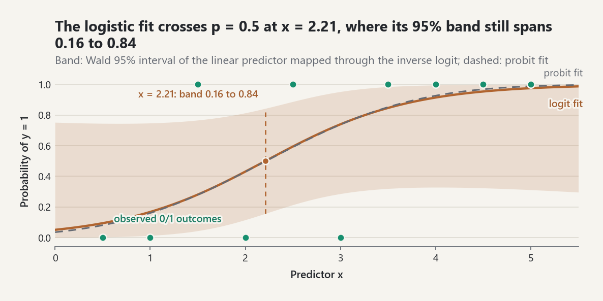
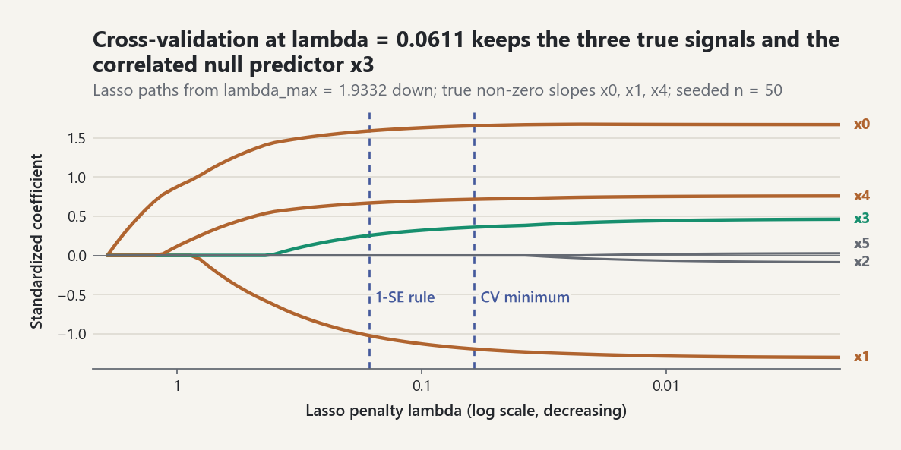

# Regression, Generalized Linear Models, and Regularization

`probstat.inference` fits multiple linear regression (OLS and WLS),
generalized linear models by IRLS, and ridge, lasso, and elastic-net models
with K-fold cross-validation. Every solve goes through the Householder QR in
`probstat.linalg` (EQ-LINALG-009); the normal equations are never formed.
Results are frozen dataclasses. Failures raise errors instead of being
patched silently: a rank-deficient design raises `RankDeficientDesignError`,
and binomial separation raises `SeparationError`.

The numbers below were produced by running the library on the data shown.
The test file `tests/test_linear_models_and_glms.py` checks the same
quantities against independent computations: exact rational arithmetic, a
hand-written Newton iteration, closed-form maximum-likelihood estimates, and
explicit KKT checks.

## 1. Design matrices

`design_matrix(data, categorical=[...])` builds the model matrix from a
mapping of named columns:

- With an intercept, a factor uses treatment coding (EQ-LM-DESIGN-001). The
  first level in sorted order is the reference unless `reference=` names
  another one.
- Without an intercept, the first factor keeps every level (cell-means
  coding).
- `DesignMatrix.transform(new_data)` encodes new rows the same way. It
  rejects levels that were not seen when the design was built.

```python
from probstat.inference import design_matrix, fit_linear_model

design = design_matrix(
    {"dose": [1, 2, 3, 1, 2, 3], "site": ["b", "a", "c", "a", "c", "b"]},
    categorical=["site"],
)
design.column_names   # ('(Intercept)', 'dose', 'site[b]', 'site[c]')
```

## 2. Multiple linear regression

`fit_linear_model(design, y, weights=None)` factors `W^(1/2) X = QR` and
solves `R beta = Q'W^(1/2) y` (EQ-LM-OLS-001). The worked example uses eight
observations, an intercept, and two predictors `a` and `b`:

| a | 1 | 2 | 3 | 4 | 5 | 6 | 7 | 8 |
|---|---|---|---|---|---|---|---|---|
| b | 2 | 1 | 5 | 3 | 6 | 4 | 8 | 7 |
| y | 3.1 | 4.0 | 8.2 | 6.9 | 11.4 | 9.8 | 14.1 | 15.3 |

| Term | Estimate | SE | t | p (t, 5 df) |
|---|---|---|---|---|
| (Intercept) | 0.661039 | 0.432365 | 1.529 | 0.187 |
| a | 0.994805 | 0.149589 | 6.650 | 0.00116 |
| b | 0.880519 | 0.149589 | 5.886 | 0.00201 |

Fit summary (EQ-LM-INF-001, EQ-LM-FIT-001, EQ-LM-LL-001):

| Quantity | Value |
|---|---|
| Residual standard error | 0.535881 on 5 df |
| R² | 0.989510 |
| Adjusted R² | 0.985314 |
| F | 235.83 on (2, 5) df, p = 1.13e-5 |
| AIC (with k = p + 1 = 4) | 16.9615 |

The test suite solves `X'X beta = X'y` exactly with `fractions.Fraction`. The
coefficients, RSS, R², adjusted R², and F agree to 12 decimal places, and F
to 9.

**Intervals at `x0 = (1, 4.5, 3.5)` (EQ-LM-PRED-001).**

| Interval | Mean | Bounds |
|---|---|---|
| 95% for the mean | 8.2195 | [7.5989, 8.8400] |
| 95% for a new observation | 8.2195 | [6.7086, 9.7303] |

The prediction interval adds `sigma^2/w0` to the variance of the mean. A
seeded simulation (400 replications, quadratic mean, n = 15) checks that both
intervals cover close to 95%. The tolerance is 3.5 binomial standard errors.

**Diagnostics.**

- Leverages (EQ-LM-DIAG-001): 0.430, 0.430, 0.417, 0.222, 0.222, 0.417,
  0.430, 0.430. They sum to `p = 3`.
- Externally studentized residuals (EQ-LM-DIAG-002) range from -1.618 to
  1.393.
- The largest Cook's distance (EQ-LM-DIAG-003) is 0.498, at observation 7.

**Robust standard errors (EQ-LM-HC-001).**

| Estimator | (Intercept) | a | b |
|---|---|---|---|
| HC0 | 0.3353 | 0.0981 | 0.1115 |
| HC3 | 0.5778 | 0.1654 | 0.1846 |

The test computes `(X'X)^-1 X' diag(omega) X (X'X)^-1` exactly and matches
it to 11 decimal places.

**Collinearity (EQ-LM-VIF-001).** `a` and `b` are correlated with
`r^2 = 0.694`, so both VIFs equal `1/(1 - r^2) = 3.273`.

**Anscombe's first data set** [REF-ANSCOMBE-1973]. The fit gives
intercept 3.00009, slope 0.500091, R² 0.666542, and slope p-value 0.00217.
This matches the rounded values usually quoted (3.00, 0.500, 0.67) and the
exact rational least-squares solution.

**Weighted least squares.** With integer weights, WLS equals OLS on rows
replicated that many times. The test checks this identity and also the exact
rational weighted normal equations.

**Comparing models: nested F tests and ANOVA tables.** A term is judged by
how much its columns reduce the residual sum of squares
[EQ-LM-ANOVA-001]. `nested_f_test(reduced, full)` compares two fits on the
same response; `linear_model_anova(design, y, terms, kind=...)` does it for
every term, and `factorial_design` builds a full-factorial design with
sum-to-zero (effect) coding and the term-to-columns map. Montgomery's
battery-life experiment crosses three materials with three temperatures,
four batteries per cell [REF-MONTGOMERY-2017, Chapter 5]:

```python
from probstat.inference import (
    breusch_pagan_test, factorial_design, fit_linear_model, linear_model_anova,
    nested_f_test,
)

material = [m for m in (1, 2, 3) for _ in range(12)]
temperature = [t for _ in range(3) for t in (15, 70, 125) for _ in range(4)]
life = [130, 155, 74, 180, 34, 40, 80, 75, 20, 70, 82, 58,
        150, 188, 159, 126, 136, 122, 106, 115, 25, 70, 58, 45,
        138, 110, 168, 160, 174, 120, 150, 139, 96, 104, 82, 60]
design, terms = factorial_design({"material": material, "temperature": temperature})
table = linear_model_anova(design, life, terms, kind="III")
[(r.term, r.df, round(r.sum_squares, 2), round(r.f_statistic, 2)) for r in table.rows[:-1]]   # [('material', 2, 10683.72, 7.91), ('temperature', 2, 39118.72, 28.97), ('material:temperature', 4, 9613.78, 3.56)]
round(table.row("material:temperature").p_value, 4)   # 0.0186
```

These are the sums of squares and F ratios of Montgomery's Table 5.5. The
interaction is significant, so the effect of temperature depends on the
material. The same interaction test as an explicit model comparison:

```python
additive = fit_linear_model([row[:5] for row in design.rows], life)
test = nested_f_test(additive, table.fit)
round(test.statistic, 2), test.numerator_df, test.denominator_df   # (3.56, 4, 27)
```

**Type I, II, or III.** The types differ in the model a term joins
[EQ-LM-ANOVA-002]: type I adds terms in the order given, type II adds a
term to every term that does not contain it (main effects are tested
without their interactions), and type III removes the term from the full
model. In a balanced design with effect coding they agree, as above. Drop
three batteries and they no longer do:

```python
keep = [i for i in range(36) if i not in (0, 5, 30)]
design2, terms2 = factorial_design(
    {"material": [material[i] for i in keep], "temperature": [temperature[i] for i in keep]}
)
life2 = [life[i] for i in keep]
{kind: round(linear_model_anova(design2, life2, terms2, kind=kind).row("material").sum_squares, 1)
 for kind in ("I", "II", "III")}   # {'I': 8548.2, 'II': 6871.5, 'III': 7862.2}
```

Type I depends on the order of the terms. Type II is the usual choice when
interactions are absent or negligible; type III tests main effects averaged
over the levels of the other factor and is meaningful only with effect
coding: with treatment coding it tests a simple effect at the reference
level instead (`factorial_design(..., coding="treatment")`).

**Checking the error assumptions.** The F tests assume constant error
variance and uncorrelated errors. `breusch_pagan_test(fit)` regresses the
squared residuals on the design; Koenker's `n R^2` form is the default
because the original statistic is oversized when the errors are not normal
[EQ-LM-BP-001]. `durbin_watson(fit)` is about `2 (1 - r_1)` for residuals in
time order [EQ-LM-DW-001].

```python
bp = breusch_pagan_test(table.fit)
round(bp.statistic, 3), bp.df, round(bp.p_value, 3)   # (10.973, 8, 0.203)
```

The nine sample cell variances range from 160 to 2057, a factor of 13, yet
with four batteries per cell the test has little power: a p-value of 0.2 is
weak evidence for constant variance, not proof of it.

## 3. Generalized linear models

`fit_glm(design, y, family=..., link=..., weights=..., offset=...)` runs
Fisher scoring as IRLS (EQ-GLM-IRLS-001) with step halving.

- Convergence is declared when `max_j |delta beta_j|/(|beta_j| + 0.1)` falls
  below `tolerance` (default `1e-10`).
- A deviance-change criterion alone is not used. It stops linearly
  convergent Fisher scoring with coefficient errors near `sqrt(tolerance)`:
  an earlier draft left probit score equations at `2e-7`.

Supported families and links (EQ-GLM-FAM-001):

| Family | Links | Dispersion | Wald reference |
|---|---|---|---|
| gaussian | identity | `X^2/(n-p)` | `t_(n-p)` |
| binomial (y = proportion, weights = trials) | logit, probit | 1 | normal |
| poisson | log | 1 | normal |
| gamma | inverse, log | `X^2/(n-p)` | `t_(n-p)` |

Each result reports:

- the deviance and null deviance (EQ-GLM-DEV-001);
- the Pearson chi-square and dispersion (EQ-GLM-PEARSON-001);
- Wald standard errors (EQ-GLM-WALD-001);
- the log-likelihood, AIC, and BIC (EQ-GLM-AIC-001);
- deviance and Pearson residuals;
- the iteration count and the `converged` flag.

### Logistic and probit regression

The example data are `x = 0.5, 1.0, ..., 5.0` with
`y = 0 0 1 0 1 0 1 1 1 1`.

| Link | Intercept (SE) | Slope (SE) | Deviance | AIC | Iterations |
|---|---|---|---|---|---|
| logit | -2.92651 (2.06009) | 1.32442 (0.80019) | 8.62024 | 12.62024 | 6 |
| probit | -1.80698 (1.15349) | 0.81493 (0.43756) | 8.48344 | 12.48344 | 12 |

The null deviance is `-2(6 log 0.6 + 4 log 0.4) = 13.4602`. The test checks
the logit fit against an explicit two-parameter Newton iteration written in
the test, using 2x2 matrix inverses. Coefficients agree to 9 decimal places
and standard errors to 8. For the probit fit, the test checks that the score
equations are zero at the solution.

<picture><source media="(prefers-color-scheme: dark)" srcset="../images/guides/regression-logistic-band-dark.png"></picture>

*The logit fit (slope 1.324) reaches probability one half at x = 2.21, but with ten observations its Wald band, symmetric on the logit scale, still spans 0.16 to 0.84 there and bends asymmetrically toward 0 and 1; the probit curve is almost indistinguishable.*

Grouped binomial data, with the trials passed as `weights`, give the same
coefficients and standard errors as the expanded Bernoulli rows.

### Poisson regression and deviance identities

Counts in three groups: a = (2, 3, 1, 4), b = (6, 8, 5, 7), c = (0, 1, 2, 1).
With a factor-only design the MLE is the vector of group means (2.5, 6.5,
1.0). The coefficients are `log 2.5 = 0.916291`, `log(6.5/2.5) = 0.955511`,
and `log(1/2.5) = -0.916291`.

| Quantity | Value |
|---|---|
| Deviance `2 sum y log(y/mu)` | 5.67698 |
| Null deviance | 25.0187 |
| Pearson X² | 4.76923 |
| AIC | 44.0457 |

The canonical log link with an intercept forces `sum(y - mu) = 0`, so the
`-(y - mu)` term drops out of the deviance. With an offset `log(exposure)`,
each group's fitted rate equals its total count divided by its total
exposure.

### Gamma regression

For `x = 0, ..., 8` and `y = 2, 3, 6, 7, 8, 9, 10, 12, 15`:

| Link | Coefficients | Dispersion | AIC |
|---|---|---|---|
| log | (1.06700, 0.21874) | 0.050011 | 37.031 |
| inverse | (0.253579, -0.024556) | 0.082092 | 43.341 |

The AIC uses the plug-in dispersion `D / sum(w)`. This is an approximation;
it is not the exact shape MLE.

### Separation

Logit and probit MLEs do not exist when some direction `d` separates the
classes (EQ-GLM-SEP-001) [REF-ALBERT-ANDERSON-1984].

- **Detection.** The library checks the separation inequalities on the last
  IRLS step, but only when that step still moves the linear predictor by more
  than `1e-4`. Converged regular fits take far smaller steps.
- **Example.** With `x = 1, 2, 3, 3, 4, 5` and `y = 0 0 0 1 1 1`, the data
  are quasi-completely separated: the tie at `x = 3` holds both classes.
- **Default behavior.** `fit_glm(..., family="binomial")` raises
  `SeparationError`.
- **Warn mode.** `on_separation="warn"` returns the diverged fit with
  `separation_detected=True` and `separated_observations=(0, 1, 4, 5)`. Its
  coefficients have drifted to about (-215, 72) after 100 iterations, so
  neither they nor their standard errors mean anything.

## 4. Ridge, lasso, and elastic net

Predictors are centred and scaled to unit population standard deviation
(EQ-PEN-STD-001). The intercept is not penalized, and coefficients are
reported on the original scale. Each method uses the penalty scaling of its
standard source:

| Model | Objective | Solver |
|---|---|---|
| `fit_ridge` | `||y_c - X~b||^2 + lambda ||b||^2` | augmented QR (EQ-PEN-RIDGE-001) |
| `fit_elastic_net` | `(1/2n)||y_c - X~b||^2 + lambda((1-a)/2 ||b||^2 + a ||b||_1)` | cyclic coordinate descent (EQ-PEN-EN-001) |

As a result, the elastic net with `alpha = 0` and penalty `lambda` equals
ridge with penalty `n lambda`. The test checks this to 8 decimal places.

The examples use seeded data: n = 50, six predictors with pairwise
correlation 0.36, true slopes (2, -1.5, 0, 0, 1, 0), and unit noise.

**Ridge.** Effective degrees of freedom `sum d_j^2/(d_j^2 + lambda)`:

| lambda | 0 | 1 | 10 | 100 |
|---|---|---|---|---|
| df | 6.000 | 5.797 | 4.534 | 1.702 |

At `lambda = 0` ridge reproduces OLS. The test checks this to 11 decimal
places, and checks the effective df against the eigenvalues of `X~'X~`.

**Lasso and elastic net.**

- `lambda_max = 1.93321`. This is the smallest penalty with an all-zero
  solution (EQ-PEN-KKT-001).
- Lasso at `lambda = 0.15`: slopes (1.622, -1.067, 0, 0.243, 0.713, 0), so
  four predictors are active.
- Elastic net at `alpha = 0.5`, `lambda = 0.2`: five predictors are active.
- The tests check the KKT conditions directly. On the active set,
  `x~_j'r/n - lambda(1-alpha) b_j = lambda alpha sign(b_j)`. Off it, the
  same gradient is at most `lambda alpha` in absolute value.

**Cross-validation.** `cross_validate_elastic_net(..., folds=5, seed=11)`
uses a 15-point grid. Folds come from a seeded permutation
(`RandomStream(seed).child("cv-folds")`), and their sizes differ by at most
one (EQ-PEN-CV-001).

| Quantity | Value |
|---|---|
| `lambda_min` | 0.0611 (CV MSE 1.450) |
| `lambda_1se` | 0.1640 |
| Active set at both | x0, x1, x3, x4 |

The truly non-zero x0, x1, and x4 are always kept. The correlated null
predictor x3 also enters, which is a known lasso behavior with correlated
designs and n = 50.

<picture><source media="(prefers-color-scheme: dark)" srcset="../images/guides/regression-lasso-path-dark.png"></picture>

*Coefficients enter one by one as the penalty falls from lambda_max = 1.9332; both the cross-validation minimum 0.0611 and the one-standard-error choice 0.1640 keep x3, a null predictor correlated with the signals, next to the true x0, x1, and x4.*

## 5. Limitations

- No column pivoting. A dependent column is reported by name rather than
  dropped.
- No regression weights for the penalized models. The binomial AIC uses
  `lgamma` for non-integer `trials * y`.
- Separation is certified only for binomial families. Poisson MLE
  non-existence (zero counts on a face of the design) shows up only as
  non-convergence.
- Wald intervals only. Profile-likelihood intervals for GLMs are not
  implemented.
- Pure-Python cost is `O(n p^2)` per QR. Coordinate descent costs `O(n p)`
  per sweep. Both are aimed at teaching-sized and moderate problems.

## Common pitfalls

- **The family must be named.** `fit_glm` defaults to `family="gaussian"`
  with the identity link; 0/1 responses fitted without
  `family="binomial"` give a linear probability model, not a logistic one.
  Binomial responses are proportions, with the trials passed as `weights`.
- **Two penalty scalings.** `fit_ridge` penalizes `||y_c - X~b||^2 +
  lambda ||b||^2`, while `fit_elastic_net` uses the glmnet scaling with
  `1/(2n)`. The same `penalty` value is therefore not the same amount of
  shrinkage: elastic net at `alpha=0` and `penalty=lambda` equals ridge at
  `penalty=n*lambda`. `fit_elastic_net` defaults to `alpha=1.0`, the lasso.
- **Reference levels.** Treatment coding drops the first level in sorted
  text order unless `reference=` names another; coefficients are contrasts
  against that level. `DesignMatrix.transform` rejects levels it has not
  seen.
- **The ANOVA type is part of the question.** Type I sums of squares change
  with the order of the terms in unbalanced data, and type III main effects
  under treatment coding test a simple effect at the reference level. State
  the type, and use `factorial_design` (effect coding) for type III.
- **Errors are not patched.** A dependent column raises
  `RankDeficientDesignError` (there is no column pivoting), and separated
  binomial data raise `SeparationError`. With `on_separation="warn"` the
  returned coefficients and standard errors are meaningless.

```python
from probstat.inference import (
    RankDeficientDesignError, SeparationError, fit_elastic_net, fit_glm,
    fit_ridge,
)

rows = [[1, 2], [2, 1], [3, 5], [4, 3], [5, 6], [6, 4], [7, 8], [8, 7]]
response = [3.1, 4.0, 8.2, 6.9, 11.4, 9.8, 14.1, 15.3]
fit_ridge(rows, response, penalty=8 * 0.5).coefficients[0]          # 0.7510
fit_elastic_net(rows, response, penalty=0.5, alpha=0.0).coefficients[0]  # 0.7510
fit_elastic_net(rows, response, penalty=0.5).alpha                  # 1.0

coded = design_matrix(
    {"dose": [1, 2, 3, 1, 2, 3], "site": ["b", "a", "c", "a", "c", "b"]},
    categorical=["site"], reference={"site": "c"},
)
coded.column_names   # ('(Intercept)', 'dose', 'site[a]', 'site[b]')

separated = design_matrix({"x": [1, 2, 3, 3, 4, 5]})
fit_glm(separated, [0, 0, 0, 1, 1, 1]).family   # 'gaussian'
try:
    fit_glm(separated, [0, 0, 0, 1, 1, 1], family="binomial")
except SeparationError as error:
    caught = type(error).__name__
caught   # 'SeparationError'
try:
    fit_linear_model(design_matrix({"a": [1, 2, 3, 4], "b": [2, 4, 6, 8]}),
                     [1, 2, 3, 5])
except RankDeficientDesignError as error:
    dependent = str(error)
dependent   # 'design matrix is rank deficient; column(s) b are linear combinations of earlier columns'
```
