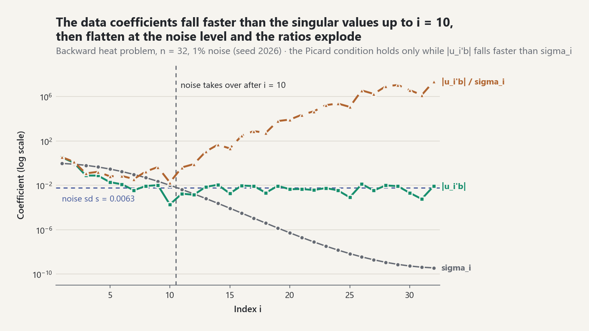
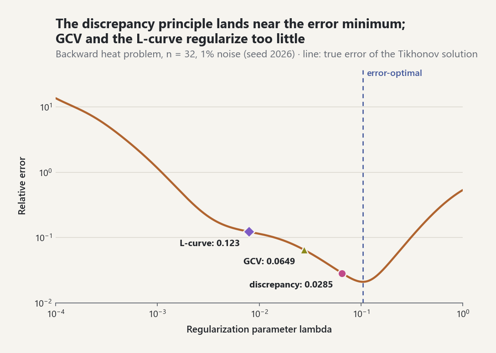

# Regularization and Ill-Posed Problems

This guide covers the deterministic side of inverse problems: why a linear
system `A x = b` can be useless to solve as written, how the singular value
decomposition shows what goes wrong, and how truncated SVD and Tikhonov
regularization repair it, with the three classical rules for choosing the
regularization parameter. The Bayesian treatment of calibration, which
reads the same penalty as a prior, is in
[inverse problems and Bayesian calibration](inverse-problems-and-calibration.md).
Decision record: [ADR-0110](../adr/ADR-0110-svd-and-regularization.md).

## 1. Ill-posed problems

A problem is well posed in Hadamard's sense when a solution exists, is
unique, and depends continuously on the data; it is ill posed when one of
the three fails, typically the third: an arbitrarily small change of the
data changes the solution arbitrarily much [REF-HANSEN-2008, Section 2.1].
First-kind integral equations `int K(s, t) f(t) dt = g(s)` with a smooth
kernel are the classical example: the integral smooths, so recovering `f`
amplifies every wiggle of `g`. A discretization gives a matrix `A` that is
invertible in exact arithmetic but whose condition number grows without
bound as the grid is refined: a *discrete ill-posed problem*.

`probstat.inverse` provides two such problems with exact solutions, so
that every method can be judged against the truth:

- `backward_heat_problem`: recover an initial temperature from the
  temperature after a diffusion time. The operator is
  `A = V diag(exp(-T mu_k)) V'` with the sine eigenvectors of the
  second-difference matrix, so its singular values `exp(-T mu_k)` are known
  exactly and decay like `exp(-T pi^2 k^2)` (severely ill posed).
- `second_derivative_problem`: the `deriv2` equation of Regularization Tools,
  whose kernel is the Green's function of the second derivative; its
  singular values decay like `k^-2` (mildly ill posed). It is discretized
  here by the midpoint rule, not by the Galerkin method of the original.

Both return `A`, the exact solution, and the exact data `b = A x`; noise is
added by the caller with a declared seed.

```python
import math
from probstat.foundations import RandomStream
from probstat.inverse import (
    backward_heat_problem, discrepancy_principle,
    generalized_cross_validation, l_curve, nonlinear_tikhonov,
    picard_coefficients, tikhonov, truncated_svd,
)
from probstat.linalg import singular_value_decomposition

problem = backward_heat_problem(32, time=0.005)
svd = singular_value_decomposition(problem.operator)

def norm(vector):
    return math.sqrt(math.fsum(value * value for value in vector))

def relative_error(estimate):
    exact = problem.exact_solution
    return norm([a - b for a, b in zip(estimate, exact)]) / norm(exact)

exact_data = problem.exact_data
scale = 0.01 * norm(exact_data) / math.sqrt(len(exact_data))
generator = RandomStream(2026).child("noise").generator()
noise = [generator.gauss(0.0, scale) for _ in exact_data]
data = tuple(b + e for b, e in zip(exact_data, noise))
delta = norm(noise)
naive = tikhonov(problem.operator, data, 0.0, decomposition=svd)
print(round(svd.condition_number / 1e9, 2))
print(round(delta, 4))
print(relative_error(naive.solution) > 1e6)
```

```text
2.61
0.0375
True
```

The condition number is `2.61e9`. The data carry 1% noise
(`||e|| = 0.0375`), and the unregularized least-squares solution
(`lambda = 0`) has a relative error above `10^6`: the noise is divided by
singular values down to `3.7e-10`.

## 2. The SVD view and the discrete Picard condition

With the SVD `A = sum_i sigma_i u_i v_i'` [EQ-LINALG-SVD-001], the naive
solution is `x = sum_i (u_i'b / sigma_i) v_i`. Write `b = b_exact + e`. The
exact part satisfies the *discrete Picard condition* when `|u_i'b_exact|`
decays on average faster than `sigma_i` [REF-HANSEN-2008, Section 2.4]; the
noise part does not decay at all, since for white noise of standard
deviation `s` every `|u_i'e|` is of size `s`. Beyond the index where
`|u_i'b|` reaches the noise level, the coefficients `|u_i'b| / sigma_i`
grow without bound. `picard_coefficients` returns the three sequences
[EQ-INV-REG-007]:

```python
picard = picard_coefficients(problem.operator, data, decomposition=svd)
print([round(v, 2) for v in picard.solution_coefficients[:14:3]])
print([f"{v:.1g}" for v in picard.data_coefficients[9:16]])
```

```text
[3.54, 0.17, 0.04, 0.02, 11.28]
['0.0002', '0.002', '0.001', '0.007', '0.01', '0.002', '0.01']
```

The ratios (indices 1, 4, 7, 10, 13) fall and then explode; from about
index 11 the data coefficients stay near the noise standard deviation
`s = 0.0063` instead of decaying.

<picture><source media="(prefers-color-scheme: dark)" srcset="../images/guides/regularization-picard-plot-dark.png"></picture>

*Picard plot of the seeded heat data: the ratio `|u_i'b| / sigma_i` is smallest at `i = 10`; beyond it the mean `|u_i'b|` is 0.0056, at the noise level `s = 0.0063`, while `sigma_i` keeps falling to 3.7e-10.*

## 3. Filtering: truncated SVD and Tikhonov

A regularization method multiplies each term by a *filter factor*,
`x_reg = sum_i f_i (u_i'b / sigma_i) v_i` [REF-HANSEN-2008, Section 2.4]:

- **Truncated SVD** keeps the `k` largest triplets, `f_i = 1` for `i <= k`
  and `0` otherwise [EQ-INV-REG-006]. It is the minimum-norm least-squares
  solution for the closest rank-`k` matrix.
- **Tikhonov** minimizes `||A x - b||^2 + lambda^2 ||L x||^2`
  [EQ-INV-REG-001]; for `L = I` its filter factors are
  `f_i = sigma_i^2 / (sigma_i^2 + lambda^2)` [EQ-INV-REG-002], a smooth
  version of the truncation at `sigma_i ~ lambda`.

The smooth filter has a tail that truncation lacks: a component with
`sigma_i << lambda` still contributes about `sigma_i (u_i'b) / lambda^2`, so
Tikhonov equals TSVD only when `sigma_k >> lambda` and
`sigma_(k+1) << lambda^2` (checked in `tests/test_regularization.py`).

```python
tsvd = truncated_svd(problem.operator, data, 6, decomposition=svd)
ridge = tikhonov(problem.operator, data, 0.1, decomposition=svd)
print(round(relative_error(tsvd.solution), 4))
print(round(relative_error(ridge.solution), 4))
print([round(f, 3) for f in ridge.filter_factors[3:9]])
```

```text
0.0139
0.0211
[0.955, 0.899, 0.759, 0.486, 0.196, 0.052]
```

These two settings are the best of each family for this data: scanning
`k = 1, ..., 32` gives the smallest TSVD error at `k = 6` (`0.0139`), and
scanning 601 log-spaced values of `lambda` in `[1e-5, 1]` gives the smallest
Tikhonov error `0.0211` at `lambda = 0.104` (computed with the same seed and
noise; the scan is not part of the executed example). For this smooth
solution and a sharp singular-value decay the hard cut wins.

**Computing Tikhonov.** `tikhonov` solves the stacked least-squares problem
`[A; lambda L] x = [b; 0]` by Householder QR
[REF-HANSEN-2008, Section 2.7.1]. The normal equations
`(A'A + lambda^2 L'L) x = A'b` square the condition number and are never
formed. The solution is unique when the null spaces of `A` and `L` meet
only in zero; otherwise `ValueError` is raised instead of adding jitter. A
general `L` (for example the first-difference matrix, which penalizes
roughness instead of size) costs one QR factorization per `lambda`; for
`L = I` the filter factors come from the SVD, passed as `decomposition` to
reuse it.

## 4. Choosing the regularization parameter

Each rule returns a `RegularizationParameterChoice` with the chosen
`lambda`, the curve it evaluated on a grid (by default geometric across
the singular values of `A`), the residual and solution norms on the grid,
and the Tikhonov solution at the choice. `at_boundary` flags an optimum at
the end of the grid.

- **Discrepancy principle** (Morozov) [EQ-INV-REG-005]: choose `lambda` with
  `||A x_lambda - b|| = tau delta` [REF-MOROZOV-1966]. It needs the noise
  norm `delta ~ s sqrt(m)`, not `s`, and `tau >= 1`. An underestimated
  `delta` asks the solution to fit noise and under-regularizes, an
  overestimated one over-smooths [REF-HANSEN-2008, Section 2.9]. A target
  outside the attainable range raises `ValueError`.
- **Generalized cross-validation** [EQ-INV-REG-003] minimizes
  `||A x_lambda - b||^2 / trace(I - A A^#)^2` and needs no noise level
  [REF-CRAVEN-WAHBA-1979], [REF-GOLUB-HEATH-WAHBA-1979]. It assumes
  independent, equal-variance errors. Its minimum can be very flat, and for
  a square operator `G` tends to a finite limit as `lambda -> 0` that can
  undercut the interior minimum.
- **L-curve** [EQ-INV-REG-004]: the corner of
  `(log ||A x_lambda - b||, log ||L x_lambda||)`, located at the maximum
  curvature [REF-HANSEN-OLEARY-1993]. It needs no noise level either and is
  more robust than GCV to correlated errors, but the corner can be
  ill-defined or lie where the noise already dominates; on the backward
  heat problem below it chooses `lambda` too small.

```python
choices = {
    "L-curve": l_curve(problem.operator, data, decomposition=svd),
    "GCV": generalized_cross_validation(problem.operator, data, decomposition=svd),
    "discrepancy": discrepancy_principle(
        problem.operator, data, delta, decomposition=svd
    ),
}
for name, choice in choices.items():
    error = relative_error(choice.solution.solution)
    print(f"{name:12s} lambda={choice.regularization:.3g} error={error:.3g}")
low = discrepancy_principle(problem.operator, data, 0.5 * delta, decomposition=svd)
print(f"{low.regularization:.1g}", relative_error(low.solution.solution) > 1e4)
```

```text
L-curve      lambda=0.00793 error=0.123
GCV          lambda=0.0277 error=0.0649
discrepancy  lambda=0.0652 error=0.0285
6e-09 True
```

<picture><source media="(prefers-color-scheme: dark)" srcset="../images/guides/regularization-parameter-choice-dark.png"></picture>

*The true relative error of the Tikhonov solution is smallest, 0.0211, at `lambda = 0.104` on this seeded heat problem. The discrepancy principle, given the realized noise norm, reaches 0.0285; GCV (0.0649) and the L-curve (0.123) choose `lambda` on the steep left branch, where noise is amplified.*

With the true noise norm the discrepancy principle lands close to the
best attainable error (`0.0211`). Halving `delta` gives a target the
solution can only meet by fitting noise: `lambda` drops to `6e-9`, and the
error exceeds `10^4`.

The same pattern holds across seeds. With the noise of
`tests/test_regularization.py` (seeds 1-6, 1% noise, `n = 32`), the ratio
of the chosen to the error-optimal `lambda` was 0.62-0.94 for the
discrepancy principle, 0.06-0.33 for GCV, and 0.06-0.10 for the L-curve on
the backward heat problem; on `deriv2` all three rules stayed within
0.44-2.33, the case the test asserts.

## 5. Bayesian interpretation

For `L = I`, the Tikhonov solution is the posterior mean of the Gaussian
model `x ~ N(0, tau_x^2 I)`, `b = A x + e`, `e ~ N(0, s^2 I)` with
`lambda^2 = s^2 / tau_x^2`: the posterior precision is
`(A'A + lambda^2 I) / s^2` [REF-TARANTOLA-2005, Chapter 3]. A general `L`
corresponds to the (possibly improper) prior precision `L'L / tau_x^2`.
`tests/test_regularization.py` checks the identity against the posterior
mean computed independently from the normal equations by Cholesky.

The reading has two consequences. `lambda` is a ratio of a noise scale to a
prior scale, so the parameter-choice rules are point estimates of a prior
hyperparameter. And the deterministic answer carries no uncertainty: for
posterior covariances, credible bands, and a prior on `lambda` itself, move
to the conjugate and MCMC tools of
[inverse problems and Bayesian calibration](inverse-problems-and-calibration.md)
and [nonlinear calibration and MCMC](nonlinear-calibration-and-mcmc.md).

## 6. Nonlinear Tikhonov

For a nonlinear residual `r(x)`, `nonlinear_tikhonov` minimizes
`||r(x)||^2 + lambda^2 ||L (x - x_bar)||^2` by Levenberg-Marquardt on the
stacked residual `[r(x); lambda L (x - x_bar)]` [EQ-INV-REG-001]. The
penalty is centered at `prior_mean`, which defaults to the starting point.
The result is a local minimizer; check `converged`.

```python
times = tuple(0.25 * i for i in range(12))
generator = RandomStream(7).child("decay").generator()
observed = tuple(2.0 * math.exp(-0.7 * t) + generator.gauss(0.0, 0.02) for t in times)

def residual(x):
    return tuple(x[0] * math.exp(-x[1] * t) - y for t, y in zip(times, observed))

for lam in (0.0, 1.0, 10.0):
    fit = nonlinear_tikhonov(residual, (1.0, 1.0), lam, prior_mean=(1.5, 0.5))
    print(lam, [round(v, 3) for v in fit.solution], fit.converged)
```

```text
0.0 [1.971, 0.68] True
1.0 [1.796, 0.599] True
10.0 [1.51, 0.499] True
```

The fit moves from the least-squares estimate (true values `2.0` and `0.7`)
to the prior center `(1.5, 0.5)` as `lambda` grows.

## 7. Limitations

- Only quadratic penalties are provided. Total variation and `l1`
  penalties, which preserve edges and promote sparsity, need non-smooth
  optimization and are out of scope.
- A general `L` is handled by one QR factorization per evaluation, not by
  the generalized SVD; the curves then cost `O((m + p) n^2)` per `lambda`.
- Dense pure-Python kernels: the SVD of a random `64 x 64` matrix took
  1.7 s on the reference machine (Windows 11, CPython 3.12). Iterative regularization (CGLS, LSQR with early stopping) is not
  implemented.
- The rules choose one `lambda` for one data set. None of them quantifies
  the uncertainty of the solution, and each can fail as described in
  Section 4; inspect the curve in the returned result.

## Common pitfalls

- **`lambda` is squared in the functional.** A ridge weight `alpha` in
  `||A x - b||^2 + alpha ||x||^2` corresponds to `lambda = sqrt(alpha)`.
- **The discrepancy principle takes the noise norm.** Pass
  `delta ~ s sqrt(m)`, not the standard deviation `s`.
- **Singular values are descending.** `symmetric_eigen` returns eigenvalues
  in ascending order; the SVD and the filter factors use descending order.
- **No silent repair.** A stacked matrix with a shared null space of `A` and
  `L` raises `ValueError`; `lambda = 0` on a rank-deficient `A` too.
- **The nonlinear penalty is centered at the start.** Without
  `prior_mean`, `nonlinear_tikhonov` shrinks toward `x0`.

```python
import inspect
inspect.signature(discrepancy_principle).parameters["safety_factor"].default  # 1.0
inspect.signature(l_curve).parameters["points"].default                       # 100
svd.singular_values[0] > svd.singular_values[-1]                             # True
try:
    tikhonov(((1.0, 1.0), (2.0, 2.0)), (1.0, 2.0), 0.5, penalty=((1.0, 1.0),))
except ValueError as error:
    message = str(error)
message.startswith("the stacked matrix [A; lambda L] is numerically rank deficient")  # True
fit = nonlinear_tikhonov(residual, (1.0, 1.0), 1.0)
fit.prior_mean                                                                # (1.0, 1.0)
```

## Sources

[REF-HANSEN-2008] (ill-posedness, filter factors, the Picard condition,
Tikhonov, TSVD, and the parameter-choice rules), [REF-TIKHONOV-1963],
[REF-MOROZOV-1966], [REF-CRAVEN-WAHBA-1979], [REF-GOLUB-HEATH-WAHBA-1979],
[REF-HANSEN-OLEARY-1993] (L-curve curvature), [REF-HESTENES-1958] and
[REF-GOLUB-VANLOAN-2013, Sections 8.5-8.6] (one-sided Jacobi SVD),
[REF-PENROSE-1955] (pseudo-inverse), [REF-TARANTOLA-2005] (Gaussian
interpretation).
