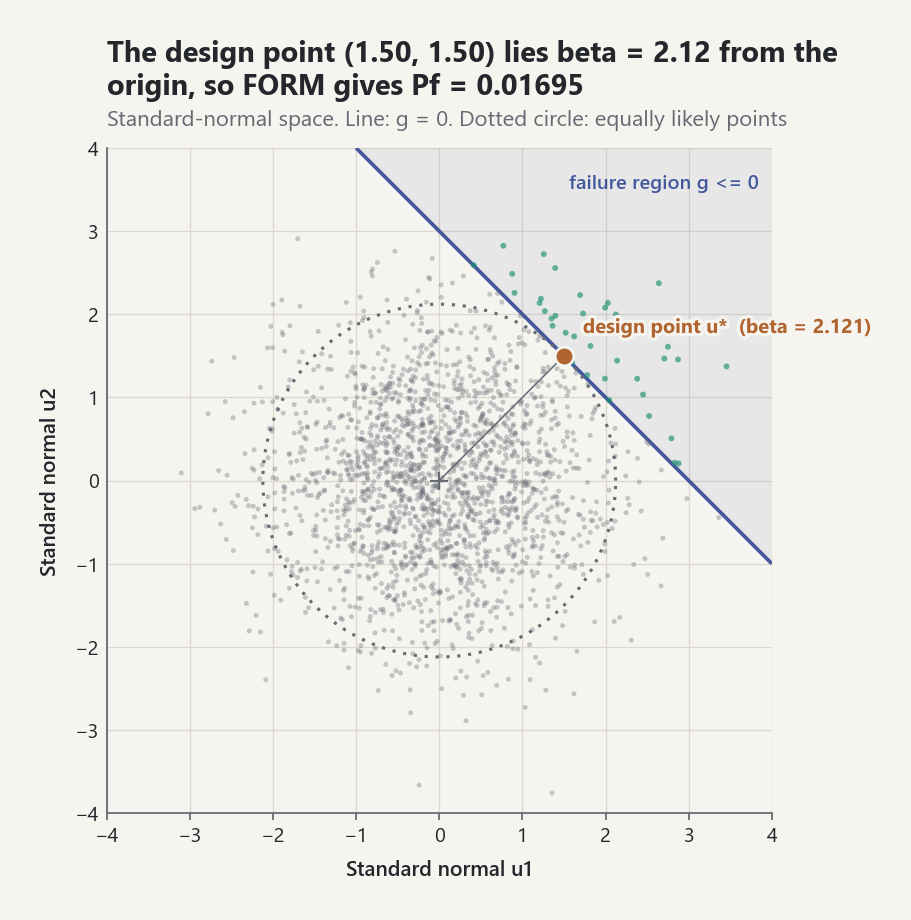
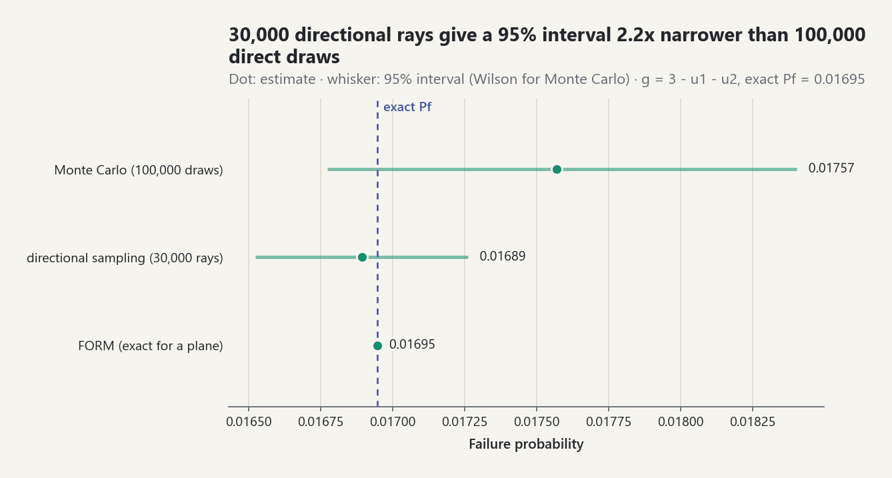

# Reliability and Rare-Event Analysis

Reliability analysis turns an engineering margin into a probability statement.
This release uses one convention everywhere: a limit-state value `g(x)>0` is
safe and `g(x)<=0` is failure [EQ-REL-LIMIT-001]. Equality is deliberately part
of failure, avoiding method-dependent boundary behavior.

## Direct Monte Carlo

Failure probability is `P_f=P(g(X)<=0)` and reliability is `1-P_f`
[EQ-REL-PF-001]. `estimate_failure_probability` evaluates explicit input
samples, returns the event count, charged model calls, plug-in standard error,
and a Wilson interval. Zero observed failures therefore does not become a false
claim that risk is zero: the interval retains a positive upper bound.

Direct Monte Carlo is model-agnostic but inefficient when `P_f` is very small.
The expected failure count is `N P_f`; credible resolution of a rare event may
require an unaffordable number of model calls.

## Rare-event importance sampling

Proposal draws may be moved toward failure and reweighted by the target-to-
proposal density ratio [EQ-REL-IS-001]. The implementation accepts explicit
likelihood ratios so multivariate transformations remain the caller's visible
responsibility. It reports ordinary weighted-contribution uncertainty, observed
proposal failures, weight ESS, and maximum normalized weight. Incorrect support
or ratios bias the answer; a large proposal failure count alone proves nothing.

## FORM, reliability index, and design point

In independent standard-normal space, FORM finds the boundary point nearest the
origin. Its signed distance is the reliability index `beta`, and the first-order
probability is `Phi(-beta)` [EQ-REL-FORM-001].

`linear_normal_form` solves this constrained problem exactly for an affine
boundary. It returns `beta`, the most-probable failure/design point, unit normal,
boundary residual, and probability. It is an exact, testable special case.
General nonlinear FORM is covered in
[Model-based reliability](advanced-reliability.md). That guide treats
non-normal and correlated inputs, the HL-RF iteration with convergence
diagnostics, SORM, subset simulation, and systems. Several design points of
one limit state are found by `find_design_points` and combined by
`multi_point_form` or `mixture_importance_sampling`; see
[Adaptive reliability](adaptive-reliability.md).

<picture><source media="(prefers-color-scheme: dark)" srcset="../images/guides/reliability-form-design-point-dark.png"></picture>

*For `g = 3 - u1 - u2` the design point (1.50, 1.50) is where the beta circle of radius 2.12 touches the limit state; the failed samples all lie beyond that line, and `Phi(-beta)` = 0.01695 is exact because the boundary is a plane.*

## Directional sampling

Independent standard-normal vectors separate into a uniform direction and a
chi-distributed radius. For a failure region that begins once per ray,
directional sampling integrates the radial tail analytically and samples only
directions [EQ-REL-DIR-001]. The API requires the radial entry boundary
explicitly. Non-star-shaped regions, multiple crossings, or missed failure
lobes violate this contract and need richer search/partition methods.

## Reproducible method comparison

Run `python examples/reliability_lab.py`. The lab compares direct Monte Carlo,
affine FORM, and directional sampling on the same bivariate Gaussian boundary,
then estimates a five-sigma normal tail with mean-shift importance sampling.
The figure shows the three estimates with their 95% intervals against the
analytic affine reference.

<picture><source media="(prefers-color-scheme: dark)" srcset="../images/guides/reliability-method-intervals-dark.png"></picture>

*Both sampling intervals cover the exact value 0.01695; directional sampling (estimate 0.01689) integrates the radial tail of each ray analytically, so its 30,000 rays give an interval 2.2 times narrower than 100,000 direct draws.*

## Common pitfalls

- **The boundary is failure.** `LimitState.failed` is `g(x) <= 0`, so a sample
  exactly on the limit surface counts as a failure.
- **Zero failures do not mean zero risk.** With no observed failure the plug-in
  `standard_error` is `0.0`; the Wilson interval keeps a positive upper bound.
- **`beta` is signed.** `linear_normal_form(intercept, coefficients)` describes
  `g(u) = intercept + coefficients . u`; a negative intercept means the origin
  already fails and gives a negative index.
- **Importance weights are the caller's responsibility.**
  `estimate_weighted_failure_probability` uses the likelihood ratios it is
  given; wrong ratios or a proposal with too small a support bias the result
  without an error.
- **Directional sampling needs one entry radius per ray.** The radial boundary
  returns `None` (no failure on that ray) or the radius where failure begins.

```python
from probstat.reliability import LimitState, estimate_failure_probability, linear_normal_form

capacity = LimitState(lambda x: 3.0 - x[0], "capacity")
capacity.failed((3.0,))                          # True
direct = estimate_failure_probability(capacity, [(0.1 * i,) for i in range(20)])
direct.failure.successes, direct.standard_error  # (0, 0.0)
round(direct.failure.confidence_interval.upper, 3)   # 0.161 (95 % Wilson interval)
linear_normal_form(3.0, (-1.0, 0.0)).reliability_index   # 3.0
linear_normal_form(-3.0, (1.0, 0.0)).reliability_index   # -3.0
```

## Sources

- [REF-MELCHERS-BECK-2018, Chapters 2-6].
- [REF-OWEN-2013, Chapter 9].
- [REF-WILSON-1927].
