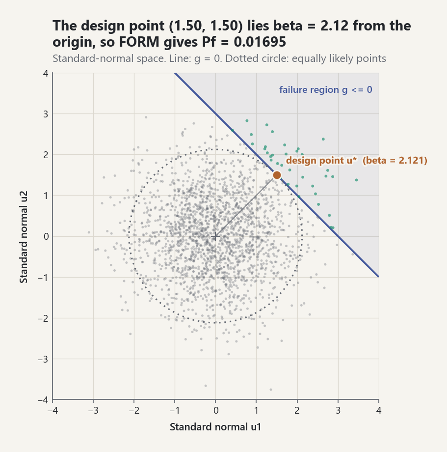
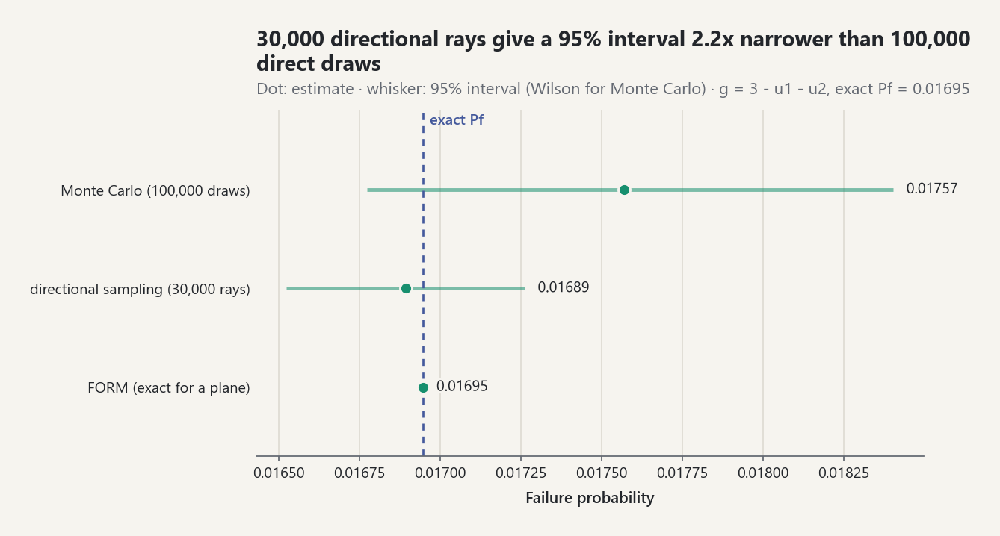
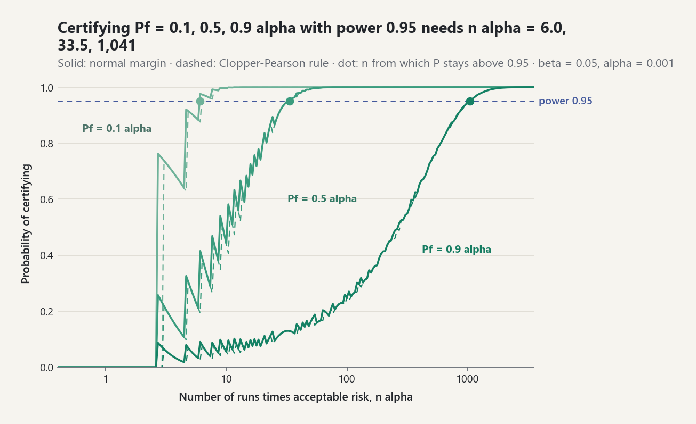

# Reliability and Rare-Event Analysis

Reliability analysis turns an engineering margin into a probability statement.
This release uses one convention everywhere: a limit-state value `g(x)>0` is
safe and `g(x)<=0` is failure [EQ-REL-LIMIT-001]. Equality is deliberately part
of failure, avoiding method-dependent boundary behavior.

## Direct Monte Carlo

Failure probability is `P_f=P(g(X)<=0)` and reliability is `1-P_f`
[EQ-REL-PF-001]. `estimate_failure_probability` evaluates explicit input
samples, returns the event count, charged model calls, plug-in standard error,
and a Wilson interval. Zero observed failures therefore does not become a false
claim that risk is zero: the interval retains a positive upper bound.

Direct Monte Carlo is model-agnostic but inefficient when `P_f` is very small.
The expected failure count is `N P_f`; credible resolution of a rare event may
require an unaffordable number of model calls.

## Rare-event importance sampling

Proposal draws may be moved toward failure and reweighted by the target-to-
proposal density ratio [EQ-REL-IS-001]. The implementation accepts explicit
likelihood ratios so multivariate transformations remain the caller's visible
responsibility. It reports ordinary weighted-contribution uncertainty, observed
proposal failures, weight ESS, and maximum normalized weight. Incorrect support
or ratios bias the answer; a large proposal failure count alone proves nothing.

## FORM, reliability index, and design point

In independent standard-normal space, FORM finds the boundary point nearest the
origin. Its signed distance is the reliability index `beta`, and the first-order
probability is `Phi(-beta)` [EQ-REL-FORM-001].

`linear_normal_form` solves this constrained problem exactly for an affine
boundary. It returns `beta`, the most-probable failure/design point, unit normal,
boundary residual, and probability. It is an exact, testable special case.
General nonlinear FORM is covered in
[Model-based reliability](advanced-reliability.md). That guide treats
non-normal and correlated inputs, the HL-RF iteration with convergence
diagnostics, SORM, subset simulation, and systems. Several design points of
one limit state are found by `find_design_points` and combined by
`multi_point_form` or `mixture_importance_sampling`; see
[Adaptive reliability](adaptive-reliability.md).

<picture><source media="(prefers-color-scheme: dark)" srcset="../images/guides/reliability-form-design-point-dark.png"></picture>

*For `g = 3 - u1 - u2` the design point (1.50, 1.50) is where the beta circle of radius 2.12 touches the limit state; the failed samples all lie beyond that line, and `Phi(-beta)` = 0.01695 is exact because the boundary is a plane.*

## Directional sampling

Independent standard-normal vectors separate into a uniform direction and a
chi-distributed radius. For a failure region that begins once per ray,
directional sampling integrates the radial tail analytically and samples only
directions [EQ-REL-DIR-001]. The API requires the radial entry boundary
explicitly. Non-star-shaped regions, multiple crossings, or missed failure
lobes violate this contract and need richer search/partition methods.

## Reproducible method comparison

Run `python examples/reliability_lab.py`. The lab compares direct Monte Carlo,
affine FORM, and directional sampling on the same bivariate Gaussian boundary,
then estimates a five-sigma normal tail with mean-shift importance sampling.
The figure shows the three estimates with their 95% intervals against the
analytic affine reference.

<picture><source media="(prefers-color-scheme: dark)" srcset="../images/guides/reliability-method-intervals-dark.png"></picture>

*Both sampling intervals cover the exact value 0.01695; directional sampling (estimate 0.01689) integrates the radial tail of each ray analytically, so its 30,000 rays give an interval 2.2 times narrower than 100,000 direct draws.*

## Certifying a failure probability

Deciding that a system is safe enough involves two probabilities: the
acceptable risk `alpha` on the failure probability `p_f`, and the
probability `beta` of certifying a system that does not meet it. With the
Monte Carlo estimate `p_hat_n` of `n` runs, the system is certified when
`p_hat_n + c(n, alpha, beta) <= alpha`. The central limit theorem suggests
`c = z_(1-beta) sqrt(alpha (1 - alpha) / n)` [EQ-REL-CERT-001], for which the
largest certification probability over `p_f >= alpha` tends to `beta`.

The rule certifies exactly when the failure count `X ~ Binomial(n, p_f)` is
at most an integer threshold `k_n`, so the certification probability is the
binomial distribution function `P(X <= k_n)` [EQ-REL-CERT-002].
`reliability.certification_probability` evaluates it through the
regularized incomplete beta function, which stays fast and accurate for
`n = 1e10`. Two consequences follow.

- **The normal margin is approximate for small `n alpha`.** With
  `n = 3000`, `alpha = p_f = 0.01`, and `beta = 0.05`, the normal rule
  certifies with probability 0.0536. The `rule="clopper-pearson"` option
  certifies when the exact one-sided upper bound is at most `alpha`, which
  keeps the false-certification probability at most `beta` for every `n`
  (here 0.0346).
- **The certification probability is not monotone in `n`.** It jumps up when
  `k_n` increases and decreases in between. `reliability.certification_sample_size`
  therefore returns the smallest `n` from which the probability stays at or
  above the requested power (`size`), and the first `n` at which it reaches
  that power (`first_size`).

The required size scales with `1/alpha`. At 95 % power and `beta = 0.05`,
the normal rule needs `n alpha` of about 6.0, 33.5, and 1042 for
`p_f = alpha/10`, `alpha/2`, and `0.9 alpha`, at every `alpha` from `1e-2` to
`1e-6`; the Clopper-Pearson rule needs 6.3, 34.9, and 1046. In round
numbers, `n` of about `10/alpha`, `50/alpha`, and `1000/alpha` certifies with
probabilities of about 0.996, 0.994, and 0.94 to 0.95. For `alpha = 1e-6` and
`p_f = alpha/10` this is six million model runs.

Conditioned sampling reduces this cost. In an idealized moving-particles run
with `N` particles the number of moves is `M ~ Poisson(-N ln p_f)` and the
estimate is `(1 - 1/N)^M`. Certifying when the exact Poisson upper bound of
`p_f` is at most `alpha` gives a certification probability that is again a
Poisson tail [EQ-REL-CERT-003]. `reliability.moving_particles_certification_probability`
counts `N` initial draws plus `steps` model calls per move, an expected
`N (1 - steps ln p_f)` calls. With 10 calls per move, 32 particles certify
`p_f = 1e-7` against `alpha = 1e-6` with probability 0.955 for about 5,190
expected calls, more than a thousand times fewer than crude Monte Carlo. At
`alpha = 1e-2` the advantage disappears (about 910 expected calls against
602 runs), because the cost grows like `-ln p_f` rather than `1/p_f`.

```python
from probstat.reliability import (
    certification_probability,
    certification_sample_size,
    moving_particles_certification_probability,
)

round(certification_probability(3000, 0.01, 0.01).probability, 4)   # 0.0536
exact = certification_probability(3000, 0.01, 0.01, rule="clopper-pearson")
exact.max_failures, round(exact.probability, 4)    # (20, 0.0346)
crude = certification_sample_size(1e-7, 1e-6)
crude.size, crude.max_failures                     # (6043694, 2)
particles = moving_particles_certification_probability(32, 1e-7, 1e-6)
round(particles.probability, 3), round(particles.expected_calls)   # (0.955, 5190)
```

<picture><source media="(prefers-color-scheme: dark)" srcset="../images/guides/reliability-certification-probability-dark.png"></picture>

*With `alpha = 0.001` and `beta = 0.05`, nothing can be certified below `n alpha` of about 3, and each curve then climbs as a saw tooth: it jumps when the admissible failure count `k_n` grows and sinks while `k_n` stays fixed. The dots mark the size from which the probability never falls below 0.95 again: `n alpha` = 6.0, 33.5 and 1,041 for `p_f` = 0.1, 0.5 and 0.9 `alpha`. The dashed Clopper-Pearson curves lie just to the right of the normal ones; that small delay is the price of a false-certification probability that stays below `beta` at every `n`.*

`examples/risk_analysis_lab.py` reproduces these numbers together with the
moving-particles certification at `alpha = 1e-3` and `1e-6`.

## Chance constraints and reliability-based design

Sizing a subsystem is an optimisation with a probabilistic requirement:
"minimise mass such that the link margin is positive with probability 0.99".
Two families of tools cover it.

**Chance constraints without a design point.** For a convex program with `d`
decision variables and `N` independent samples of the uncertain constraint,
the scenario solution violates a fresh constraint with probability `V` and
`P(V > eps) <= sum_(i<d) C(N, i) eps^i (1 - eps)^(N - i)` [EQ-REL-SCENARIO-001],
a binomial tail that is attained by fully-supported problems.
`reliability.scenario_sample_size` inverts it for `N` (the exact size and the
explicit sufficient size `(2/eps)(d - 1 + ln(1/beta))` of [EQ-REL-SCENARIO-002]),
and `reliability.scenario_violation_bound` returns the guaranteed `eps` for a
given `N`. After the solve, the number `k` of support constraints replaces
`d`: `reliability.scenario_posterior_violation_bound` gives the
wait-and-judge level of [EQ-REL-SCENARIO-003], much smaller when few
constraints are active. None of this needs convexity to be *computed*, but the
guarantee needs it; for any other design, however obtained,
`reliability.certify_design` counts violations in a fresh seeded sample and
returns the exact Clopper-Pearson upper bound (`reliability.certify_violation_frequency`
for a count you already have). `reliability.solve_chance_constrained`
minimises an objective subject to the sampled chance constraint (single or
joint) and returns the design, the empirical violation used in the
optimisation, and the out-of-sample certificate. The sampled constraint "at
most `floor(gamma N)` samples violate" is one order-statistic constraint
[EQ-REL-SAA-001]; it is non-convex in general, so the result is a local
solution and only the certificate supports a claim. For a linear constraint
with normal coefficients the constraint is a second-order cone,
`reliability.normal_linear_chance_margin` [EQ-REL-CHANCE-NORMAL-001], and
`reliability.distribution_free_chance_margin` gives the Cantelli and
Chebyshev versions [EQ-REL-CHANCE-FREE-001].

**Reliability-based design optimisation.** `reliability.rbdo_sora` minimises
`cost(d)` subject to `beta_j(d) >= beta_target_j` by sequential optimisation
and reliability assessment: a deterministic optimisation with constraints
shifted to the most-probable target points, then an inverse FORM analysis
(`reliability.inverse_form`) at the new design, repeated [EQ-REL-SORA-001].
`reliability.rbdo_double_loop` runs one FORM analysis per constraint
evaluation [EQ-REL-RBDO-002] and is the slow reference.
`reliability.minimize_constrained` is the augmented-Lagrangian solver both
use [EQ-REL-AUGLAG-001], and `reliability.verify_design_reliability`
re-checks the final design with SORM or importance sampling. A design enters a
limit state through a factory `design -> ModelLimitState`.

```python
from probstat.distributions import Normal
from probstat.modeling import JointInput, ProbabilisticModel, RandomInput
from probstat.reliability import (
    ModelLimitState,
    certify_violation_frequency,
    rbdo_sora,
    scenario_posterior_violation_bound,
    scenario_sample_size,
    scenario_violation_bound,
    verify_design_reliability,
)
from probstat.uq import QuantityOfInterest

sizes = scenario_sample_size(0.05, 0.99999, 10)
sizes.size, sizes.explicit_size                  # (581, 821)
round(scenario_violation_bound(200, 4, 0.95), 4)           # 0.0383
round(scenario_posterior_violation_bound(100, 1, 5, 0.999), 4)   # 0.1119
round(certify_violation_frequency(0, 100).upper_bound, 4)  # 0.0295


def capacity(design):
    inputs = JointInput.independent(
        RandomInput("x1", Normal(10.0, 1.0)), RandomInput("x2", Normal(30.0, 5.0))
    )
    model = ProbabilisticModel(
        inputs,
        lambda p: {"y": p["c"] * p["x1"] - p["x2"]},
        (QuantityOfInterest("y", "margin"),),
        fixed={"c": design[0]},
    )
    return ModelLimitState(model, "y", 0.0, "below")


result = rbdo_sora(lambda d: d[0], [capacity], 3.0, (8.0,), bounds=[(1.0, 20.0)])
round(result.design[0], 3), round(result.betas[0], 3), result.converged  # (5.154, 3.0, True)
check = verify_design_reliability(result.design, [capacity], 3.0)[0]
round(check.beta_difference, 3)                  # 0.0
```

The design `c = 5.154` solves `91 c^2 - 600 c + 675 = 0`, the closed form of
`beta(c) = (10 c - 30) / sqrt(c^2 + 25) = 3` for this linear limit state, so
SORM agrees with FORM exactly.

- **Convention.** `solve_chance_constrained` and `certify_design` call
  `g > 0` a violation (the optimisation convention); a `ModelLimitState` calls
  `g <= 0` a failure. Pass `-g` to convert.
- **Scenario guarantees need convexity.** The bounds are computed for any
  problem but hold only when the program is convex with a unique solution;
  `solve_chance_constrained` reports them only for `violation_level=0`.
- **SORA is first order.** The achieved index is the FORM index; check the
  final design with `reliability.verify_design_reliability`, which reports
  the difference between FORM and SORM or importance sampling.

## Common pitfalls

- **The boundary is failure.** `LimitState.failed` is `g(x) <= 0`, so a sample
  exactly on the limit surface counts as a failure.
- **Zero failures do not mean zero risk.** With no observed failure the plug-in
  `standard_error` is `0.0`; the Wilson interval keeps a positive upper bound.
- **`beta` is signed.** `linear_normal_form(intercept, coefficients)` describes
  `g(u) = intercept + coefficients . u`; a negative intercept means the origin
  already fails and gives a negative index.
- **Importance weights are the caller's responsibility.**
  `estimate_weighted_failure_probability` uses the likelihood ratios it is
  given; wrong ratios or a proposal with too small a support bias the result
  without an error.
- **Directional sampling needs one entry radius per ray.** The radial boundary
  returns `None` (no failure on that ray) or the radius where failure begins.

```python
from probstat.reliability import LimitState, estimate_failure_probability, linear_normal_form

capacity = LimitState(lambda x: 3.0 - x[0], "capacity")
capacity.failed((3.0,))                          # True
direct = estimate_failure_probability(capacity, [(0.1 * i,) for i in range(20)])
direct.failure.successes, direct.standard_error  # (0, 0.0)
round(direct.failure.confidence_interval.upper, 3)   # 0.161 (95 % Wilson interval)
linear_normal_form(3.0, (-1.0, 0.0)).reliability_index   # 3.0
linear_normal_form(-3.0, (1.0, 0.0)).reliability_index   # -3.0
```

## Sources

- [REF-MELCHERS-BECK-2018, Chapters 2-6].
- [REF-OWEN-2013, Chapter 9].
- [REF-WILSON-1927].
- [REF-CLOPPER-PEARSON-1934], [REF-WALTER-2015].
- [REF-CAMPI-GARATTI-2008], [REF-CAMPI-GARATTI-2018], [REF-DU-CHEN-2004].
