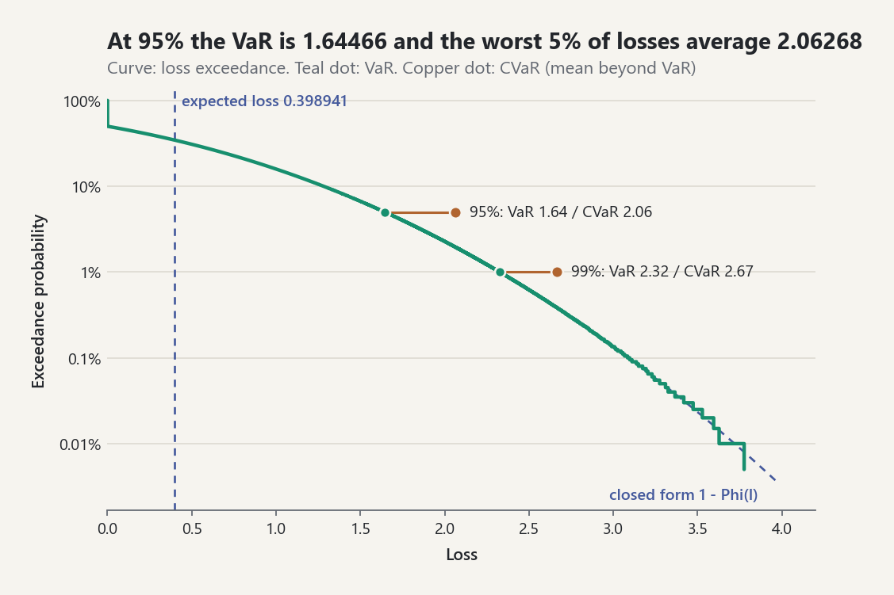

# Quantitative Risk Analysis

Kaplan and Garrick define risk as the set of triplets *(scenario, likelihood,
consequence)* [EQ-RISK-DEF-001]. `probstat.risk` implements each part of that
definition: scenarios come from a `ProbabilisticModel`, a fault tree, or an
event tree; likelihoods are probabilities or annual frequencies; consequences
come from an explicit loss function. Every scalar summary below discards part
of the triplet set, so report the exceedance curve alongside any single
number.

All numbers in this guide were produced by the library at version 0.13.0 on
2026-10-11 and are asserted, where marked, by `tests/test_risk_analysis.py`.

## Loss orientation and sample measures

Losses are oriented so larger is worse. Every sample measure accepts optional
non-negative weights (normalized internally), so Monte Carlo output,
importance-sampling output, and finite scenario sets share one code path.

| Measure | Definition | Function |
|---|---|---|
| Expected loss | `sum_i w_i L_i` [EQ-RISK-EL-001] | `expected_loss` |
| Value-at-risk | lower quantile `inf{l : F(l) >= alpha}` [EQ-RISK-VAR-001] | `value_at_risk` |
| CVaR / expected shortfall | `VaR + E[(L - VaR)^+] / (1 - alpha)` [EQ-RISK-CVAR-001] | `conditional_value_at_risk` |
| Exceedance | `P(L > l)` [EQ-RISK-EXC-001] | `exceedance_probability`, `loss_exceedance_curve` |
| Return period | `1 / lambda`, `1 - exp(-lambda t)` [EQ-RISK-RP-001] | `return_period`, `poisson_exceedance_probability` |

**VaR convention.** VaR is the *lower* quantile (Hyndman-Fan type 1 for equal
weights), never an interpolated value. It therefore always equals an observed
loss. Cumulative weights are compared with a `1e-10` tolerance, so
`value_at_risk(range(1, 11), 0.7)` is `7`, not `8` (floating `0.7 * 10` is
`7.000000000000001`).

**CVaR and ties.** The Rockafellar-Uryasev formula averages exactly the worst
`1 - alpha` probability mass. When an atom straddles VaR, only the needed part
of it is counted. Worked examples (tested):

| Losses | Weights | `alpha` | VaR | CVaR |
|---|---|---|---|---|
| 1, 2, 3, 4, 5 | equal | 0.8 | 4 | 5 |
| 1, 2, 3, 4, 5 | equal | 0.7 | 4 | (0.1·4 + 0.2·5)/0.3 = 4.667 |
| 0, 0, 0, 10, 10 | equal | 0.5 | 0 | (0.1·0 + 0.4·10)/0.5 = 8 |
| 0, 100, 1000 | 0.90, 0.08, 0.02 | 0.95 | 100 | 100 + 0.02·900/0.05 = 460 |

A naive "average of losses at or above VaR" would give `20/5 = 4` for the tied
example, not 8, because it would count all three zero losses as tail mass.

**Coherence.** CVaR is coherent (monotone, translation-equivariant, positively
homogeneous, subadditive) [REF-ARTZNER-ETAL-1999], [REF-ACERBI-TASCHE-2002];
VaR is not subadditive in general and says nothing about losses beyond it.

**Closed-form oracles.** For `L ~ Normal(mu, sigma^2)`,
`VaR = mu + sigma z_alpha` and `CVaR = mu + sigma phi(z_alpha)/(1 - alpha)`
[EQ-RISK-NORMAL-001]. For `ln L ~ Normal(mu, sigma^2)`,
`CVaR = exp(mu + sigma^2/2) Phi(sigma - z_alpha)/(1 - alpha)`
[EQ-RISK-LOGNORMAL-001].

| Law, `alpha = 0.95` | Analytic VaR | Analytic CVaR | Sample VaR | Sample CVaR |
|---|---|---|---|---|
| Normal(0, 1) | 1.64485 | 2.06271 | 1.64376 | 2.05817 |
| LogNormal(0, 0.5) | 2.27602 | 2.85859 | 2.27431 | 2.85134 |

The sample columns use 200 000 normal draws followed by 200 000 lognormal draws
from one `random.Random(1)` stream.

**Sampling uncertainty.** `bootstrap_risk_interval` returns a seeded percentile
interval [EQ-RISK-BOOT-001]. For the first 2000 normal draws above, the CVaR at
0.95 is 1.9925 with a 200-replicate interval [1.886, 2.064] (seed 3). Only
`n (1 - alpha)` losses inform a tail estimate; with 100 tail points the
interval is already wide, and percentile intervals undercover for very small
tail counts.

## Consequence models and `assess_risk`

A `LossFunction` maps a QoI value to a loss [EQ-RISK-LOSS-001]: `step_loss`
(all-or-nothing), `linear_loss` (hinge with optional cap),
`piecewise_linear_loss` (damage table with constant extrapolation), or
`custom_loss`. `assess_risk(model, quantity, loss, size, design=..., seed=...)`
calls `probstat.propagation.propagate`, applies the loss, and returns a
`RiskAssessment` with the expected-loss estimate and standard error, VaR and
CVaR at the requested levels, a 50-point exceedance curve, `P(L > 0)`, the
model-evaluation count, and the underlying study.

Worked example: `Y = X`, `X ~ Normal(0, 1)`, loss `max(Y, 0)`. Analytically
`E[L] = 1/sqrt(2 pi) = 0.398942`, and for `alpha > 0.5` the tail measures equal
the normal ones. With 20 000 LHS points (seed 5) the assessment gives
`E[L] = 0.398941`, `VaR_0.95 = 1.64466`, `CVaR_0.95 = 2.06268`, and
`P(L > 0) = 0.5`, using exactly 20 000 model evaluations. The standard-error
interval of the mean assumes independent draws; for LHS or QMC it is a
conservative reference only.

<picture><source media="(prefers-color-scheme: dark)" srcset="../images/guides/risk-loss-exceedance-dark.png"></picture>

*The loss is zero half the time, so the expected loss 0.398941 sits far below the tail; at 95% the VaR 1.64466 is the loss exceeded with probability 5%, and the CVaR 2.06268 is the mean of that worst 5%, both on the closed-form normal tail.*

## Fault trees

Build trees from `BasicEvent` leaves with `and_gate`, `or_gate`, and
`k_of_n_gate` [EQ-RISK-FT-GATE-001]. Basic events are independent; reusing a
name in several branches denotes the same (repeated) event.

- `minimal_cut_sets` uses MOCUS (top-down row expansion due to Fussell and
  Vesely) followed by Boolean absorption [EQ-RISK-FT-MOCUS-001].
- `top_event_probability()` is exact: it conditions on every repeated event
  (Shannon decomposition) and evaluates the remaining tree bottom-up
  [EQ-RISK-FT-SHANNON-001]. Cost grows as `2^r` in the number `r` of repeated
  events; the default guard is `r <= 16`. `method="inclusion_exclusion"` is an
  independent check for at most 15 cut sets [EQ-RISK-FT-IE-001].
- `rare_event_approximation` and `min_cut_upper_bound` are the classical
  cut-set approximations [EQ-RISK-FT-BOUND-001].

Worked example (tested): `TOP = (A and B) or (C and (A or D))` with
`p = 0.1, 0.2, 0.3, 0.4`. MOCUS gives `{A,B}`, `{A,C}`, `{C,D}`; `A` is
repeated. Conditioning on `A`:
`Q = 0.1 · (1 - 0.8 · 0.7) + 0.9 · (0.3 · 0.4) = 0.044 + 0.108 = 0.152`.
Inclusion-exclusion over the three cut sets gives the same 0.152, the
rare-event approximation gives 0.17, and the min-cut upper bound gives
0.163472, so `Q <= MCUB <= REA` as theory requires.

**Importance** [EQ-RISK-FT-IMP-001]: Birnbaum `Q(1_i) - Q(0_i)`;
Fussell-Vesely `P(union of cut sets containing i)/Q` (evaluated exactly, not
by the `1 - Q(0_i)/Q` approximation); RAW `Q(1_i)/Q`; RRW `Q/Q(0_i)`.

| Event | Birnbaum | FV | RAW | RRW |
|---|---|---|---|---|
| A | 0.32 | 0.2895 | 2.895 | 1.267 |
| B | 0.07 | 0.1316 | 1.368 | 1.101 |
| C | 0.44 | 0.9079 | 3.026 | 7.600 |
| D | 0.27 | 0.7895 | 2.066 | 3.455 |

For a two-component series system (OR) with `p_A = a`, `p_B = b`:
Birnbaum(A) `= 1 - b`, FV(A) `= a/Q`, RAW(A) `= 1/Q`, RRW(A) `= Q/b`. For the
parallel system (AND): Birnbaum `= b`, FV `= 1`, RAW `= 1/a`, RRW `= inf`.
Both cases are tested.

## Event trees

An `EventTree` has an initiating frequency and nested `Heading` nodes whose
`Branch` probabilities are conditional on the path so far and sum to one;
paths end in an `Outcome` with a consequence. Sequence frequency is
`f_IE prod p_branch` [EQ-RISK-ET-001], and total risk is `sum f_i c_i`
[EQ-RISK-DEF-001].

Worked example (tested): fire at 0.1/yr; detection fails with 0.01 (major
damage, 10^6); after detection, suppression fails with 0.05 (minor damage,
10^4). Sequence frequencies are 0.09405 (ok), 0.00495 (minor), and 0.001
(major); total risk is `49.5 + 1000 = 1049.5` per year, and the major sequence
ranks first by risk but last by frequency. Fault-tree results can supply
branch probabilities, but shared basic events between headings are not linked;
encode such dependence in the conditional probabilities yourself.

## Fragility curves and hazard convolution

`LognormalFragility(theta, beta)` evaluates `Phi(ln(a/theta)/beta)`
[EQ-RISK-FRAG-001]. `fit_lognormal_fragility` maximizes the binomial
likelihood [EQ-RISK-FRAG-MLE-001] over `(ln theta, ln beta)` with
`optimization.minimize_bfgs`; pass `trials=` for multiple-stripe counts. It
refuses data without both outcomes, with fewer than two distinct intensities,
or with failures and survivals completely separated by intensity, because no
finite MLE exists there.

Worked example: 3000 binary observations with intensities log-uniform on
[0.1, 2.0] and true `(theta, beta) = (0.5, 0.4)` (`random.Random(7)`) give
`theta = 0.5027`, `beta = 0.4085` after 8 BFGS iterations and 46 objective
evaluations.

`annual_failure_frequency(fragility, hazard)` integrates the fragility against
the hazard-curve decrements with geometric midpoints and an optional tail term
[EQ-RISK-CONV-001]; the result includes a disaggregation by intensity and a
return period. For a power-law hazard `lambda(a) = k0 a^-k` the exact answer is
`k0 theta^-k exp(k^2 beta^2/2)` [EQ-RISK-CONV-002]. With `k0 = 1e-4`, `k = 3`,
`theta = 0.5`, `beta = 0.4`: exact `1.643547e-3`/yr, numerical
`1.643576e-3`/yr on 2001 log-spaced levels from `1e-3` to `1e3` (relative
difference `2e-5`). Hazard levels must start where the fragility is
negligible, because events below the first level are not counted.

## Decision analysis and value of information

`DecisionProblem(decisions, states, probabilities, payoffs, maximize=True)`
computes expected payoffs and the Bayes decision [EQ-RISK-DEC-EU-001], EVPI
[EQ-RISK-DEC-EVPI-001], and, via `preposterior(outcomes, likelihoods)`, the
EVSI of a discrete experiment [EQ-RISK-DEC-EVSI-001]. Use `maximize=False` for
loss tables.

Worked example (tested): rain with probability 0.3; *take umbrella* pays 70
(rain) or 80 (dry), *leave* pays 0 or 100. `EU(take) = 77`, `EU(leave) = 70`,
value with perfect information `0.3·70 + 0.7·100 = 91`, so `EVPI = 14`. A
forecast that says "rain" with probability 0.8 when it rains and 0.1 when dry
has `P("rain") = 0.31`; the decision rule is take on "rain", leave on "dry";
the value with the forecast is `0.24·70 + 0.07·80 + 0.63·100 = 85.4`, so
`EVSI = 8.4 <= EVPI`. Pay for the forecast only if it costs less than 8.4.

## Sequential decisions: bandits, logged data, and Markov decision processes

`DecisionProblem` treats one decision. Four modules cover decisions that
repeat, each with its own question.

**Which action in this context, while still learning?** `LinUCB(n_arms,
dimension, alpha=...)` keeps one ridge regression per arm and plays the arm
with the largest `theta_a'x + alpha sqrt(x' A_a^-1 x)` [EQ-RISK-LINUCB-001];
the inverse is updated in `O(d^2)` by a rank-one formula
[EQ-RISK-LINUCB-002]. `LinearThompsonSampling(dimension, v=...)` draws one
shared parameter from `N(B^-1 f, v^2 B^-1)` and plays its best arm
[EQ-RISK-LINTS-001]; with `v = 1` this is the exact posterior of a `N(0, I)`
prior under unit-variance Gaussian rewards. `alpha` and `v` are tuning
parameters: the values used in the regret proofs of the sources depend on
the horizon and a confidence level and are not reproduced here.
`simulate_linear_bandit` runs a policy in a known linear environment and
reports the pseudo-regret [EQ-RISK-LINUCB-003]. With four arms in three
dimensions (noise 0.5, seed 21) LinUCB loses 0.068 per round over the first
200 rounds and 0.010 over 2000 (total 20.7, against 1224 for uniform play).

**What would another policy have earned on data already collected?** A log
of `(context, action, reward, logging propensity)` records goes into
`logged_bandit_data`. `inverse_propensity_score` reweights the rewards by
`pi(a|x) / p(a|x)` [EQ-RISK-OPE-001] and is unbiased when the propensities
are the true ones; `self_normalized_ips` divides by the sum of the weights
[EQ-RISK-OPE-002]; `direct_method` averages a reward model
[EQ-RISK-OPE-003]; `doubly_robust` adds the weighted residual of the model
[EQ-RISK-OPE-004] and is unbiased if either the propensities or the model
are right. Every estimate carries a standard error, the largest weight, and
the effective sample size of the weights [EQ-RISK-OPE-005]. On a tabular
problem with two contexts and three actions the tests enumerate all 144
two-record logs: IPS and both doubly robust variants have expectation equal
to the true value 0.576 to rounding, while IPS with wrong propensities is
off by 0.316 and weights clipped at 2 give a bias of -0.276.

**What is the best policy when actions change the future state?**
`FiniteMDP(transitions, rewards, discount)` holds `P[a][s][s']`, rewards
`R[a][s]` or `R[a][s][s']`, and `gamma < 1`. `policy_evaluation` solves
`(I - gamma P_pi) V = r_pi` [EQ-RISK-MDP-001]; `policy_iteration` alternates
that solve with greedy improvement and stops at an optimal policy
[EQ-RISK-MDP-004]; `value_iteration(tolerance=eps)` iterates the Bellman
operator until the change is below `eps (1 - gamma) / (2 gamma)`, which
guarantees a policy within `eps` of optimal [EQ-RISK-MDP-003];
`backward_induction` solves the finite-horizon problem
[EQ-RISK-MDP-005]. Every solution reports its Bellman residual and the
error bounds that follow from it [EQ-RISK-MDP-006].

**Which of `n` options is best, with a fixed number of trials?**
`sequential_halving(pull, n_arms, budget)` spends the budget in
`ceil(log2 n)` rounds and drops the worse half after each
[EQ-RISK-SH-001]. On eight Bernoulli arms with best mean 0.6 and runner-up
0.45 the wrong arm was returned in 34.7 %, 12.0 %, and 0 % of 300 seeded
runs with budgets 48, 240, and 1200.

```python
from probstat.risk import (
    FiniteMDP, LinUCB, doubly_robust, inverse_propensity_score,
    logged_bandit_data, policy_evaluation, policy_iteration,
    sequential_halving, value_iteration,
)

# A machine is "good" or "worn"; "run" earns 10 or 4, "repair" earns 5 or 1.
run = ((0.8, 0.2), (0.0, 1.0))
repair = ((1.0, 0.0), (1.0, 0.0))
mdp = FiniteMDP((run, repair), ((10.0, 4.0), (5.0, 1.0)), 0.9)
best = policy_iteration(mdp)
best.policy                                          # (0, 1)
best.values[0]                                       # 86.2712
policy_evaluation(mdp, (0, 0))[0]                    # 61.4286
value_iteration(mdp, tolerance=1e-6).iterations      # 180

log = logged_bandit_data(
    [("a", 0, 1.0, 0.5), ("a", 1, 0.0, 0.5), ("b", 1, 1.0, 0.25),
     ("b", 0, 0.0, 0.75), ("a", 1, 1.0, 0.5), ("b", 1, 1.0, 0.25)],
    n_actions=2,
)
always_one = lambda context: (0.0, 1.0)
ips = inverse_propensity_score(log, always_one)
ips.value                                            # 1.6667
ips.effective_sample_size                            # 3.6
doubly_robust(log, always_one, lambda x, a: 0.5).value   # 1.1667

policy = LinUCB(2, 1, alpha=1.0)
for reward in (1.0, 0.0, 1.0):
    policy.update(0, (1.0,), reward)
policy.theta(0)[0]                                   # 0.5
policy.bonus(0, (1.0,))                              # 0.5

halving = sequential_halving(lambda arm, rng: (0.1, 0.5, 0.3, 0.9)[arm], 4, 40)
halving.best_arm                                     # 3
```

The six-record log shows why the diagnostics matter: rewards lie in
`[0, 1]` but the IPS estimate is 1.67, because two records carry weight 4
and the effective sample size is 3.6.

Limits: the bandit policies assume the linear payoff model; nothing is
claimed when it is wrong. Off-policy estimators need logging propensities
that are positive wherever the target policy acts, independent records, and
a reward model that was not fitted on the evaluated records; a small
effective sample size means the standard error is itself unreliable. A
`FiniteMDP` needs known transition probabilities and offers every action in
every state; model-free learning (Q-learning) is not implemented.

## Risk matrices: communication only

`RiskMatrix` maps (likelihood, severity) bins to categories
[EQ-RISK-MATRIX-001]; a value on an edge falls into the higher bin. Cox (2008)
shows that risk matrices can give identical ratings to quantitatively very
different risks, can rank risks in the reverse of their expected-loss order,
and depend on arbitrary bin edges [REF-COX-2008]. Use a matrix only to
communicate results already obtained with the quantitative tools above.

## Assumptions and limits

- Fault trees are static and coherent with independent basic events; no NOT
  gates, common-cause models, or time dependence. Exact quantification is
  exponential in the number of repeated events.
- Event-tree branch probabilities are taken as given conditional numbers.
- The fragility MLE reports no parameter uncertainty; use a bootstrap or
  Bayesian treatment for that.
- EVSI is implemented for discrete experiments only.
- Sample risk measures inherit the sampling error of the propagation; check
  the tail count `n (1 - alpha)`.

## Common pitfalls

- **Losses, not gains.** Every sample measure reads larger values as worse.
  `DecisionProblem` instead defaults to `maximize=True`, so its payoffs are
  utilities. Negate gains before passing them as losses.
- **VaR is an observed loss.** `value_at_risk` is the lower quantile, never an
  interpolated value.
- **CVaR is not the mean of the losses at or above VaR.** With ties at VaR
  only the needed part of the atom enters the tail.
- **Unseeded runs differ.** `assess_risk` and `bootstrap_risk_interval`
  default to `seed=None`; pass an integer seed.
- **A cell edge belongs to the higher bin.** `RiskMatrix.cell` uses the right
  side of each threshold, so a value equal to an edge is rated in the bin
  above it.

```python
import inspect
from probstat.risk import (
    DecisionProblem, RiskMatrix, assess_risk, conditional_value_at_risk, value_at_risk,
)

value_at_risk(range(1, 11), 0.7)                     # 7.0
losses = [0, 0, 0, 10, 10]
conditional_value_at_risk(losses, 0.5)               # 8.0
sum(x for x in losses if x >= value_at_risk(losses, 0.5)) / len(losses)   # 4.0, naive
inspect.signature(DecisionProblem).parameters["maximize"].default         # True
inspect.signature(assess_risk).parameters["seed"].default                 # None
matrix = RiskMatrix((0.1,), (10.0,), (("low", "medium"), ("medium", "high")))
matrix.cell(0.1, 10.0)                               # (1, 1)
```

## Sources

- [REF-KAPLAN-GARRICK-1981].
- [REF-ROCKAFELLAR-URYASEV-2000], [REF-ROCKAFELLAR-URYASEV-2002].
- [REF-ARTZNER-ETAL-1999], [REF-ACERBI-TASCHE-2002].
- [REF-MCNEIL-FREY-EMBRECHTS-2015, Chapter 2].
- [REF-EFRON-TIBSHIRANI-1993, Chapter 13].
- [REF-VESELY-ETAL-1981], [REF-RAUSAND-HOYLAND-2004], [REF-BIRNBAUM-1969].
- [REF-BAKER-2015], [REF-SHINOZUKA-ETAL-2000], [REF-CORNELL-ETAL-2002],
  [REF-BAKER-BRADLEY-STAFFORD-2021].
- [REF-RAIFFA-SCHLAIFER-1961], [REF-COX-2008].
- [REF-LI-ETAL-2010], [REF-AGRAWAL-GOYAL-2013], [REF-DUDIK-LANGFORD-LI-2011],
  [REF-NORRIS-1997], [REF-KARNIN-KOREN-SOMEKH-2013].
