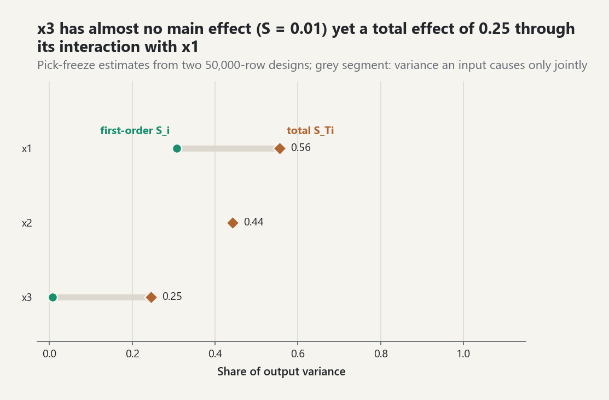

# Local and Global Sensitivity Analysis

Sensitivity analysis asks how model output changes when inputs change. Local and
global answers are different and must not be conflated.

## Local derivatives

`central_difference_gradient` approximates each partial derivative at one
declared point with symmetric perturbations [EQ-SENS-LOCAL-001]. It charges two
model evaluations per coordinate. The result depends on point and step size;
large derivatives do not by themselves imply large variance contributions over
an uncertain input distribution.

## Functional ANOVA and Sobol indices

For mutually independent inputs and a square-integrable scalar response,
functional ANOVA decomposes output variance into orthogonal main and interaction
components [EQ-SENS-ANOVA-001]. First-order indices measure main effects,
second-order indices isolate pair interactions, and total-effect indices include
every term involving an input [EQ-SENS-FIRST-001], [EQ-SENS-SECOND-001],
[EQ-SENS-TOTAL-001].

`estimate_sobol_indices` takes two explicitly independent base matrices and
constructs pick-freeze hybrids. It reports all model calls. Monte Carlo estimates
are intentionally not clipped to `[0,1]`: small negative or above-one estimates
are finite-sample diagnostics, while large violations signal inadequate sample
size, dependence, numerical noise, or a broken sampling design.

The current estimator assumes independent inputs. For dependent inputs use the
Shapley effects described below. Replicated stochastic simulators and
streaming evaluation remain future extensions.

## Ranking and decisions

Inputs are ranked by total effect because it includes interactions. The declared
threshold rule [EQ-SENS-DECISION-001] separates uncertainty-reduction priorities
from candidates for fixing during dimension reduction. This is a screening
recommendation, not a causal statement or cost-benefit optimum; physical,
epistemic, safety, and measurement-cost information must still be considered.

## Reproducible laboratory

Run `python examples/sensitivity_lab.py`. The Ishigami benchmark contains a
strong interaction: its third input has essentially no first-order effect but a
substantial total effect.

<picture><source media="(prefers-color-scheme: dark)" srcset="../images/guides/ishigami-sobol-indices-dark.png"></picture>

*With two 50,000-row pick-freeze designs, x3 has a first-order index of 0.01 but a total index of 0.25 (analytic values 0 and 0.2437): ranking by main effects alone would mark it for fixing, while the total effect, which includes its interaction with x1, keeps it.*

## Sources

- [REF-SOBOL-1993].
- [REF-SALTELLI-2008, Chapters 1, 4, and 6].
- [REF-SALTELLI-2010].
- [REF-FORNBERG-1988].

## Shapley effects for dependent inputs

Sobol indices need independent inputs: under correlation the functional ANOVA
terms are no longer orthogonal and first-order and total indices stop adding
up. Shapley effects share the output variance among inputs by the Shapley
value of the variance game [EQ-SENS-SHAPLEY-001]:

`Sh_i = (1/Var Y) sum_(J not containing i) [|J|! (d-|J|-1)! / d!] (c(J u {i}) - c(J))`.

They are non-negative in the population and sum to one under any joint law.
For independent inputs without interactions they equal the first-order and
total Sobol indices; with interactions each interaction share is split equally
among its inputs [REF-OWEN-2014].

`shapley_effects(model, quantity)` follows Song, Nelson, and Staum
[EQ-SENS-SHAPLEY-002]. The cost `c(J) = E[Var(Y | X_-J)]` (equivalent to the
closed index `Var(E[Y | X_J])`) is estimated with `N_O` outer draws of `X_-J`
and `N_I = 3` inner draws of `X_J | X_-J`. `Var Y` comes from `N_V` separate
joint draws, so the effects telescope to exactly one.

- `method="exact"` (default for `d <= 6`) estimates each of the `2^d - 2`
  proper subsets once and uses the subset formula; cost
  `N_V + (2^d - 2) N_O N_I`.
- `method="random"` averages `m` random permutations with `N_O = 1` by
  default; cost `N_V + m (d - 1) N_O N_I`.

Conditional sampling uses the model's joint law. For Gaussian-copula inputs
`z_J | z_K` is Gaussian with mean `R_JK R_KK^-1 z_K` and Schur-complement
covariance `R_JJ - R_JK R_KK^-1 R_KJ`, and `x_i = F_i^-1(Phi(z_i))`
[EQ-SENS-SHAPLEY-003]. The standard errors are delta-method approximations
that ignore the noise of the normalizing `Var Y`.

`linear_gaussian_shapley(b, Sigma)` gives exact effects of `Y = b'X` for
Gaussian `X` from `Var(E[Y | X_J]) = s_J' Sigma_JJ^-1 s_J`, `s = Sigma b`
[EQ-SENS-SHAPLEY-004]. In two dimensions:

`Sh_1 = (b1^2 s1^2 (1 - rho^2/2) + rho b1 b2 s1 s2 + b2^2 s2^2 rho^2/2) / V`.

Expanding `Sh_1 = (1/2)[c({1}) + V - c({2})]` with
`c({1}) = (b1 s1 + rho b2 s2)^2` and `c({2}) = (b2 s2 + rho b1 s1)^2` gives
this formula. `tests/test_mlmc_ce_line_shapley.py` checks it against
`linear_gaussian_shapley` on three parameter sets to twelve decimal places.

### Numbers computed with this release

`Y = X1 + X2` with `X1 ~ N(0, 1)`, `X2 ~ N(0, 2^2)`, and correlation `0.6`
(`Var Y = 7.4`):

| quantity | `X1` | `X2` |
| --- | --- | --- |
| closed first-order index `Var(E[Y | X_i]) / V` | 0.654 | 0.914 |
| total index `1 - Var(E[Y | X_-i]) / V` | 0.086 | 0.346 |
| exact Shapley effect | 0.3703 | 0.6297 |
| `shapley_effects`, exact, `N_O = 500`, `N_V = 2000`, seed 1 (5000 calls) | 0.3755 +/- 0.0084 | 0.6245 +/- 0.0084 |
| `shapley_effects`, 400 random permutations, `N_V = 1000`, seed 1 (2200 calls) | 0.3831 +/- 0.0198 | 0.6169 +/- 0.0198 |

The first-order indices sum to 1.57 and the total indices to 0.43. Only the
Shapley effects give a variance budget that sums to one. The estimated rows
are reproduced by:

```python
from probstat.distributions import Normal
from probstat.modeling import JointInput, ProbabilisticModel, RandomInput
from probstat.sensitivity import linear_gaussian_shapley, shapley_effects
from probstat.uq import QuantityOfInterest

sum_qoi = (QuantityOfInterest("y", "sum"),)
pair_inputs = JointInput(
    (RandomInput("x1", Normal(0.0, 1.0)), RandomInput("x2", Normal(0.0, 2.0))),
    ((1.0, 0.6), (0.6, 1.0)),
)
pair = ProbabilisticModel(pair_inputs, lambda p: {"y": p["x1"] + p["x2"]}, sum_qoi)
analytic = linear_gaussian_shapley((1.0, 1.0), ((1.0, 1.2), (1.2, 4.0)))
round(analytic[0], 4)   # 0.3703
subsets = shapley_effects(pair, "y", outer_samples=500, variance_samples=2000, seed=1)
round(subsets.effects[0], 4), round(subsets.standard_errors[0], 4)   # (0.3755, 0.0084)
subsets.evaluations   # 5000
permuted = shapley_effects(pair, "y", method="random", permutations=400, seed=1)
round(permuted.effects[0], 4), round(permuted.standard_errors[0], 4)   # (0.3831, 0.0198)
permuted.evaluations   # 2200
```

For the independent additive model `Y = X0 + 2 X1 + 3 X2` (standard normal
inputs) the exact values are `(1, 4, 9)/14 = (0.071, 0.286, 0.643)`. With
`N_O = 400` and seed 4, `shapley_effects` returned `(0.088, 0.263, 0.649)`,
with standard errors of about `0.02` (0.022, 0.018 and 0.021), in 8200 calls.

Sources: [REF-OWEN-2014], [REF-SONG-NELSON-STAUM-2016],
[REF-OWEN-PRIEUR-2017], [REF-IOOSS-PRIEUR-2019].

## Sampling-based measures: regression coefficients and HSIC

A forward propagation already provides an i.i.d. sample `(x_k, y_k)` of
inputs and outputs. The measures below are computed from that sample alone,
without the structured designs of Sobol or Morris, and accept dependent
inputs (they then describe total association, not causal shares).

**Look first.** `visualization.plot_input_scatter` draws the output against
each input, one panel per input with a shared output axis and a lowess
smoother (local linear fit on two thirds of the points). A flat smoother
marks an input without first-order effect; a curved one, an effect that a
linear index will understate. `visualization.plot_cobweb` draws every run as
a polyline across the inputs (scaled ranks in `[0, 1]`) and colours the runs
whose output exceeds a threshold over grey context: a coloured bundle that
crosses one end of an axis names an input that drives the exceedance, and
crossing patterns between neighbouring axes hint at interactions, which the
marginal scatterplots cannot show.

**Linear regression.** `sensitivity.regression_sensitivity` fits
`y = b_0 + sum_i b_i x_i + e` by least squares and reports:

- the standardized regression coefficient `SRC_i = b_i s_i / s_y`
  ([EQ-SENS-SRC-001]); for a linear model with independent inputs,
  `SRC_i^2 = b_i^2 Var(X_i) / Var(Y)` is the share of variance due to `X_i`
  and `sum_i SRC_i^2 = R^2 = 1`;
- the partial correlation coefficient `PCC_i = t_i / sqrt(t_i^2 + n - d - 1)`,
  the correlation of `y` and `x_i` once both are cleared of the other inputs
  ([EQ-SENS-PCC-001]). It ranks inputs but is not a variance share: an input
  with a small spread and a precise effect has a small `SRC` and a large
  `PCC`;
- with `rank=True`, the same quantities on the mid-ranks of every column
  (SRRC, PRCC, rank `R^2`, [EQ-SENS-RANK-001]), which measure monotone
  rather than linear association;
- the Student test of each slope (`H0: b_i^2 Var(X_i) = 0`) and the overall
  Fisher test, both exact only for normal errors of constant variance.

Two numbers decide whether the indices can be read as shares. `R^2` is the
fraction of output variance that the linear fit explains: the result adds a
note when `R^2 < 0.7`, because nonlinear effects and interactions are then
missing from the indices. `sum_i SRC_i^2` differs from `R^2` by
`2 sum_{i<j} SRC_i SRC_j r_ij`, where `r_ij` are the sample correlations of
the inputs: with independent inputs this term is noise of order
`1/sqrt(n)`, with correlated inputs the squared coefficients overlap.
A rank `R^2` well above `R^2` signals a monotone nonlinear response, for
which SRRC and PRCC are the better summaries.

**HSIC.** `sensitivity.hsic_indices` estimates the Hilbert-Schmidt
independence criterion between each input and the output with Gaussian
kernels `exp(-(x - x')^2 / (2 h^2))`; the default bandwidth `h` is the
sample standard deviation, and `bandwidth="median"` uses the median
pairwise distance instead. HSIC is zero if and only if `X_i` and `Y` are
independent, so it detects nonmonotone effects: for `Y = X^2` with a
symmetric `X` the correlation is zero but HSIC is large. The biased estimate
is `tr(K H L H) / n^2` ([EQ-SENS-HSIC-001]); `estimator="unbiased"` gives the
U-statistic ([EQ-SENS-HSIC-002]), centred at zero under independence. Raw
HSIC values depend on the kernels; compare inputs through
`R2_HSIC = HSIC(X, Y) / sqrt(HSIC(X, X) HSIC(Y, Y))` and through the
p-values of `H0: X_i independent of Y`, obtained either by permuting the
output ([EQ-SENS-HSIC-004], exact level, `O(n^2)` per permutation and input,
about 5 s per input for 200 permutations at `n = 1000`) or by the Gamma
approximation to the null law of `n HSIC_b` ([EQ-SENS-HSIC-003], about 0.6 s
per input at `n = 1000`). `target=c` replaces `Y` by `1{Y > c}`
([EQ-SENS-HSIC-005]) and measures the influence of each input on the
occurrence of the critical event rather than on the whole output
distribution. `model_regression_sensitivity` and `model_hsic_indices` draw
the sample from a `ProbabilisticModel` first (plain Monte Carlo by default,
which keeps the rows i.i.d. as both tests assume).

### Flood model: numbers computed with this release

`modeling.flood_model()`, 1000 plain Monte Carlo runs, seed 2026 (the
regression and the HSIC wrappers draw their samples from separate child
streams of the seed). Overflow `S` (m) and maintenance cost `C` (million
euros); HSIC uses the biased estimator and the standard-deviation
bandwidth, permutation p-values use 200 permutations (smallest attainable
value `1/201 = 0.005`).

| input | `S`: `SRC^2` | `S`: `R2_HSIC` | `S`: HSIC p (Gamma / perm.) | `C`: `SRC^2` | `C`: `R2_HSIC` | `C`: HSIC p (Gamma / perm.) |
| --- | --- | --- | --- | --- | --- | --- |
| `Q` | 0.330 | 0.200 | 5e-72 / 0.005 | 0.324 | 0.226 | 9e-63 / 0.005 |
| `Ks` | 0.127 | 0.057 | 1e-25 / 0.005 | 0.151 | 0.082 | 1e-35 / 0.005 |
| `Zv` | 0.198 | 0.091 | 8e-40 / 0.005 | 0.173 | 0.102 | 6e-42 / 0.005 |
| `Zm` | 0.003 | 0.003 | 0.23 / 0.19 | 0.007 | 0.002 | 0.50 / 0.41 |
| `Hd` | 0.291 | 0.236 | 5e-95 / 0.005 | 0.005 | 0.128 | 1e-54 / 0.005 |
| `Cb` | 0.035 | 0.023 | 4e-10 / 0.005 | 0.029 | 0.015 | 5e-06 / 0.005 |
| `L` | 0.000 | 0.001 | 0.78 / 0.83 | 0.000 | 0.001 | 0.71 / 0.68 |
| `B` | 0.000 | 0.003 | 0.38 / 0.29 | 0.001 | 0.001 | 0.90 / 0.92 |

Fit summaries: for `S`, `R^2 = 0.980`, `sum SRC^2 = 0.984` and rank
`R^2 = 0.948`; for `C`, `R^2 = 0.687`, `sum SRC^2 = 0.690` and rank
`R^2 = 0.725`. Base R `lm` on the same `S` and `C` samples gives the same
`R^2`, SRC and partial correlations (checked to nine decimal places in
`tests/test_regression_and_hsic_sensitivity.py`).

Reading the table:

- The overflow is close to linear in its inputs over their ranges, so the
  squared coefficients are variance shares: `Q`, `Hd`, `Zv` and `Ks` carry
  about 95 % of the variance, `L` and `B` almost none.
- The cost fit explains only 69 % of the variance and the result carries the
  low-`R^2` note. The dike height shows why: its `SRC^2` is 0.005, yet it is
  the second input by `R2_HSIC` (0.128). Over the range of `Hd` the cost
  first falls and then rises, a V shape that a straight line averages away
  and that the scatterplot of `C` against `Hd` shows directly.
- `Zm` illustrates the opposite limit. Its effect on `S` is linear and
  small (`SRC^2 = 0.003`); the Student test detects it (`p = 2e-35`)
  because the residual variance of the near-perfect fit is tiny, while the
  marginal HSIC test, which does not remove the effect of the other inputs,
  does not (`p = 0.19`).
- Goal-oriented HSIC of the event `S > -9.64` (the 0.9-quantile of the HSIC
  sample, 10 % of the runs) keeps the same leading inputs but changes their
  weights: `R2_HSIC` is 0.143 for `Q` and 0.048, 0.048 and 0.040 for `Ks`,
  `Hd` and `Zv`, with Gamma p-values below `1e-8`; `L` and `B` stay at
  `p > 0.79`.

```python
from probstat.modeling import flood_model
from probstat.sensitivity import model_hsic_indices, model_regression_sensitivity

overflow = model_regression_sensitivity(flood_model(), "overflow", 1000, seed=2026, rank=True)
round(overflow.r_squared, 3)   # 0.98
round(overflow.sum_src_squared, 3)   # 0.984
overflow.ranking()   # ('Q', 'Hd', 'Zv', 'Ks', 'Cb', 'Zm', 'B', 'L')
[round(value, 3) for value in overflow.src_squared]   # [0.33, 0.127, 0.198, 0.003, 0.291, 0.035, 0.0, 0.0]
cost = model_regression_sensitivity(flood_model(), "cost", 1000, seed=2026)
round(cost.r_squared, 3)   # 0.687
round(cost.src_squared[4], 4)   # 0.0052
len(cost.notes)   # 1
hsic = model_hsic_indices(flood_model(), "cost", 1000, seed=2026, test="gamma")
hsic.ranking()[:4]   # ('Q', 'Hd', 'Zv', 'Ks')
round(hsic.r2_hsic[4], 3)   # 0.128
hsic.independent(0.05)   # ('Zm', 'L', 'B')
```

Sources: [REF-SALTELLI-2008, Chapter 1], [REF-HELTON-ETAL-2006],
[REF-IMAN-CONOVER-1979], [REF-GRETTON-ETAL-2005], [REF-GRETTON-ETAL-2008],
[REF-SONG-ETAL-2012], [REF-DA-VEIGA-2015], [REF-MARREL-CHABRIDON-2021],
[REF-INSELBERG-1985], [REF-CLEVELAND-1979].

## Common pitfalls

- **Dependent inputs.** `sensitivity.sobol_analysis` and
  `sensitivity.morris_screening` raise `ValueError` for a model with a
  non-identity copula. Use `shapley_effects` rather than dropping the
  correlation.
- **No interval by default.** `sobol_analysis` defaults to `bootstrap=0` and
  reports `interval_method == "none"` with `nan` bounds; `UQStudy.sensitivity`
  defaults to `bootstrap=200`, which on a Sobol design gives replicate
  intervals over 8 randomizations. Rows of a quasi-random or LHS design are
  never bootstrapped.
- **Cost.** One analysis costs `size (d + 2)` model runs; use
  `sobol_analysis_all` to share them across QoIs.
- **Rank by total effect.** Estimates are not clipped to `[0, 1]`, and an
  input that acts only through interactions has a first-order index near
  zero.
- **Morris on periodic responses.** One Morris step moves an input by half
  of its quantile range, so `sin(x)**2` with `x ~ Uniform(-pi, pi)` gives
  `mu* = 0` although `x` matters.

```python
import math

from probstat.distributions import Normal, Uniform
from probstat.modeling import JointInput, ProbabilisticModel, RandomInput
from probstat.sensitivity import morris_screening, sobol_analysis
from probstat.uq import QuantityOfInterest
from probstat.workflow import UQStudy

def total(p):
    return {"y": p["a"] + p["b"]}

laws = (RandomInput("a", Normal(0.0, 1.0)), RandomInput("b", Normal(0.0, 2.0)))
qoi = (QuantityOfInterest("y", "sum"),)
independent = ProbabilisticModel(JointInput(laws), total, qoi)
plain = sobol_analysis(independent, "y", 128, seed=1)
(plain.interval_method, plain.evaluations)    # ('none', 512); cost 128 * (2 + 2)
staged = UQStudy(independent, seed=1).sensitivity("y", 128)
(staged.interval_method, staged.replicates)   # ('replicates', 8)
correlated = ProbabilisticModel(JointInput(laws, ((1.0, 0.6), (0.6, 1.0))), total, qoi)
try:
    sobol_analysis(correlated, "y", 64, seed=1)
except ValueError as error:
    refused = str(error).split(";")[0]
refused                                       # 'variance-based Sobol indices require independent inputs'

def periodic(p):
    return {"y": math.sin(p["x"]) ** 2 + p["z"]}

wave = ProbabilisticModel(
    JointInput((RandomInput("x", Uniform(-math.pi, math.pi)), RandomInput("z", Uniform(0.0, 1.0)))),
    periodic,
    (QuantityOfInterest("y", "periodic in x"),),
)
morris_screening(wave, "y", 10, seed=1).mu_star  # (0.0, 1.0)
```
