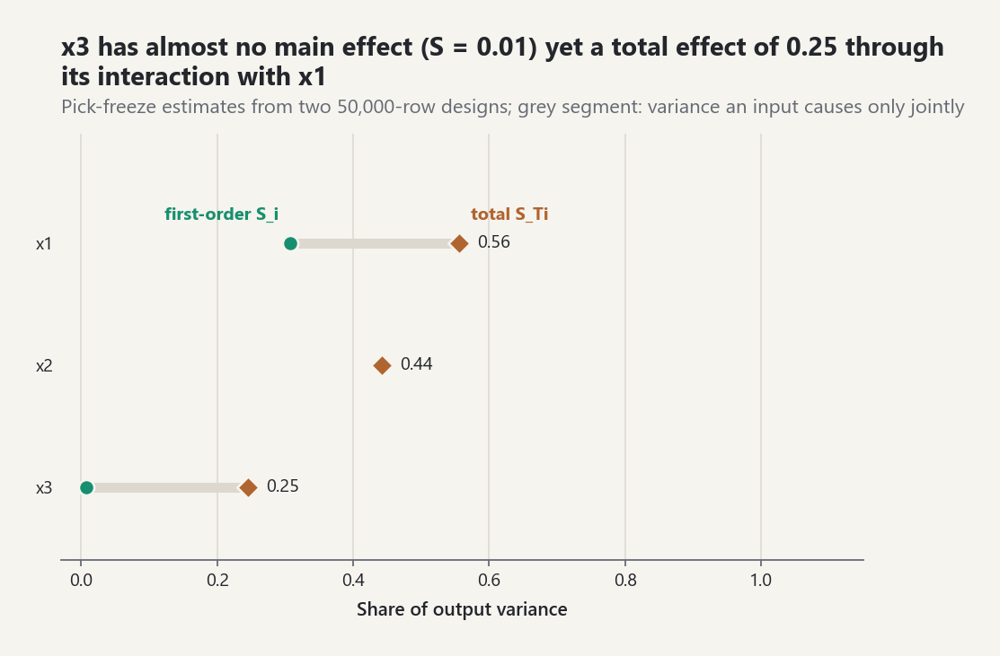

# Local and Global Sensitivity Analysis

Sensitivity analysis asks how model output changes when inputs change. Local and
global answers are different and must not be conflated.

## Local derivatives

`central_difference_gradient` approximates each partial derivative at one
declared point with symmetric perturbations [EQ-SENS-LOCAL-001]. It charges two
model evaluations per coordinate. The result depends on point and step size;
large derivatives do not by themselves imply large variance contributions over
an uncertain input distribution.

## Functional ANOVA and Sobol indices

For mutually independent inputs and a square-integrable scalar response,
functional ANOVA decomposes output variance into orthogonal main and interaction
components [EQ-SENS-ANOVA-001]. First-order indices measure main effects,
second-order indices isolate pair interactions, and total-effect indices include
every term involving an input [EQ-SENS-FIRST-001], [EQ-SENS-SECOND-001],
[EQ-SENS-TOTAL-001].

`estimate_sobol_indices` takes two explicitly independent base matrices and
constructs pick-freeze hybrids. It reports all model calls. Monte Carlo estimates
are intentionally not clipped to `[0,1]`: small negative or above-one estimates
are finite-sample diagnostics, while large violations signal inadequate sample
size, dependence, numerical noise, or a broken sampling design.

The current estimator assumes independent inputs. For dependent inputs use the
Shapley effects described below. Replicated stochastic simulators and
streaming evaluation remain future extensions.

## Ranking and decisions

Inputs are ranked by total effect because it includes interactions. The declared
threshold rule [EQ-SENS-DECISION-001] separates uncertainty-reduction priorities
from candidates for fixing during dimension reduction. This is a screening
recommendation, not a causal statement or cost-benefit optimum; physical,
epistemic, safety, and measurement-cost information must still be considered.

## Reproducible laboratory

Run `python examples/sensitivity_lab.py`. The Ishigami benchmark contains a
strong interaction: its third input has essentially no first-order effect but a
substantial total effect.

<picture><source media="(prefers-color-scheme: dark)" srcset="../images/guides/ishigami-sobol-indices-dark.png"></picture>

*With two 50,000-row pick-freeze designs, x3 has a first-order index of 0.01 but a total index of 0.25 (analytic values 0 and 0.2437): ranking by main effects alone would mark it for fixing, while the total effect, which includes its interaction with x1, keeps it.*

## Sources

- [REF-SOBOL-1993].
- [REF-SALTELLI-2008, Chapters 1, 4, and 6].
- [REF-SALTELLI-2010].
- [REF-FORNBERG-1988].

## Shapley effects for dependent inputs

Sobol indices need independent inputs: under correlation the functional ANOVA
terms are no longer orthogonal and first-order and total indices stop adding
up. Shapley effects share the output variance among inputs by the Shapley
value of the variance game [EQ-SENS-SHAPLEY-001]:

`Sh_i = (1/Var Y) sum_(J not containing i) [|J|! (d-|J|-1)! / d!] (c(J u {i}) - c(J))`.

They are non-negative in the population and sum to one under any joint law.
For independent inputs without interactions they equal the first-order and
total Sobol indices; with interactions each interaction share is split equally
among its inputs [REF-OWEN-2014].

`shapley_effects(model, quantity)` follows Song, Nelson, and Staum
[EQ-SENS-SHAPLEY-002]. The cost `c(J) = E[Var(Y | X_-J)]` (equivalent to the
closed index `Var(E[Y | X_J])`) is estimated with `N_O` outer draws of `X_-J`
and `N_I = 3` inner draws of `X_J | X_-J`. `Var Y` comes from `N_V` separate
joint draws, so the effects telescope to exactly one.

- `method="exact"` (default for `d <= 6`) estimates each of the `2^d - 2`
  proper subsets once and uses the subset formula; cost
  `N_V + (2^d - 2) N_O N_I`.
- `method="random"` averages `m` random permutations with `N_O = 1` by
  default; cost `N_V + m (d - 1) N_O N_I`.

Conditional sampling uses the model's joint law. For Gaussian-copula inputs
`z_J | z_K` is Gaussian with mean `R_JK R_KK^-1 z_K` and Schur-complement
covariance `R_JJ - R_JK R_KK^-1 R_KJ`, and `x_i = F_i^-1(Phi(z_i))`
[EQ-SENS-SHAPLEY-003]. The standard errors are delta-method approximations
that ignore the noise of the normalizing `Var Y`.

`linear_gaussian_shapley(b, Sigma)` gives exact effects of `Y = b'X` for
Gaussian `X` from `Var(E[Y | X_J]) = s_J' Sigma_JJ^-1 s_J`, `s = Sigma b`
[EQ-SENS-SHAPLEY-004]. In two dimensions:

`Sh_1 = (b1^2 s1^2 (1 - rho^2/2) + rho b1 b2 s1 s2 + b2^2 s2^2 rho^2/2) / V`.

Expanding `Sh_1 = (1/2)[c({1}) + V - c({2})]` with
`c({1}) = (b1 s1 + rho b2 s2)^2` and `c({2}) = (b2 s2 + rho b1 s1)^2` gives
this formula. `tests/test_mlmc_ce_line_shapley.py` checks it against
`linear_gaussian_shapley` on three parameter sets to twelve decimal places.

### Numbers computed with this release

`Y = X1 + X2` with `X1 ~ N(0, 1)`, `X2 ~ N(0, 2^2)`, and correlation `0.6`
(`Var Y = 7.4`):

| quantity | `X1` | `X2` |
| --- | --- | --- |
| closed first-order index `Var(E[Y | X_i]) / V` | 0.654 | 0.914 |
| total index `1 - Var(E[Y | X_-i]) / V` | 0.086 | 0.346 |
| exact Shapley effect | 0.3703 | 0.6297 |
| `shapley_effects`, exact, `N_O = 500`, `N_V = 2000`, seed 1 (5000 calls) | 0.3755 +/- 0.0084 | 0.6245 +/- 0.0084 |
| `shapley_effects`, 400 random permutations, `N_V = 1000`, seed 1 (2200 calls) | 0.3831 +/- 0.0198 | 0.6169 +/- 0.0198 |

The first-order indices sum to 1.57 and the total indices to 0.43. Only the
Shapley effects give a variance budget that sums to one. The estimated rows
are reproduced by:

```python
from probstat.distributions import Normal
from probstat.modeling import JointInput, ProbabilisticModel, RandomInput
from probstat.sensitivity import linear_gaussian_shapley, shapley_effects
from probstat.uq import QuantityOfInterest

sum_qoi = (QuantityOfInterest("y", "sum"),)
pair_inputs = JointInput(
    (RandomInput("x1", Normal(0.0, 1.0)), RandomInput("x2", Normal(0.0, 2.0))),
    ((1.0, 0.6), (0.6, 1.0)),
)
pair = ProbabilisticModel(pair_inputs, lambda p: {"y": p["x1"] + p["x2"]}, sum_qoi)
analytic = linear_gaussian_shapley((1.0, 1.0), ((1.0, 1.2), (1.2, 4.0)))
round(analytic[0], 4)   # 0.3703
subsets = shapley_effects(pair, "y", outer_samples=500, variance_samples=2000, seed=1)
round(subsets.effects[0], 4), round(subsets.standard_errors[0], 4)   # (0.3755, 0.0084)
subsets.evaluations   # 5000
permuted = shapley_effects(pair, "y", method="random", permutations=400, seed=1)
round(permuted.effects[0], 4), round(permuted.standard_errors[0], 4)   # (0.3831, 0.0198)
permuted.evaluations   # 2200
```

For the independent additive model `Y = X0 + 2 X1 + 3 X2` (standard normal
inputs) the exact values are `(1, 4, 9)/14 = (0.071, 0.286, 0.643)`. With
`N_O = 400` and seed 4, `shapley_effects` returned `(0.088, 0.263, 0.649)`,
with standard errors of about `0.02` (0.022, 0.018 and 0.021), in 8200 calls.

Sources: [REF-OWEN-2014], [REF-SONG-NELSON-STAUM-2016],
[REF-OWEN-PRIEUR-2017], [REF-IOOSS-PRIEUR-2019].

## Common pitfalls

- **Dependent inputs.** `sensitivity.sobol_analysis` and
  `sensitivity.morris_screening` raise `ValueError` for a model with a
  non-identity copula. Use `shapley_effects` rather than dropping the
  correlation.
- **No interval by default.** `sobol_analysis` defaults to `bootstrap=0` and
  reports `interval_method == "none"` with `nan` bounds; `UQStudy.sensitivity`
  defaults to `bootstrap=200`, which on a Sobol design gives replicate
  intervals over 8 randomizations. Rows of a quasi-random or LHS design are
  never bootstrapped.
- **Cost.** One analysis costs `size (d + 2)` model runs; use
  `sobol_analysis_all` to share them across QoIs.
- **Rank by total effect.** Estimates are not clipped to `[0, 1]`, and an
  input that acts only through interactions has a first-order index near
  zero.
- **Morris on periodic responses.** One Morris step moves an input by half
  of its quantile range, so `sin(x)**2` with `x ~ Uniform(-pi, pi)` gives
  `mu* = 0` although `x` matters.

```python
import math

from probstat.distributions import Normal, Uniform
from probstat.modeling import JointInput, ProbabilisticModel, RandomInput
from probstat.sensitivity import morris_screening, sobol_analysis
from probstat.uq import QuantityOfInterest
from probstat.workflow import UQStudy

def total(p):
    return {"y": p["a"] + p["b"]}

laws = (RandomInput("a", Normal(0.0, 1.0)), RandomInput("b", Normal(0.0, 2.0)))
qoi = (QuantityOfInterest("y", "sum"),)
independent = ProbabilisticModel(JointInput(laws), total, qoi)
plain = sobol_analysis(independent, "y", 128, seed=1)
(plain.interval_method, plain.evaluations)    # ('none', 512); cost 128 * (2 + 2)
staged = UQStudy(independent, seed=1).sensitivity("y", 128)
(staged.interval_method, staged.replicates)   # ('replicates', 8)
correlated = ProbabilisticModel(JointInput(laws, ((1.0, 0.6), (0.6, 1.0))), total, qoi)
try:
    sobol_analysis(correlated, "y", 64, seed=1)
except ValueError as error:
    refused = str(error).split(";")[0]
refused                                       # 'variance-based Sobol indices require independent inputs'

def periodic(p):
    return {"y": math.sin(p["x"]) ** 2 + p["z"]}

wave = ProbabilisticModel(
    JointInput((RandomInput("x", Uniform(-math.pi, math.pi)), RandomInput("z", Uniform(0.0, 1.0)))),
    periodic,
    (QuantityOfInterest("y", "periodic in x"),),
)
morris_screening(wave, "y", 10, seed=1).mu_star  # (0.0, 1.0)
```
