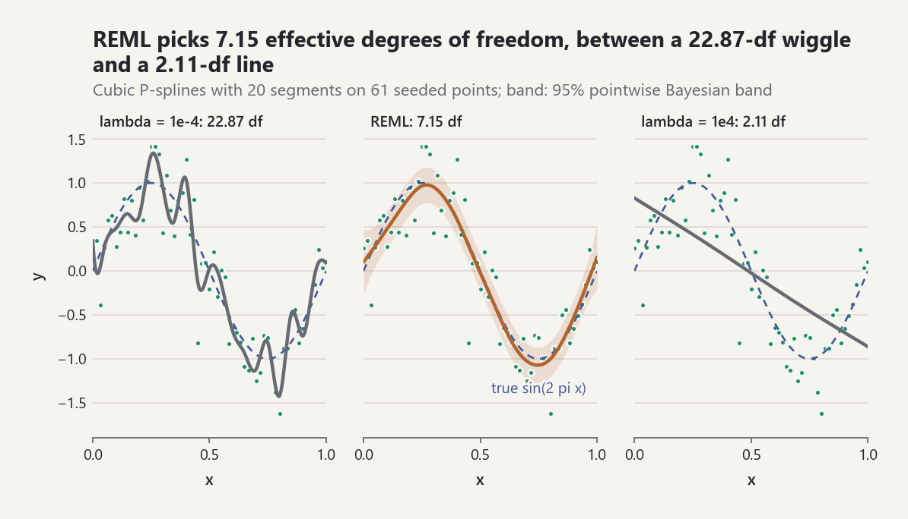
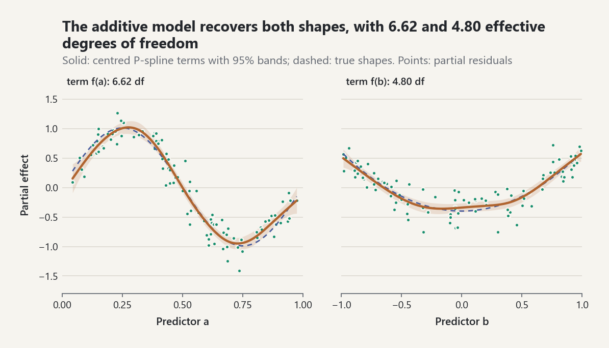

# Smoothing and Additive Models

`probstat.inference` estimates a regression function `m(x) = E[y | x]`
without choosing its shape in advance. Penalized splines and smoothing
splines trade fidelity against roughness through one smoothing parameter
chosen from the data; LOESS and kernel regression fit locally; isotonic
regression only assumes monotonicity; additive models extend the penalized
splines to several predictors. Every fit is a frozen dataclass, and every
number below was produced by the code shown. The tests in
`tests/test_smoothing_and_additive_models.py` check the same machinery
against SciPy 1.14.1 and NumPy 2.2.6 values computed offline, the exact
restricted likelihood of the equivalent mixed model, and closed forms.

## When to use which method

| Situation | Method | Call |
|---|---|---|
| Smooth curve, uncertainty band, automatic smoothness | P-spline with REML | `fit_pspline(x, y)` |
| Classical penalized-curvature curve, knots at the data | Cubic smoothing spline | `fit_smoothing_spline(x, y)` |
| Exploratory scatterplot smoother, outliers present | LOESS with robustness iterations | `loess(x, y, robustness_iterations=2)` |
| Only monotonicity is known (dose-response, calibration) | Isotonic regression | `isotonic_regression(y)` |
| Local averaging with a data-driven bandwidth | Kernel regression | `kernel_regression(x, y)` |
| Several predictors acting additively | Additive model | `fit_additive_model(data, y)` |

P-splines and smoothing splines give comparable curves; the P-spline has a
fixed, modest number of coefficients and bands anywhere in the domain, and
the smoothing spline places a knot at every distinct `x` and costs `O(n)`
per smoothing parameter. LOESS and kernel regression have no global model,
so they report no standard errors here.

## 1. B-spline bases

A B-spline basis of degree `p` on knots `t_0 <= ... <= t_(m-1)` is built by
the Cox-de Boor recursion (EQ-SMOOTH-001). The functions are non-negative,
sum to one, and only `p + 1` of them are non-zero at any point.
`uniform_knots(lower, upper, segments, degree)` places `segments` equal
intervals on `[lower, upper]` and `degree` extra knots beyond each end, as
Eilers and Marx (1996) recommend.

```python
from probstat.inference import bspline_basis, uniform_knots

knots = uniform_knots(0.0, 1.0, segments=4, degree=3)
len(knots)  # 11
row = bspline_basis(0.3, knots)
[round(value, 4) for value in row]  # [0.0, 0.0853, 0.6307, 0.2827, 0.0013, 0.0, 0.0]
sum(row)  # 1.0
```

The test suite checks the values against
`scipy.interpolate.BSpline.design_matrix` and checks Marsden's identity
`(x - tau)^3 = sum_i prod_r (t_(i+r) - tau) B_i(x)`, which shows that the
cubic basis reproduces every cubic polynomial exactly.

## 2. Penalized regression splines (P-splines)

`fit_pspline` fits `sum_j beta_j B_j(x)` by minimizing the weighted residual
sum of squares plus `lambda sum_k (Delta^d beta_k)^2`, a penalty on the
`d`-th differences of adjacent coefficients (EQ-SMOOTH-002). With `d = 2`
the penalty shrinks the fit towards a straight line, never towards zero:
`lambda = 0` is least squares on the basis, and `lambda -> infinity` gives
the least-squares line.

The **effective degrees of freedom** `edf = tr(H)` of the smoother matrix
`H` measure the complexity of the fit (EQ-SMOOTH-003): they fall from the
number of basis functions to `d` as `lambda` grows. The residual variance
is `phi = RSS / (n - edf)`.

```python
import math

from probstat.foundations import resolve_stream
from probstat.inference import fit_pspline

generator = resolve_stream(2026).generator()
x = [i / 60 for i in range(61)]
y = [math.sin(2 * math.pi * v) + generator.gauss(0.0, 0.3) for v in x]

fit = fit_pspline(x, y, segments=20)
fit.method  # 'reml'
fit.edf  # 7.15
fit.scale  # 0.1053
```

### Choosing the smoothing parameter: REML or GCV

Two criteria choose `lambda` by minimizing over `log lambda` (a 37-point
grid followed by golden-section refinement):

- **GCV**, `n RSS / (n - edf)^2` (EQ-SMOOTH-004), approximates
  leave-one-out prediction error (Craven and Wahba 1979).
- **REML** (EQ-SMOOTH-005) treats the penalty as a Gaussian prior on the
  coefficients and maximizes the restricted likelihood of the resulting
  mixed model, with `phi` profiled out (Wood 2011). It is the default
  because it penalizes overfitting more and has fewer spurious minima.

```python
gcv = fit_pspline(x, y, segments=20, method="gcv")
gcv.edf  # 5.97
```

<picture><source media="(prefers-color-scheme: dark)" srcset="../images/guides/smoothing-pspline-reml-dark.png"></picture>

*With 23 basis functions, a tiny penalty gives 22.87 effective degrees of freedom and chases the noise, a huge one leaves 2.11 and returns essentially the least-squares line, and REML settles on 7.15, close to the true sine inside its 95% band.*

Both are estimates. The criterion profile stored in `fit.profile` shows how
sharply the data determine `lambda`: here the GCV profile has two local
minima three orders of magnitude apart in `lambda`, with scores within 2%
of each other.

```python
best = min(score for _, score in gcv.profile)
[round(rho, 1) for rho, score in gcv.profile if score < 1.02 * best]  # [-4.5, 1.5, 2.5]
```

### Pointwise confidence bands

`fit.band(points, level)` returns the Bayesian band
`f(x) +/- z sqrt(b(x)' V b(x))` with `V = phi (B'WB + lambda S)^-1`
(EQ-SMOOTH-006; Wahba 1983, Nychka 1988). The posterior covariance includes
the smoothing bias, so the coverage averaged over the function is close to
nominal even though at a given point it can be lower or higher. A seeded
simulation in the test suite (40 replicates) gives an average coverage of
about 0.97 for a nominal 0.95.

```python
band = fit.band([0.25, 0.5], level=0.95)
[round(value, 3) for value in band.estimate]  # [0.966, -0.022]
[round(value, 3) for value in band.standard_error]  # [0.103, 0.103]
```

## 3. Cubic smoothing splines

`fit_smoothing_spline` minimizes
`sum w_i (y_i - g(x_i))^2 + lambda int g''(x)^2 dx` over all
twice-differentiable `g`. The minimizer is the natural cubic spline with a
knot at each distinct `x_i`. The Reinsch algorithm solves a pentadiagonal
system for its second derivatives (EQ-SMOOTH-007), and the Hutchinson-de
Hoog recursion gives the trace and leverages from the central band of an
inverse (EQ-SMOOTH-008), so every evaluation of GCV or REML costs `O(n)`.
`lambda` is on the scale of the objective above, the convention of
`scipy.interpolate.make_smoothing_spline`; the tests match its values to
nine digits and its GCV minimizer.

```python
from probstat.inference import fit_smoothing_spline

spline = fit_smoothing_spline(x, y)
spline.method  # 'reml'
spline.edf  # 7.49
spline.predict([0.25])[0]  # 0.973
fit_smoothing_spline(x, y, method="gcv").edf  # 6.14
spline.predict([1.2])[0]  # 1.549, linear beyond the last knot
```

`spline.band(level)` gives the Bayesian band at the knots, with posterior
variance `phi H_ii / w_i`. Two exact limits are checked by the tests: a
straight line is reproduced for every `lambda` (its GCV score is zero), and
`edf` runs from `n` as `lambda -> 0` (interpolation) to 2 as
`lambda -> infinity` (the least-squares line).

## 4. LOESS

`loess(x, y, span=f, degree=d)` fits, at each point, a weighted polynomial
of degree `d` to the `round(f n)` nearest neighbours with tricube weights
(EQ-SMOOTH-009; Cleveland 1979). Each robustness iteration recomputes
bisquare weights from the residuals, giving zero weight to residuals beyond
six median absolute residuals (EQ-SMOOTH-010).

```python
from probstat.inference import loess

lx = [i / 19 for i in range(20)]
ly = [2.0 + 3.0 * v for v in lx]
ly[7] = 15.0  # one gross outlier; the line gives 3.105 there
loess(lx, ly, span=0.5).fitted[7]  # 5.16
loess(lx, ly, span=0.5, robustness_iterations=2).fitted[7]  # 3.105
```

Degree 1 reproduces straight lines and degree 2 quadratics exactly, for
every span; larger spans lower the variance and raise the bias.

## 5. Isotonic regression

`isotonic_regression(y, weights=..., increasing=True)` returns the monotone
sequence closest to `y` in weighted least squares. The pool-adjacent-
violators algorithm merges neighbouring blocks whose means are out of order
and replaces them by their weighted mean; the result equals the min-max
formula `f_i = max_(j <= i) min_(k >= i) Av(y_j..y_k)` (EQ-SMOOTH-011),
against which the tests compare 200 random weighted cases.

```python
from probstat.inference import isotonic_regression

isotonic_regression([1.0, 3.0, 2.0, 4.0, 3.5, 5.0]).fitted  # (1.0, 2.5, 2.5, 3.75, 3.75, 5.0)
```

## 6. Kernel regression

`kernel_regression(x, y, degree=0)` is the Nadaraya-Watson estimator
`sum K_i y_i / sum K_i`; `degree=1` (the default) is the local-linear
estimator, which reproduces straight lines exactly and removes the
first-order boundary bias of local averaging (EQ-SMOOTH-012). Without a
`bandwidth`, the bandwidth minimizes the leave-one-out cross-validation
score (EQ-SMOOTH-013) over 25 multiples `2^(k/4)` of the Silverman
rule-of-thumb bandwidth of `x`; `cv_curve` holds every candidate's score.

```python
from probstat.inference import kernel_regression

local = kernel_regression(x, y)
local.bandwidth  # 0.0293
local.cv_score  # 0.1167
```

## 7. Additive models

An additive model `y = alpha + sum_j f_j(x_j) + e` keeps the
interpretability of a linear model while letting each predictor act
nonlinearly. `fit_additive_model(data, y)` gives each predictor a P-spline
term constrained to sum to zero over the data, so the intercept is the mean
response (EQ-GAM-001), and selects one smoothing parameter per term by REML
(or GCV). `backfit_additive_model` solves the same problem for fixed
smoothing parameters by the backfitting iteration (EQ-GAM-002); for these
symmetric smoothers it converges to the joint solution (Buja, Hastie, and
Tibshirani 1989).

```python
from probstat.inference import (
    backfit_additive_model,
    fit_additive_model,
    partial_dependence,
)

generator = resolve_stream(102).generator()
a = [generator.uniform(0.0, 1.0) for _ in range(100)]
b = [generator.uniform(-1.0, 1.0) for _ in range(100)]
response = [
    math.sin(2 * math.pi * u) + v * v + generator.gauss(0.0, 0.2)
    for u, v in zip(a, b)
]
data = {"a": a, "b": b}
gam = fit_additive_model(data, response, segments=10)
gam.intercept  # 0.39
[round(term.edf, 2) for term in gam.terms]  # [6.62, 4.8]
[round(value, 3) for value in gam.term("a").evaluate([0.25, 0.75])]  # [1.006, -0.939]

smoothing = {term.name: term.smoothing for term in gam.terms}
backfit = backfit_additive_model(data, response, smoothing=smoothing, segments=10)
max(abs(p - q) for p, q in zip(backfit.fitted, gam.fitted)) < 1e-8  # True
```

<picture><source media="(prefers-color-scheme: dark)" srcset="../images/guides/smoothing-additive-terms-dark.png"></picture>

*Against the partial residuals, the two centred terms track the true sine and quadratic shapes inside their 95% bands, with 6.62 and 4.80 effective degrees of freedom chosen separately by REML.*

`gam.term(name).band(points)` gives the band of a centred term.

### Partial dependence

`partial_dependence(predict, data, feature, grid)` averages a prediction
function over the data with one feature held at each grid value
(EQ-GAM-003; Friedman 2001). It works for any model; for an additive model
it equals `alpha + f_j(v)` exactly, because the other terms are centred.

```python
curve = partial_dependence(gam.predict, data, "b", [0.0, 0.9])
[round(value, 3) for value in curve.values]  # [0.05, 0.818]
```

## Common pitfalls

- **Extrapolation.** A P-spline basis exists only on `[lower, upper]`;
  `predict` and `band` raise `ValueError` outside it rather than invent a
  continuation. A natural smoothing spline is linear beyond its end knots,
  which is a modelling choice, not information: the spline above predicts
  1.549 at `x = 1.2`, where the generating curve is 0.951. Additive-model
  terms raise outside the range of their predictor.
- **Smoothing-parameter uncertainty.** The bands condition on the selected
  `lambda`. When the criterion profile is flat or has several minima, as in
  the GCV example above, curves of quite different roughness are nearly
  equally supported; compare REML with GCV and inspect `profile` before
  reading fine detail into the fit.
- **GCV undersmooths at small noise and with correlated errors.** Both
  criteria assume independent errors; positive autocorrelation makes the
  fit chase the noise. REML is more stable than GCV at moderate `n`.
- **The basis dimension is an upper bound, not the smoothness.** With
  penalization the result is insensitive to `segments` once it is large
  enough; too few segments cap the EDF and bias the fit, which shows as an
  EDF close to `segments + degree`.
- **Pointwise is not simultaneous.** A 95% pointwise band covers the curve
  at a given `x` about 95% of the time, not the whole curve at once.
- **Ties in `x`.** `fit_smoothing_spline` needs distinct `x`; average tied
  responses and pass the counts as `weights`.
- **LOESS spans and kernel bandwidths are relative to the design.** A span
  is a fraction of the data, so sparse regions get wide windows; with the
  compact Epanechnikov kernel a small bandwidth leaves points without
  neighbours (`cv_score = inf`).
- **Partial dependence hides interactions** and evaluates the model at
  feature combinations that may not occur in the data when predictors are
  correlated.

## References

[REF-DE-BOOR-1972], [REF-EILERS-MARX-1996], [REF-WOOD-2017],
[REF-WOOD-2011], [REF-CRAVEN-WAHBA-1979], [REF-REINSCH-1967],
[REF-GREEN-SILVERMAN-1994], [REF-HUTCHINSON-DEHOOG-1985],
[REF-WAHBA-1983], [REF-NYCHKA-1988], [REF-CLEVELAND-1979],
[REF-AYER-ETAL-1955], [REF-DE-LEEUW-HORNIK-MAIR-2009],
[REF-NADARAYA-1964], [REF-FAN-GIJBELS-1996],
[REF-HASTIE-TIBSHIRANI-FRIEDMAN-2009], [REF-HASTIE-TIBSHIRANI-1990],
[REF-BUJA-HASTIE-TIBSHIRANI-1989], [REF-FRIEDMAN-2001].
