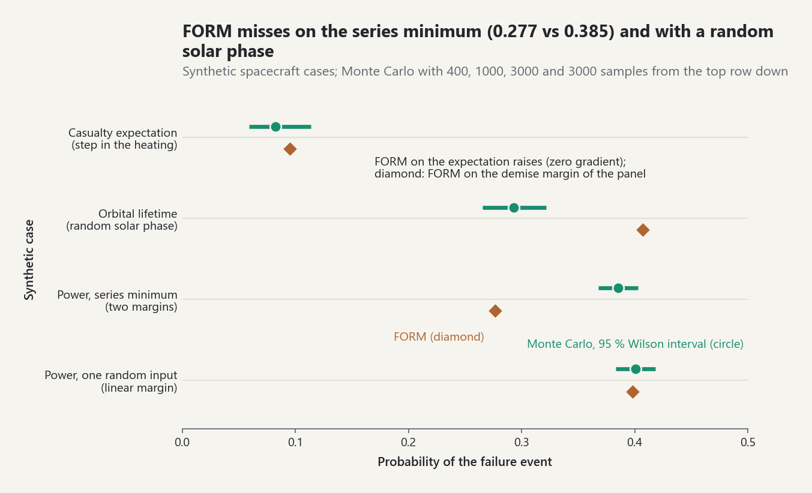

# Uncertainty quantification for spacecraft systems

A spacecraft has to survive its own sensors, its battery, the thermosphere,
the cold of space and the day it comes back down. This guide applies the
library's uncertainty tools to nine questions about the spacecraft itself:
will the power system carry the load at end of life (section 2), will the
orbit decay inside the disposal deadline (section 3), will a shield stop the
particles it is exposed to (section 4), what is the casualty expectation of an
uncontrolled reentry (section 5), how accurately can the attitude be known and
pointed (section 7), is an engine drifting or about to fail (section 8), is a
telemetry channel misbehaving (section 9), what can a thermal-vacuum test
teach about a thermal model (section 10) and what can a manoeuvre teach about
an inertia tensor (section 11). Section 6 compares the first-order
reliability method with simulation on four of these events, because the honest
answer to "does FORM work" is different for each. The models live in
`probstat.aerospace`, `probstat.inverse` and `probstat.surrogates`
(experimental since 0.28,
[ADR-0145](../adr/ADR-0145-aerospace-uq-gaussian-processes-and-hybrid-models.md)).

**Every vehicle and every data set in this guide is synthetic.** The orbit,
the array, the battery, the thermosphere, the fragments, the engine, the
gyroscope, the thermal network, the inertia tensor and the telemetry are
invented demonstration values, and every "measured" number below was produced
by the code in the same block, with the seed given. None of it is data from a
real spacecraft, engine or sensor, and none is a statement about any real
mission. Where a number comes from a module's test file instead of from a block
here, the text says so and the number was not re-run for this guide.

Prerequisites: reliability by FORM, Monte Carlo and subset simulation
([advanced reliability](advanced-reliability.md)), the Kalman filter
([filtering and data assimilation](filtering-and-data-assimilation.md)) and the
Gaussian posterior of a nonlinear inverse problem
([nonlinear Bayesian inversion](nonlinear-bayesian-inversion.md)). The
propulsion companion
[Uncertainty quantification for rocket propulsion](aerospace-propulsion-uq.md)
introduces the aleatory/epistemic split used below; the laboratory
[`examples/spacecraft_mission_risk_lab.py`](../../examples/spacecraft_mission_risk_lab.py)
runs a larger mission chain with the same tools.

## 1. What is asked of each model

Each module wraps a deterministic physical relation, states its units and
validity, and offers the statistical question that goes with it:

| Section | Module | Deterministic model | Question |
| --- | --- | --- | --- |
| 2 | `probstat.aerospace.power_budget` | eclipse geometry, array and battery ageing | probability of an end-of-life shortfall |
| 3 | `probstat.aerospace.orbital_decay` | drag decay in a synthetic thermosphere | probability of missing a disposal deadline |
| 4 | `probstat.aerospace.debris_risk` | ballistic limits and a Poisson flux | probability of no penetration |
| 5 | `probstat.aerospace.reentry_casualty` | fragment heating, demise, casualty area | probability that the casualty expectation exceeds a limit |
| 7 | `probstat.aerospace.attitude_estimation` | gyro and star-tracker Kalman filter | knowledge accuracy and pointing budget |
| 8 | `probstat.aerospace.health_monitoring` | chamber lag with efficiency loss | fault detection and remaining useful life |
| 9 | `probstat.surrogates.gp_anomaly` | Gaussian-process telemetry model | alarm thresholds with a stated false-alarm rate |
| 10 | `probstat.inverse.thermal_correlation` | lumped thermal network | which conductances a test identifies |
| 11 | `probstat.inverse.inertia_identification` | Euler's rigid-body equations | inertia tensor and torque design |

Sections 2 to 5 build a `ProbabilisticModel`
([probabilistic modeling](probabilistic-modeling.md)) and use
`probstat.reliability` and `probstat.sensitivity`; sections 7 to 11 are
estimation and detection problems with their own closed forms, which the
module tests use as oracles.

## 2. Power: a series system of two margins

A circular orbit at altitude `h` has an eclipse fraction given in closed form
by the cylindrical Earth shadow ([EQ-AERO-POWER-001], [REF-CURTIS-2014]), and
the energy balance of one orbit compares the array energy over the sunlit arc
with the sunlit load plus the battery recharge ([EQ-AERO-POWER-005]). Two
margins result: the power margin, and the depth of discharge against its
limit. The combined margin is their minimum, a series system
([EQ-AERO-POWER-006]), and it falls with age because the array degrades and
the battery fades.

```python
import dataclasses
import math

from probstat.aerospace import power_budget as pb
from probstat.distributions import LogNormal, Normal, Uniform

design = pb.demonstration_design()
round(math.degrees(pb.critical_beta(design.altitude)), 2)  # 66.07
round(pb.eclipse_fraction(design.altitude, 0.0), 3)  # 0.367
round(pb.eclipse_duration(design.altitude, 0.0) / 60.0, 1)  # 35.5
nominal = {
    "bol_power": 540.0, "degradation_rate": 0.025, "fade_rate": 5.0e-6,
    "charge_efficiency": 0.95, "discharge_efficiency": 0.95,
    "load_factor": 1.0, "failed_strings": 0.0,
}
start = pb.power_budget(design, 0.0, **nominal)
end = pb.power_budget(design, 10.0, **nominal)
(round(start.array_power, 1), round(end.array_power, 1))  # (464.8,360.8)
(round(start.power_margin_ratio, 2), round(end.power_margin_ratio, 2))  # (0.57,0.22)
(round(end.dod, 3), round(end.dod_margin_ratio, 3))  # (0.257,0.359)
round(pb.power_lifetime(design, 30.0, **nominal).years, 2)  # 17.77
```

Beyond 66.07 degrees of beta angle the orbit never enters the shadow. At
beta 0 the 600 km orbit spends 35.5 minutes of each revolution in eclipse. The
nominal array is 464.8 W at beginning of life and 360.8 W after ten years; the
power margin shrinks from 0.57 to 0.22 of the required energy, and the first
year the combined margin is negative is 17.77. With a tighter depth-of-discharge
limit of 0.30 the battery becomes the binding constraint and the lifetime
shortens:

```python
tight = dataclasses.replace(design, dod_max=0.30)
round(pb.power_lifetime(tight, 30.0, **nominal).years, 2)  # 13.88
```

Now make the ingredients uncertain: beginning-of-life power, degradation
rate, fade rate, the two efficiencies, the load and the number of failed
strings ([EQ-AERO-POWER-007]). Take the first case with only the
beginning-of-life power normal. The combined margin is then linear in that
input on the failure side, so FORM is exact and the failure probability is
`Phi((p_crit - mu) / sigma)`, where `p_crit` is the power at which the
balance closes:

```python
fixed = {k: v for k, v in nominal.items() if k != "bol_power"}
linear = pb.power_budget_model(design, 10.0, bol_power=Normal(450.0, 25.0), **fixed)
unit = pb.power_budget(design, 10.0, **{**nominal, "bol_power": 1.0})
p_crit = unit.required_wh / unit.available_wh
exact = 0.5 * math.erfc(-((p_crit - 450.0) / 25.0) / math.sqrt(2.0))
form = pb.power_failure_probability(linear)
mc = pb.power_failure_probability(linear, method="monte_carlo", samples=3000, seed=3)
(round(p_crit, 1), round(exact, 3))  # (443.5,0.398)
(round(form.probability, 3), form.converged)  # (0.398,True)
round(mc.probability, 3)  # 0.401
abs(mc.probability - exact) < 4 * mc.standard_error  # True
```

The probability that this design fails at ten years is 0.398 by every method:
the closed form, FORM and 3000 Monte Carlo draws (0.401, standard error 0.009).
This is the case the method is built for.

Now let all seven inputs vary, with the tight depth-of-discharge limit so that
both margins can fail. FORM linearizes the limit state of the *minimum* at one
design point, and the minimum has a kink where the two margins cross:

```python
def power_model(design, bol):
    return pb.power_budget_model(
        design, 10.0,
        bol_power=LogNormal(math.log(bol), 0.03),
        degradation_rate=Uniform(0.015, 0.035), fade_rate=Uniform(2.0e-6, 8.0e-6),
        charge_efficiency=Uniform(0.90, 0.98), discharge_efficiency=Uniform(0.90, 0.98),
        load_factor=LogNormal(0.0, 0.04), failed_strings=Uniform(0.0, 2.0),
    )


series = power_model(tight, 500.0)
form = pb.power_failure_probability(series)
mc = pb.power_failure_probability(series, method="monte_carlo", samples=3000, seed=4)
bounds = pb.component_form_bounds(series)
(round(form.probability, 3), round(mc.probability, 3))  # (0.277,0.385)
(round(bounds.power, 3), round(bounds.dod, 3))  # (0.277,0.211)
(round(bounds.lower, 3), round(bounds.upper, 3))  # (0.277,0.488)
bounds.lower <= mc.probability <= bounds.upper  # True
```

FORM reports 0.277 where simulation gives 0.385 (standard error 0.009): it
followed the power-margin branch, whose own FORM probability is 0.277, and
missed that the depth-of-discharge branch (0.211 alone) also fails on draws the
first branch passes. `component_form_bounds` returns what FORM can honestly
say about a series system, the interval [0.277, 0.488] between the larger
component and their sum, and the simulation value lies inside it
([EQ-AERO-POWER-008]). A series system is therefore a case for simulation or
for the bounds, not for FORM on the minimum. When one mode dominates, the
difficulty disappears: at 580 W the depth-of-discharge branch carries the event
and FORM agrees with simulation:

```python
dominated = power_model(tight, 580.0)
form = pb.power_failure_probability(dominated)
mc = pb.power_failure_probability(dominated, method="monte_carlo", samples=3000, seed=4)
(round(form.probability, 3), round(mc.probability, 3))  # (0.211,0.211)
```

`required_bol_power` inverts the question (the smallest array power that meets
a target failure probability, by bisection on a monotone probability) and
`binomial_mixture_probability` handles failed array strings exactly instead of
as a continuous input ([EQ-AERO-POWER-009], [EQ-AERO-POWER-010]).

## 3. Orbital lifetime: exponential in the drag, periodic in the solar phase

A disposal rule such as "reenter within 25 years" is a statement about
lifetime, and the lifetime depends on the thermosphere through an exponential.
`probstat.aerospace.orbital_decay` integrates the circular decay equation in a
synthetic piecewise-exponential atmosphere whose density scales with a
synthetic solar-activity index ([EQ-AERO-DECAY-001], [EQ-AERO-DECAY-002],
[EQ-AERO-DECAY-003]; [REF-KING-HELE-1987], [REF-CURTIS-2014]). The atmosphere
is not a published model and the activity is not real solar data.

The integrator has two oracles. In an isothermal atmosphere with a constant
scale height the lifetime has a closed form bracketed by freezing `sqrt(mu a)`
at either end of the path ([EQ-AERO-DECAY-005]), and at a frozen activity the
lifetime is a quadrature that shares no code with the time stepping
([EQ-AERO-DECAY-004]):

```python
from probstat.aerospace import orbital_decay as od
from probstat.reliability import ModelLimitState

single = od.SyntheticThermosphere((150.0e3,), (60.0e3,), 1.0e-9)
bounds = od.exponential_lifetime_bounds(500.0e3, 50.0, 150.0e3, 1.0e-9, 60.0e3)
run = od.orbital_decay(500.0e3, 50.0, single, 1.0, horizon_years=200.0)
(round(bounds.lower_years, 4), round(run.lifetime_years, 4), round(bounds.upper_years, 4))  # (0.6189,0.6216,0.6367)
round(od.static_lifetime(500.0e3, 50.0, single), 4)  # 0.6216
```

The integrated lifetime of 0.6216 years sits inside the bracket
[0.6189, 0.6367] and agrees with the quadrature to the digits shown. With a
solar cycle in the atmosphere the phase of the cycle at launch moves the
lifetime of one fixed orbit by years:

```python
thermosphere = od.demonstration_thermosphere()
ballistic = od.ballistic_coefficient(100.0, 2.2, 0.85)
phases = (0.0, 0.25, 0.5, 0.75)
[
    round(
        od.orbital_decay(
            640.0e3, ballistic, thermosphere,
            od.demonstration_solar_activity(phase=p, amplitude=0.4),
            horizon_years=50.0, altitude_fraction=0.1, static_tail=True,
        ).lifetime_years,
        1,
    )
    for p in phases
]  # [14.4,20.0,19.7,17.1]
```

The same orbit lasts 14.4 years or 20.0 years depending on where in the cycle
it starts; the lifetime is periodic in the phase. That matters for the
reliability question, because FORM linearizes in standard-normal space and a
periodic dependence has no single linearization. Compare the 25-year
non-compliance probability for a 640 km orbit with the phase fixed and with
the phase uniform on a cycle:

```python
from probstat.sensitivity import sobol_analysis


def lifetime_model(altitude, random_phase):
    inputs = dict(
        initial_altitude=Normal(altitude, 3000.0),
        area_to_mass=LogNormal(math.log(0.01), 0.2),
        density_factor=LogNormal(0.0, 0.3),
        altitude_fraction=0.1,
    )
    if random_phase:
        inputs.update(
            drag_coefficient=LogNormal(math.log(2.2), 0.1),
            attitude_factor=Uniform(0.7, 1.0),
            solar_phase=Uniform(0.0, 1.0),
            solar_amplitude=Uniform(0.2, 0.5),
        )
    else:
        inputs.update(
            drag_coefficient=2.2, attitude_factor=0.85,
            solar_phase=0.3, solar_amplitude=0.4,
        )
    return od.orbital_lifetime_model(thermosphere, 25.0, **inputs)


for random_phase in (False, True):
    model = lifetime_model(640.0e3, random_phase)
    form = od.noncompliance_probability(model, 25.0, method="form")
    mc = od.noncompliance_probability(
        model, 25.0, method="monte_carlo", samples=1000, seed=4
    )
    print(round(form.probability, 3), round(mc.probability, 3), round(mc.standard_error, 3))
# 0.152 0.152 0.011
# 0.407 0.293 0.015
```

With a fixed phase the limit state is smooth and FORM (0.152) matches
simulation (0.152, standard error 0.011). With a random phase FORM reads 0.407
against 0.293, about seven standard errors high: the periodic dependence
cannot be represented by one hyperplane ([EQ-AERO-DECAY-007]). The module's
test records the same behaviour at 640 km with other seeds (FORM 0.407 against
Monte Carlo 0.318, from the test docstring, not re-run here) and asserts only
the agreement of subset simulation with Monte Carlo for the random-phase
model. The Sobol analysis says why the phase is the input to worry about at low
altitude:

```python
sobol = sobol_analysis(lifetime_model(550.0e3, True), "log_lifetime", 128, seed=1)
total = {
    name: item.estimate
    for name, item in zip(sobol.input_names, sobol.total_effect, strict=True)
}
sorted(sorted(total, key=total.get, reverse=True)[:2])  # ['density_factor','solar_phase']
round(total["solar_phase"], 2)  # 0.49
```

At 550 km, where the lifetime spans only a couple of cycles, the solar phase
and the density-model error carry most of the variance of the log lifetime,
with total effects of 0.49 for the phase here. At 750 km the lifetime spans many
cycles and the module's slow test records the phase washing out (total effect
0.01, from its docstring, not re-run here).
`maximum_compliant_altitude` solves the design question, the highest initial
altitude whose non-compliance probability meets a target, by bisection with
common random numbers ([EQ-AERO-DECAY-008]).

## 4. Debris: a closed form that FORM can reproduce exactly

The penetration model of section 11 of the
[propulsion guide](aerospace-propulsion-uq.md#11-debris-and-micrometeoroid-penetration-risk)
(`probstat.aerospace.debris_risk`; the flux and the ballistic limits are
synthetic power laws, not ORDEM, MASTER or a published equation) gives a
Poisson count of penetrations whose mean adds over surfaces, so that
independent surfaces multiply their probabilities of no penetration
([EQ-AERO-MMOD-001], [EQ-AERO-MMOD-002]; [REF-CHRISTIANSEN-1993]):

```python
from probstat.aerospace import (
    ImpactEnvironment, PowerLawBallisticLimit, PowerLawFlux, SingleWallShield,
    Surface, mmod_risk_model, penetration_risk,
)
from probstat.reliability import form_hlrf, model_monte_carlo

half = PowerLawBallisticLimit(0.5, 1.0, 0.0, 0.0, 0.0, 0.0)  # d_c = t / 2
flux = PowerLawFlux(1.0e-3, 1.0e-3, 2.0)
normal_impacts = ImpactEnvironment.single_bin(0.0, 1.0e4, 2700.0)
bus = Surface("bus", 10.0, SingleWallShield(half, 4.0e-3, 2800.0), flux)
tank = Surface("tank", 20.0, SingleWallShield(half, 6.0e-3, 2800.0), flux)
both = penetration_risk([bus, tank], normal_impacts, 5.0)
alone = [penetration_risk([s], normal_impacts, 5.0) for s in (bus, tank)]
(round(alone[0].expected_penetrations, 4), round(alone[1].expected_penetrations, 4))  # (0.0125,0.0111)
round(both.expected_penetrations, 4)  # 0.0236
round(both.pnp - alone[0].pnp * alone[1].pnp, 12)  # 0.0
round(both.pnp, 4)  # 0.9767
```

The two surfaces together expect 0.0236 penetrations in five years and have a
probability of no penetration of 0.9767. Now treat the flux level and the
ballistic-limit scale as epistemic log-normal factors. The expected count is
`N = N0 f g^-2`, so `log N` is linear in the two standard-normal inputs and
the failure surface `N = -ln(0.98)` is a hyperplane in standard-normal space:
FORM must be exact, and it is ([EQ-AERO-MMOD-006], [EQ-AERO-MMOD-011]):

```python
risk = mmod_risk_model(
    [bus, tank], normal_impacts,
    flux_factor=LogNormal(0.0, 0.5), limit_factor=LogNormal(0.0, 0.1),
    exposure_time=5.0,
)
level = -math.log(0.98)  # the event is PNP < 0.98
event = ModelLimitState(risk, "expected_penetrations", level, "above")
sigma = math.hypot(0.5, 2.0 * 0.1)
exact = 0.5 * math.erfc(math.log(level / both.expected_penetrations) / sigma / math.sqrt(2.0))
form = form_hlrf(event)
draws = model_monte_carlo(event, 4000, seed=2)
(round(exact, 4), round(form.probability, 4), form.converged)  # (0.6139,0.6139,True)
round(draws.probability, 3)  # 0.626
```

The nominal probability of no penetration, 0.9767, is already below 0.98, and
with the epistemic spread of the flux and the limit it is below 0.98 with
probability 0.614. FORM matches the closed form to
four digits; 4000 Monte Carlo draws give 0.626 (standard error 0.008), within
two standard errors. The lesson of sections 2 and 3 reappears: FORM is exact
exactly when the limit surface is a hyperplane in the space where the inputs
are standard normal, and that is a property to check, not to assume.

## 5. Reentry casualty: a step function of the heating

After a breakup, each fragment follows a ballistic entry, is heated by the
Sutton-Graves stagnation correlation, and either demises, when the absorbed
energy reaches `m [c (T_m - T_0) + L_f]`, or reaches the ground with an impact
energy ([EQ-AERO-CASUALTY-001], [EQ-AERO-CASUALTY-002],
[EQ-AERO-CASUALTY-004]; [REF-SUTTON-GRAVES-1971]). Survivors above an energy
threshold contribute the casualty area `A_c = (sqrt(A_p) + sqrt(A_f))^2`, and
times a population density that is the casualty expectation
([EQ-AERO-CASUALTY-005], [EQ-AERO-CASUALTY-006]). **The materials, the four
fragments, the energy threshold, the person area, the population density and
the expectation limit used here are synthetic, round numbers of the right order
of magnitude; none was checked against a property database or a standard, and
the limit of `1e-4` is a placeholder that has to be checked against the
governing standard before it is used for anything.**

```python
from probstat.aerospace import reentry_casualty as rc

fragments = rc.demonstration_fragments()
assessment = rc.assess_reentry_casualty(
    fragments, breakup_altitude=78.0e3, flight_path_angle=-0.01,
    person_area=0.36, population_density=40.0, energy_threshold=15.0,
)
[(fate.name, fate.demised) for fate in assessment.fates]  # [('tank',False),('panel',True),('shaft',False),('box',True)]
assessment.dominant_fragment()  # 'tank'
round(assessment.total_casualty_area, 2)  # 2.3
f"{assessment.casualty_expectation:.2e}"  # '9.20e-05'
```

At the nominal break-up the tank and the shaft reach the ground, the panel and
the box demise, the total casualty area is 2.30 m^2 and the expectation
9.20e-05, just under the limit. The expectation is a function of which
fragments survive: a switch. Make the heating, the break-up altitude, the
melt temperature of the panel's alloy and the panel's ballistic coefficient
uncertain and look at what the 150 draws do:

```python
from probstat.distributions import LogNormal, Normal
from probstat.reliability import form_hlrf

three = tuple(f for f in fragments if f.name in ("tank", "panel", "shaft"))
casualty = rc.reentry_casualty_model(
    three,
    breakup_altitude=Normal(78.0e3, 4.0e3), flight_path_angle=-0.01,
    person_area=0.36, population_density=40.0, energy_threshold=15.0,
    casualty_threshold=1.0e-4, heating_scale=LogNormal(0.0, 0.3),
    melt_temperature_scale={"aluminium_like": Normal(1.0, 0.03)},
    ballistic_scale={"panel": LogNormal(0.0, 0.15)},
)
points = casualty.inputs.sample(150, seed=3)
outputs = [casualty.evaluate(p) for p in points]
exceed = [o["casualty_expectation"] > 1.0e-4 for o in outputs]
panel_survives = [o["demise_margin_panel"] > 0.0 for o in outputs]
(sum(exceed), exceed == panel_survives)  # (11,True)
len({round(o["casualty_expectation"], 9) for o in outputs})  # 3
```

On 11 of the 150 draws the expectation exceeds the limit (0.073; the module's
test uses 600 draws of the same model and records 0.085), and it does so
exactly on the draws in which the panel survives. The expectation takes three
distinct values on the 150 draws, because it depends on the draw only through
which fragments reach the ground. A function with that shape has a zero
gradient almost everywhere, and FORM, whose HL-RF iteration steps along the
gradient, has nothing to follow:

```python
event = ModelLimitState(casualty, "casualty_expectation", 1.0e-4, "above")
try:
    form_hlrf(event)
except ValueError as error:
    str(error)  # 'limit-state gradient vanished at u=(0.0, 0.0, 0.0, 0.0); FORM direction undefined'
```

FORM fails loudly (a `ValueError`, not a wrong number), which is the right
failure. The module's test records that subset simulation on the step-valued
expectation also raises for 100 samples per level and seed 5, because
intermediate levels tie (not re-run here); that is not evidence that it is safe
with other sizes. The module therefore also reports the continuous demise margin
of each fragment, `1 - max E / E_dem`, which is positive exactly when the
fragment survives. The event is the sign of the margin of the one switching
fragment, and FORM works on that, with a larger finite-difference step than the
default because the trajectory solver's own noise exceeds the default
perturbation:

```python
margin = ModelLimitState(casualty, "demise_margin_panel", 0.0, "above")
form = form_hlrf(margin, relative_step=1.0e-4, tolerance=1.0e-3)
(round(form.probability, 3), form.converged)  # (0.095,True)
{k: round(v, 2) for k, v in form.importance_factors.items()}  # {'breakup_altitude':0.17,'heating_scale':0.72,'melt_temperature_scale_aluminium_like':0.01,'ballistic_scale_panel':0.1}
```

FORM on the margin reads 0.095 against the 0.073 of the 150 draws and the 0.085
of the 600-draw reference, which is a first-order error for a curved switch and
inside the sampling noise of the small run. It also says what drives the event:
72 % of the variance of the margin is the heating scale and 1 % the melt
temperature, so on these synthetic numbers a better heating correlation buys
more than a better alloy specification. A Sobol ranking of the casualty area
(first-order indices at `N = 16`, from the module's test, not re-run here) gives
the same order, 0.44 for the heating scale against 0.16 for the panel's
ballistic scale.

## 6. FORM against simulation on four events

The four events of sections 2, 3 and 5 were chosen to show different outcomes of
the same two estimators. For the linear power margin FORM is exact. For the
series minimum it follows one branch. For the lifetime with a random solar phase
it linearizes a periodic function. For the casualty expectation it has no
gradient to follow, so the figure draws the FORM estimate on the continuous
demise margin of the panel, which is a different limit state of the same event.

<picture><source media="(prefers-color-scheme: dark)" srcset="../images/guides/spacecraft-form-versus-simulation-dark.png"></picture>

*Four synthetic spacecraft failure events judged by FORM and by Monte Carlo with its 95 % Wilson interval: on the linear power margin FORM reads 0.398 against 0.401; on the series minimum of two power margins it reads 0.277 against 0.385 (3000 samples for both power cases); on the 25-year orbital lifetime with a random solar phase it reads 0.407 against 0.293 (1000 samples); on the step-valued casualty expectation FORM raises and the diamond is FORM on the demise margin of the panel, 0.095, against 0.083 from 400 samples.*

The practical rule from the four rows is a procedure rather than a prohibition.
Run a simulation estimate with its interval first, because it fails by being
noisy and says so. Use FORM when the limit surface is plausibly one hyperplane
in standard-normal space, and compare it with the simulation interval, never
with a sense of what the answer should be. For a series system use the
component bounds. For a periodic input and for a step-valued output, change the
problem before changing the method: fix the phase, or work on the continuous
margin that lies behind the step.

## 7. Attitude: what a star tracker and a gyro can know

A single axis carries a rate gyro, whose reading is the true rate plus a
drifting bias plus white angle random walk, and a star tracker with white
attitude noise. A two-state Kalman filter on the error state
`[attitude error, gyro bias]` blends them ([EQ-AERO-ATT-001];
[REF-KALMAN-1960]). The steady-state covariance has a closed form, derived in
the docstring of `steady_state_attitude_closed_form` as the root of a reciprocal
quartic and checked against a doubling iteration of the Riccati equation
([EQ-AERO-ATT-002], [EQ-AERO-ATT-003]; [REF-FARRENKOPF-1978] is the classical
analysis, and the module states that the steady state it implements was derived
and verified numerically, not copied from that paper):

```python
from probstat.aerospace import (
    GyroStarTrackerModel, attitude_state_space, fit_allan_noise,
    overlapping_allan_deviation, pointing_budget, simulate_attitude_error,
    simulate_gyro_rate, steady_state_attitude_closed_form,
    steady_state_attitude_riccati,
)
from probstat.filtering import kalman_filter, nees_test_from_filters

model = GyroStarTrackerModel(sigma_v=2.0e-4, sigma_u=5.0e-6, sigma_n=5.0e-4, dt=0.5)
closed = steady_state_attitude_closed_form(model)
riccati = steady_state_attitude_riccati(model)
round(closed.attitude_std_filtered * 1.0e6, 1)  # 252.4
abs(closed.attitude_std_filtered / riccati.attitude_std_filtered - 1.0) < 1e-12  # True
(closed.method, riccati.method, riccati.converged)  # ('closed_form','doubling',True)
```

The filtered attitude error settles at 252.4 microradians, and the closed form
and the numerical Riccati solution agree to better than a part in `1e12`. A
filter is a model, and the check that it is a consistent one is the normalised
estimation error squared (NEES): its average over runs must sit in the
chi-square band whose centre is the state dimension.

```python
prior = (2.0e-3, 2.0e-5)
space = attitude_state_space(model, initial_std=prior)
results, truths = [], []
for run in range(30):
    data = simulate_attitude_error(model, 120, seed=100 + run, initial_std=prior)
    results.append(kalman_filter(space, data.measurements))
    truths.append(data.truth)
nees = nees_test_from_filters(results, truths, confidence=0.99)
(nees.verdict, nees.dimension, round(nees.mean_statistic, 2))  # ('consistent',2,1.82)
```

The average NEES over 30 runs of 120 steps is 1.82 against the dimension 2,
inside its band at 99 % confidence. The module's test shows the check has power:
a filter that assumes half the true process noise fails it (recorded in the test
file, not re-run here).

The gyro's own noise parameters come from the Allan deviation of a stationary
record: the white rate noise shows as a slope of -1/2 and the bias random walk
as a slope of +1/2 ([EQ-AERO-ATT-004], [EQ-AERO-ATT-005], [EQ-AERO-ATT-006]).

```python
record = simulate_gyro_rate(2.0e-4, 3.0e-6, 0.1, 60000, seed=21)
fit = fit_allan_noise(overlapping_allan_deviation(record, 0.1))
(fit.converged, fit.stop_reason)  # (True,'ok')
f"{fit.sigma_v:.3e} +- {fit.sigma_v_error:.1e}"  # '2.002e-04 +- 6.7e-07'
f"{fit.sigma_u:.2e} +- {fit.sigma_u_error:.1e}"  # '3.48e-06 +- 5.4e-07'
```

The fit recovers `sigma_v = 2.0e-4` (truth `2.0e-4`) and `sigma_u = 3.5e-6`
(truth `3.0e-6`, within one reported standard error of 5.4e-7). The reported
errors are approximate: the least-squares errors are inflated by an empirical
factor 2.3 for the correlation between cluster sizes, and the module's tests
compare them with seed-to-seed scatter instead of treating them as exact.

The knowledge error is one entry of a pointing budget with control jitter, a
thermal-elastic misalignment and a tracker alignment error
([EQ-AERO-ATT-007], [EQ-AERO-ATT-008]). Correlation between the thermal and
alignment terms is the part that root-sum-square budgets leave out:

```python
ARCSEC = math.pi / 180.0 / 3600.0
quiet = GyroStarTrackerModel(2.0e-5, 1.0e-7, 1.0e-4, 0.1)
common = dict(
    control_jitter=2.0 * ARCSEC, thermal_elastic=3.0 * ARCSEC,
    tracker_alignment=2.0 * ARCSEC, requirement_3sigma=30.0 * ARCSEC,
    size=20000, seed=3,
)
independent = pointing_budget(quiet, **common)
correlated = pointing_budget(
    quiet, correlations={("thermal_elastic", "tracker_alignment"): 0.9}, **common
)
(round(independent.rss / ARCSEC, 2), round(correlated.combined / ARCSEC, 2))  # (6.58,7.35)
(round(independent.margin, 2), round(correlated.margin, 2))  # (1.52,1.36)
(round(independent.rss_coverage_mc, 4), round(correlated.rss_coverage_mc, 4))  # (0.9969,0.992)
```

The independent budget is 6.58 arcseconds (1 sigma) with a 3-sigma margin of
1.52 against the requirement. With a correlation of 0.9 between the thermal and
alignment terms the combined uncertainty is 7.35 arcseconds and the margin
1.36: still met, but the stated 99.73 % coverage of a 3-sigma interval built
from the uncorrelated root-sum-square is 99.20 % in the Monte Carlo of 20000
draws. A budget that ignores a correlation of that size overstates its own
coverage by a factor of three in the miss probability.

## 8. Engine health: detection with a stated run length, prognosis with a calibration

`probstat.aerospace.health_monitoring` couples a chamber-pressure lag with a
slowly degrading efficiency `eta` and estimates the joint state `[p, m, eta,
r]` with the extended or unscented Kalman filter ([EQ-AERO-PHM-001],
[EQ-AERO-PHM-002]; [REF-KALMAN-1960], [REF-JULIER-UHLMANN-2004]). The statistical
layer then detects faults on the normalised innovations with a CUSUM or a
windowed generalised likelihood ratio, and predicts the remaining useful life
from the first-passage time of a Wiener process with drift ([EQ-AERO-PHM-003],
[EQ-AERO-PHM-005], [EQ-AERO-PHM-006], [EQ-AERO-PHM-007]; [REF-PAGE-1954],
[REF-CHHIKARA-FOLKS-1989], [REF-SAXENA-GOEBEL-SIMON-EKLUND-2008]). The engine is
synthetic.

A CUSUM has a stated false-alarm run length, and the library gives it twice, by
Siegmund's approximation and by a numerical solution of the Brook-Evans
integral equation, which is independent of it ([EQ-AERO-PHM-004]; [REF-SIEGMUND-1979],
[REF-BROOK-EVANS-1972]):

```python
from probstat.aerospace import health_monitoring as hm

arl = hm.cusum_arl_siegmund(0.5, 4.0)
exact = hm.cusum_arl_numerical(0.5, 4.0, cells=120)
(round(arl, 1), round(exact, 1))  # (338.1,335.0)
round(hm.cusum_arl_siegmund(0.5, 4.0, two_sided=True), 1)  # 169.0
(round(hm.cusum_arl_siegmund(0.5, 4.0, shift=1.0), 2), round(hm.cusum_arl_numerical(0.5, 4.0, shift=1.0, cells=120), 2))  # (8.34,8.38)
```

For independent standard normal data, a reference value of 0.5 and a threshold
of 4, a one-sided CUSUM takes 335 samples on average to false-alarm (338 by the
approximation), 169 for the two-sided detector, and 8.4 samples to detect a
one-sigma shift. Those figures describe independent unit-variance data. The
innovations of a filter are only approximately that, and the module's own study
measures what happens on them:

```python
spec = hm.EnginePhmSpec()
study = hm.detection_operating_characteristic(
    spec, thresholds=(4.0,), fault_size=-0.02, runs=16, steps=200, seed=4
)
point = study.points[0]
(point.false_alarm_runs, round(point.arl0_estimate, 1))  # (12,179.7)
round(hm.cusum_arl_siegmund(0.5, 4.0, two_sided=True), 1)  # 169.0
(point.detection_probability, round(point.mean_delay_steps, 1))  # (0.9375,3.6)
```

On filter innovations the measured run length is 179.7 from 12 false-alarm
runs, against 169.0 from the independent-data theory. With 12 events the
Poisson error of that estimate is about 30 %, so the agreement is not a
calibration; the test asserts only that the estimate lies within a factor of two
of the theory. The threshold for a given false-alarm rate should be measured on
the filter's own innovations, as `detection_operating_characteristic` does,
and not read from the table.

An end-to-end assessment follows one engine record: an efficiency step of
-0.03 injected at step 70, estimation, both detectors, and the remaining useful
life:

```python
sim = hm.simulate_plant(spec, 110, seed=2, fault=hm.StepFault(70, -0.03))
out = hm.assess_engine_health(
    spec, sim.observations, failure_threshold=0.85, cusum_threshold=5.0
)
(out.cusum.alarm_index, out.cusum.alarm_side)  # (72,'lower')
(out.glr.alarm_index, out.glr.change_index)  # (72,69)
[round(out.rul.quantile(q)) for q in (0.05, 0.5, 0.95)]  # [101,124,158]
```

Both detectors alarm at step 72, two steps after the fault, on the lower side,
and the GLR test dates the change at step 69, within the three-step resolution
of the window. The remaining useful life is a distribution, not a number: 101,
124 and 158 seconds at the 5th, 50th and 95th percentile. Whether that
distribution is calibrated is a separate question with its own study:

```python
calibration = hm.rul_coverage_study(
    spec, failure_threshold=0.88, observe_steps=100, horizon_steps=600,
    runs=40, seed=3,
).calibration
(calibration.levels, calibration.coverage)  # ((0.5,0.8,0.9),(0.65,0.85,0.9))
calibration.within_band  # True
```

On 40 simulated engines the central 50 %, 80 % and 90 % intervals contained the
true life 65 %, 85 % and 90 % of the time, inside the binomial band. That is a
*matched* synthetic study: the true degradation is a Wiener process with the
same diffusion as the filter's. It shows that the code computes what it says,
not that a real engine degrades that way.

## 9. Telemetry: alarm thresholds with a measured false-alarm rate

A telemetry channel (a temperature, a bus current) is modelled as a Gaussian
process with a periodic orbital component, a smooth trend and white noise,
fitted on a nominal window. New samples are scored by the one-step-ahead
predictive law of a sliding-window GP of bounded cost per sample
([EQ-SUR-GPANOM-001], [EQ-SUR-GPANOM-007]; [REF-RASMUSSEN-WILLIAMS-2006]). The
channel is synthetic: a 96-minute orbit sampled twelve times per revolution.

```python
from probstat.surrogates import gp_anomaly as ga

spec = ga.ChannelSpec(dt=8.0)
path = ga.simulate_telemetry(300, spec, seed=11)
nominal_model = ga.fit_nominal_model(
    path.times[:60], path.values[:60], period=100.0, seed=1,
    restarts=1, max_iterations=60,
)
(nominal_model.converged, round(nominal_model.period, 1))  # (False,95.9)
nominal_model.stop_reason.startswith("line search could not decrease")  # True
round(nominal_model.noise_variance, 3)  # 0.073
```

The fit on five orbits finds the period (95.9 against the true 96) and a noise
variance of 0.073 against the true 0.09 (0.3 squared). It reports
`converged = False`: the line search stalled at a gradient norm of 6e-5, above
the tolerance, with a predicted decrease of 2e-13, and the stop reason says the
objective may be too noisy at that scale. The module reports that instead of
hiding it, and for a fit whose period and noise level are already right to a few
percent the stall costs nothing here; it is the stop reason to read before
trusting the hyperparameters of a harder channel. The alarm threshold for a
per-sample false-alarm rate `alpha` can be the analytic Gaussian quantile of the
standardized residual `|z|` or a split-conformal quantile of `|z|` on held-out
nominal data ([EQ-SUR-GPANOM-004], [EQ-SUR-GPANOM-005];
[REF-VOVK-GAMMERMAN-SHAFER-2005]). Conformal prediction guarantees the rate
under exchangeability; a time series is not exchangeable, so the guarantee is
approximate and the rate has to be measured on fresh nominal data, which
`false_alarm_rate` does:

```python
import statistics

window = 16


def scores(series_spec, count, seed):
    series = ga.simulate_telemetry(window + count, series_spec, seed=seed)
    return ga.sliding_window_scores(
        nominal_model, series.times[window:], series.values[window:],
        window=window, history=(series.times[:window], series.values[:window]),
    )


def rates(series_spec, alpha, pairs=10):
    gaussian, conformal = [], []
    for r in range(pairs):
        calibration = scores(series_spec, 400, 1000 + 2 * r)
        fresh = scores(series_spec, 400, 1001 + 2 * r)
        gaussian.append(ga.false_alarm_rate(fresh.abs_z, ga.gaussian_threshold(alpha)))
        conformal.append(
            ga.false_alarm_rate(fresh.abs_z, ga.conformal_threshold(calibration.abs_z, alpha))
        )
    return round(statistics.fmean(gaussian), 4), round(statistics.fmean(conformal), 4)


heavy = ga.ChannelSpec(dt=8.0, noise="student_t", noise_df=3.0)
rates(spec, 0.01)  # (0.0152,0.0083)
rates(heavy, 0.01)  # (0.0268,0.0185)
```

At a target of 1 % on Gaussian noise the Gaussian threshold alarms on 1.52 % of
fresh samples and the conformal threshold on 0.83 %. On heavy-tailed noise
(Student-t, 3 degrees of freedom) the Gaussian threshold alarms on 2.68 %, more
than twice the target, and the conformal threshold on 1.85 %: closer, because it
learns the tail from data, but still above 1 %, so conformal is a better
calibration, not an exact one. These ten calibration and ten fresh series of 400
samples are autocorrelated, which is why the module's test uses a band that
allows a design effect of two. At a target of 5 % both thresholds come out near
6 % in the module's own test and in the run behind this guide; the
approximation is worst, relatively, in the tail.

The detection study measures what the GP buys over a rolling mean and standard
deviation at the same false-alarm rate. Both detectors are calibrated on the same
nominal calibration series for `alpha = 0.01`; the faults are injected at a fixed
sample and have a size in noise standard deviations:

```python
detection = ga.detection_study(
    nominal_model, spec, alpha=0.01, faults=("spike", "step"), sizes=(4.0,),
    replicates=8, calibration_series=4, series_length=80, onset=30,
    window=window, horizon=30, seed=5,
)
for fault in ("spike", "step"):
    for method in ("gp_abs_z", "baseline_abs_z"):
        row = detection.get(fault, 4.0, method)
        print(fault, method, row.detection_rate)
# spike gp_abs_z 0.875
# spike baseline_abs_z 0.0
# step gp_abs_z 1.0
# step baseline_abs_z 0.625
```

A 4-sigma spike is found in 7 of 8 replicates by the GP score and in none by the
rolling baseline, whose window absorbs a slow orbital swing it cannot predict and
therefore needs a wide threshold; a 4-sigma step is found in 8 of 8 against 5
of 8. With 8 replicates these are counts, not rates to three digits. Two
pitfalls of the module are worth knowing: a sliding window that keeps absorbing
a slow drift can hide it (use the `gate` option or a CUSUM on `z`), and the
periodic kernel's likelihood is multimodal in the period, so the period bounds
must be kept tight around the orbital period.

## 10. Thermal correlation: what a steady test cannot separate

A lumped thermal network has capacities, conductances and radiative couplings,
and correlating it to test data means estimating scale factors on selected
links ([EQ-INV-THERM-001]; [REF-BERGMAN-2011] for the relations). The module
solves the steady state by damped Newton with the exact Jacobian and the exact
parameter sensitivities, the transient by backward Euler with the exact discrete
sensitivity recursion ([EQ-INV-THERM-002], [EQ-INV-THERM-003]), and finds the
posterior by Levenberg-Marquardt, the Gauss-Newton Laplace approximation, or
transitional MCMC ([EQ-INV-THERM-006]; [REF-CHING-CHEN-2007]). The bundled
five-node network (panel, box, bracket, radiator, battery) is invented; the
bracket carries no sensor.

Two conductances in series with no sensor between them, here box-bracket and
bracket-radiator, enter the steady balance only through the sum of their
resistances. A steady test, at one or at many power levels, cannot tell them
apart; a transient can, through the heat capacity of the bracket
([EQ-INV-THERM-007]):

```python
from probstat.inverse import thermal_correlation as tc

truth = (1.3, 0.75, 1.2, 0.9)  # scale factors of the four parameters
noise = 0.2  # K, sensor noise standard deviation
network = tc.demo_spacecraft_model()
steady = tc.demo_calibration_tests()
transient = tc.demo_transient_test()


def report(tests):
    data = tc.simulate_thermal_data(network, truth, tc.DEMO_SENSORS, tests, noise, seed=1)
    problem = tc.ThermalCorrelationProblem(
        network, tc.DEMO_SENSORS, tests, data, noise_sd=noise
    )
    return tc.identifiability_report(tc.thermal_laplace(problem))


steady_report = report(list(steady))
mixed_report = report([steady[1], transient])
steady_report.names[:2]  # ('G_box_bracket','G_bracket_radiator')
smallest = steady_report.likelihood_eigenvalues
smallest[0] < 1e-8 * smallest[-1]  # True
round(steady_report.correlation[0][1], 3)  # -0.999
[round(v, 2) for v in steady_report.posterior_sd[:2]]  # [0.44,0.25]
round(mixed_report.likelihood_eigenvalues[0])  # 171
[round(v, 2) for v in mixed_report.posterior_sd[:2]]  # [0.07,0.03]
```

With three steady power levels the smallest eigenvalue of the likelihood Hessian
is zero to rounding (relative to the largest, below `1e-8`), the posterior
correlation of the two series conductances is -0.999, and their posterior
standard deviations in log scale are 0.44 and 0.25, which is the prior: the data
taught nothing about either separately. Replacing two of the steady tests with one
steady test and a power-step transient lifts that eigenvalue to 171 and shrinks
the standard deviations to 0.07 and 0.03. The module's tests record that more
steady power levels do not help the series pair (the standard deviations stay
within 0.01) while they do tighten the parallel panel-box conduction and
emissivity pair (from 0.0121 and 0.0051 to 0.0070 and 0.0030; test comments, not
re-run here), which is the sense in which identifiability is a structural
property of the test and not a question of data volume.

The purpose of a correlation is a prediction of an untested case, and a
prediction made with a model that is slightly wrong is where honest bands
matter. Generate the data from a network with an extra, unmodelled panel to
radiator coupling of 0.3 W/K, correlate the nominal network, and ask whether a
90 % band for four nodes of an untested flight case contains the true flight
temperatures, with and without a per-sensor model-form discrepancy
([EQ-INV-THERM-005], [EQ-INV-THERM-008]):

```python
nominal = tc.demo_spacecraft_model()
actual = tc.demo_spacecraft_model(0.3)  # an unmodelled coupling
flight = tc.demo_flight_case()
nodes = (0, 1, 3, 4)
state, _ = actual.steady(truth, flight)
flight_truth = tuple(state.temperatures[i] for i in nodes)


def coverage(discrepancy):
    covered = total = 0
    widths = []
    for seed in range(8):
        data = tc.simulate_thermal_data(
            actual, truth, tc.DEMO_SENSORS, steady, noise, seed=100 + seed
        )
        problem = tc.ThermalCorrelationProblem(
            nominal, tc.DEMO_SENSORS, steady, data, noise_sd=noise,
            discrepancy_prior=(1.0, 1.0) if discrepancy else None,
        )
        posterior = tc.thermal_laplace(problem, tau_grid_size=9).sample(200, seed=seed)
        band = tc.predict_flight(posterior, flight, nodes, seed=seed)
        covered += sum(band.covers(flight_truth))
        total += len(nodes)
        widths += [high - low for low, high in zip(band.lower, band.upper)]
    return covered, total, round(statistics.fmean(widths), 1)


coverage(False)  # (16,32,2.4)
coverage(True)  # (30,32,3.2)
```

Over eight seeds and four nodes the plain band contains the true flight
temperature in 16 of 32 cases, about half, against a nominal 90 %, and it is 2.4 K
wide: it is precise and wrong, the signature of model-form error. With the
discrepancy term the band contains 30 of 32 (94 %) and is 3.2 K wide. The module's
own 20-seed measurement, recorded in its test docstring and not re-run here, is
0.56 without and 0.975 with the discrepancy; the discrepancy band is
conservative. A narrow band from a correlation that fits its test data tells you
that the model reproduces the tests, which is not the question that was asked.

## 11. Inertia identification: a biased regression and a torque design

Euler's equations `J w' + w x (J w) = tau + d` are linear in the six distinct
entries of the symmetric inertia tensor once the rate and its derivative are
known ([EQ-INV-INERTIA-001], [EQ-INV-INERTIA-003]; [REF-MARKLEY-CRASSIDIS-2014]).
That invites an ordinary least-squares regression on finite-differenced gyro
rates, and the derivative of a noisy rate enters the regressors, so the
estimator is an errors-in-variables estimator, biased even with unlimited data
([EQ-INV-INERTIA-004]). The alternative is the output-error likelihood of the
integrated model, maximised by Levenberg-Marquardt under the Cholesky
parameterization `J = L L'`, which is positive definite for every real parameter
vector ([EQ-INV-INERTIA-002], [EQ-INV-INERTIA-005]). Compare the three on eight
seeds of one synthetic manoeuvre; the quantity is the error in the trace of `J`,
the most strongly biased combination:

```python
from probstat.inverse import inertia_identification as ii

truth_inertia = ((10.0, 0.4, -0.3), (0.4, 12.0, 0.5), (-0.3, 0.5, 15.0))
guess = ((11.0, 0.0, 0.0), (0.0, 11.0, 0.0), (0.0, 0.0, 11.0))
torques = ii.excitation_torques("sequential", steps=240, amplitude=0.2, pulse_steps=10)
prior_mean, prior_std = ii.weak_prior(guess)
trace_truth = math.fsum(ii.inertia_entries(truth_inertia)[:3])
errors = {"central": [], "integral": [], "output error": []}
for seed in range(8):
    data = ii.simulate_inertia_data(truth_inertia, torques, 1.0, noise_std=2.0e-3, seed=seed)
    for method in ("central", "integral"):
        entries = ii.regression_estimate(data, method=method).entries
        errors[method].append(math.fsum(entries[:3]) - trace_truth)
    fit = ii.inertia_laplace(
        ii.InertiaProblem(data, prior_mean=prior_mean, prior_std=prior_std), prior_mean
    )
    errors["output error"].append(
        math.fsum(ii.inertia_entries(fit.inertia_map)[:3]) - trace_truth
    )
{k: round(statistics.fmean(v), 2) for k, v in errors.items()}  # {'central':-1.77,'integral':-0.4,'output error':0.02}
```

The true trace is 37 kg m^2. The central-difference regression underestimates it
by 1.77 kg m^2 on average over the eight seeds, the integral (windowed) form by
0.40, and the output-error estimator by 0.02 kg m^2, which is zero within the
spread of the seeds. The module's tests assert that the central-difference bias
is more than ten standard errors from zero and that it does not shrink when the
record is doubled (recorded in the test file, not re-run here): the bias is
inconsistency, not a small-sample effect.

Which torques to apply is the second question. The Fisher information of the
output-error model, with the prior precision, gives a Bayesian D-criterion and
the posterior shrinkage of each entry ([EQ-INV-INERTIA-008]). At small rates a
torque about one axis tells the angular acceleration only along that axis
(`w' ~ J^-1 tau`), so the other entries are learned only through the weak
gyroscopic term:

```python
def shrinkage(kind, amplitude, noise_std):
    torque = ii.excitation_torques(kind, steps=240, amplitude=amplitude, pulse_steps=10)
    result = ii.assess_excitation(
        kind, truth_inertia, torque, 1.0, noise_std=noise_std,
        prior_mean=prior_mean, prior_std=prior_std,
    )
    return round(result.shrinkage[5], 4)  # the Jyz entry


(shrinkage("single_axis", 0.002, 1.0e-5), shrinkage("sequential", 0.002, 1.0e-5))  # (0.8135,0.0019)
shrinkage("single_axis", 0.2, 2.0e-3)  # 0.0039
```

At 0.002 N m the product of inertia `J_yz` keeps 81 % of its prior standard
deviation after a one-axis manoeuvre and 0.2 % after the sequential three-axis
one: the one-axis data say almost nothing about it. At 0.2 N m the rates are
large enough for the gyroscopic coupling to carry information across the axes
and the one-axis shrinkage falls to 0.4 %. The conclusion that one-axis torques
are insufficient is a statement about the rate regime, not about axes, and the
module reports it rather than regularizing the singular case silently: without a
prior the Laplace covariance of a poorly excited manoeuvre is singular and
`covariance_theta` is `None`.

## Common pitfalls

- Reading FORM on the minimum of two margins as the failure probability of the
  system. At 500 W it returned 0.277 for an event that simulation puts at 0.385;
  it had followed one branch. Use `component_form_bounds` or simulation.
- Applying FORM to a lifetime that is periodic in an uncertain solar phase: 0.407
  against 0.293. Fix the phase or simulate.
- Applying FORM, or subset simulation, to a step-valued casualty expectation. FORM
  raises because the gradient vanishes; that is the correct outcome, not a bug.
  Work on the continuous demise margin of the switching fragment, with a
  finite-difference step above the solver noise.
- Quoting the casualty-expectation limit, the energy threshold, the person area or
  a population density from this guide. They are synthetic placeholders that must
  be taken from the governing standard and the mission.
- Treating a Monte Carlo estimate of 0.083 from 400 draws as a number to three
  digits. Its Wilson interval is about 0.06 to 0.11.
- Building an attitude budget as a root-sum-square when terms are correlated: the
  nominal 99.73 % coverage of a 3-sigma interval became 99.20 % at a correlation of
  0.9.
- Taking the CUSUM run lengths of the tables for the filter innovations of a real
  detector. They hold for independent standard normal data; measure the false-alarm
  rate on the innovations, with enough events (12 events carry a 30 % error).
- Reading a calibrated remaining-useful-life interval from a matched synthetic
  study as evidence for a real engine.
- Assuming a conformal threshold gives the nominal alarm rate on telemetry: it gave
  1.85 % at a target of 1 % on heavy-tailed noise, better than the Gaussian 2.68 %
  but not exact, because the scores are autocorrelated.
- Expecting more steady thermal tests to separate series conductances with no sensor
  between them. They cannot; a transient test or a sensor on the bracket can.
- Trusting a thermal-correlation band because the model fits the test data: with an
  unmodelled coupling the plain band covered 16 of 32 true flight temperatures.
- Estimating an inertia tensor by regression on finite-differenced rates: the bias
  does not vanish with more data. Use the output-error estimator.
- Torquing about one axis at small rates and expecting the products of inertia: the
  data do not contain them.
- Reading any figure here as a property of a real vehicle. Every case is synthetic.

## References

[REF-KALMAN-1960], [REF-FARRENKOPF-1978], [REF-JULIER-UHLMANN-2004],
[REF-CURTIS-2014], [REF-KING-HELE-1987], [REF-MELCHERS-BECK-2018],
[REF-HASOFER-LIND-1974], [REF-AU-BECK-2001], [REF-SALTELLI-2010],
[REF-CHRISTIANSEN-1993], [REF-SUTTON-GRAVES-1971], [REF-PAGE-1954],
[REF-SIEGMUND-1979], [REF-BROOK-EVANS-1972], [REF-CHHIKARA-FOLKS-1989],
[REF-SAXENA-GOEBEL-SIMON-EKLUND-2008], [REF-RASMUSSEN-WILLIAMS-2006],
[REF-VOVK-GAMMERMAN-SHAFER-2005], [REF-BERGMAN-2011], [REF-CHING-CHEN-2007],
[REF-MARKLEY-CRASSIDIS-2014].
