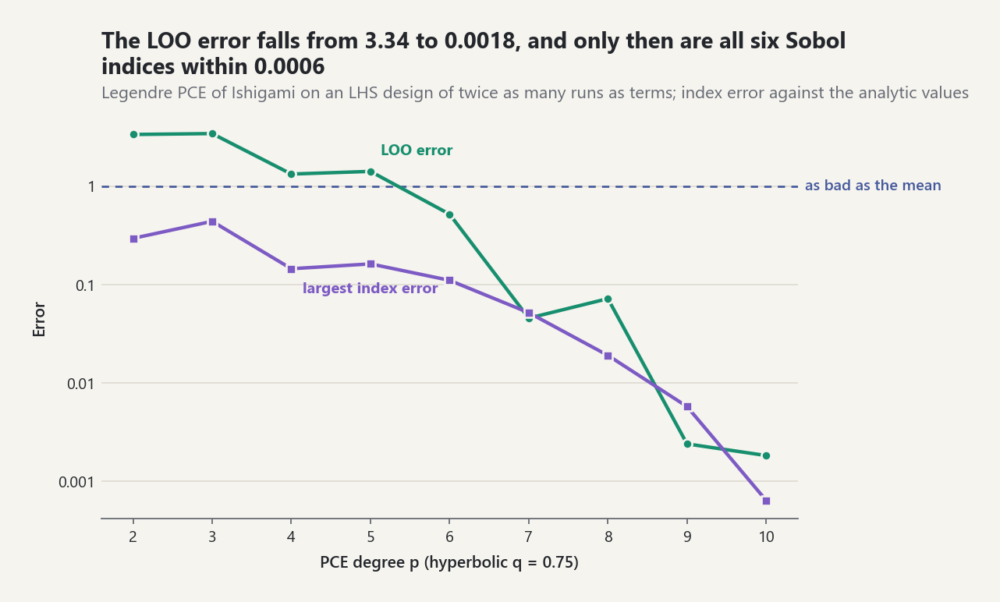
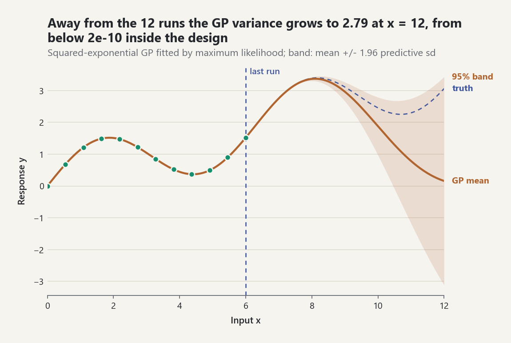

# Surrogate Models: Polynomial Chaos and Gaussian Processes

A surrogate (emulator) is a cheap approximation of an expensive forward model,
fitted to a limited number of model runs. `probstat.surrogates` builds
surrogates directly from a `ProbabilisticModel`, so the joint input law used
for propagation, reliability, and sensitivity also defines the training
design. A fitted surrogate can then replace the model inside a new
`ProbabilisticModel`. All numbers below were produced by the library with the
stated seeds.

## 1. Polynomial chaos expansion

A PCE writes the output as a sum of multivariate polynomials that are
orthonormal under the input law [EQ-SUR-PCE-001]:

`Y ~= sum_alpha c_alpha Psi_alpha(xi)`, with `E[Psi_alpha Psi_beta] = delta`.

Two bases are available:

- `basis="hermite"`: orthonormal probabilists' Hermite polynomials
  [EQ-SUR-PCE-002] in the independent standard-normal variables `u` of the
  model's Nataf transformation [EQ-MOD-NATAF-001]. It works for any marginals
  and any Gaussian copula. Non-Gaussian marginals become non-polynomial
  functions of `u`, though, so convergence is slower.
- `basis="legendre"`: orthonormal Legendre polynomials [EQ-SUR-PCE-003] of
  affinely mapped, independent uniform inputs. This is the Wiener-Askey
  optimal basis for uniform inputs.

**Truncation.** `multi_indices(d, p, q_norm=q)` keeps
`(sum alpha_i^q)^(1/q) <= p` [EQ-SUR-PCE-004]. For `d = 3`, `p = 10`, the
total-degree set has 286 terms; the hyperbolic set with `q = 0.75` keeps 144
by dropping high-order interactions first.

**Fit and validation.** `fit_polynomial_chaos` draws an experimental design
(LHS by default, twice as many points as terms), maps it through the joint
input law, evaluates the model, and solves the least-squares problem
[EQ-SUR-PCE-005] by a Householder QR factorization of the design matrix,
which avoids the squared condition number of the normal equations. A
numerically rank-deficient design is rejected with the dependent
multi-indices named. The leave-one-out error comes from
the hat-matrix diagonal without re-running the model [EQ-SUR-PCE-006]. The
mean is `c_0`, the variance is the sum of the other squared coefficients
[EQ-SUR-PCE-007], and Sobol indices are partial sums of squared coefficients
[EQ-SUR-PCE-008].

**Worked example: Ishigami** [EQ-LAB-ISHIGAMI-001]. Legendre basis, LHS,
`seed=1`; analytic values are mean 3.5, variance 13.8446,
`S = (0.3139, 0.4424, 0)`, and `S_T = (0.5576, 0.4424, 0.2437)`:

| degree / `q` | terms | runs | LOO error | mean | variance | `S_1, S_2, S_3` | `S_T1, S_T2, S_T3` |
|---|---|---|---|---|---|---|---|
| 2 / 1.0 | 10 | 20 | 3.70 | 2.980 | 6.405 | 0.403, 0.074, 0.356 | 0.569, 0.095, 0.504 |
| 6 / 1.0 | 84 | 168 | 0.142 | 3.402 | 15.335 | 0.270, 0.429, 0.002 | 0.563, 0.499, 0.259 |
| 10 / 0.75 | 144 | 288 | 0.0018 | 3.492 | 13.836 | 0.3133, 0.4423, 0.0000 | 0.5575, 0.4427, 0.2443 |

The LOO error is the diagnostic to read. At degree 2 it exceeds one: the
expansion predicts held-out points worse than the output mean would, and its
indices are meaningless (for example `S_3 = 0.356`, although `x_3` has no main
effect). At degree 10 the LOO error is 0.18% and every index is within 0.001
of its analytic value. The coefficient-based second-order index
`S_13 = 0.2439` recovers the `x_1`-`x_3` interaction that main-effect ranking
misses.

<picture><source media="(prefers-color-scheme: dark)" srcset="../images/guides/pce-loo-by-degree-dark.png"></picture>

*With the hyperbolic truncation q = 0.75 at every degree, the LOO error falls from 3.34 at degree 2 to 0.0018 at degree 10, and the largest error among the six first-order and total indices falls with it, from 0.29 to 0.0006; while the LOO error is above one the indices are not usable.*

**Exactness check.** A cubic `1 + 2a - a b^2 + 0.5 b^3` in independent normal
inputs is reproduced at degree 3 to machine precision, with LOO error below
`1e-22`. The Nataf map is affine for normal inputs, so the Hermite expansion
is exact.

**Dependence.** With correlated inputs the Hermite PCE still yields the
correct mean and variance. The tests check this on correlated lognormals
against the exact sum moments. Its Sobol indices, however, would attribute
variance to the independent Nataf variables rather than to the physical
inputs, so `sobol_indices()` raises for dependent inputs instead of returning
misleading numbers.

## 2. Sparse polynomial chaos

A full least-squares fit needs more runs than basis terms: 288 for the
degree-10 Ishigami fit above, and more than 286 for a cubic in ten inputs.
Most of those coefficients are usually negligible. `fit_sparse_polynomial_chaos`
keeps only the terms that matter, following the hybrid least-angle
regression of Blatman and Sudret:

1. **Ranking.** Least-angle regression (LAR) [EQ-SUR-SPCE-001] runs on the
   centred, unit-norm basis columns. Each step moves the fit along the
   direction equiangular to all active columns until an inactive column is
   as correlated with the residual as they are; that column enters next.
   The constant term is always kept and is not ranked (centring removes it
   from the LAR problem). `method="omp"` ranks by orthogonal matching
   pursuit instead [EQ-SUR-SPCE-002]: each step adds the column most
   correlated with the current least-squares residual.
2. **Hybrid refit.** Every nested set, the constant plus the first `k`
   ranked terms, is refitted by ordinary least squares, which removes the
   LAR shrinkage. Each refit is scored by the corrected leave-one-out error
   [EQ-SUR-SPCE-003], `T epsilon_LOO` with
   `T = N/(N-P) (1 + tr((Psi'Psi)^-1))`. The factor penalizes sets whose
   size `P` is not small next to `N`. The nested refits share one
   Gram-Schmidt factorization that grows by a column per step, so a whole
   path costs about one least-squares fit of its largest set.
3. **Adaptivity.** The selection runs on the truncation set `A_(p,q)` of
   every requested degree and norm (`degrees=range(...)`, `q_norms=(...)`),
   and the `(p, q, k)` with the smallest corrected error wins
   [EQ-SUR-SPCE-004]. The winner is refitted by Householder QR.

At most `N - 2` terms enter, so the truncation set may be larger than the
design. With `early_stop=True` (the default) a path stops after
`max(10, ceil(0.1 k_max))` steps without improvement, and the degree loop
stops after two degrees without improvement. Errors below `1e-20` count as
an exact fit, so among exact sets the sparsest is kept. These thresholds are
computational choices. The full fit of section 1 now also reports
`corrected_loo_error`.

The result is an ordinary `PolynomialChaosExpansion`: `mean`, `variance`,
`sobol_indices()`, `predict`, and `surrogate_probabilistic_model` work on the
selected terms. `candidate_size` is the size of the truncation set the terms
came from. `selection` records every visited set: its LAR (or OMP) entry
order, which ranks the basis terms, the corrected LOO error of every step,
and the step kept. `least_angle_regression(matrix, response)` returns the
LAR path of any regressors, with the entry order, the correlation level, and
the coefficients at every knot.

```python
from probstat.modeling import flood_model
from probstat.surrogates import fit_sparse_polynomial_chaos

flood = fit_sparse_polynomial_chaos(
    flood_model(), "overflow", size=150, degrees=range(1, 6), q_norms=(0.75,), seed=1
)
flood.degree, flood.candidate_size, flood.size  # (5, 237, 30)
flood.corrected_loo_error                       # 0.0030
flood.selection.entry_order[:2]                 # ((1, 0, 0, 0, 0, 0, 0, 0), (0, 0, 0, 0, 1, 0, 0, 0))
```

The first two ranked terms are the linear terms in `Q` and `Hd`, the two
inputs with the largest Sobol indices. The visited degrees 1 to 5 have
corrected errors 0.046, 0.036, 0.0078, 0.0067, and 0.0030.

**Exactness check.** Ten independent standard normals and an exact
expansion with four non-constant Hermite terms of degree at most 3
(`x_1`, `x_3^2`, `x_5 x_8`, `x_7^3`): from 60 LHS runs (`seed=1`), fewer
than the 286 terms of the cubic set, LAR and OMP both select exactly the
four terms and the constant and reproduce the coefficients to `4.4e-16`,
with corrected LOO error below `1e-30`. Exact recovery is not guaranteed at
that size: with `seed=4`, LAR ranked an interaction `x_5 x_6 x_7` before the
cubic term; it stays in the selected exact set with a refitted coefficient
of `9e-17`.

**Ishigami** (Legendre basis, LHS, `seed=1`, `degrees=range(2, 17)`,
`q_norms=(0.5, 0.75)`). The validation error is the relative mean squared
error on 5000 independent Monte Carlo points (`make_design("mc", 5000, 3,
seed=resolve_stream(999))`); the index error is the largest absolute error
among the six first-order and total indices against the analytic values:

| fit | runs | `p` / `q` | candidate terms | kept | LOO | corrected LOO | validation | index error |
|---|---|---|---|---|---|---|---|---|
| full OLS (section 1) | 288 | 10 / 0.75 | 144 | 144 | 1.8e-3 | 1.8e-2 | 7.9e-4 | 6e-4 |
| LAR | 100 | 14 / 0.75 | 325 | 50 | 2.9e-8 | 1.4e-7 | 9.0e-8 | 1.6e-5 |
| LAR | 150 | 14 / 0.75 | 325 | 58 | 5.1e-10 | 1.6e-9 | 3.6e-9 | 5.2e-6 |
| LAR | 200 | 16 / 0.75 | 445 | 39 | 1.4e-9 | 2.2e-9 | 1.6e-9 | 1.2e-6 |
| OMP | 150 | 16 / 0.75 | 445 | 82 | 2.8e-11 | 1.7e-10 | 6.7e-9 | 3.9e-6 |

With 100 runs the sparse fit is four orders of magnitude more accurate than
the full fit with 288, because it can afford degree 14 while keeping only
50 terms.

**Flood overflow** (Hermite basis on the Nataf transform of the eight
non-Gaussian inputs, LHS, `seed=1`, `degrees=range(1, 9)`,
`q_norms=(0.5, 0.75)`; first-order / total indices). The reference columns
are the sampled Sobol estimates of the
[sensitivity guide](sensitivity-analysis.md) (4096 runs, 8 replicates,
half-widths at most 0.003):

| fit | runs | `p` / `q` | kept | corrected LOO | validation | `Q` | `Hd` | `Zv` | `Ks` | `Cb` |
|---|---|---|---|---|---|---|---|---|---|---|
| Sobol sampling | | | | | | 0.344 / 0.352 | 0.284 / 0.284 | 0.190 / 0.190 | 0.134 / 0.142 | 0.036 / 0.036 |
| LAR | 100 | 7 / 0.5 | 28 | 3.9e-3 | 5.4e-3 | 0.348 / 0.357 | 0.283 / 0.283 | 0.185 / 0.185 | 0.137 / 0.145 | 0.036 / 0.036 |
| LAR | 150 | 5 / 0.5 | 27 | 2.9e-3 | 1.9e-3 | 0.344 / 0.352 | 0.285 / 0.285 | 0.189 / 0.189 | 0.133 / 0.140 | 0.036 / 0.036 |
| LAR | 200 | 7 / 0.5 | 41 | 6.7e-4 | 5.4e-4 | 0.344 / 0.353 | 0.283 / 0.283 | 0.190 / 0.190 | 0.134 / 0.143 | 0.036 / 0.036 |
| OMP | 150 | 7 / 0.75 | 70 | 2.2e-4 | 3.0e-3 | 0.340 / 0.350 | 0.287 / 0.287 | 0.189 / 0.190 | 0.135 / 0.144 | 0.034 / 0.034 |

From 100 to 200 runs every index is within 0.006 of the sampled estimate.
Two points about the error estimates:

- **LAR.** The corrected LOO error stays within a factor of 2.3 of the
  validation error in these runs, on either side (3.9e-3 against 5.4e-3 at
  100 flood runs, 2.9e-3 against 1.9e-3 at 150, 1.6e-9 against 3.6e-9 at
  150 Ishigami runs). The terms are chosen on the
  same runs that score them, so the estimate is not unbiased.
- **OMP.** OMP fits the training runs more aggressively: its corrected LOO
  error is 14 times below the validation error on the flood model and 40
  times below it on Ishigami. Its accuracy is comparable to that of LAR,
  but its error estimate is not trustworthy; prefer `method="lar"`.

For the full fit with `P / N = 0.5` the correction runs the other way: the
corrected error, 1.8e-2, is 23 times the validation error.

## 3. Gaussian-process regression

A GP prior `f ~ GP(0, k)` conditioned on training runs gives a Gaussian
predictive law: the mean interpolates the data, and the variance grows away
from it [EQ-SUR-GP-003]. Two ARD kernels are provided: squared exponential
[EQ-SUR-GP-001] and Matérn 5/2 [EQ-SUR-GP-002], with one length scale per
input.

`fit_gaussian_process` standardizes the outputs, then maximizes the log
marginal likelihood [EQ-SUR-GP-004] over log hyperparameters. It uses BFGS
with the exact gradient and several seeded restarts. The **nugget** is an
explicit diagonal variance in standardized units (default `1e-10`). If no
optimizer start gives a positive-definite kernel matrix, `adaptive_nugget=True`
(the default) multiplies it by ten, up to `1e-4`, and emits
`GaussianProcessJitterWarning`; the value used is the result's `nugget`, and
`adaptive_nugget=False` raises instead. `estimate_noise=True` adds a fitted
noise variance on top of the nugget. Closed-form leave-one-out residuals
[EQ-SUR-GP-005] are available from `leave_one_out()`.

**Worked example.** Twelve equally spaced points on `[0, 6]` of
`sin(x) + 0.3 x`, nugget `1e-10`, `seed=4`:

| kernel | log-lik. at start | log-lik. fitted | `sigma_f^2` | `ell` | max error at 11 midpoints | LOO error |
|---|---|---|---|---|---|---|
| squared exponential | -128.78 | 40.21 | 9.72 | 3.01 | 4.5e-6 | 3.7e-9 |
| Matérn 5/2 | -19.81 | 7.49 | 32.69 | 7.58 | 1.7e-3 | 2.5e-4 |

Both fits interpolate the training data. The squared exponential is more
accurate here because the target is analytic. The predictive variance at
`x = 12`, far outside the data, is 2.79 (squared exponential) and 10.47
(Matérn), compared with at most `2.5e-11` at the training runs. The variance reflects
the absence of data, not the true error.

<picture><source media="(prefers-color-scheme: dark)" srcset="../images/guides/gp-variance-beyond-data-dark.png"></picture>

*The squared-exponential GP interpolates the 12 runs with predictive variance below 2e-10; beyond the last run the mean drifts away from the truth, which it misses by 2.91 at x = 12, where the variance has grown to 2.79 because there are no data, not because the GP has measured its error.*

Use GPs with caution. The cost is cubic in the number of runs, and every
likelihood evaluation forms the full inverse kernel matrix, so this
implementation targets tens of points. Grid designs can create degenerate
likelihood optima: a length scale shrinks so that each grid line is fitted
independently. Use space-filling random designs, which
`fit_gaussian_process_to_model` does by default with LHS.

**Hyperparameter regularization (opt-in, ADR-0054).** Plain maximum
likelihood has two failure modes on small designs. For a smooth, nearly
polynomial response the likelihood keeps rising as the length scales grow and
the signal variance grows with them: the kernel matrix becomes numerically
singular and the posterior variance cancels to exactly 0 although the mean is
not exact. For a rough response a white-noise optimum (length scales far below
the spacing of the design) can win; the likelihood is flat there, so a
warm-started refit never leaves it. `regularization=GaussianProcessRegularization()`
bounds `log ell_i` to `[log(0.1 h_i), log(20 E_i)]` (`h_i` the smallest gap
between coordinates of input `i`, `E_i` its extent), bounds `sigma_f^2` to
`[1e-3, 1e3]` standardized units, adds the noise floor `1e-8 sigma_f^2` to the
diagonal (signal-to-noise at most `1e8`), and can add a log-normal prior
`log ell_i ~ N(log E_i, s^2)` [EQ-SUR-GP-006]. The result lists any parameter
that ended on a bound in `at_bound`. On the 12-point AK-MCS design (LHS on
`[-5, 5]^2`, seed 1) of `G = 3 + u1^2/4 - u2`:

| fit | `ell_1`, `ell_2` | signal / noise | `mu(0.5, 2)` (true 1.0625) | predictive sd | `at_bound` |
|---|---|---|---|---|---|
| unregularized | 1402, 1.31e5 | 4.2e18 | 1.064 | 0 | none |
| regularized | 38.8, 177 | 1.0e8 | 1.068 | 0.047 | `length_scale[1]:upper` |

On the four-branch design of seed 5 (smallest coordinate gaps 0.33 and
0.26), releases before 0.16 ended the unregularized fit at a white-noise
optimum, with length scales two orders of magnitude below those gaps and a
mean equal to the output mean everywhere. The current BFGS with a
strong-Wolfe line search (ADR-0059) reaches length scales 5.98 and 1.06 there
with or without regularization; the bounds exclude the white-noise region by
construction, whatever the optimizer does. The default of
`fit_gaussian_process` is still the unregularized fit, so existing results do
not change; `reliability.ak_mcs` uses the regularized fit by default.

## 4. Surrogates inside the central model

`surrogate_probabilistic_model(model, {"y": surrogate})` wraps any object with
`predict(x)` in a `SurrogateModel` forward model. The result is a new
`ProbabilisticModel` with the same joint input law and QoI declarations.
`propagation.propagate`, `ProbabilisticModel.unit_function` with
`sensitivity.estimate_sobol_indices`, and every other workflow that accepts a
`ProbabilisticModel` run unchanged on it, and none of their calls touch the
expensive model. The tests propagate a PCE emulator of Ishigami with 1024
Sobol points and recover its analytic mean and variance within sampling
error. They also estimate pick-freeze Sobol indices on the emulator that
agree with the PCE's coefficient-based indices.

The emulator's answers inherit the surrogate's approximation error, which
none of these workflows can see. Report the LOO error next to any result
computed on a surrogate.

## 5. Deep ensembles of neural networks

Active-learning reliability methods need a surrogate that returns a
predictive variance as well as a mean. A GP provides one, but every
likelihood evaluation costs `O(n^3)` and the optimizer needs many of them, so
a GP becomes slow beyond a few hundred runs or a few tens of inputs. A
**deep ensemble** [REF-LAKSHMINARAYANAN-PRITZEL-BLUNDELL-2017] is the simplest
neural alternative. `fit_deep_ensemble(points, values)` trains `M` small
MLPs (`members=5`, `hidden=(32, 32)`, `tanh`) on the same data. Each starts
from its own Glorot initialization; `bootstrap=True` also gives each member a
bootstrap resample. Each member outputs a mean and a log-variance
(`heteroscedastic=True`) or a mean and one shared variance
(`heteroscedastic=False`). It minimizes the Gaussian negative log-likelihood
plus a weight penalty `(lambda / 2) sum w^2` (`weight_decay=1e-4`) by Adam on
mini-batches of 32 [EQ-SUR-DE-001]. Inputs and outputs are standardized
first. The gradient comes from a closed-form backward pass. The tests check
it against reverse-mode differentiation of `MLP.forward` to `1e-12`.

Two training details go beyond the original method. Both are computational
choices, and setting them to `0` recovers the original procedure:

- `warmup_fraction=0.3` spends the first 30% of the iterations on the mean
  alone, with the variance held at one, before the full likelihood takes
  over. Without it the variance output absorbs the early misfit and the
  mean stays underfitted (table below).
- `tail_fraction=0.2` averages the last 20% of the Adam iterates. Without it,
  in a 1-D run with 3 members and learning rate 0.02, one member finished on
  a noisy last iterate that was overconfident at a training point; its
  training loss was 67 against about -2.4 for the other two members.

**Uncertainty decomposition.** The ensemble predicts the uniform mixture of
the member Gaussians [EQ-SUR-DE-002]. Its mean is the average member mean.
Its variance `mean_m (sigma_m^2 + mu_m^2) - mu*^2` splits exactly into two
parts. The **aleatoric** part, `mean_m sigma_m^2`, is the noise the members
attribute to the data. The **epistemic** part, `mean_m (mu_m - mu*)^2`, is
the disagreement between members, and it grows where no data constrain the
networks. `predict_decomposed(x)` returns both parts and the member values.
`predict_with_variance(x)` returns the mean and the total variance, and
`include_aleatoric=False` gives the epistemic part alone.
`epistemic_variance(x)` and `aleatoric_variance(x)` return one part each. For
a deterministic simulator the aleatoric part measures the misfit, not noise.
Whether a learning function should include it is a modelling choice: the
epistemic part is the counterpart of a GP's latent variance.
`fit_deep_ensemble_to_model(model, size=...)` trains on an LHS design of the
model, like `fit_gaussian_process_to_model`. The result has `predict(x)`, so
`surrogate_probabilistic_model` accepts it.

**Worked example.** The data are 20 equally spaced runs of `sin(x) + 0.3 x`
on `[0, 6]`. The ensembles are tiny: 3 members with one hidden layer of 8
units, 1500 full-batch iterations at learning rate 0.02, and seeds 1 to 8.
The validation error is the RMSE at the 19 midpoints divided by the output
standard deviation. The variance ratio is the mean epistemic variance at
`x = -3, -2, 8, 9` over its mean at the training runs:

| training | median error | worst error | smallest variance ratio |
|---|---|---|---|
| likelihood only (`warmup_fraction=0`) | 0.046 | 0.124 | 6 |
| warm-up 0.3 (default) | 0.006 | 0.020 | 747 |
| `heteroscedastic=False`, no warm-up | 0.005 | 0.007 | 1464 |

In every run the member means agree on the data and disagree away from it,
so the epistemic variance grows outside `[0, 6]`, as it should. The second
test is heteroscedastic: 200 runs of `y = 2x + e` with
`sd(e) = 0.05 + 0.4 x` on `[0, 1]`, trained with the same tiny settings and
the warm-up. Over seeds 1 to 6, the predicted aleatoric standard deviation at
`x = 0.1, 0.3, ..., 0.9` was between 0.87 and 1.22 times the true one.

**Measured cost.** All arithmetic is scalar Python. The table gives seconds
per training epoch of one member (`hidden=(32, 32)`, heteroscedastic, batch
32, median of 3 runs). It also gives the cost of predicting one point with 5
members, and, for comparison, one GP log-likelihood evaluation with gradient
(Matérn 5/2), of which a GP fit needs many. Measured on Python 3.12.1 and an
Intel Core (family 6, model 158) desktop; repeated runs differed by tens of
percent.

| `d` | `n` | parameters per member | steps per epoch | s per epoch | ms per step | predict, 5 members (ms) | one GP likelihood (s) |
|---|---|---|---|---|---|---|---|
| 2 | 50 | 1218 | 2 | 0.025 | 12 | 0.33 | 0.009 |
| 2 | 200 | 1218 | 7 | 0.077 | 11 | 0.31 | 0.40 |
| 2 | 500 | 1218 | 16 | 0.17 | 10 | 0.33 | 4.7 |
| 10 | 50 | 1474 | 2 | 0.018 | 9 | 0.61 | 0.018 |
| 10 | 200 | 1474 | 7 | 0.073 | 10 | 0.38 | 0.48 |
| 10 | 500 | 1474 | 16 | 0.23 | 15 | 0.79 | 7.1 |
| 50 | 50 | 2754 | 2 | 0.040 | 20 | 0.87 | 0.066 |
| 50 | 200 | 2754 | 7 | 0.14 | 21 | 1.8 | 2.3 |
| 50 | 500 | 2754 | 16 | 0.66 | 41 | 0.97 | 17 |

An Adam step costs 10 to 40 ms and does not depend on `n`. A fit therefore
costs `members x iterations` steps whatever the design size, and the
defaults (5 x 2000) take about E2E_TIME. E2E_SENTENCE
Supported range: up to about 50 inputs and 500 training runs. Beyond that,
a fit takes many minutes. Prediction over a candidate pool of `10^5` points
takes about one to three minutes per active-learning iteration.

**Out of scope.** Physics-informed neural networks fit a network to the
residual of a known PDE. They need the governing equations, not a black-box
performance function, so they are not reliability surrogates in this sense.
Full Bayesian neural networks sample the posterior over the weights, for
example by Hamiltonian Monte Carlo. With thousands of weights, each
log-density gradient costs a full pass over the data, and HMC needs
thousands of such gradients even for a modest sample. That is impractical in
scalar Python. A deep ensemble gives a usable predictive
spread at a fixed, known cost instead. Its epistemic variance measures member
disagreement, not the true error, and is not calibrated.

## Limitations

- PCE: Hermite and Legendre bases only (no other Wiener-Askey families) and
  no quadrature projection. Sparse selection offers LAR without the lasso
  modification and OMP; there is no Bayesian compressive sensing or subspace
  pursuit. Its error estimate is computed on the runs that chose the basis,
  and its early-stopping thresholds are computational choices. All algebra
  is dense pure Python and a LAR or OMP step costs `O(N P)`; each Ishigami
  fit above (29 truncation sets of up to 445 terms) took 5 to 7 s here.
- GP: constant (centered) mean only, no universal kriging trend, stationary
  kernels, dense `O(n^3)` algebra, and hyperparameters restricted to
  `|log theta| <= 25` (narrower, data-dependent bounds with `regularization`;
  their factors are computational choices, not estimated).
- Deep ensembles: scalar-Python training at 10 to 40 ms per Adam step,
  measured up to 50 inputs and 500 runs; a fixed learning rate with no early
  stopping or validation split; no adversarial training (an optional part of
  the original method). The warm-up and iterate averaging are computational
  choices. The epistemic variance is member disagreement, not a calibrated
  error. Physics-informed networks and full Bayesian networks are not
  provided.

## Common pitfalls

- **Nugget units and growth.** The GP `nugget` (default `1e-10`) is a
  variance in standardized output units, not in QoI units. It can grow up to
  `1e-4` under `adaptive_nugget=True`; check for
  `GaussianProcessJitterWarning` and read the result's `nugget`. A condition
  number above `1e12` emits `GaussianProcessConditioningWarning`.
- **Unregularized by default.** `fit_gaussian_process` and
  `fit_gaussian_process_to_model` default to `regularization=None`. On small
  designs pass `GaussianProcessRegularization()` and inspect `at_bound`.
- **Predictive variance is not the error.** It grows with distance from the
  data whether or not the mean is wrong there.
- **Read the leave-one-out error first.** A PCE whose `loo_error` exceeds one
  predicts held-out points worse than the output mean, and its moments and
  indices are not usable.
- **Sparse fits.** Report `corrected_loo_error`, not `loo_error`, for a
  sparse fit. Prefer `method="lar"`: the OMP error estimate was more than an
  order of magnitude too optimistic in the benchmarks above. A selected
  degree at the top of `degrees` suggests the range may be too small.
- **Basis and inputs.** `basis="hermite"` is the default for every input law;
  `basis="legendre"` is refused unless all inputs are independent uniforms.
- **Seeds.** The fitters default to `seed=None`, which is not reproducible.

```python
import inspect

from probstat.distributions import Normal
from probstat.modeling import JointInput, ProbabilisticModel, RandomInput
from probstat.surrogates import fit_gaussian_process, fit_polynomial_chaos
from probstat.uq import QuantityOfInterest

gp_defaults = inspect.signature(fit_gaussian_process).parameters
gp_defaults["nugget"].default                  # 1e-10
gp_defaults["adaptive_nugget"].default         # True
gp_defaults["regularization"].default is None  # True
square = ProbabilisticModel(
    JointInput((RandomInput("x", Normal(0.0, 1.0)),)),
    lambda p: {"y": p["x"] ** 2},
    (QuantityOfInterest("y", "square of x"),),
)
fit_polynomial_chaos(square, degree=1, seed=1).loo_error > 1.0  # True, a line cannot fit x^2
fit_polynomial_chaos(square, degree=2, seed=1).mean             # 1.0, exact at degree 2
try:
    fit_polynomial_chaos(square, degree=2, basis="legendre", seed=1)
except ValueError as error:
    refused = str(error)
refused  # "the Legendre basis requires Uniform marginals; 'x' is not uniform"
```

## Sources

- [REF-XIU-KARNIADAKIS-2002], [REF-SUDRET-2008], [REF-SUDRET-2007],
  [REF-BLATMAN-SUDRET-2011], [REF-NIST-DLMF-ORTHOGONAL].
- [REF-EFRON-HASTIE-JOHNSTONE-TIBSHIRANI-2004] for least-angle regression and
  [REF-CHAPELLE-VAPNIK-BENGIO-2002] for the corrected leave-one-out error.
- [REF-RASMUSSEN-WILLIAMS-2006, Chapters 2, 4, and 5].
- [REF-SALTELLI-2008, Chapter 4] for the Ishigami benchmark.
