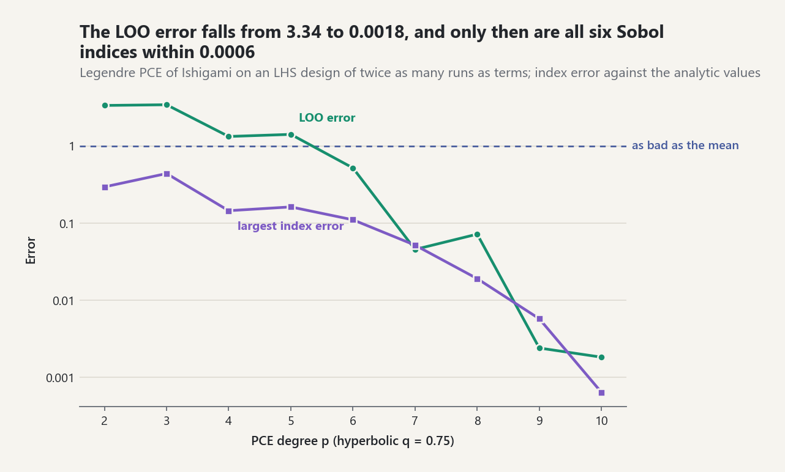
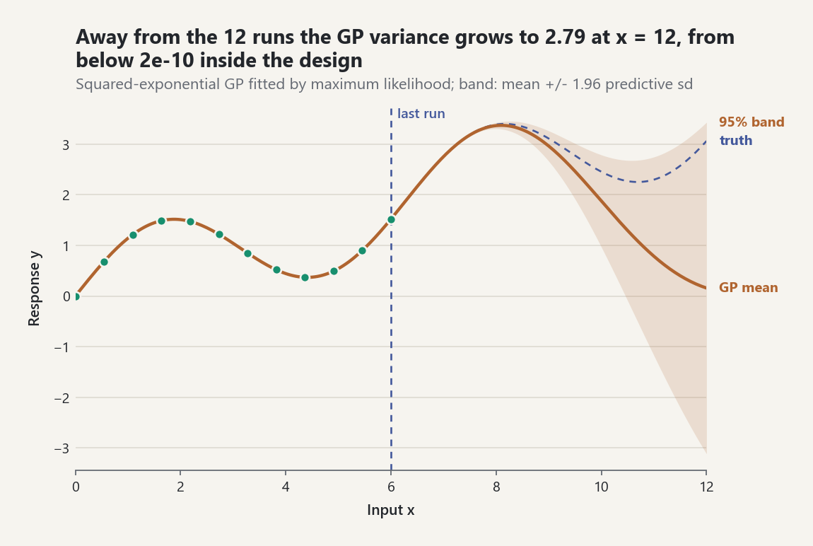

# Surrogate Models: Polynomial Chaos and Gaussian Processes

A surrogate (emulator) is a cheap approximation of an expensive forward model,
fitted to a limited number of model runs. `probstat.surrogates` builds
surrogates directly from a `ProbabilisticModel`, so the joint input law used
for propagation, reliability, and sensitivity also defines the training
design. A fitted surrogate can then replace the model inside a new
`ProbabilisticModel`. All numbers below were produced by the library with the
stated seeds.

## 1. Polynomial chaos expansion

A PCE writes the output as a sum of multivariate polynomials that are
orthonormal under the input law [EQ-SUR-PCE-001]:

`Y ~= sum_alpha c_alpha Psi_alpha(xi)`, with `E[Psi_alpha Psi_beta] = delta`.

Two bases are available:

- `basis="hermite"`: orthonormal probabilists' Hermite polynomials
  [EQ-SUR-PCE-002] in the independent standard-normal variables `u` of the
  model's Nataf transformation [EQ-MOD-NATAF-001]. It works for any marginals
  and any Gaussian copula. Non-Gaussian marginals become non-polynomial
  functions of `u`, though, so convergence is slower.
- `basis="legendre"`: orthonormal Legendre polynomials [EQ-SUR-PCE-003] of
  affinely mapped, independent uniform inputs. This is the Wiener-Askey
  optimal basis for uniform inputs.

**Truncation.** `multi_indices(d, p, q_norm=q)` keeps
`(sum alpha_i^q)^(1/q) <= p` [EQ-SUR-PCE-004]. For `d = 3`, `p = 10`, the
total-degree set has 286 terms; the hyperbolic set with `q = 0.75` keeps 144
by dropping high-order interactions first.

**Fit and validation.** `fit_polynomial_chaos` draws an experimental design
(LHS by default, twice as many points as terms), maps it through the joint
input law, evaluates the model, and solves the least-squares problem
[EQ-SUR-PCE-005] by a Householder QR factorization of the design matrix,
which avoids the squared condition number of the normal equations. A
numerically rank-deficient design is rejected with the dependent
multi-indices named. The leave-one-out error comes from
the hat-matrix diagonal without re-running the model [EQ-SUR-PCE-006]. The
mean is `c_0`, the variance is the sum of the other squared coefficients
[EQ-SUR-PCE-007], and Sobol indices are partial sums of squared coefficients
[EQ-SUR-PCE-008].

**Worked example: Ishigami** [EQ-LAB-ISHIGAMI-001]. Legendre basis, LHS,
`seed=1`; analytic values are mean 3.5, variance 13.8446,
`S = (0.3139, 0.4424, 0)`, and `S_T = (0.5576, 0.4424, 0.2437)`:

| degree / `q` | terms | runs | LOO error | mean | variance | `S_1, S_2, S_3` | `S_T1, S_T2, S_T3` |
|---|---|---|---|---|---|---|---|
| 2 / 1.0 | 10 | 20 | 3.70 | 2.980 | 6.405 | 0.403, 0.074, 0.356 | 0.569, 0.095, 0.504 |
| 6 / 1.0 | 84 | 168 | 0.142 | 3.402 | 15.335 | 0.270, 0.429, 0.002 | 0.563, 0.499, 0.259 |
| 10 / 0.75 | 144 | 288 | 0.0018 | 3.492 | 13.836 | 0.3133, 0.4423, 0.0000 | 0.5575, 0.4427, 0.2443 |

The LOO error is the diagnostic to read. At degree 2 it exceeds one: the
expansion predicts held-out points worse than the output mean would, and its
indices are meaningless (for example `S_3 = 0.356`, although `x_3` has no main
effect). At degree 10 the LOO error is 0.18% and every index is within 0.001
of its analytic value. The coefficient-based second-order index
`S_13 = 0.2439` recovers the `x_1`-`x_3` interaction that main-effect ranking
misses.

<picture><source media="(prefers-color-scheme: dark)" srcset="../images/guides/pce-loo-by-degree-dark.png"></picture>

*With the hyperbolic truncation q = 0.75 at every degree, the LOO error falls from 3.34 at degree 2 to 0.0018 at degree 10, and the largest error among the six first-order and total indices falls with it, from 0.29 to 0.0006; while the LOO error is above one the indices are not usable.*

**Exactness check.** A cubic `1 + 2a - a b^2 + 0.5 b^3` in independent normal
inputs is reproduced at degree 3 to machine precision, with LOO error below
`1e-22`. The Nataf map is affine for normal inputs, so the Hermite expansion
is exact.

**Dependence.** With correlated inputs the Hermite PCE still yields the
correct mean and variance. The tests check this on correlated lognormals
against the exact sum moments. Its Sobol indices, however, would attribute
variance to the independent Nataf variables rather than to the physical
inputs, so `sobol_indices()` raises for dependent inputs instead of returning
misleading numbers.

## 2. Gaussian-process regression

A GP prior `f ~ GP(0, k)` conditioned on training runs gives a Gaussian
predictive law: the mean interpolates the data, and the variance grows away
from it [EQ-SUR-GP-003]. Two ARD kernels are provided: squared exponential
[EQ-SUR-GP-001] and Matérn 5/2 [EQ-SUR-GP-002], with one length scale per
input.

`fit_gaussian_process` standardizes the outputs, then maximizes the log
marginal likelihood [EQ-SUR-GP-004] over log hyperparameters. It uses BFGS
with the exact gradient and several seeded restarts. The **nugget** is an
explicit diagonal variance in standardized units (default `1e-10`). If no
optimizer start gives a positive-definite kernel matrix, `adaptive_nugget=True`
(the default) multiplies it by ten, up to `1e-4`, and emits
`GaussianProcessJitterWarning`; the value used is the result's `nugget`, and
`adaptive_nugget=False` raises instead. `estimate_noise=True` adds a fitted
noise variance on top of the nugget. Closed-form leave-one-out residuals
[EQ-SUR-GP-005] are available from `leave_one_out()`.

**Worked example.** Twelve equally spaced points on `[0, 6]` of
`sin(x) + 0.3 x`, nugget `1e-10`, `seed=4`:

| kernel | log-lik. at start | log-lik. fitted | `sigma_f^2` | `ell` | max error at 11 midpoints | LOO error |
|---|---|---|---|---|---|---|
| squared exponential | -128.78 | 40.21 | 9.72 | 3.01 | 4.5e-6 | 3.7e-9 |
| Matérn 5/2 | -19.81 | 7.49 | 32.69 | 7.58 | 1.7e-3 | 2.5e-4 |

Both fits interpolate the training data. The squared exponential is more
accurate here because the target is analytic. The predictive variance at
`x = 12`, far outside the data, is 2.79 (squared exponential) and 10.47
(Matérn), compared with at most `2.5e-11` at the training runs. The variance reflects
the absence of data, not the true error.

<picture><source media="(prefers-color-scheme: dark)" srcset="../images/guides/gp-variance-beyond-data-dark.png"></picture>

*The squared-exponential GP interpolates the 12 runs with predictive variance below 2e-10; beyond the last run the mean drifts away from the truth, which it misses by 2.91 at x = 12, where the variance has grown to 2.79 because there are no data, not because the GP has measured its error.*

Use GPs with caution. The cost is cubic in the number of runs, and every
likelihood evaluation forms the full inverse kernel matrix, so this
implementation targets tens of points. Grid designs can create degenerate
likelihood optima: a length scale shrinks so that each grid line is fitted
independently. Use space-filling random designs, which
`fit_gaussian_process_to_model` does by default with LHS.

**Hyperparameter regularization (opt-in, ADR-0054).** Plain maximum
likelihood has two failure modes on small designs. For a smooth, nearly
polynomial response the likelihood keeps rising as the length scales grow and
the signal variance grows with them: the kernel matrix becomes numerically
singular and the posterior variance cancels to exactly 0 although the mean is
not exact. For a rough response a white-noise optimum (length scales far below
the spacing of the design) can win; the likelihood is flat there, so a
warm-started refit never leaves it. `regularization=GaussianProcessRegularization()`
bounds `log ell_i` to `[log(0.1 h_i), log(20 E_i)]` (`h_i` the smallest gap
between coordinates of input `i`, `E_i` its extent), bounds `sigma_f^2` to
`[1e-3, 1e3]` standardized units, adds the noise floor `1e-8 sigma_f^2` to the
diagonal (signal-to-noise at most `1e8`), and can add a log-normal prior
`log ell_i ~ N(log E_i, s^2)` [EQ-SUR-GP-006]. The result lists any parameter
that ended on a bound in `at_bound`. On the 12-point AK-MCS design (LHS on
`[-5, 5]^2`, seed 1) of `G = 3 + u1^2/4 - u2`:

| fit | `ell_1`, `ell_2` | signal / noise | `mu(0.5, 2)` (true 1.0625) | predictive sd | `at_bound` |
|---|---|---|---|---|---|
| unregularized | 1402, 1.31e5 | 4.2e18 | 1.064 | 0 | none |
| regularized | 38.8, 177 | 1.0e8 | 1.068 | 0.047 | `length_scale[1]:upper` |

On the four-branch design of seed 5 (smallest coordinate gaps 0.33 and
0.26), releases before 0.16 ended the unregularized fit at a white-noise
optimum, with length scales two orders of magnitude below those gaps and a
mean equal to the output mean everywhere. The current BFGS with a
strong-Wolfe line search (ADR-0059) reaches length scales 5.98 and 1.06 there
with or without regularization; the bounds exclude the white-noise region by
construction, whatever the optimizer does. The default of
`fit_gaussian_process` is still the unregularized fit, so existing results do
not change; `reliability.ak_mcs` uses the regularized fit by default.

## 3. Surrogates inside the central model

`surrogate_probabilistic_model(model, {"y": surrogate})` wraps any object with
`predict(x)` in a `SurrogateModel` forward model. The result is a new
`ProbabilisticModel` with the same joint input law and QoI declarations.
`propagation.propagate`, `ProbabilisticModel.unit_function` with
`sensitivity.estimate_sobol_indices`, and every other workflow that accepts a
`ProbabilisticModel` run unchanged on it, and none of their calls touch the
expensive model. The tests propagate a PCE emulator of Ishigami with 1024
Sobol points and recover its analytic mean and variance within sampling
error. They also estimate pick-freeze Sobol indices on the emulator that
agree with the PCE's coefficient-based indices.

The emulator's answers inherit the surrogate's approximation error, which
none of these workflows can see. Report the LOO error next to any result
computed on a surrogate.

## Limitations

- PCE: ordinary least squares on a fixed truncation only. There is no sparse
  regression (LARS/OMP), no adaptive degree selection, no arbitrary
  Wiener-Askey families beyond Hermite and Legendre, and no quadrature
  projection.
- GP: constant (centered) mean only, no universal kriging trend, stationary
  kernels, dense `O(n^3)` algebra, and hyperparameters restricted to
  `|log theta| <= 25` (narrower, data-dependent bounds with `regularization`;
  their factors are computational choices, not estimated).

## Common pitfalls

- **Nugget units and growth.** The GP `nugget` (default `1e-10`) is a
  variance in standardized output units, not in QoI units. It can grow up to
  `1e-4` under `adaptive_nugget=True`; check for
  `GaussianProcessJitterWarning` and read the result's `nugget`. A condition
  number above `1e12` emits `GaussianProcessConditioningWarning`.
- **Unregularized by default.** `fit_gaussian_process` and
  `fit_gaussian_process_to_model` default to `regularization=None`. On small
  designs pass `GaussianProcessRegularization()` and inspect `at_bound`.
- **Predictive variance is not the error.** It grows with distance from the
  data whether or not the mean is wrong there.
- **Read the leave-one-out error first.** A PCE whose `loo_error` exceeds one
  predicts held-out points worse than the output mean, and its moments and
  indices are not usable.
- **Basis and inputs.** `basis="hermite"` is the default for every input law;
  `basis="legendre"` is refused unless all inputs are independent uniforms.
- **Seeds.** The fitters default to `seed=None`, which is not reproducible.

```python
import inspect

from probstat.distributions import Normal
from probstat.modeling import JointInput, ProbabilisticModel, RandomInput
from probstat.surrogates import fit_gaussian_process, fit_polynomial_chaos
from probstat.uq import QuantityOfInterest

gp_defaults = inspect.signature(fit_gaussian_process).parameters
gp_defaults["nugget"].default                  # 1e-10
gp_defaults["adaptive_nugget"].default         # True
gp_defaults["regularization"].default is None  # True
square = ProbabilisticModel(
    JointInput((RandomInput("x", Normal(0.0, 1.0)),)),
    lambda p: {"y": p["x"] ** 2},
    (QuantityOfInterest("y", "square of x"),),
)
fit_polynomial_chaos(square, degree=1, seed=1).loo_error > 1.0  # True, a line cannot fit x^2
fit_polynomial_chaos(square, degree=2, seed=1).mean             # 1.0, exact at degree 2
try:
    fit_polynomial_chaos(square, degree=2, basis="legendre", seed=1)
except ValueError as error:
    refused = str(error)
refused  # "the Legendre basis requires Uniform marginals; 'x' is not uniform"
```

## Sources

- [REF-XIU-KARNIADAKIS-2002], [REF-SUDRET-2008], [REF-SUDRET-2007],
  [REF-BLATMAN-SUDRET-2011], [REF-NIST-DLMF-ORTHOGONAL].
- [REF-RASMUSSEN-WILLIAMS-2006, Chapters 2, 4, and 5].
- [REF-SALTELLI-2008, Chapter 4] for the Ishigami benchmark.
