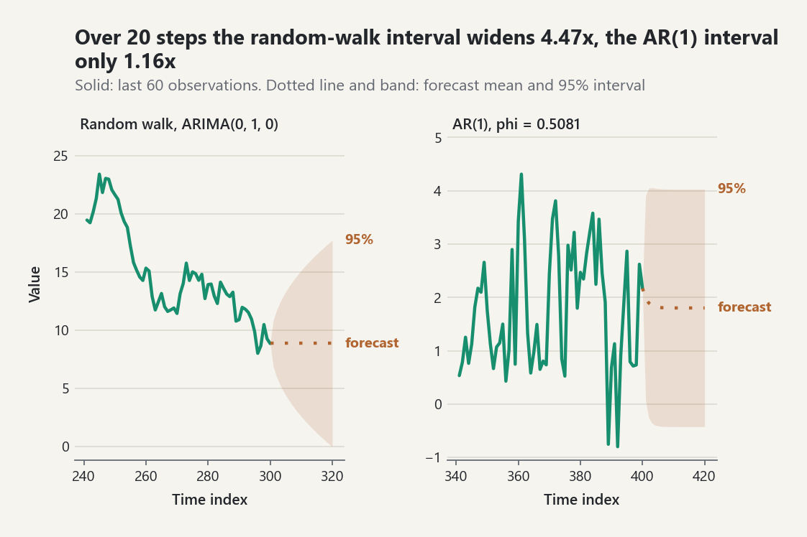
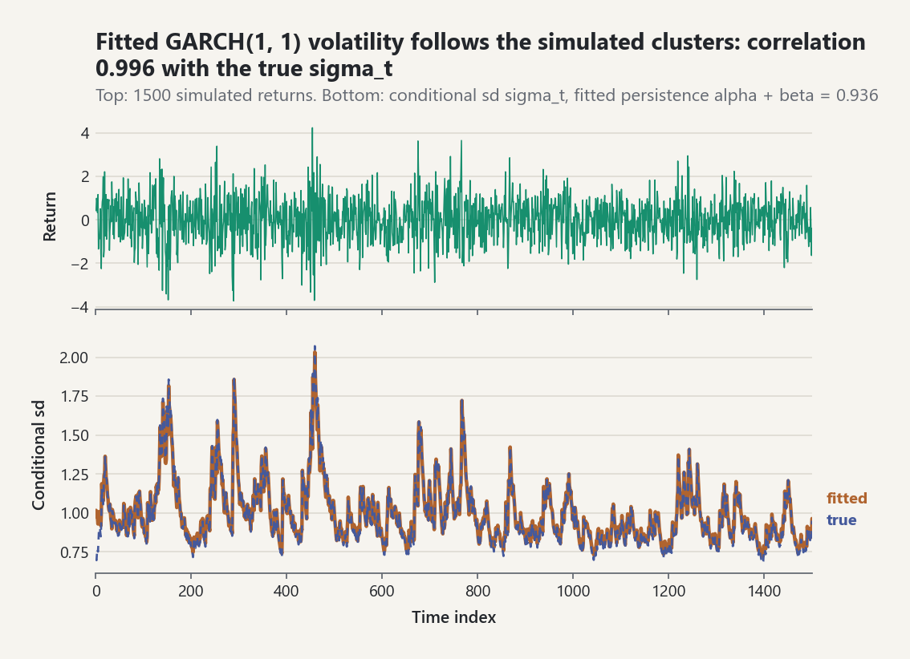
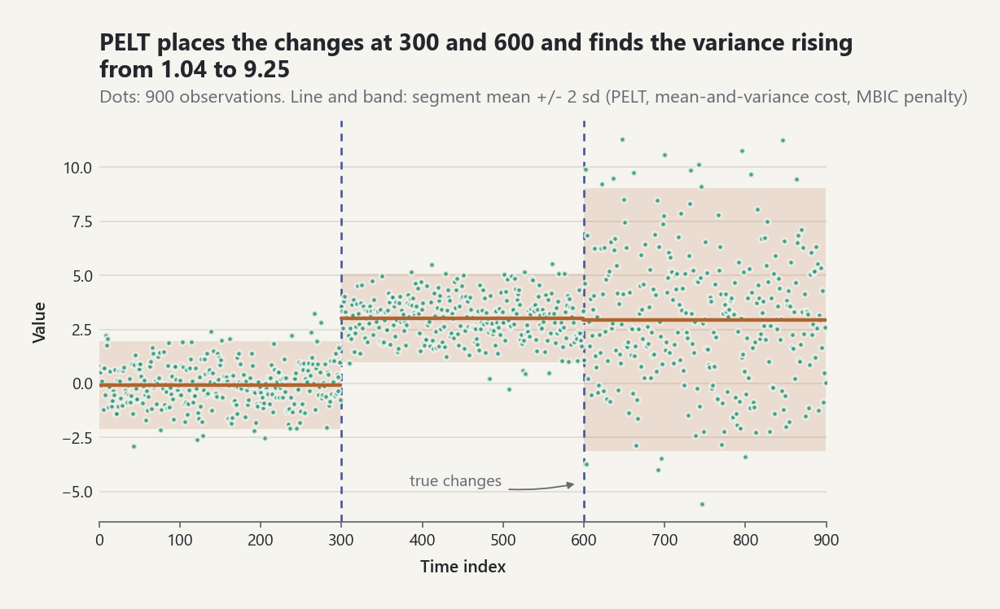

# Time Series: Correlograms, ARIMA, Smoothing, Volatility, VAR, Unit Roots, and Change Points

A time series is a set of observations whose order matters: today's value
carries information about tomorrow's. This guide covers `probstat.timeseries`.
Every number below was computed by the library with the seed shown, and the
cross-checks named in each section were run against NumPy/SciPy in a separate
script (those packages are not dependencies of the library).

## 1. Correlograms

The sample autocovariance uses the `1/n` divisor [EQ-TS-ACF-001], which keeps
the sample autocovariance matrix positive semidefinite. `acf(series, K)`
returns `rho_hat(0..K)`.

**AR(1) check.** For `x_t = 0.7 x_(t-1) + e_t` the theoretical ACF is
`0.7^k`. With `simulate_arma((0.7,), (), 4000, seed=101)`:

| lag | 1 | 2 | 3 | 4 |
|---|---|---|---|---|
| sample `rho_hat(k)` | 0.6898 | 0.4711 | 0.3248 | 0.2331 |
| `0.7^k` | 0.7000 | 0.4900 | 0.3430 | 0.2401 |
| Bartlett half-width (95%) | 0.0310 | 0.0433 | 0.0480 | 0.0500 |

The Bartlett band [EQ-TS-BAND-002] widens with the lag because the earlier
autocorrelations add sampling variance. The white-noise band
[EQ-TS-BAND-001] is the lag-1 value `1.96/sqrt(4000) = 0.0310`. Every
sample value lies within one Bartlett half-width of `0.7^k`.

**PACF and Durbin-Levinson.** `durbin_levinson` [EQ-TS-PACF-001] solves the
Yule-Walker equations for every order at once; its reflection coefficients
are the partial autocorrelations. For the AR(2) `phi = (0.5, -0.3)` the
theoretical PACF (from `arma_autocovariance`) is `0.384615` (that is
`0.5/1.3`), then `-0.3`. Lags 3-5 come out at about `1e-17`, which is zero
to rounding. That is the AR(p) cut-off. The sample PACF of
`simulate_arma((0.5, -0.3), (), 2000, seed=102)` is
`0.3637, -0.2892, 0.0052, 0.0134, 0.0103, 0.0010` against a band of
`+/-0.0438`. The NumPy cross-check (solving each Toeplitz system directly)
agreed to `6e-16`.

**Ljung-Box.** `Q = n(n+2) sum rho_hat(k)^2/(n-k)` [EQ-TS-LB-001] is compared
with `chi^2(h - p - q)`:

| series (n = 300, h = 10) | `Q` | p-value |
|---|---|---|
| white noise, `seed=103` | 8.175 | 0.612 |
| AR(1) `phi = 0.6`, `seed=104` | 172.93 | `6.9e-32` |

The statistic matched a NumPy evaluation to `9e-14`, and the p-value matched
`scipy.stats.chi2.sf`.

## 2. Differencing and decomposition

`difference(y, d, lag=1)` applies `(1 - B)^d`; `seasonal_difference(y, s, D)`
applies `(1 - B^s)^D`; `undifference` inverts ordinary differencing from the
first `d` values [EQ-TS-DIFF-001]. Applying `difference(., 2)` to `1, 4, 9,
16, 25, 36` gives the constant `2`, as expected for a quadratic.

`classical_decomposition(y, s, model=...)` [EQ-TS-DECOMP-001] uses a centred
moving average (`2 x s` for even `s`) as the trend. On
`10 + 0.5 t + (2, -1, 0.5, -1.5)[t mod 4]` it recovers the seasonal indices
exactly and leaves a zero remainder. The trend is `None` at the ends, where
the window is incomplete. In the multiplicative form the indices average one.
With a linear trend they are close to the true factors but not exact: on
`(10 + 0.5t)(1.2, 0.9, 1.1, 0.8)` the indices were
`1.1990, 0.9007, 1.1009, 0.7993` (24 points). The centred average of a
product is not the product of the averages. An STL-type robust decomposition
was **not** implemented (see ADR-0031).

## 3. ARMA polynomials: roots and stationarity

Sign convention: `phi(z) = 1 - sum phi_j z^j` and `theta(z) = 1 + sum theta_j
z^j` [EQ-TS-ARMA-001]. Two routes are used:

- `polynomial_roots` [EQ-TS-ROOT-001] runs the Durand-Kerner iteration plus
  Newton polishing. On six test polynomials, including complex pairs, a
  quintic, and the double root of `1 - 2z + z^2`, the roots agreed with
  `numpy.roots` to `6e-15`. The double root agreed only to `5e-10`, because
  repeated roots converge linearly.
- `is_stationary` / `is_invertible` [EQ-TS-ROOT-002] decide with the
  Schur-Cohn step-down recursion, which needs no root finding.
  `ar_root_check` reports both.

For `phi = (0.5, -0.3)` the roots are `0.8333 +/- 1.6245i`, with modulus
`1.8257 = sqrt(1/0.3)`, and the reflection coefficients are
`(0.3846, -0.3)`. So the model is stationary. `(1.2,)`, `(1.0,)`,
`(0.5, 0.5)`, and `(0.2, 0.9)` are rejected, and `arma_state_space`,
`simulate_arma`, and `arma_log_likelihood` raise `ValueError` for them. The
MA polynomial `1 + 1.5z` has its root at `-0.6667` and is not invertible.

## 4. Exact likelihood through the state-space form

`arma_state_space` builds the Harvey form [EQ-TS-SSM-001] with
`r = max(p, q + 1)`. The stationary state covariance comes from solving the
Lyapunov equation exactly. `arma_autocovariance` reads `gamma(k) = Z T^k P Z'`
off it. Against the `psi`-weight sum [EQ-TS-ARMA-002], with 3000 terms, it
agreed to `9e-16` for AR(1), ARMA(2,1), MA(1), and ARMA(3,2).

The likelihood [EQ-TS-LIK-001] is the prediction-error decomposition of the
Kalman filter. Two implementations share it:

- `ARMAStateSpace.kalman(series)` returns a full
  `filtering.KalmanFilterResult`. Its measurement step is
  `filtering.linear_gaussian_update`, the update that `kalman_filter` uses.
- `arma_log_likelihood` is a scalar `O(r^2)`-per-step specialization used for
  estimation. It freezes the covariance once it reaches steady state.

Checks:

| check | difference |
|---|---|
| AR(1) closed form [EQ-TS-LIK-002] vs both filters (`phi=0.7`, `sigma^2=0.8`, `mu=0.3`, n=200, seed 105; `log L = -269.5869`) | `5.7e-14` (both filters) |
| dense `N(mu 1, Toeplitz(gamma))` log-density, n=150, five models incl. non-invertible MA(1) `theta=1.5` | at most `6.8e-13` |
| ARMA(2,1) plus measurement noise `0.25`: `kalman(..., observation_variance=0.25)` vs `filtering.kalman_filter(model.to_linear_gaussian(0.25), ...)` | `0.0` |

`filtering.LinearGaussianStateSpace` requires a positive-definite observation
covariance, so a pure ARMA (observation noise zero) cannot be passed to
`kalman_filter` itself. ADR-0031 explains the workaround.

## 5. Estimation

`yule_walker(series, p)` [EQ-TS-YW-001] is always stationary. It matched a
direct NumPy solve to `4e-16`. `fit_arima(series, (p, d, q))` maximizes the
concentrated exact likelihood by BFGS. The optimizer works on `u` with
reflection coefficients `tanh(u)` [EQ-TS-PARAM-001], so every iterate is
stationary and invertible. Standard errors come from the inverse
central-difference Hessian [EQ-TS-SE-001].

| simulation | estimates | standard errors | `log L` |
|---|---|---|---|
| AR(2) `(0.5, -0.3)`, `mu = 1`, n = 800, seed 108 | `phi = (0.4131, -0.3107)`, `mu = 1.0267`, `sigma^2 = 0.9421` | `0.0336, 0.0336, 0.0382, 0.0471` | -1111.441 |
| MA(1) `theta = 0.6`, n = 800, seed 109 | `theta = 0.6002`, `sigma^2 = 1.0093` | `0.0286, 0.0505` | -1139.092 |

The AR(2) `phi_1` estimate is 2.6 standard errors from the truth. That is an
honest sampling outcome for this seed, and the test checks the 3-SE
criterion. For three models (n = 400-600), the maximum agreed with an
independent SciPy Nelder-Mead run on the same likelihood to `2.3e-12` in
`log L`. Information criteria (AIC / BIC) on the AR(2) data pick the true
order:

| order | AIC | BIC |
|---|---|---|
| (1,0,0) | 2310.07 | 2324.12 |
| **(2,0,0)** | **2230.88** | **2249.62** |
| (1,0,1) | 2259.23 | 2277.97 |
| (0,0,2) | 2257.69 | 2276.42 |

`fit.diagnostics(10)` runs Ljung-Box on the standardized innovations with
`p + q` degrees of freedom removed. For the AR(2) fit: `Q = 6.23`, `df = 8`,
`p = 0.621`.

## 6. Forecasting with exact intervals

`fit.forecast(h)` [EQ-TS-FC-001] propagates the filter's final predicted
state, keeps the full conditional covariance of the future differenced
values, and integrates `d` times. The intervals are exact given the
parameters. They omit parameter-estimation uncertainty.

- **ARIMA(0,1,0)**, `simulate_arima((), 1, (), 300, seed=110)`: the forecast
  stays at the last value, `8.8470`. Standard errors are
  `1.0113, 1.4301, 1.7516, 2.0225` for `h = 1..4`, which is
  `sqrt(sigma_hat^2 h)` with `sigma_hat^2 = 1.0226`. The ratio to `sqrt(h)`
  equals one to `2.2e-16` for `h = 1..8`.
- **AR(1)**, seed 111 (`phi_hat = 0.5081`, `mu_hat = 1.8016`): means and
  standard errors equal the closed forms `mu + phi^h (y_n - mu)` and
  `sigma sqrt(sum_{j<h} phi^{2j})` to `1e-10`. The standard error rises from
  `0.979` toward the marginal value.

<picture><source media="(prefers-color-scheme: dark)" srcset="../images/guides/time-series-forecast-intervals-dark.png"></picture>

*The random-walk forecast error accumulates without limit, so its 95% interval widens 4.47x from one step to twenty (`sqrt(20)`), while the AR(1) fit with `phi = 0.5081` forgets its starting value and its interval widens only 1.16x before it levels off at the marginal spread.*

## 7. Simulation and exponential smoothing

`simulate_arma(ar, ma, n, seed=..., burn_in=...)` [EQ-TS-SIM-001] uses the
child stream `"arma"` of a `RandomStream`. The default burn-in is
`200 + 10(p + q)`. `simulate_arima` integrates the ARMA path `d` times.

`simple_exponential_smoothing` [EQ-TS-ES-001] and `holt_linear`
[EQ-TS-ES-002] optimize `alpha` (and `beta`) over `(0, 1)` by BFGS on the
logit. The initial level and trend enter the one-step errors linearly, so
they are concentrated out exactly by least squares.

| data | result |
|---|---|
| `5 + N(0, 1)`, n = 200, seed 112 | `alpha = 2e-8` (no evidence of level change); forecast `5.0722` = least-squares level (the sample mean) |
| `3 + 0.7 t + N(0, 0.25)`, n = 150, seed 113 | `alpha = 1.2e-5`, `beta = 7.9e-5`, slope `0.6995` |
| ARIMA(0,1,1) with `theta = -0.6`, n = 300, seed 43 | `alpha = 0.355` (the equivalent ARIMA value is `1 + theta = 0.4`) |

Smoothing returns point forecasts only. No prediction intervals are provided
for it.

## 8. Volatility: GARCH models

Financial returns are close to uncorrelated, but their *squares* are not:
calm and turbulent periods cluster. Bollerslev's GARCH(p, q) model lets the
conditional variance respond to recent squared shocks and to its own past
[EQ-TS-GARCH-001]:

`sigma_t^2 = omega + sum_{i=1}^{q} alpha_i e_(t-i)^2 + sum_{j=1}^{p} beta_j sigma_(t-j)^2`.

`q` counts the ARCH terms and `p` the GARCH terms, as in Bollerslev (1986)
and R's `tseries::garch(order = c(p, q))`. The process is covariance
stationary exactly when the persistence `sum alpha + sum beta` is below one;
the unconditional variance is then `omega / (1 - persistence)`.
`fit_garch` maximizes the conditional likelihood [EQ-TS-GARCH-002] in
coordinates that keep every iterate inside that region (`omega` through an
exponential, the persistence through a logistic map, its split among the
coefficients through a softmax), so the optimizer never proposes a
non-stationary or negative-variance model. Innovations are normal or
standardized Student-t (`distribution="t"`, `nu > 2`).

Start by checking that there is something to model: Engle's LM test
[EQ-TS-ARCHLM-001] regresses squared values on their own lags.

```python
from probstat.timeseries import arch_lm_test, fit_garch, simulate_garch

returns = simulate_garch(0.05, (0.1,), (0.85,), 1500, mean=0.02, seed=2026)
arch_lm_test(returns.series, 5).p_value   # 2.7e-21 (strong ARCH effects)
fit = fit_garch(returns.series)           # GARCH(1, 1), normal innovations
fit.parameter_names    # ('mean', 'omega', 'alpha1', 'beta1')
[round(value, 4) for value in fit.estimates]          # [0.0014, 0.0656, 0.0989, 0.8375]
[round(value, 4) for value in fit.standard_errors]    # [0.0241, 0.0211, 0.0196, 0.0329]
round(fit.persistence, 4)              # 0.9364
round(fit.unconditional_variance, 4)   # 1.0319
```

The true values are `omega = 0.05`, `alpha = 0.1`, `beta = 0.85`; every
estimate is within two standard errors. The same likelihood maximized
independently by SciPy's SLSQP under explicit constraints gave the same
optimum to `2e-10` in `log L`, for this fit and for a Student-t fit (`tests/test_timeseries_extensions.py`).

<picture><source media="(prefers-color-scheme: dark)" srcset="../images/guides/time-series-garch-volatility-dark.png"></picture>

*Calm and turbulent stretches of the returns are the peaks and troughs of `sigma_t`: the fitted conditional standard deviation follows the simulated one with correlation 0.996, and the estimated persistence 0.936 is the geometric rate at which a volatility shock decays back toward the unconditional level.*

**Forecasts.** Variance forecasts [EQ-TS-GARCH-003] revert geometrically to
the unconditional variance at the rate of the persistence; for GARCH(1, 1)
`sigma_(n+h)^2 = sigma_bar^2 + (alpha + beta)^(h-1) (sigma_(n+1)^2 - sigma_bar^2)`.

```python
forecast = fit.forecast(250)
[round(value, 4) for value in forecast.variance[:3]]   # [0.8586, 0.8697, 0.88]
round(forecast.variance[-1], 4)                        # 1.0319
```

**Diagnostics.** If the model is adequate, the standardized residuals
`z_t = e_t / sigma_t` show no remaining ARCH effects and no autocorrelation
in `z_t^2`:

```python
checks = fit.diagnostics()
round(checks.arch_test.p_value, 3)           # 0.717
round(checks.ljung_box_squared.p_value, 3)   # 0.6
round(checks.excess_kurtosis, 3)             # -0.023
```

Heavy tails that GARCH does not explain show up as positive excess kurtosis
of `z_t`. On a series simulated with Student-t innovations (`nu = 6`), the
normal GARCH leaves `z_t` with excess kurtosis 1.85, and the t model is
preferred by AIC:

```python
heavy = simulate_garch(
    0.05, (0.1,), (0.85,), 1500, distribution="t", shape=6.0, seed=2027
).series
normal_fit = fit_garch(heavy)
t_fit = fit_garch(heavy, distribution="t")
round(normal_fit.diagnostics().excess_kurtosis, 2)   # 1.85
round(normal_fit.aic, 1), round(t_fit.aic, 1)        # (3983.6, 3909.9)
round(t_fit.shape, 2)                                # 6.27
```

## 9. Vector autoregression

A VAR(p) models `K` series jointly: each variable is regressed on `p` lags
of every variable [EQ-TS-VAR-001]. Least squares equation by equation is the
efficient estimator because all equations share the regressors.

**Choosing `p`.** `select_var_order` fits every order on the same sample and
reports AIC, BIC (Schwarz), Hannan-Quinn, and FPE [EQ-TS-VAR-002]. BIC and
HQ are consistent; AIC and FPE aim at forecasting and tend to choose more
lags. Here the data come from a VAR(2) whose second lag has a single
coefficient, `0.25`:

```python
from probstat.timeseries import fit_var, select_var_order, simulate_var

A1 = ((0.5, 0.1), (0.4, 0.5))
A2 = ((0.0, 0.0), (0.25, 0.0))
SIGMA = ((1.0, 0.3), (0.3, 0.5))
data = simulate_var((A1, A2), SIGMA, 300, intercept=(0.1, -0.2), seed=11)
select_var_order(data, 6).selected   # {'aic': 2, 'bic': 1, 'hq': 1, 'fpe': 2}
```

BIC's heavier penalty drops the weak second lag at `n = 300`; the
disagreement is itself informative.

**Stability.** The VAR is stable (stationary) when all eigenvalues of the
companion matrix lie inside the unit circle [EQ-TS-VAR-003]. They are
computed by Hessenberg reduction and the Francis double-shift QR
iteration:

```python
var = fit_var(data, 2, names=("x", "y"))
[[round(value, 3) for value in row] for row in var.coefficients[0]]   # [[0.447, 0.09], [0.374, 0.528]]
[round(abs(value), 4) for value in var.eigenvalues()]   # [0.7834, 0.2706, 0.1105, 0.032]
var.is_stable()                                         # True
```

**Impulse responses and variance decomposition.** `impulse_response(h)`
returns `Theta_i = Phi_i P` [EQ-TS-VAR-004], with `Phi_i` the moving-average
coefficients and `P` the lower Cholesky factor of the residual covariance:
the response of each variable to a one-standard-deviation orthogonal shock.
The Cholesky factor makes the first variable's shock contemporaneously
exogenous, so **the ordering of the variables is an assumption**. For a
VAR(1) `Phi_i = A_1^i`, the closed form used in the tests.
`fevd(h)` [EQ-TS-VAR-005] splits each variable's `h`-step forecast-error
variance among the orthogonal shocks.

```python
response = var.impulse_response(10)
[round(matrix[1][0], 4) for matrix in response[:4]]   # [0.2583, 0.4939, 0.6075, 0.5253]
[round(share, 3) for share in var.fevd(10)[-1][1]]    # [0.694, 0.306]
```

A shock to `x` raises `y` for several periods, and after ten periods 69% of
the forecast-error variance of `y` is due to `x`.

**Granger causality.** `x` Granger-causes `y` if past `x` improves the
forecasts of `y` given past `y`. The Wald test sets the lag coefficients of
`x` in the `y` equation to zero [EQ-TS-VAR-006]; `lambda_W / N` is compared
with `F(N, K(T - Kp - 1))`.

```python
x_to_y = var.granger_causality(caused=1, causing=0)
round(x_to_y.f_statistic, 2), x_to_y.f_degrees_of_freedom   # (49.25, (2, 586))
x_to_y.f_p_value < 1e-15                                     # True
y_to_x = var.granger_causality(caused=0, causing=1)
round(y_to_x.f_statistic, 3), round(y_to_x.f_p_value, 3)     # (1.306, 0.272)
```

The true coefficients of `y` in the `x` equation are `0.1` and `0`, too
small to detect at `n = 300`. Granger causality is predictive, not
structural, and both series must be stationary for the F distribution to
apply.

## 10. Unit roots and stationarity: ADF and KPSS

Before differencing, or before fitting an ARMA or VAR in levels, decide
whether the series has a unit root. Two tests with **opposite nulls** are
used together:

| | null | rejects for | here |
|---|---|---|---|
| augmented Dickey-Fuller | unit root | large negative `tau` | `adf_test` |
| KPSS | (level or trend) stationarity | large `eta` | `kpss_test` |

**ADF** [EQ-TS-ADF-001] regresses `Delta y_t` on deterministic terms,
`y_(t-1)`, and `k` lagged differences; the t-ratio of `y_(t-1)` has a
non-standard Dickey-Fuller distribution. `regression` is `"n"`, `"c"`
(constant), `"ct"` (constant and trend), or `"ctt"`. With `lags=None` the
lag `k` is chosen by AIC (or `criterion="bic"`) on a common sample, up to
Schwert's `floor(12 (n/100)^(1/4))`. Critical values come from MacKinnon's
(2010) response surfaces, transcribed from Tables 2-4 of the working paper
(row `N = 1`) [EQ-TS-ADF-002]:

```python
from probstat.timeseries import adf_critical_values

{level: round(value, 4) for level, value in adf_critical_values(249, "c").items()}   # {0.01: -3.4569, 0.05: -2.8732, 0.1: -2.573}
```

The p-value is **simulated** [EQ-TS-ADF-003]: the statistic is compared with
`simulations` (default 2000) Dickey-Fuller statistics of seeded Gaussian
random walks with the same regression length, and the result carries its
Monte Carlo standard error. The simulated distribution reproduces
MacKinnon's critical values: the share of 20 000 simulated statistics below
each published value is within two standard errors of 1%, 5%, and 10% for
all four regressions at `T = 100` (ADR-0104).

**KPSS** [EQ-TS-KPSS-001] uses the partial sums of regression residuals and
a Newey-West long-run variance with truncation lag `floor(4 (T/100)^(1/4))`
(`lags="short"`) or `floor(12 (T/100)^(1/4))` (`"long"`). Its limit is a
weighted sum of `chi^2_1` variables [EQ-TS-KPSS-002]: the Cramer-von Mises
law for the level case (`lambda_k = 1/(k pi)^2`) and, for the trend case,
`lambda = 1/(2 pi j)^2` together with `1/(4 x^2)` at the positive roots of
`tan x = x`. The p-value is computed from this law by Imhof's inversion
formula, not by interpolating four tabulated points.

```python
import random

from probstat.timeseries import adf_test, kpss_test, simulate_arma

generator = random.Random(5)
walk = [0.0]
for _ in range(249):
    walk.append(walk[-1] + generator.gauss(0.0, 1.0))
stationary = simulate_arma((0.5,), (), 250, seed=8)

adf_walk, kpss_walk = adf_test(walk), kpss_test(walk)
adf_walk.lags, adf_walk.nobs                 # (0, 249)
round(adf_walk.statistic, 3)                 # -1.461
round(adf_walk.p_value, 3)                   # 0.555
round(adf_walk.p_value_standard_error, 3)    # 0.011
round(kpss_walk.statistic, 3), round(kpss_walk.p_value, 4)   # (0.943, 0.0034)

adf_ar, kpss_ar = adf_test(stationary), kpss_test(stationary)
round(adf_ar.statistic, 3), adf_ar.p_value   # (-10.529, 0.0005), the smallest attainable p-value 1/2001
round(kpss_ar.statistic, 3), round(kpss_ar.p_value, 4)       # (0.363, 0.0906)
kpss_critical = kpss_ar.critical_values
kpss_critical[0.1], kpss_critical[0.05]      # (0.347305, 0.461361)
```

The random walk: ADF does not reject a unit root, KPSS rejects
stationarity. The AR(1) with `phi = 0.5`: ADF rejects decisively; KPSS does
not reject at 5% but does at 10%. A level-`alpha` test rejects a true null a
fraction `alpha` of the time, and when the two tests disagree the honest
conclusion is that the data cannot settle the question. The exact limiting
critical values (`0.347305` and `0.461361` for the level case) differ in
the third decimal from the simulated table used by R's `tseries::kpss.test`
(`0.347`, `0.463`, `0.574`, `0.739` at 10%, 5%, 2.5%, 1%); the exact
trend-case values are `0.119220`, `0.147890`, `0.177468`, and `0.217747`
(table: `0.119`, `0.146`, `0.176`, `0.216`).

## 11. Change points: CUSUM and PELT

**One shift in the mean.** `cusum_test` [EQ-TS-CP-001] standardizes the
partial sums of deviations from the mean; under a constant mean their
maximum converges to the supremum of a Brownian bridge (Kolmogorov law), and
the arg-max estimates where the mean changed. For dependent data pass a
positive `lags` (Newey-West scale), otherwise positive autocorrelation
inflates the false-alarm rate.

**Several changes.** `pelt` [EQ-TS-CP-002] minimizes a penalized Gaussian
cost over all segmentations [EQ-TS-CP-003]: shifts in the mean
(`model="mean"`, known noise variance, by default estimated robustly from
first differences), in the variance (`"variance"`), or in both
(`"meanvar"`), with the BIC or MBIC penalty or a number. The pruning rule of
Killick, Fearnhead and Eckley removes candidates that can never again be
optimal, so the answer is exactly that of optimal partitioning, which the
tests confirm by brute force and by exhaustive enumeration.

```python
from probstat.timeseries import cusum_test, pelt

generator = random.Random(2012)
segments = (
    [generator.gauss(0.0, 1.0) for _ in range(300)]
    + [generator.gauss(3.0, 1.0) for _ in range(300)]
    + [generator.gauss(3.0, 3.0) for _ in range(300)]
)
shift = cusum_test(segments[:600])
round(shift.statistic, 3), shift.location   # (10.233, 300)
found = pelt(segments, model="meanvar", penalty="mbic")
found.changepoints                          # (300, 600)
[(s.start, s.stop, round(s.mean, 2), round(s.variance, 2)) for s in found.segments]   # [(0, 300, -0.07, 1.03), (300, 600, 3.03, 1.04), (600, 900, 2.95, 9.25)]
found.cost_evaluations                      # 129751
```

Optimal partitioning without pruning evaluates `900 * 901 / 2 = 405 450`
segment costs; PELT evaluated a third of them here, and the saving grows
with the length of the series when changes keep occurring.

<picture><source media="(prefers-color-scheme: dark)" srcset="../images/guides/time-series-pelt-segments-dark.png"></picture>

*PELT recovers both changes, at 300 and 600: the first shifts the mean and keeps the spread, the second keeps the mean near 3 while the segment variance rises from 1.04 to 9.25, a change that a mean-only cost would not see.*

## When to use which method

| question | method | function |
|---|---|---|
| Is there serial correlation? | correlogram, Ljung-Box | `acf`, `ljung_box` |
| Forecast one stationary series | ARIMA, exponential smoothing | `fit_arima`, `holt_linear` |
| Does the variance cluster? | ARCH-LM, then GARCH | `arch_lm_test`, `fit_garch` |
| Forecast several interacting series | VAR with order selection | `select_var_order`, `fit_var` |
| How does a shock propagate? | orthogonalized IRF, FEVD | `VARFit.impulse_response`, `VARFit.fevd` |
| Does `x` help predict `y`? | Granger Wald/F test | `VARFit.granger_causality` |
| Difference first, or not? | ADF together with KPSS | `adf_test`, `kpss_test` |
| Did the mean change once? | CUSUM | `cusum_test` |
| Where did mean or variance change? | PELT | `pelt` |

## Common pitfalls

- **Sign conventions.** The AR polynomial is `1 - sum phi_j z^j` and the MA
  polynomial `1 + sum theta_j z^j`. Coefficients copied from a source that
  writes the MA part with a minus sign must change sign; `theta = 1.5` is
  not invertible here.
- **Degrees of freedom of Ljung-Box on residuals.** `ljung_box` defaults
  to `fitted_parameters=0`. On the innovations of a fitted ARMA(p, q) pass
  `p + q`, or use `fit.diagnostics(h)`, which does it.
- **Mean and drift defaults.** `fit_arima` estimates a mean only for
  `d = 0` unless `include_mean` is given; a differenced model has no drift
  by default. Standard errors are `None` when the Hessian is not positive
  definite.
- **The `1/n` divisor.** `acf` and `autocovariance` divide by `n` at every
  lag, so sample autocorrelations at large lags are shrunk toward zero
  compared with an `n - k` divisor.
- **Forecast intervals given the parameters.** `fit.forecast(h)` intervals
  omit parameter-estimation uncertainty, and the smoothing functions give no
  intervals at all.
- **Spurious regression.** Regressing one random walk on another, unrelated
  one gives a "significant" slope most of the time, because the residuals
  are themselves a random walk and the usual t statistic does not apply.
  Test for unit roots first; difference (or test for cointegration) before
  regressing levels.
- **Choosing lags.** Too few lags leave autocorrelation that distorts the
  ADF and Granger tests; too many waste degrees of freedom and lower power.
  Use `select_var_order` (BIC/HQ for the true order, AIC/FPE for
  forecasting), the automatic ADF lag choice, and check that residuals are
  white (`ljung_box`). The KPSS truncation lag trades size for power:
  `"short"` keeps power, `"long"` controls size under strong
  autocorrelation.
- **Volatility clustering versus structural breaks.** A single jump in the
  variance makes squared values autocorrelated, so the ARCH-LM test fires
  and a GARCH fit reports high persistence; conversely, a change-point
  method for the variance splits a GARCH series into spurious regimes. Test
  each half of a suspected break separately, and compare a GARCH model with
  a segmentation before choosing.
- **ADF and KPSS answer different questions.** Failing to reject a unit
  root is not evidence of one. Use both tests; trend terms must match the
  data (a trending stationary series looks like a unit root to `"c"`).
- **Simulated p-values have Monte Carlo error.** `adf_test` reports
  `p_value_standard_error`; raise `simulations` when the p-value is near
  the significance level. The smallest attainable value is
  `1/(simulations + 1)`.
- **GARCH order convention and boundaries.** `fit_garch(series, p, q)` has
  `q` ARCH and `p` GARCH terms. A coefficient at the boundary (near zero)
  makes the observed information singular, and the standard errors are
  then `None`.

```python
from probstat.timeseries import (
    acf, is_invertible, is_stationary, simulate_arma,
)

acf((1.0, 2.0, 3.0, 4.0), 1)    # (1.0, 0.25); an n - k divisor would give 1/3
is_invertible((1.5,))           # False
is_stationary((0.5, -0.3))      # True
is_stationary((1.0,))           # False
try:
    simulate_arma((1.0,), (), 10, seed=1)
except ValueError as error:
    unit_root = str(error)
unit_root   # 'AR polynomial is not stationary (a root has |z| <= 1)'
```

```python
import math

from probstat.inference import fit_simple_linear_regression
from probstat.timeseries import difference


def slope_t(x, y):
    """Return |t| of the OLS slope from R^2."""
    r_squared = fit_simple_linear_regression(x, y).r_squared
    return math.sqrt(r_squared * (len(x) - 2) / (1.0 - r_squared))


def random_walk(generator, n):
    """Return a Gaussian random walk of length n started at zero."""
    path = [0.0]
    for _ in range(n - 1):
        path.append(path[-1] + generator.gauss(0.0, 1.0))
    return path


levels = changes = 0
for seed in range(200):
    generator = random.Random(seed)
    x, y = random_walk(generator, 100), random_walk(generator, 100)
    levels += slope_t(x, y) > 1.96
    changes += slope_t(difference(x), difference(y)) > 1.96
levels / 200    # 0.725 (independent walks look related 72.5% of the time)
changes / 200   # 0.06 (the differences reject at about the nominal 5%)
```

```python
generator = random.Random(2012)
for _ in range(900):
    generator.gauss(0.0, 1.0)
break_series = (
    [generator.gauss(0.0, 1.0) for _ in range(500)]
    + [generator.gauss(0.0, 2.5) for _ in range(500)]
)
arch_lm_test(break_series, 5).p_value < 1e-15   # True, a variance break mimics ARCH
[round(arch_lm_test(half, 5).p_value, 3) for half in (break_series[:500], break_series[500:])]   # [0.704, 0.719]
clustered = simulate_garch(0.05, (0.1,), (0.85,), 1000, seed=88).series
pelt(break_series, model="variance").changepoints   # (500,)
pelt(clustered, model="variance").changepoints      # (332, 346, 941), regimes that are only clustering
```
