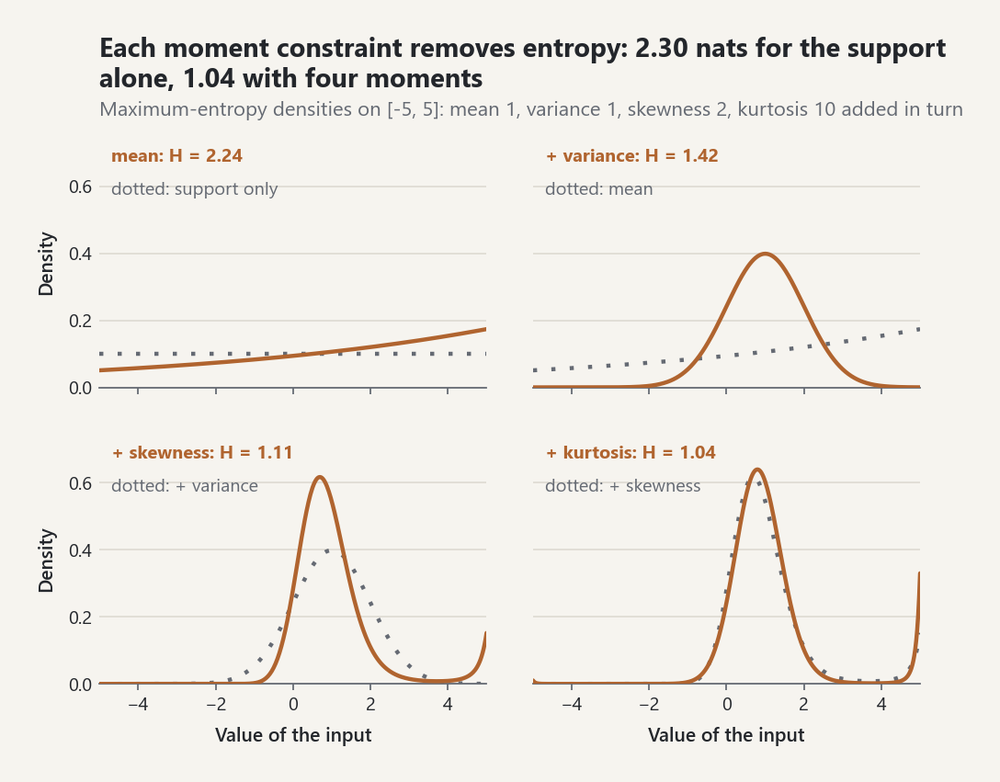
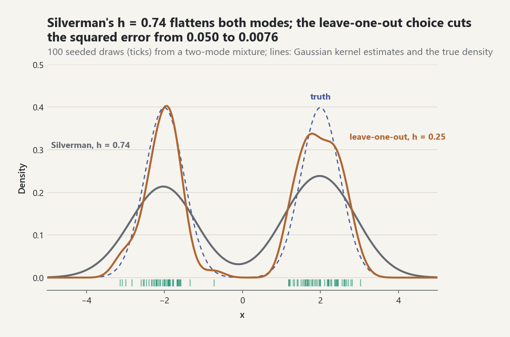
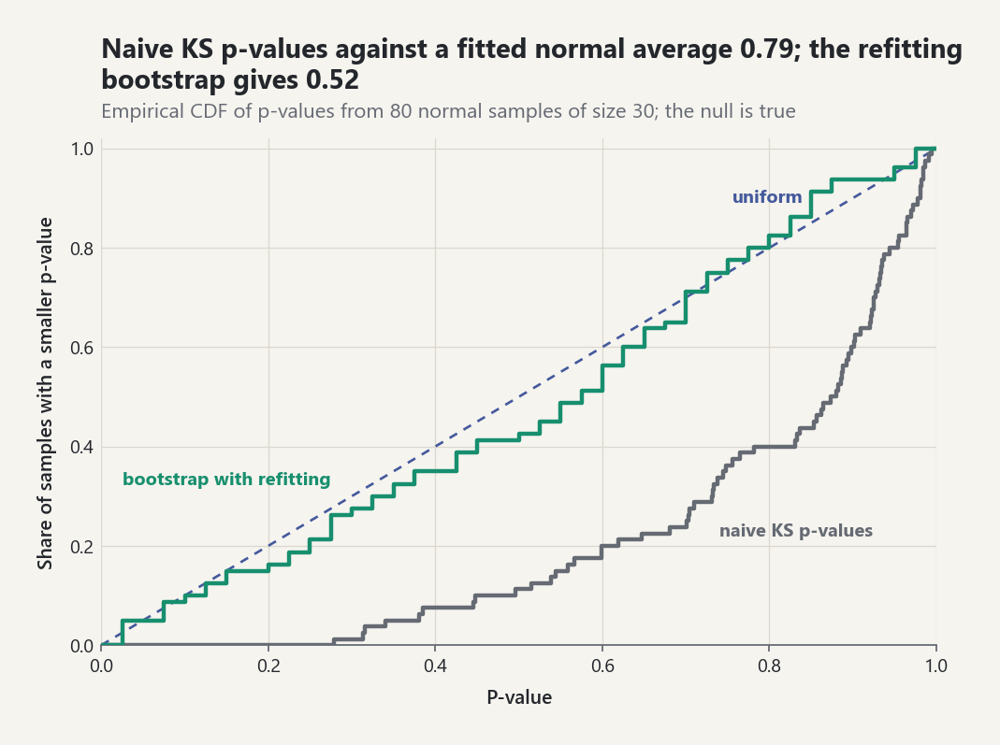
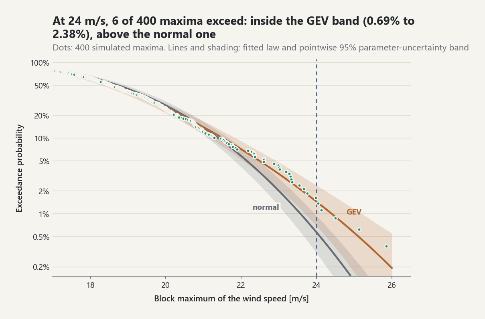
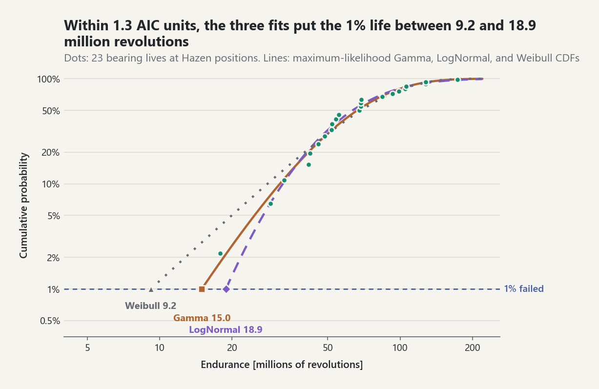

# Uncertainty Modeling and Statistical Fitting

## Choose a variable before choosing a distribution

An uncertainty model begins with the physical quantity, units, admissible
support, data-generation process, and intended quantity of interest. A familiar
distribution name is not a substitute for those decisions.

- A Normal law permits every real value and is appropriate only when that
  support is defensible or negligible impossible-tail mass is documented.
- A Uniform law encodes constant density between known finite bounds; it does
  not mean “we know nothing.”
- A Lognormal law is strictly positive and uses parameters of `log(X)`, not the
  mean and standard deviation of `X`.
- A Weibull law is non-negative; its shape controls decreasing, constant, or
  increasing hazard behavior.

All four required ATHENS families now expose PDF/log-PDF, CDF, direct survival,
quantile, moments, and seeded sampling where defined. Parameterization is part
of the public contract and is recorded in `docs/equation-registry.md`.

## Multivariate uncertainty

For `X ~ N_d(mu, Sigma)`, the covariance matrix must be symmetric positive
definite for an ordinary density in `d` dimensions. `MultivariateNormal`
validates that condition by Cholesky factorization, evaluates Mahalanobis
distance without forming `Sigma^-1`, exposes univariate marginals and
correlations, and samples through `X = mu + LZ`.

Positive semidefinite but singular covariance is intentionally rejected. Such
a Gaussian law lives on a lower-dimensional affine subspace and needs a
different measure/density contract; silently adding jitter would alter the
model.

## Which construction for which information

An input law should encode the information that is actually available and
nothing more. Three situations call for three constructions:

| Available information | Construction | Call |
|---|---|---|
| Expert statements only: a range, a mean, a spread, a skewness, a tail weight | Maximum-entropy law under those constraints [EQ-DIST-MAXENT-001] | `maximum_entropy` |
| Expert statements and a modest sample | Parametric family fitted to the data, the family chosen with the expert's support and shape | `fit_distribution`, `select_distribution` |
| Many observations | Kernel density estimate with a data-driven bandwidth [EQ-STAT-KDE-004] | `gaussian_kde`, `select_kde_bandwidth`, `gaussian_kde_multivariate` |

The boundaries are soft. A maximum-entropy law is the least committal law
consistent with the statements, so it is the honest default before data
arrive; a parametric family adds a shape assumption that a modest sample can
check but not replace; a kernel estimate adds no shape assumption, which is
only affordable when the sample is large enough to show the shape itself.

## Maximum-entropy laws from expert constraints

Given a support `K` and constraints `E[g_m(X)] = h_m`, the density of
largest differential entropy is `f(x) = 1_K(x) exp(-lambda_0 - sum_m
lambda_m g_m(x))` [REF-JAYNES-1957]. The multipliers minimize the convex dual
`Gamma(lambda) = log int_K exp(-sum_m lambda_m (g_m - h_m)) dx`, whose
gradient is `h - E[g]` and whose Hessian is `Cov[g]`
[REF-MEAD-PAPANICOLAOU-1984]; `maximum_entropy` runs Newton's method with a
backtracking line search on it (or BFGS with `method="bfgs"`), integrates
with composite Kronrod panels, and confirms the constraints afterwards by
adaptive Gauss-Kronrod quadrature. At the optimum the entropy equals the
minimum of the dual, `lambda_0 + sum_m lambda_m h_m`
[REF-COVER-THOMAS-2006, Chapter 12].

The classical laws are special cases: no constraint on `[a, b]` gives the
uniform law, a mean on a half-line the exponential law, a mean and a
variance on the real line the normal law, and `E[log X]` with `E[X]` on
`[0, inf)` the gamma law.

```python
from probstat.distributions import maximum_entropy

maximum_entropy(0.0, mean=2.0).multipliers  # (0.5,), the exponential rate
normal = maximum_entropy(mean=1.0, variance=4.0)
normal.multipliers  # (-0.25, 0.125), the exponent (x - 1)^2 / 8
normal.entropy      # 2.1121, that is log(2 sqrt(2 pi e))
```

The ATHENS example states a range `[-5, 5]`, a mean 1, a variance 1, a
skewness 2, and `E[((X - mu)/sigma)^4] = 10`, an excess kurtosis of 7.
These moments are feasible: Pearson's inequality `10 > 2^2 + 1` holds
[REF-WILKINS-1944], and the Hankel and localizing matrices of `[-5, 5]` are
positive definite [EQ-DIST-MAXENT-002]. The quartic multiplier of the
solution is negative, so the density rises again towards both ends of the
range: a kurtosis of 10 asks for tail mass that a bounded range can only
hold near its ends, and one percent of the probability lies above 4.96.

```python
course = maximum_entropy(
    -5.0, 5.0, mean=1.0, variance=1.0, skewness=2.0, excess_kurtosis=7.0
)
course.diagnostics.converged                    # True
max(abs(r) for r in course.residuals) < 1e-10  # True
course.multipliers[3] < 0.0                     # True
course.pdf(1.0)          # 0.603
course.pdf(5.0)          # 0.330
course.pdf(-5.0)         # 0.0104
course.quantile(0.99)    # 4.964
course.entropy           # 1.0373
```

<picture><source media="(prefers-color-scheme: dark)" srcset="../images/guides/maximum-entropy-constraints-dark.png"></picture>

*The support alone gives the uniform law with entropy 2.30 nats; a mean of 1 tilts it into a truncated exponential (2.24), the variance pulls in a bell, skewness leans it, and the fourth moment of the course example sharpens the peak and lifts the density again at the right end of the support, ending at 1.04 nats: every constraint is information, and the law commits to nothing else.*

Infeasible constraints raise before any iteration, and constraints that no
density on an unbounded support can attain raise after the solve with the
reason:

```python
try:
    maximum_entropy(
        -5.0, 5.0, mean=1.0, variance=1.0, skewness=2.0, excess_kurtosis=1.5
    )
except ValueError as error:
    print(error)
# kurtosis E[Z^4] = 4.5 must exceed skewness^2 + 1 = 5.0 (Pearson's inequality)
```

### Common pitfalls

- **The law encodes only the stated constraints.** A maximum-entropy law
  with a mean and a variance on the real line is normal because nothing else
  was said; it does not certify normal tails. Add the constraints the expert
  can defend (a range, `E[log X]`, a tail moment) rather than reading shape
  into the result.
- **A bounded range can distort high moments.** With a large kurtosis on a
  short range the density piles up at the ends, as in the example above.
  Check `pdf` at the ends before using the law in a reliability analysis.
- **Unbounded supports need decaying exponents.** On the real line the top
  constrained moment must have even order with a positive multiplier;
  moments such as mean 0, variance 1, skewness 0, kurtosis 4 have no
  maximum-entropy density there [REF-JUNK-2000], and `maximum_entropy`
  raises instead of returning a law with mass at infinity.
- **`excess_kurtosis` is excess.** The course writes the standardized fourth
  moment (10); pass `excess_kurtosis=7.0`, consistent with the `kurtosis`
  property of every distribution in `probstat.distributions`.

## Kernel density estimates with selected bandwidths

A Gaussian kernel estimate `f_h(x) = (1/(n h)) sum_i phi((x - x_i)/h)`
[EQ-STAT-KDE-001] is only as good as its bandwidth. The rules of thumb
(`kde_bandwidth`, R's `bw.nrd0` and `bw.nrd` [EQ-STAT-KDE-003]) are optimal
for normal data and oversmooth multimodal data. `select_kde_bandwidth`
chooses `h` from the data instead:

- `method="likelihood"` maximizes the leave-one-out log-likelihood
  `L_LOO(h) = sum_i log((1/(n-1)) sum_(j != i) phi_h(x_i - x_j))`
  [EQ-STAT-KDE-004] [REF-DUIN-1976];
- `method="ucv"` minimizes the unbiased (least-squares) cross-validation
  score and `method="bcv"` the biased one [EQ-STAT-KDE-005]
  [REF-SCOTT-TERRELL-1987], the criteria of R's `bw.ucv` and `bw.bcv`
  evaluated on exact rather than binned distances.

Leaving `x_i` out is essential: the in-sample log-likelihood contains
`phi_h(0) = 1/(h sqrt(2 pi))` in every term, so it grows without bound as
`h -> 0`, while the leave-one-out version falls.

```python
from probstat.distributions import Mixture, Normal
from probstat.statistics import (
    gaussian_kde,
    gaussian_kde_multivariate,
    kde_bandwidth,
    kde_loo_log_likelihood,
    select_kde_bandwidth,
)

law = Mixture((Normal(-2.0, 0.5), Normal(2.0, 0.5)), (0.5, 0.5))
sample = law.sample(200, seed=2026)
kde_bandwidth(sample)                                        # 0.661
select_kde_bandwidth(sample, method="likelihood").bandwidth  # 0.243
select_kde_bandwidth(sample, method="ucv").bandwidth         # 0.183
law.pdf(2.0)                                                 # 0.399
gaussian_kde(sample).pdf(2.0)                                # 0.240
gaussian_kde(sample, bandwidth="likelihood").pdf(2.0)        # 0.388
kde_loo_log_likelihood(sample[:20], 1e-3, leave_one_out=False)  # 59.86
kde_loo_log_likelihood(sample[:20], 1e-6, leave_one_out=False)  # 198.02
```

Silverman's bandwidth flattens each mode to 0.240 against a true peak of
0.399; the cross-validated bandwidths keep it.

<picture><source media="(prefers-color-scheme: dark)" srcset="../images/guides/kde-bandwidth-selection-dark.png"></picture>

*Silverman's rule assumes one Gaussian bump, so on 100 draws from two separated modes it picks h = 0.74 and halves both peaks; maximizing the leave-one-out likelihood picks h = 0.25 and follows the modes, cutting the integrated squared error from 0.050 to 0.0076.*

For `d`-dimensional data `gaussian_kde_multivariate` uses the kernel
covariance `h^2 R`, with `R` the sample covariance, so every kernel has the
shape of the data cloud [EQ-STAT-KDE-006]. Silverman's factor is
`h = (4 / (N (d + 2)))^(1/(d+4))` [REF-SILVERMAN-1986, Chapter 4]; with
`bandwidth="likelihood"` the factor maximizes the leave-one-out
log-likelihood instead.

```python
x = law.sample(150, seed=1)
noise = Normal(0.0, 0.3).sample(150, seed=2)
points = [(u, 0.5 * u + e) for u, e in zip(x, noise)]
gaussian_kde_multivariate(points).factor                           # 0.434
gaussian_kde_multivariate(points, bandwidth="likelihood").factor   # 0.236
```

### Common pitfalls

- **Silverman over-smooths multimodal or curved data.** Its factor is the
  optimum for a single normal law; on two separated modes it fills the
  trough and lowers the peaks, as above. In several dimensions one factor
  scales a single covariance, so a curved or clustered cloud is smoothed
  across its gaps; select the factor by the likelihood or reduce the
  dimension first.
- **The leave-one-out likelihood is pulled up by outliers.** A distant
  observation is predicted only by wide kernels, so a few outliers inflate
  the selected bandwidth (Newcomb's passage times with two outliers give
  `8.08` against Silverman's `1.96`). Prefer `"ucv"` for data with outliers or
  heavy tails.
- **Rounded data break cross-validation.** When every value is repeated the
  leave-one-out likelihood grows without bound as `h -> 0`; the search then
  stops at the lower end of the interval and warns.
- **R's values differ slightly.** R bins the pairwise distances (1000 bins)
  and stops `optimize` at a tolerance of `0.01 h_os`, so its `bw.ucv` and
  `bw.bcv` agree with the exact minimizers only to about one percent.

## Estimation is not uncertainty elimination

`fit_normal_mle` and `fit_lognormal_mle` implement closed-form maximum
likelihood estimates. For the normal scale, MLE uses divisor `n`, whereas the
usual unbiased sample-variance estimator uses `n-1`. An estimated parameter is
still uncertain; reporting only the fitted number discards that uncertainty.

`normal_mean_confidence_interval` distinguishes a known-scale z interval from
a large-sample approximation that inserts the sample standard deviation. The
latter is not presented as an exact Student-t interval. `wilson_score_interval`
provides a boundary-respecting interval for binomial probabilities, useful for
later reliability calculations.

## Goodness of fit

The one-sample Kolmogorov-Smirnov statistic measures the largest empirical-CDF
gap. The Anderson-Darling statistic weights tail discrepancies more strongly.
The implementation uses direct survival probabilities when a model provides
them, reducing upper-tail cancellation.

Both tests require careful calibration:

- The generic KS p-value is asymptotic and assumes a fully specified continuous
  null distribution.
- Fitting null parameters from the tested sample changes the KS null law.
- Anderson-Darling critical values and p-values depend on the null family and
  on whether parameters were estimated.

### Anderson-Darling p-values for a fully specified null

When the null CDF `F` is fixed in advance, `F(X_i)` are uniform and the law
of `A_n^2` (`[EQ-INF-GOF-AD-001]`) depends on `n` only. Its limit
`ADinf(z)` is a series in which each term is summed by a two-term recursion
(`[EQ-INF-GOF-AD-002]`, [REF-MARSAGLIA-MARSAGLIA-2004, Section 2]);
`anderson_darling_asymptotic_cdf` reproduces the paper's 30-digit values
and an independent 30-digit quadrature to `5e-16`. For finite `n`,
`P(A_n^2 < z) = x + errfix(n, x)` with `x = ADinf(z)`, where `errfix` is an
empirical error curve fitted to `10^10` simulated statistics
(`[EQ-INF-GOF-AD-003]`, Section 3); for `n = 1` the exact law
`sqrt(1 - 4 exp(-1 - z))` applies (`[EQ-INF-GOF-AD-004]`).
`anderson_darling_cdf` implements both, and `anderson_darling_test`
reports `p_value = 1 - P(A_n^2 < a)` with a `method` label.

Use it only when nothing in `F` was estimated from the tested sample: a
specification, a design value, or a law fitted to other data. The stated
accuracy is `5e-5` at `n = 8, 16, 32, 64, 128` and `5e-4` elsewhere; seeded
simulations of four million statistics found deviations up to `5e-4` at
`n = 8, 10, 50`, `6e-4` at `n = 5`, `0.004` at `n = 3`, and `0.012` at
`n = 2`.
The correction also leaves an upper-tail floor near `6e-4 / n`, so extreme
statistics get small but conservative p-values.

```python
import random

from probstat.distributions import Uniform
from probstat.inference import (
    NORMAL_FAMILY,
    anderson_darling_asymptotic_cdf,
    anderson_darling_cdf,
    anderson_darling_test,
    bootstrap_goodness_of_fit,
    fit_normal_mle,
    normality_tests,
)

anderson_darling_asymptotic_cdf(2.492)  # 0.94998, the classical 95% point
anderson_darling_asymptotic_cdf(3.857)  # 0.98976, so 3.857 is not the 99% point
anderson_darling_cdf(2.492, 10)         # 0.94875

# Marsaglia and Marsaglia's first test sample, against Uniform(0, 1).
spread = [0.0392, 0.0884, 0.260, 0.310, 0.454, 0.644, 0.797, 0.813, 0.921, 0.960]
uniform_check = anderson_darling_test(spread, Uniform(0.0, 1.0))
uniform_check.statistic  # 0.3632
uniform_check.p_value    # 0.882
```

The classical 99% point `3.857` of Anderson and Darling (1954) is too small;
the paper gives `3.8781250216...` (Section 2), and
`anderson_darling_asymptotic_cdf` returns `0.99` there to `1e-13`. The
paper's C routine `ADtest` returns the CDF value `P(A_n^2 < a)`, not the
upper-tail p-value.

When parameters are estimated, the fitted law sits closer to the data than
the true law, `A_n^2` is stochastically smaller, and the case-0 p-value is
too large. For a normal null with mean and standard deviation estimated,
`normality_tests` applies Stephens' modified statistic and table
(`[EQ-INF-GOF-NORM-003]`); for any fitted family, `bootstrap_goodness_of_fit`
(next section) refits every replicate. Both are shown here on 30 lognormal
values tested as normal:

```python
rng = random.Random(1)
skewed = [rng.lognormvariate(0.0, 0.5) for _ in range(30)]
fitted = fit_normal_mle(skewed)
anderson_darling_test(skewed, fitted).p_value  # 0.40, case 0: too large
bootstrap_goodness_of_fit(skewed, NORMAL_FAMILY, n_bootstrap=199, seed=1).ad_p_value  # 0.01
normality_tests(skewed).anderson_darling.p_value  # 0.021, Stephens

rng = random.Random(30)
naive = []
for _ in range(200):
    normal_sample = [rng.gauss(0.0, 1.0) for _ in range(30)]
    naive.append(anderson_darling_test(normal_sample, fit_normal_mle(normal_sample)).p_value)
sum(p < 0.10 for p in naive)  # 0, where a calibrated test gives about 20
sum(naive) / len(naive)       # 0.85, where a calibrated test gives about 0.5
```

## Generic fitting, calibrated goodness of fit, and model selection

### One likelihood engine for every family

`fit_distribution(values, family)` fits any `DistributionFamily`: a
constructor, parameter kinds, a starting rule, and an optional closed form.
Parameters are optimized in unconstrained coordinates (`log` for positive
parameters, data-spread units for locations, a logistic map for a bounded
parameter) by BFGS on the negative log-likelihood built from `log_pdf`
(`[EQ-INF-MLE-GEN-001]`), with a Nelder-Mead fallback. Standard errors come
from the observed information: the central-difference Hessian in the
unconstrained coordinates, mapped back by the delta method
(`[EQ-INF-MLE-GEN-002]`). Each `FitResult` carries estimates, standard errors,
covariance, log-likelihood, AIC, AICc, BIC, and a convergence flag.

Ready-made families: Normal, LogNormal, Exponential, Gamma, Weibull (closed
form or profile likelihood), Gumbel, GEV, Logistic, location-scale Student t,
Beta on `(0, 1)` (numerical), and Uniform (closed form, non-regular: its
standard errors are reported as `nan`). The Student-t `nu` is bounded by
`1000`; on light-tailed data the estimate sits at the bound, its standard
error is `nan`, and the message says so.

Cross-checks (`tests/test_generic_fitting_model_selection.py`): starting the
optimizer away from the MLE, it reproduces the closed-form Normal,
LogNormal, and Exponential estimates and the profile Gamma/Weibull estimates
to `2e-6` relative. The exponential-rate standard error equals
`rate/sqrt(n)`, the normal ones equal `sigma/sqrt(n)` and `sigma/sqrt(2n)`,
and the gamma ones equal the inverse Fisher information.

### The Lilliefors/Stephens problem

The KS and AD reference laws assume the null model is fully specified. A
model fitted to the same data sits closer to it than the true law does, so
the ordinary p-values are too large. `bootstrap_goodness_of_fit` draws
`B` replicates from the fitted law, **refits every replicate with the same
estimator**, and reports `p = (1 + #{T* >= T})/(1 + B_ok)` for KS and AD
(`[EQ-INF-GOF-PB-001]`), together with the number of successful and failed
refits. The smallest attainable p-value is `1/(B+1)`. With `B = 19` nothing
can be rejected at `alpha = 0.05`, and `select_distribution` warns about this.

One seeded check: 40 samples of `n = 30` from `Normal(3, 2)` (root stream
`RandomStream(11)`, data seed `root.child("data", r)` and bootstrap stream
`root.child("b", r)` for replicate `r`, `B = 49`), each tested against its
own fitted normal. The bootstrap KS p-values averaged `0.53`, and `12.5 %`
fell below `0.1`. The naive KS p-values against the same fitted laws
averaged `0.77`, which is far too conservative. An exponential sample of
`n = 100` (`Exponential(1)`, seed 5) fitted as normal gives bootstrap
p-values of `0.01` for both KS and AD (seed 3; the minimum with `B = 99`).

<picture><source media="(prefers-color-scheme: dark)" srcset="../images/guides/fitting-bootstrap-calibration-dark.png"></picture>

*With 80 normal samples of size 30, each tested against its own fitted normal, the naive KS p-values average 0.79 and none falls below 0.1 (0 of 80); the bootstrap with 39 refits per sample averages 0.52 and gives 7 of 80 below 0.1, close to the 8 a calibrated test produces.*

`qq_points` and `pp_points` return `(theoretical, empirical)` pairs with
Hazen positions `(i - 1/2)/n` (`[EQ-INF-GOF-QQ-001]`) for plotting.

### Ranking candidates

`select_distribution(sample, candidates)` fits every admissible candidate and
ranks it by AIC (or AICc/BIC). It reports Akaike and BIC weights
`exp(-Delta/2)/sum exp(-Delta/2)` (`[EQ-INF-IC-004]`) and, when
`n_bootstrap > 0`, a calibrated KS/AD p-value per candidate. Candidates whose
domain excludes the data are listed as failures rather than raising an error.
A `ModelSelectionWarning` is emitted when the best model is still rejected.
Weights are relative to the candidate set; they never certify adequacy.

`examples/model_selection_lab.py` prints this table for 250 draws from
`Weibull(1.6, 40)` (seed 2026, `B = 99`):

| Rank | Family | AIC | dAIC | Akaike weight | KS p | AD p |
|---|---|---|---|---|---|---|
| 1 | Weibull | 2207.0 | 0.0 | 0.870 | 0.23 | 0.30 |
| 2 | Gumbel | 2211.4 | 4.5 | 0.094 | 0.57 | 0.27 |
| 3 | Gamma | 2213.3 | 6.3 | 0.036 | 0.01 | 0.04 |
| 4 | Normal | 2251.8 | 44.8 | 0.000 | 0.01 | 0.01 |
| 5 | LogNormal | 2267.5 | 60.6 | 0.000 | 0.01 | 0.01 |
| 6 | Exponential | 2300.8 | 93.9 | 0.000 | 0.01 | 0.01 |

The true family wins. The fitted shape is `1.732 (SE 0.085)`, so the truth
`1.6` lies about 1.6 SE away, and the fitted scale is `40.93 (SE 1.57)`. The table
also shows why ranking and testing answer different questions. The
runner-up Gumbel is not rejected by either test: 250 points cannot rule out
a Gumbel shape. Information criteria still prefer the Weibull by
`dAIC = 4.5`. Gamma has a reasonable AIC but is rejected by both tests at `0.05`.

### Joint inputs from data

`modeling.fit_joint_input(columns)` fits each named column, either with a
user-specified family or by `select_distribution`, and estimates a Gaussian
copula from ranks. The `"spearman"` option maps Spearman correlations by
`rho = 2 sin(pi r_s / 6)` (`[EQ-MOD-COPULA-FIT-001]`). The
`"normal-scores"` option correlates van der Waerden scores of the rank
pseudo-observations `R/(n+1)` (`[EQ-MOD-COPULA-FIT-002]`). The result is a
ready `JointInput`. Because the copula is estimated from ranks, it does not
depend on the marginal fits. A pairwise matrix that is not positive definite
is repaired by eigenvalue clipping, and the repair is flagged. With 800
draws of a three-input Weibull/LogNormal/Gumbel law and latent correlations
`(0.6, -0.3, 0.2)`, both estimators recover every entry within `0.06`.
`inference.fit_multivariate_normal_mle` gives the multivariate normal MLE
(divisor `n`).

Limitations: AIC/BIC for the non-regular Uniform are descriptive only. The
bootstrap with numerical refits costs `B` optimizations per candidate (about
0.02-0.1 s each in pure Python). The Gaussian copula cannot represent tail
dependence.

## Moments versus likelihood, and parameter-uncertainty bands

### Choosing the estimator

`fit_distribution` maximizes the likelihood; `fit_distribution_moments`
equates the first `k` moments of a `k`-parameter family to the sample mean,
the population variance `v = (1/n) sum (x_i - m)^2` (divisor `n`), and, for
the GEV, the population third central moment ([EQ-INF-MOM-001]). These are
the conventions of R's `fitdistrplus::fitdist(x, distr, method = "mme")`
[REF-DELIGNETTE-MULLER-DUTANG-2015]: on the ATHENS wind maxima (400 values)
both libraries give the lognormal moment estimate
`meanlog = 2.978689811447`, `sdlog = 0.161122240569`. The closed forms
([EQ-INF-MOM-002]) are Normal `(m, sqrt v)`, LogNormal
`s2 = log(1 + v/m^2)`, `(log m - s2/2, sqrt s2)` (moments of `x`, not of
`log x`), Exponential `1/m`, Gamma `(m^2/v, m/v)`, Uniform
`m -+ sqrt(3v)`, Logistic `(m, sqrt(3v)/pi)`, Gumbel
`beta = sqrt(6v)/pi`, `mu = m - gamma_E beta`, and Beta
`c = m(1 - m)/v - 1`, `(mc, (1 - m)c)`. The Weibull shape solves the
coefficient-of-variation equation and the GEV shape the skewness equation
([EQ-INF-MOM-003]). The Student t has no moment rule: its fourth-moment
estimator is unstable, so maximum likelihood is the only option offered.

When to use which:

- **Maximum likelihood** is the default. It is asymptotically efficient,
  it gives observed-information standard errors, and only a maximized
  likelihood supports AIC, BIC, and likelihood-ratio comparisons.
- **Moments** give a closed-form or one-dimensional answer that cannot fail
  to converge, a reproduction of an `mme` analysis done in R, starting
  values, and a quick consistency check: a large gap between the two
  estimates is a sign that the family does not fit.
- A moment estimate is not a likelihood estimate. `MomentFitResult`
  therefore carries no AIC or BIC; its `log_likelihood` is only the value at
  the moment estimate, and it is `-inf` when the fitted support excludes an
  observation (a Uniform `m -+ sqrt(3v)` can fall inside the sample range).

Standard errors of moment estimates come from the delta method
([EQ-INF-MOM-004]): with `J` the Jacobian of the moments with respect to
`theta`, `Cov(theta_hat) = J^-1 A J^-T / n`. `covariance="model"` (default)
takes the covariance `A` of the powers `(x - m)^j` from the fitted law, as
fitdistrplus's `calcvcov` does; `covariance="empirical"` takes it from the
data (a sandwich estimate that stays valid when the family is wrong). Both
need finite moments of order `2k`. For a GEV with `xi >= 1/6` the model form
does not exist and its standard errors are `nan`. fitdistrplus 1.2.6
reports a wrong `calcvcov` for its beta, uniform, and logistic moment fits:
its internal moment functions return the second moment for orders 3 and 4.

On 400 Gumbel maxima, the normal moment fit coincides with the normal MLE
(both use divisor `n`), while the lognormal and Gumbel fits differ, and the
moment estimate of the Gumbel scale has a standard error a third larger
than the MLE:

```python
from probstat.distributions import Gumbel
from probstat.inference import (
    GUMBEL_FAMILY,
    LOGNORMAL_FAMILY,
    NORMAL_FAMILY,
    fit_distribution,
    fit_distribution_moments,
)

maxima = Gumbel(18.5, 2.5).sample(400, seed=2026)
fit_distribution_moments(maxima, NORMAL_FAMILY).estimates    # (20.12, 3.157)
fit_distribution(maxima, NORMAL_FAMILY).estimates            # (20.12, 3.157)
fit_distribution_moments(maxima, LOGNORMAL_FAMILY).estimates  # (2.990, 0.1559)
fit_distribution(maxima, LOGNORMAL_FAMILY).estimates          # (2.991, 0.1491)
gumbel_moments = fit_distribution_moments(maxima, GUMBEL_FAMILY)
gumbel_mle = fit_distribution(maxima, GUMBEL_FAMILY)
gumbel_moments.estimates        # (18.70, 2.461)
gumbel_moments.standard_errors  # (0.133, 0.129)
gumbel_mle.estimates            # (18.70, 2.508)
gumbel_mle.standard_errors      # (0.132, 0.0964)
```

### A case where moments lose badly: the uniform endpoint

For `X_i ~ U(0, theta)` the moment estimator is `2 xbar`, unbiased with
quadratic risk `theta^2/(3n)`. The likelihood `theta^-n 1{theta >= max x_i}`
is maximized at `max x_i`; its unbiased rescaling `(n+1)/n max x_i` has risk
`theta^2/(n(n+2))` ([EQ-EST-006], [REF-CASELLA-BERGER-2002, Section 7.3.1]).
The first decreases like `1/n`, the second like `1/n^2`, because the support
depends on `theta` and the usual regularity conditions fail. A seeded
simulation reproduces both risks within their Monte Carlo errors:

```python
import math

from probstat.distributions import Uniform
from probstat.inference import evaluate_estimator, uniform_maximum_risks

risks = {risk.label: risk.mse for risk in uniform_maximum_risks(1.0, 10)}
risks["2 mean"]       # 0.03333, theta^2/(3n)
risks["(n+1)/n max"]  # 0.008333, theta^2/(n(n+2))

law = Uniform(0.0, 1.0)


def sampler(size, rng):
    return tuple(law.quantile(rng.random()) for _ in range(size))


twice_mean = evaluate_estimator(
    lambda xs: 2 * math.fsum(xs) / len(xs), sampler, 1.0, 10, 4000, seed=7
)
scaled_max = evaluate_estimator(
    lambda xs: 11 / 10 * max(xs), sampler, 1.0, 10, 4000, seed=7
)
twice_mean.mse, twice_mean.mse_se  # (0.0339, 0.00074)
scaled_max.mse, scaled_max.mse_se  # (0.00894, 0.00032)
```

### Parameter-uncertainty bands for a fitted CDF

A fitted CDF inherits the uncertainty of its parameters.
`parameter_uncertainty_band(fit, grid)` draws `R` parameter vectors from the
asymptotic normal law `N(theta_hat, Cov(theta_hat))` of a `FitResult`
(inverse observed information) or a `MomentFitResult` (delta-method
covariance), discards and counts draws outside the parameter space, and
evaluates `F(x; theta*)` on the grid ([EQ-INF-BAND-001]). It returns three
pointwise bands:

- the `(1 - level)/2` and `(1 + level)/2` sample quantiles of the drawn CDF
  values, which converge as `R` grows;
- the min/max envelope of the draws, which is what a plot of all drawn CDFs
  shows;
- the delta-method band `F(x; theta_hat) +- z se(x)`,
  `se(x)^2 = g' Cov g`, `g = dF/dtheta` ([EQ-INF-BAND-002],
  [REF-CASELLA-BERGER-2002, Section 5.5.4]).

**The envelope is not a confidence band.** The extremes of `R` draws move
outwards as `R` grows (for one normal parameter, like `sqrt(2 log R)`
standard errors), so its width measures the number of draws as much as the
uncertainty. Quote the quantile band, or the delta band where the CDF is
close to linear in the parameters. For a normal fit
`se(x)^2 = phi(u)^2 (1 + u^2/2)/n`, `u = (x - mu)/sigma`;
`tests/test_parameter_bands.py` checks this formula, and checks that the
simulated band agrees with the exact quantiles of the normal approximation
within its Monte Carlo error and covers the true CDF at the nominal level.
In the tails the simulated band is asymmetric and the symmetric delta band
can reach below zero, where it is clipped.

```python
from probstat.inference import parameter_uncertainty_band

band = parameter_uncertainty_band(
    gumbel_mle, (14.0, 18.0, 22.0, 28.0), draws=2000, seed=11,
    quantile_probabilities=(0.99,),
)
band.cdf_estimate  # (0.00148, 0.2664, 0.7646, 0.9758)
band.lower         # (0.00049, 0.2314, 0.7314, 0.9675)
band.upper         # (0.00344, 0.3008, 0.7997, 0.9830)
band.delta_lower   # (0.00007, 0.2317, 0.7309, 0.9679)
band.delta_upper   # (0.00289, 0.3012, 0.7983, 0.9836)
band.quantile_estimate, band.quantile_lower, band.quantile_upper
# ((30.24,), (29.24,), (31.18,))

for draws in (100, 1000, 10000):
    wider = parameter_uncertainty_band(gumbel_mle, (22.0,), draws=draws, seed=11)
    print(draws, round(wider.upper[0] - wider.lower[0], 3),
          round(wider.envelope_upper[0] - wider.envelope_lower[0], 3))
# 100 0.07 0.088
# 1000 0.07 0.107
# 10000 0.067 0.134
```

The draws are generated in order from one stream, so the 10000-draw run
contains the 1000-draw run: the 95 % band settles near `0.07` while the
envelope keeps widening. The bands are pointwise; a band that holds
simultaneously over all `x` is wider.

**A band is conditional on its family.** Parameter uncertainty is not
model uncertainty: a narrow band around the wrong family is confidently
wrong in the tail, which is where design values live. Block maxima of wind
speed are the classic case: the normal law fits the bulk and misses the
upper tail, while the GEV law, the limit law of maxima
[REF-COLES-2001, Chapter 3], follows it.

<picture><source media="(prefers-color-scheme: dark)" srcset="../images/guides/fitting-parameter-bands-dark.png"></picture>

*Each of 400 simulated maxima is the largest of 144 Weibull(2, 8) wind speeds; at 24 m/s, 6 of 400 exceed, which lies inside the pointwise 95% band of the GEV fit (0.69% to 2.38%) and above the band of the normal fit (0.30% to 0.94%), whose AIC is 19.3 units worse.*

## Real-data case studies

Synthetic data show that a method works when its assumptions hold; historical
data show what happens when nobody arranged them to hold.
`probstat.statistics.datasets` bundles five small public-domain records,
each frozen with its units, the original page or table, a secondary source
against which the values were checked, and a licence statement (ADR-0080):

| Key | Values | Source and locator |
|---|---|---|
| `bortkiewicz-horse-kicks` | deaths by horse kick per corps-year, 200 corps-years | [REF-BORTKIEWICZ-1898], Section 12, page 25 |
| `rutherford-geiger-scintillations` | alpha particles per 7.5 s interval, 2608 intervals | [REF-RUTHERFORD-GEIGER-1910], table on page 701 |
| `newcomb-passage-times` | light passage time minus 24800 ns, 66 values | [REF-NEWCOMB-VELOCITY-OF-LIGHT] as given by [REF-STIGLER-1977, Table 5] |
| `lieblein-zelen-ball-bearings` | endurance in millions of revolutions, 23 bearings | [REF-LIEBLEIN-ZELEN-1956], worksheet on page 286 |
| `student-sleep` | additional hours of sleep under two drugs, 10 patients | [REF-STUDENT-1908], page 20, from [REF-CUSHNY-PEEBLES-1905] |

`examples/real_data_fitting_lab.py` fits all five. The count models come
from `inference.count_models`: `fit_poisson_counts` (the sample mean,
[EQ-INF-COUNT-001]), `fit_negative_binomial_counts` (real size `r`, variance
`mu + mu^2/r`, [EQ-INF-COUNT-002]), `poisson_mean_interval` (Garwood,
[EQ-INF-COUNT-003]), and `count_goodness_of_fit`, which pools cells to at
least five expected units and calibrates Pearson's statistic by refitting
every bootstrap replicate. `visualization.fit_plots` adds a hanging
rootogram ([EQ-VIZ-ROOT-001]) and a Q-Q plot; `statistics.trimmed_mean`
([EQ-STAT-TRIM-001]) joins the median and the MAD for the robust comparison.

### What the sources state, and what the lab reproduces

- **Horse kicks.** Bortkiewicz printed the expected frequencies 108.7, 66.3,
  20.2, 4.1, 0.6, and 0.1 next to the observed 109, 65, 22, 3, 1 and found
  that the agreement left nothing to be desired. The Poisson fit at the
  sample mean reproduces his expected column to the printed decimal. The
  divisor-`n` variance is below the mean, so the negative binomial maximum
  is the Poisson boundary itself: the extra parameter buys nothing and costs
  two AIC units.
- **Alpha particles.** Rutherford and Geiger reported "excellent accord"
  between theory and experiment and noted that at four particles the
  observation exceeds the theory by nearly five per cent. Both statements
  are reproduced (the bootstrap p-value is above 0.05, and the excess at
  four particles is between four and five per cent), the printed theoretical
  row agrees
  with `2608 p(k)` to its rounding for `k = 0..12`, and the counts are again
  slightly under-dispersed, so the negative binomial collapses to the
  Poisson law.
- **Newcomb's light passage times.** Two values (-44 and -2) lie far below
  the rest. The fitted normal is rejected by every calibrated test, while
  the Student-t fit with about two degrees of freedom passes and wins by a
  wide AIC margin. Every location estimate lies below 33.02, the value
  implied by the accepted speed of light, which is a systematic error that
  no estimator removes; light trimming moves the estimate towards it, in
  line with Stigler's finding that "light trimming provides some
  improvement over the sample mean" [REF-STIGLER-1977, abstract].
- **Ball bearings.** Weibull, lognormal, and gamma laws all pass the
  calibrated tests and lie within two AIC units of each other, so 23
  lifetimes cannot rank these families [REF-BURNHAM-ANDERSON-2002, Chapter
  2]; any extrapolation beyond the observed lives should therefore be
  reported for each family. The worksheet's own summary (median life
  "68.") matches the sample median.
- **Sleep.** The paired t test on the ten differences rejects a zero mean
  effect; the Lilliefors check of the differences is reported because the
  t interval leans on their normality.

<picture><source media="(prefers-color-scheme: dark)" srcset="../images/guides/fitting-bearing-tails-dark.png"></picture>

*The Gamma, LogNormal, and Weibull fits to the 23 bearing lives lie within 1.3 AIC units and agree where the data are, yet their 1% lives range from 9.2 to 18.9 million revolutions: an extrapolation into the tail depends on a choice of family that the data cannot make.*

### Results

The block below is generated by `results_markdown` in the laboratory (seed
`SEED = 20261111`); `tests/test_real_data_case_studies.py` regenerates it and
requires it to equal this text character for character, so every number
quoted here is lab output.

<!-- real-data-case-studies:begin -->

**Counts: Poisson against negative binomial** (Garwood 95% interval for the mean; Pearson X^2 on cells pooled to at least five expected units; bootstrap with 999 refits, seed 20261111)

| Data set | Units | Total | Poisson mean | 95% interval | Variance (divisor n) / mean | NB size | Poisson AIC | NB AIC | X^2 | Asymptotic p | Bootstrap p |
|---|---|---|---|---|---|---|---|---|---|---|---|
| bortkiewicz-horse-kicks | 200 | 122 | 0.6100 | [0.5066, 0.7283] | 0.9966 | inf (boundary) | 414.21 | 416.21 | 0.063 (3 cells, 1 df) | 0.802 | 0.902 |
| rutherford-geiger-scintillations | 2608 | 10097 | 3.8715 | [3.7964, 3.9478] | 0.9543 | inf (boundary) | 10706.21 | 10708.21 | 12.961 (12 cells, 10 df) | 0.226 | 0.220 |

Fitted Poisson frequencies:

- `bortkiewicz-horse-kicks`: n p(k) for k = 0..4 is 108.7, 66.3, 20.2, 4.1, 0.6; the tail k > 4 adds 0.08.
- `rutherford-geiger-scintillations`: n p(k) for k = 0..14 is 54.3, 210.3, 407.1, 525.3, 508.4, 393.7, 254.0, 140.5, 68.0, 29.2, 11.3, 4.0, 1.3, 0.4, 0.1; the tail k > 14 adds 0.04.

**Newcomb's passage times: normal against Student-t** (KS and AD p-values from 199 bootstrap refits)

| Family | Parameters (SE) | log L | AIC | BIC | Akaike weight | KS p | AD p |
|---|---|---|---|---|---|---|---|
| StudentT | nu = 2.131 (0.66), mu = 27.4 (0.61), sigma = 3.81 (0.62) | -215.38 | 436.75 | 443.32 | 1.0000 | 0.505 | 0.480 |
| Normal | mu = 26.21 (1.3), sigma = 10.66 (0.93) | -249.86 | 503.72 | 508.10 | 0.0000 | 0.005 | 0.005 |

Closed-form fitted-normal calibration: Lilliefors p < 0.001, Cramer-von Mises p < 0.001, Anderson-Darling p < 0.001. Student-t 95% interval for the mean: [23.571, 28.854].

| Location estimate | Value (ns) | Below 33.02 by |
|---|---|---|
| mean | 26.212 | 6.808 |
| median | 27.000 | 6.020 |
| 10% trimmed mean | 27.426 | 5.594 |
| 20% trimmed mean | 27.350 | 5.670 |
| Student-t location (MLE) | 27.402 | 5.618 |
| mean without the two negative values | 27.750 | 5.270 |

Scale estimates (ns): standard deviation 10.745; normal-consistent MAD 4.448; Student-t scale (MLE) 3.810.

**Ball-bearing endurance: Weibull, lognormal, gamma** (KS and AD p-values from 199 bootstrap refits)

| Family | Parameters (SE) | log L | AIC | BIC | Akaike weight | KS p | AD p |
|---|---|---|---|---|---|---|---|
| Gamma | shape = 4.025 (1.1), rate = 0.05573 (0.017) | -113.03 | 230.06 | 232.33 | 0.4130 | 0.485 | 0.865 |
| LogNormal | mu = 4.15 (0.11), sigma = 0.5216 (0.077) | -113.13 | 230.26 | 232.53 | 0.3740 | 0.880 | 0.890 |
| Weibull | shape = 2.102 (0.33), scale = 81.88 (8.6) | -113.69 | 231.38 | 233.65 | 0.2130 | 0.170 | 0.560 |

**Student's sleep data: paired t test** (drug_2 - drug_1)

| Mean difference (h) | SE | t | df | Two-sided p | 95% interval | Lilliefors p of the differences |
|---|---|---|---|---|---|---|
| 1.580 | 0.3890 | 4.0621 | 9 | 0.00283 | [0.700, 2.460] | 0.058 |

<!-- real-data-case-studies:end -->

The laboratory also writes four figures to `examples/generated/`: hanging
rootograms of both Poisson fits, a normal Q-Q plot of Newcomb's series, and
the fitted CDF of the AIC-best bearing model. Limitations: the bootstrap
p-values carry Monte Carlo error of up to 0.016 (999 refits) and 0.035 (199
refits); two parameters are counted for the negative binomial even on its
boundary; the counts are treated as independent although Bortkiewicz's
corps-years share calendar years.

## Reproducible laboratory

Run `python examples/statistical_fitting_lab.py` after installing visualization
support (and `python examples/model_selection_lab.py` for the ranking above;
`python examples/real_data_fitting_lab.py` for the historical case studies). It generates seeded lognormal data, fits log-space parameters, reports
KS/AD diagnostics and an approximate log-mean interval, and saves an empirical
versus fitted CDF figure. The output labels the fitted-null KS limitation rather
than hiding it.

## Common pitfalls

- **Lognormal parameters live on the log scale.** `LogNormal(mu, sigma)` has
  `log X ~ Normal(mu, sigma)`; its mean is `exp(mu + sigma^2 / 2)`, not `mu`.
- **MLE scale versus sample variance.** `fit_normal_mle` uses divisor `n`;
  the usual sample variance uses `n - 1`.
- **Fitted nulls need calibrated p-values.** Ordinary KS p-values against
  parameters fitted to the same data are too large; use
  `bootstrap_goodness_of_fit`, which refits every replicate.
- **Case-0 Anderson-Darling p-values assume nothing was fitted.**
  `anderson_darling_test(...).p_value` is calibrated only for a fully
  specified null; against a law fitted to the same data it is too large
  (0.40 against 0.01 for the lognormal sample above). Use
  `normality_tests` for a fitted normal and `bootstrap_goodness_of_fit`
  otherwise.
- **The bootstrap p-value has a floor.** It is `(1 + exceedances) / (1 + B)`,
  so with `select_distribution`'s default `n_bootstrap=99` the smallest value
  is `0.01`; a reported `0.01` means "at or below the floor".
- **Weights are relative.** Akaike and BIC weights rank the candidates that
  were tried; they do not certify that any of them fits.
- **A moment fit has no AIC.** `MomentFitResult.log_likelihood` is the value
  at the moment estimate, not a maximum; rank families with
  `fit_distribution` fits.
- **A min/max envelope of drawn CDFs is not a confidence band.** It widens
  with the number of draws; use the pointwise quantile band of
  `parameter_uncertainty_band`.

```python
import statistics

from probstat.distributions import LogNormal
from probstat.inference import fit_normal_mle

LogNormal(0.0, 0.25).mean                        # 1.0317, that is exp(0.25^2 / 2)
fit_normal_mle([1.0, 2.0, 3.0, 4.0]).sigma ** 2  # 1.25, divisor n
statistics.variance([1.0, 2.0, 3.0, 4.0])        # 1.6667, divisor n - 1
```

## Sources

- [REF-NIST-DISTRIBUTIONS].
- [REF-NIST-GOF].
- [REF-CASELLA-BERGER-2002, Chapters 7 and 9].
- [REF-MARDIA-KENT-BIBBY-1979, Chapters 1-3].
- [REF-WILSON-1927].
- [REF-AKAIKE-1974], [REF-SCHWARZ-1978], [REF-HURVICH-TSAI-1989].
- [REF-BURNHAM-ANDERSON-2002, Chapter 2].
- [REF-LILLIEFORS-1967], [REF-STEPHENS-1974], [REF-STEPHENS-1986].
- [REF-MARSAGLIA-MARSAGLIA-2004], [REF-ANDERSON-DARLING-1954].
- [REF-DAVISON-HINKLEY-1997, Chapter 4].
- [REF-WILK-GNANADESIKAN-1968].
- [REF-GENEST-GHOUDI-RIVEST-1995], [REF-KRUSKAL-1958].
- [REF-BORTKIEWICZ-1898], [REF-RUTHERFORD-GEIGER-1910], [REF-STIGLER-1977],
  [REF-NEWCOMB-VELOCITY-OF-LIGHT], [REF-LIEBLEIN-ZELEN-1956],
  [REF-STUDENT-1908], [REF-CUSHNY-PEEBLES-1905].
- [REF-GARWOOD-1936], [REF-LEVIN-REEDS-1977], [REF-KLEIBER-ZEILEIS-2016].
- [REF-DELIGNETTE-MULLER-DUTANG-2015], [REF-VAN-DER-VAART-1998, Chapters 3
  and 4].
