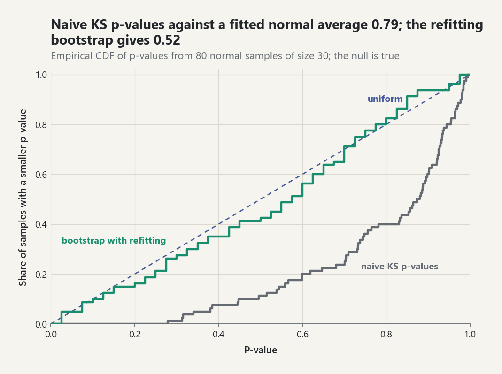
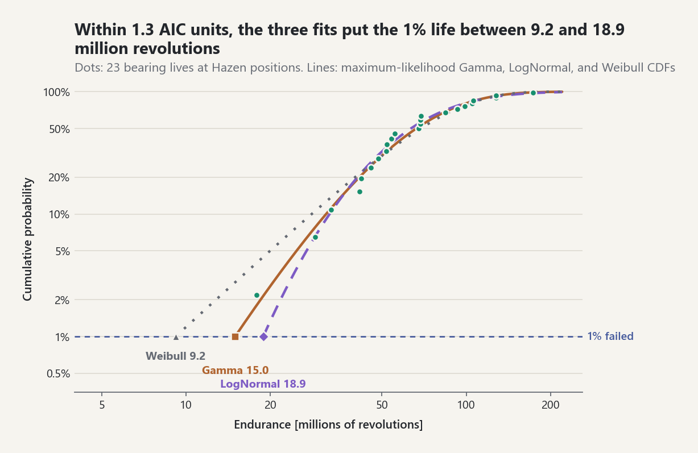

# Uncertainty Modeling and Statistical Fitting

## Choose a variable before choosing a distribution

An uncertainty model begins with the physical quantity, units, admissible
support, data-generation process, and intended quantity of interest. A familiar
distribution name is not a substitute for those decisions.

- A Normal law permits every real value and is appropriate only when that
  support is defensible or negligible impossible-tail mass is documented.
- A Uniform law encodes constant density between known finite bounds; it does
  not mean “we know nothing.”
- A Lognormal law is strictly positive and uses parameters of `log(X)`, not the
  mean and standard deviation of `X`.
- A Weibull law is non-negative; its shape controls decreasing, constant, or
  increasing hazard behavior.

All four required ATHENS families now expose PDF/log-PDF, CDF, direct survival,
quantile, moments, and seeded sampling where defined. Parameterization is part
of the public contract and is recorded in `docs/equation-registry.md`.

## Multivariate uncertainty

For `X ~ N_d(mu, Sigma)`, the covariance matrix must be symmetric positive
definite for an ordinary density in `d` dimensions. `MultivariateNormal`
validates that condition by Cholesky factorization, evaluates Mahalanobis
distance without forming `Sigma^-1`, exposes univariate marginals and
correlations, and samples through `X = mu + LZ`.

Positive semidefinite but singular covariance is intentionally rejected. Such
a Gaussian law lives on a lower-dimensional affine subspace and needs a
different measure/density contract; silently adding jitter would alter the
model.

## Estimation is not uncertainty elimination

`fit_normal_mle` and `fit_lognormal_mle` implement closed-form maximum
likelihood estimates. For the normal scale, MLE uses divisor `n`, whereas the
usual unbiased sample-variance estimator uses `n-1`. An estimated parameter is
still uncertain; reporting only the fitted number discards that uncertainty.

`normal_mean_confidence_interval` distinguishes a known-scale z interval from
a large-sample approximation that inserts the sample standard deviation. The
latter is not presented as an exact Student-t interval. `wilson_score_interval`
provides a boundary-respecting interval for binomial probabilities, useful for
later reliability calculations.

## Goodness of fit

The one-sample Kolmogorov-Smirnov statistic measures the largest empirical-CDF
gap. The Anderson-Darling statistic weights tail discrepancies more strongly.
The implementation uses direct survival probabilities when a model provides
them, reducing upper-tail cancellation.

Both tests require careful calibration:

- The generic KS p-value is asymptotic and assumes a fully specified continuous
  null distribution.
- Fitting null parameters from the tested sample changes the KS null law.
- Anderson-Darling critical values and p-values depend on the null family and
  on whether parameters were estimated.

Therefore the generic AD result reports the statistic without inventing a
universal p-value. When parameters are estimated from the tested data, use
`bootstrap_goodness_of_fit` (next section), which calibrates both statistics by
a parametric bootstrap with refitting.

## Generic fitting, calibrated goodness of fit, and model selection

### One likelihood engine for every family

`fit_distribution(values, family)` fits any `DistributionFamily`: a
constructor, parameter kinds, a starting rule, and an optional closed form.
Parameters are optimized in unconstrained coordinates (`log` for positive
parameters, data-spread units for locations, a logistic map for a bounded
parameter) by BFGS on the negative log-likelihood built from `log_pdf`
(`[EQ-INF-MLE-GEN-001]`), with a Nelder-Mead fallback. Standard errors come
from the observed information: the central-difference Hessian in the
unconstrained coordinates, mapped back by the delta method
(`[EQ-INF-MLE-GEN-002]`). Each `FitResult` carries estimates, standard errors,
covariance, log-likelihood, AIC, AICc, BIC, and a convergence flag.

Ready-made families: Normal, LogNormal, Exponential, Gamma, Weibull (closed
form or profile likelihood), Gumbel, GEV, Logistic, location-scale Student t,
Beta on `(0, 1)` (numerical), and Uniform (closed form, non-regular: its
standard errors are reported as `nan`). The Student-t `nu` is bounded by
`1000`; on light-tailed data the estimate sits at the bound, its standard
error is `nan`, and the message says so.

Cross-checks (`tests/test_generic_fitting_model_selection.py`): starting the
optimizer away from the MLE, it reproduces the closed-form Normal,
LogNormal, and Exponential estimates and the profile Gamma/Weibull estimates
to `2e-6` relative. The exponential-rate standard error equals
`rate/sqrt(n)`, the normal ones equal `sigma/sqrt(n)` and `sigma/sqrt(2n)`,
and the gamma ones equal the inverse Fisher information.

### The Lilliefors/Stephens problem

The KS and AD reference laws assume the null model is fully specified. A
model fitted to the same data sits closer to it than the true law does, so
the ordinary p-values are too large. `bootstrap_goodness_of_fit` draws
`B` replicates from the fitted law, **refits every replicate with the same
estimator**, and reports `p = (1 + #{T* >= T})/(1 + B_ok)` for KS and AD
(`[EQ-INF-GOF-PB-001]`), together with the number of successful and failed
refits. The smallest attainable p-value is `1/(B+1)`. With `B = 19` nothing
can be rejected at `alpha = 0.05`, and `select_distribution` warns about this.

One seeded check: 40 normal samples (`n = 30`, `B = 49`, root seed 11),
each with a fitted normal null. The bootstrap KS p-values averaged `0.53`,
and `12.5 %` fell below `0.1`. The naive KS p-values against the same fitted
laws averaged `0.78`, which is far too conservative. An exponential sample of
`n = 100` fitted as normal gives bootstrap p-values of `0.01` for both KS and
AD (the minimum with `B = 99`).

<picture><source media="(prefers-color-scheme: dark)" srcset="../images/guides/fitting-bootstrap-calibration-dark.png"></picture>

*With 80 normal samples of size 30, each tested against its own fitted normal, the naive KS p-values average 0.79 and none falls below 0.1 (0 of 80); the bootstrap with 39 refits per sample averages 0.52 and gives 7 of 80 below 0.1, close to the 8 a calibrated test produces.*

`qq_points` and `pp_points` return `(theoretical, empirical)` pairs with
Hazen positions `(i - 1/2)/n` (`[EQ-INF-GOF-QQ-001]`) for plotting.

### Ranking candidates

`select_distribution(sample, candidates)` fits every admissible candidate and
ranks it by AIC (or AICc/BIC). It reports Akaike and BIC weights
`exp(-Delta/2)/sum exp(-Delta/2)` (`[EQ-INF-IC-004]`) and, when
`n_bootstrap > 0`, a calibrated KS/AD p-value per candidate. Candidates whose
domain excludes the data are listed as failures rather than raising an error.
A `ModelSelectionWarning` is emitted when the best model is still rejected.
Weights are relative to the candidate set; they never certify adequacy.

`examples/model_selection_lab.py` prints this table for 250 draws from
`Weibull(1.6, 40)` (seed 2026, `B = 99`):

| Rank | Family | AIC | dAIC | Akaike weight | KS p | AD p |
|---|---|---|---|---|---|---|
| 1 | Weibull | 2207.0 | 0.0 | 0.870 | 0.23 | 0.30 |
| 2 | Gumbel | 2211.4 | 4.5 | 0.094 | 0.57 | 0.27 |
| 3 | Gamma | 2213.3 | 6.3 | 0.036 | 0.01 | 0.04 |
| 4 | Normal | 2251.8 | 44.8 | 0.000 | 0.01 | 0.01 |
| 5 | LogNormal | 2267.5 | 60.6 | 0.000 | 0.01 | 0.01 |
| 6 | Exponential | 2300.8 | 93.9 | 0.000 | 0.01 | 0.01 |

The true family wins. The fitted shape is `1.732 (SE 0.085)`, so the truth
`1.6` lies about 1.6 SE away, and the fitted scale is `40.93 (SE 1.57)`. The table
also shows why ranking and testing answer different questions. The
runner-up Gumbel is not rejected by either test: 250 points cannot rule out
a Gumbel shape. Information criteria still prefer the Weibull by
`dAIC = 4.5`. Gamma has a reasonable AIC but is rejected by both tests at `0.05`.

### Joint inputs from data

`modeling.fit_joint_input(columns)` fits each named column, either with a
user-specified family or by `select_distribution`, and estimates a Gaussian
copula from ranks. The `"spearman"` option maps Spearman correlations by
`rho = 2 sin(pi r_s / 6)` (`[EQ-MOD-COPULA-FIT-001]`). The
`"normal-scores"` option correlates van der Waerden scores of the rank
pseudo-observations `R/(n+1)` (`[EQ-MOD-COPULA-FIT-002]`). The result is a
ready `JointInput`. Because the copula is estimated from ranks, it does not
depend on the marginal fits. A pairwise matrix that is not positive definite
is repaired by eigenvalue clipping, and the repair is flagged. With 800
draws of a three-input Weibull/LogNormal/Gumbel law and latent correlations
`(0.6, -0.3, 0.2)`, both estimators recover every entry within `0.06`.
`inference.fit_multivariate_normal_mle` gives the multivariate normal MLE
(divisor `n`).

Limitations: AIC/BIC for the non-regular Uniform are descriptive only. The
bootstrap with numerical refits costs `B` optimizations per candidate (about
0.02-0.1 s each in pure Python). The Gaussian copula cannot represent tail
dependence.

## Real-data case studies

Synthetic data show that a method works when its assumptions hold; historical
data show what happens when nobody arranged them to hold.
`probstat.statistics.datasets` bundles five small public-domain records,
each frozen with its units, the original page or table, a secondary source
against which the values were checked, and a licence statement (ADR-0080):

| Key | Values | Source and locator |
|---|---|---|
| `bortkiewicz-horse-kicks` | deaths by horse kick per corps-year, 200 corps-years | [REF-BORTKIEWICZ-1898], Section 12, page 25 |
| `rutherford-geiger-scintillations` | alpha particles per 7.5 s interval, 2608 intervals | [REF-RUTHERFORD-GEIGER-1910], table on page 701 |
| `newcomb-passage-times` | light passage time minus 24800 ns, 66 values | [REF-NEWCOMB-VELOCITY-OF-LIGHT] as given by [REF-STIGLER-1977, Table 5] |
| `lieblein-zelen-ball-bearings` | endurance in millions of revolutions, 23 bearings | [REF-LIEBLEIN-ZELEN-1956], worksheet on page 286 |
| `student-sleep` | additional hours of sleep under two drugs, 10 patients | [REF-STUDENT-1908], page 20, from [REF-CUSHNY-PEEBLES-1905] |

`examples/real_data_fitting_lab.py` fits all five. The count models come
from `inference.count_models`: `fit_poisson_counts` (the sample mean,
[EQ-INF-COUNT-001]), `fit_negative_binomial_counts` (real size `r`, variance
`mu + mu^2/r`, [EQ-INF-COUNT-002]), `poisson_mean_interval` (Garwood,
[EQ-INF-COUNT-003]), and `count_goodness_of_fit`, which pools cells to at
least five expected units and calibrates Pearson's statistic by refitting
every bootstrap replicate. `visualization.fit_plots` adds a hanging
rootogram ([EQ-VIZ-ROOT-001]) and a Q-Q plot; `statistics.trimmed_mean`
([EQ-STAT-TRIM-001]) joins the median and the MAD for the robust comparison.

### What the sources state, and what the lab reproduces

- **Horse kicks.** Bortkiewicz printed the expected frequencies 108.7, 66.3,
  20.2, 4.1, 0.6, and 0.1 next to the observed 109, 65, 22, 3, 1 and found
  that the agreement left nothing to be desired. The Poisson fit at the
  sample mean reproduces his expected column to the printed decimal. The
  divisor-`n` variance is below the mean, so the negative binomial maximum
  is the Poisson boundary itself: the extra parameter buys nothing and costs
  two AIC units.
- **Alpha particles.** Rutherford and Geiger reported "excellent accord"
  between theory and experiment and noted that at four particles the
  observation exceeds the theory by nearly five per cent. Both statements
  are reproduced (the bootstrap p-value is above 0.05, and the excess at
  four particles is between four and five per cent), the printed theoretical
  row agrees
  with `2608 p(k)` to its rounding for `k = 0..12`, and the counts are again
  slightly under-dispersed, so the negative binomial collapses to the
  Poisson law.
- **Newcomb's light passage times.** Two values (-44 and -2) lie far below
  the rest. The fitted normal is rejected by every calibrated test, while
  the Student-t fit with about two degrees of freedom passes and wins by a
  wide AIC margin. Every location estimate lies below 33.02, the value
  implied by the accepted speed of light, which is a systematic error that
  no estimator removes; light trimming moves the estimate towards it, in
  line with Stigler's finding that "light trimming provides some
  improvement over the sample mean" [REF-STIGLER-1977, abstract].
- **Ball bearings.** Weibull, lognormal, and gamma laws all pass the
  calibrated tests and lie within two AIC units of each other, so 23
  lifetimes cannot rank these families [REF-BURNHAM-ANDERSON-2002, Chapter
  2]; any extrapolation beyond the observed lives should therefore be
  reported for each family. The worksheet's own summary (median life
  "68.") matches the sample median.
- **Sleep.** The paired t test on the ten differences rejects a zero mean
  effect; the Lilliefors check of the differences is reported because the
  t interval leans on their normality.

<picture><source media="(prefers-color-scheme: dark)" srcset="../images/guides/fitting-bearing-tails-dark.png"></picture>

*The Gamma, LogNormal, and Weibull fits to the 23 bearing lives lie within 1.3 AIC units and agree where the data are, yet their 1% lives range from 9.2 to 18.9 million revolutions: an extrapolation into the tail depends on a choice of family that the data cannot make.*

### Results

The block below is generated by `results_markdown` in the laboratory (seed
`SEED = 20261111`); `tests/test_real_data_case_studies.py` regenerates it and
requires it to equal this text character for character, so every number
quoted here is lab output.

<!-- real-data-case-studies:begin -->

**Counts: Poisson against negative binomial** (Garwood 95% interval for the mean; Pearson X^2 on cells pooled to at least five expected units; bootstrap with 999 refits, seed 20261111)

| Data set | Units | Total | Poisson mean | 95% interval | Variance (divisor n) / mean | NB size | Poisson AIC | NB AIC | X^2 | Asymptotic p | Bootstrap p |
|---|---|---|---|---|---|---|---|---|---|---|---|
| bortkiewicz-horse-kicks | 200 | 122 | 0.6100 | [0.5066, 0.7283] | 0.9966 | inf (boundary) | 414.21 | 416.21 | 0.063 (3 cells, 1 df) | 0.802 | 0.902 |
| rutherford-geiger-scintillations | 2608 | 10097 | 3.8715 | [3.7964, 3.9478] | 0.9543 | inf (boundary) | 10706.21 | 10708.21 | 12.961 (12 cells, 10 df) | 0.226 | 0.220 |

Fitted Poisson frequencies:

- `bortkiewicz-horse-kicks`: n p(k) for k = 0..4 is 108.7, 66.3, 20.2, 4.1, 0.6; the tail k > 4 adds 0.08.
- `rutherford-geiger-scintillations`: n p(k) for k = 0..14 is 54.3, 210.3, 407.1, 525.3, 508.4, 393.7, 254.0, 140.5, 68.0, 29.2, 11.3, 4.0, 1.3, 0.4, 0.1; the tail k > 14 adds 0.04.

**Newcomb's passage times: normal against Student-t** (KS and AD p-values from 199 bootstrap refits)

| Family | Parameters (SE) | log L | AIC | BIC | Akaike weight | KS p | AD p |
|---|---|---|---|---|---|---|---|
| StudentT | nu = 2.131 (0.66), mu = 27.4 (0.61), sigma = 3.81 (0.62) | -215.38 | 436.75 | 443.32 | 1.0000 | 0.505 | 0.480 |
| Normal | mu = 26.21 (1.3), sigma = 10.66 (0.93) | -249.86 | 503.72 | 508.10 | 0.0000 | 0.005 | 0.005 |

Closed-form fitted-normal calibration: Lilliefors p < 0.001, Cramer-von Mises p < 0.001, Anderson-Darling p < 0.001. Student-t 95% interval for the mean: [23.571, 28.854].

| Location estimate | Value (ns) | Below 33.02 by |
|---|---|---|
| mean | 26.212 | 6.808 |
| median | 27.000 | 6.020 |
| 10% trimmed mean | 27.426 | 5.594 |
| 20% trimmed mean | 27.350 | 5.670 |
| Student-t location (MLE) | 27.402 | 5.618 |
| mean without the two negative values | 27.750 | 5.270 |

Scale estimates (ns): standard deviation 10.745; normal-consistent MAD 4.448; Student-t scale (MLE) 3.810.

**Ball-bearing endurance: Weibull, lognormal, gamma** (KS and AD p-values from 199 bootstrap refits)

| Family | Parameters (SE) | log L | AIC | BIC | Akaike weight | KS p | AD p |
|---|---|---|---|---|---|---|---|
| Gamma | shape = 4.025 (1.1), rate = 0.05573 (0.017) | -113.03 | 230.06 | 232.33 | 0.4130 | 0.485 | 0.865 |
| LogNormal | mu = 4.15 (0.11), sigma = 0.5216 (0.077) | -113.13 | 230.26 | 232.53 | 0.3740 | 0.880 | 0.890 |
| Weibull | shape = 2.102 (0.33), scale = 81.88 (8.6) | -113.69 | 231.38 | 233.65 | 0.2130 | 0.170 | 0.560 |

**Student's sleep data: paired t test** (drug_2 - drug_1)

| Mean difference (h) | SE | t | df | Two-sided p | 95% interval | Lilliefors p of the differences |
|---|---|---|---|---|---|---|
| 1.580 | 0.3890 | 4.0621 | 9 | 0.00283 | [0.700, 2.460] | 0.058 |

<!-- real-data-case-studies:end -->

The laboratory also writes four figures to `examples/generated/`: hanging
rootograms of both Poisson fits, a normal Q-Q plot of Newcomb's series, and
the fitted CDF of the AIC-best bearing model. Limitations: the bootstrap
p-values carry Monte Carlo error of up to 0.016 (999 refits) and 0.035 (199
refits); two parameters are counted for the negative binomial even on its
boundary; the counts are treated as independent although Bortkiewicz's
corps-years share calendar years.

## Reproducible laboratory

Run `python examples/statistical_fitting_lab.py` after installing visualization
support (and `python examples/model_selection_lab.py` for the ranking above;
`python examples/real_data_fitting_lab.py` for the historical case studies). It generates seeded lognormal data, fits log-space parameters, reports
KS/AD diagnostics and an approximate log-mean interval, and saves an empirical
versus fitted CDF figure. The output labels the fitted-null KS limitation rather
than hiding it.

## Common pitfalls

- **Lognormal parameters live on the log scale.** `LogNormal(mu, sigma)` has
  `log X ~ Normal(mu, sigma)`; its mean is `exp(mu + sigma^2 / 2)`, not `mu`.
- **MLE scale versus sample variance.** `fit_normal_mle` uses divisor `n`;
  the usual sample variance uses `n - 1`.
- **Fitted nulls need calibrated p-values.** Ordinary KS p-values against
  parameters fitted to the same data are too large; use
  `bootstrap_goodness_of_fit`, which refits every replicate.
- **The bootstrap p-value has a floor.** It is `(1 + exceedances) / (1 + B)`,
  so with `select_distribution`'s default `n_bootstrap=99` the smallest value
  is `0.01`; a reported `0.01` means "at or below the floor".
- **Weights are relative.** Akaike and BIC weights rank the candidates that
  were tried; they do not certify that any of them fits.

```python
import statistics

from probstat.distributions import LogNormal
from probstat.inference import fit_normal_mle

LogNormal(0.0, 0.25).mean                        # 1.0317, that is exp(0.25^2 / 2)
fit_normal_mle([1.0, 2.0, 3.0, 4.0]).sigma ** 2  # 1.25, divisor n
statistics.variance([1.0, 2.0, 3.0, 4.0])        # 1.6667, divisor n - 1
```

## Sources

- [REF-NIST-DISTRIBUTIONS].
- [REF-NIST-GOF].
- [REF-CASELLA-BERGER-2002, Chapters 7 and 9].
- [REF-MARDIA-KENT-BIBBY-1979, Chapters 1-3].
- [REF-WILSON-1927].
- [REF-AKAIKE-1974], [REF-SCHWARZ-1978], [REF-HURVICH-TSAI-1989].
- [REF-BURNHAM-ANDERSON-2002, Chapter 2].
- [REF-LILLIEFORS-1967], [REF-STEPHENS-1974].
- [REF-DAVISON-HINKLEY-1997, Chapter 4].
- [REF-WILK-GNANADESIKAN-1968].
- [REF-GENEST-GHOUDI-RIVEST-1995], [REF-KRUSKAL-1958].
- [REF-BORTKIEWICZ-1898], [REF-RUTHERFORD-GEIGER-1910], [REF-STIGLER-1977],
  [REF-NEWCOMB-VELOCITY-OF-LIGHT], [REF-LIEBLEIN-ZELEN-1956],
  [REF-STUDENT-1908], [REF-CUSHNY-PEEBLES-1905].
- [REF-GARWOOD-1936], [REF-LEVIN-REEDS-1977], [REF-KLEIBER-ZEILEIS-2016].
