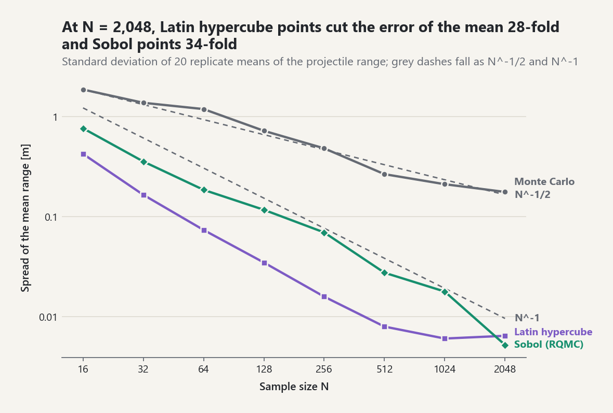

# Uncertainty Propagation, Quadrature, and Basic Monte Carlo

## From uncertain inputs to uncertain outputs

For a forward model `Y = g(X)`, uncertainty propagation asks for properties of
the output distribution induced by uncertain `X`. `propagate_samples` evaluates
explicit named parameter realizations through the validated forward-model
contract and retains both raw QoI observations and immutable summaries.

The implementation reports three quantities that must not be conflated:

- **Output variance** describes variability in simulated `Y` values.
- **Monte Carlo variance/standard error** describes sampling uncertainty in an
  estimator such as the output mean.
- **Numerical-model error** describes approximation error inside a model or
  quadrature rule and belongs in the numerical verification budget.

More model samples reduce standard error but do not automatically reduce model
bias, discretization error, model-form error, or input-distribution error.

## Expectation integrals and quadrature

For a scalar density, `E[g(X)] = integral g(x)f_X(x)dx`. The library provides
composite trapezoid and Simpson rules with finite-value validation and exact
function-evaluation counts. Simpson requires an even number of equal
subintervals.

`expectation_by_quadrature` accepts explicit finite bounds. When a distribution
has unbounded support, the result is a truncated expectation unless omitted
tail mass is bounded or corrected. A dense grid is not itself an error
estimate; refinement studies should accompany high-stakes results.

## Monte Carlo estimators

`estimate_mean` returns the sample mean, unbiased output sample variance,
estimated standard error, an explicitly normal-approximation confidence
interval, sample size, and evaluation count. Constant output is represented by
a zero-width interval rather than rejected.

`estimate_probability` accepts exact Boolean indicators and uses a Wilson score
interval. This avoids reporting the fragile uncorrected Wald interval,
especially when no events or all events are observed.

`estimate_uniform_integral` implements
`integral_a^b f(x)dx = (b-a)E[f(U)]`. Its contribution variance includes the
interval-width scaling, so the reported standard error has integral units.

## Convergence and cost

For independent, identically distributed finite-variance contributions, ideal
Monte Carlo standard deviation scales as `N^(-1/2)`. Four times as many samples
are therefore needed to halve standard error. `convergence_trace` computes
nested-prefix estimates at explicit checkpoints, and
`plot_monte_carlo_convergence` displays estimates and their reported intervals.

This rate is an assumption-backed asymptotic statement. Dependence, heavy
tails, nonstationarity, rare events, or biased sampling can invalidate its
ordinary interpretation. A visually stable trace is evidence, not proof.

<picture><source media="(prefers-color-scheme: dark)" srcset="../images/guides/propagation-design-convergence-dark.png"></picture>

*For the laboratory's projectile range, the spread of plain Monte Carlo means follows the N^-1/2 guide (fitted slope -0.53), so four times the samples halve the error; Latin hypercube and randomized Sobol points fall faster, and at N = 2,048 their means are 28 and 34 times less variable.*

Every result carries an evaluation count. In forward propagation, one model
call may produce several QoIs, so `model_evaluations` counts complete calls
rather than multiplying by the number of outputs.

## Threshold probabilities

For a threshold `S`, strict exceedance is estimated as
`P(Y>S)=E[I(Y>S)]`. Equality is deliberately not counted. The threshold,
success count, trial count, standard error, Wilson interval, and model-call cost
remain inspectable.

## Reproducible laboratory

`examples/basic_monte_carlo_lab.py` includes:

1. Monte Carlo estimation of pi with a Wilson interval;
2. Simpson versus Monte Carlo integration of `x^2`;
3. propagation of uncertain speed and angle through an idealized projectile
   model; and
4. an output threshold probability and convergence plot.

All random streams are seeded locally. The projectile model is pedagogical and
does not include drag, Earth curvature, or numerical trajectory integration.

## Common pitfalls

- **Different defaults for the same step.** `propagation.propagate` defaults
  to `design="mc"` and `seed=None` (fresh entropy, not reproducible);
  `UQStudy.propagate` defaults to `design="sobol"` on a child of the study
  seed.
- **Error bars for LHS and quasi-random designs.** Without `replicates`, the
  mean and exceedance intervals treat the points as independent draws. For
  LHS and Sobol designs they are conservative references; pass
  `replicates=r` for a Student-t interval over `r` randomizations, at cost
  `r * size`.
- **Strict exceedance.** `exceedance(t)` counts `Y > t`; an output exactly
  equal to `t` is not an exceedance, which matters for discrete or clipped
  outputs.
- **Output spread is not estimator error.** `sample_variance` describes the
  outputs; `standard_error` describes the mean estimate and shrinks like
  `n^(-1/2)`.
- **Truncated quadrature.** `expectation_by_quadrature` integrates only over
  the given bounds; Simpson's rule needs an even number of intervals.

```python
import inspect

from probstat.distributions import Normal
from probstat.modeling import JointInput, ProbabilisticModel, RandomInput
from probstat.propagation import propagate
from probstat.uq import QuantityOfInterest
from probstat.workflow import UQStudy

inspect.signature(propagate).parameters["design"].default          # 'mc'
inspect.signature(UQStudy.propagate).parameters["design"].default  # 'sobol'

step = ProbabilisticModel(
    JointInput((RandomInput("x", Normal(0.0, 1.0)),)),
    lambda p: {"y": float(p["x"] > 0.0)},
    (QuantityOfInterest("y", "indicator of x > 0"),),
)
y = propagate(step, 200, seed=3)["y"]
y.exceedance(1.0).probability   # 0.0, although about half the outputs equal 1
plain = propagate(step, 64, design="sobol", seed=1)["y"]
plain.mean_interval().method    # 'normal approximation with estimated standard deviation'
replicated = propagate(step, 64, design="sobol", seed=1, replicates=4)["y"]
replicated.mean_interval().method  # 'Student-t interval over 4 randomized replicates of the mean'
```

## Sources

- [REF-SMITH-UQ-2024, Chapters 3-4].
- [REF-ROBERT-CASELLA-2004, Chapters 3-4].
- [REF-DAVIS-RABINOWITZ-1984, Chapters 2-3].
- [REF-WILSON-1927].
